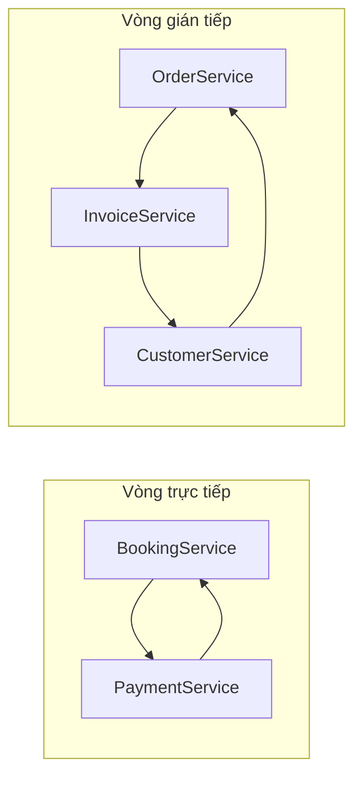
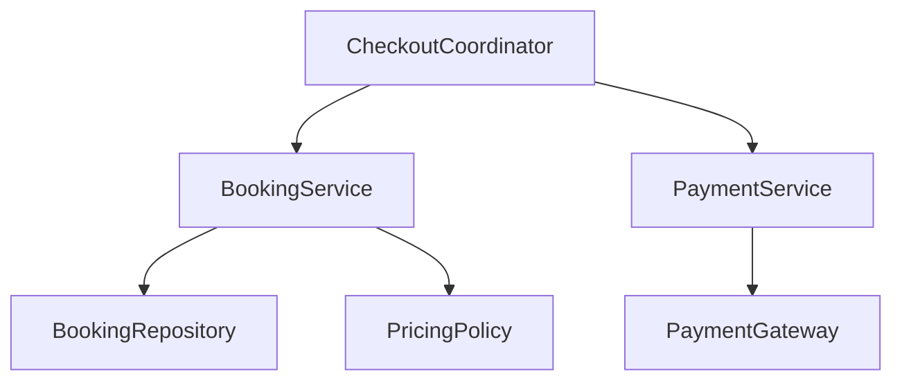
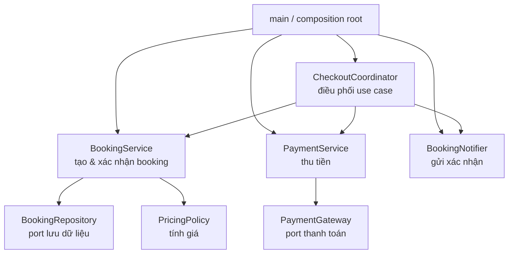

# Phát hiện vòng như dấu hiệu cần xem lại ranh giới trách nhiệm

Trong chương **Đồ thị đối tượng** của module **Dependency Injection (DI)**, một tình huống đáng chú ý là **phụ thuộc vòng** (*circular dependency*): thành phần A cần B để hoạt động, trong khi B trực tiếp hoặc gián tiếp lại cần A. Nếu mỗi thành phần đòi hỏi đối tượng còn lại ngay trong constructor, quá trình lắp ghép có thể rơi vào bế tắc thiết kế: chưa có đối tượng nào được xây dựng xong để cung cấp cho đối tượng kia.

Vòng phụ thuộc thường là **tín hiệu cần xem lại ranh giới trách nhiệm**. Nó có thể cho thấy hai service đang điều phối lẫn nhau, module đang biết quá nhiều chi tiết của module khác hoặc một workflow chung chưa có chủ sở hữu rõ ràng. Tuy vậy, **không phải mọi quan hệ hai chiều đều sai**: cần xác định loại đồ thị, tính chất của cạnh và ngữ cảnh trước khi sửa.

Việc nhìn đồ thị phụ thuộc giúp triển khai **constructor injection**, **Inversion of Control (IoC)** và **composition root** rõ ràng. Với Java thuần, ta có thể phân tích đồ thị, sửa thiết kế, kiểm thử và quản lý vòng đời mà chưa cần một DI container. Khi sau này dùng Spring/CDI, các nguyên tắc xác định trách nhiệm vẫn giữ nguyên.

Sau bài này, bạn sẽ có thể:

- Phân biệt đồ thị đối tượng, đồ thị phụ thuộc trong mã nguồn và đồ thị lời gọi.
- Phát hiện vòng trực tiếp hoặc gián tiếp; giải thích ý nghĩa của **strongly connected component** (SCC).
- Biết vì sao vòng constructor tạo khó khăn và vì sao `lazy`, provider hay proxy không tự giải quyết vấn đề thiết kế.
- Chẩn đoán trách nhiệm đang bị đặt sai và sửa bằng **coordinator**, **port** hoặc tách một thành phần chung có ý nghĩa.
- Lắp ghép đồ thị không vòng ở composition root, kiểm thử bằng Java thuần và xem xét scope/lifecycle của các instance.

## 1. Đồ thị phụ thuộc biểu diễn điều gì?

Một đồ thị có **đỉnh** là các thành phần và **cạnh có hướng** là quan hệ phụ thuộc. Với ký hiệu `A → B`, ta nói A **cần B** theo một ý nghĩa đã quy ước trước. Cần ghi rõ ý nghĩa cạnh vì cùng một sơ đồ có thể đang nói về những chuyện khác nhau:

| Loại đồ thị | Đỉnh | Cạnh `A → B` nghĩa là | Ví dụ |
| --- | --- | --- | --- |
| **Đồ thị kiểu/mã nguồn** | Class, interface, package hoặc module | Mã A tham chiếu/biên dịch dựa trên kiểu B | `BookingService` khai báo field kiểu `PaymentService` |
| **Đồ thị đối tượng lúc chạy** (*object graph*) | Các **instance** thực tế | Instance A giữ tham chiếu tới instance B, hoặc cần B để được xây dựng | Instance `bookingService` nhận instance `paymentService` qua constructor |
| **Đồ thị lời gọi** (*call graph*) | Phương thức/hàm | A có thể gọi B trong một nhánh thực thi | `checkout()` gọi `charge()`, `charge()` gọi `confirm()` |
| **Đồ thị cấp module** | Module hoặc phân hệ | Module A phụ thuộc API, kiểu hoặc triển khai của module B | Module Booking import lớp hạ tầng Payment |

**Không đồng nhất các đồ thị.** Hai đối tượng có thể giữ tham chiếu qua lại nhưng không gọi đệ quy. Hai phương thức có thể gọi đệ quy mà không cần một vòng constructor. Một vòng giữa package ở mức mã nguồn cũng chưa đủ chứng minh các instance đang giữ tham chiếu vòng tại runtime.

Để phát hiện vấn đề lắp ghép, hãy bắt đầu từ **những phụ thuộc bắt buộc khi xây dựng instance**. Sau đó xem đồ thị class/module để kiểm tra trách nhiệm và hướng phụ thuộc. Một sơ đồ đúng phải ghi rõ cạnh đang mô tả quan hệ nào.

### 1.1. Vòng trực tiếp và vòng gián tiếp



Vòng trực tiếp gồm hai cạnh đối nhau, ví dụ `BookingService → PaymentService → BookingService`. Vòng gián tiếp có nhiều bước: `OrderService → InvoiceService → CustomerService → OrderService`. Với mỗi vòng, mục tiêu không đơn giản là "xóa một mũi tên"; mục tiêu là tìm **trách nhiệm nào thực sự cần liên kết** và ai nên điều phối luồng.

### 1.2. Khi nào vòng là một vấn đề thực tế?

Trong **đồ thị constructor injection**, mọi instance cần được cấp các tham số bắt buộc trước khi hoàn tất việc xây dựng. Nếu `A` đòi `B` và `B` lại đòi đúng `A`, không thể tạo hai instance bằng một chuỗi `new` trực tiếp thông thường mà không dùng đối tượng chưa xây dựng xong, cơ chế trì hoãn hoặc một điểm nối sau đó. Các cách "đi đường vòng" có thể làm mã biên dịch/chạy được nhưng thường khiến invariant và vòng đời khó suy luận.

Ở cấp module, vòng tham chiếu khiến nhóm phát triển khó thay đổi một module độc lập, khó phân định API và thời điểm khởi tạo. Ở cấp phương thức, vòng lời gọi chỉ trở thành đệ quy vô hạn nếu các điều kiện thực thi không có điểm dừng; không phải cứ hai phương thức có thể gọi nhau là luôn gây `StackOverflowError`.

## 2. Ví dụ có mùi thiết kế: hai service điều phối lẫn nhau

Giả sử luồng đặt thuê xe gồm **tạo đặt chỗ**, **thu tiền** và **đánh dấu đã thanh toán**. Thiết kế ban đầu:

```java
final class BookingService {
    private final PaymentService payments;

    BookingService(PaymentService payments) {
        this.payments = payments;
    }

    // Tạo booking rồi gọi payments.charge(...).
}

final class PaymentService {
    private final BookingService bookings;

    PaymentService(BookingService bookings) {
        this.bookings = bookings;
    }

    // Thu tiền xong lại gọi bookings.confirmPaid(...).
}
```

Đây là đoạn minh họa riêng, **không phải file Java hoàn chỉnh**. Cả hai constructor đều cần đối tượng còn lại. Thử lắp ghép bằng cách:

```java
// Không có cách khởi tạo trực tiếp hợp lệ từ hai constructor này:
// BookingService bookings = new BookingService(??? payments ???);
// PaymentService payments = new PaymentService(??? bookings ???);
```

Không chỉ khó `new`. Nhìn vào trách nhiệm:

- `BookingService` vừa quản lý dữ liệu đặt chỗ vừa chủ động điều phối việc thanh toán.
- `PaymentService` vừa xử lý thanh toán vừa quyết định cập nhật trạng thái đặt chỗ.
- Cả hai biết và gọi nhau, nên thay đổi quy trình (hoàn tiền, gửi xác nhận, xử lý lỗi) dễ lan sang cả hai phía.

**Câu hỏi cốt lõi:** *Việc nối "đặt chỗ → thanh toán → xác nhận" là trách nhiệm của service nào?* Thường đây là **một use case điều phối riêng**, không phải một chi tiết nội bộ đồng thời thuộc hai service.

## 3. Cách đọc và phát hiện vòng

### 3.1. Lập danh sách cạnh đúng nghĩa

Với constructor injection, ghi lại các tham số mà mỗi service phải có. Ví dụ:

| Đỉnh | Những phụ thuộc constructor bắt buộc |
| --- | --- |
| `BookingService` | `PaymentService`, `BookingRepository` |
| `PaymentService` | `BookingService`, `PaymentGateway` |
| `BookingRepository` | Không có trong ví dụ trừu tượng |
| `PaymentGateway` | Không có trong ví dụ trừu tượng |

Đi theo các cạnh từ `BookingService` sẽ quay lại chính nó. Đó là một vòng. Lúc kiểm tra dự án, cần nhớ tham chiếu có thể bị **giấu** bởi factory, service locator, provider hoặc callback được đăng ký ở khởi động. Xem cả hành vi xây dựng và các phụ thuộc được sử dụng muộn, không chỉ số lượng tham số constructor.

### 3.2. Duyệt đồ thị với ba trạng thái

Một cách phát hiện vòng trong **đồ thị có hướng** là duyệt theo chiều sâu (**DFS**) và đánh dấu:

1. **Chưa thăm**: đỉnh chưa được duyệt.
2. **Đang trên đường duyệt** (*visiting*, thường gọi màu xám): đỉnh nằm trong ngăn xếp đệ quy hiện tại.
3. **Duyệt xong** (*visited*, thường gọi màu đen): toàn bộ các cạnh đi ra đã được xét.

Nếu từ một đỉnh ta gặp lại một đỉnh **đang trên đường duyệt**, ta đã tìm được một chu trình có hướng. Chỉ gặp một đỉnh **đã duyệt xong** thì không đủ để kết luận có vòng. Phân biệt hai trạng thái này tránh báo nhầm khi hai service độc lập cùng phụ thuộc vào một repository.

Ví dụ không có vòng:



`CheckoutCoordinator` có hai nhánh đến Booking/Payment; nhiều nhánh có thể cùng trỏ tới một port hoặc một instance singleton **mà không tạo vòng**. Vấn đề là có hay không một **đường có hướng quay về điểm xuất phát**.

### 3.3. Strongly connected component (SCC) và nhiều vòng

Trong một đồ thị lớn, một **thành phần liên thông mạnh** (SCC) là tập đỉnh mà mỗi đỉnh đều có đường có hướng đến mọi đỉnh khác trong tập. SCC gồm **hơn một đỉnh** chắc chắn chứa ít nhất một vòng; SCC gồm **một đỉnh** chỉ tạo vòng khi đỉnh đó có cạnh tự trỏ về chính mình. Thuật toán Tarjan hoặc Kosaraju có thể tìm tất cả SCC với độ phức tạp `O(V + E)`.

Với bài tập nhỏ, DFS đủ để chỉ ra **một đường vòng cụ thể**. Với hệ thống lớn, việc gom nhóm SCC giúp biết những service nào đang liên kết chặt và cần xem lại cùng nhau. Một công cụ vẽ đồ thị class/package không tự chứng minh lỗi kiến trúc; người thiết kế vẫn phải kiểm tra ý nghĩa các cạnh và hợp đồng.

## 4. Hướng sửa ưu tiên: đưa phần điều phối về một use case riêng

Đối với luồng đặt chỗ và thanh toán, có thể tách như sau:



Ở đây:

- `BookingService` quản lý các thao tác với booking và **không biết `PaymentService`**.
- `PaymentService` thực hiện yêu cầu thu tiền qua `PaymentGateway` và **không biết `BookingService`**.
- `CheckoutCoordinator` biết **trình tự của use case**: tạo booking chờ thanh toán, yêu cầu thu tiền, xác nhận booking và thông báo.
- Composition root tạo các thành phần từ ngoài, truyền qua constructor, quyết định những triển khai thực tế và vòng đời của chúng.

Kết quả là một đồ thị có hướng từ lớp điều phối đến các cộng tác viên, **không có cạnh quay lại**. Nếu quy trình thay đổi, có một điểm chịu trách nhiệm rõ. Đây là ví dụ sử dụng **application service/coordinator**, không phải một "lớp điều phối toàn bộ hệ thống" gom mọi nghiệp vụ vào một chỗ.

**Lưu ý về độ tin cậy:** việc tách vòng **không tự giải quyết tính nguyên tử** giữa database và cổng thanh toán. Nếu thu tiền thành công nhưng lưu trạng thái thất bại, ứng dụng cần một quy trình xác nhận, retry/compensation hoặc saga phù hợp. Trong ví dụ Java thuần bên dưới, trạng thái chờ thanh toán được giữ lại khi cổng thanh toán báo lỗi để thấy rõ ranh giới xử lý.

## 5. Ví dụ đầy đủ Java 11: phát hiện vòng, sửa đồ thị và kiểm thử

Ví dụ sử dụng một file `ObjectGraphCycleDemo.java`, chạy được với **Java 11 trở lên**. Chương trình minh họa hai phần: một DFS tìm vòng trong bản mô tả phụ thuộc và một luồng checkout được lắp ghép bằng **constructor injection** tại **composition root**. Các adapter dùng bộ nhớ và gateway giả để học bằng Java thuần, không cần DI container.

```bash
javac ObjectGraphCycleDemo.java
java ObjectGraphCycleDemo
```

```java
import java.util.ArrayList;
import java.util.HashMap;
import java.util.HashSet;
import java.util.LinkedHashMap;
import java.util.List;
import java.util.Map;
import java.util.Objects;
import java.util.Set;

public final class ObjectGraphCycleDemo {
    // 1. Phát hiện một vòng trong đồ thị có hướng được khai báo tường minh.
    static final class CycleDetector {
        static List<String> findCycle(Map<String, List<String>> graph) {
            Set<String> visited = new HashSet<>();
            Set<String> active = new HashSet<>();
            List<String> path = new ArrayList<>();

            for (String node : graph.keySet()) {
                List<String> cycle = visit(node, graph, visited, active, path);
                if (!cycle.isEmpty()) {
                    return cycle;
                }
            }
            return List.of();
        }

        private static List<String> visit(
                String node,
                Map<String, List<String>> graph,
                Set<String> visited,
                Set<String> active,
                List<String> path) {
            if (active.contains(node)) {
                int from = path.indexOf(node);
                List<String> cycle =
                        new ArrayList<>(path.subList(from, path.size()));
                cycle.add(node);
                return cycle;
            }
            if (!visited.add(node)) {
                return List.of();
            }

            active.add(node);
            path.add(node);
            try {
                for (String next : graph.getOrDefault(node, List.of())) {
                    List<String> cycle =
                            visit(next, graph, visited, active, path);
                    if (!cycle.isEmpty()) {
                        return cycle;
                    }
                }
                return List.of();
            } finally {
                active.remove(node);
                path.remove(path.size() - 1);
            }
        }
    }

    // 2. Giá trị cấu hình và thực thể nghiệp vụ.
    static final class BookingSettings {
        final long dailyRate;
        final int maxDays;

        BookingSettings(long dailyRate, int maxDays) {
            if (dailyRate <= 0 || maxDays < 1) {
                throw new IllegalArgumentException("Invalid settings");
            }
            this.dailyRate = dailyRate;
            this.maxDays = maxDays;
        }
    }

    static final class Booking {
        final String id;
        final String customerId;
        final int days;
        final long totalPrice;
        final boolean paid;

        Booking(String id, String customerId,
                int days, long totalPrice, boolean paid) {
            this.id = Objects.requireNonNull(id);
            this.customerId = Objects.requireNonNull(customerId);
            this.days = days;
            this.totalPrice = totalPrice;
            this.paid = paid;
        }

        Booking asPaid() {
            return new Booking(id, customerId, days, totalPrice, true);
        }
    }

    // 3. Các port nhỏ theo nhu cầu của use case.
    interface PricingPolicy {
        long quote(int days);
    }

    interface BookingRepository {
        void save(Booking booking);
        Booking markPaid(String bookingId);
        Booking find(String bookingId);
    }

    interface PaymentGateway {
        String charge(String bookingId, long amount);
    }

    interface BookingNotifier {
        void paymentConfirmed(Booking booking, String paymentId);
    }

    // 4. Thành phần nghiệp vụ độc lập.
    static final class WeeklyPricing implements PricingPolicy {
        private final long dailyRate;

        WeeklyPricing(long dailyRate) {
            if (dailyRate <= 0) {
                throw new IllegalArgumentException("Invalid daily rate");
            }
            this.dailyRate = dailyRate;
        }

        @Override
        public long quote(int days) {
            if (days < 1) {
                throw new IllegalArgumentException("Invalid days");
            }
            long gross = Math.multiplyExact(dailyRate, days);
            return days >= 7 ? gross - gross / 10 : gross;
        }
    }

    static final class BookingService {
        private final BookingRepository repository;
        private final PricingPolicy pricing;
        private final BookingSettings settings;

        BookingService(
                BookingRepository repository,
                PricingPolicy pricing,
                BookingSettings settings) {
            this.repository = Objects.requireNonNull(repository);
            this.pricing = Objects.requireNonNull(pricing);
            this.settings = Objects.requireNonNull(settings);
        }

        Booking createPending(String bookingId, String customerId, int days) {
            if (bookingId == null || bookingId.isBlank()
                    || customerId == null || customerId.isBlank()) {
                throw new IllegalArgumentException("IDs must not be blank");
            }
            if (days < 1 || days > settings.maxDays) {
                throw new IllegalArgumentException("Days out of range");
            }
            Booking booking = new Booking(
                    bookingId, customerId, days, pricing.quote(days), false);
            repository.save(booking);
            return booking;
        }

        Booking confirmPaid(String bookingId) {
            return repository.markPaid(bookingId);
        }
    }

    static final class PaymentService {
        private final PaymentGateway gateway;

        PaymentService(PaymentGateway gateway) {
            this.gateway = Objects.requireNonNull(gateway);
        }

        String charge(String bookingId, long amount) {
            if (bookingId == null || bookingId.isBlank() || amount <= 0) {
                throw new IllegalArgumentException("Invalid payment");
            }
            return Objects.requireNonNull(
                    gateway.charge(bookingId, amount), "paymentId");
        }
    }

    // 5. Điều phối chung: Booking và Payment không phụ thuộc lẫn nhau.
    static final class CheckoutCoordinator {
        private final BookingService bookings;
        private final PaymentService payments;
        private final BookingNotifier notifier;

        CheckoutCoordinator(
                BookingService bookings,
                PaymentService payments,
                BookingNotifier notifier) {
            this.bookings = Objects.requireNonNull(bookings);
            this.payments = Objects.requireNonNull(payments);
            this.notifier = Objects.requireNonNull(notifier);
        }

        Booking checkout(String bookingId, String customerId, int days) {
            Booking pending = bookings.createPending(bookingId, customerId, days);
            String paymentId = payments.charge(pending.id, pending.totalPrice);
            Booking paid = bookings.confirmPaid(pending.id);
            notifier.paymentConfirmed(paid, paymentId);
            return paid;
        }
    }

    // 6. Adapter bộ nhớ đơn giản cho demo và kiểm thử đơn luồng.
    static final class MemoryBookingRepository implements BookingRepository {
        private final Map<String, Booking> data = new HashMap<>();

        @Override
        public void save(Booking booking) {
            Objects.requireNonNull(booking);
            if (data.putIfAbsent(booking.id, booking) != null) {
                throw new IllegalArgumentException("Duplicate booking ID");
            }
        }

        @Override
        public Booking markPaid(String bookingId) {
            Booking current = find(bookingId);
            if (current.paid) {
                throw new IllegalStateException("Already paid");
            }
            Booking updated = current.asPaid();
            data.put(bookingId, updated);
            return updated;
        }

        @Override
        public Booking find(String bookingId) {
            Booking booking = data.get(bookingId);
            if (booking == null) {
                throw new IllegalArgumentException("Unknown booking ID");
            }
            return booking;
        }
    }

    public static void main(String[] args) {
        // 7. Phát hiện một vòng ở mô hình constructor ban đầu.
        Map<String, List<String>> broken = new LinkedHashMap<>();
        broken.put("BookingService", List.of("PaymentService"));
        broken.put("PaymentService", List.of("BookingService"));
        List<String> cycle = CycleDetector.findCycle(broken);
        if (!cycle.equals(
                List.of("BookingService", "PaymentService", "BookingService"))) {
            throw new AssertionError("Cycle was not detected");
        }
        System.out.println("Vong phu thuoc: " + String.join(" -> ", cycle));

        // Sau khi tách coordinator, hướng phụ thuộc không còn quay về.
        Map<String, List<String>> fixed = Map.of(
                "CheckoutCoordinator",
                List.of("BookingService", "PaymentService", "BookingNotifier"),
                "BookingService",
                List.of("BookingRepository", "PricingPolicy", "BookingSettings"),
                "PaymentService", List.of("PaymentGateway"));
        if (!CycleDetector.findCycle(fixed).isEmpty()) {
            throw new AssertionError("Unexpected dependency cycle");
        }

        // 8. Composition root cấp các instance qua constructor.
        BookingSettings settings = new BookingSettings(100_000L, 30);
        MemoryBookingRepository repository = new MemoryBookingRepository();
        PricingPolicy pricing = new WeeklyPricing(settings.dailyRate);
        BookingService bookingService =
                new BookingService(repository, pricing, settings);
        PaymentGateway fakeGateway =
                (id, amount) -> "PAY-" + id;
        PaymentService paymentService = new PaymentService(fakeGateway);
        BookingNotifier notifier = (booking, paymentId) ->
                System.out.println("Xac nhan " + booking.id + " / " + paymentId);
        CheckoutCoordinator checkout =
                new CheckoutCoordinator(bookingService, paymentService, notifier);

        Booking paid = checkout.checkout("BK-001", "KH-01", 7);
        if (!paid.paid
                || paid.totalPrice != 630_000L
                || !repository.find("BK-001").paid) {
            throw new AssertionError("Incorrect checkout result");
        }
        System.out.println("Tong tien: " + paid.totalPrice + " VND");
        verifyFailureWithoutContainer();
        System.out.println("Kiem tra Java thuan: PASS");
    }

    static void verifyFailureWithoutContainer() {
        // Tạo riêng đồ thị test; gateway lỗi không cần gọi mạng thật.
        MemoryBookingRepository repository = new MemoryBookingRepository();
        BookingSettings settings = new BookingSettings(100_000L, 30);
        BookingService bookings = new BookingService(
                repository, new WeeklyPricing(settings.dailyRate), settings);
        PaymentGateway failingGateway = (id, amount) -> {
            throw new IllegalStateException("Gateway unavailable");
        };
        PaymentService payments = new PaymentService(failingGateway);
        List<Booking> notifications = new ArrayList<>();
        BookingNotifier notifier = (booking, paymentId) ->
                notifications.add(booking);
        CheckoutCoordinator checkout =
                new CheckoutCoordinator(bookings, payments, notifier);

        try {
            checkout.checkout("BK-FAILED", "KH-02", 2);
            throw new AssertionError("Expected payment failure");
        } catch (IllegalStateException expected) {
            if (!"Gateway unavailable".equals(expected.getMessage())) {
                throw expected;
            }
        }
        // Booking vẫn ở trạng thái chờ, không gửi thông báo thành công.
        if (repository.find("BK-FAILED").paid || !notifications.isEmpty()) {
            throw new AssertionError("Failed payment changed the state");
        }
    }
}
```

Kết quả dự kiến:

```text
Vong phu thuoc: BookingService -> PaymentService -> BookingService
Xac nhan BK-001 / PAY-BK-001
Tong tien: 630000 VND
Kiem tra Java thuan: PASS
```

Với đơn giá `100_000` VND/ngày, 7 ngày có giá gốc `700_000` VND; giảm 10% còn **630_000 VND**. Chương trình kiểm tra được cả đồ thị được mô tả và hành vi use case. `CycleDetector` chỉ phát hiện vòng trong **danh sách cạnh ta cung cấp**; nó **không tự quét source code hoặc toàn bộ object graph của JVM**.

### Điều đáng chú ý từ cách lắp ghép

| Thành phần | Nhận phụ thuộc từ đâu? | Có cần tham chiếu ngược? |
| --- | --- | --- |
| `CheckoutCoordinator` | Constructor nhận `BookingService`, `PaymentService`, `BookingNotifier` | Không |
| `BookingService` | Constructor nhận repository, chính sách giá và settings | Không biết `PaymentService` |
| `PaymentService` | Constructor nhận `PaymentGateway` | Không biết `BookingService` |
| `MemoryBookingRepository` | Là adapter do composition root tạo | Không biết use case điều phối |
| `BookingSettings` | Tạo ở khởi động, cung cấp giá trị đã xác thực | Không phụ thuộc service |

Ở phần kiểm tra thất bại, gateway giả ném exception trước khi cập nhật `paid`. Booking còn trạng thái chờ và không có thông báo thanh toán thành công. Trong hệ thống thật, giao dịch có thể **thành công ở bên ngoài nhưng trả về lỗi mạng**; phải có idempotency key, tra cứu kết quả, cơ chế retry/compensation, lưu trạng thái và xử lý phân tán phù hợp. Ví dụ cố ý giữ cổng thanh toán giả đơn giản để tập trung vào vấn đề **vòng phụ thuộc**.

## 6. Không phải mọi vòng đều được sửa bằng một coordinator

Tách một coordinator hợp lý khi hai service đang **điều phối các bước của cùng một use case**. Nhưng một vòng khác có thể đòi cách sửa khác:

| Dấu hiệu | Câu hỏi chẩn đoán | Hướng thiết kế có thể phù hợp |
| --- | --- | --- |
| `OrderService` và `InvoiceService` liên tục gọi nhau để hoàn tất cùng một giao dịch | Ai sở hữu quy trình đầu cuối? | Trích xuất `CheckoutWorkflow`/coordinator cấp ứng dụng |
| Hai service cùng chứa logic kiểm tra điều kiện, mỗi service gọi ngược service kia | Có một chính sách chung bị đặt sai chỗ? | Tách `EligibilityPolicy`/domain service độc lập rồi cho cả hai phụ thuộc vào nó |
| Module nghiệp vụ cần adapter hạ tầng, adapter lại gọi trực tiếp service nghiệp vụ | Adapter cần làm hành vi gì, qua hợp đồng nào? | Định nghĩa port ở ranh giới thích hợp, chuyển quyền lắp ghép về composition root |
| Notification cần báo cho Booking khi gửi xong | Đây là callback mang kết quả hay một yêu cầu gọi đồng bộ? | Cân nhắc coordinator, callback contract hoặc event có chủ đích với ngữ nghĩa rõ |
| Hai đối tượng miền có liên kết hai chiều (parent/child, đồ thị dữ liệu) | Quan hệ dữ liệu đó có phải quan hệ **constructor bắt buộc** không? | Giữ nếu cần cho mô hình, nhưng kiểm soát ownership, serialization, equality, vòng đời |
| Singleton phụ thuộc trực tiếp vào đối tượng theo request | Đó là vòng hay là sai scope? | Tách dữ liệu request, dùng provider/factory có phạm vi thích hợp; kiểm tra captive dependency |

Tách một interface cũng **không tự loại bỏ vòng**. Nếu A cần interface `IB`, B triển khai `IB` nhưng vẫn cần A, thì object graph vẫn có thể là `A → B → A`. Interface có thể cải thiện hướng phụ thuộc **mã nguồn**, nhưng để xóa vòng khi khởi tạo, phải đổi cách các **instance** thực sự được nối hoặc ai chịu trách nhiệm gọi ai.

### 6.1. Trích xuất thành phần dùng chung

Giả sử `BookingService` và `PaymentService` đều cần kiểm tra hạn mức thanh toán, nên một service gọi ngược service kia. Nếu quy tắc thực sự là chung, tạo một `PaymentLimitPolicy` độc lập để cả hai sử dụng:

```text
Trước: BookingService -> PaymentService -> BookingService

Sau:   BookingService -> PaymentLimitPolicy
       PaymentService -> PaymentLimitPolicy
```

Đây là cách **đưa kiến thức chung về đúng nơi**, không phải thêm lớp chỉ để "đẹp sơ đồ". Đảm bảo policy chỉ nhận dữ liệu đầu vào cần thiết và không lại đi gọi vòng về các service lớn.

### 6.2. Tách port và tổ chức lại hướng phụ thuộc

Nếu `PaymentService` cần cập nhật trạng thái đặt chỗ, có thể cân nhắc một port như `BookingStatusUpdater` được thiết kế theo use case. Tuy nhiên, **port không tự loại bỏ vòng runtime** nếu implementation của nó vẫn chính là `BookingService` đang giữ tham chiếu đến `PaymentService`. Sự thay đổi chỉ thật sự có ích khi bạn tái bố trí trách nhiệm và quan hệ gọi để đồ thị lắp ghép không còn đường quay về.

Đối với ví dụ checkout, coordinator chủ động gọi `BookingService.confirmPaid` sau khi Payment trả kết quả là một ranh giới dễ hiểu hơn.

### 6.3. Sử dụng event khi ngữ nghĩa cho phép bất đồng bộ

Một service có thể phát sự kiện `PaymentCompleted` để một handler cập nhật booking hoặc gửi thông báo. Event có thể giảm phụ thuộc trực tiếp giữa các service, hữu ích khi consumer không bắt buộc phản hồi đồng bộ. Nhưng cần quyết định:

- Ai bảo đảm sự kiện được công bố khi transaction thành công?
- Handler có thể nhận sự kiện trùng hoặc nhận muộn không?
- Điều gì xảy ra nếu broker không sẵn sàng?
- Use case cần nhất quán ngay hay chấp nhận **eventual consistency**?

Vì vậy, event không phải lựa chọn mặc định chỉ để che vòng constructor. Nó đổi mô hình tương tác và đòi cơ chế đáng tin cậy phù hợp.

### 6.4. Lazy, `Supplier` và proxy chỉ thay đổi thời điểm truy cập

Giả sử một factory cấp `Supplier<PaymentService>` cho Booking thay vì cấp `PaymentService` trực tiếp. Việc tạo PaymentService có thể bị trì hoãn, nhưng nếu PaymentService vẫn giữ một tham chiếu ngược đến Booking, **quan hệ khái niệm vẫn tồn tại**. Một proxy của container đôi khi xử lý được một kiểu vòng lắp ghép cụ thể, nhưng không làm cho ranh giới trách nhiệm tốt hơn.

Chỉ dùng lazy/provider khi **vòng đời hoặc thời điểm khởi tạo thực sự đòi hỏi**, và có hợp đồng rõ ràng về trường hợp provider chưa sẵn sàng, đối tượng đã đóng hay lời gọi đồng thời. Không xem proxy/lazy là cách sửa chuẩn cho một vòng nghiệp vụ chưa được phân tích.

## 7. Những trường hợp vòng không đồng nghĩa sai thiết kế

Java cho phép những object graph chứa tham chiếu hai chiều. Chẳng hạn một cấu trúc cây có node con trỏ tới node cha để hỗ trợ thao tác ngược, hoặc đồ thị quan hệ dữ liệu có liên kết hai chiều. Những quan hệ này có thể hợp lệ nếu:

- Mô hình dữ liệu thực sự yêu cầu di chuyển theo cả hai hướng.
- Việc khởi tạo được tổ chức để không công bố object chưa xây dựng hoàn chỉnh cho thread khác.
- Phạm vi trách nhiệm, quyền sở hữu và chính sách cập nhật được xác định.
- `equals`, `hashCode`, `toString`, serializer hoặc thao tác đệ quy có cơ chế tránh duyệt vô hạn khi cần.

**Garbage collector của Java thu hồi được những nhóm object tham chiếu vòng khi toàn bộ nhóm không còn reachable từ GC roots.** Vòng tham chiếu tự nó không đủ kết luận gây rò rỉ bộ nhớ. Rò rỉ có thể xảy ra nếu một listener, static field, cache hay một object sống lâu vẫn giữ cả nhóm reachable không còn cần thiết.

Quan trọng nhất, **vòng tham chiếu dữ liệu** khác **vòng phụ thuộc bắt buộc của các service được cấp bằng constructor**. Bài học tập trung vào vòng thứ hai vì nó thường báo hiệu quyền sở hữu hành vi và thứ tự lắp ghép không rõ.

## 8. Composition root, scope và vòng đời khi có vòng

Một composition root hiệu quả cho thấy rõ **đồ thị instance** cần tạo, việc chọn adapter và trách nhiệm đóng tài nguyên:

```text
main / composition root
  ├── BookingSettings
  ├── WeeklyPricing
  ├── BookingRepository (adapter)
  ├── BookingService(repository, pricing, settings)
  ├── PaymentGateway (adapter)
  ├── PaymentService(gateway)
  ├── BookingNotifier (adapter)
  └── CheckoutCoordinator(bookings, payments, notifier)
```

Đồ thị trên được dựng theo thứ tự từ các phụ thuộc cơ sở đến đối tượng điều phối. Với các constructor yêu cầu đủ tham số và không có vòng, ta có thể sắp xếp topo các đỉnh để xác định thứ tự tạo. Khi đồ thị có vòng, không tồn tại thứ tự topo cho **toàn bộ** đồ thị đó; đây là một dấu hiệu kỹ thuật rất trực quan của vấn đề constructor injection.

### Scope không giải quyết vòng trách nhiệm

Nếu `BookingService` là singleton nhưng phụ thuộc vào object chứa trạng thái của mỗi request, ta gặp vấn đề scope ngay cả khi không có vòng. Tương tự, chuyển `PaymentService` từ singleton sang prototype chưa chắc loại được vòng `BookingService ↔ PaymentService` nếu hai constructor vẫn yêu cầu nhau.

| Đối tượng | Scope gợi ý cho ví dụ | Điều cần xem xét |
| --- | --- | --- |
| `BookingSettings` bất biến | Tạo khi khởi động, chia sẻ | Làm mới cấu hình cần chính sách snapshot hoặc provider rõ |
| `WeeklyPricing` không giữ state request | Có thể dùng chung | An toàn nếu hành vi không mutable |
| `BookingService` và `PaymentService` | Có thể tái sử dụng | Mọi phụ thuộc chia sẻ phải đáp ứng thread-safety phù hợp |
| `CheckoutCoordinator` không giữ dữ liệu request | Có thể tái sử dụng | Các dữ liệu `bookingId`, `customerId` nằm trong tham số phương thức |
| `MemoryBookingRepository` với `HashMap` | Chỉ dùng cho demo/test đơn luồng | Không an toàn khi nhiều thread cập nhật đồng thời |
| Database connection/transaction | Theo transaction hoặc request | Không chia sẻ một connection ngắn hạn như singleton toàn ứng dụng |

Khi các adapter mở kết nối, thread pool hay file, composition root hoặc một runtime handle có trách nhiệm đóng chúng đúng trình tự, kể cả khi startup thất bại. Việc đưa reference qua interface không tự quản lý lifecycle. Một vòng tham chiếu có thể khiến phân định *ai sở hữu tài nguyên và ai đóng nó* khó hơn; giải quyết ownership là một phần của sửa ranh giới.

## 9. Phát hiện sớm trong quá trình phát triển

Không nhất thiết đợi đến khi một DI container báo lỗi mới kiểm tra vòng. Quy trình phù hợp:

1. **Đọc constructor** của các service chính và lập danh sách cạnh bắt buộc, bắt đầu từ entry point của application.
2. **Xem cấu trúc package/module** để nhận diện các import và call ngược bất thường, không chỉ phụ thuộc instance lúc chạy.
3. **Vẽ đồ thị** và dùng DFS/SCC để tìm các chu trình đáng xem xét. Với đồ thị nhỏ, sơ đồ tay hoặc Mermaid đủ hữu ích.
4. **Phân tích vai trò mỗi cạnh:** consumer thật sự cần hành vi nào? Một service có đang xử lý cả workflow của service khác? Có phần dùng chung hoặc coordinator nào đang thiếu?
5. **Thay đổi ranh giới**, cập nhật constructor và cách lắp ghép ở composition root. Tránh chữa bằng setter, biến static, lookup hoặc proxy chỉ để chương trình khởi động.
6. **Kiểm thử kết quả và lỗi** bằng Java thuần với fake/in-memory adapter; sau đó kiểm thử tích hợp với hạ tầng thật theo yêu cầu.

Nếu cần kiểm tra tự động ở quy mô lớn, có thể tạo tập cạnh từ phân tích mã nguồn, rule dependency theo package/module hoặc công cụ kiến trúc. **Không nên nhầm vòng ở mức class với vòng ở mức module**: một module trỏ tới hợp đồng của module khác không đồng nghĩa có vòng instance. Kết luận phải dựa trên đồ thị mà công cụ thật sự đo.

### Dấu hiệu dễ nhận biết trong code review

| Dấu hiệu | Nguy cơ | Cần kiểm tra |
| --- | --- | --- |
| Hai constructor khai báo tham số là service của nhau | Vòng bắt buộc không thể dựng trực tiếp | Có workflow chung hoặc policy đặt sai chỗ? |
| `ServiceA` gọi `ServiceB`, rồi B callback A để hoàn tất cùng một thao tác | Phân tán quyền điều phối | Có nên có coordinator ở tầng application? |
| Module phải import class implement của module khác | Khó thay đổi độc lập | Có port/hợp đồng hợp lý để đảo hướng phụ thuộc không? |
| Dùng `Provider<A>` và `Provider<B>` để phá lỗi khởi động | Vòng logic bị trì hoãn | Có thể xóa cạnh bằng phân lại trách nhiệm không? |
| Cấu hình DI bật circular references để ứng dụng chạy | Hợp đồng khởi tạo khó quan sát | Vì sao các constructor phụ thuộc lẫn nhau? |
| Nhiều setter bắt buộc gọi theo thứ tự phức tạp | Đối tượng có thể chưa sẵn sàng | Có thể thiết kế constructor đầy đủ và đồ thị không vòng không? |
| Service singleton giữ đối tượng request hoặc resource có vòng đời ngắn | Sai scope và dễ rò rỉ trạng thái | Ai tạo, giữ và đóng tài nguyên? |

## 10. Những nhầm lẫn thường gặp

**"Tạo interface cho A và B là hết vòng."** Sai nếu mỗi triển khai vẫn cần instance của bên kia. Interface có thể giúp giảm phụ thuộc vào chi tiết ở mức mã nguồn, nhưng đồ thị instance vẫn là vòng nếu quan hệ constructor không đổi.

**"Đổi sang field/setter injection là sửa xong."** Không nhất thiết. Việc đưa các phụ thuộc vào sau khi tạo object có thể vượt qua giới hạn dựng đối tượng nhưng để lại giai đoạn chưa đủ invariant, tạo lỗi runtime hoặc vòng gọi nguy hiểm.

**"Có hai đối tượng tham chiếu qua lại chắc chắn gây memory leak."** Không đúng trong Java: collector đánh dấu từ GC roots và thu hồi nhóm object không còn reachable. Cần tìm thứ gì đang giữ nhóm reachable lâu hơn mong muốn.

**"Container có thể dựng được thì kiến trúc hợp lý."** Khả năng tự lắp ghép chỉ chứng minh một số bước khởi tạo thành công; không xác nhận trách nhiệm đã tách đúng, hợp đồng đúng hay scope an toàn.

**"Phát hiện một chu trình nghĩa là phải loại bỏ mọi quan hệ hai chiều."** Không đúng. Quan hệ dữ liệu hai chiều có thể có ý nghĩa. Hãy sửa vòng đang gây phụ thuộc constructor, giao tiếp module hoặc phân tán điều phối theo vấn đề thực tế.

**"Thêm event luôn giải quyết vòng."** Event có thể đổi coupling trực tiếp thành giao tiếp bất đồng bộ, nhưng cũng tạo vấn đề delivery, thứ tự, trùng lặp và nhất quán. Chỉ chọn nếu use case cho phép mô hình đó.

## 11. Bài tập tự đánh giá

**Bài 1 — Nhận diện vòng.** Cho các cạnh `A → B`, `B → C`, `C → D`, `D → B`, `A → E`. Có vòng hay không? Đỉnh nào thuộc SCC có nhiều hơn một phần tử?

*Gợi ý:* Có vòng `B → C → D → B`. `B`, `C`, `D` thuộc một SCC; `A` và `E` không thuộc vòng này.

**Bài 2 — Không báo nhầm.** `CheckoutCoordinator` phụ thuộc `BookingService` và `PaymentService`; cả hai cùng phụ thuộc `AuditLogger`. Có vòng chỉ vì cùng dùng một logger không?

*Gợi ý:* Không. Hai nhánh cùng trỏ tới một đỉnh không tạo đường quay lại. Cần một cạnh hoặc đường đi có hướng từ logger (hoặc nơi khác) quay về những đỉnh phía trên thì mới xuất hiện chu trình.

**Bài 3 — Phân lại trách nhiệm.** `InvoiceService` gọi `PaymentService.charge`; `PaymentService` gọi `InvoiceService.markPaid`. Đề xuất một cách sửa.

*Gợi ý:* Trích xuất `InvoicePaymentCoordinator` để gọi tạo hóa đơn, thu tiền và cập nhật hóa đơn theo thứ tự. `InvoiceService` và `PaymentService` chỉ giữ trách nhiệm của chúng; root cấp cả hai cho coordinator. Cần thiết kế xử lý lỗi khi dịch vụ thanh toán ngoài không đồng bộ.

**Bài 4 — Port có đủ chưa?** `A` nhận `IB` qua constructor; `B implements IB` nhận `A` qua constructor. Vòng đã mất chưa?

*Gợi ý:* Chưa, nếu runtime vẫn tạo `A → B → A`. Cần đổi trách nhiệm, cách nối hoặc loại bỏ một phụ thuộc thực sự.

**Bài 5 — Vòng trong dữ liệu.** `Parent` giữ danh sách `Child`, mỗi `Child` có tham chiếu `parent`. Có bắt buộc xóa quan hệ này để tránh Java memory leak không?

*Gợi ý:* Không. Quan hệ hai chiều có thể có mục đích. Hãy đảm bảo bất biến, serialization, tránh đệ quy không dừng và loại bỏ các GC roots giữ object khi không cần.

**Bài 6 — Thử nghiệm Java thuần.** Trong ví dụ `ObjectGraphCycleDemo`, thêm một đỉnh `PricingPolicy` cùng trỏ tới `BookingSettings`, đồng thời `BookingService` cũng trỏ tới `BookingSettings`. `CycleDetector.findCycle` có nên trả về chu trình không?

*Gợi ý:* Không nếu `BookingSettings` không có đường quay lại. Việc nhiều cạnh cùng trỏ tới một cấu hình bất biến chỉ tạo chia sẻ phụ thuộc.

## 12. Checklist khi gặp vòng phụ thuộc

- Đã xác định **loại đồ thị** đang xét: class, module, instance hay lời gọi?
- Đã ghi lại **đường vòng cụ thể** (ví dụ `A → B → C → A`) và các cạnh được tạo từ đâu?
- Constructor có đang buộc hai object cần nhau trước khi một object được xây dựng xong không?
- Hai service có đang đồng thời sở hữu **một workflow chung** hay trộn trách nhiệm nghiệp vụ với tích hợp hạ tầng?
- Có thể trích xuất một **coordinator**, một chính sách dùng chung hoặc một port theo đúng nhu cầu consumer không?
- Nếu dùng event, callback, lazy hoặc provider, lý do của cơ chế đó đã rõ và có bảo đảm lỗi/vòng đời phù hợp chưa?
- Composition root có thể dựng được đồ thị không vòng theo thứ tự phụ thuộc, cấp các instance và đóng tài nguyên rõ ràng chưa?
- Đã kiểm thử use case, trường hợp thất bại và scope/thread-safety bằng Java thuần trước khi giao việc lắp ghép cho DI container chưa?

**Phát hiện vòng là bước chẩn đoán, không phải một mục tiêu hình thức để xóa mọi mũi tên hai chiều.** Với vòng constructor và vòng điều phối giữa service, hãy dùng đồ thị để hỏi *ai thật sự sở hữu công việc này?*, rồi sắp xếp lại ranh giới. Constructor injection làm các phụ thuộc hiện rõ, composition root nối các thành phần theo thứ tự hợp lý, còn kiểm thử Java thuần giúp xác nhận rằng việc bỏ vòng đã cải thiện cả **cấu trúc** lẫn **hành vi** trước khi mở rộng sang DI container.
