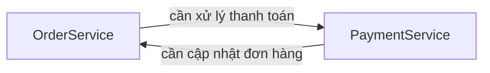
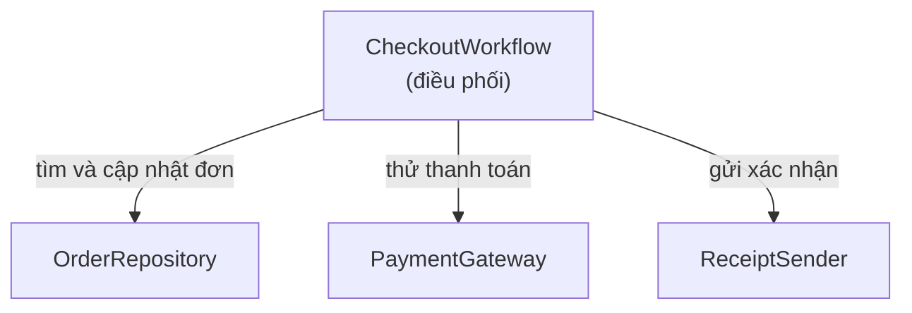
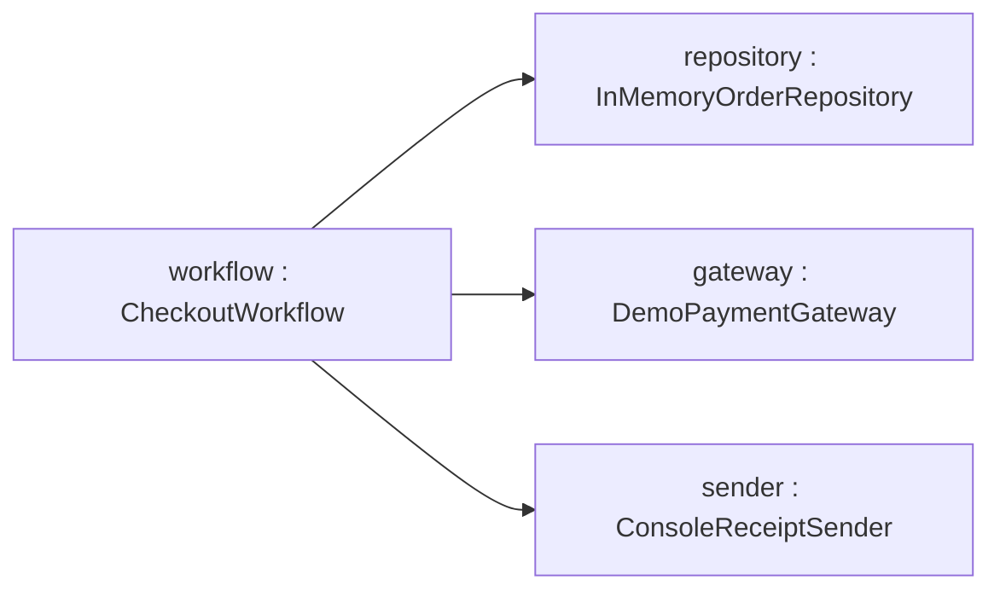
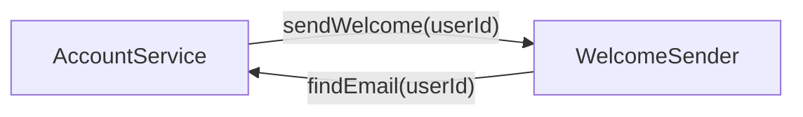
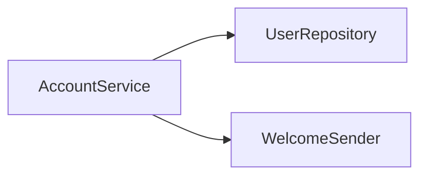
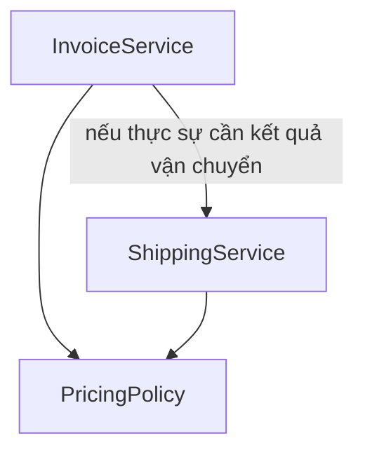

# Phá vòng bằng tách trách nhiệm hoặc thay đổi hướng phối hợp

## Mục tiêu học tập

Sau bài này, bạn có thể:

- Nhìn một **đồ thị đối tượng (object graph)** và nhận diện vòng phụ thuộc giữa các thành phần, thay vì chỉ nhìn thấy một lỗi khởi tạo.
- Phân biệt **vòng tham chiếu/phụ thuộc** với **gọi đệ quy vô hạn**; một vòng trong đồ thị chưa chắc làm chương trình lặp vô hạn, nhưng có thể gây khó khăn khi lắp ghép, kiểm thử và quản lý vòng đời.
- Phá vòng bằng cách **tách trách nhiệm điều phối**, **đưa khả năng chung sang một thành phần độc lập** hoặc **đổi hướng trao đổi thông tin**.
- Giải thích vì sao chỉ thêm interface, đổi sang setter injection hoặc trì hoãn việc tạo đối tượng có thể **không loại bỏ** vòng phụ thuộc thực tế.
- Lắp ghép một đồ thị không vòng bằng **constructor injection** trong Java thuần, rồi kiểm thử bằng các đối tượng giả trước khi sử dụng DI container.

Bài thuộc chương **Đồ thị đối tượng** của chủ đề **Dependency Injection (DI)** và **Inversion of Control (IoC)**. Tư tưởng xuyên suốt là tách việc **sử dụng** dependency khỏi việc **tạo và lắp ghép** chúng. Khi gặp một vòng phụ thuộc, cần xem lại quan hệ trách nhiệm giữa các đối tượng, thay vì chỉ tìm mẹo khiến container khởi tạo được chúng.

## 1. Vòng phụ thuộc xuất hiện như thế nào?

Theo quy ước trong bài, cạnh `A → B` có nghĩa **A cần/sử dụng B**. Một vòng xuất hiện khi đi theo các cạnh phụ thuộc và quay về đỉnh ban đầu:



Giả sử `OrderService` gọi `PaymentService.pay(...)`, còn `PaymentService` lại gọi `OrderService.markPaid(...)` khi đã thanh toán. Hai service đang có lý do để giữ tham chiếu đến nhau.

Một phiên bản mã rút gọn có thể trông như sau (đây là **minh họa cấu trúc**, chưa phải chương trình Java hoàn chỉnh):

```java
final class OrderService {
    private final PaymentService payments;

    OrderService(PaymentService payments) {
        this.payments = payments;
    }

    void checkout(Order order) {
        payments.pay(order);
    }

    void markPaid(String orderId) {
        // Cập nhật trạng thái đơn hàng.
    }
}

final class PaymentService {
    private final OrderService orders;

    PaymentService(OrderService orders) {
        this.orders = orders;
    }

    void pay(Order order) {
        // Nếu thanh toán thành công:
        orders.markPaid(order.id);
    }
}
```

Ở mức **kiểu**, ta đã có hai cạnh `OrderService → PaymentService` và `PaymentService → OrderService`. Nếu cả hai dependency đều bắt buộc trong constructor và không có instance được dựng sẵn, ta không thể lắp ghép hai đối tượng này một cách trực tiếp bằng các lời gọi `new` thông thường: tạo `OrderService` cần `PaymentService`, nhưng tạo `PaymentService` lại cần `OrderService`.

Một DI container có thể phát hiện chu trình và báo lỗi, hoặc một số framework có cơ chế proxy/lazy reference để xử lý một vài trường hợp. Việc framework khởi tạo được **không chứng minh rằng trách nhiệm giữa hai service đã được phân chia hợp lý**.

### Ba loại quan hệ không nên trộn lẫn

| Quan hệ | Câu hỏi | Ví dụ |
| --- | --- | --- |
| **Phụ thuộc theo kiểu** | Lớp A phải biết hợp đồng hay kiểu B nào? | `OrderService` có field `PaymentService`. |
| **Tham chiếu giữa instance lúc chạy** | Đối tượng cụ thể A đang giữ tham chiếu đến instance nào? | `orders` giữ `payments`, còn `payments` giữ `orders`. |
| **Thứ tự lời gọi** | Khi chạy một thao tác, phương thức nào gọi phương thức nào? | `checkout()` gọi `pay()`, rồi `pay()` gọi `markPaid()`. |

Một vòng tham chiếu **không đồng nghĩa** với đệ quy vô hạn: `markPaid()` có thể chỉ cập nhật trạng thái rồi trả về. Ngược lại, một phương thức có thể gọi đệ quy vô hạn ngay cả khi không có hai instance tham chiếu vòng. Ta đang xử lý **vòng trong đồ thị phụ thuộc và cách lắp ghép**, không mặc định rằng có lỗi `StackOverflowError`.

## 2. Đọc vòng theo trách nhiệm: vì sao hai phía cần nhau?

Trước khi sửa mã, hãy trả lời hai câu hỏi:

1. `OrderService` cần **khả năng thanh toán** để hoàn tất quy trình checkout.
2. `PaymentService` thật sự cần **toàn bộ OrderService**, hay chỉ cần **báo kết quả thanh toán** để một thành phần khác cập nhật trạng thái đơn?

Thông thường, việc gọi cổng thanh toán và việc lưu trạng thái đơn là **hai trách nhiệm khác nhau**. `PaymentService` không nhất thiết phải biết cách quản lý đơn hàng. Vòng phụ thuộc cho thấy trách nhiệm **điều phối trình tự nghiệp vụ** đang bị chia cho cả hai service.

Có thể chia hệ thống thành ba năng lực:

- `OrderRepository`: đọc đơn và cập nhật trạng thái thanh toán.
- `PaymentGateway`: thử thanh toán và trả kết quả.
- `ReceiptSender`: gửi thông báo xác nhận khi đơn đã thanh toán.

Sau đó giao **một nơi điều phối** là `CheckoutWorkflow` quyết định thứ tự gọi ba khả năng này. Trong phạm vi ví dụ, việc gửi xác nhận là tùy thuộc vào thanh toán thành công.



Đồ thị mới **không có đường phụ thuộc quay ngược về `CheckoutWorkflow`**. Ba thành phần ở dưới không phải gọi nhau để điều phối. `CheckoutWorkflow` không cần biết chúng được tạo bằng cách nào; constructor của nó chỉ nhận các khả năng cần dùng.

### Điều gì đã thay đổi?

| Trước | Sau |
| --- | --- |
| `OrderService` gọi `PaymentService`. | `CheckoutWorkflow` gọi `PaymentGateway`. |
| `PaymentService` gọi ngược `OrderService.markPaid(...)`. | `PaymentGateway` **trả kết quả** cho `CheckoutWorkflow`. |
| Hai service cùng tham gia quyết định tiến trình. | Một workflow quyết định khi nào cập nhật đơn và gửi xác nhận. |
| Hai constructor có thể cần nhau. | Các dependency được tạo trước, workflow được tạo sau. |

Đây là cách **tách trách nhiệm điều phối** kết hợp **đổi hướng trao đổi kết quả**: cổng thanh toán trả về dữ liệu, còn thành phần điều phối quyết định bước kế tiếp.

## 3. Ví dụ Java hoàn chỉnh: từ vòng phụ thuộc sang đồ thị không vòng

Chương trình dưới đây dùng **Java thuần**, mô phỏng kho đơn trong bộ nhớ, thanh toán thành công và gửi xác nhận qua console. Nó không kết nối hệ thống thanh toán hay email thật. Lưu toàn bộ mã vào **`Main.java`**:

```java
import java.util.HashMap;
import java.util.Map;
import java.util.Objects;

// Dữ liệu đơn được truyền giữa các thành phần.
final class Order {
    final String id;
    final String email;
    final long amountVnd;

    Order(String id, String email, long amountVnd) {
        this.id = Objects.requireNonNull(id, "id");
        this.email = Objects.requireNonNull(email, "email");
        if (amountVnd <= 0) {
            throw new IllegalArgumentException("amountVnd must be positive");
        }
        this.amountVnd = amountVnd;
    }
}

// Ba hợp đồng tách biệt, không tham chiếu ngược đến workflow.
interface OrderRepository {
    Order findById(String orderId);
    void markPaid(String orderId);
}

interface PaymentGateway {
    boolean charge(String orderId, long amountVnd);
}

interface ReceiptSender {
    void send(String email, String orderId);
}

final class CheckoutWorkflow {
    private final OrderRepository orders;
    private final PaymentGateway payments;
    private final ReceiptSender receipts;

    CheckoutWorkflow(OrderRepository orders, PaymentGateway payments,
                     ReceiptSender receipts) {
        this.orders = Objects.requireNonNull(orders, "orders");
        this.payments = Objects.requireNonNull(payments, "payments");
        this.receipts = Objects.requireNonNull(receipts, "receipts");
    }

    boolean checkout(String orderId) {
        Order order = orders.findById(orderId);
        if (order == null) {
            throw new IllegalArgumentException("Không tìm thấy đơn " + orderId);
        }

        boolean paid = payments.charge(order.id, order.amountVnd);
        if (!paid) {
            return false;
        }

        orders.markPaid(order.id);
        receipts.send(order.email, order.id);
        return true;
    }
}

// Implementation demo: giữ dữ liệu trong bộ nhớ.
final class InMemoryOrderRepository implements OrderRepository {
    private final Map<String, Order> orders = new HashMap<>();
    private final Map<String, Boolean> paid = new HashMap<>();

    void add(Order order) {
        orders.put(order.id, order);
        paid.put(order.id, false);
    }

    @Override
    public Order findById(String orderId) {
        return orders.get(orderId);
    }

    @Override
    public void markPaid(String orderId) {
        if (!orders.containsKey(orderId)) {
            throw new IllegalArgumentException("Không tìm thấy đơn " + orderId);
        }
        paid.put(orderId, true);
        System.out.println("[DEMO] Đã ghi trạng thái PAID cho " + orderId);
    }

    boolean isPaid(String orderId) {
        return Boolean.TRUE.equals(paid.get(orderId));
    }
}

final class DemoPaymentGateway implements PaymentGateway {
    @Override
    public boolean charge(String orderId, long amountVnd) {
        System.out.println("[DEMO] Thanh toán " + amountVnd
                + " VND cho " + orderId);
        return true;
    }
}

final class ConsoleReceiptSender implements ReceiptSender {
    @Override
    public void send(String email, String orderId) {
        System.out.println("[DEMO] Xác nhận đơn " + orderId
                + " đến " + email);
    }
}

// Composition root: tạo các thành phần và lắp ghép chúng.
public class Main {
    public static void main(String[] args) {
        InMemoryOrderRepository repository = new InMemoryOrderRepository();
        repository.add(new Order("DH-07", "khach@example.com", 120_000L));

        PaymentGateway gateway = new DemoPaymentGateway();
        ReceiptSender sender = new ConsoleReceiptSender();
        CheckoutWorkflow workflow = new CheckoutWorkflow(repository, gateway, sender);

        boolean success = workflow.checkout("DH-07");
        System.out.println("Thanh toán thành công: " + success);
        System.out.println("Đơn đã PAID: " + repository.isPaid("DH-07"));
    }
}
```

Chạy bằng JDK:

```bash
javac -encoding UTF-8 Main.java
java Main
```

Kết quả dự kiến:

```text
[DEMO] Thanh toán 120000 VND cho DH-07
[DEMO] Đã ghi trạng thái PAID cho DH-07
[DEMO] Xác nhận đơn DH-07 đến khach@example.com
Thanh toán thành công: true
Đơn đã PAID: true
```

### Theo dõi các bước lắp ghép

| Thứ tự | Mã trong `Main` | Vai trò |
| --- | --- | --- |
| 1 | `new InMemoryOrderRepository()` | Tạo kho đơn, chưa cần workflow. |
| 2 | `new DemoPaymentGateway()` | Tạo provider thực thi `PaymentGateway`. |
| 3 | `new ConsoleReceiptSender()` | Tạo provider thực thi `ReceiptSender`. |
| 4 | `new CheckoutWorkflow(repository, gateway, sender)` | **Constructor injection**: ghép ba dependency vào consumer. |
| 5 | `workflow.checkout("DH-07")` | Thực hiện nghiệp vụ trên đồ thị đã hoàn tất. |

`CheckoutWorkflow` không gọi `new DemoPaymentGateway()` hay tự tìm dependency trong container. Điều này giữ rõ ranh giới giữa **sử dụng** và **tạo/lắp ghép**, đồng thời cho phép thay từng provider ở composition root.

Đồ thị ở mức instance cho lần chạy này:



**Giới hạn của ví dụ:** nếu thanh toán thành công nhưng `markPaid(...)` hoặc `send(...)` thất bại, hệ thống thật cần thiết kế việc thử lại, idempotency, lưu trạng thái trung gian hoặc bù trừ. Phá vòng phụ thuộc **không tự giải quyết** tính nhất quán giữa các tác vụ có tác động phụ.

## 4. Cách thứ hai: đổi hướng phối hợp bằng cách truyền dữ liệu cần thiết

Không phải vòng nào cũng đòi hỏi một workflow mới. Đôi khi hai service tham chiếu nhau vì một service **truy vấn ngược** để lấy dữ liệu mà caller đã có.

Ví dụ, `AccountService` cần gửi email chào mừng, nên giữ `WelcomeSender`. Nhưng `WelcomeSender` lại giữ `AccountService` chỉ để gọi `accountService.findEmail(userId)`:



Nếu `AccountService` đã có địa chỉ email sau khi tạo tài khoản, `WelcomeSender` **không cần biết** `AccountService`. Ta đổi contract để caller chuyển dữ liệu cần thiết:

```java
interface WelcomeSender {
    void sendWelcome(String email);
}

final class AccountService {
    private final UserRepository users;
    private final WelcomeSender welcomeSender;

    AccountService(UserRepository users, WelcomeSender welcomeSender) {
        this.users = users;
        this.welcomeSender = welcomeSender;
    }

    void register(String userId, String email) {
        users.save(userId, email);
        welcomeSender.sendWelcome(email);
    }
}

interface UserRepository {
    void save(String userId, String email);
}
```

Đây là đoạn **minh họa API** độc lập với chương trình `Main.java` ở mục 3. `WelcomeSender` chỉ cần email để gửi, còn `AccountService` chịu trách nhiệm tạo tài khoản. Hai dependency hiện là:



Ta đã loại cạnh `WelcomeSender → AccountService` bằng cách **đẩy dữ liệu cần thiết qua tham số**. Việc đổi hướng thông tin này là hợp lý khi email là dữ liệu của **một lần gọi**. Không nên đẩy cả `AccountService` hay một `ApplicationContext` vào sender chỉ để nó truy cập một giá trị.

Nếu sender cần nhiều dữ liệu liên quan, có thể truyền một DTO nhỏ như `WelcomeMessage(userId, email, locale)` thay vì rất nhiều tham số rời rạc. DTO phải chỉ chứa dữ liệu cần thiết; không nên biến nó thành túi chứa các service hoặc container tổng quát.

## 5. Cách thứ ba: tách khả năng dùng chung ra một thành phần độc lập

Một tình huống khác: hai service cần qua lại vì cùng nắm một phần logic được tái sử dụng. Ví dụ:

- `InvoiceService` gọi `ShippingService` để tính phí giao hàng.
- `ShippingService` gọi `InvoiceService` để lấy quy tắc ưu đãi/thuế dùng khi tính phí.

Nếu quy tắc tính toán đó không thực sự thuộc quyền sở hữu riêng của `InvoiceService`, có thể tách nó thành một `PricingPolicy` độc lập. Khi đó mỗi service phụ thuộc **trực tiếp vào điều mình cần**:



Đồ thị này không có cạnh `ShippingService → InvoiceService`. Sự tách biệt làm rõ rằng hai bên đang dùng **một quy tắc chung**, thay vì bắt một service làm nơi chứa mọi tiện ích cho service còn lại.

Tuy nhiên, **không nên tách lớp chỉ để làm mất mũi tên trên sơ đồ**. `PricingPolicy` phải có trách nhiệm nghiệp vụ có nghĩa, hợp đồng rõ và có thể kiểm thử độc lập. Nếu lớp mới chỉ gọi vòng qua các service cũ, vòng thực tế vẫn có thể tồn tại ở cấp độ instance hoặc lời gọi.

## 6. Những cách tưởng đã phá vòng nhưng thực ra chưa

### 6.1. Chỉ thêm interface

Giả sử sửa `OrderService` để phụ thuộc vào `PaymentPort` thay vì `PaymentService`:

```java
interface PaymentPort {
    void pay(Order order);
}

// OrderService giữ PaymentPort, nhưng implementation của PaymentPort
// vẫn giữ một tham chiếu tới OrderService để gọi markPaid(...).
```

Nếu runtime vẫn nối `orders → paymentsImplementation → orders`, **vòng tham chiếu vẫn còn**. Interface có thể giúp đảo chiều phụ thuộc **mã nguồn**, nhưng không tự thay đổi cách hai instance cần và giữ nhau. Hãy vẽ **cả đồ thị kiểu và đồ thị instance**, rồi hỏi xem mũi tên nào thực sự biến mất.

### 6.2. Đổi sang setter injection để tạo lần lượt

Một cách đối phó thường thấy là tạo `A` chưa có `B`, tạo `B` tham chiếu `A`, rồi gọi `A.setB(b)`. Cách đó có thể làm bước khởi tạo chạy được, nhưng:

- Đồ thị cuối vẫn có `A → B → A`.
- Có khoảng thời gian `A` chưa hợp lệ hoặc chưa được cấu hình.
- Việc thiết lập thứ tự, kiểm thử và an toàn đồng thời có thể phức tạp hơn.

Setter injection có chỗ dùng cho dependency **tùy chọn hoặc có lý do thay đổi**, nhưng không nên là cách mặc định để che một vòng giữa các dependency bắt buộc.

### 6.3. Dùng `Supplier`, lazy proxy hay `Provider<T>`

Tiêm một factory/lazy reference có thể **trì hoãn** việc lấy `B` cho tới lúc gọi phương thức của `A`. Điều đó đôi khi hợp lý khi đối tượng **ngắn hạn** hoặc **được chọn theo ngữ cảnh**, nhưng nếu tại lúc chạy `A` vẫn cần `B` và `B` vẫn cần `A`, phần trách nhiệm trùng lặp chưa biến mất.

Tương tự, việc chuyển mọi `new` vào DI container hoặc gọi `container.getBean(...)` từ service chỉ đổi cơ chế tra cứu. **Container không thay thế việc quyết định ai điều phối ai.**

### 6.4. Đổi sang sự kiện chỉ để tránh constructor cycle

Event/callback có thể phù hợp nếu nghiệp vụ thực sự cần xử lý **sau khi** một sự kiện xảy ra, không đòi hỏi kết quả tức thời. Chẳng hạn, thanh toán phát `PaymentAccepted` và một handler độc lập cập nhật thông tin theo mô hình eventual consistency.

Tuy nhiên, một event bus có thể vẫn giữ tham chiếu đến handler; hãy vẽ cả đồ thị **runtime** của bus, publisher, handler và các dependency con. Đừng mặc định việc dùng sự kiện tự động loại bỏ mọi chu trình. Ngoài ra cần xác định thứ tự xử lý, giao dịch, lỗi, retry, idempotency và thời điểm kết quả được xem là hoàn thành. Nếu nghiệp vụ cần cập nhật đơn **đồng bộ trước khi trả kết quả**, một workflow trả kết quả trực tiếp thường dễ hiểu hơn sự kiện bất đồng bộ.

## 7. Scope và vòng đời cũng có thể làm lộ vòng phụ thuộc

Một đồ thị không vòng vẫn phải quản lý đúng **scope**. Ví dụ, `CheckoutWorkflow` được tạo một lần và dùng lại cho nhiều request, còn thông tin khách hiện tại là dữ liệu theo **mỗi lời gọi**. Không được lưu `currentCustomer` trong field thay đổi của workflow dùng chung chỉ để tránh truyền tham số.

| Thành phần | Vòng đời có thể phù hợp | Lưu ý |
| --- | --- | --- |
| `CheckoutWorkflow` | Một instance tái sử dụng nếu không giữ trạng thái request | Constructor nhận các dependency ổn định. |
| `PaymentGateway` | Client dùng chung nếu implementation an toàn luồng | Nơi tạo quản lý cấu hình và tài nguyên dùng chung. |
| `Order` | Dữ liệu của một lần xử lý | Truyền hoặc tải theo thao tác; không cần đưa vào container. |
| Transaction/session có khả năng đóng | Một thao tác hoặc request | Tiêm một factory hẹp nếu phải mở phiên mới; quy định ai đóng. |

Một số DI container còn báo lỗi khi một dependency có scope ngắn bị inject trực tiếp vào một consumer sống lâu. Cách xử lý là điều chỉnh đúng ranh giới vòng đời, không dùng một tham chiếu lazy để che mọi vấn đề.

Trong Java thuần, nếu cần tạo một phiên thanh toán riêng mỗi lần gọi, có thể tiêm `PaymentSessionFactory` vào workflow rồi mở/đóng session trong phương thức xử lý. Factory chỉ nên cấp **đúng loại tài nguyên cần thiết**; tránh đưa nguyên `Container` vào workflow. **Factory không phải phép phá vòng tự động**: nếu factory lại giữ workflow để gọi ngược, cần tiếp tục xem lại đồ thị.

## 8. Kiểm thử đồ thị sau khi phá vòng bằng Java thuần

Không cần DI container để kiểm tra việc `CheckoutWorkflow` chỉ điều phối ba dependency theo hợp đồng. Tạo đối tượng giả ghi nhận lời gọi, sau đó thử cả đường **thành công** và **thanh toán bị từ chối**.

Lưu **`CheckoutWorkflowCheck.java`** cạnh `Main.java`:

```java
public class CheckoutWorkflowCheck {
    static final class FakeOrders implements OrderRepository {
        final Order order = new Order("DH-T", "test@example.com", 70_000L);
        int finds;
        int marks;

        @Override
        public Order findById(String orderId) {
            finds++;
            return order.id.equals(orderId) ? order : null;
        }

        @Override
        public void markPaid(String orderId) {
            marks++;
        }
    }

    static final class FakePayments implements PaymentGateway {
        boolean approved = true;
        int charges;
        long lastAmount;

        @Override
        public boolean charge(String orderId, long amountVnd) {
            charges++;
            lastAmount = amountVnd;
            return approved;
        }
    }

    static final class FakeReceipts implements ReceiptSender {
        int sends;
        String lastEmail;

        @Override
        public void send(String email, String orderId) {
            sends++;
            lastEmail = email;
        }
    }

    public static void main(String[] args) {
        FakeOrders orders = new FakeOrders();
        FakePayments payments = new FakePayments();
        FakeReceipts receipts = new FakeReceipts();
        CheckoutWorkflow workflow = new CheckoutWorkflow(orders, payments, receipts);

        boolean succeeded = workflow.checkout("DH-T");
        if (!succeeded || orders.finds != 1 || orders.marks != 1
                || payments.charges != 1 || payments.lastAmount != 70_000L
                || receipts.sends != 1
                || !"test@example.com".equals(receipts.lastEmail)) {
            throw new AssertionError("Đường thành công không đúng");
        }

        // Dùng lại workflow, nhưng gateway từ chối thanh toán lần thứ hai.
        payments.approved = false;
        boolean failed = workflow.checkout("DH-T");
        if (failed || orders.finds != 2 || orders.marks != 1
                || payments.charges != 2 || receipts.sends != 1) {
            throw new AssertionError("Không được cập nhật/gửi khi thanh toán thất bại");
        }

        System.out.println("PASS: workflow điều phối đúng các dependency");
    }
}
```

Chạy:

```bash
javac -encoding UTF-8 Main.java CheckoutWorkflowCheck.java
java CheckoutWorkflowCheck
```

Phép kiểm tra chỉ cần **ba fake**, vì constructor của `CheckoutWorkflow` công khai đầy đủ những collaborator bắt buộc. Không phải dựng `OrderService`, `PaymentService` thành cặp phụ thuộc vòng, và không cần chạy container hay khởi động hạ tầng. Nó kiểm tra quan hệ phối hợp; những ràng buộc giao dịch và lỗi mạng cần thêm bài kiểm thử integration ở bước phát triển thực tế.

## 9. Quy trình nhận diện và phá vòng trong một codebase

1. **Vẽ cạnh đúng chiều:** với mỗi lớp, ghi `consumer → dependency` từ constructor/field và các lời gọi. Đừng nhầm thứ tự thực thi với chiều phụ thuộc.
2. **Tìm chu trình:** bắt đầu ở một service và đi theo các cạnh; nếu quay về đỉnh đã nằm trên đường hiện tại, có vòng. Với đồ thị lớn, thuật toán DFS hoặc tìm **thành phần liên thông mạnh (SCC)** có thể giúp xác định nhóm thành phần cùng tham gia chu trình.
3. **Kiểm tra từng cạnh trong vòng:** vì sao `A` cần `B`? Nó cần toàn bộ service hay chỉ một giá trị, sự kiện hoặc khả năng cụ thể?
4. **Tìm nơi đặt trách nhiệm điều phối:** nếu hai service gọi ngược nhau để nối các bước nghiệp vụ, cân nhắc workflow/coordinator riêng; các bước con nên trả kết quả qua hợp đồng.
5. **Tách logic dùng chung nếu có:** nếu hai service chỉ cần một quy tắc chung, tách thành một thành phần độc lập có trách nhiệm rõ.
6. **Thay việc truy vấn ngược bằng dữ liệu đầu vào:** nếu đối tượng được gọi chỉ cần dữ liệu caller đã biết, chuyển dữ liệu qua tham số hoặc DTO nhỏ.
7. **Vẽ lại đồ thị kiểu và đồ thị instance:** kiểm tra cạnh nào đã thực sự mất; đừng chỉ dựa vào việc chương trình biên dịch hay container khởi động được.
8. **Lắp ghép từ đỉnh lá tại composition root:** tạo repository/gateway/sender trước, consumer điều phối sau; xác nhận scope và quyền sở hữu tài nguyên.
9. **Kiểm thử độc lập:** thay từng dependency bằng fake, kiểm tra đường thành công/thất bại và tránh các lời gọi ngược không cần thiết.

### Những ngộ nhận thường gặp

| Ngộ nhận | Cách hiểu đúng |
| --- | --- |
| “Vòng phụ thuộc luôn gây `StackOverflowError`.” | Vòng tham chiếu và gọi đệ quy vô hạn là hai hiện tượng khác nhau. |
| “Chỉ cần đổi một bên sang interface là hết vòng.” | Phải xem đồ thị **instance**; implementation có thể vẫn giữ tham chiếu quay lại consumer. |
| “Setter injection/lazy reference đã phá vòng.” | Có thể chỉ giúp khởi tạo, trong khi đồ thị sử dụng cuối cùng vẫn có chu trình. |
| “Đưa toàn bộ logic sang một lớp lớn là tốt nhất.” | Workflow chỉ nên điều phối; từng dependency giữ trách nhiệm chuyên biệt và kiểm thử được. |
| “Tạo event bus là hết coupling.” | Cần xem đồ thị đăng ký handler và ngữ nghĩa đồng bộ/bất đồng bộ, lỗi và nhất quán. |
| “DI container sẽ tự giải quyết thiết kế vòng.” | Container lắp ghép theo mô hình đã thiết kế; ranh giới trách nhiệm vẫn do lập trình viên quyết định. |

## 10. Bài tập vận dụng

Xét hai service:

```text
ReservationService → BillingService
BillingService → ReservationService
```

`ReservationService.reserve(...)` gọi tính phí. `BillingService` lại gọi `ReservationService.confirm(...)` sau khi thu phí.

Hãy tự trả lời:

1. Vòng nằm ở đồ thị kiểu, đồ thị instance hay cả hai nếu mỗi service giữ tham chiếu tới service còn lại?
2. Nếu `BillingService` chỉ cần trả `PaymentResult`, thành phần nào nên nhận kết quả rồi gọi `ReservationRepository.confirm(...)`?
3. Nếu `BillingService` gọi ngược chỉ để lấy `currency` mà caller đã biết, thay đổi hợp đồng nào sẽ bỏ được cạnh đó?
4. Nếu sử dụng `Provider<ReservationService>` bên trong billing, điều gì **chưa được giải quyết** ở mức trách nhiệm?

**Gợi ý:** (1) Cả hai, nếu hai instance thực sự giữ tham chiếu quay lại nhau. (2) Một `ReservationWorkflow` hoặc coordinator chịu trách nhiệm gọi billing rồi cập nhật đặt chỗ; billing chỉ thực hiện nhiệm vụ thanh toán. (3) Truyền `currency` vào lời gọi phù hợp hoặc DTO yêu cầu thanh toán, thay vì gọi ngược reservation service. (4) Provider có thể trì hoãn việc tạo/lấy instance nhưng billing vẫn biết và cần reservation service; vòng trách nhiệm còn nguyên.

Một đồ thị tốt không nhất thiết có ít lớp nhất; điều quan trọng là mỗi cạnh có **lý do nghiệp vụ rõ ràng**, các phụ thuộc bắt buộc được thể hiện minh bạch và **việc điều phối có hướng nhất quán**. Khi chuyển sang DI container, nguyên tắc phá vòng này vẫn giữ nguyên: hãy thiết kế và lắp ghép các đối tượng sao cho chúng có thể cộng tác qua hợp đồng cụ thể mà không phải tạo hoặc tra cứu ngược lẫn nhau.
