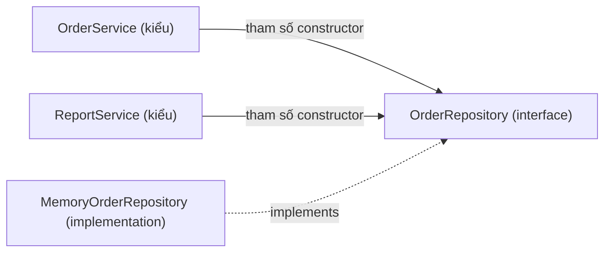
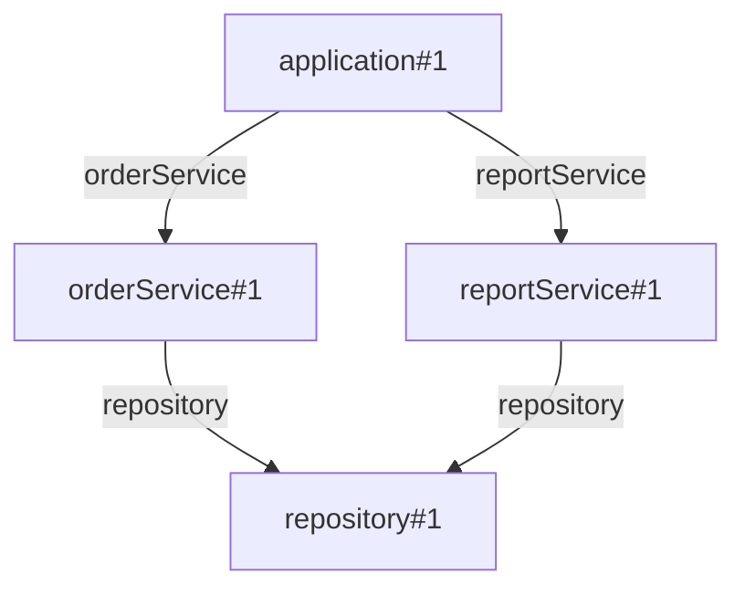
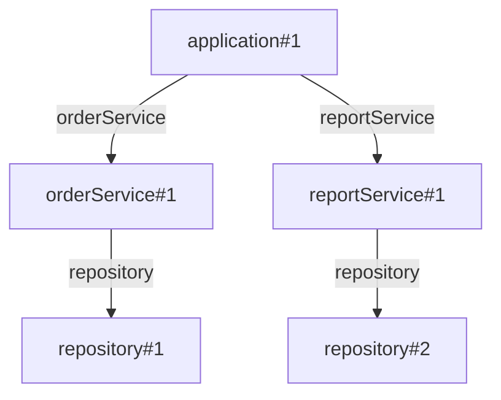

# Trình bày và kiểm chứng đồ thị thực tế sau khi thay đổi lắp ghép

Khi thay đổi mã tại **composition root**, chẳng hạn truyền một repository dùng chung thành hai repository riêng hoặc thay một adapter hạ tầng bằng fake, mã nghiệp vụ có thể **không thay đổi và vẫn biên dịch thành công**. Tuy nhiên, **đồ thị đối tượng thực tế lúc chạy** có thể thay đổi đáng kể: số instance khác đi, những cạnh tham chiếu trỏ tới đối tượng khác, trạng thái không còn được chia sẻ, hoặc một dependency tồn tại lâu hơn phạm vi hợp lệ của nó.

Do đó, trong học phần **Dependency Injection (DI)** và **Inversion of Control (IoC)**, ta cần biết cách **trình bày đồ thị sau khi lắp ghép** và **kiểm chứng rằng đồ thị thực tế đúng với thiết kế mong muốn**. Đây là bước bổ sung quan trọng cho constructor injection và composition root: ta không chỉ viết `new` và truyền tham số đúng kiểu, mà còn xác minh **instance nào thực sự được truyền cho consumer nào**.

Sau bài học, bạn có thể:

- Biểu diễn các **nút đối tượng** và **cạnh tham chiếu** của một cấu hình Java đang chạy.
- So sánh **trước/sau** khi thay đổi composition root, bao gồm số lượng instance và quan hệ dùng chung.
- Dùng `==` và phép thử hành vi để xác minh một dependency được dùng chung hay được tạo riêng.
- Kiểm tra các bất biến về wiring, scope, ownership và vòng đời bằng **Java thuần**, chưa cần DI container.
- Phân biệt bằng chứng thu được từ chương trình chạy với sơ đồ dự kiến được vẽ từ mã nguồn.

## 1. Đồ thị kiểu khác đồ thị đối tượng thực tế

Xét một ứng dụng quản lý đơn hàng có hai chức năng:

- `OrderService` ghi đơn hàng qua `OrderRepository`.
- `ReportService` thống kê số đơn hàng qua **cùng hợp đồng** `OrderRepository`.

Trong mã nguồn, cả hai service đều khai báo phụ thuộc vào **kiểu** `OrderRepository`. Nếu đổi cách tạo object, quan hệ giữa các kiểu có thể giữ nguyên:



Nhưng khi chạy, cùng sơ đồ kiểu trên có thể sinh ra nhiều **đồ thị instance**.

**Cấu hình A — hai service dùng chung một repository:**



**Cấu hình B — mỗi service nhận repository riêng:**



Các nhãn `#1` và `#2` chỉ **danh tính đối tượng trong từng sơ đồ**, không phải ID do JVM cung cấp và cũng không bảo đảm hai nút `#1` ở hai sơ đồ là cùng đối tượng.

| Câu hỏi | Cấu hình A | Cấu hình B |
| --- | --- | --- |
| Có bao nhiêu instance repository? | 1 | 2 |
| Hai service cùng dùng một instance? | Có | Không |
| Một thay đổi trạng thái trong repository của `OrderService` có được `ReportService` quan sát trực tiếp? | Có, nếu hợp đồng và đồng bộ cho phép | Không, trừ khi có cơ chế đồng bộ trạng thái riêng |
| Kiểu khai báo trong constructor có thay đổi? | Không | Không |
| Có thể kiểm chứng chỉ bằng việc Java biên dịch thành công? | Không | Không |

Ví dụ hai repository độc lập **không mặc nhiên là thiết kế sai**. Đó có thể là chủ đích, chẳng hạn kiến trúc đọc/ghi riêng có cơ chế đồng bộ. Nhưng nếu cả hai service cần cùng dữ liệu trong bộ nhớ và không có cơ chế đồng bộ, cấu hình B gây sai lệch hành vi dù mọi kiểu Java đều hợp lệ.

### Khái niệm quan trọng

Trong bài này, **đồ thị đối tượng thực tế** là đồ thị được quan sát tại **một thời điểm xác định** của một lần thực thi:

- **Nút:** các instance cụ thể, ví dụ một `OrderService` và hai `MemoryOrderRepository`.
- **Cạnh:** tham chiếu được giữ hoặc quan hệ phụ thuộc được sử dụng, ví dụ field `repository` của một service.
- **Gốc quan sát:** các object được composition root tạo và lắp ghép, thường là application/controller/handler.
- **Nhãn:** tên phục vụ chẩn đoán, không thay thế việc so sánh danh tính thật.

Đồ thị này **không bắt buộc là toàn bộ heap của JVM**. Nó là phần đồ thị phụ thuộc liên quan đến mục tiêu kiểm chứng. Một ứng dụng còn có String, collection, đối tượng tạm, thread, class loader và nhiều object nội bộ khác mà ta không cần vẽ.

## 2. Đặt giả thuyết trước khi thay đổi wiring

Một thay đổi ở composition root nên có **kỳ vọng quan sát được**, không chỉ mô tả “đã sửa một dòng”.

Ví dụ: muốn tách repository cho ghi và đọc trong môi trường thử nghiệm.

| Tiêu chí | Trước thay đổi | Sau thay đổi | Cần xác minh |
| --- | --- | --- | --- |
| Dependency của `OrderService` | `repository#1` | `repository#1` | Service ghi đúng instance |
| Dependency của `ReportService` | `repository#1` | `repository#2` | Service đọc đúng instance |
| Số repository | 1 | 2 | Không vô tình dùng chung |
| Quan hệ danh tính | `orderRepo == reportRepo` | `orderRepo != reportRepo` | So sánh `==` lúc chạy |
| Số đơn quan sát sau một thao tác ghi | 1 | 0 khi hai store bộ nhớ độc lập | Kiểm tra hậu quả về hành vi |
| Quyền sở hữu | Composition root | Composition root | Phạm vi sống còn hợp lệ |

Nếu mục tiêu thực sự của hệ thống là báo cáo đọc được đơn vừa tạo, thì thay đổi thành hai repository bộ nhớ độc lập phải được coi là **một thay đổi có nguy cơ vi phạm bất biến**. Bài học sẽ dùng sự khác biệt này để minh họa cách kiểm chứng.

Một cách viết kỳ vọng có thể kiểm tra được:

> “Ở cấu hình dùng chung, hai field repository phải trỏ cùng instance, và báo cáo phải quan sát đơn hàng vừa tạo. Ở cấu hình tách biệt, hai field phải trỏ hai instance khác nhau; nếu chưa có đồng bộ dữ liệu, báo cáo không nhìn thấy đơn hàng mới.”

Với một yêu cầu production, ta thường cần giữ bất biến nghiệp vụ (ví dụ báo cáo thấy dữ liệu đúng) và bổ sung cơ chế đồng bộ nếu chủ đích tách dependency. Cần tách **kỳ vọng cấu trúc** khỏi **kỳ vọng hành vi**.

## 3. Ví dụ Java thuần: tạo hai đồ thị và quan sát cạnh thực tế

Tạo file `ObjectGraphDemo.java`. Mọi lớp được đặt lồng trong một file để chạy đơn giản. `GraphInspector` truy cập các field của lớp lồng nhau trong ví dụ nhằm đọc **tham chiếu thực tế** mà không cần reflection hay DI container.

```java
import java.util.ArrayList;
import java.util.HashMap;
import java.util.IdentityHashMap;
import java.util.List;
import java.util.Map;
import java.util.Objects;

public class ObjectGraphDemo {

    interface OrderRepository {
        void save(String orderId);
        int count();
    }

    static final class MemoryOrderRepository implements OrderRepository {
        private final List<String> ids = new ArrayList<>();

        @Override
        public void save(String orderId) {
            ids.add(Objects.requireNonNull(orderId, "orderId"));
        }

        @Override
        public int count() {
            return ids.size();
        }
    }

    static final class OrderService {
        private final OrderRepository repository;

        OrderService(OrderRepository repository) {
            this.repository =
                    Objects.requireNonNull(repository, "repository");
        }

        void place(String orderId) {
            repository.save(orderId);
        }
    }

    static final class ReportService {
        private final OrderRepository repository;

        ReportService(OrderRepository repository) {
            this.repository =
                    Objects.requireNonNull(repository, "repository");
        }

        int numberOfOrders() {
            return repository.count();
        }
    }

    static final class Application {
        private final OrderService orders;
        private final ReportService reports;

        Application(OrderService orders, ReportService reports) {
            this.orders = Objects.requireNonNull(orders, "orders");
            this.reports = Objects.requireNonNull(reports, "reports");
        }

        void place(String id) {
            orders.place(id);
        }

        int reportCount() {
            return reports.numberOfOrders();
        }
    }

    // Handle do composition root giữ để có thể xác minh wiring.
    // Đây là công cụ quan sát của ví dụ, không phải dependency của nghiệp vụ.
    static final class Assembly {
        final Application application;
        final OrderService orderService;
        final ReportService reportService;
        final MemoryOrderRepository writeStore;
        final MemoryOrderRepository readStore;

        Assembly(Application application,
                 OrderService orderService,
                 ReportService reportService,
                 MemoryOrderRepository writeStore,
                 MemoryOrderRepository readStore) {
            this.application = application;
            this.orderService = orderService;
            this.reportService = reportService;
            this.writeStore = writeStore;
            this.readStore = readStore;
        }
    }

    // COMPOSITION ROOT: thay đổi đúng một quyết định chia sẻ instance.
    static Assembly assemble(boolean sharedRepository) {
        MemoryOrderRepository writeStore = new MemoryOrderRepository();

        MemoryOrderRepository readStore = sharedRepository
                ? writeStore
                : new MemoryOrderRepository();

        OrderService orders = new OrderService(writeStore);
        ReportService reports = new ReportService(readStore);
        Application application = new Application(orders, reports);

        return new Assembly(
                application, orders, reports, writeStore, readStore);
    }

    // Gán nhãn theo danh tính đối tượng để trình bày snapshot.
    // IdentityHashMap phân biệt instance bằng identity, không bằng equals().
    static final class GraphInspector {
        private final IdentityHashMap<Object, String> labels =
                new IdentityHashMap<>();
        private final Map<String, Integer> counts = new HashMap<>();

        private String label(Object node) {
            String known = labels.get(node);
            if (known != null) {
                return known;
            }

            String type = node.getClass().getSimpleName();
            int number = counts.getOrDefault(type, 0) + 1;
            counts.put(type, number);

            String name = type + "#" + number;
            labels.put(node, name);
            return name;
        }

        private void edge(Object source, String field, Object target) {
            System.out.println(
                    label(source) + " --" + field + "--> " + label(target));
        }

        void print(Assembly graph) {
            Application app = graph.application;

            // Đọc field đang giữ tham chiếu, không suy từ kiểu constructor.
            edge(app, "orders", app.orders);
            edge(app, "reports", app.reports);
            edge(app.orders, "repository", app.orders.repository);
            edge(app.reports, "repository", app.reports.repository);

            System.out.println("Shared repository: "
                    + (app.orders.repository == app.reports.repository));
        }
    }

    static void verify(Assembly graph, boolean expectedShared,
                       int expectedCount) {
        // Kiểm tra các cạnh thật có khớp đối tượng đã lắp ghép không.
        if (graph.application.orders != graph.orderService
                || graph.application.reports != graph.reportService
                || graph.orderService.repository != graph.writeStore
                || graph.reportService.repository != graph.readStore) {
            throw new AssertionError("Unexpected object graph wiring");
        }

        boolean actualShared =
                graph.orderService.repository
                        == graph.reportService.repository;
        if (actualShared != expectedShared) {
            throw new AssertionError("Wrong repository sharing");
        }

        graph.application.place("O-001");
        int observed = graph.application.reportCount();

        if (observed != expectedCount) {
            throw new AssertionError(
                    "Expected " + expectedCount + " but got " + observed);
        }
        System.out.println("After place, report sees: " + observed);
    }

    public static void main(String[] args) {
        System.out.println("== SHARED ==");
        Assembly shared = assemble(true);
        new GraphInspector().print(shared);
        verify(shared, true, 1);

        System.out.println("== SPLIT ==");
        Assembly split = assemble(false);
        new GraphInspector().print(split);
        verify(split, false, 0);
    }
}
```

Ví dụ chạy bằng **JDK 11 trở lên**, không cần thêm thư viện:

```bash
javac ObjectGraphDemo.java
java ObjectGraphDemo
```

Kết quả dự kiến:

```text
== SHARED ==
Application#1 --orders--> OrderService#1
Application#1 --reports--> ReportService#1
OrderService#1 --repository--> MemoryOrderRepository#1
ReportService#1 --repository--> MemoryOrderRepository#1
Shared repository: true
After place, report sees: 1
== SPLIT ==
Application#1 --orders--> OrderService#1
Application#1 --reports--> ReportService#1
OrderService#1 --repository--> MemoryOrderRepository#1
ReportService#1 --repository--> MemoryOrderRepository#2
Shared repository: false
After place, report sees: 0
```

### 3.1. Vì sao đây là quan sát đồ thị thực tế?

`GraphInspector` đọc trực tiếp các field:

```java
app.orders
app.reports
app.orders.repository
app.reports.repository
```

Những biểu thức này lấy **đối tượng thật** đang được tham chiếu sau khi composition root đã hoàn tất việc lắp ghép. `GraphInspector` không tạo giả một danh sách cạnh bằng cách đọc tên interface hay đoán ý nghĩa từ cấu hình.

Phương thức `label` dùng `IdentityHashMap<Object, String>` để bảo đảm **hai object bằng nhau theo `equals()` vẫn được ghi thành hai nút nếu không cùng instance**. Các nhãn `#1`, `#2` được gán khi quan sát và chỉ có ý nghĩa **trong snapshot đang in**.

Trong `verify`, phép `==` xác nhận **chính xác danh tính tham chiếu**. Dùng `Objects.equals(a, b)` ở đây có thể sai mục tiêu, vì `equals` có thể được định nghĩa theo nội dung. Ví dụ hai repository khác nhau cùng rỗng có thể được xem là bằng nhau nếu một implementation override `equals` theo dữ liệu, nhưng chúng vẫn không phải cùng instance.

### 3.2. Vì sao phải có thêm phép thử hành vi?

Kiểm tra `orderService.repository == reportService.repository` xác minh **cấu trúc**. Nhưng nó chưa chứng minh toàn bộ hành vi của hệ thống sau thay đổi. `verify` còn gọi:

```java
graph.application.place("O-001");
int observed = graph.application.reportCount();
```

Với repository bộ nhớ:

- **SHARED:** service ghi một đơn vào repository duy nhất; service báo cáo đọc cùng instance và thấy `1`.
- **SPLIT:** service ghi vào `writeStore`; service báo cáo đọc `readStore` khác nên thấy `0`.

Sự khác nhau về kết quả là **bằng chứng hành vi** cho hậu quả của thay đổi wiring. Nếu yêu cầu hệ thống vẫn đòi báo cáo thấy đơn vừa tạo, cấu hình SPLIT cần bổ sung giải pháp dữ liệu phù hợp; không nên coi `0` là kết quả production hợp lệ chỉ vì nó khớp với cách viết code thử nghiệm.

## 4. Cách xây dựng một báo cáo đồ thị trước/sau

Một báo cáo thay đổi wiring hữu ích nên mô tả **điểm quan sát**, **cấu hình đầu vào**, **những đối tượng và cạnh liên quan**, cùng **kết quả kiểm chứng**.

Mẫu cho bài học:

| Thuộc tính | Snapshot trước | Snapshot sau |
| --- | --- | --- |
| Thời điểm | Ngay sau `assemble(true)` | Ngay sau `assemble(false)` |
| Root quan sát | `Application#1` | `Application#1` mới của lần dựng khác |
| `Application.orders` | `OrderService#1` | `OrderService#1` mới |
| `Application.reports` | `ReportService#1` | `ReportService#1` mới |
| `OrderService.repository` | `MemoryOrderRepository#1` | `MemoryOrderRepository#1` |
| `ReportService.repository` | `MemoryOrderRepository#1` | `MemoryOrderRepository#2` |
| Bất biến identity | Hai service dùng chung: đúng | Hai service dùng chung: sai |
| Hành vi sau một lệnh ghi | Báo cáo thấy 1 | Báo cáo thấy 0 |

**Cảnh báo về cách đọc nhãn:** tên `Application#1` được gán mới khi mỗi `GraphInspector` khởi tạo. Hai snapshot không cùng dùng một object Application. Nếu cần so sánh **danh tính xuyên nhiều snapshot của cùng một tiến trình**, hãy giữ một bộ đăng ký nhãn identity dùng chung giữa các lần quan sát hoặc lưu lại chính tham chiếu cần so sánh. Không dựa vào các con số `#1` độc lập để kết luận object đã được tái sử dụng.

Một thay đổi lắp ghép cũng có thể là **đổi implementation** mà không đổi số instance:

```java
// Cùng port, khác adapter được chọn tại composition root:
OrderRepository repository = new MemoryOrderRepository();
// Hoặc: OrderRepository repository = new JdbcOrderRepository(dataSource);
OrderService service = new OrderService(repository);
```

`JdbcOrderRepository` và `dataSource` ở đoạn này là thành phần minh họa, chưa được khai báo trong file chạy độc lập. Khi đổi implementation, báo cáo cần thể hiện kiểu chạy thật, cấu hình cần thiết, quyền sở hữu tài nguyên và các hợp đồng hành vi được giữ nguyên. Trong Java thuần, `repository.getClass().getName()` cho biết lớp runtime của instance, nhưng **tên lớp đúng không đủ để chứng minh instance và hành vi đúng**.

## 5. Kiểm chứng bằng bất biến đồ thị

Khi review composition root, trước hết hãy đặt các **bất biến có thể kiểm tra** thay vì chỉ nhìn xem constructor có nhận đúng kiểu hay không.

Ví dụ:

| Bất biến | Cách kiểm chứng | Lỗi có thể phát hiện |
| --- | --- | --- |
| Root giữ đúng service đã tạo | So sánh reference bằng `==` | Vô tình tạo service thứ hai không được sử dụng |
| Hai consumer phải dùng chung một store | `orders.repository == reports.repository` | Tạo hai repository khi chỉ cần một |
| Hai consumer phải tách store | `orders.repository != reports.repository` | Vô tình tái sử dụng instance hoặc scope sai |
| Mỗi dependency bắt buộc được cấp | `Objects.requireNonNull` tại constructor + bootstrap | Bỏ sót wiring dẫn đến lỗi muộn |
| Service gọi đúng dependency | Fake ghi nhận lời gọi và tham số | Có đúng tham chiếu nhưng luồng nghiệp vụ không sử dụng như dự kiến |
| Adapter có thể phục vụ đúng hợp đồng | Contract test/integration test | Fake đúng nhưng adapter thật dịch sai dữ liệu hoặc lỗi |
| Resource được đóng đúng một lần bởi owner hợp lệ | Spy/`AutoCloseable` trong thử nghiệm vòng đời | Đóng sớm, quên đóng hoặc đóng lặp |
| Dependency sống đủ lâu cho mọi consumer | Kiểm tra scope và hoạt động sau từng giai đoạn | Singleton giữ object request-scoped đã hết hiệu lực |

Một sơ đồ có thể **đúng về số lượng nút** nhưng vẫn sai: hai đối tượng repository khác nhau bị truyền cho **nhầm consumer**, hoặc một notifier giả được cấp cho đường đi production. Vì vậy, kiểm tra cả **đích của cạnh**, **vai trò của instance** và **hành vi**.

### 5.1. Những gì `==` xác minh được

Trong Java, với các biểu thức tham chiếu `a` và `b`:

- `a == b` là `true` nếu cả hai cùng tham chiếu một object, hoặc đều là `null`.
- `a == b` là `false` nếu chúng tham chiếu hai object khác nhau.
- `a.equals(b)`, nếu có, hỏi về **bằng nhau theo hợp đồng equality** của kiểu; không nhất thiết là cùng instance.
- `System.identityHashCode(a)` chỉ tạo mã băm dựa trên identity, **không bảo đảm duy nhất**; không nên dùng một mình để khẳng định hai object là một.

Với các dependency bắt buộc đã kiểm tra khác `null`, `==` là phép đo rõ nhất cho **chia sẻ instance**. Với một log hoặc công cụ tracing không thể giữ reference, có thể dùng nhãn identity đã đăng ký như `GraphInspector` thay vì kết luận chỉ từ hash code.

### 5.2. Không để bộ kiểm chứng làm thay đổi hành vi

Một công cụ kiểm chứng đồ thị nên ưu tiên **đọc** tham chiếu tại thời điểm ổn định. Nó không nên gọi `save`, `close` hoặc mở kết nối chỉ để vẽ sơ đồ. Trong ví dụ:

- `GraphInspector.print` chỉ đọc cấu trúc.
- `verify` **chủ động thay đổi trạng thái** để kiểm tra hành vi, vì đây là bước kiểm thử riêng biệt.

Tách hai bước giúp báo cáo thể hiện rõ bằng chứng nào là **cấu trúc lúc quan sát** và bằng chứng nào là **kết quả của tác động kiểm thử**. Với hạ tầng thật, các phép thử có tác dụng phụ nên chạy trong môi trường test hoặc dùng fake, transaction rollback hay dữ liệu dùng một lần theo chính sách hệ thống.

## 6. Kiểm thử một thay đổi wiring mà không cần container

Ta có thể viết test trong Java thuần để đảm bảo cấu hình production vẫn dùng chung repository như yêu cầu. Tạo file `ObjectGraphTest.java` cùng thư mục:

```java
public class ObjectGraphTest {

    public static void main(String[] args) {
        ObjectGraphDemo.Assembly graph =
                ObjectGraphDemo.assemble(true);

        // Root phải cấp cùng instance cho hai đường ghi và đọc.
        if (graph.writeStore != graph.readStore) {
            throw new AssertionError("Expected shared repository");
        }

        // Helper trong ObjectGraphDemo đọc các field private thực tế,
        // kiểm chứng wiring và tạo một đơn hàng qua Application.
        ObjectGraphDemo.verify(graph, true, 1);

        // Bất biến hành vi: ghi rồi đọc qua các service phải nhất quán.
        graph.application.place("TEST-2");
        if (graph.application.reportCount() != 2) {
            throw new AssertionError("Report did not observe both orders");
        }

        System.out.println("PASS");
    }
}
```

Chạy:

```bash
javac ObjectGraphDemo.java ObjectGraphTest.java
java ObjectGraphTest
```

Kết quả mong đợi:

```text
After place, report sees: 1
PASS
```

Đây là test đặc biệt dành cho **wiring**: nó kiểm tra một thuộc tính **của đồ thị instance**, cộng với hành vi có thể quan sát được ở ranh giới ứng dụng.

Hãy thử thay `assemble(true)` thành `assemble(false)` trong test. Điều kiện chia sẻ repository sẽ thất bại. Ngay cả khi tạm bỏ các kiểm tra identity (bao gồm phần tương ứng trong `verify`), phép thử đếm số lượng vẫn phát hiện báo cáo không nhìn thấy đơn hàng đã ghi. Hai phép đo bổ sung cho nhau: cấu trúc cho biết **nguyên nhân về wiring**, còn hành vi cho biết **hậu quả**.

Trong dự án thực, không nên mở rộng API public của business service chỉ để test truy cập vào field private. Đoạn ví dụ dùng các lớp lồng nhau nên bộ kiểm chứng có thể đọc field. Có thể thay cách quan sát bằng:

- Đặt một test nhỏ ở ranh giới bootstrap, giữ các reference ngay tại nơi khởi tạo.
- Dùng fake/spy ở các port để xác nhận instance nào nhận lời gọi.
- Truy xuất thông tin cấu hình/scope bằng API chẩn đoán của container khi đã sử dụng container.
- Chỉ dùng reflection cho công cụ kiểm tra đặc thù và cân nhắc giới hạn truy cập module, bảo mật, chi phí bảo trì.

Điều cần kiểm tra là **hành vi cùng các bất biến quan trọng**, không nhất thiết phơi toàn bộ nội bộ của service ra ngoài.

## 7. Thay adapter: nhận đúng đối tượng chưa đủ để chứng minh hợp đồng

Một thay đổi composition root có thể giữ nguyên cấu trúc chia sẻ nhưng thay implementation của port:

```java
// Minh họa tại composition root:
OrderRepository repository = createRepository(configuration);
OrderService orders = new OrderService(repository);
ReportService reports = new ReportService(repository);
```

Trong đoạn này, `configuration` và `createRepository` là thành phần bootstrap minh họa. Kể cả khi cả hai service dùng đúng cùng một reference, ta vẫn cần kiểm chứng:

1. **Loại adapter:** lựa chọn theo môi trường có đúng không (fake, in-memory, JDBC, HTTP)?
2. **Cấu hình:** adapter có kết nối đúng nơi, đúng thông số và dùng đúng dữ liệu không?
3. **Hợp đồng:** `save` và `count` có giữ cùng ngữ nghĩa khi chuyển implementation không?
4. **Lỗi:** timeout, ngoại lệ hoặc lỗi truy cập được chuyển thành dạng consumer hiểu, không bị giả thành “không có dữ liệu”?
5. **Scope/vòng đời:** adapter có tài nguyên cần đóng không và có owner thích hợp không?
6. **Tính đồng thời:** instance dùng chung có an toàn nếu nhiều request gọi đồng thời không?

**Wiring đúng về danh tính là điều kiện cần cho một số thiết kế, chưa đủ để chứng minh toàn bộ chức năng đúng.** Unit test với fake xác minh logic nghiệp vụ; contract test xác minh adapter tuân thủ port; integration test xác minh kết nối và hành vi thật của hạ tầng.

### Ví dụ về nhầm lẫn cấu hình

```java
// Cả hai đều triển khai cùng một interface:
OrderRepository dev = createInMemoryRepository();
OrderRepository production = createDatabaseRepository();

// Nếu vô tình dùng dev trong môi trường production:
OrderService service = new OrderService(dev);
```

Đoạn này có thể biên dịch và mọi tham số constructor đều hợp lệ. Một test chỉ kiểm tra `repository != null` sẽ không phát hiện sai cấu hình. Composition root cần ghi nhận cấu hình đã chọn theo cách an toàn (không lộ mật khẩu), có kiểm tra môi trường và bài kiểm thử kết nối/hợp đồng phù hợp.

## 8. Thời điểm quan sát quyết định đồ thị mà ta nhìn thấy

Đồ thị đối tượng **có thể thay đổi theo thời gian** ngay cả khi source code không đổi.

| Thời điểm | Điều có thể đang xảy ra | Ý nghĩa khi quan sát |
| --- | --- | --- |
| Trước bootstrap | Chưa tạo service và adapter | Không thể suy ra đồ thị đầy đủ từ heap |
| Ngay sau constructor injection | Các field đã có reference | Phù hợp để kiểm tra đồ thị nền của ứng dụng |
| Khi xử lý request | Tạo repository/session/context ngắn hạn | Có thêm nút chỉ tồn tại trong request |
| Sau request | Resource được đóng hoặc bỏ tham chiếu | Giữ reference không đồng nghĩa còn được sử dụng hợp lệ |
| Khi reload cấu hình | Có thể dựng một graph mới hoặc thay một số thành phần | Phải kiểm tra cả graph cũ còn được request sử dụng |
| Khi shutdown | Đóng resource theo thứ tự, dừng consumer | Bất biến vòng đời quan trọng hơn số nút còn reachable |

Ví dụ một singleton application giữ `RequestContext` trong field sẽ trỏ đến object vốn chỉ hợp lệ trong phạm vi request. Sơ đồ tham chiếu vẫn “đẹp” nhưng scope sai. Đây là **captive dependency**: consumer sống dài giữ dependency sống ngắn.

Nếu dependency được tạo qua factory trong mỗi thao tác, sơ đồ ngay sau bootstrap **chưa có tất cả các instance tương lai**. Khi ấy, kiểm chứng cần thêm snapshot trong thời điểm xử lý hoặc fake factory ghi nhận số lần tạo và đóng.

### Tham chiếu còn tồn tại không đồng nghĩa tài nguyên còn sử dụng được

Một object `AutoCloseable` có thể vẫn được một field tham chiếu sau khi đã gọi `close()`. Vì vậy, kiểm tra `dependency != null` không chứng minh vòng đời đúng.

Nếu muốn xác minh ownership, có thể viết spy `AutoCloseable`:

```java
final class CloseSpy implements AutoCloseable {
    private int closes;

    @Override
    public void close() {
        closes++;
    }

    int closeCount() {
        return closes;
    }
}

CloseSpy resource = new CloseSpy();
try (CloseSpy owned = resource) {
    // Composition root sở hữu tài nguyên trong phạm vi này.
}
if (resource.closeCount() != 1) {
    throw new AssertionError("Wrong close count");
}
```

Đây là ví dụ độc lập về **kiểm tra sự kiện đóng**, không phải đối tượng repository trong `ObjectGraphDemo`. Với resource thực, chỉ đếm `close()` chưa đủ: cần kiểm tra việc đóng diễn ra **sau khi consumer dùng xong**, tránh đóng sớm, kể cả khi ném ngoại lệ. Chủ sở hữu tài nguyên phải được ghi rõ trong thiết kế.

## 9. Các bẫy khi vẽ và kiểm chứng đồ thị

### 9.1. Chỉ vẽ sơ đồ từ mã nguồn

Đọc `new OrderService(repository)` cho biết một object được truyền vào constructor, nhưng không tự chứng minh object ấy trùng với object truyền cho `ReportService` ở đường chạy khác. Các nhánh cấu hình, factory, cache và điều kiện có thể làm đồ thị khác nhau theo môi trường.

**Cách xử lý:** ghi snapshot sau bước wiring và dùng `==` cho các cạnh quan trọng.

### 9.2. Đếm tên biến thay vì đếm instance

```java
OrderRepository first = new MemoryOrderRepository();
OrderRepository second = first;
```

Có **hai biến tham chiếu nhưng chỉ một instance repository**. Ngược lại:

```java
OrderRepository first = new MemoryOrderRepository();
OrderRepository second = new MemoryOrderRepository();
```

Có **hai instance** cùng kiểu. Đếm dòng khai báo biến hoặc tên interface không phản ánh chính xác đồ thị lúc chạy.

### 9.3. Dùng `equals` để khẳng định object được chia sẻ

`equals` có thể định nghĩa bằng nhau theo giá trị. Khi cần biết hai service dùng **chính một dependency**, hãy kiểm tra `==` hoặc dùng `IdentityHashMap` cho công cụ gán nhãn.

### 9.4. Giả định đồ thị luôn cố định

Factory, lazy initialization, provider, request scope và việc thay cấu hình có thể tạo thêm hoặc thay thế instance. Cần gắn snapshot với thời điểm và đường chạy. Nếu dùng DI container sau này, đôi khi client nhận **proxy** hoặc wrapper thay vì target instance trực tiếp; `==` trên proxy và target chưa chắc đo cùng khái niệm. Khi đó phải phân biệt **identity của dependency được inject** và **identity của đối tượng đích do proxy chuyển tiếp**, rồi kiểm chứng theo hợp đồng container.

### 9.5. Chỉ so sánh số lượng object

Hai đồ thị có cùng số nút nhưng vẫn khác hướng cạnh; ví dụ repository A và B bị cấp hoán đổi cho hai consumer. Hãy ghi quan hệ **consumer → field/constructor parameter → target** thay vì chỉ ghi “có 2 repository”.

### 9.6. Test chỉ kiểm tra wiring mà bỏ qua nghiệp vụ

Một service có thể nhận đúng repository nhưng không gọi nó, gọi sai thứ tự, hoặc biến lỗi lưu trữ thành thành công giả. Kết hợp kiểm tra **cạnh tham chiếu**, **tương tác qua port** và **kết quả nghiệp vụ**.

### 9.7. Xem kết quả test trong bộ nhớ là bằng chứng cho hạ tầng thật

`MemoryOrderRepository` không chứng minh đặc tính transaction, đồng bộ, latency hoặc độ bền của database. Sau khi thay adapter thật, cần test tương thích hợp đồng và tích hợp, nhất là hành vi khi lỗi hoặc chạy đồng thời.

## 10. Quy trình kiểm chứng thay đổi composition root

Khi thay một đoạn wiring, có thể dùng quy trình sau:

1. **Ghi mục tiêu thay đổi.** Muốn chia sẻ một instance, tách theo request, đổi adapter, hay đổi scope? Nêu lý do nghiệp vụ và bất biến cần giữ.
2. **Vẽ đồ thị dự kiến trước/sau.** Ghi nút theo *instance*, cạnh theo tham chiếu, tô rõ những cạnh thay đổi; không đồng nhất interface với object.
3. **Triển khai tại composition root.** Tập trung lựa chọn implementation và constructor injection; giữ lớp nghiệp vụ không tự tra cứu hay tự tạo dependency hạ tầng.
4. **Quan sát graph sau bootstrap.** Dùng reference giữ tại root, inspector hoặc khả năng chẩn đoán hợp lệ của container; gắn snapshot với cấu hình và thời điểm.
5. **Kiểm chứng identity.** Dùng `==` để kiểm tra những cặp phải dùng chung hoặc phải tách, đồng thời kiểm tra đích thực tế của từng cạnh.
6. **Kiểm chứng hành vi.** Dùng fake/spy hoặc test riêng để xác nhận các service dùng đúng dependency, theo đúng trình tự và kết quả mong đợi.
7. **Kiểm chứng scope và ownership.** Đảm bảo dependency sống đủ lâu, resource được đóng đúng nơi và không còn consumer dùng sau khi đóng.
8. **Ghi kết quả trước/sau.** Nêu cấu hình, graph snapshot, bất biến đã xác nhận và những kiểm tra còn cần thực hiện ở adapter/integration test.

Trong một hệ thống có nhiều cấu hình (development, test, production), hãy kiểm chứng **từng cấu hình có ý nghĩa**, vì cùng code composition root có thể tạo các đồ thị khác nhau dựa trên tham số hoặc profile. Không cần vẽ mọi object của JVM: chỉ cần các dependency, scope và đường chạy có thể làm thay đổi hành vi.

## 11. Bài tập thực hành

**Bài 1 — Tạo lỗi wiring có chủ đích.** Trong `ObjectGraphDemo`, đổi `readStore = sharedRepository ? writeStore : new MemoryOrderRepository()` thành luôn tạo `new MemoryOrderRepository()`. Chạy `ObjectGraphTest` với `assemble(true)` và xác định bất biến nào thất bại trước. Sau đó dùng `GraphInspector` để chỉ ra cạnh khác mong đợi.

**Bài 2 — Hai biến, một instance.** Thêm biến `OrderRepository alias = writeStore;` tại composition root, rồi truyền `alias` cho `ReportService`. Dự đoán số repository thực tế và giá trị của phép `writeStore == alias`. Xác minh bằng snapshot.

**Bài 3 — Hai instance, cùng trạng thái.** Tạo hai repository mới, mỗi repository được ghi cùng một ID. `count()` ở cả hai đều bằng `1`. Điều này có chứng minh rằng hai service dùng chung instance không? **Gợi ý:** không; dữ liệu bằng nhau không đồng nghĩa object identity bằng nhau.

**Bài 4 — Tách repository có chủ đích.** Giữ cấu hình `assemble(false)` và bổ sung cơ chế đồng bộ từ write store sang read store. Ghi hai kỳ vọng riêng: identity là **khác nhau**, nhưng báo cáo cuối cùng phải có dữ liệu phù hợp với hợp đồng đồng bộ. Giải thích vì sao “báo cáo đọc ngay lập tức” có thể phải được thay bằng hợp đồng **nhất quán sau một khoảng thời gian** nếu cơ chế đồng bộ bất đồng bộ.

**Bài 5 — Tài nguyên có vòng đời.** Thay repository bộ nhớ bằng adapter `AutoCloseable` mô phỏng. Sắp xếp ownership tại root, tạo fake đếm số lần `close()` và kiểm tra không service nào đóng adapter trước khi consumer còn lại sử dụng. Giải thích vì sao snapshot reference không đủ để chứng minh tài nguyên còn mở.

**Bài 6 — Báo cáo review.** Từ hai snapshot `SHARED` và `SPLIT` của ví dụ, lập bảng gồm cạnh thay đổi, bất biến identity, kết quả hành vi và rủi ro khi đưa bản SPLIT lên production mà chưa đồng bộ dữ liệu. Đây là dạng bằng chứng ngắn gọn có thể đính kèm khi review một thay đổi wiring.

## 12. Ghi nhớ

**Đồ thị đối tượng thực tế là tập những instance và tham chiếu tại một thời điểm chạy**, có thể khác sơ đồ thiết kế hoặc cấu trúc phụ thuộc giữa các kiểu. Sau khi thay đổi composition root, cần trình bày **graph trước/sau** và kiểm tra **cạnh tham chiếu thật**, không chỉ dựa vào việc mã biên dịch thành công.

Constructor injection và IoC giúp dịch chuyển việc tạo/lắp ghép ra khỏi mã nghiệp vụ; **composition root** quyết định adapter, số instance, phạm vi chia sẻ và vòng đời. Trong Java thuần, `==`, `IdentityHashMap`, test double và phép thử hành vi đủ để xác minh những bất biến trọng yếu. Khi mở rộng sang DI container, các nguyên tắc này vẫn giữ nguyên; chỉ có cơ chế dựng và quan sát graph có thể thay đổi.
