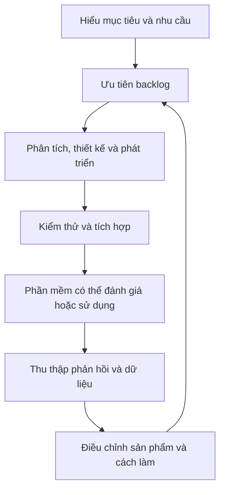

# Phát triển Agile là gì và giải quyết vấn đề nào trong phần mềm

## 1. Vì sao phát triển phần mềm cần một cách tiếp cận thích ứng?

Phát triển phần mềm luôn có một mức độ bất định. Khi bắt đầu dự án, nhóm có thể biết mục tiêu kinh doanh nhưng chưa hiểu đầy đủ nhu cầu của người dùng. Một quy trình nghiệp vụ có thể thay đổi sau khi khách hàng thử phiên bản đầu tiên. Công nghệ, quy định, đối thủ hoặc ưu tiên của tổ chức cũng có thể thay đổi trong lúc sản phẩm đang được xây dựng.

Nếu nhóm cố định toàn bộ yêu cầu, thiết kế và kế hoạch từ rất sớm, rồi chỉ bàn giao sản phẩm ở cuối dự án, rủi ro thường chỉ lộ ra khi chi phí sửa đổi đã cao. Nhóm có thể hoàn thành đúng tài liệu nhưng tạo ra phần mềm ít người dùng cần; tích hợp các phần việc quá muộn; phát hiện lỗi kiến trúc hoặc chất lượng khi gần đến ngày phát hành; hoặc mất nhiều thời gian chờ phê duyệt và bàn giao giữa các bộ phận.

Phát triển Agile ra đời để giúp nhóm làm việc hiệu quả trong bối cảnh đó. Agile tổ chức công việc thành những phần nhỏ có thể kiểm tra, đưa kết quả đến người dùng hoặc bên liên quan sớm, học từ phản hồi thực tế và điều chỉnh hướng đi thường xuyên. Nhóm vẫn lập kế hoạch và quản lý rủi ro, nhưng xem kế hoạch là thứ cần được cập nhật khi có thêm thông tin.

## 2. Agile là gì?

**Agile (phát triển linh hoạt)** là cách tiếp cận phát triển sản phẩm dựa trên các giá trị và nguyên tắc đề cao con người, sự cộng tác, sản phẩm hoạt động được, phản hồi thường xuyên và khả năng thích ứng với thay đổi. Trong phát triển phần mềm, Agile giúp nhóm tạo ra giá trị theo từng phần nhỏ, kiểm tra giả định sớm và cải tiến cả sản phẩm lẫn cách làm việc.

Agile không phải tên của một quy trình duy nhất. Đây là một tư duy và tập hợp nguyên tắc được hiện thực hóa bằng nhiều phương pháp, khung làm việc và kỹ thuật khác nhau. Scrum, Kanban và Extreme Programming (XP) là những cách thực hành phổ biến, có thể dùng riêng hoặc kết hợp tùy bối cảnh.

Hai đặc điểm thường đi cùng nhau trong phát triển Agile là:

- **Tăng dần (incremental):** sản phẩm được xây dựng và mở rộng qua nhiều phần có giá trị. Mỗi phần hoàn thành bổ sung khả năng mới vào sản phẩm.
- **Lặp (iterative):** nhóm thường xuyên xem xét kết quả, nhận phản hồi và điều chỉnh giải pháp qua các vòng làm việc.

Một nhóm có thể vừa phát triển tăng dần vừa cải tiến lặp lại. Ví dụ, nhóm xây dựng chức năng đặt lịch theo từng phần: trước tiên người dùng xem được khung giờ trống, sau đó đặt lịch, tiếp theo nhận thông báo và cuối cùng quản lý việc đổi hoặc hủy lịch. Sau mỗi phần, nhóm kiểm tra cách người dùng thực sự sử dụng để điều chỉnh trải nghiệm và thứ tự ưu tiên.

### Agile không có nghĩa là gì?

Để tránh hiểu sai, cần phân biệt Agile với một số quan niệm phổ biến:

| Quan niệm sai | Cách hiểu phù hợp |
|---|---|
| Agile nghĩa là không cần kế hoạch | Nhóm lập kế hoạch ở nhiều mức độ và cập nhật kế hoạch khi có thông tin mới. |
| Agile nghĩa là chấp nhận mọi thay đổi ngay lập tức | Nhóm đánh giá giá trị, chi phí, rủi ro và tác động của thay đổi rồi mới sắp xếp ưu tiên. |
| Agile nghĩa là không cần tài liệu | Nhóm tạo tài liệu vừa đủ để cộng tác, vận hành, bảo trì, tuân thủ và chuyển giao kiến thức. |
| Agile nghĩa là làm nhanh bằng cách bỏ qua kiểm thử | Chất lượng kỹ thuật và kiểm thử liên tục giúp nhóm duy trì tốc độ bền vững. |
| Agile chỉ là Scrum hoặc họp Daily | Scrum là một khung làm việc; Agile rộng hơn và còn có nhiều cách thực hành khác. |
| Agile nghĩa là không có vai trò hay trách nhiệm rõ ràng | Nhóm vẫn cần mục tiêu, quyền quyết định, trách nhiệm và cách phối hợp minh bạch. |

## 3. Các giá trị và nguyên tắc nền tảng

Tuyên ngôn Agile cho phát triển phần mềm nêu bốn giá trị cốt lõi. Các yếu tố ở vế phải vẫn có giá trị, nhưng nhóm coi trọng các yếu tố ở vế trái hơn khi phải lựa chọn cách làm.

1. **Cá nhân và sự tương tác** hơn quy trình và công cụ. Công cụ tốt không thể thay thế trao đổi rõ ràng, tin cậy và khả năng phối hợp giữa những người làm sản phẩm.
2. **Phần mềm chạy được** hơn tài liệu đầy đủ. Kết quả hoạt động được giúp kiểm chứng tiến độ và giá trị trực tiếp; tài liệu vẫn cần thiết khi hỗ trợ hiểu, sử dụng, vận hành hoặc bảo trì sản phẩm.
3. **Cộng tác với khách hàng** hơn đàm phán hợp đồng. Khách hàng và bên liên quan tham gia thường xuyên để nhóm hiểu đúng vấn đề và điều chỉnh giải pháp.
4. **Phản hồi với thay đổi** hơn bám sát kế hoạch. Kế hoạch là công cụ định hướng; khi giả định ban đầu không còn đúng, nhóm cần cập nhật kế hoạch dựa trên bằng chứng.

Các nguyên tắc Agile diễn giải những giá trị này thành hành vi cụ thể. Có thể nhóm chúng thành các chủ đề sau:

- **Tạo giá trị sớm và liên tục:** ưu tiên làm hài lòng khách hàng bằng việc cung cấp phần mềm có giá trị sớm, sau đó tiếp tục bàn giao đều đặn.
- **Chấp nhận thay đổi có chọn lọc:** xem thay đổi yêu cầu là cơ hội cải thiện sản phẩm, kể cả khi thay đổi xuất hiện muộn; đồng thời đánh giá tác động và điều chỉnh phạm vi, kế hoạch phù hợp.
- **Cộng tác thường xuyên:** người làm nghiệp vụ và người phát triển trao đổi trong suốt dự án; giao tiếp trực tiếp giúp giảm hiểu nhầm và thời gian chờ.
- **Trao quyền cho nhóm:** xây dựng công việc quanh những cá nhân có động lực, cung cấp môi trường và sự hỗ trợ cần thiết, rồi tin tưởng nhóm tổ chức cách hoàn thành mục tiêu.
- **Đo tiến độ bằng kết quả:** phần mềm hoạt động được là thước đo tiến độ quan trọng hơn số lượng tài liệu hoặc phần trăm công việc báo cáo.
- **Duy trì nhịp độ bền vững:** nhóm, khách hàng và nhà tài trợ cần có khả năng duy trì nhịp làm việc lâu dài.
- **Chú trọng kỹ thuật và thiết kế tốt:** chất lượng kỹ thuật, thiết kế phù hợp và sự đơn giản giúp nhóm dễ thay đổi sản phẩm hơn.
- **Thường xuyên cải tiến:** nhóm định kỳ nhìn lại cách làm, xác định trở ngại và thử những điều chỉnh cụ thể.

Những nguyên tắc này bổ trợ lẫn nhau. Bàn giao thường xuyên mà thiếu kiểm thử có thể làm chất lượng suy giảm. Trao quyền mà thiếu mục tiêu chung có thể khiến các thành viên đi theo nhiều hướng. Nhận phản hồi mà không điều chỉnh thứ tự ưu tiên sẽ không tạo ra giá trị của việc học hỏi. Agile cần một hệ thống thực hành nhất quán, không phải vài nghi thức rời rạc.

## 4. Agile giải quyết những vấn đề nào trong phát triển phần mềm?

Agile không tự động loại bỏ mọi rủi ro của dự án. Cách tiếp cận này giúp nhóm phát hiện vấn đề sớm hơn, giảm chi phí của một số quyết định sai và thích ứng có chủ đích khi bối cảnh thay đổi.

### 4.1. Yêu cầu chưa rõ hoặc thường xuyên thay đổi

**Vấn đề:** Người dùng thường mô tả nhu cầu bằng mong muốn hoặc giải pháp giả định. Khi nhìn thấy phần mềm thực tế, họ mới nhận ra điều gì hữu ích, khó hiểu hoặc còn thiếu. Nếu nhóm khóa yêu cầu quá sớm, sản phẩm có thể không còn phù hợp khi được bàn giao.

**Agile xử lý:** chia mục tiêu thành các hạng mục nhỏ, sắp xếp theo giá trị và kiểm tra thường xuyên với người dùng. Phản hồi mới được đưa vào backlog để nhóm xem xét và ưu tiên. Nhờ đó, nhóm có thể thay đổi thứ tự thực hiện trước khi đầu tư quá nhiều vào một giả định sai.

**Ví dụ:** nhóm xây dựng ứng dụng đặt lịch cho phòng khám ban đầu cho rằng người dùng cần bộ lọc theo bác sĩ. Bản thử nghiệm cho thấy người dùng thường tìm theo chuyên khoa và khung giờ trước. Nhóm cập nhật thứ tự ưu tiên để cải thiện luồng tìm kiếm trước khi phát triển các bộ lọc ít được sử dụng.

### 4.2. Phát hiện sai lệch và rủi ro quá muộn

**Vấn đề:** Khi tích hợp, kiểm thử hoặc trình diễn chỉ diễn ra gần cuối dự án, lỗi tương thích, thiếu chức năng và khác biệt giữa kỳ vọng với sản phẩm có thể tích tụ. Việc sửa chữa khi đó thường tốn kém và ảnh hưởng nhiều phần liên quan.

**Agile xử lý:** hoàn thành các phần nhỏ theo một nhịp đều đặn, tích hợp và kiểm thử liên tục, trình diễn kết quả cho bên liên quan. Mỗi vòng phản hồi tạo cơ hội phát hiện sai lệch khi phạm vi thay đổi còn giới hạn.

**Ví dụ:** thay vì chờ hoàn thành toàn bộ hệ thống thanh toán mới tích hợp, nhóm tích hợp một luồng thanh toán đơn giản từ sớm trong môi trường kiểm thử. Nhóm phát hiện vấn đề với cổng thanh toán và xử lý trước khi mở rộng sang hoàn tiền, mã giảm giá và đối soát.

### 4.3. Bàn giao giá trị chậm

**Vấn đề:** Dự án có thể dành nhiều tháng để hoàn thành một gói lớn. Trong thời gian đó, khách hàng chưa nhận được lợi ích và nhóm chưa có dữ liệu sử dụng thực tế để kiểm chứng quyết định.

**Agile xử lý:** chia sản phẩm thành các phần có thể sử dụng hoặc đánh giá độc lập. Nhóm ưu tiên khả năng mang lại giá trị sớm, phát hành theo từng đợt khi đáp ứng điều kiện chất lượng và vận hành.

**Ví dụ:** một hệ thống quản lý kho có thể phát hành trước chức năng xem tồn kho và ghi nhận nhập xuất cơ bản. Sau khi nhân viên kho sử dụng, nhóm tiếp tục bổ sung cảnh báo tồn thấp và báo cáo nâng cao dựa trên nhu cầu quan sát được.

### 4.4. Công việc bị chia cắt giữa nhiều bộ phận

**Vấn đề:** Phân tích, thiết kế, lập trình, kiểm thử và vận hành có thể hoạt động như các khâu tách biệt. Mỗi khâu hoàn thành phần việc của mình rồi chờ khâu tiếp theo, khiến thời gian chờ và chi phí phối hợp tăng lên.

**Agile xử lý:** khuyến khích nhóm đa chức năng cùng chịu trách nhiệm về một mục tiêu sản phẩm. Công việc được hiển thị rõ, các trở ngại được đưa ra thảo luận sớm và nhóm phối hợp để đưa một hạng mục từ ý tưởng đến trạng thái hoàn thành.

**Ví dụ:** khi một câu chuyện người dùng bị chặn vì thiếu dữ liệu kiểm thử, lập trình viên, kiểm thử viên và người phụ trách nghiệp vụ cùng làm rõ dữ liệu cần có thay vì chuyển yêu cầu qua nhiều hàng đợi riêng biệt.

### 4.5. Chất lượng suy giảm khi phải thay đổi nhanh

**Vấn đề:** Nếu nhóm liên tục bổ sung tính năng mà không kiểm soát chất lượng, nợ kỹ thuật, lỗi hồi quy và độ phức tạp sẽ tăng. Mỗi thay đổi tiếp theo trở nên khó khăn hơn.

**Agile xử lý:** đưa thực hành kỹ thuật vào công việc hằng ngày, chẳng hạn kiểm thử tự động, tích hợp liên tục, rà soát mã, tái cấu trúc và định nghĩa rõ điều kiện hoàn thành. Nhóm dành năng lực để duy trì khả năng thay đổi của sản phẩm.

**Ví dụ:** một thay đổi về tính phí được bảo vệ bởi bộ kiểm thử tự động cho các trường hợp tính tiền hiện có. Khi sửa logic, nhóm có thể phát hiện sớm nếu một quy tắc cũ bị ảnh hưởng.

### 4.6. Thiếu minh bạch về tiến độ và trở ngại

**Vấn đề:** Báo cáo theo phần trăm hoàn thành có thể tạo cảm giác dự án đang tiến triển dù phần mềm chưa chạy được hoặc công việc đang mắc kẹt. Quản lý và các bên liên quan khó biết khi nào một phần giá trị thực sự sẵn sàng.

**Agile xử lý:** hiển thị backlog, trạng thái công việc, giới hạn công việc đang làm và kết quả đã hoàn thành. Nhóm xem xét sản phẩm hoạt động được cùng các chỉ số dòng công việc để hiểu tình hình và điều chỉnh.

**Ví dụ:** bảng Kanban cho thấy nhiều hạng mục đang chờ kiểm thử. Nhóm nhận ra nút thắt nằm ở năng lực kiểm thử và phối hợp để giảm việc bắt đầu mới, hỗ trợ xử lý các hạng mục đang chờ.

## 5. Vòng phản hồi trong một cách làm Agile

Một vòng làm việc Agile thường bắt đầu từ mục tiêu hoặc vấn đề của người dùng. Nhóm làm rõ nhu cầu, chọn phần việc ưu tiên, xây dựng và kiểm tra giải pháp, sau đó đưa kết quả đến người dùng hoặc bên liên quan để học hỏi. Kết quả phản hồi ảnh hưởng đến backlog và kế hoạch tiếp theo.



Vòng phản hồi có thể diễn ra ở nhiều quy mô: trong lúc lập trình qua kiểm thử và tích hợp liên tục; hằng ngày khi nhóm đồng bộ và xử lý trở ngại; sau mỗi đợt bàn giao khi trình diễn sản phẩm; hoặc định kỳ khi nhóm nhìn lại cách phối hợp. Phản hồi càng gần thời điểm quyết định liên quan, nhóm càng có cơ hội xử lý vấn đề khi thông tin còn mới.

Một hạng mục chỉ nên được xem là hoàn thành khi đáp ứng tiêu chí chất lượng đã thống nhất. Tùy sản phẩm, điều đó có thể bao gồm mã đã được rà soát, kiểm thử đạt, tài liệu cần thiết được cập nhật, yêu cầu bảo mật được kiểm tra và khả năng triển khai đã sẵn sàng. Hoàn thành phần lập trình nhưng chưa tích hợp hoặc chưa kiểm thử thường chưa tạo ra một phần tăng trưởng đáng tin cậy của sản phẩm.

## 6. Các khái niệm và thực hành thường gặp

Agile Development bao gồm nhiều cách tổ chức công việc. Các khái niệm dưới đây tạo nền tảng để hiểu và lựa chọn cách thực hành phù hợp.

### 6.1. User story và tiêu chí chấp nhận

**User story (câu chuyện người dùng)** mô tả nhu cầu từ góc nhìn của người sử dụng hoặc bên liên quan. Một mẫu diễn đạt thường dùng là:

> Với vai trò là [đối tượng], tôi muốn [khả năng], để [lợi ích].

Ví dụ: “Với vai trò là bệnh nhân, tôi muốn xem các khung giờ còn trống để chọn thời điểm phù hợp cho buổi khám.”

User story là lời nhắc để trao đổi, không phải bản đặc tả hoàn chỉnh. Nhóm cần làm rõ bối cảnh, quy tắc nghiệp vụ, ngoại lệ và cách xác nhận kết quả. **Tiêu chí chấp nhận (acceptance criteria)** mô tả những điều kiện cụ thể mà chức năng phải đáp ứng. Chẳng hạn:

- Chỉ hiển thị các khung giờ còn có thể đặt.
- Múi giờ hiển thị phải phù hợp với địa điểm của phòng khám.
- Khi khung giờ vừa được người khác đặt, người dùng nhận được thông báo phù hợp và có thể chọn khung giờ khác.

Tiêu chí rõ ràng giúp người làm nghiệp vụ, lập trình viên và kiểm thử viên hiểu cùng một kết quả mong đợi. Nhóm nên trao đổi sớm để phát hiện trường hợp biên trước khi phát triển.

### 6.2. Product backlog và ưu tiên

**Backlog sản phẩm (product backlog)** là danh sách được sắp xếp theo thứ tự ưu tiên gồm các công việc có thể giúp cải thiện sản phẩm: tính năng, lỗi, nghiên cứu, cải thiện kỹ thuật hoặc yêu cầu tuân thủ. Backlog được cập nhật khi nhóm học thêm về người dùng và sản phẩm.

Một hạng mục backlog tốt thường có mục tiêu dễ hiểu, đủ thông tin để nhóm thảo luận, kích thước phù hợp để thực hiện và cách xác nhận kết quả. Nhóm có thể ưu tiên dựa trên giá trị người dùng, mức độ cấp thiết, rủi ro, chi phí, sự phụ thuộc và mục tiêu kinh doanh. Không nên chỉ ưu tiên theo người yêu cầu có chức danh cao nhất hoặc theo việc nào dễ làm nhất.

### 6.3. Scrum

**Scrum** là một khung làm việc giúp một nhóm tạo giá trị qua các Sprint có độ dài cố định, thường không quá một tháng. Scrum cung cấp trách nhiệm, sự kiện và tạo tác để nhóm kiểm tra tiến độ hướng tới mục tiêu và thích ứng.

Ba trách nhiệm trong Scrum gồm:

- **Product Owner:** tối đa hóa giá trị sản phẩm và quản lý hiệu quả Product Backlog.
- **Scrum Master:** thiết lập Scrum theo đúng tinh thần, hỗ trợ hiệu quả của nhóm và giúp loại bỏ trở ngại trong phạm vi có thể.
- **Developers:** những người tạo ra Increment có thể sử dụng được trong mỗi Sprint; họ tự tổ chức công việc cần thiết để đạt Sprint Goal.

Các sự kiện chính gồm Sprint, Sprint Planning, Daily Scrum, Sprint Review và Sprint Retrospective. Ba tạo tác chính là Product Backlog, Sprint Backlog và Increment; mỗi tạo tác gắn với một cam kết tương ứng: Product Goal, Sprint Goal và Definition of Done. Những yếu tố này tạo nhịp để nhóm lập kế hoạch, phối hợp, kiểm tra kết quả và cải tiến.

Scrum phù hợp khi nhóm cần nhịp lập kế hoạch và phản hồi đều đặn quanh một mục tiêu sản phẩm. Nhóm cần hiểu mục đích của từng sự kiện, tránh biến chúng thành thủ tục báo cáo mà không tạo ra quyết định hoặc cải tiến.

### 6.4. Kanban

**Kanban** tập trung quản lý dòng công việc liên tục. Nhóm trực quan hóa công việc trên bảng với các trạng thái phản ánh quy trình thực tế, giới hạn số lượng việc đang làm (Work in Progress - WIP), theo dõi dòng công việc và cải tiến quy trình.

Ví dụ một bảng đơn giản:

```text
Backlog | Sẵn sàng | Đang làm | Đang kiểm thử | Hoàn thành
```

Giới hạn WIP giúp nhóm tránh mở quá nhiều việc cùng lúc. Khi một cột đạt giới hạn, thành viên nên hỗ trợ đưa việc hiện tại tiến lên thay vì tiếp tục bắt đầu việc mới. Nhờ vậy, nhóm có thể giảm chuyển đổi ngữ cảnh và phát hiện nút thắt.

Kanban phù hợp với công việc đến liên tục, cần xử lý theo thứ tự ưu tiên thay đổi hoặc có luồng hỗ trợ và bảo trì. Bảng chỉ có ích khi phản ánh đúng trạng thái, có quy tắc chuyển cột rõ ràng và được dùng để điều chỉnh công việc thực tế.

### 6.5. Extreme Programming (XP)

**Extreme Programming (XP)** nhấn mạnh các thực hành kỹ thuật giúp nhóm phát triển và thay đổi phần mềm an toàn. Những thực hành thường được nhắc đến gồm:

- Phát triển hướng kiểm thử (Test-Driven Development - TDD): viết kiểm thử trước, triển khai để kiểm thử đạt, rồi tái cấu trúc.
- Lập trình cặp (pair programming): hai người cùng giải quyết một nhiệm vụ trên cùng một máy hoặc phiên làm việc.
- Tích hợp liên tục: tích hợp thay đổi thường xuyên và tự động kiểm tra để phát hiện lỗi sớm.
- Tái cấu trúc: cải thiện cấu trúc mã mà không thay đổi hành vi mong muốn.
- Thiết kế đơn giản và phát hành nhỏ: giải quyết nhu cầu hiện tại với cấu trúc dễ hiểu, đưa phần mềm đến người dùng thường xuyên.

XP đặc biệt hữu ích khi nhóm cần nâng cao chất lượng mã và duy trì khả năng thay đổi nhanh. Một số thực hành có thể được áp dụng ngay cả khi nhóm đang dùng Scrum hoặc Kanban.

## 7. Đo lường để cải thiện dòng công việc

Đo lường trong Agile nhằm giúp nhóm hiểu hệ thống làm việc và đưa ra quyết định tốt hơn. Chỉ số nên được xem cùng bối cảnh, xu hướng và chất lượng; một con số riêng lẻ hiếm khi giải thích đầy đủ hiệu quả.

| Chỉ số | Ý nghĩa | Câu hỏi có thể trả lời |
|---|---|---|
| Lead time | Thời gian từ khi yêu cầu được ghi nhận đến khi kết quả được bàn giao, theo mốc nhóm đã định nghĩa | Người yêu cầu phải chờ bao lâu để nhận kết quả? |
| Cycle time | Thời gian từ khi nhóm bắt đầu xử lý một hạng mục đến khi hoàn thành | Khi đã bắt đầu, công việc thường mất bao lâu để đi hết quy trình? |
| Throughput | Số hạng mục hoàn thành trong một khoảng thời gian | Nhóm hoàn thành được bao nhiêu hạng mục trong mỗi tuần hoặc tháng? |
| WIP | Số hạng mục đang được xử lý tại một thời điểm | Nhóm có đang bắt đầu quá nhiều việc cùng lúc không? |
| Work item age | Thời gian một hạng mục đang mở đã nằm trong quy trình | Có công việc nào bị mắc kẹt lâu bất thường không? |
| Lỗi sau phát hành | Lỗi được phát hiện sau khi phiên bản đến người dùng | Chất lượng của phần bàn giao đang ảnh hưởng thế nào đến người dùng? |

Nhóm nên dùng các chỉ số dòng công việc để tìm điểm nghẽn và thử cải tiến. Ví dụ, nếu cycle time tăng và nhiều hạng mục chờ kiểm thử, nhóm có thể xem lại kích thước hạng mục, cách chuẩn bị dữ liệu, tự động hóa kiểm thử hoặc cách phân bổ hỗ trợ.

Trong Scrum, velocity đôi khi được dùng để hỗ trợ dự báo nội bộ dựa trên lượng công việc nhóm hoàn thành qua các Sprint. Velocity phụ thuộc cách ước lượng và bối cảnh riêng của nhóm; không nên dùng để so sánh năng suất giữa các nhóm, đặt mục tiêu tăng điểm bằng mọi giá hoặc thay thế việc đo giá trị thực tế cho người dùng.

## 8. Khi nào nên chọn cách thực hành nào?

Không có một phương pháp Agile phù hợp với mọi nhóm. Lựa chọn nên dựa trên loại công việc, mức độ biến động, cấu trúc nhóm, nhu cầu phối hợp và khả năng phát hành.

| Bối cảnh | Cách thực hành có thể phù hợp | Điều cần chú ý |
|---|---|---|
| Nhóm phát triển một sản phẩm, cần mục tiêu và nhịp phản hồi rõ ràng | Scrum | Duy trì Product Goal, Sprint Goal và Increment có chất lượng; tránh biến sự kiện thành họp báo cáo. |
| Yêu cầu đến liên tục, ưu tiên thay đổi thường xuyên, có công việc hỗ trợ hoặc bảo trì | Kanban | Trực quan hóa luồng thực tế, giới hạn WIP và chủ động xử lý nút thắt. |
| Nhóm cần nâng cao chất lượng kỹ thuật và thay đổi mã an toàn | Thực hành XP | Áp dụng kiểm thử tự động, tích hợp liên tục, rà soát mã và tái cấu trúc phù hợp. |
| Nhóm đang học về nhu cầu người dùng và chưa chắc giải pháp nào hiệu quả | User story, thử nghiệm nhỏ và phản hồi thường xuyên | Kiểm tra giả định trước khi đầu tư lớn; xác định cách đo kết quả. |

Các cách tiếp cận này không loại trừ nhau. Một nhóm có thể dùng Sprint của Scrum, trực quan hóa và giới hạn WIP theo Kanban, đồng thời thực hành TDD và tích hợp liên tục theo XP. Việc kết hợp cần giữ rõ mục tiêu và trách nhiệm, tránh thêm nghi thức khiến công việc nặng nề mà không cải thiện kết quả.

Agile cũng không phải lựa chọn duy nhất cho mọi hoàn cảnh. Một số công việc có yêu cầu pháp lý, an toàn hoặc hợp đồng nghiêm ngặt cần bằng chứng, phê duyệt và tài liệu truy vết. Nhóm vẫn có thể làm việc theo hướng Agile bằng cách tích hợp các yêu cầu đó vào backlog, tiêu chí hoàn thành, kiểm thử và quy trình phát hành. Mức độ linh hoạt cần phù hợp với rủi ro và nghĩa vụ thực tế của sản phẩm.

## 9. Bắt đầu áp dụng Agile như thế nào?

Một nhóm mới áp dụng Agile có thể bắt đầu từ quy mô nhỏ và học qua kết quả thực tế:

1. **Làm rõ mục tiêu sản phẩm:** xác định người dùng, vấn đề cần giải quyết, kết quả mong đợi và cách nhận biết giá trị.
2. **Tạo backlog ban đầu:** ghi lại nhu cầu, lỗi, rủi ro và việc kỹ thuật; sắp xếp theo giá trị và mức độ cần thiết.
3. **Chọn một phần việc nhỏ có thể hoàn thành:** chia nhỏ hạng mục để có thể xây dựng, kiểm thử và đánh giá trong thời gian ngắn.
4. **Thống nhất chất lượng:** làm rõ tiêu chí chấp nhận và Definition of Done phù hợp với sản phẩm, bao gồm kiểm thử, bảo mật, tài liệu và khả năng vận hành khi cần.
5. **Tạo vòng phản hồi:** đưa kết quả đến người dùng hoặc bên liên quan, ghi nhận điều đã học và cập nhật backlog.
6. **Quan sát dòng công việc:** xem việc nào đang chờ, bị chặn hoặc kéo dài; thử giới hạn WIP và giải quyết nút thắt.
7. **Cải tiến có kiểm chứng:** chọn một thay đổi nhỏ cho cách làm, theo dõi tác động rồi quyết định tiếp tục, điều chỉnh hoặc dừng.

Ví dụ, nhóm có thể thử trong một chu kỳ ngắn với mục tiêu “người dùng đặt được một lịch khám hợp lệ”. Nhóm thống nhất luồng tối thiểu, tiêu chí chấp nhận, kiểm thử và người có thể phản hồi. Sau khi bàn giao, nhóm quan sát tỷ lệ đặt lịch thành công, các bước người dùng bỏ dở và phản hồi của nhân viên tiếp nhận. Dữ liệu đó giúp nhóm quyết định nên cải thiện giao diện, quy tắc chọn giờ hay thông báo xác nhận.

## 10. Những dấu hiệu cho thấy nhóm đang thực hành Agile có hiệu quả

Hiệu quả không được xác định bằng số cuộc họp, số thẻ di chuyển trên bảng hoặc việc nhóm có gọi mình là Agile hay không. Một số dấu hiệu hữu ích hơn gồm:

- Người dùng hoặc bên liên quan thường xuyên nhìn thấy kết quả có thể đánh giá và phản hồi có ảnh hưởng đến ưu tiên.
- Nhóm có thể giải thích mục tiêu hiện tại và lý do chọn công việc đang làm.
- Hạng mục được hoàn thành theo từng phần nhỏ, có chất lượng và ít bị mắc kẹt lâu.
- Vấn đề về tích hợp, kiểm thử, phụ thuộc và rủi ro được phát hiện sớm.
- Nhóm hiểu rõ giới hạn công việc đang làm và phối hợp để xử lý nút thắt.
- Thay đổi được cân nhắc dựa trên giá trị và tác động, không làm mất mục tiêu chung.
- Nhóm có thể duy trì nhịp làm việc, cải thiện quy trình và chất lượng qua thời gian.
- Sản phẩm tạo ra kết quả có thể quan sát được, chẳng hạn giảm thời gian xử lý, tăng tỷ lệ hoàn thành tác vụ hoặc giảm lỗi ảnh hưởng đến người dùng.

Nếu nhóm tổ chức đủ sự kiện nhưng phản hồi không làm thay đổi quyết định, công việc vẫn chờ qua nhiều bộ phận hoặc sản phẩm chỉ được kiểm thử vào cuối dự án, các thực hành Agile có thể đang được áp dụng hình thức. Khi đó, nên tìm nguyên nhân trong cách ưu tiên, quyền quyết định, quy mô hạng mục, chất lượng kỹ thuật và dòng công việc.

## 11. Kết luận

Agile là cách tiếp cận phát triển phần mềm thích ứng dựa trên việc tạo giá trị theo từng phần, cộng tác thường xuyên, kiểm tra kết quả và cải tiến liên tục. Cách tiếp cận này đặc biệt hữu ích khi yêu cầu chưa chắc chắn, sản phẩm cần phản hồi từ người dùng, rủi ro tích hợp và chất lượng cần được phát hiện sớm, hoặc công việc bị chậm do nhiều điểm bàn giao.

Scrum, Kanban, XP, user story, backlog và các chỉ số dòng công việc cung cấp những cách thực hành khác nhau để biến các giá trị Agile thành hành động. Nhóm nên lựa chọn và điều chỉnh chúng dựa trên mục tiêu sản phẩm, loại công việc và bối cảnh vận hành. Điều quan trọng là duy trì khả năng bàn giao phần mềm có chất lượng, học từ bằng chứng và thay đổi hướng đi khi điều đó giúp tạo ra giá trị tốt hơn.
