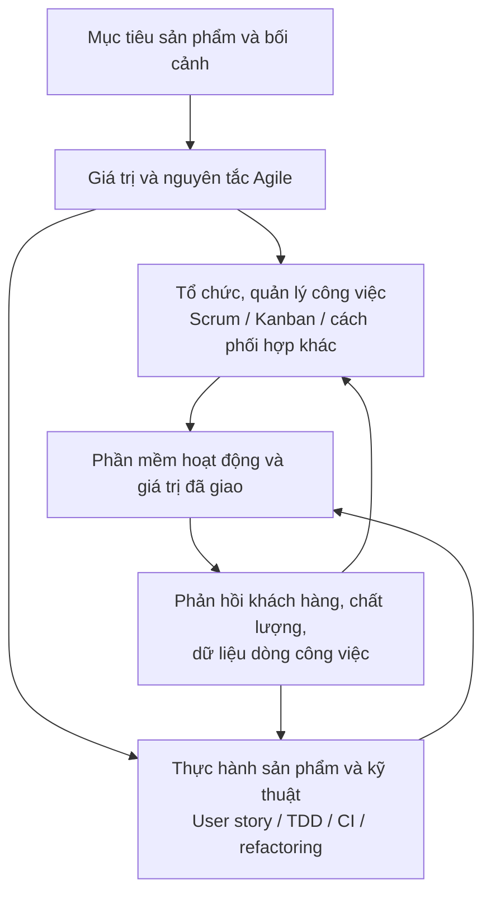

# Phân biệt Agile, phương pháp, khung làm việc và thực hành kỹ thuật

Một nhóm nói rằng họ "làm Agile" vì có bảng công việc, họp hằng ngày và chia việc thành các Sprint. Nhóm khác không dùng Sprint nhưng liên tục giao phần mềm có ích, lấy phản hồi khách hàng, cải tiến cách làm và giữ chất lượng kỹ thuật. Nhóm nào thực sự làm việc theo tinh thần Agile?

Câu trả lời không nằm ở tên cuộc họp hay công cụ. **Agile định hướng cách ra quyết định và thích ứng; phương pháp và khung làm việc giúp tổ chức công việc; thực hành kỹ thuật giúp biến quyết định thành phần mềm đáng tin cậy.** Các lớp này liên quan chặt chẽ nhưng không đồng nghĩa.

Trong phát triển phần mềm, phân biệt đúng những khái niệm này giúp đội ngũ lựa chọn Scrum, Kanban, Extreme Programming (XP), user story, backlog hay các kỹ thuật chất lượng một cách có chủ đích, thay vì áp dụng máy móc chỉ vì chúng được gắn nhãn "Agile".

## 1. Kết quả học tập

Sau bài này, bạn có thể:

- Giải thích Agile là hệ giá trị và nguyên tắc hướng đến giao giá trị sớm, học từ phản hồi và thích ứng với thay đổi.
- Phân biệt **phương pháp** (*method*), **khung làm việc** (*framework*), **quy trình**, **thực hành** (*practice*) và **công cụ** (*tool*).
- Xác định vai trò khác nhau của Scrum, Kanban, XP, user story, backlog, TDD và CI.
- Nhận biết trường hợp một đội "làm đúng nghi thức" nhưng chưa đạt mục tiêu Agile.
- Đề xuất cách phối hợp phù hợp với bối cảnh sản phẩm, luồng công việc và yêu cầu chất lượng.

## 2. Agile là gì và không phải là gì?

### 2.1. Agile bắt đầu từ giá trị và nguyên tắc

Tuyên ngôn Agile trong phát triển phần mềm (*Manifesto for Agile Software Development*, năm 2001) nêu bốn ưu tiên:

| Ưu tiên cao hơn | Vẫn có giá trị, nhưng không phải ưu tiên cao nhất |
| --- | --- |
| Con người và sự tương tác | Quy trình và công cụ |
| Phần mềm hoạt động được | Tài liệu đầy đủ, chi tiết |
| Cộng tác với khách hàng | Thương lượng hợp đồng |
| Phản hồi và thích ứng với thay đổi | Bám sát một kế hoạch đã định |

Điểm dễ hiểu sai nhất là vế bên phải **không bị phủ nhận**. Agile vẫn cần công cụ, tài liệu, hợp đồng và kế hoạch; chỉ không để chúng che khuất nhu cầu hợp tác và kết quả thực tế. Ví dụ, một tài liệu về quy định bảo mật có thể rất quan trọng; câu hỏi Agile đặt ra là tài liệu ấy giúp tạo ra và kiểm chứng giá trị như thế nào.

Mười hai nguyên tắc đi kèm Tuyên ngôn nhấn mạnh giao phần mềm có giá trị sớm và thường xuyên, hoan nghênh thay đổi có ích, người làm sản phẩm và người làm kỹ thuật phối hợp, tốc độ phát triển bền vững, chú trọng kỹ thuật và thiết kế tốt, đơn giản hóa, tự tổ chức và thường xuyên nhìn lại để cải tiến.

Từ đây có thể hiểu **Agile là một cách tư duy và tập hợp định hướng làm việc**: giảm thời gian chờ trước khi nhận phản hồi đáng tin cậy, dùng những gì học được để điều chỉnh ưu tiên, và duy trì khả năng tiếp tục thay đổi sản phẩm. Agile không quy định một lịch họp, tên vai trò hay phần mềm quản lý công việc thống nhất cho mọi đội.

### 2.2. Ba cơ chế cốt lõi: giao tăng dần, học qua vòng lặp, cải tiến liên tục

- **Giao tăng dần (*incremental*)**: bổ sung các phần chức năng có thể sử dụng và kiểm chứng qua từng lần giao. Mỗi lần giao thêm giá trị vào sản phẩm đã có.
- **Phát triển lặp (*iterative*)**: quay lại xem xét hoặc điều chỉnh giải pháp dựa trên điều vừa học. Một trải nghiệm có thể được sửa qua nhiều vòng trước khi phù hợp với người dùng.
- **Phản hồi và thích ứng**: quan sát cách người dùng dùng sản phẩm, lỗi phát sinh, số liệu vận hành và ý kiến bên liên quan; sau đó thay đổi backlog, thiết kế hoặc cách phối hợp.

Ba cơ chế bổ trợ nhau. Một nhóm có thể giao nhiều phiên bản nhưng không học gì từ phản hồi; khi đó tốc độ phát hành cao chưa chắc tạo ra tính thích ứng. Ngược lại, nhóm họp liên tục mà không có phần mềm hoạt động để kiểm chứng cũng khó biết giả định của mình đúng hay sai.

**Ví dụ:** Đội phát triển tính năng đặt hàng ban đầu đưa ra luồng thanh toán ngắn gọn. Sau khi quan sát người dùng bỏ dở ở bước nhập địa chỉ, đội sửa cách hiển thị và thử nghiệm lại. Lần phát hành đầu là một *increment*; việc thay đổi trải nghiệm theo dữ liệu là một *iteration*; quyết định dựa trên phản hồi thể hiện tư duy Agile.

## 3. Các khái niệm thường bị trộn lẫn

Thuật ngữ trong thực tế có phần giao nhau. Một tài liệu có thể gọi Scrum là "phương pháp" theo nghĩa phổ thông, trong khi **Scrum Guide tự định nghĩa Scrum là một *framework***. Khi cần phân tích chính xác, nên dùng cách tự định nghĩa của từng cách tiếp cận và làm rõ mình đang nói đến lớp nào.

| Khái niệm | Trả lời câu hỏi | Đặc điểm | Ví dụ |
| --- | --- | --- | --- |
| **Tư duy, giá trị, nguyên tắc** (*mindset, values, principles*) | Vì sao và theo tiêu chí nào ta ra quyết định? | Định hướng hành vi; không chỉ ra một quy trình duy nhất | Giá trị và 12 nguyên tắc Agile |
| **Phương pháp** (*method, methodology*) | Ta theo đuổi mục tiêu và quản lý công việc bằng cách tiếp cận nào? | Có nguyên tắc, chính sách và nhóm thực hành tương đối nhất quán | Kanban Method; Extreme Programming (XP) |
| **Khung làm việc** (*framework*) | Cấu trúc phối hợp tối thiểu nào giúp đội vận hành và học hỏi? | Xác định các thành phần và quan hệ; để lại chỗ cho đội lựa chọn cách thực hiện chi tiết | Scrum |
| **Quy trình, luồng công việc** (*process, workflow*) | Công việc cụ thể đi qua những bước và điều kiện nào? | Mô tả thứ tự, đầu vào, đầu ra, trạng thái hoặc quy tắc bàn giao | Yêu cầu → phân tích → xây dựng → kiểm tra → triển khai |
| **Thực hành** (*practice*) | Ta lặp lại hành động cụ thể nào để đạt một mục đích? | Kỹ thuật hoặc thói quen có thể học, áp dụng, đo lường, điều chỉnh | Viết user story; TDD; pair programming; WIP limit; retrospective |
| **Công cụ** (*tool*) | Ta dùng phương tiện nào để hỗ trợ công việc? | Phần mềm hoặc hạ tầng; tự nó không bảo đảm hành vi đúng | Jira, Trello, Git, Jenkins, GitHub Actions |

**Không nên hiểu bảng này là phân cấp cứng.** Một phương pháp thường bao gồm nhiều thực hành; một thực hành có thể được nhiều khung làm việc sử dụng; một công cụ có thể phục vụ nhiều quy trình khác nhau. "Methodology" đôi khi còn được dùng rộng hơn "method". Điểm quan trọng là **xác định chức năng của thuật ngữ trong ngữ cảnh**, không tranh luận chỉ vì tên gọi.

### 3.1. Sơ đồ từ định hướng đến kết quả



Sơ đồ cho thấy vì sao một khung quản lý tốt vẫn cần thực hành kỹ thuật, và vì sao kỹ thuật tốt cần kết nối với mục tiêu khách hàng. Agile được thể hiện bằng **vòng phản hồi có tác động đến quyết định**, không phải một chứng nhận rằng đội đã dùng đủ bộ công cụ.

## 4. Scrum, Kanban và XP ở vị trí nào?

Ba tên gọi này thường xuất hiện cạnh nhau trong tài liệu Agile, nhưng chúng nhấn mạnh những vấn đề khác nhau.

### 4.1. Scrum: khung làm việc để tạo giá trị trong môi trường phức tạp

Theo Scrum Guide, Scrum là **khung làm việc nhẹ** giúp cá nhân, nhóm và tổ chức tạo ra giá trị thông qua các giải pháp thích ứng cho vấn đề phức tạp. Scrum dựa trên thực nghiệm (*empiricism*) và tư duy tinh gọn: làm minh bạch thực trạng, kiểm tra thường xuyên và điều chỉnh dựa trên điều quan sát được.

Scrum mô tả những thành phần chính:

- **Trách nhiệm:** Product Owner, Scrum Master và Developers trong Scrum Team.
- **Sự kiện:** Sprint, Sprint Planning, Daily Scrum, Sprint Review và Sprint Retrospective. Sprint có độ dài cố định, tối đa một tháng theo Scrum Guide 2020.
- **Hiện vật và cam kết:** Product Backlog gắn với Product Goal; Sprint Backlog gắn với Sprint Goal; Increment gắn với Definition of Done.

Scrum cung cấp nhịp phối hợp và các cơ hội kiểm tra, thích ứng nhưng không chỉ dẫn chi tiết cách viết mã, kiểm thử hay triển khai. Đội Scrum vẫn cần lựa chọn các thực hành kỹ thuật phù hợp để tạo ra Increment đạt Definition of Done. Nếu một nhóm chỉ tổ chức đủ năm sự kiện mà không có Increment sử dụng được hoặc không thay đổi dựa trên điều đã học, nghi thức Scrum chưa đem lại kết quả mong muốn.

### 4.2. Kanban Method: quản lý dòng công việc và cải tiến dần

**Kanban Method là phương pháp quản lý công việc và cải tiến dịch vụ theo hướng tiến hóa.** Sáu nhóm thực hành phổ quát trong hướng dẫn của Kanban University gồm: trực quan hóa, giới hạn công việc đang làm (*WIP – Work in Progress*), quản lý dòng chảy, công khai chính sách, thiết lập vòng phản hồi, và cùng nhau cải tiến qua thử nghiệm.

Một bảng Kanban có các cột `To do → In progress → Review → Done` mới chỉ là **một cách trực quan hóa**. Để quản lý dòng chảy, đội còn cần biết khi nào được kéo việc mới, giới hạn bao nhiêu việc đang xử lý, xử lý việc bị tắc ra sao và quan sát thời gian hoàn tất.

Kanban Method không mặc định bắt buộc Sprint hay bộ vai trò Scrum. Nó đặc biệt hữu ích khi công việc đến liên tục, kích thước không đồng đều hoặc phải xử lý yêu cầu phát sinh như lỗi sản xuất và hỗ trợ vận hành. Dù vậy, đội sản phẩm theo Scrum cũng có thể áp dụng các thực hành Kanban để cải thiện dòng công việc bên trong Sprint.

### 4.3. Extreme Programming (XP): phương pháp phát triển phần mềm coi trọng kỷ luật kỹ thuật

**XP là một phương pháp phát triển phần mềm Agile** gắn việc phối hợp và phản hồi nhanh với các thực hành kỹ thuật hỗ trợ nhau. Những thực hành thường được nhắc đến gồm phát triển hướng kiểm thử (*test-first development / TDD*), lập trình cặp, tích hợp liên tục, tái cấu trúc mã (*refactoring*), thiết kế đơn giản, quyền sở hữu mã chung và phát hành nhỏ.

Ý tưởng quan trọng của XP là: muốn đón nhận thay đổi thường xuyên, đội phải giữ mã nguồn đủ dễ hiểu, dễ kiểm thử và dễ sửa. Nếu chỉ thúc ép giao nhanh mà bỏ qua chất lượng kỹ thuật, chi phí sửa lỗi và thay đổi ở các vòng sau sẽ tăng.

XP là ví dụ tốt cho việc một **phương pháp có thể bao gồm nhiều thực hành**; từng thực hành như TDD hoặc pair programming cũng có thể dùng riêng ở đội Scrum hay Kanban khi phù hợp.

### 4.4. Bảng so sánh thực dụng

| Tiêu chí | Scrum | Kanban Method | XP |
| --- | --- | --- | --- |
| Cách gọi sát nguồn gốc | Framework | Method | Phương pháp phát triển phần mềm |
| Vấn đề nổi bật | Phối hợp, kiểm tra và thích ứng khi giải quyết việc phức tạp | Quản lý và cải thiện luồng cung cấp dịch vụ | Giao thay đổi phần mềm thường xuyên mà giữ chất lượng mã |
| Cơ chế thường thấy | Sprint Goal, Sprint, các sự kiện và hiện vật | Trực quan hóa, WIP limit, chính sách kéo việc, vòng phản hồi | TDD/test-first, pair programming, CI, refactoring, phát hành nhỏ |
| Vai trò và nhịp thời gian | Có trách nhiệm được định nghĩa; Sprint theo timebox | Không áp đặt bộ vai trò hay Sprint cố định | Nhấn mạnh phối hợp gần gũi với khách hàng và kỷ luật kỹ thuật; không đồng nhất với lịch Scrum |
| Thiếu gì nếu chỉ áp dụng riêng? | Không tự quy định chi tiết cách làm kỹ thuật | Bảng và số liệu không tự tạo chất lượng mã hoặc định hướng sản phẩm | Thực hành mã tốt không tự quyết định thứ tự ưu tiên kinh doanh |

Không cần chọn đúng **một** ô trong bảng. Ví dụ, một đội sản phẩm sử dụng Scrum để xác lập mục tiêu ngắn hạn, giới hạn WIP theo Kanban để giảm tắc nghẽn và áp dụng TDD/CI từ XP để bảo đảm chất lượng. Việc kết hợp có ích khi nó giải quyết vấn đề quan sát được, không phải vì muốn sở hữu nhiều nhãn phương pháp.

## 5. User story, backlog và thực hành kỹ thuật là gì?

### 5.1. User story: cách diễn đạt nhu cầu từ góc nhìn người dùng

Một *user story* là kỹ thuật giúp trao đổi về nhu cầu và giá trị mong muốn, thường được viết dưới dạng:

> Là một **[nhóm người dùng]**, tôi muốn **[khả năng]** để **[lợi ích]**.

Ví dụ:

> Là khách hàng đã từng đặt hàng, tôi muốn dùng lại địa chỉ giao hàng đã lưu để hoàn tất đơn tiếp theo nhanh hơn.

Story không tự nó là đặc tả đầy đủ. Nhóm cần trao đổi để làm rõ quy tắc, ví dụ địa chỉ có thể chọn khi nào, trường bắt buộc, cách xử lý địa chỉ đã xóa, quyền truy cập dữ liệu và tiêu chí chấp nhận (*acceptance criteria*). Story hữu ích khi nó dẫn tới **một phần giá trị nhỏ có thể kiểm chứng**.

User story là **thực hành/kỹ thuật quản lý và khám phá yêu cầu**; Scrum không bắt buộc mọi Product Backlog Item phải ở định dạng user story. Tương tự, một đội Kanban cũng có thể dùng user story nếu nó giúp làm rõ công việc.

### 5.2. Backlog: danh sách công việc được quản lý và sắp thứ tự

*Backlog* nói chung là tập hợp các hạng mục chưa hoàn thành hoặc đang chờ xử lý, thường được làm rõ và sắp thứ tự theo giá trị, rủi ro, phụ thuộc và khả năng thực hiện.

Trong **Scrum**, *Product Backlog* là một **hiện vật chính thức**: danh sách có thứ tự, phát triển dần, về những gì cần để cải thiện sản phẩm; Product Owner chịu trách nhiệm tối đa hóa giá trị và quản lý Product Backlog hiệu quả. *Sprint Backlog* là hiện vật khác, thể hiện mục tiêu Sprint, những hạng mục được chọn và kế hoạch thực hiện.

Không phải mọi danh sách việc làm được đặt tên `backlog` đều là Product Backlog theo Scrum; cũng không phải đội nào dùng backlog đều thực hành Scrum. Điểm quan trọng là mỗi hạng mục có lý do tồn tại, đủ rõ để quyết định tiếp theo và có cơ chế cập nhật khi nhận phản hồi.

### 5.3. Thực hành kỹ thuật: biến thay đổi thành phần mềm đáng tin cậy

Các thực hành thường gặp:

| Thực hành | Tác dụng | Dấu hiệu sử dụng đúng |
| --- | --- | --- |
| **TDD / test-first** | Làm rõ hành vi mong đợi trước khi hiện thực; tạo lưới an toàn khi sửa mã | Kiểm thử thất bại → viết mã tối thiểu để đạt → cải tiến mã và chạy lại kiểm thử (*red–green–refactor*) |
| **Continuous Integration (CI)** | Tích hợp thay đổi thường xuyên và kiểm tra tự động để phát hiện lỗi sớm | Mỗi thay đổi được kiểm tra build/test đáng tin cậy và lỗi được xử lý sớm |
| **Refactoring** | Cải thiện cấu trúc nội bộ mà giữ nguyên hành vi quan sát được | Mã dễ hiểu hơn, kiểm thử hiện có tiếp tục đạt |
| **Pair programming / code review** | Chia sẻ hiểu biết, phát hiện rủi ro, cải thiện quyết định thiết kế | Có phản hồi kỹ thuật hữu ích, thay vì chỉ duyệt hình thức |
| **Automated testing** | Kiểm chứng hành vi, hạn chế hồi quy | Kiểm thử ổn định, tập trung vào rủi ro và chạy được khi mã thay đổi |
| **Continuous Delivery** | Duy trì khả năng đưa phiên bản đạt yêu cầu tới môi trường phát hành | Quy trình build, kiểm thử, đóng gói và đưa phần mềm ra sử dụng có thể lặp lại |

Ví dụ nhỏ về tư duy TDD với quy tắc: đơn hàng từ 500.000 đồng được miễn phí vận chuyển. Trước khi xây dựng logic, người phát triển có thể viết kiểm thử đơn vị như sau:

```java
@Test
void freeShippingStartsAtFiveHundredThousand() {
    ShippingPolicy policy = new ShippingPolicy();

    assertFalse(policy.isFreeShipping(499_999));
    assertTrue(policy.isFreeShipping(500_000));
}
```

*Đoạn mã minh họa kiểm thử JUnit; lớp `ShippingPolicy` là đối tượng cần hiện thực.* Người phát triển làm cho kiểm thử chạy được, sau đó cải thiện cách biểu diễn quy tắc và bổ sung những trường hợp liên quan. **TDD là thực hành kỹ thuật**, không phải tên gọi của một framework quản lý công việc. CI có thể thực thi kiểm thử đó tự động, còn Scrum hay Kanban giúp đội quyết định và theo dõi khi nào xử lý yêu cầu này.

**Công cụ không đồng nghĩa với thực hành:** dùng GitHub Actions không tự động nghĩa là đội đã có CI hiệu quả; một pipeline không chạy kiểm thử quan trọng hoặc luôn bị bỏ qua khi lỗi chỉ tạo cảm giác an toàn. Tương tự, bảng Jira không đồng nghĩa với Kanban Method.

## 6. Tình huống xuyên suốt: cải thiện trải nghiệm đặt hàng

Giả sử một đội phụ trách ứng dụng thương mại điện tử nhận thấy người dùng thường bỏ dở khi thanh toán. Đội chưa biết nguyên nhân chính là tốc độ tải, bước nhập địa chỉ hay thông báo phí giao hàng.

### Bước 1: Tư duy Agile xác định cách học

Thay vì khóa toàn bộ yêu cầu cho nhiều tháng, đội chọn một giả thuyết có thể kiểm chứng: **hiển thị tổng chi phí sớm hơn sẽ giảm số người bỏ dở**. Đội ưu tiên thay đổi nhỏ có thể phát hành, đồng thời dự kiến đo tỷ lệ hoàn tất đặt hàng và lắng nghe phản hồi từ hỗ trợ khách hàng.

Đây là lựa chọn dựa trên **giá trị và nguyên tắc Agile**: giao sớm, minh bạch giả thuyết và sẵn sàng đổi hướng khi có dữ liệu. Nó chưa quyết định đội dùng Scrum hay Kanban.

### Bước 2: Cách tổ chức công việc làm rõ trách nhiệm và luồng xử lý

Nếu đội sản phẩm cần phối hợp theo một mục tiêu ngắn hạn, họ có thể dùng **Scrum**: Product Owner sắp thứ tự Product Backlog, Scrum Team xây dựng một Sprint Goal liên quan đến giảm bỏ dở thanh toán, và sử dụng Sprint Review để xem kết quả cùng bên liên quan.

Nếu đội đồng thời nhận nhiều yêu cầu vận hành không dự báo được, họ có thể dùng **Kanban Method** để trực quan hóa các loại việc, đặt giới hạn WIP ở bước kiểm thử, công khai quy tắc xử lý việc khẩn cấp và theo dõi thời gian hoàn tất. Hai cách tổ chức có thể cùng tồn tại, miễn là chính sách rõ ràng và không khiến nhóm mất tập trung vào kết quả.

### Bước 3: Các kỹ thuật cụ thể giúp giao một thay đổi an toàn

- **User story:** "Là người mua hàng, tôi muốn xem tổng số tiền gồm phí giao hàng trước khi xác nhận để quyết định chính xác".
- **Acceptance criteria:** tổng tiền hiển thị đúng với các loại phí, cập nhật khi đổi địa chỉ hoặc phương thức giao, và trùng số tiền cuối cùng được thu.
- **TDD và kiểm thử tự động:** kiểm tra quy tắc tính phí, tình huống ranh giới và các lần thay đổi giá.
- **CI và code review:** kiểm tra sớm mỗi thay đổi; chia sẻ hiểu biết về rủi ro giao dịch.
- **Thực hành phản hồi:** phát hành trong phạm vi kiểm soát, theo dõi lỗi và tỷ lệ hoàn tất, sau đó xem xét lại giả thuyết.

Giả sử số liệu cho thấy người dùng vẫn bỏ dở vì khó sửa địa chỉ. Đội điều chỉnh thứ tự backlog để ưu tiên cải tiến địa chỉ. **Chính việc học và đổi quyết định này mới biểu hiện tính thích ứng**, còn Sprint, bảng Kanban, user story và kiểm thử là các cơ chế giúp đội thực hiện nó.

### Bước 4: Phân biệt đầu ra và kết quả

| Chỉ dấu | Câu hỏi được trả lời | Lưu ý |
| --- | --- | --- |
| Số story hoàn thành, số lần triển khai | Đã tạo ra bao nhiêu đầu ra? | Cần thiết để theo dõi tiến độ, nhưng không tự chứng minh giá trị |
| Tỷ lệ hoàn tất đơn, thời gian hoàn tất tác vụ | Người dùng có được lợi ích dự kiến không? | Cần so với mốc ban đầu, bối cảnh và chất lượng dữ liệu |
| Lỗi hồi quy, sự cố, thời gian phục hồi | Đổi nhanh có đang làm giảm độ tin cậy không? | Là tín hiệu để điều chỉnh kỹ thuật và chính sách phát hành |
| WIP, throughput, lead time, cycle time | Công việc có chờ đợi hoặc tắc ở đâu? | Phải thống nhất điểm bắt đầu/kết thúc đo và loại công việc |

Chẳng hạn, **lead time** thường được chọn đo từ lúc yêu cầu đi vào một điểm cam kết của luồng đến khi được hoàn tất; **cycle time** thường được chọn đo từ lúc bắt đầu thực hiện đến khi hoàn tất. Định nghĩa cụ thể có thể khác giữa các đội và hệ thống đo; hãy công bố rõ các điểm đo trước khi so sánh. **Throughput** là số hạng mục hoàn tất trong một đơn vị thời gian; **WIP** là số hạng mục đang xử lý. Các số đo nên giúp tìm tắc nghẽn và nâng độ dự đoán, không dùng một con số riêng lẻ để đánh giá năng lực cá nhân.

## 7. Những nhầm lẫn phổ biến

| Phát biểu thường gặp | Điều cần chỉnh lại |
| --- | --- |
| "Agile chính là Scrum" | Scrum là một framework có thể giúp áp dụng tư duy Agile; Agile rộng hơn Scrum. |
| "Không dùng Sprint nghĩa là không Agile" | Agile không yêu cầu Sprint; đội quản lý luồng liên tục vẫn có thể làm việc thích ứng. |
| "Dùng bảng Kanban là đã dùng Kanban Method" | Bảng chỉ trực quan hóa. Phương pháp còn bao gồm WIP limit, quản lý dòng chảy, chính sách, phản hồi và cải tiến. |
| "Agile không cần kế hoạch hoặc tài liệu" | Agile coi trọng khả năng cập nhật kế hoạch và tài liệu hữu ích, đúng mức. |
| "Story point hoặc velocity càng cao càng Agile" | Ước lượng và velocity có thể hỗ trợ một đội lập kế hoạch, nhưng không đo trực tiếp giá trị hay chất lượng; không nên dùng để xếp hạng chéo đội. |
| "Họp Daily và Retro là đủ" | Cuộc họp chỉ hữu ích khi giúp nhóm nhìn thấy thực trạng, giải quyết trở ngại và thực sự thay đổi cách làm. |
| "Chất lượng sẽ bổ sung sau vì Agile cần nhanh" | Chất lượng kỹ thuật và thiết kế tốt là nền tảng để thích ứng lâu dài; nợ kỹ thuật không kiểm soát làm vòng phản hồi chậm hơn. |
| "Mọi nhu cầu đều phải viết user story" | User story là một cách trao đổi nhu cầu. Bug, thử nghiệm, công việc nền tảng hoặc yêu cầu tuân thủ có thể cần hình thức mô tả khác. |
| "CI, TDD và Scrum là cùng một loại phương pháp" | Scrum tổ chức phối hợp; TDD là thực hành phát triển; CI là thực hành tích hợp liên tục có thể được công cụ tự động hỗ trợ. |

Một dấu hiệu cảnh báo quan trọng là **đội tối ưu việc tuân thủ hình thức hơn kết quả**: cố hoàn tất số lượng story đã cam kết dù không còn nhu cầu, giấu lỗi để giữ biểu đồ đẹp hoặc làm thêm giờ liên tục để đạt mục tiêu Sprint. Cách làm ấy đi ngược mục đích học hỏi, minh bạch và phát triển bền vững.

## 8. Chọn và kết hợp cách tiếp cận như thế nào?

Không có tổ hợp chung cho mọi đội. Bắt đầu từ trở ngại thật trong hệ thống làm việc:

| Bối cảnh quan sát được | Hướng tiếp cận nên xem xét | Câu hỏi xác minh hiệu quả |
| --- | --- | --- |
| Nhiều bên liên quan, sản phẩm phức tạp, cần cùng hướng về mục tiêu ngắn hạn | Các cơ chế Scrum: Product Goal, Sprint Goal, review và retrospective | Có Increment có giá trị, mục tiêu chung và quyết định điều chỉnh sau phản hồi không? |
| Yêu cầu đến liên tục, công việc thường kẹt ở bước chờ, khó dự báo thời gian hoàn tất | Kanban Method: trực quan hóa, giới hạn WIP, chính sách kéo việc, đo dòng chảy | WIP và thời gian chờ có giảm? Tính dự đoán có cải thiện? |
| Mỗi thay đổi nhỏ dễ gây lỗi hồi quy, tích hợp mã chậm, sợ sửa thiết kế | Thực hành XP: test-first/TDD, CI, refactoring, pair programming | Có thể sửa và phát hành an toàn với chu kỳ phản hồi ngắn hơn không? |
| Nhiều tính năng được làm nhưng không rõ người dùng cần gì | Phỏng vấn, user story, kiểm chứng giả thuyết, phát hành tăng dần và đo kết quả | Sản phẩm có giải quyết đúng vấn đề và đội có bỏ được giả định sai không? |
| Quy định hoặc yêu cầu kiểm toán chặt chẽ | Kết hợp vòng phản hồi Agile với truy vết, tiêu chí hoàn thành và bằng chứng kiểm chứng phù hợp | Có chứng minh được cả giá trị lẫn tuân thủ ở mỗi lần giao không? |

Một trình tự ra quyết định đơn giản:

1. **Nêu vấn đề cụ thể:** chẳng hạn "công việc chờ code review trung bình quá lâu", không phải "đội chưa đủ Agile".
2. **Chọn nguyên tắc dẫn đường:** làm minh bạch dòng việc, rút ngắn vòng phản hồi, cải thiện chất lượng hoặc cộng tác với khách hàng.
3. **Chọn cấu trúc phối hợp tối thiểu:** có cần Sprint Goal và review định kỳ, hay cần quản lý luồng yêu cầu đến liên tục?
4. **Chọn thực hành có cơ chế tác động rõ:** giới hạn WIP để giảm việc dở dang, CI để phát hiện lỗi tích hợp, user story để làm rõ giá trị.
5. **Đặt tiêu chí kiểm chứng:** quan sát chất lượng, giá trị, thời gian chờ và mức độ bền vững; điều chỉnh nếu kết quả không cải thiện.

Đừng mặc định mọi thực hành tốt đều phải áp dụng cùng lúc. Mỗi bổ sung cần có mục đích, chi phí vận hành và tín hiệu cho biết nó hữu ích hay không. Đồng thời, tránh loại bỏ tùy tiện các thành phần cốt lõi của một framework rồi vẫn khẳng định đang vận hành đúng framework đó; khi điều chỉnh, hãy mô tả trung thực cách nhóm đang làm.

## 9. Cách nhận diện đúng lớp khái niệm trong cuộc họp

Khi nghe một đề xuất, hãy hỏi:

- **"Vì sao?"** Nếu câu trả lời nói về giá trị khách hàng, hợp tác, minh bạch, thích ứng hay tính bền vững, đó là tầng **giá trị/nguyên tắc**.
- **"Đội phối hợp và quyết định ra sao?"** Nếu câu trả lời nói về các trách nhiệm Scrum, Sprint Goal, chính sách kéo việc hay giới hạn số việc đang làm, đó là tầng **framework/phương pháp/quy trình**.
- **"Người làm thực hiện hành động nào?"** Nếu câu trả lời là viết kiểm thử trước, ghép cặp, làm rõ story hay review mã, đó là tầng **thực hành**.
- **"Dùng phương tiện gì?"** Nếu câu trả lời là hệ thống ticket, kho Git, pipeline hoặc công cụ biểu đồ, đó là tầng **công cụ**.
- **"Có bằng chứng nào cho thấy cách làm hữu ích?"** Nếu câu trả lời chỉ là "chúng ta đã làm đủ cuộc họp", hãy tìm thêm dữ liệu về sản phẩm, chất lượng và dòng công việc.

### Tóm lược khái niệm

**Agile là định hướng về giá trị, phản hồi và khả năng thích ứng. Scrum là một framework phối hợp. Kanban là một phương pháp quản lý dòng công việc. XP là một phương pháp phát triển phần mềm giàu thực hành kỹ thuật. User story và TDD là các thực hành ở những khâu khác nhau; backlog là danh sách/hạng mục quản lý công việc và trong Scrum còn là hiện vật được định nghĩa cụ thể; Jira hay CI server là công cụ hỗ trợ.**

Một đội không trở nên Agile chỉ bằng cách đổi tên vai trò hay cuộc họp. Đội tiến gần Agile hơn khi liên tục giao được giá trị có thể kiểm chứng, sử dụng phản hồi để điều chỉnh và cải tiến cách xây dựng phần mềm mà vẫn giữ chất lượng, khả năng cộng tác và nhịp làm việc bền vững.

## Nguồn tham khảo

1. [Manifesto for Agile Software Development](https://agilemanifesto.org/) và [Principles behind the Agile Manifesto](https://agilemanifesto.org/principles.html) — giá trị và nguyên tắc gốc.
2. [The Scrum Guide](https://scrumguides.org/scrum-guide.html) — định nghĩa Scrum, trách nhiệm, sự kiện, hiện vật và cam kết (bản chính thức hiện hành công bố tháng 11/2020).
3. [The Official Guide to the Kanban Method — Kanban University](https://kanban.university/kanban-guide/) — nguyên tắc và sáu nhóm thực hành Kanban.
4. [What is Extreme Programming (XP)? — Agile Alliance](https://agilealliance.org/glossary/xp/) — mục đích và các thực hành XP.
