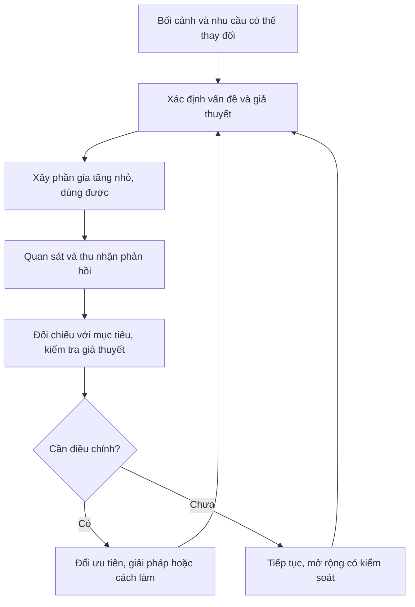

# Mối liên hệ giữa nhu cầu thay đổi, phản hồi và khả năng thích ứng

Trong phát triển phần mềm, yêu cầu ban đầu hiếm khi mô tả đầy đủ điều người dùng thật sự cần. Thị trường thay đổi, quy định được cập nhật, công nghệ xuất hiện, còn người dùng thường chỉ nhận ra điều gì thuận tiện hoặc bất tiện sau khi trải nghiệm sản phẩm. Vì thế, một kế hoạch được lập rất kỹ vẫn có thể dẫn đến sản phẩm không còn phù hợp nếu nhóm không kiểm chứng các giả định trong quá trình thực hiện.

**Agile** xem thay đổi là một phần bình thường của phát triển phần mềm. Thay vì cố đoán mọi yêu cầu ngay từ đầu, nhóm giao sản phẩm có thể sử dụng theo từng phần nhỏ, thu nhận phản hồi sớm, rồi điều chỉnh quyết định dựa trên điều đã học. Ba khái niệm **nhu cầu thay đổi**, **phản hồi** và **khả năng thích ứng** tạo thành một chu trình liên tục, chứ không phải ba hoạt động độc lập.

Sau bài này, bạn có thể:

- Phân biệt nguyên nhân tạo ra nhu cầu thay đổi với tín hiệu phản hồi giúp phát hiện nhu cầu đó.
- Giải thích vì sao giao phần mềm tăng dần và phản hồi sớm giúp giảm rủi ro xây sai sản phẩm.
- Mô tả cách một nhóm Agile chuyển phản hồi thành quyết định ưu tiên và điều chỉnh công việc.
- Nhận diện vai trò của Scrum, Kanban, XP và một số chỉ số dòng công việc trong việc nâng cao khả năng thích ứng.

## 1. Vì sao nhu cầu thay đổi luôn tồn tại?

Một dự án bắt đầu với những giả định: người dùng có vấn đề gì, chức năng nào giải quyết được vấn đề, doanh nghiệp sẽ thu được giá trị nào và nhóm có thể xây dựng giải pháp ra sao. Một số giả định được xác nhận khi trao đổi ban đầu, nhưng nhiều giả định chỉ có thể được kiểm chứng bằng một phiên bản sản phẩm thật.

Nhu cầu thay đổi thường đến từ bốn nguồn:

| Nguồn thay đổi | Ví dụ | Câu hỏi cần xem xét |
| --- | --- | --- |
| **Người dùng** | Khách hàng bỏ dở quy trình đăng ký vì biểu mẫu quá dài. | Hành vi thực tế có khác điều nhóm dự đoán không? |
| **Kinh doanh và thị trường** | Đối thủ đưa ra hình thức thanh toán mới; mục tiêu quý thay đổi. | Điều gì hiện tạo giá trị cao nhất cho sản phẩm? |
| **Kỹ thuật và vận hành** | Hệ thống chậm khi lượng truy cập tăng; một thư viện hết hỗ trợ. | Giới hạn nào cản trở việc cung cấp giá trị an toàn? |
| **Pháp lý và môi trường bên ngoài** | Quy định về dữ liệu cá nhân được cập nhật. | Việc nào phải thay đổi, hạn chót và mức rủi ro là gì? |

Không phải thay đổi nào cũng là một tính năng mới. Đôi khi nhóm cần *bỏ bớt* một tính năng ít giá trị, sửa lỗi, cải thiện khả năng truy cập, thay đổi quy trình triển khai hoặc làm rõ một quy tắc nghiệp vụ. Tương tự, không phải mọi yêu cầu mới đều nên được thực hiện: nhóm cần đánh giá mục tiêu, bằng chứng, chi phí và rủi ro trước khi quyết định.

### Thay đổi càng được phát hiện muộn, chi phí điều chỉnh càng có thể lớn

Giả sử nhóm dành ba tháng xây một quy trình đặt lịch gồm mười bước rồi mới cho người dùng thử. Nếu người dùng chỉ cần ba bước chính, nhóm có thể phải bỏ đi nhiều giao diện, logic xử lý và bài kiểm thử vừa hoàn thành. Ngược lại, nếu nhóm đưa ra bản đặt lịch cơ bản ngay trong tuần đầu và quan sát người dùng, giả định về số bước có thể được sửa trước khi phần phức tạp được xây dựng.

Điều này không có nghĩa *mọi* thay đổi muộn đều đắt như nhau. Chi phí phụ thuộc vào kiến trúc, mức tự động hóa kiểm thử, các phụ thuộc đã hình thành và phạm vi triển khai. Điểm cốt lõi là **phát hiện sai lệch sớm thường giúp nhóm có thêm lựa chọn và giảm lượng công việc phải làm lại**.

## 2. Phản hồi kết nối nhu cầu thay đổi với khả năng thích ứng như thế nào?

Một nhu cầu thay đổi có thể đã tồn tại nhưng nhóm chưa nhìn thấy. **Phản hồi (feedback)** là thông tin giúp nhóm nhận ra khoảng cách giữa điều mình kỳ vọng và điều đang thực sự xảy ra. **Khả năng thích ứng (adaptability)** là năng lực sử dụng thông tin đó để điều chỉnh mục tiêu gần, thứ tự ưu tiên, thiết kế hoặc cách phối hợp mà vẫn duy trì chất lượng và khả năng giao hàng.

Chu trình học hỏi có thể hình dung như sau:



Chu trình này có ba mối quan hệ quan trọng:

1. **Nhu cầu thay đổi đặt ra câu hỏi cần học.** Nếu mục tiêu là tăng số người hoàn tất đặt lịch, nhóm cần tìm hiểu vì sao người dùng bỏ dở; chỉ thêm chức năng theo yêu cầu chưa chắc giải quyết đúng nguyên nhân.
2. **Phản hồi cung cấp bằng chứng để điều chỉnh.** Quan sát thao tác, dữ liệu sử dụng và ý kiến trực tiếp có thể xác nhận hoặc bác bỏ giả thuyết. Phản hồi không tự động biến thành một yêu cầu phải làm.
3. **Khả năng thích ứng biến điều học được thành hành động.** Nhóm có thể đổi thứ tự backlog, thử giải pháp nhỏ hơn, cải thiện kiến trúc hoặc ngừng một hướng phát triển không còn giá trị.

Nếu thiếu phản hồi, nhóm dễ thay đổi theo phỏng đoán. Nếu có phản hồi nhưng không thể điều chỉnh kế hoạch, nhóm biết vấn đề mà vẫn tiếp tục làm sai. Nếu thay đổi liên tục nhưng không kiểm tra kết quả, nhóm chỉ đang phản ứng với mọi ý kiến mới, chưa thực sự học hỏi.

> **Phân biệt:** “Khách hàng muốn thêm nút gọi điện” là một đề xuất giải pháp. “Khách hàng không thể tìm được cách liên hệ khi gặp sự cố” là vấn đề cần hiểu. Agile khuyến khích làm rõ vấn đề và giá trị mong muốn trước khi cam kết một giải pháp.

## 3. Phản hồi nào có ích và thu thập khi nào?

Phản hồi hữu ích đến từ nhiều nguồn, ở nhiều nhịp độ. Chỉ dựa vào đánh giá cảm tính của một cuộc họp hoặc chỉ nhìn một chỉ số có thể dẫn đến kết luận sai.

| Loại phản hồi | Ví dụ | Điều nhóm có thể học |
| --- | --- | --- |
| **Trải nghiệm người dùng** | Quan sát thử nghiệm khả dụng; phỏng vấn khách hàng; phiếu hỗ trợ. | Người dùng vướng ở đâu, họ đang cố đạt kết quả gì? |
| **Hành vi sản phẩm** | Tỉ lệ hoàn tất tác vụ, thời gian thực hiện, bước bị thoát. | Vấn đề phổ biến đến đâu; thay đổi có đi đúng hướng không? |
| **Chất lượng kỹ thuật** | Kiểm thử tự động, lỗi production, log, cảnh báo hiệu năng. | Phần gia tăng có hoạt động đúng và an toàn không? |
| **Dòng công việc** | Cycle time, công việc tồn đọng, nút thắt tại bước review. | Điều gì đang kéo dài thời gian đưa ý tưởng thành giá trị? |
| **Phối hợp trong nhóm** | Trao đổi hằng ngày, Sprint Retrospective, buổi cải tiến quy trình. | Cách làm nào cần giữ, thử thay đổi hoặc dừng? |

Nhóm thường kết hợp hai cách nhìn:

- **Định tính** cho biết *tại sao* một điều xảy ra: người dùng nói gì, thao tác thế nào, vướng điều gì.
- **Định lượng** cho biết *mức độ và xu hướng*: bao nhiêu người gặp vấn đề, hành vi có thay đổi theo thời gian không.

Ví dụ, tỉ lệ bỏ dở biểu mẫu tăng là dấu hiệu cần điều tra, nhưng riêng con số này không chứng minh nguyên nhân là biểu mẫu dài. Phỏng vấn người dùng, xem bản ghi phiên sử dụng có sự đồng ý hoặc thử một phương án khác có thể cung cấp thêm bằng chứng. Mẫu dữ liệu nhỏ, người dùng được chọn không đại diện hoặc thời điểm đo khác nhau đều có thể làm kết quả lệch.

### Tạo nhiều vòng phản hồi với độ trễ khác nhau

**Vòng nhanh (phút đến ngày):** lập trình viên chạy test, review code, tích hợp liên tục (CI), xem lỗi phát sinh, trao đổi các điểm nghẽn. Vòng này giúp phát hiện lỗi kỹ thuật và trở ngại thực thi trước khi chúng tích tụ.

**Vòng trung bình (ngày đến tuần):** hoàn thành một lát cắt chức năng, cho người dùng thử, xem dữ liệu sử dụng, demo sản phẩm, đánh giá mục tiêu gần. Vòng này giúp kiểm tra giả thuyết về giá trị sản phẩm.

**Vòng dài (tuần đến tháng):** xem tác động kinh doanh, mức độ giữ chân người dùng, chi phí vận hành và xu hướng thị trường. Vòng này giúp điều chỉnh định hướng sản phẩm hoặc mức đầu tư.

Không phải phản hồi nào cũng cần chờ hết một Sprint hoặc một lần phát hành lớn. Nhóm nên thiết kế cách nhận tín hiệu sớm nhất phù hợp với loại quyết định cần đưa ra. Với thay đổi gây rủi ro cao, cần thêm kiểm thử, kiểm soát hoặc phê duyệt thích hợp trước khi triển khai.

## 4. Khả năng thích ứng được tạo ra từ những thực hành nào?

Khả năng thích ứng không đồng nghĩa với việc có thể đổi mọi thứ ngay lập tức. Một nhóm thật sự thích ứng phải **thay đổi hướng đi với chi phí hợp lý**, đồng thời bảo vệ mục tiêu hiện tại, chất lượng phần mềm và sự phối hợp trong nhóm.

### 4.1. Chia nhỏ công việc và giao sản phẩm tăng dần

Thay vì xây trọn một hệ thống đặt lịch rồi mới thử nghiệm, nhóm có thể giao lần lượt các phần hoàn chỉnh từ góc nhìn người dùng: xem lịch trống, chọn khung giờ, xác nhận đặt lịch, sau đó mới bổ sung nhắc lịch hoặc hủy lịch. Mỗi phần nhỏ cần đủ tích hợp để kiểm tra giá trị thực tế, không chỉ là màn hình trình diễn thiếu xử lý phía sau.

Giảm kích thước lô công việc có ba lợi ích: người dùng nhìn thấy sản phẩm sớm hơn, lỗi và giả định sai được phát hiện trước, và nhóm có ít công việc đang làm dở hơn khi cần đổi ưu tiên. Tuy nhiên, phải giữ chất lượng kỹ thuật; chia nhỏ bằng cách bỏ qua kiểm thử hoặc bảo mật sẽ tạo ra khoản nợ khiến những thay đổi sau khó hơn.

### 4.2. Duy trì backlog theo giá trị và bằng chứng

**Product Backlog** là danh sách được sắp thứ tự, có thể điều chỉnh khi nhóm học thêm về sản phẩm. Một mục backlog nên thể hiện vấn đề, người hưởng lợi, kết quả mong muốn và điều kiện kiểm chứng, thay vì chỉ ghi tên tính năng.

Một cách viết **user story**:

> Là khách hàng đặt lịch sửa chữa, tôi muốn xem các khung giờ còn trống trước khi nhập thông tin liên hệ, để biết ngay mình có thể đặt lịch phù hợp hay không.

Ví dụ về tiêu chí chấp nhận cho story này:

```gherkin
Scenario: Chọn khung giờ còn trống
  Given khách hàng đã chọn dịch vụ và ngày mong muốn
  When hệ thống hiển thị các khung giờ
  Then khách hàng chỉ có thể chọn khung giờ còn chỗ
  And hệ thống thông báo rõ khi ngày đó không còn khung giờ
```

User story giúp khơi gợi trao đổi; tiêu chí chấp nhận giúp xác định hành vi đúng. Cả hai có thể được làm rõ sau khi có thông tin mới. Việc đưa story lên đầu backlog vẫn cần cân nhắc giá trị, độ khẩn cấp, rủi ro, phụ thuộc và nỗ lực thực hiện.

### 4.3. Bảo vệ năng lực thay đổi bằng chất lượng kỹ thuật

Nếu mỗi thay đổi nhỏ đều làm hỏng chức năng cũ, nhóm sẽ ngại thích ứng. Vì vậy, các thực hành như kiểm thử tự động ở mức phù hợp, tích hợp liên tục, kiểm tra code, thiết kế dễ sửa đổi và **refactoring** thường xuyên giúp duy trì tốc độ học hỏi.

Kỹ thuật có chất lượng không loại bỏ rủi ro, nhưng giảm chi phí kiểm chứng và triển khai phương án mới. **Definition of Done** rõ ràng cũng giúp nhóm không đánh đồng “đã viết code” với “phần gia tăng sẵn sàng sử dụng”.

### 4.4. Cho phép nhóm tự điều chỉnh cách làm

Phản hồi về sản phẩm giúp chọn *việc cần làm*; phản hồi về quy trình giúp cải thiện *cách làm việc*. Nhóm cần nhìn thấy công việc đang tiến triển ra sao, điểm nghẽn nằm ở đâu và ai có quyền ra quyết định. Trao đổi cởi mở về thất bại của giả thuyết giúp học nhanh hơn so với việc che giấu số liệu xấu để giữ kế hoạch ban đầu.

Một cải tiến quy trình nên nhỏ, có người chịu trách nhiệm và có thời điểm kiểm tra. Ví dụ: “Trong hai tuần tới, giới hạn tối đa hai mục đang chờ review; sau đó kiểm tra thời gian chờ review có giảm không”. Như vậy, cải tiến liên tục cũng là một dạng thử nghiệm có phản hồi.

## 5. Scrum, Kanban và XP hỗ trợ chu trình này ra sao?

Agile là hệ giá trị và nguyên tắc; **Scrum, Kanban và Extreme Programming (XP)** là những cách thực hành có trọng tâm khác nhau. Nhóm có thể lựa chọn hoặc phối hợp các thực hành phù hợp với bối cảnh, thay vì nghĩ rằng chỉ dùng tên một phương pháp là đã trở nên linh hoạt.

| Cách tiếp cận | Cơ chế hỗ trợ phản hồi và thích ứng | Điểm cần chú ý |
| --- | --- | --- |
| **Scrum** | Sprint tạo nhịp làm việc ngắn; Sprint Review kiểm tra kết quả và định hướng tiếp theo; Retrospective cải tiến cách phối hợp; Product Backlog có thể được sắp lại. | Giữ **Sprint Goal** làm định hướng chung. Khi có thông tin mới trong Sprint, trao đổi và điều chỉnh phạm vi công việc mà không làm mất mục tiêu Sprint. |
| **Kanban** | Trực quan hóa các bước làm việc, giới hạn work in progress (WIP), theo dõi thời gian chờ và cải tiến luồng công việc liên tục. | Không chỉ đếm số thẻ đã xong; cần nhìn vào thời gian hoàn thành, công việc bị tắc và khả năng dự báo. |
| **XP** | Kiểm thử tự động, phát triển hướng kiểm thử (TDD), tích hợp liên tục, lập trình cặp khi phù hợp và refactoring tạo phản hồi kỹ thuật nhanh. | Kỷ luật kỹ thuật cần được duy trì; bỏ qua chất lượng để “đi nhanh” thường làm giảm khả năng đổi hướng về sau. |

Ví dụ, một nhóm dùng Scrum có thể kiểm tra phản hồi khách hàng ở Sprint Review rồi đổi thứ tự Product Backlog cho Sprint tiếp theo. Nhóm vận hành dùng Kanban có thể ưu tiên xử lý sự cố khẩn, đồng thời kiểm soát WIP để không làm tắc cả luồng. Dù theo cách nào, mục đích vẫn là **nhìn thấy thực tế, học từ thực tế và điều chỉnh hành động**.

## 6. Tình huống thực tế: thay đổi dựa trên bằng chứng

Một nhóm phát triển ứng dụng đặt lịch sửa chữa thiết bị. Mục tiêu sản phẩm là giúp khách hàng hoàn tất việc đặt lịch nhanh và tự phục vụ được. Kế hoạch ban đầu ưu tiên tính năng tạo tài khoản và trang lịch sử sửa chữa.

**Vòng 1 — giao phần tối thiểu có thể dùng:** Nhóm phát hành một luồng đặt lịch cơ bản cho một nhóm người dùng thử. Trong tuần đầu, 80 người truy cập trang đặt lịch, 32 người bắt đầu điền thông tin nhưng chỉ 12 người hoàn tất. Tỉ lệ hoàn tất tính trên toàn bộ lượt truy cập là `12 / 80 = 15%`. Dữ liệu cho thấy một vấn đề nhưng chưa giải thích nguyên nhân.

**Vòng 2 — thu phản hồi và đặt giả thuyết:** Nhóm phỏng vấn tám người có trải nghiệm với luồng đặt lịch; sáu người nói họ không muốn nhập thông tin trước khi biết còn khung giờ phù hợp hay không. Nhóm hình thành giả thuyết: **hiển thị lịch trống sớm hơn sẽ giảm số người bỏ dở**. Đây là bằng chứng ban đầu để ưu tiên thử nghiệm, chưa phải kết luận chắc chắn cho toàn bộ khách hàng.

**Vòng 3 — thích ứng:** Product Owner đưa user story “xem khung giờ trống trước khi nhập thông tin” lên cao hơn trang lịch sử sửa chữa trong Product Backlog. Nhóm kiểm tra các ràng buộc về tính chính xác của lịch, triển khai một phần gia tăng nhỏ và đo lại hành vi người dùng.

**Vòng 4 — đánh giá thay đổi:** Trong một giai đoạn quan sát tiếp theo có 100 lượt truy cập, 30 lượt đặt lịch hoàn tất, tương ứng `30%`. Đây là tín hiệu tích cực so với mức `15%` ban đầu. Tuy nhiên, quy mô mẫu, nguồn truy cập hoặc thời điểm có thể khác nhau. Nhóm cần tiếp tục theo dõi, đối chiếu các phân khúc hoặc thiết kế thử nghiệm phù hợp trước khi khẳng định thay đổi giao diện *đã gây ra* toàn bộ mức tăng.

| Thành phần | Trước khi nhận phản hồi | Sau khi học từ phản hồi |
| --- | --- | --- |
| Giả định | Người dùng sẵn sàng điền thông tin rồi mới chọn lịch. | Có khả năng người dùng cần xem giờ trống sớm hơn. |
| Ưu tiên | Tạo tài khoản và lịch sử sửa chữa. | Kiểm tra luồng xem giờ trống trước khi điền thông tin. |
| Cách giao | Theo danh sách tính năng đã lập. | Giao một thay đổi nhỏ để kiểm chứng giả thuyết. |
| Tiêu chí quan sát | Đã hoàn thành bao nhiêu chức năng. | Bao nhiêu người đặt lịch thành công và vì sao họ bỏ dở. |

Điều đáng chú ý là nhóm không đổi hướng chỉ vì một khách hàng đưa ra ý kiến. Nhóm kết hợp dữ liệu hành vi, phỏng vấn, mục tiêu sản phẩm và khả năng triển khai để chọn một thử nghiệm có thể kiểm chứng.

## 7. Đo khả năng thích ứng bằng kết quả và dòng công việc

Một nhóm nói “chúng tôi linh hoạt” chưa đủ. Cần quan sát cả **giá trị được tạo ra** và **năng lực chuyển phản hồi thành phần mềm hoạt động được**.

### Chỉ số về giá trị và chất lượng

- **Kết quả người dùng:** tỉ lệ hoàn tất tác vụ, thời gian thực hiện, mức độ sử dụng tính năng hoặc tỉ lệ quay lại, tùy mục tiêu thực tế.
- **Chất lượng vận hành:** lỗi lọt ra môi trường sử dụng, độ ổn định, thời gian khôi phục khi gặp sự cố, phản hồi hỗ trợ.
- **Tốc độ học hỏi:** thời gian từ khi nhận tín hiệu đến khi có giả thuyết rõ ràng; thời gian từ thử nghiệm đến khi có bằng chứng đủ để quyết định.

Số tính năng đã giao, story point hoàn tất hoặc số ticket đóng chỉ phản ánh hoạt động. Chúng không tự chứng minh người dùng nhận thêm giá trị. Các chỉ số phải được đọc cùng bối cảnh và không nên trở thành mục tiêu để đội ngũ tìm cách làm đẹp con số.

### Chỉ số về luồng công việc

| Chỉ số | Cách hiểu | Khi chỉ số xấu đi, nên hỏi gì? |
| --- | --- | --- |
| **Lead time** | Thời gian từ khi yêu cầu được ghi nhận đến khi hoàn tất theo điểm đầu/cuối đã thống nhất. | Yêu cầu chờ ưu tiên, phụ thuộc hoặc phê duyệt ở đâu? |
| **Cycle time** | Thời gian từ khi một mục bắt đầu được xử lý đến khi hoàn tất. | Có bước nào bị tắc hoặc có quá nhiều việc làm song song? |
| **Throughput** | Số mục công việc hoàn tất trong một khoảng thời gian. | Kích thước các mục có thay đổi khiến việc so sánh sai lệch không? |
| **WIP (work in progress)** | Số mục đang được xử lý nhưng chưa xong. | Nhóm có đang khởi động nhiều việc hơn khả năng hoàn thành? |

Ví dụ, một nhóm thường xuyên mở tám việc cùng lúc nhưng chỉ hoàn tất hai việc mỗi tuần. Khi phát hiện review code là nút thắt, nhóm thử giới hạn số việc đang làm và cùng giải quyết các mục chờ review trước khi bắt đầu việc mới. Sau hai tuần, họ so sánh phân bố cycle time, throughput và số việc tồn với giai đoạn trước; nếu tốt hơn mà chất lượng vẫn ổn, nhóm có cơ sở duy trì quy tắc. Việc giảm WIP *có thể* giúp luồng thông suốt hơn, nhưng cần đo lường trong bối cảnh cụ thể.

Trong Kanban, các số đo dòng công việc giúp nhận ra khả năng phản hồi trước yêu cầu mới. Trong Scrum, nhóm cũng có thể dùng các số đo này song song với Sprint Goal và kết quả sản phẩm. Không có một con số đơn lẻ nào đại diện đầy đủ cho “mức độ Agile”.

## 8. Khi nào nên thay đổi, khi nào nên giữ hướng đi?

Đón nhận thay đổi không có nghĩa đảo thứ tự công việc mỗi khi có một lời đề nghị. Thay đổi liên tục thiếu cơ sở khiến nhóm mất tập trung, tăng WIP và khó hoàn thành mục tiêu. Trước một tín hiệu mới, có thể dùng chuỗi câu hỏi sau:

1. **Tín hiệu nói về vấn đề nào?** Điều gì đã quan sát được, điều gì mới là suy đoán?
2. **Vấn đề có liên quan mục tiêu hiện tại không?** Ai được lợi, ảnh hưởng lớn đến đâu, có hạn chót hay rủi ro không?
3. **Cần thêm bằng chứng gì?** Có thể phỏng vấn, phân tích dữ liệu, làm prototype hoặc thử thay đổi nhỏ không?
4. **Chi phí đổi hướng là bao nhiêu?** Công việc nào sẽ dừng, phụ thuộc nào bị ảnh hưởng, cần kiểm soát chất lượng gì?
5. **Ai quyết định và bao giờ đánh giá lại?** Ghi nhận quyết định, tiêu chí thành công và mốc quan sát tiếp theo.

Trong Scrum, thông tin mới có thể dẫn tới trao đổi về phạm vi thực hiện với Product Owner và Developers, nhưng **không tùy tiện làm suy yếu Sprint Goal**. Trong luồng Kanban, nhóm có thể dùng quy tắc ưu tiên minh bạch cho công việc khẩn và xem lại tác động lên các việc đang chạy. Trong mọi trường hợp, thay đổi có chủ đích cần trả lời: *“Chúng ta kỳ vọng học được hoặc cải thiện điều gì?”*

Một số tình huống điển hình:

- **Lỗi bảo mật nghiêm trọng:** cần xử lý sớm theo mức rủi ro, dù không nằm trong kế hoạch tính năng.
- **Một yêu cầu giao diện từ một người dùng:** ghi nhận và tìm thêm bằng chứng trước khi thay đổi ưu tiên lớn.
- **Một thử nghiệm cho thấy giải pháp không giúp tăng tỉ lệ hoàn tất:** xem lại giả thuyết, phân khúc người dùng và cách đo; cân nhắc dừng hướng triển khai.
- **Một nhóm liên tục trễ vì phụ thuộc review:** cải tiến quy trình và giới hạn công việc đang làm trước khi cam kết thêm đầu việc.

## 9. Thực hành: thiết kế một vòng phản hồi ngắn

Giả sử bạn tham gia nhóm phát triển nền tảng học trực tuyến. Nhiều người bắt đầu một bài học nhưng ít người hoàn tất. Một thành viên đề nghị ngay lập tức thêm huy hiệu thưởng sau mỗi bài.

Hãy thử làm việc theo bốn bước:

1. **Viết lại vấn đề:** “Người học bỏ dở bài học ở những điểm nào và vì sao?” thay vì mặc định “thiếu huy hiệu”.
2. **Chọn tín hiệu:** xem tỉ lệ hoàn tất theo độ dài bài, vị trí thoát, lỗi phát video và phỏng vấn một số người học.
3. **Đặt giả thuyết có thể kiểm tra:** chẳng hạn “chia bài dài thành các chặng ngắn với dấu mốc tiến độ sẽ giúp người học hoàn thành nhiều hơn”.
4. **Tạo thử nghiệm nhỏ:** áp dụng cho một nhóm bài, chọn chỉ số hoàn tất và chất lượng học tập, xác định thời điểm xem kết quả; so sánh với dữ liệu phù hợp trước khi nhân rộng.

Trong lúc thực hiện, hãy tự hỏi: phản hồi nào có thể thu được trong một ngày, phản hồi nào cần nhiều tuần, và thực hành kỹ thuật nào giúp nhóm đổi giải pháp mà không phá hỏng tính năng đang hoạt động? Các câu trả lời cho thấy rõ mối liên hệ giữa **tốc độ nhận biết**, **chất lượng quyết định** và **chi phí thay đổi**.

## 10. Ghi nhớ trọng tâm

- **Nhu cầu thay đổi** xuất phát từ sự biến động của bối cảnh và những giả định được kiểm chứng dần trong quá trình phát triển.
- **Phản hồi** giúp thấy chênh lệch giữa kỳ vọng với thực tế; cần phối hợp tín hiệu định tính, định lượng, kỹ thuật và quy trình.
- **Khả năng thích ứng** là năng lực biến thông tin thành quyết định và hành động có kiểm soát, không phải chạy theo mọi yêu cầu mới.
- **Giao sản phẩm tăng dần, backlog được điều chỉnh, chất lượng kỹ thuật và cải tiến liên tục** làm cho mỗi vòng học hỏi ngắn hơn, ít tốn kém hơn.
- **Scrum, Kanban và XP** cung cấp các thực hành khác nhau để tạo nhịp phản hồi, bảo vệ dòng công việc và giữ cho phần mềm dễ thay đổi.

Một nhóm phát triển theo tinh thần Agile không cần đoán đúng mọi thứ từ ngày đầu. Nhóm cần xây dựng khả năng **kiểm chứng sớm, học từ dữ liệu thực tế, thích ứng có chủ đích và tiếp tục giao giá trị** khi điều kiện thay đổi.
