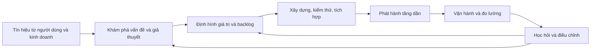

# Agile trong toàn bộ vòng đời từ khám phá đến vận hành

> **Chương:** Định hướng  
> **Học phần:** `AGILE_DEVELOPMENT` — phát triển phần mềm thích ứng dựa trên phản hồi sớm, giao sản phẩm tăng dần và cải tiến liên tục.

Một sản phẩm phần mềm không bắt đầu khi lập trình viên mở trình soạn thảo, cũng không kết thúc khi phiên bản mới được triển khai. Trước khi viết mã, nhóm phải xác định vấn đề nào đáng giải quyết; sau khi phát hành, nhóm phải biết giải pháp có thực sự tạo ra giá trị và vận hành ổn định hay không. **Agile là cách tổ chức các quyết định và công việc trong toàn bộ vòng đời đó**, thông qua các vòng học hỏi ngắn và những phần mềm có thể sử dụng được.

Bài học đặt các thực hành **user story, backlog, Scrum, Kanban, XP và đo lường dòng công việc** vào bức tranh chung: từ khám phá nhu cầu, định hình giải pháp, xây dựng, kiểm thử, phát hành cho đến vận hành và cải tiến. Mục tiêu là hiểu **khi nào dùng thực hành nào và vì sao**, thay vì coi Agile như một bộ cuộc họp cố định.

## 1. Kết quả học tập

Sau bài này, bạn có thể:

1. Diễn giải các giá trị Agile thành cách làm việc cụ thể ở từng giai đoạn của vòng đời sản phẩm.
2. Phân biệt khám phá vấn đề (*discovery*), giao sản phẩm (*delivery*) và vận hành (*operations*), đồng thời giải thích vì sao ba hoạt động cần liên tục trao đổi thông tin.
3. Chuyển một mục tiêu sản phẩm thành giả thuyết kiểm chứng, các user story nhỏ, backlog có thứ tự ưu tiên và những lần phát hành tăng dần.
4. Nhận biết vai trò của Scrum, Kanban và XP khi điều phối công việc và bảo vệ chất lượng kỹ thuật.
5. Chọn tín hiệu, chỉ số và nhịp phản hồi để quyết định bước tiếp theo sau mỗi lần giao sản phẩm.

## 2. Agile là tư duy xuyên suốt vòng đời, không phải một giai đoạn

### 2.1. Từ kế hoạch tuyến tính đến chu kỳ học hỏi

Trong cách tiếp cận tuyến tính cứng nhắc, nhóm dễ giả định rằng yêu cầu đã được hiểu đủ ngay từ đầu: thu thập toàn bộ yêu cầu, thiết kế toàn bộ, viết mã, kiểm thử rồi bàn giao. Với sản phẩm có độ bất định cao, giả định này dễ khiến nhóm phát hiện sai nhu cầu hoặc thiếu sót quá muộn.

Agile ưu tiên **giảm thời gian từ một giả định đến bằng chứng có thể kiểm chứng**. Thay vì chờ hoàn thiện toàn bộ sản phẩm, nhóm tạo một phần giá trị đủ nhỏ, kiểm tra với người dùng hoặc môi trường thực tế, sau đó điều chỉnh ưu tiên. Điều này không xóa bỏ thiết kế, tài liệu, kế hoạch hay kiểm soát rủi ro; các hoạt động ấy được thực hiện ở mức phù hợp và cập nhật khi có thông tin mới.



Sơ đồ cho thấy một **vòng phản hồi**, không phải sáu cổng phê duyệt nối tiếp nhau. Nhóm vẫn có thể đang khám phá nhu cầu của quý tới trong khi triển khai tính năng của tuần này và xử lý sự cố ở phiên bản đang hoạt động.

### 2.2. Bốn giá trị Agile được thể hiện thế nào?

Tuyên ngôn Agile năm 2001 đề cao bốn vế bên trái, đồng thời vẫn thừa nhận giá trị của các vế bên phải:

| Giá trị được ưu tiên | Hành vi cụ thể trong vòng đời |
| --- | --- |
| **Cá nhân và tương tác** hơn quy trình và công cụ | Người làm sản phẩm, thiết kế, phát triển, kiểm thử và vận hành trao đổi trực tiếp để hiểu vấn đề; công cụ hỗ trợ minh bạch, không thay thế cộng tác. |
| **Phần mềm hoạt động được** hơn tài liệu toàn diện | Mỗi phần tăng trưởng có thể chạy, được kiểm thử và minh họa; vẫn duy trì tài liệu cần thiết cho vận hành, bảo mật và chuyển giao. |
| **Cộng tác với khách hàng** hơn thương lượng hợp đồng | Thường xuyên xác nhận giả định bằng người dùng, người mua hoặc bên sử dụng; cùng đánh giá kết quả thay vì chỉ đối chiếu danh sách đầu việc. |
| **Đáp ứng thay đổi** hơn bám sát kế hoạch | Thay đổi thứ tự backlog khi xuất hiện bằng chứng mới, nhưng vẫn giữ mục tiêu sản phẩm và các ràng buộc quan trọng rõ ràng. |

Các nguyên tắc đứng sau những giá trị này nhấn mạnh giao phần mềm có giá trị thường xuyên, chào đón thay đổi, phối hợp gần gũi, duy trì chất lượng kỹ thuật, giữ nhịp làm việc bền vững và thường xuyên xem xét để cải tiến.

**Ba câu hỏi định hướng mỗi vòng lặp:** Chúng ta muốn tạo ra **kết quả** nào? Phần giá trị nhỏ nhất có thể giúp **kiểm chứng** điều gì? Sau khi có dữ liệu mới, chúng ta nên **giữ, sửa hay bỏ** giả định nào?

## 3. Một vòng đời Agile nhìn từ quyết định và phản hồi

| Hoạt động | Câu hỏi cần trả lời | Đầu ra vừa đủ | Nguồn phản hồi chính |
| --- | --- | --- | --- |
| **Khám phá** | Ai đang gặp vấn đề gì, mức độ quan trọng ra sao? | Bằng chứng nhu cầu, giả thuyết, mục tiêu đo được | Phỏng vấn, quan sát, dữ liệu sử dụng, thử nghiệm |
| **Định hình và ưu tiên** | Phần giá trị nào nên làm trước? | Product Goal, user story, backlog đã sắp thứ tự, tiêu chí chấp nhận | Người dùng, người chịu trách nhiệm sản phẩm, nhóm kỹ thuật |
| **Phát triển và kiểm thử** | Cách nào giao một phần sử dụng được với rủi ro chấp nhận được? | Increment đã đạt chuẩn chất lượng, kiểm thử và tích hợp | Kiểm thử tự động, review, thử nghiệm sử dụng, demo |
| **Phát hành** | Đưa thay đổi đến người dùng an toàn thế nào? | Bản phát hành, hướng dẫn cần thiết, phương án phục hồi | Kết quả triển khai, quan sát ban đầu, phản hồi người dùng |
| **Vận hành** | Sản phẩm có ổn định và tạo kết quả kỳ vọng không? | Tín hiệu sức khỏe hệ thống, phản hồi hỗ trợ, dữ liệu kết quả | Giám sát, nhật ký, cảnh báo, hỗ trợ, phân tích sử dụng |
| **Thích ứng** | Bằng chứng mới làm thay đổi ưu tiên và cách phối hợp thế nào? | Backlog cập nhật, thí nghiệm tiếp theo, hành động cải tiến | Sprint Review, Retrospective, đánh giá dòng công việc |

Các hoạt động có **nhịp khác nhau**: nghiên cứu người dùng có thể kéo dài vài ngày; một lần tích hợp có thể diễn ra nhiều lần mỗi ngày; sự cố vận hành cần được xử lý ngay. Agile không yêu cầu tất cả cùng nằm trong một lịch cố định.

## 4. Khám phá liên tục: xác định đúng vấn đề trước và trong khi xây dựng

### 4.1. Bắt đầu bằng nhu cầu và kết quả, không bắt đầu bằng danh sách chức năng

Yêu cầu “thêm chatbot” mới mô tả một giải pháp được đề xuất. Để hiểu giá trị của nó, nhóm cần hỏi: Người dùng gặp trở ngại nào? Hiện họ xử lý thế nào? Vì sao trở ngại đáng giải quyết? Dấu hiệu nào cho biết trải nghiệm đã tốt hơn?

Một tuyên bố vấn đề hữu ích gồm **đối tượng**, **bối cảnh**, **nỗi đau có bằng chứng** và **tác động**. Ví dụ: “Khách đặt lịch tư vấn bằng điện thoại thường bỏ dở ở bước chọn giờ; nhật ký hành vi cho thấy nhiều lượt thoát tại bước này, làm giảm số lịch hẹn hoàn tất.” Đây vẫn là một giả định cần kiểm tra nếu dữ liệu chưa xác nhận nguyên nhân.

Nhóm có thể dùng phỏng vấn, quan sát thao tác, phân tích dữ liệu, bản mẫu có thể bấm, thử nghiệm nội dung hoặc một triển khai giới hạn. Mỗi phương pháp trả lời một loại câu hỏi khác nhau: phỏng vấn giúp hiểu động cơ; dữ liệu hành vi mô tả việc đã xảy ra; thử nghiệm có kiểm soát giúp ước lượng tác động của một thay đổi trong điều kiện thích hợp.

### 4.2. Viết giả thuyết có thể bác bỏ

Một giả thuyết ví dụ:

> Nếu cho người dùng xem các khung giờ còn trống ngay trên màn hình đầu tiên của luồng đặt lịch, tỷ lệ hoàn tất đặt lịch sẽ tăng, vì người dùng không cần đi qua nhiều bước mới biết giờ phù hợp.

Để giả thuyết dùng được, cần xác định:

- **Đối tượng:** Người dùng đặt lịch trên điện thoại.
- **Kết quả kỳ vọng:** Tỷ lệ hoàn tất tăng trong nhóm đủ điều kiện đo.
- **Tín hiệu bảo vệ:** Không tăng lịch trùng, lỗi đặt lịch hoặc thời gian phản hồi quá mức chấp nhận được.
- **Phương án kiểm chứng:** Thử bản mẫu để phát hiện vấn đề sử dụng, sau đó đo bản phát hành nhỏ trên dữ liệu thực tế; nếu cần khẳng định tác động nhân quả, cân nhắc thử nghiệm đối chứng.

Nhóm cũng nên đánh giá bốn loại bất định: người dùng có **cần** giải pháp không (*value*), có **sử dụng được** không (*usability*), nhóm có **làm được** không (*feasibility*), và giải pháp có **phù hợp kinh doanh, pháp lý, vận hành** không (*viability*). Một bản mẫu rất được yêu thích vẫn có thể không khả thi về chi phí hay quyền riêng tư.

**Discovery và delivery có thể diễn ra đồng thời.** Trong khi nhóm phát triển lát cắt đầu tiên đã đủ bằng chứng, người chịu trách nhiệm sản phẩm và các thành viên khác tiếp tục tìm hiểu vấn đề kế tiếp. Discovery tạo đầu vào cho backlog; kết quả vận hành lại tạo câu hỏi mới cho discovery.

## 5. Từ mục tiêu sản phẩm đến backlog có thể giao tăng dần

### 5.1. Phân biệt mục tiêu, đầu ra và kết quả

- **Mục tiêu sản phẩm (*Product Goal*):** Hướng giá trị trung hạn mà nhóm muốn đạt, ví dụ “người dùng đặt được lịch tư vấn thuận tiện và tin cậy”.
- **Đầu ra (*output*):** Thứ nhóm tạo ra, ví dụ màn hình chọn giờ và API đặt lịch.
- **Kết quả (*outcome*):** Thay đổi quan sát được ở người dùng hoặc hệ thống, ví dụ tỷ lệ hoàn tất tăng và số lịch trùng giảm.
- **Tác động (*impact*):** Giá trị rộng hơn cho tổ chức hoặc cộng đồng, ví dụ giảm thời gian điều phối thủ công.

Hoàn tất nhiều story chưa đảm bảo kết quả sản phẩm tốt hơn. Vì thế, khi chọn việc cần làm, nhóm cần nối từng lát cắt giá trị với giả thuyết hoặc mục tiêu.

### 5.2. User story là lời nhắc để đối thoại

Mẫu phổ biến:

> **Là** [vai trò], **tôi muốn** [khả năng], **để** [lợi ích].

Ví dụ: “Là khách cần tư vấn, tôi muốn chọn một khung giờ còn trống trên điện thoại, để hoàn tất đặt lịch mà không phải gọi tổng đài.”

Story này cần trao đổi thêm về quy tắc nghiệp vụ, trường hợp lỗi và tiêu chí chấp nhận. Một bộ tiêu chí minh họa:

```gherkin
Feature: Đặt lịch tư vấn theo khung giờ trống

  Scenario: Xác nhận một khung giờ hợp lệ
    Given khách đang xem một khung giờ còn trống
    When khách cung cấp thông tin bắt buộc và xác nhận
    Then hệ thống tạo đúng một lịch hẹn
    And khách thấy mã lịch hẹn và thời gian đã chọn

  Scenario: Khung giờ vừa được người khác đặt
    Given khung giờ khách đã chọn không còn trống khi xác nhận
    When khách gửi yêu cầu đặt lịch
    Then hệ thống không tạo lịch hẹn trùng
    And khách được hướng dẫn chọn khung giờ khác
```

Đây là đặc tả hành vi mẫu, không phải toàn bộ kiểm thử. Nhóm còn cần làm rõ múi giờ, giới hạn tải, quyền truy cập dữ liệu, tính thuận tiện khi dùng bàn phím hoặc trình đọc màn hình, và cách xử lý yêu cầu lặp do mạng chậm.

### 5.3. Chia lát cắt dọc thay cho chia việc theo tầng kỹ thuật

Các đầu việc “xây xong database”, “xây xong backend”, “xây xong frontend” có thể thuận tiện để phân công nhưng riêng lẻ chưa tạo ra giá trị người dùng. Một **lát cắt dọc (*vertical slice*)** đi qua các lớp cần thiết để tạo được hành vi dùng được, dù phạm vi còn hẹp.

Với luồng đặt lịch, nhóm có thể giao tăng dần:

1. Người dùng xem giờ trống và đặt **một loại lịch cơ bản** thành công, kèm xác nhận trên màn hình.
2. Người dùng nhận xác nhận qua kênh phù hợp và xem lại lịch đã đặt.
3. Người dùng tự đổi hoặc hủy lịch theo quy tắc nghiệp vụ.
4. Người dùng chọn thêm nhiều loại tư vấn hoặc địa điểm.

Mỗi lát cắt cần đáp ứng chuẩn chất lượng và có thể được sử dụng trong phạm vi của nó. Không nên gọi một API chưa được tích hợp thành “giá trị đã giao” nếu người dùng vẫn không hoàn tất được tác vụ.

### 5.4. Sắp thứ tự Product Backlog theo điều đã học

**Product Backlog** là danh sách công việc sản phẩm có thứ tự và có thể thay đổi. Thứ tự không chỉ phụ thuộc vào mức độ mong muốn của bên liên quan, mà còn cân nhắc giá trị, rủi ro, chi phí trì hoãn, phụ thuộc, công sức và khả năng học hỏi. Product Owner chịu trách nhiệm tối ưu giá trị và quản lý hiệu quả Product Backlog trong Scrum; việc làm rõ các mục có thể được chia sẻ với cả nhóm.

**Backlog refinement** là hoạt động diễn ra thường xuyên để chia nhỏ, bổ sung hiểu biết và ước lượng khi hữu ích. Nó không phải một sự kiện Scrum bắt buộc với thời lượng cố định. Các mục gần nhất cần đủ rõ để nhóm có thể trao đổi và triển khai; không cần chi tiết hóa mọi ý tưởng cho nhiều tháng tới.

Trong Scrum, **Definition of Done (DoD)** thể hiện chuẩn chất lượng để Increment được coi là hoàn tất. Nhóm có thể có tiêu chí sẵn sàng thảo luận công việc (*Definition of Ready*) nếu thấy hữu ích, nhưng đó không phải thành phần bắt buộc của Scrum và không nên trở thành cổng quan liêu.

Ví dụ DoD phù hợp một sản phẩm web có thể gồm: hành vi và tiêu chí chấp nhận được kiểm chứng, mã đã review và tích hợp, các kiểm thử liên quan chạy đạt, yêu cầu bảo mật cơ bản được đáp ứng, tín hiệu quan sát cần thiết đã có và tài liệu vận hành được cập nhật khi thay đổi hành vi hệ thống. DoD cho biết **Increment đạt chất lượng sử dụng**, còn **thời điểm đưa ra production** là quyết định phát hành riêng.

## 6. Delivery: phối hợp bằng Scrum hoặc Kanban, củng cố chất lượng bằng XP

Agile là hệ giá trị và nguyên tắc; **Scrum, Kanban và Extreme Programming (XP)** giải quyết những câu hỏi khác nhau. Một nhóm có thể kết hợp chúng mà không cần sao chép nguyên mẫu từ một tổ chức khác.

### 6.1. Scrum: tạo nhịp kiểm tra và thích ứng cho mục tiêu chung

Scrum là một framework nhẹ dựa trên tính minh bạch, kiểm tra và thích ứng. **Scrum Team** gồm ba trách nhiệm (*accountabilities*):

- **Product Owner:** Tối ưu giá trị sản phẩm, chịu trách nhiệm Product Goal và Product Backlog.
- **Scrum Master:** Giúp nhóm và tổ chức hiểu, sử dụng Scrum hiệu quả; hỗ trợ tháo gỡ trở ngại và cải thiện hiệu quả làm việc.
- **Developers:** Cùng chịu trách nhiệm lập kế hoạch thực hiện Sprint, chất lượng và tạo Increment đạt DoD; đây là tên trách nhiệm trong Scrum, không chỉ có nghĩa là người viết mã.

**Sprint** là khoảng thời gian cố định không quá một tháng. Một vòng Sprint bao gồm:

| Sự kiện | Câu hỏi trọng tâm |
| --- | --- |
| **Sprint Planning** | Vì sao Sprint này có giá trị? Làm gì để tiến tới Sprint Goal? Thực hiện ra sao? |
| **Daily Scrum** | Nhóm Developers điều chỉnh kế hoạch hằng ngày để tiến gần Sprint Goal thế nào? |
| **Sprint Review** | Increment và những thay đổi trong bối cảnh sản phẩm cho thấy cần thích ứng Product Backlog thế nào? |
| **Sprint Retrospective** | Có thể cải thiện chất lượng, hiệu quả và cách phối hợp bằng hành động cụ thể nào? |

Trong Sprint, nhóm tập trung vào **Sprint Goal**, chủ động điều chỉnh kế hoạch khi học thêm. Cuối Sprint không đồng nghĩa với việc mọi ý tưởng ban đầu đều phải hoàn tất bằng mọi giá; những mục chưa Done không được tính vào Increment. Sprint Review là buổi làm việc với các bên liên quan để xem sản phẩm và quyết định tiếp, không chỉ là buổi trình diễn. Retrospective xem lại **hệ thống làm việc**, không nhằm quy lỗi cá nhân.

Scrum tạo nhịp tốt cho một nhóm sản phẩm có mục tiêu và cần kiểm tra kết quả định kỳ. Nó không tự động đảm bảo mã chất lượng, triển khai nhanh hay phản hồi người dùng tốt: nhóm vẫn cần thực hành kỹ thuật, discovery và vận hành thích hợp.

### 6.2. Kanban: tối ưu dòng công việc đang chảy

Kanban phù hợp khi nhóm cần thấy trạng thái công việc, quản lý số việc đang làm và rút ngắn thời gian hoàn tất, đặc biệt hữu ích với luồng yêu cầu đến liên tục như hỗ trợ vận hành hoặc bảo trì. Một bảng minh họa:

```text
Chờ ưu tiên -> Sẵn sàng -> Đang làm [WIP ≤ 2] -> Review [WIP ≤ 1] -> Hoàn tất
                                  |                 |
                                  +-- bị chặn? ----+--> hiển thị nguyên nhân
```

**WIP limit** là giới hạn số mục công việc đang xử lý ở một trạng thái hoặc trong một luồng. Khi cột Review đầy, nhóm ưu tiên hỗ trợ hoàn tất việc ở đó trước khi kéo thêm việc mới. Cơ chế **pull** giúp giảm đa nhiệm và phơi bày điểm nghẽn. Con số `2` hay `1` trong bảng chỉ là ví dụ; giới hạn thực tế phải được nhóm điều chỉnh theo năng lực và bản chất công việc.

Kanban cần chính sách rõ ràng: khi nào một mục được phép vào từng cột, thế nào là xong, ai phối hợp khi bị chặn, và xử lý công việc khẩn cấp ra sao. Các cuộc họp phản hồi hoặc cải tiến định kỳ vẫn hữu ích, dù Kanban không yêu cầu Sprint cố định.

### 6.3. XP: giữ khả năng thay đổi mà không tích lũy lỗi

XP tập trung vào các thực hành kỹ thuật giúp nhóm thay đổi phần mềm thường xuyên và an toàn:

- **Test-driven development (TDD):** Viết kiểm thử thể hiện hành vi cần có, triển khai để kiểm thử đạt, rồi cải tiến cấu trúc mã.
- **Pair programming và review:** Hai người cùng giải quyết vấn đề hoặc dùng review phù hợp để phát hiện sai sót, lan tỏa hiểu biết.
- **Continuous integration (CI):** Tích hợp thường xuyên, chạy kiểm thử và kiểm tra tự động để phát hiện lỗi tích hợp sớm.
- **Refactoring:** Cải thiện cấu trúc bên trong mà không đổi hành vi bên ngoài, giúp chi phí thay đổi không tăng vô hạn.
- **Thiết kế đơn giản, sở hữu mã chung và nhịp bền vững:** Hạn chế phức tạp chưa cần thiết, tránh tri thức bị khóa ở một cá nhân và không phụ thuộc vào làm thêm giờ kéo dài.

Ví dụ: Scrum giúp nhóm thống nhất Sprint Goal, Kanban giúp nhìn và giảm WIP trong Sprint hoặc ở nhóm vận hành, còn CI và TDD trong XP giúp những lát cắt được tích hợp an toàn. Các kỹ thuật bổ trợ nhau; chọn và cải tiến chúng theo vấn đề thực tế, không dùng tên framework làm thước đo thành công.

### 6.4. Chọn cách phối hợp theo hoàn cảnh

| Hoàn cảnh | Thực hành thường hữu ích | Điều cần kiểm chứng |
| --- | --- | --- |
| Nhóm sản phẩm có mục tiêu chung, cần xem lại chiến lược giao hàng thường xuyên | Scrum với Sprint Goal, Review và Retrospective | Increment có thật sự hữu dụng và được các bên liên quan kiểm tra? |
| Nhóm nhận nhiều yêu cầu khó dự báo, cần xử lý theo dòng liên tục | Kanban với chính sách pull, WIP limit và theo dõi thời gian hoàn tất | Hàng đợi và điểm nghẽn có giảm? |
| Hệ thống cần thay đổi thường xuyên nhưng kiểm thử yếu, lỗi hồi quy cao | Thực hành XP, tự động hóa kiểm thử, CI, refactoring | Tốc độ phản hồi có tăng mà độ ổn định vẫn được bảo vệ? |
| Nhóm vừa phát triển tính năng vừa xử lý sự cố | Phối hợp nhịp mục tiêu sản phẩm với bảng dòng công việc và chính sách việc khẩn cấp | Công việc vận hành có làm mất khả năng dự báo hoặc che khuất mục tiêu? |

## 7. Chất lượng, phát hành và vận hành là một phần của vòng lặp

### 7.1. Tích hợp sớm, triển khai an toàn

Một Increment đạt DoD là nền tảng để phát hành, nhưng **không bắt buộc phải đưa ra production ngay lúc kết thúc Sprint**. Phát hành là quyết định tùy mức độ rủi ro, người dùng và cách triển khai. Nhóm có thể dùng:

1. **Tích hợp và kiểm thử tự động:** Mỗi thay đổi được kiểm tra càng sớm càng tốt; kiểm thử đơn vị, tích hợp, hành vi quan trọng và bảo mật được chọn theo rủi ro.
2. **Triển khai lặp lại được:** Quy trình triển khai có log, quyền truy cập phù hợp và kiểm tra sức khỏe sau triển khai.
3. **Phát hành theo phạm vi nhỏ:** Feature flag, nhóm thử nghiệm, canary hoặc triển khai từng đợt nếu kiến trúc và vận hành hỗ trợ.
4. **Khả năng phục hồi:** Biết cách tắt tính năng, rollback hoặc roll forward khi có sự cố; với thay đổi dữ liệu, cần tính trước tính tương thích và phương án khôi phục.

**Continuous delivery** nói đến khả năng giữ phần mềm ở trạng thái có thể phát hành tin cậy, thường cho phép quyết định phát hành theo nhu cầu. **Continuous deployment** tự động đưa mọi thay đổi đạt các bước kiểm tra lên production. Hai khái niệm liên quan nhưng không đồng nghĩa.

### 7.2. Vận hành cung cấp bằng chứng về chất lượng và giá trị

Sau phát hành, nhóm cần nhìn cả **sức khỏe kỹ thuật** lẫn **kết quả người dùng**:

- **Sức khỏe kỹ thuật:** tỷ lệ lỗi, thời gian phản hồi, độ sẵn sàng, mức tiêu thụ tài nguyên và số sự cố.
- **Trải nghiệm người dùng:** tỷ lệ hoàn tất tác vụ, thời gian thao tác, tỷ lệ bỏ dở, yêu cầu hỗ trợ và phản hồi định tính.
- **An toàn và trách nhiệm:** quyền riêng tư, kiểm soát truy cập, khả năng tiếp cận, nhật ký không chứa dữ liệu nhạy cảm ngoài mục đích và yêu cầu pháp lý áp dụng.

Với dịch vụ quan trọng, nhóm có thể đặt **SLI** (*service level indicator*: chỉ số đo chất lượng dịch vụ, ví dụ tỷ lệ yêu cầu thành công) và **SLO** (*service level objective*: mục tiêu cho chỉ số đó trong một cửa sổ thời gian). Mục tiêu giúp nhóm biết khi nào cần ưu tiên ổn định hệ thống trước khi mở rộng tính năng.

Khi có sự cố, điều cần học không chỉ là “ai sửa được lỗi” mà còn là: tín hiệu nào báo trước, tại sao quy trình kiểm thử hoặc phát hành không phát hiện, làm cách nào giảm phạm vi ảnh hưởng, và thay đổi nào ngăn tái diễn. **Postmortem không đổ lỗi** và các hành động cải tiến cụ thể giúp thông tin vận hành quay lại backlog.

### 7.3. Ba vòng phản hồi cần cùng tồn tại

| Vòng phản hồi | Chu kỳ thường gặp | Câu hỏi |
| --- | --- | --- |
| **Kỹ thuật** | Sau từng thay đổi mã hoặc tích hợp | Thay đổi có đúng, an toàn và không làm hỏng hành vi cũ? |
| **Sản phẩm** | Sau thử nghiệm, bản phát hành hoặc Sprint Review | Người dùng có nhận được giá trị? Giả thuyết nào cần cập nhật? |
| **Vận hành và quy trình** | Liên tục khi giám sát; định kỳ khi cải tiến | Hệ thống có đáng tin cậy? Công việc đang tắc ở đâu? Cách làm nào cần đổi? |

Nếu chỉ có vòng phản hồi kỹ thuật, nhóm có thể xây **đúng cách** một chức năng không ai cần. Nếu chỉ có phản hồi sản phẩm, nhóm dễ mất khả năng thay đổi vì nợ kỹ thuật. Nếu bỏ qua vận hành, nhóm không thấy chi phí thật của những gì đã phát hành.

## 8. Đo lường để ra quyết định, không để xếp hạng cá nhân

Đo lường Agile cần phục vụ **học hỏi và cải tiến hệ thống làm việc**. Không có một chỉ số đơn lẻ nào đại diện cho thành công sản phẩm, tốc độ phát triển và độ tin cậy.

| Nhóm chỉ số | Ví dụ | Cách diễn giải hữu ích |
| --- | --- | --- |
| **Kết quả sản phẩm** | Tỷ lệ hoàn tất tác vụ, mức sử dụng tính năng, tỷ lệ giữ chân, mức hài lòng | Xem thay đổi có tạo giá trị cho nhóm người dùng mục tiêu hay không; kết hợp dữ liệu định tính. |
| **Dòng công việc** | Lead time, cycle time, throughput, WIP, số mục bị chặn | Xác định mức độ chờ đợi và điểm nghẽn; so sánh trong cùng hệ thống với định nghĩa nhất quán. |
| **Khả năng giao thay đổi** | Tần suất triển khai, thời gian từ commit tới production, tỷ lệ thay đổi gây sự cố, thời gian phục hồi | Đánh giá khả năng giao thay đổi nhanh và an toàn; thường được dùng trong các nhóm chỉ số DORA. |
| **Vận hành** | Tỷ lệ lỗi, độ trễ, mức đạt SLO, sự cố lặp lại | Biết khi nào cần xử lý độ ổn định, hiệu năng và khả năng phục hồi. |
| **Sức khỏe nhóm** | Trở ngại lặp lại, độ tập trung, mức phối hợp và học hỏi | Xác định vấn đề trong quy trình; cần đối thoại và bối cảnh, không biến thành chỉ tiêu áp đặt. |

**Phân biệt các chỉ số dòng công việc:**

- **Lead time:** Khoảng thời gian từ một điểm bắt đầu được định nghĩa rõ (ví dụ yêu cầu được ghi nhận) đến điểm hoàn tất được định nghĩa rõ (ví dụ đã giao). Không so sánh số liệu nếu các nhóm dùng mốc khác nhau.
- **Cycle time:** Khoảng thời gian từ khi công việc thực sự bắt đầu xử lý đến khi hoàn tất; thường là một phần của lead time.
- **Throughput:** Số mục công việc hoàn tất trong một khoảng thời gian, với quy tắc đếm nhất quán.
- **WIP:** Số mục đã bắt đầu nhưng chưa hoàn tất tại một thời điểm.
- **Service Level Expectation (SLE):** Dự báo thời gian hoàn tất cho một loại công việc dựa trên dữ liệu lịch sử và mức tin cậy đã chọn; đây là kỳ vọng để quản lý dòng, không phải lời hứa tuyệt đối.

Ví dụ, nếu nhiều mục đã bắt đầu nhưng đứng chờ review, tăng số người cùng viết mã có thể chỉ làm hàng đợi dài hơn. Nhóm nên kiểm tra nguyên nhân nghẽn ở review và giảm WIP trước khi kết luận rằng cần “làm nhanh hơn”. **Cumulative flow diagram** có thể giúp quan sát hàng đợi tích tụ; biểu đồ cycle time theo thời gian cho thấy công việc nào bất thường.

**Cẩn trọng khi dùng story point và velocity:** Đây có thể là công cụ lập kế hoạch nội bộ cho một nhóm nếu nhóm thấy hữu ích. Chúng không đo trực tiếp giá trị sản phẩm hay năng suất cá nhân, và thường không so sánh có ý nghĩa giữa các nhóm. Tương tự, số deployment tăng chỉ đáng mừng khi kết quả và độ tin cậy không suy giảm.

## 9. Ví dụ xuyên suốt: cải thiện luồng đặt lịch tư vấn

Giả sử một nhóm đang phát triển sản phẩm đặt lịch tư vấn. Các con số sau **hoàn toàn minh họa**, nhằm trình bày cách dùng dữ liệu để ra quyết định, không phải số liệu nghiên cứu thực tế.

**Bối cảnh:** Trên thiết bị di động, tỷ lệ hoàn tất luồng đặt lịch hiện là **42%** trong nhóm người dùng được đo. Nhóm muốn hướng tới **55%** sau một số vòng cải tiến, đồng thời không tăng tỷ lệ đặt trùng hoặc lỗi hệ thống.

| Vòng | Việc nhóm thực hiện | Bằng chứng và quyết định |
| --- | --- | --- |
| **Khám phá** | Quan sát phiên sử dụng, phỏng vấn người bỏ dở và đọc dữ liệu thoát từng bước. | Nhiều người cần biết giờ còn trống trước khi điền thông tin dài. Nhóm lập giả thuyết hiển thị giờ sớm sẽ giảm bỏ dở. |
| **Định hình** | Viết user story, xác định tiêu chí chấp nhận, chọn lát cắt “xem giờ và đặt một loại lịch”. | Backlog ưu tiên lát cắt hoàn chỉnh có thể dùng, thay vì triển khai tất cả mẫu biểu và loại lịch cùng lúc. |
| **Delivery lần 1** | Xây dựng giao diện nhỏ, xử lý đặt lịch chống trùng, kiểm thử tự động và tích hợp liên tục. | Increment đạt DoD; nhóm kiểm tra cùng đại diện người dùng ở Sprint Review hoặc buổi đánh giá sản phẩm tương đương. |
| **Phát hành giới hạn** | Bật chức năng cho nhóm người dùng được lựa chọn, theo dõi lỗi và thời gian phản hồi, chuẩn bị tắt tính năng khi cần. | Không thấy tín hiệu tăng lịch trùng; tỷ lệ hoàn tất quan sát được tăng từ 42% lên **48%** trong mẫu minh họa. Chưa kết luận chắc chắn về nguyên nhân khi thiếu đối chứng và kiểm tra độ tin cậy. |
| **Học và điều chỉnh** | Xem phản hồi cho thấy nút xác nhận khó thấy trên màn hình nhỏ; cập nhật thứ tự backlog. | Nhóm ưu tiên cải thiện khả năng sử dụng thay vì lập tức thêm lựa chọn địa điểm. |
| **Delivery lần 2 và vận hành** | Cải tiến giao diện, kiểm tra khả năng tiếp cận, phát hành và tiếp tục đo với định nghĩa nhất quán. | Tỷ lệ minh họa lên **57%**; nhóm tiếp tục kiểm tra chất lượng mẫu, yếu tố mùa vụ và chỉ số bảo vệ trước khi xác nhận đạt mục tiêu. |

Trong ví dụ này, Scrum có thể cung cấp nhịp mục tiêu và review, Kanban giúp xử lý luồng bug hoặc yêu cầu phát sinh, XP giúp nhóm giữ kiểm thử và CI khi đổi hành vi nhanh. Quan trọng hơn, **phản hồi sau phát hành quyết định ưu tiên tiếp theo**: nhóm không tự động làm tiếp mục thứ hai trong kế hoạch ban đầu khi đã có bằng chứng mới.

Một cách trình bày mục tiêu thực nghiệm gọn là:

```text
Vấn đề       : Nhiều người bỏ dở khi chưa biết giờ còn trống.
Giả thuyết   : Hiển thị giờ sớm giúp tăng tỷ lệ hoàn tất.
Lát cắt đầu  : Xem giờ trống + đặt một loại lịch + xác nhận.
Chỉ số chính : Số lượt đặt thành công / số lượt bắt đầu hợp lệ.
Chỉ số gác   : Tỷ lệ lịch trùng, lỗi đặt lịch, độ trễ phản hồi.
Quyết định   : Mở rộng / điều chỉnh / dừng sau khi xem bằng chứng.
```

Để đo đúng, nhóm phải định nghĩa một **lượt bắt đầu hợp lệ**, cách xử lý người dùng quay lại nhiều lần, nguồn dữ liệu và cửa sổ quan sát. Nếu tỷ lệ tăng nhưng lỗi đặt lịch cũng tăng, chưa thể coi thay đổi là thành công. Nếu nhóm cần chứng minh tác động của thiết kế mới, một thử nghiệm được thiết kế phù hợp sẽ đáng tin hơn phép so sánh đơn thuần trước và sau.

## 10. Những ngộ nhận làm đứt vòng phản hồi

| Ngộ nhận | Hệ quả | Cách điều chỉnh |
| --- | --- | --- |
| “Làm Agile là có Daily Scrum và chia Sprint.” | Nhiều cuộc họp nhưng người dùng không nhận giá trị sớm. | Bắt đầu từ mục tiêu, Increment dùng được và phản hồi thực tế; chọn sự kiện cần thiết. |
| “Yêu cầu phải cố định trong cả dự án.” | Tiếp tục xây chức năng dù giả định ban đầu đã sai. | Giữ hướng mục tiêu ổn định tương đối, điều chỉnh backlog theo bằng chứng; quản lý thay đổi có trách nhiệm. |
| “Làm xong code là Done.” | Kiểm thử, tích hợp, bảo mật và vận hành bị dồn cuối kỳ. | Thống nhất DoD bao trùm chất lượng của Increment, làm kiểm thử và tích hợp liên tục. |
| “Càng nhiều việc đang làm càng nhanh.” | Nhiều hàng đợi, chuyển ngữ cảnh và thời gian chờ. | Giới hạn WIP, ưu tiên hoàn tất công việc, làm rõ điểm nghẽn. |
| “Discovery chỉ làm trước dự án, vận hành chỉ làm sau dự án.” | Nhóm ngừng học khi sản phẩm thay đổi hoặc có sự cố. | Duy trì discovery, đo lường và phản hồi vận hành trong suốt vòng đời. |
| “Velocity hoặc số story đo hiệu suất từng người.” | Ước lượng bị bóp méo, nhóm tối ưu chỉ số thay vì giá trị. | Dùng dữ liệu dòng công việc để cải thiện hệ thống; đánh giá sản phẩm bằng kết quả thực tế. |
| “Agile nghĩa là không cần kiến trúc hay tài liệu.” | Chi phí sửa đổi và rủi ro vận hành tăng. | Thiết kế và tài liệu hóa vừa đủ theo rủi ro, cập nhật liên tục; dành công sức cho nền tảng kỹ thuật. |

## 11. Áp dụng trong một nhóm mới bắt đầu

Không cần đồng thời thay mọi quy trình. Một cách khởi đầu thực tế:

1. **Thống nhất kết quả cần đạt:** Nêu một vấn đề có bằng chứng, đối tượng bị ảnh hưởng, mục tiêu có thể đo và các ràng buộc không được phá vỡ.
2. **Nhìn thấy dòng công việc hiện tại:** Vẽ các bước thực sự từ khi có yêu cầu đến khi người dùng nhận giá trị; đánh dấu nơi chờ, bị chặn và làm lại.
3. **Chọn một lát cắt giá trị nhỏ:** Viết story cùng tiêu chí chấp nhận; xây dựng, kiểm thử, tích hợp và phát hành theo mức rủi ro chấp nhận được.
4. **Thiết lập vòng phản hồi:** Hẹn thời điểm xem sản phẩm với người dùng hoặc bên liên quan, thu thập chỉ số sau phát hành, ghi nhận vấn đề vận hành.
5. **Cải thiện một trở ngại mỗi vòng:** Ví dụ giảm WIP, tăng kiểm thử tự động ở luồng dễ lỗi, hoặc làm rõ điều kiện hoàn tất; theo dõi xem thay đổi có tác dụng không.
6. **Lặp lại và điều chỉnh phương pháp:** Chọn Scrum, Kanban, XP hay sự kết hợp dựa trên dữ liệu của nhóm, mục tiêu sản phẩm và đặc điểm công việc.

Một nhóm đã triển khai Agile tốt không phải nhóm có bảng đẹp, nhiều thuật ngữ hay tốc độ story point cao. Dấu hiệu đáng tin hơn là nhóm **phát hiện giả định sai sớm**, **giao được những phần giá trị hoàn chỉnh**, **vận hành đáng tin cậy** và **thay đổi cách làm khi có bằng chứng**.

## 12. Tóm lược khái niệm cần ghi nhớ

| Thuật ngữ | Ý nghĩa ngắn gọn |
| --- | --- |
| **Agile** | Hệ giá trị và nguyên tắc hỗ trợ thích ứng thông qua cộng tác, giao tăng dần và học hỏi. |
| **Discovery** | Tìm hiểu vấn đề, kiểm chứng nhu cầu và giảm bất định trước khi đầu tư sâu. |
| **Delivery** | Biến ưu tiên thành Increment chất lượng có thể sử dụng và phát hành khi phù hợp. |
| **Operations** | Giữ dịch vụ hoạt động, quan sát chất lượng và đưa bài học thực tế về sản phẩm. |
| **User story** | Cách diễn đạt một nhu cầu theo góc nhìn người dùng để khơi mở đối thoại về giá trị. |
| **Product Backlog** | Danh sách công việc sản phẩm có thứ tự và được cập nhật khi học thêm. |
| **Increment / DoD** | Phần tăng trưởng tích hợp, đáp ứng định nghĩa chất lượng để được coi là hoàn tất. |
| **Scrum** | Framework hỗ trợ đạt mục tiêu và kiểm tra, thích ứng theo Sprint. |
| **Kanban** | Cách quản lý dòng công việc bằng trực quan hóa, chính sách rõ ràng, WIP và các vòng phản hồi. |
| **XP** | Tập hợp thực hành phát triển chú trọng chất lượng và khả năng thay đổi thường xuyên. |
| **Outcome / Flow metrics** | Chỉ số kết quả sản phẩm và chỉ số cho biết công việc chảy qua hệ thống thế nào. |

**Điểm nối toàn bài:** Agile chỉ phát huy tác dụng khi thông tin đi hết vòng **nhu cầu → quyết định → phần mềm dùng được → vận hành → bằng chứng → quyết định mới**. Đây là lý do khám phá, phát triển và vận hành phải được xem là một hệ thống học hỏi thống nhất.

### Tài liệu gốc nên đọc tiếp

- [Manifesto for Agile Software Development](https://agilemanifesto.org/) — bốn giá trị và mười hai nguyên tắc Agile.
- [The Scrum Guide (2020)](https://scrumguides.org/scrum-guide.html) — trách nhiệm, sự kiện, artifact và cam kết trong Scrum.
- [The Kanban Guide](https://kanbanguides.org/) — định nghĩa dòng công việc, WIP và các chỉ số dòng công việc.
- [DORA](https://dora.dev/) — nghiên cứu và hướng dẫn về hiệu quả giao phần mềm và vận hành.
