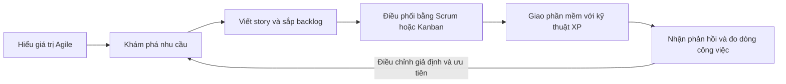

# Định hướng: Trình tự học từ tư duy nền tảng đến thực hành trong nhóm

Agile là cách phát triển sản phẩm thích ứng khi nhu cầu người dùng, giải pháp kỹ thuật hoặc điều kiện kinh doanh còn thay đổi. Thay vì cố xác định toàn bộ yêu cầu ngay từ đầu rồi chỉ kiểm tra ở cuối, nhóm thường xuyên tạo ra một phần sản phẩm có thể sử dụng, nhận phản hồi, học từ kết quả và điều chỉnh công việc tiếp theo.

Trong mô-đun **AGILE_DEVELOPMENT**, hành trình học đi từ **giá trị và nguyên tắc Agile** đến **user story, backlog, Scrum, Kanban, XP và đo lường dòng công việc**. Đích đến là hiểu vì sao từng thực hành tồn tại, chọn cách phối hợp phù hợp với bối cảnh và có thể cùng một nhóm nhỏ giao sản phẩm tăng dần, lấy phản hồi sớm và cải tiến liên tục.

Bài này trình bày trình tự học và một tình huống xuyên suốt để bạn có thể biến kiến thức thành hành động, thay vì học rời rạc từng thuật ngữ.

## 1. Đích học tập và nguyên tắc sắp xếp

Sau khi đi hết lộ trình, bạn cần có khả năng:

1. Giải thích bốn giá trị của Agile và liên hệ chúng với các quyết định thường ngày trong nhóm phát triển phần mềm.
2. Chuyển một vấn đề của người dùng thành mục tiêu sản phẩm, user story có tiêu chí chấp nhận và Product Backlog được ưu tiên.
3. Chia công việc thành những phần nhỏ có thể kiểm chứng, lựa chọn và thực hành Scrum, Kanban hoặc các kỹ thuật XP theo nhu cầu thực tế.
4. Phối hợp với các thành viên để lập kế hoạch ngắn hạn, minh bạch tiến độ, giao phần mềm sử dụng được và thu thập phản hồi.
5. Đọc các tín hiệu về giá trị sản phẩm và dòng công việc để đề xuất một cải tiến cụ thể, rồi kiểm chứng cải tiến ấy.

Trình tự nên theo dòng **tư duy → giá trị người dùng → công việc nhỏ → phối hợp nhóm → chất lượng kỹ thuật → đo lường và cải tiến**. Học một công cụ quản lý bảng việc trước khi hiểu mục tiêu thường chỉ tạo ra một danh sách công việc đẹp mắt; học Scrum mà chưa biết cách chia nhỏ yêu cầu dễ dẫn đến Sprint có quá nhiều việc dở dang.



Đây là **vòng học lặp**, không phải một chuỗi bước chỉ thực hiện một lần. Chẳng hạn, khi đo thấy một hạng mục bị tắc ở khâu kiểm thử, nhóm có thể quay lại cách chia story, chính sách WIP hoặc kỹ thuật tự động hóa.

## 2. Tình huống xuyên suốt: hệ thống đăng ký workshop

Giả sử một nhóm ba người xây dựng ứng dụng để học viên đăng ký các buổi workshop. Hiện tại, người tham gia nhắn tin cho ban tổ chức; danh sách được nhập thủ công nên dễ trùng chỗ, khó biết buổi nào còn suất. Nhóm chưa chắc người dùng cần thanh toán trực tuyến, email tự động hay chỉ cần một biểu mẫu đăng ký đơn giản.

**Giả thuyết ban đầu:** nếu học viên xem được lịch, biết số chỗ còn lại và tự đăng ký, công việc nhập liệu của ban tổ chức sẽ giảm và trải nghiệm đăng ký sẽ thuận tiện hơn. Đây là giả thuyết cần kiểm tra, chưa phải sự thật đã được đo lường.

Để kiểm chứng, nhóm có thể giao một lát cắt đầu tiên: xem các buổi workshop còn chỗ, chọn một buổi, nhập email và nhận xác nhận ngay trên trang. Sau đó nhóm quan sát người dùng thử, xem dữ liệu đăng ký và quyết định tính năng tiếp theo. Tình huống này sẽ được dùng ở các giai đoạn học bên dưới.

## 3. Giai đoạn 1 — Hiểu tư duy và các giá trị Agile

### 3.1. Bắt đầu bằng vấn đề cần giải quyết

Trong phát triển phần mềm có nhiều điều chưa biết: liệu người dùng có thật sự cần tính năng, cách triển khai nào là khả thi, yêu cầu có đổi không và nhóm có thể giao được bao nhiêu việc với chất lượng chấp nhận được. Agile đề xuất rút ngắn khoảng cách giữa **quyết định** và **bằng chứng** thông qua những vòng lập kế hoạch, triển khai, kiểm tra và thích ứng.

Bốn giá trị trong Agile Manifesto là:

| Giá trị được ưu tiên | Ý nghĩa khi làm việc |
| --- | --- |
| Cá nhân và tương tác hơn quy trình và công cụ | Chủ động trao đổi để giải quyết vướng mắc; công cụ phục vụ việc phối hợp. |
| Phần mềm chạy được hơn tài liệu đầy đủ | Chứng minh tiến độ bằng kết quả có thể chạy, kiểm thử và dùng thử. |
| Hợp tác với khách hàng hơn đàm phán hợp đồng | Thường xuyên xác nhận nhu cầu, giá trị và phản hồi với người liên quan. |
| Phản hồi với thay đổi hơn bám sát kế hoạch | Cập nhật ưu tiên khi xuất hiện thông tin đáng tin cậy mới. |

Các yếu tố ở vế phải **vẫn có giá trị**; Agile ưu tiên vế trái khi cần cân nhắc cách tạo giá trị trong điều kiện bất định. Ví dụ, nhóm vẫn ghi tài liệu API và quy tắc vận hành cần thiết, nhưng không xem số trang tài liệu là bằng chứng thay thế cho một chức năng đã được kiểm thử.

Mười hai nguyên tắc Agile có thể được học theo các cụm dễ thực hành:

- **Giao giá trị sớm và thường xuyên:** đưa ra phần mềm có ích, chào đón thay đổi giúp khách hàng đạt mục tiêu.
- **Cộng tác trực tiếp:** người hiểu nghiệp vụ và người triển khai cùng làm việc, ưu tiên trao đổi rõ ràng và hỗ trợ nhóm tự tổ chức.
- **Giữ chất lượng và nhịp làm bền vững:** quan tâm kỹ thuật tốt, thiết kế phù hợp, tốc độ ổn định và khả năng duy trì sản phẩm.
- **Giữ đơn giản, học và tự điều chỉnh:** tránh công việc chưa cần thiết, đánh giá phần mềm chạy được và thường xuyên cải thiện cách phối hợp.

**Bài tập cá nhân:** với ứng dụng workshop, viết hai giả định có thể sai và cách kiểm tra từng giả định trong một tuần. Ví dụ: “Người dùng cần email xác nhận” có thể được thử bằng một bản xác nhận trên màn hình và câu hỏi ngắn sau đăng ký. Điều quan trọng là nêu được **bằng chứng nào** khiến bạn giữ hay thay đổi giả định.

**Dấu hiệu đạt:** bạn giải thích được vì sao giao sớm và nhận phản hồi giảm rủi ro, đồng thời không nhầm Agile với “không cần kế hoạch, tài liệu hoặc kỷ luật kỹ thuật”.

## 4. Giai đoạn 2 — Từ nhu cầu đến user story kiểm chứng được

### 4.1. Phân biệt đầu ra và kết quả

“Hoàn thành màn hình đăng ký” là **đầu ra**; “học viên tự đăng ký thành công, không cần ban tổ chức nhập hộ” là **kết quả mong muốn**. Nhóm cần cả hai: đầu ra để tạo năng lực mới và tín hiệu kết quả để biết năng lực đó có ích không.

Với ví dụ workshop, có thể đặt mục tiêu thử nghiệm: *trong buổi dùng thử với năm học viên, ít nhất bốn người hoàn thành đăng ký mà không cần hướng dẫn*. Con số và số người ở đây là **mục tiêu minh họa**, không phải dữ liệu thực tế hay chuẩn áp dụng cho mọi dự án.

### 4.2. Viết story theo góc nhìn người dùng

Một mẫu ngắn gọn là:

> Là **[vai trò]**, tôi muốn **[khả năng]**, để **[nhận được giá trị]**.

Ví dụ:

> Là học viên, tôi muốn chọn một buổi workshop còn chỗ và đăng ký bằng email, để giữ chỗ mà không cần nhắn tin cho ban tổ chức.

Story là điểm khởi đầu cho trao đổi, không phải bản đặc tả đầy đủ. Nhóm cần làm rõ trường hợp thành công, trường hợp lỗi và kỳ vọng về chất lượng. Có thể ghi **tiêu chí chấp nhận** cho story như sau:

```gherkin
Tình huống: Đăng ký một buổi còn chỗ
  Cho trước buổi workshop còn ít nhất một suất
  Khi học viên cung cấp email hợp lệ và xác nhận đăng ký
  Thì hệ thống lưu đăng ký cho buổi đó
  Và hiển thị thông báo đăng ký thành công

Tình huống: Đăng ký khi đã hết chỗ
  Cho trước buổi workshop đã đủ số lượng
  Khi học viên yêu cầu đăng ký
  Thì hệ thống không tạo đăng ký mới
  Và giải thích rằng buổi học đã hết chỗ
```

Hai tiêu chí trên giúp nhóm và người liên quan thảo luận cùng một ý nghĩa của “xong”. Khi triển khai thật, nhóm còn cần thống nhất cách xử lý đăng ký trùng, lỗi mạng và nhiều người đăng ký cùng thời điểm.

### 4.3. Chia nhỏ để giao được giá trị

Một story kiểu “Xây dựng toàn bộ hệ thống quản lý workshop” quá lớn để kiểm tra sớm. Nên chia theo những hành vi người dùng có thể quan sát:

1. Xem lịch và số chỗ còn lại của các buổi học.
2. Đăng ký một buổi bằng email và thấy kết quả.
3. Xem trạng thái đăng ký đã có.
4. Nhận email xác nhận nếu thử nghiệm cho thấy người dùng cần.
5. Hủy đăng ký theo quy định của ban tổ chức.

Mỗi lát cắt nên đi qua các phần cần thiết của giao diện, nghiệp vụ, lưu trữ và kiểm thử để tạo ra **hành vi hoàn chỉnh**. Chia lần lượt thành “làm database”, “làm API”, “làm UI” có thể giúp phân công kỹ thuật, nhưng từng phần riêng lẻ chưa chứng minh được lợi ích cho học viên.

**Bài tập:** viết ba user story, mỗi story có lợi ích rõ ràng và ít nhất hai tiêu chí chấp nhận. Nhờ một người đóng vai người dùng đọc và chỉ ra điểm còn mơ hồ.

**Dấu hiệu đạt:** người khác có thể dùng tiêu chí chấp nhận để quyết định một story đã hoạt động đúng hay chưa.

## 5. Giai đoạn 3 — Tạo và ưu tiên Product Backlog

**Product Backlog** là danh sách có thứ tự, luôn được cập nhật về những gì cần làm để cải thiện sản phẩm. Nó không phải bản cam kết rằng mọi mục ban đầu đều sẽ được triển khai. Người chịu trách nhiệm về thứ tự ưu tiên cần xem xét giá trị, độ khẩn cấp, rủi ro, phụ thuộc và điều vừa học được từ người dùng.

Một backlog minh họa cho sản phẩm workshop:

| Thứ tự hiện tại | Hạng mục | Vì sao được xếp ở đây? | Cách kiểm tra |
| --- | --- | --- | --- |
| 1 | Xem các buổi và chỗ còn lại | Cần để học viên biết mình có thể chọn gì | Người thử tìm được buổi phù hợp |
| 2 | Đăng ký bằng email | Kiểm chứng giá trị cốt lõi của sản phẩm | Đăng ký được ghi nhận và thông báo đúng |
| 3 | Chặn đăng ký khi hết chỗ hoặc trùng | Tránh dữ liệu sai, tạo niềm tin | Các trường hợp biên bị từ chối đúng |
| 4 | Xem trạng thái đăng ký | Giảm nhu cầu hỏi ban tổ chức | Người dùng tự tra cứu được |
| 5 | Gửi email xác nhận | Hữu ích nhưng có thể chờ bằng chứng | Người dùng nhận và hiểu email |
| 6 | Báo cáo thống kê nâng cao | Chưa cần cho thử nghiệm đầu tiên | Ban tổ chức xác nhận nhu cầu cụ thể |

Danh sách này chỉ là một **phương án ưu tiên tại một thời điểm**. Nếu dùng thử cho thấy ban tổ chức cần kiểm tra email trước khi xác nhận chỗ, nhóm phải xem lại thứ tự và phạm vi các hạng mục.

Trong buổi **backlog refinement**, nhóm làm rõ giá trị, tiêu chí chấp nhận, chia hạng mục quá lớn và nêu phụ thuộc. Không nhất thiết phân tích mọi mục ở cùng độ sâu: phần sắp làm cần rõ hơn phần còn xa. Nếu dùng ước lượng, hãy dùng nó để thảo luận độ phức tạp và rủi ro, tránh hiểu điểm ước lượng là số giờ chính xác.

**Bài tập nhóm:** trao đổi trong 20 phút để xếp thứ tự sáu mục ở bảng trên. Mỗi thành viên đưa ra một lý do, một rủi ro và một câu hỏi chưa có câu trả lời. Ghi lại quyết định cùng điều kiện có thể khiến nhóm đảo thứ tự.

**Dấu hiệu đạt:** nhóm chọn được phần giá trị nhỏ nhất có thể thử với người dùng và giải thích được vì sao các mục khác chờ đến sau.

## 6. Giai đoạn 4 — Học cách nhóm phối hợp bằng Scrum, Kanban và XP

Ba tên gọi này có vai trò khác nhau. **Scrum** là framework giúp nhóm làm việc theo Sprint và kiểm tra, thích ứng thường xuyên. **Kanban** giúp hình dung, quản lý và cải thiện dòng công việc, đặc biệt hữu ích khi công việc đến liên tục. **Extreme Programming (XP)** nhấn mạnh các thực hành kỹ thuật để phần mềm có thể thay đổi an toàn. Nhóm có thể áp dụng kỹ thuật XP khi làm Scrum hoặc Kanban.

| Nội dung cần học | Scrum | Kanban | XP |
| --- | --- | --- | --- |
| Trọng tâm | Mục tiêu sản phẩm, Sprint Goal, phản hồi theo Sprint | Dòng việc từ bắt đầu đến hoàn thành và khả năng giao ổn định | Chất lượng mã nguồn, phản hồi kỹ thuật nhanh và khả năng thay đổi |
| Cách phối hợp tiêu biểu | Sprint Planning, Daily Scrum, Sprint Review, Sprint Retrospective | Trực quan hóa công việc, giới hạn WIP, quản lý mục đang tắc, cải thiện luồng | Pair programming, test-driven development, continuous integration, refactoring |
| Tình huống dễ bắt đầu | Nhóm sản phẩm có thể đặt mục tiêu ngắn hạn chung | Nhóm bảo trì hoặc công việc có yêu cầu phát sinh thường xuyên | Nhóm cần giao tính năng nhanh mà vẫn giữ khả năng sửa đổi an toàn |
| Câu hỏi cần trả lời | “Sprint này tạo ra giá trị gì?” | “Việc nào đang bị tắc và làm sao để hoàn tất?” | “Làm sao biết thay đổi hôm nay không phá chức năng hôm qua?” |

### 6.1. Scrum: học từ một vòng Sprint trọn vẹn

Scrum Team gồm **Product Owner**, **Scrum Master** và **Developers**; đây là những trách nhiệm phối hợp, không mặc định thành một hệ thống cấp bậc. Product Owner chịu trách nhiệm tối đa hóa giá trị sản phẩm và quản lý Product Backlog; Scrum Master giúp Scrum được hiểu và áp dụng hiệu quả; Developers tạo ra Increment đạt tiêu chuẩn chất lượng.

Trong mỗi **Sprint** (tối đa một tháng), nhóm thực hành:

1. **Sprint Planning:** thống nhất vì sao Sprint có giá trị, có thể làm gì và sẽ làm như thế nào; kết quả gồm Sprint Goal và Sprint Backlog.
2. **Daily Scrum:** Developers kiểm tra tiến độ hướng tới Sprint Goal, điều chỉnh kế hoạch công việc; buổi này giới hạn 15 phút, không phải họp báo cáo riêng cho quản lý.
3. **Phát triển và kiểm thử liên tục:** tạo ra Increment sử dụng được, thỏa **Definition of Done (DoD)** đã thống nhất; không chờ đến cuối Sprint mới tích hợp.
4. **Sprint Review:** cùng các bên liên quan xem kết quả, thảo luận những gì đã thay đổi và điều chỉnh Product Backlog khi cần.
5. **Sprint Retrospective:** đánh giá cách làm việc và xác định cải tiến giúp tăng chất lượng, hiệu quả trong Sprint tiếp theo.

Ba cam kết của các Scrum artifact là **Product Goal** với Product Backlog, **Sprint Goal** với Sprint Backlog, và **Definition of Done** với Increment. Học mối liên hệ này sẽ giúp tránh biến Scrum thành việc chỉ tham dự đủ các cuộc họp.

### 6.2. Kanban: quan sát dòng công việc và giảm việc đang làm dở

Một bảng Kanban ban đầu có thể là:

```text
Backlog → Sẵn sàng → Đang làm (WIP tối đa 2)
                           ↓
                    Kiểm tra (WIP tối đa 1) → Hoàn tất
```

**WIP (work in progress)** là số hạng mục đã bắt đầu nhưng chưa hoàn tất trong phạm vi được xác định. Nếu cột “Kiểm tra” đã đầy, nhóm nên ưu tiên hoàn tất và gỡ tắc trước khi kéo thêm việc mới. Chính sách cần công khai: khi nào được kéo việc, khi nào chuyển cột, thế nào là bị tắc, khi nào coi là hoàn thành. Giới hạn WIP ở trên chỉ là ví dụ để thử, không phải con số bắt buộc cho mọi nhóm.

Kanban phát huy tác dụng khi nhóm theo dõi thời gian xử lý, tuổi của mục đang làm và nguyên nhân chờ đợi, sau đó cùng cải thiện quy trình. Cập nhật thẻ trên bảng là bước đầu; mục tiêu thật là công việc **đi đến hoàn thành** đều đặn.

### 6.3. XP: bảo vệ khả năng thay đổi

Với chức năng đăng ký workshop, thử áp dụng một số thực hành XP:

- **Test-driven development (TDD):** viết một kiểm thử nhỏ cho hành vi cần có, nhìn nó thất bại, viết mã tối thiểu để đạt, sau đó cải tiến cấu trúc mã.
- **Pair programming:** hai người cùng giải quyết một vấn đề, cùng xem xét giả định và lỗi, đổi vai thường xuyên.
- **Continuous integration:** tích hợp thay đổi thường xuyên, chạy kiểm thử tự động để phát hiện lỗi sớm.
- **Refactoring:** cải thiện thiết kế bên trong trong khi giữ nguyên hành vi quan sát được; dựa vào kiểm thử để tăng độ tin cậy.
- **Thiết kế đơn giản và nhịp làm bền vững:** ưu tiên giải pháp đủ tốt cho nhu cầu đã xác minh và tránh tích lũy nợ kỹ thuật vì làm gấp liên tục.

**Bài tập:** so sánh một nhóm xây sản phẩm theo Sprint với một nhóm hỗ trợ có yêu cầu bất chợt. Chọn Scrum hoặc Kanban làm cơ chế phối hợp chính cho từng nhóm, rồi chọn hai thực hành XP cần dùng chung. Giải thích quyết định bằng tính chất dòng việc, rủi ro và phản hồi mong muốn.

**Dấu hiệu đạt:** bạn biết thực hành nào giải quyết vấn đề nào; không đồng nhất Agile với Scrum và không xem bảng Kanban là công cụ theo dõi trạng thái thuần túy.

## 7. Giai đoạn 5 — Tổ chức một vòng làm việc thực tế với nhóm nhỏ

Giả sử nhóm workshop có ba thành viên phát triển và một người đại diện người dùng tham gia phản hồi. Để học, nhóm chọn **Sprint dài một tuần**. Đây là thời lượng thử nghiệm cho bài tập, không phải quy tắc Scrum chung. Nếu bối cảnh là vận hành với công việc phát sinh liên tục, có thể làm cùng bài tập bằng Kanban và các mốc xem xét định kỳ.

### 7.1. Trước khi bắt đầu

Nhóm thống nhất:

- **Mục tiêu sản phẩm tạm thời:** người tham gia tự đăng ký chỗ workshop mà ban tổ chức không phải nhập hộ.
- **Sprint Goal mẫu:** một học viên có thể tìm buổi còn chỗ và hoàn tất đăng ký trong môi trường dùng thử.
- **Các hạng mục có khả năng hoàn thành:** danh sách workshop; form đăng ký; thông báo kết quả; xử lý tình huống hết chỗ ở mức tối thiểu.
- **DoD mẫu:** mã đã được review hoặc cùng kiểm tra; kiểm thử quan trọng đạt; tích hợp vào nhánh chung; không có lỗi nghiêm trọng đã biết đối với hành vi đang giao; người dùng có thể thử trên môi trường đã thống nhất.

DoD mô tả chất lượng chung cho Increment. **Tiêu chí chấp nhận** mô tả hành vi cần có của từng story. Một story đáp ứng vài tiêu chí chấp nhận nhưng chưa qua kiểm thử, chưa tích hợp thì chưa nên được xem là hoàn tất theo DoD mẫu.

### 7.2. Diễn tiến một Sprint học tập

| Thời điểm | Hoạt động | Bằng chứng hoặc kết quả cần có |
| --- | --- | --- |
| Đầu tuần | Sprint Planning, chia hạng mục nhỏ, làm rõ tiêu chí chấp nhận | Sprint Goal, Sprint Backlog và cách kiểm chứng |
| Mỗi ngày | Daily Scrum, xem bảng việc, gỡ chặn, phối hợp triển khai | Kế hoạch ngày được điều chỉnh theo tình hình |
| Trong tuần | Pair programming hoặc review mã, kiểm thử, tích hợp thường xuyên | Những phần chức năng đạt DoD dần hình thành |
| Cuối tuần | Sprint Review với người đóng vai học viên và ban tổ chức | Demo phần chạy được, ghi phản hồi và thay đổi ưu tiên |
| Sau Review | Sprint Retrospective | Chọn một cải tiến cụ thể có người phụ trách, cách đo và thời điểm xem lại |

**Ví dụ phản hồi:** người dùng đăng ký được nhưng không biết yêu cầu đã được ghi nhận vì thông báo quá mờ. Nhóm ghi nhận bằng quan sát, đưa việc cải thiện xác nhận thành hạng mục ưu tiên cao. Nếu phản hồi này phát sinh ở Sprint Review, nó sẽ được xem xét cho công việc tiếp theo; nhóm không cần giả vờ rằng kế hoạch ban đầu đã hoàn hảo.

**Ví dụ cải tiến từ Retrospective:** nhiều story bị chờ review đến cuối tuần. Nhóm đặt thử chính sách “mỗi ngày dành một khoảng thời gian chung để review các thay đổi đang chờ”, sau đó kiểm tra thời gian chờ review trong Sprint sau. Đây là một giả thuyết cải tiến có thể đo, không phải lời hứa chung chung “phối hợp tốt hơn”.

### 7.3. Nếu học bằng Kanban thay cho Sprint

Giữ cùng backlog và DoD, nhưng quản lý công việc bằng bảng với giới hạn WIP, kéo việc mới khi còn năng lực và kiểm tra các mục bị tắc hàng ngày. Hẹn nhịp nhận phản hồi sản phẩm và nhịp cải tiến dòng việc phù hợp. Dù dùng cách nào, nhóm cần làm rõ **khi nào người dùng có thể thử kết quả** và **ai có quyền đưa ra quyết định ưu tiên**.

## 8. Giai đoạn 6 — Đo lường để học và cải tiến

Đừng đánh giá Agile bằng số cuộc họp, số thẻ đã tạo hoặc mức độ bận rộn. Hãy theo dõi hai hướng: **giá trị đối với người dùng** và **khả năng công việc đi tới hoàn tất**.

### 8.1. Tín hiệu từ người dùng

Với ứng dụng workshop, có thể theo dõi tỷ lệ người hoàn tất đăng ký trong buổi thử, số lần nhờ ban tổ chức hỗ trợ, lỗi đăng ký trùng hoặc phản hồi về độ rõ của xác nhận. Cần xác định đối tượng, thời gian và cách thu thập để tránh diễn giải một vài ý kiến đơn lẻ thành kết luận phổ quát.

### 8.2. Tín hiệu từ dòng công việc

| Chỉ số | Cách hiểu thực hành | Câu hỏi cải tiến |
| --- | --- | --- |
| **WIP** | Số hạng mục đang được xử lý, chưa xong | Nhóm có bắt đầu quá nhiều việc cùng lúc không? |
| **Cycle time** | Thời gian từ lúc một hạng mục bắt đầu được xử lý đến khi hoàn tất, theo ranh giới đã thống nhất | Bước nào làm việc kéo dài hoặc khó dự đoán? |
| **Lead time** | Thời gian từ khi nhận yêu cầu tại điểm đã quy ước đến khi hoàn tất | Người yêu cầu phải đợi bao lâu? |
| **Throughput** | Số hạng mục hoàn tất trong một khoảng thời gian | Nhóm giao được bao nhiêu phần việc có chất lượng theo thời gian? |
| **Work item age** | Thời gian một hạng mục đang làm đã trôi qua mà chưa hoàn tất | Việc nào cần chú ý và gỡ chặn ngay? |

Ví dụ giả định: một tuần nhóm hoàn tất bốn story với cycle time lần lượt là **1, 2, 4 và 5 ngày**. Cycle time trung bình trong mẫu nhỏ này là **(1 + 2 + 4 + 5) / 4 = 3 ngày/story**, còn throughput là **4 story/tuần**. Các số chỉ dùng để minh họa cách tính; không đủ để cam kết tuần sau chắc chắn cũng giao bốn story. Cần quan sát xu hướng, độ phân tán và lý do phát sinh chờ đợi.

Nếu story “đăng ký workshop” mất năm ngày vì chờ môi trường kiểm thử, việc cải tiến môi trường và tích hợp có thể hữu ích hơn yêu cầu mọi người gõ mã nhanh hơn. Nếu nhiều story dài bất thường, nhóm nên xem lại cách cắt story và phụ thuộc.

**Velocity** (nếu nhóm sử dụng story points) có thể hỗ trợ lập kế hoạch trong chính nhóm đó qua nhiều Sprint. Không nên dùng velocity để so sánh năng suất giữa các nhóm hoặc biến story point thành chỉ tiêu cá nhân: cách ước lượng và quy mô story khác nhau, dễ dẫn đến tối ưu con số thay vì giá trị.

Một vòng cải tiến tốt có thể viết thành: **Quan sát → Giả thuyết nguyên nhân → Thử một thay đổi → Đo lại → Giữ hoặc điều chỉnh**. Khi đo, thống nhất định nghĩa và tránh thay đổi quá nhiều yếu tố một lúc khiến khó rút ra bài học.

**Dấu hiệu đạt:** bạn chỉ ra được một điểm nghẽn từ bảng và số liệu, đề xuất cải tiến có thể kiểm chứng, đồng thời liên hệ nó với chất lượng giao sản phẩm và trải nghiệm người dùng.

## 9. Lộ trình thực hành sáu tuần cho một nhóm học

Lịch bên dưới là gợi ý cho nhóm mới học, có thể rút ngắn hoặc kéo dài theo thời gian thực tế. Mỗi tuần nên kết thúc bằng một **minh chứng học tập** có thể quan sát hoặc được người khác nhận xét.

| Tuần | Trọng tâm | Bài thực hành | Minh chứng hoàn thành |
| --- | --- | --- | --- |
| 1 | Tư duy Agile, bốn giá trị, phản hồi và thích ứng | Phân tích một nhu cầu người dùng, xác định hai giả định rủi ro | Mô tả vấn đề, mục tiêu, phép thử giả định |
| 2 | User story, tiêu chí chấp nhận, lát cắt giá trị | Phỏng vấn người đóng vai học viên, viết và chia nhỏ story | Ba story có ví dụ kiểm chứng, bản phác luồng dùng thử |
| 3 | Product Backlog, thứ tự ưu tiên, refinement | Sắp backlog sản phẩm workshop, thương lượng phạm vi bản đầu tiên | Backlog có lý do ưu tiên, Sprint Goal hoặc mục tiêu giao ngắn hạn |
| 4 | Scrum, Kanban và chính sách làm việc chung | Mô phỏng Planning, Daily, bảng Kanban, giới hạn WIP | Bảng việc minh bạch, vai trò và chính sách hoàn tất rõ ràng |
| 5 | XP, tích hợp, kiểm thử, giao Increment | Cùng triển khai một lát cắt có test và review | Bản chạy được, đạt DoD, người dùng thử được |
| 6 | Review, Retrospective, flow metrics và cải tiến | Thu phản hồi, xem lead/cycle time, chọn thử cải tiến | Báo cáo ngắn: điều học được, quyết định backlog, kết quả thử cải tiến |

Không cần đạt mức thành thạo TDD, Scrum hoặc dự báo dòng công việc sau đúng sáu tuần. Mục tiêu là thực hành được **một vòng khép kín** từ nhận diện nhu cầu đến thay đổi cách làm dựa trên bằng chứng; sau đó lặp lại với tình huống khó hơn.

## 10. Cách tự đánh giá và những lỗi học thường gặp

### 10.1. Bài đánh giá tích hợp

Tổ chức một buổi làm việc nhóm 60–90 phút với đề bài: *“Ban tổ chức muốn người học đăng ký và hủy workshop mà không nhắn tin thủ công.”* Nhóm cần bàn giao:

1. Một mô tả ngắn về người dùng, vấn đề và tín hiệu cho thấy giải pháp có ích.
2. Backlog được ưu tiên, ít nhất ba user story với tiêu chí chấp nhận và một lát cắt đủ nhỏ để thử.
3. Lựa chọn Scrum hoặc Kanban kèm lý do; mô tả vai trò, chính sách dòng việc hoặc Sprint Goal, và Definition of Done.
4. Kịch bản demo phần tăng trưởng đầu tiên, cách thu phản hồi và các thực hành kỹ thuật bảo đảm chất lượng.
5. Một chỉ số giá trị người dùng, hai chỉ số dòng việc và một giả thuyết cải tiến có thể kiểm tra.

Có thể tự chấm từng phần theo ba mức: **chưa rõ** (chỉ nêu thuật ngữ), **đạt** (có quyết định và minh chứng phù hợp), **vững** (giải thích được đánh đổi, điều kiện thay đổi quyết định và cách kiểm chứng). Chỉ coi là sẵn sàng làm việc nhóm khi phần “đạt” xuất hiện ở cả năm đầu ra.

### 10.2. Nhầm lẫn cần nhận ra sớm

| Nhầm lẫn | Cách sửa khi thực hành |
| --- | --- |
| Agile nghĩa là bỏ kế hoạch | Lập kế hoạch ngắn hạn có mục tiêu và cập nhật khi có bằng chứng mới. |
| Có đủ các cuộc họp Scrum tức là đã Agile | Đánh giá bằng Increment đạt DoD, phản hồi thực và việc cải tiến có kết quả. |
| Càng nhiều việc “Đang làm” càng nhanh | Giới hạn WIP, hoàn thành việc hiện có trước khi kéo thêm việc mới. |
| Story là danh sách tác vụ kỹ thuật | Viết theo hành vi và lợi ích người dùng; tách tác vụ kỹ thuật bên dưới story nếu cần. |
| Sprint Review chỉ là trình diễn cho quản lý | Cùng bên liên quan kiểm tra kết quả, thị trường và bước tiếp theo của sản phẩm. |
| Làm nhanh thì có thể kiểm thử sau | Xây chất lượng ngay trong vòng làm việc bằng kiểm thử, tích hợp và DoD. |
| Đo nhiều điểm story nghĩa là năng suất cao | Đối chiếu với giá trị, chất lượng, dòng công việc và khả năng dự báo; tránh đua điểm. |
| Retrospective là buổi nêu khó khăn | Chốt một thay đổi nhỏ, có người theo dõi và kiểm tra tác dụng ở vòng kế tiếp. |

## 11. Điều chỉnh trình tự theo bối cảnh

Người mới nên học theo thứ tự gợi ý ở trên để hiểu các mối liên hệ. Khi đã nắm nền tảng, nhóm có thể điều chỉnh trọng tâm:

- **Xây sản phẩm mới, chưa rõ nhu cầu:** dành nhiều vòng ở giai đoạn khám phá người dùng, story nhỏ và Sprint Review để tránh đầu tư sớm vào tính năng không cần.
- **Vận hành, sửa lỗi và hỗ trợ liên tục:** ưu tiên bảng Kanban, chính sách phân loại công việc, giới hạn WIP, work item age và cải thiện thời gian phản hồi.
- **Hệ thống có yêu cầu tin cậy cao:** tăng thời gian học kiểm thử tự động, CI, review, an toàn thay đổi và DoD; vẫn giao phần nhỏ để kiểm chứng thường xuyên.
- **Nhóm phân tán nhiều múi giờ:** minh bạch backlog, ghi rõ quyết định, thời gian phản hồi và cách cập nhật công việc bất đồng bộ; duy trì trao đổi trực tiếp khi cần tháo gỡ vấn đề phức tạp.

Một nhóm trưởng thành không cần “chọn phe” giữa Scrum, Kanban và XP. Điều cần xác định là **vấn đề đang gặp, nguyên tắc không muốn đánh đổi, thực hành giải quyết vấn đề và bằng chứng để biết thực hành đó có hiệu quả**.

## 12. Checklist sẵn sàng bước vào thực hành nhóm

Trước khi chuyển sang bài tập nhóm lớn hơn, hãy tự kiểm tra:

- [ ] Tôi phân biệt được giá trị Agile với từng nghi thức hoặc công cụ.
- [ ] Tôi có thể nói rõ ai là người dùng, vấn đề của họ và kết quả cần quan sát.
- [ ] Tôi viết được một story đủ nhỏ, có tiêu chí chấp nhận và lý do ưu tiên.
- [ ] Tôi hiểu Product Backlog được cập nhật theo thông tin mới.
- [ ] Tôi giải thích được Sprint Goal, Increment, Definition of Done và mục đích của Review, Retrospective.
- [ ] Tôi biết cách nhìn bảng Kanban, giới hạn WIP và phát hiện việc bị tắc.
- [ ] Tôi có thể chọn một vài thực hành XP để giữ chất lượng khi thay đổi nhanh.
- [ ] Tôi dùng phản hồi người dùng cùng các chỉ số dòng việc để đề xuất một thử nghiệm cải tiến.

Khi nhóm có thể **nêu giả định, giao một phần mềm chạy được, quan sát kết quả và đưa ra quyết định mới dựa trên bằng chứng**, hành trình từ tư duy Agile đến thực hành phối hợp đã bắt đầu tạo ra năng lực thực tế. Những vòng làm việc tiếp theo sẽ giúp năng lực đó ổn định và phát triển.
