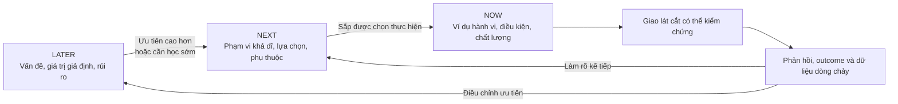

# Điều chỉnh mức chi tiết theo khoảng cách đến thời điểm triển khai

Một đội sản phẩm có backlog gồm 180 ý tưởng và yêu cầu. Để “chuẩn bị kỹ”, đội viết hàng chục trang đặc tả, đầy đủ màn hình, điều kiện chấp nhận và ước lượng cho mọi hạng mục. Ba tháng sau, phản hồi người dùng làm thay đổi ưu tiên: gần một nửa hạng mục chưa cần thực hiện, còn những hạng mục quan trọng nhất phải viết lại đặc tả. Ở chiều ngược lại, một đội khác chỉ ghi tiêu đề ngắn cho mọi việc, kể cả những hạng mục sẽ bắt đầu ngày mai. Đến lúc phát triển, họ phát hiện thiếu dữ liệu, quy tắc tính phí chưa thống nhất và API đối tác chưa được xác nhận.

Cả hai đội đều gặp cùng một vấn đề: **mức độ chi tiết không phù hợp với thời điểm cần ra quyết định**.

Trong Agile, backlog là công cụ quản lý **những lựa chọn đang phát triển**, không phải bản dự báo bất biến về mọi việc sẽ xây trong tương lai. Những hạng mục sắp được chọn làm thường cần rõ hơn để đội có thể triển khai và kiểm chứng an toàn. Những hạng mục còn xa thường chỉ cần đủ thông tin về vấn đề, giá trị, rủi ro và lý do được giữ trong backlog. Theo thời gian, phản hồi và thông tin mới giúp đội **làm rõ dần đúng phần công việc cần đến**.

Bài học thuộc chương **Ưu tiên và backlog** của mô-đun **AGILE_DEVELOPMENT**. Nội dung tập trung vào cách điều chỉnh mức chi tiết theo khoảng cách tới thời điểm triển khai (*progressive elaboration*, *rolling-wave planning*, *just-in-time backlog refinement*), đồng thời liên hệ user story, Scrum, Kanban, XP, đo lường dòng công việc và phát triển sản phẩm theo phản hồi sớm, giao tăng dần và cải tiến liên tục.

## 1. Kết quả học tập

Sau bài học, bạn có thể:

- Giải thích tại sao **hạng mục gần triển khai thường cần chi tiết hơn hạng mục ở xa**, và tại sao “gần” không chỉ được xác định bằng ngày tháng.
- Phân biệt việc **làm rõ bài toán và giá trị** với việc **khóa sớm cách thực hiện**.
- Sử dụng các chân trời **Now – Next – Later** như một công cụ tư duy để quản lý độ chi tiết của backlog.
- Xác định khi nào cần bổ sung acceptance criteria, ví dụ dữ liệu, phụ thuộc, rủi ro hoặc thử nghiệm kỹ thuật.
- Thực hiện backlog refinement vừa đủ: tách hạng mục lớn, nêu điều chưa biết, kiểm tra khả năng hoàn thành và cập nhật thứ tự.
- Kết hợp cách làm này với Product Backlog trong Scrum, chính sách kéo việc trong Kanban và kiểm thử/chất lượng kỹ thuật trong XP.
- Đánh giá tác động bằng tín hiệu về thời gian chờ, làm lại, công việc dở dang, chất lượng và giá trị người dùng.

## 2. Vì sao cần điều chỉnh mức chi tiết?

### 2.1. Nhu cầu và hiểu biết thay đổi theo thời gian

Khi một ý tưởng mới được đưa ra, đội thường chưa biết đầy đủ người dùng cần gì, giải pháp nào có tác dụng, ràng buộc kỹ thuật ra sao hoặc mức ưu tiên có còn giữ nguyên khi sản phẩm thay đổi. Phỏng vấn, thử nghiệm, vận hành và các lần phát hành tạo thêm bằng chứng.

Nếu viết quá chi tiết cho công việc còn xa:

- **Lãng phí làm rõ:** chi phí viết, đọc, cập nhật và đồng bộ nhiều thông tin có thể không được sử dụng.
- **Chốt giải pháp sớm:** màn hình, API hoặc kiến trúc bị coi như cam kết trước khi có bằng chứng cần thiết.
- **Tạo cảm giác chắc chắn giả:** đặc tả chính xác đến từng trường nhưng chưa xác minh được người dùng có cần chức năng.
- **Tăng chi phí thay đổi:** khi thị trường, quy định, thiết kế hoặc kiến trúc đổi, hàng loạt tài liệu và ước lượng phải chỉnh.
- **Che khuất ưu tiên thật:** backlog dài với quá nhiều hạng mục “đã sẵn sàng” khiến đội khó nhận ra việc nào đáng làm trước.

Nếu làm rõ quá muộn:

- Người thực hiện phải **chờ câu trả lời**, gây gián đoạn luồng công việc.
- Phụ thuộc vào dữ liệu, đối tác hoặc quyết định kiến trúc chỉ lộ ra khi đã bắt đầu.
- Phát sinh nhiều lần làm lại vì các bên hiểu khác nhau về cùng một yêu cầu.
- Hạng mục lớn không thể hoàn tất theo nhịp giao mong muốn.
- Điều kiện quan trọng về bảo mật, chất lượng hoặc tuân thủ có nguy cơ bị bỏ qua để kịp hạn.

**Mục tiêu là tối ưu thời điểm và chi phí học hỏi**, chứ không phải “viết càng ít càng Agile”.

### 2.2. Kỹ thuật làm rõ dần: progressive elaboration

*Progressive elaboration* là cách tăng độ chính xác và mức chi tiết khi hiểu biết tăng và thời điểm cần hành động đến gần. Trong lập kế hoạch theo các làn sóng (*rolling-wave planning*), công việc gần được hoạch định cụ thể hơn, còn phần ở xa được giữ ở cấp định hướng hoặc nhóm tính năng.

Trong Agile, cách tiếp cận này thường thể hiện qua **backlog refinement liên tục, đúng lúc (*just in time*)**:

1. Ghi nhận nhu cầu hoặc cơ hội ở mức đủ để quyết định có theo dõi không.
2. Dùng thông tin mới để xem lại giá trị, mức ưu tiên và rủi ro.
3. Chỉ đầu tư chi tiết lớn hơn cho các hạng mục có khả năng được chọn thực hiện hoặc cần giảm bất định sớm.
4. Khi hạng mục sắp được làm, cùng đội làm rõ những ví dụ, ràng buộc và phần việc còn mở.
5. Trong lúc làm, tiếp tục trao đổi nếu có bằng chứng mới, không xem đặc tả đã viết là bất biến.
6. Sau khi giao, dùng kết quả thực tế để cập nhật các hạng mục tiếp theo.

**Làm rõ dần không đồng nghĩa đợi tới phút cuối.** Một phụ thuộc có thời gian chuẩn bị dài có thể cần được điều tra sớm ngay khi ý tưởng còn xa. “Đúng lúc” nghĩa là đủ sớm để bảo đảm quyết định tiếp theo được đưa ra có chất lượng, nhưng tránh đầu tư không cần thiết vào giả định chưa đáng tin.

## 3. Phân biệt “độ gần” và “độ chắc chắn”

Không nên mặc định rằng một hạng mục được ghi ở tháng tới thì luôn phải chi tiết, còn hạng mục ở quý sau luôn mơ hồ. Đội nên xét ít nhất bốn yếu tố:

| Yếu tố | Câu hỏi | Hệ quả đối với mức chi tiết |
| --- | --- | --- |
| **Khả năng sắp được chọn** | Hạng mục có thể được kéo vào luồng hoặc Sprint gần nhất không? | Càng gần quyết định thực hiện, càng cần làm rõ hành vi và khả năng hoàn tất. |
| **Giá trị và mục tiêu sản phẩm** | Nó gắn với mục tiêu/đầu ra người dùng nào? | Dù ở xa, cần ghi rõ lý do giữ hạng mục; nếu giá trị chưa rõ, ưu tiên khám phá thay vì đặc tả triển khai. |
| **Độ bất định và rủi ro** | Có giả định kinh doanh, pháp lý, bảo mật hoặc kỹ thuật nào có thể làm thay đổi toàn bộ kế hoạch? | Cần giảm bất định quan trọng bằng phép thử sớm, đôi khi trước khi chi tiết hóa phần còn lại. |
| **Phụ thuộc và thời gian chuẩn bị** | Có cần phê duyệt, hợp đồng, API đối tác, thiết bị hoặc thay đổi dữ liệu mất nhiều thời gian? | Khởi động việc xác minh/chuẩn bị phù hợp sớm, dù chưa cần chi tiết mọi màn hình. |

Có ba loại “sẵn sàng” khác nhau:

- **Sẵn sàng để tiếp tục cân nhắc:** hiểu vấn đề, đối tượng, giá trị giả định và lý do còn trong backlog.
- **Sẵn sàng để quyết định ưu tiên:** đã có đủ bằng chứng hoặc đánh giá về giá trị, rủi ro, quy mô tương đối, phụ thuộc để so với lựa chọn khác.
- **Sẵn sàng để bắt đầu triển khai an toàn:** đội hiểu hành vi cần tạo ra, ràng buộc thiết yếu, những điểm chưa biết, cách kiểm chứng và phạm vi có thể hoàn thành.

Không có nghĩa mọi hạng mục phải đi qua các “cổng phê duyệt” cứng nhắc. Chúng là **những câu hỏi tương ứng với loại quyết định** mà đội đang chuẩn bị thực hiện.

### 3.1. Chi tiết không đồng nghĩa chắc chắn

Ví dụ hai mô tả:

- “Màn hình có một dropdown 12 lựa chọn, nút xanh rộng 140 px và ba API mới.”
- “Người mua thường bỏ dở khi phải nhập địa chỉ lần nữa; chúng ta cần xác định mức ảnh hưởng và thử một cách dùng lại địa chỉ.”

Mô tả đầu rất **chi tiết về giải pháp**, nhưng chưa chứng minh giải pháp đúng. Mô tả thứ hai chưa chỉ cách lập trình, nhưng có thể **chính xác hơn về vấn đề cần khám phá**.

Vì vậy, cần phân biệt **mức chi tiết** với **độ tin cậy của giả định**. Đội có thể ghi rõ một điều chưa biết và kế hoạch kiểm chứng nó; đó là tiến bộ về hiểu biết, dù chưa thêm dòng đặc tả nào.

## 4. Ba chân trời thực hành: Now, Next, Later

**Now – Next – Later** là mô hình phân nhóm hữu ích để thảo luận khoảng cách tới quyết định thực hiện, **không phải cấu trúc bắt buộc của Scrum, Kanban hay Tuyên ngôn Agile**. Các mốc không nhất thiết là ngày cố định; chúng có thể đại diện cho nhịp công việc của từng đội.

| Chân trời | Câu hỏi ưu tiên | Mức thông tin thường có ích | Những gì chưa cần quyết định |
| --- | --- | --- | --- |
| **Later — còn xa/đang khám phá** | Tại sao hạng mục đáng được cân nhắc? Ai được lợi, điều gì chưa chắc? | Vấn đề/cơ hội, nhóm người dùng, outcome kỳ vọng, bằng chứng hiện có, rủi ro lớn, liên hệ Product Goal | Chi tiết từng giao diện, hầu hết test case, ước lượng chính xác, cách chia task |
| **Next — có khả năng làm sớm** | Có nên chọn hạng mục này trước việc khác và cần giảm bất định nào? | Giá trị tương đối, phụ thuộc chính, phạm vi sơ bộ, các lát cắt, trường hợp nghiệp vụ quan trọng, tiêu chí thành công và câu hỏi mở | Mọi chi tiết thiết kế kỹ thuật cuối cùng, toàn bộ ngoại lệ ít gặp không ảnh hưởng an toàn |
| **Now — sắp bắt đầu/đang thực hiện** | Đội có thể bắt đầu, kiểm chứng và giao phần việc này một cách an toàn? | User story/PBI được làm rõ, ví dụ chấp nhận, dữ liệu ranh giới, chất lượng, chính sách kiểm thử, phụ thuộc xử lý được, cách hoàn thành | Các lựa chọn không cần thiết để đạt mục tiêu và các chức năng tương lai chưa được ưu tiên |

Một chính sách vận hành **minh họa** có thể là: Later được xem lại khi Product Goal hoặc bằng chứng thay đổi; Next được trao đổi định kỳ theo nhịp của đội; Now được làm rõ trước khi kéo việc vào thực hiện và tiếp tục trao đổi hằng ngày. Đội cần điều chỉnh lịch theo loại sản phẩm, tần suất nhu cầu và mức độ bất định.

### 4.1. Sơ đồ tăng mức chi tiết theo nhu cầu ra quyết định



Các mũi tên không bắt buộc chỉ đi từ trái sang phải. Một hạng mục **Next** có thể quay về **Later** khi mục tiêu sản phẩm đổi; một ý tưởng **Later** có thể bị xóa; một vấn đề khẩn cấp mới có thể cần xử lý ngay nếu đội đã có đủ thông tin và chính sách rủi ro.

### 4.2. Ví dụ một ý tưởng ở ba chân trời

Giả sử ứng dụng bán hàng muốn hỗ trợ **đặt lại đơn đã mua**.

**Later — thẻ ý tưởng:**

> Người mua quay lại có thể cần một cách tạo đơn mới từ đơn cũ. Mục tiêu giả định là rút ngắn thời gian đặt hàng lặp lại. Chưa rõ nhóm khách hàng nào cần nhất và giá sản phẩm/phí giao thay đổi ảnh hưởng ra sao.

**Next — cơ hội đã được xem xét:**

> Dữ liệu hỗ trợ và phỏng vấn cho thấy nhóm mua thường xuyên gặp khó khi tìm lại sản phẩm. Phạm vi thử đầu: từ lịch sử đơn, tạo giỏ hàng mới với những sản phẩm còn bán; người dùng phải xác nhận giá và địa chỉ. Cần xác minh cách xử lý sản phẩm ngừng bán và biến thể đã đổi.

**Now — lát cắt chuẩn bị làm:**

> Là người mua đã đăng nhập, tôi muốn tạo giỏ hàng mới từ một đơn cũ để bớt tìm lại từng sản phẩm. Khi chọn “Mua lại”, hệ thống thêm những mặt hàng còn bán vào giỏ; hiển thị rõ những mặt hàng không còn bán; giá và phí được tính theo dữ liệu **hiện tại**; người dùng xác nhận trước thanh toán. Kiểm thử phân quyền lịch sử đơn, thay đổi giá, mặt hàng ngừng bán và trường hợp giỏ đang có sẵn.

Đội không cần ước lượng chính xác ba API và từng màn hình ngay từ **Later**. Nhưng nếu có một ràng buộc bắt buộc như lưu trữ lịch sử đơn theo quy định hoặc phụ thuộc đối tác, cần ghi nhận và đánh giá tác động ngay từ khi phát hiện.

## 5. Tăng chi tiết ở đúng lớp thông tin

“Làm rõ hạng mục” có thể mang nhiều nghĩa. Không nên đánh đồng **làm rõ giá trị** với **viết nhiều task kỹ thuật**.

| Lớp thông tin | Ở Later | Ở Next | Ở Now |
| --- | --- | --- | --- |
| **Người dùng và vấn đề** | Nhóm người dùng, nhu cầu giả định | Bằng chứng và bối cảnh sử dụng cụ thể hơn | Tình huống cần hỗ trợ trong lát cắt hiện tại |
| **Giá trị và outcome** | Kết quả mong đợi, liên hệ Product Goal | Chỉ số và cơ sở ưu tiên tương đối | Tiêu chí đo/quan sát sau phát hành và chỉ số bảo vệ |
| **Phạm vi** | Chủ đề/epic/cơ hội | Lựa chọn lát cắt đầu tiên, phần sẽ hoãn | Hành vi thực hiện và ngoài phạm vi được thống nhất |
| **Quy tắc nghiệp vụ** | Điều kiện hoặc quy định lớn đã biết | Các quy tắc ảnh hưởng tính khả thi | Ví dụ cụ thể, dữ liệu ranh giới, ngoại lệ quan trọng |
| **Phụ thuộc** | Phụ thuộc lớn, thời gian chuẩn bị dài | Người phối hợp, việc cần xác minh, phương án thay thế | Điều kiện để bắt đầu/hoàn thành rõ và có người xử lý |
| **Kỹ thuật và chất lượng** | Rủi ro/giới hạn kiến trúc, bảo mật đã biết | Spike hoặc lựa chọn thiết kế quan trọng | Kế hoạch kiểm chứng phù hợp, DoD/chính sách chất lượng |
| **Ước lượng** | Có thể chỉ nhận định thô hoặc không ước lượng | Đủ để so sánh lựa chọn và năng lực | Đủ để quyết định lát cắt khả thi trong nhịp làm việc |

Điều cần nhớ: **hạng mục ở xa vẫn phải có ý nghĩa kinh doanh và rủi ro lớn được nhận diện**; hạng mục gần mới cần nhiều ví dụ và chi tiết kiểm chứng. Không có quy tắc “Later phải có đúng ba dòng, Now phải có đúng mười dòng”.

## 6. Backlog refinement: làm rõ để phục vụ một quyết định

Trong **Scrum Guide 2020**, *Product Backlog* là danh sách có thứ tự, mang tính phát triển dần, những gì cần để cải thiện sản phẩm; gắn với **Product Goal**. *Product Backlog refinement* là hoạt động liên tục nhằm chia nhỏ và định nghĩa rõ hơn các Product Backlog Item, thường thêm các thông tin như mô tả, thứ tự, quy mô. Scrum Guide không quy định refinement là một sự kiện Scrum riêng có timebox cố định.

Các PBI có thể được xem là **đủ sẵn sàng để lựa chọn trong Sprint Planning khi Developers tin rằng chúng có thể hoàn thành trong một Sprint**. Điều này phụ thuộc hiểu biết, năng lực và bối cảnh của chính đội.

### 6.1. Một vòng refinement thực tế

1. **Xác định quyết định sắp đưa ra:** chọn những hạng mục nào cho nhịp tới, phân biệt giải pháp hay kiểm tra tính khả thi?
2. **Nhắc lại Product Goal và bằng chứng ưu tiên:** hạng mục giúp đạt kết quả nào, có thay đổi gì kể từ lần xem trước?
3. **Làm rõ nhu cầu:** ai được lợi, công việc của họ đang bị trở ngại ra sao, điều chưa biết là gì?
4. **Tách theo giá trị:** tìm lát cắt nhỏ có hành vi hoàn chỉnh, kiểm chứng được; hoãn phần chưa cần.
5. **Nêu các tình huống khó:** quy tắc nghiệp vụ, dữ liệu ranh giới, lỗi và rủi ro an toàn/tuân thủ.
6. **Xem xét phụ thuộc và khả năng hoàn thành:** cần phối hợp với ai, điều nào phải xác minh sớm, có thể giao theo nhịp hiện tại?
7. **Cập nhật cách mô tả, thứ tự và câu hỏi mở:** lưu quyết định đủ để người tiếp theo hiểu, không viết lại toàn bộ cuộc họp.
8. **Dừng khi đã đủ:** nếu còn một bất định lớn, tạo hành động khám phá có người phụ trách thay vì bịa thêm chi tiết.

Điểm kết thúc của một buổi refinement **không phải số lượng ticket đã điền đủ trường**. Kết quả có ích là: đội có thể đưa ra quyết định kế tiếp chính xác hơn, biết điều gì chưa rõ và biết ai có thể giúp làm rõ.

### 6.2. Mời đúng góc nhìn để tránh làm lại

Trong môi trường Scrum, Product Owner chịu trách nhiệm tối đa hóa giá trị và quản lý Product Backlog; Developers đưa vào hiểu biết về khả năng thực hiện và quy mô. Người dùng, kiểm thử, bảo mật, vận hành hoặc đối tác có thể tham gia khi thông tin của họ là cần thiết. Scrum Master hỗ trợ Scrum được hiểu và vận dụng hiệu quả, có thể giúp nhóm xử lý trở ngại trong cách phối hợp.

Ví dụ, tính năng **địa chỉ giao hàng được lưu** cần câu hỏi từ bảo mật và người hiểu dữ liệu cá nhân trước lúc bắt đầu; không nên chờ tới sau khi mã đã viết mới kiểm tra phân quyền. Tuy nhiên, không nhất thiết triệu tập mọi chuyên gia cho mọi ticket nhỏ; chỉ mời người cần thiết với mức độ phù hợp.

### 6.3. Từ “mơ hồ” đến “đủ để bắt đầu”

Bốn mức độ biểu đạt cùng một hạng mục:

| Mức | Nội dung | Có đủ để làm ngay không? |
| --- | --- | --- |
| **1 — Tên ý tưởng** | “Cải thiện đặt hàng” | Thường chưa đủ; chưa rõ ai, vấn đề và lợi ích |
| **2 — Nhu cầu có giá trị** | “Khách mua quay lại muốn tái sử dụng địa chỉ để đặt nhanh hơn” | Đủ để cân nhắc, nhưng cần trao đổi phạm vi |
| **3 — Lát cắt và rủi ro** | “Chọn địa chỉ gần nhất cho tài khoản đã đăng nhập; có kiểm tra phí, phân quyền; chưa hỗ trợ nhiều địa chỉ” | Gần khả thi; cần xác định ví dụ/tiêu chí và phụ thuộc |
| **4 — Có thể xác minh** | Các ví dụ: tài khoản đúng, đổi tỉnh thì phí đổi, địa chỉ bị xóa, tài khoản khác không truy cập được; DoD và cách kiểm chứng rõ | Có thể đủ để chọn nếu Developers tin thực hiện xong trong nhịp dự kiến |

Không có mức “chuẩn toàn cầu”. Một sửa lỗi nhỏ với điều kiện tái hiện rõ có thể chuyển thẳng từ mức 2 sang triển khai, trong khi thay đổi thanh toán phức tạp cần nghiên cứu sâu hơn trước khi chọn.

## 7. User story, acceptance criteria và tiêu chuẩn chất lượng

### 7.1. Story là lời mời trao đổi, không phải hồ sơ khóa trước

Một user story thường có cấu trúc:

> Là **[người dùng]**, tôi muốn **[khả năng]** để **[lợi ích]**.

Ở **Later**, câu này có thể là điểm khởi đầu đủ tốt để nhớ vấn đề. Ở **Next**, cần làm rõ tình huống và cách chia nhỏ. Gần lúc làm, đội có thể bổ sung **Card – Conversation – Confirmation**: thẻ nhắc nhớ, trao đổi nghiệp vụ và xác nhận bằng ví dụ.

User story **không phải định dạng bắt buộc** cho mọi Product Backlog Item. Công việc bảo mật, sửa lỗi, kiến trúc, nâng cấp phụ thuộc hoặc nghiên cứu có thể mô tả trực tiếp theo tác động và điều cần kiểm chứng.

### 7.2. Acceptance criteria cần xuất hiện khi giúp kiểm chứng

Một story sắp thực hiện nên có các ví dụ đủ để các bên hiểu **hành vi nào được kỳ vọng**. Có thể dùng Given – When – Then:

```gherkin
Feature: Chọn lại địa chỉ giao hàng

  Scenario: Đổi địa chỉ trước khi xác nhận
    Given người mua đã đăng nhập và có địa chỉ hợp lệ đã lưu
    And giỏ hàng có thể đặt
    When người mua chọn địa chỉ ở tỉnh khác
    Then địa chỉ giao hàng trên đơn hiển thị đúng lựa chọn mới
    And phí vận chuyển được tính lại theo địa chỉ mới
    And tổng tiền cuối cùng phản ánh phí mới

  Scenario: Chặn dùng địa chỉ của tài khoản khác
    Given người mua B đã đăng nhập
    And địa chỉ A thuộc tài khoản khác
    When người mua B yêu cầu sử dụng địa chỉ A
    Then yêu cầu bị từ chối theo quy tắc phân quyền
    And hệ thống không trả dữ liệu riêng của địa chỉ A
```

Ví dụ trên chưa phải mã kiểm thử tự động hoàn chỉnh. Nó giúp phát hiện người tham gia hiểu khác nhau ở những điểm quan trọng. Các trường hợp khác có thể bổ sung khi có lý do; không cần viết mọi tổ hợp dữ liệu tưởng tượng từ nhiều tháng trước.

### 7.3. Acceptance criteria khác Definition of Done

- **Acceptance criteria** trả lời *hạng mục này cần thể hiện hành vi nào?*
- **Definition of Done (DoD)** trong Scrum mô tả tiêu chuẩn chất lượng mà Increment phải đáp ứng để được coi là hoàn thành.
- **Product Goal/outcome** trả lời *vì sao hạng mục được chọn và kết quả người dùng nào được kỳ vọng?*

Nếu một hạng mục có acceptance criteria rõ nhưng không có kiểm thử phân quyền, dữ liệu hoặc tích hợp phù hợp, đội chưa chắc giao được một Increment an toàn. Ngược lại, một Increment đạt DoD vẫn chưa chứng minh người dùng thật sự được lợi; cần quan sát sau phát hành.

Scrum Guide **không quy định một “Definition of Ready” (DoR) chính thức bắt buộc**. Nhóm có thể thống nhất các câu hỏi về mức sẵn sàng để giảm làm lại, nhưng không nên biến chúng thành cổng hành chính cứng khiến công việc có giá trị bị chặn chỉ vì thiếu một trường biểu mẫu không cần thiết.

## 8. Chia nhỏ đúng lúc để giao tăng dần

Một hạng mục còn xa có thể được biểu diễn là *epic* hoặc cơ hội lớn. Khi ưu tiên tăng lên, nên tìm **lát cắt dọc (*vertical slice*)** chứa hành vi hoàn chỉnh từ trải nghiệm đến dữ liệu và kiểm chứng, thay vì chia thành các nhiệm vụ kỹ thuật rời rạc rồi coi từng phần là giá trị độc lập.

### 8.1. Ví dụ hạng mục quá lớn

> “Xây hệ thống quản lý địa chỉ nhiều người dùng, chia sẻ gia đình, đồng bộ đối tác vận chuyển, đặt mặc định, lịch sử thay đổi và tự động tối ưu phí.”

Khi còn ở **Later**, chỉ cần giữ mục tiêu và rủi ro cốt lõi, chẳng hạn “giảm ma sát khi mua hàng quay lại” và “bảo vệ dữ liệu địa chỉ”. Nếu ưu tiên tăng, thử chia:

| Lát cắt | Giá trị người dùng | Việc có thể hoãn |
| --- | --- | --- |
| **A — Chọn địa chỉ gần nhất** | Mua lại không cần nhập địa chỉ từ đầu | Nhiều địa chỉ, chia sẻ gia đình |
| **B — Chọn trong danh sách** | Có thể đổi nơi nhận nhanh | Tự động chọn theo phí thấp nhất |
| **C — Quản lý địa chỉ riêng** | Cập nhật và xóa địa chỉ không còn dùng | Đồng bộ bên thứ ba |
| **D — Phối hợp nhiều người** | Các thành viên được phép dùng địa chỉ phù hợp | Các tối ưu nâng cao chưa được kiểm chứng |

Mỗi lát cắt được chọn phải đáp ứng yêu cầu bảo mật, dữ liệu, chất lượng và quy tắc cốt lõi. **Không được hoãn kiểm soát truy cập** của lát cắt A với lý do “bảo mật sẽ làm trong D”.

### 8.2. Cách chia mang tính kỹ thuật có thể gây ảo giác tiến độ

Các mục như “tạo database”, “viết API”, “làm giao diện”, “kiểm thử” có thể là task con để phối hợp. Nhưng nếu hoàn tất một task mà người dùng chưa thể thực hiện hành vi hữu ích, nó không nên được dùng làm bằng chứng **đã giao giá trị**.

Một lát cắt dọc nhỏ, hoạt động được, có tiêu chí kiểm chứng rõ thường cho phản hồi nhanh hơn một gói lớn chứa nhiều tầng kỹ thuật chưa tích hợp.

### 8.3. Đừng chia trước quá sớm

Làm rõ và chia tất cả epic của năm sau thành hàng trăm story nhỏ có thể khiến backlog trở nên khó bảo trì. Khi phản hồi mới làm đổi hướng sản phẩm, những story ấy phải sửa hoặc loại bỏ. Đội nên chia đến mức cần thiết cho **so sánh ưu tiên và bước thực hiện gần**, giữ phần xa ở mức cơ hội/nhóm hành vi nếu thông tin chưa ổn định.

## 9. Khi nào cần làm rõ sớm dù việc còn xa?

“Chi tiết theo thời điểm” không cho phép bỏ qua rủi ro có **thời gian xử lý dài**. Một số tình huống nên khởi động việc học ngay từ chân trời Later:

| Tình huống | Việc cần làm sớm | Điều có thể để sau |
| --- | --- | --- |
| **Hợp đồng API đối tác chưa xác nhận** | Kiểm tra khả năng tích hợp, hạn mức, thời gian cấp quyền và kế hoạch dự phòng | Trường hiển thị cụ thể trên mọi màn hình |
| **Yêu cầu pháp lý hoặc quyền riêng tư** | Xác định ràng buộc bắt buộc và người chịu trách nhiệm đánh giá | Chi tiết giao diện không liên quan đến tuân thủ |
| **Di chuyển dữ liệu có ảnh hưởng nhiều hệ thống** | Kiểm tra dữ liệu thực, khả năng tương thích ngược, độ phức tạp chuyển đổi | Task triển khai chi tiết chưa cần trong nhịp gần |
| **Rủi ro công nghệ chưa từng làm** | Spike/PoC có giới hạn nhằm kiểm tra giả định quan trọng | Toàn bộ kiến trúc sản xuất dự đoán trước |
| **Mùa cao điểm hoặc hạn có thực** | Kiểm tra năng lực, phụ thuộc, đường phát hành và điều kiện cần chuẩn bị | Tính năng nâng cao có thể loại khỏi phạm vi |
| **Rủi ro bảo mật mức cao** | Threat modeling và xác định rào chắn thiết yếu | Các chi tiết tối ưu ít ảnh hưởng rủi ro |
| **Nghi ngờ nhu cầu người dùng** | Nghiên cứu, quan sát hoặc thử nguyên mẫu để quyết định có nên đầu tư | Thiết kế kỹ thuật hoàn chỉnh trước khi chứng minh giá trị |

**Spike** là công việc tìm hiểu có giới hạn thời gian và mục tiêu học cụ thể. Ví dụ: “trong hai ngày xác minh API đối tác có hỗ trợ khóa chống lặp thanh toán hay không, báo cáo lựa chọn và rủi ro”. Spike không nên trở thành chỗ ẩn một dự án lớn với kết quả mơ hồ “nghiên cứu thêm”.

Kết quả học hỏi có thể khiến đội **đổi lựa chọn hoặc bỏ hẳn ý tưởng**. Đó là lợi ích của việc giảm bất định đúng lúc.

## 10. Tình huống xuyên suốt: cải thiện thanh toán trong sản phẩm thương mại điện tử

Giả sử đội phát triển nhận nhiều phản hồi rằng người mua phải nhập lại thông tin giao hàng, dẫn đến bỏ dở thanh toán. Một bên liên quan đề xuất xây **“quản lý địa chỉ nâng cao”** gồm nhiều địa chỉ, gắn nhãn, địa chỉ gia đình và đồng bộ đối tác.

Đội muốn tạo giá trị sớm nhưng chưa biết phần nào quan trọng nhất. Ta quan sát sự thay đổi mức chi tiết qua năm thời điểm.

### 10.1. Thời điểm A — Ý tưởng còn ở Later

Thông tin ban đầu trong backlog có thể là:

> **Cơ hội:** Người mua quay lại gặp ma sát khi nhập địa chỉ.
>
> **Đối tượng:** Khách đã đặt hàng trước đó.
>
> **Giá trị kỳ vọng:** Rút ngắn thời gian thanh toán, giảm nhập sai.
>
> **Bằng chứng ban đầu:** Phản hồi hỗ trợ và một số phiên quan sát; chưa đủ để định lượng mức ảnh hưởng.
>
> **Rủi ro lớn:** Lưu dữ liệu cá nhân; phí giao có thể thay đổi theo địa chỉ.
>
> **Việc học tiếp:** Phân tích bước bỏ dở thanh toán và quan sát người mua quay lại.

Ở đây **chưa cần** thiết kế sáu màn hình, liệt kê 30 test case, tạo database schema cuối cùng hoặc ước lượng ngày công cho toàn bộ epic. Nhưng **đã cần** đánh dấu rủi ro dữ liệu cá nhân.

### 10.2. Thời điểm B — Sắp đưa vào lựa chọn ưu tiên, chuyển sang Next

Phân tích và phỏng vấn cho thấy một nhóm người dùng quay lại thường đặt đơn cùng địa chỉ. Đội thay đổi đề xuất: **thử cách chọn lại một địa chỉ gần nhất**, chưa cần tính năng quản lý nhiều địa chỉ.

Backlog được làm rõ:

| Yếu tố | Nội dung được bổ sung |
| --- | --- |
| **Giả thuyết** | Chọn lại địa chỉ gần nhất giúp người mua quay lại hoàn tất thanh toán nhanh hơn |
| **Lát cắt đầu** | Chỉ tài khoản đăng nhập, chọn/xem/sửa địa chỉ gần nhất trước xác nhận |
| **Giá trị có thể quan sát** | Tỷ lệ sử dụng địa chỉ cũ, thời gian hoàn tất bước địa chỉ |
| **Điều kiện bảo vệ** | Không lộ địa chỉ người khác; tổng tiền tính đúng khi đổi địa chỉ |
| **Phụ thuộc** | Cần xác nhận dữ liệu địa chỉ lịch sử và chính sách vận chuyển |
| **Bất định còn mở** | Cách xử lý địa chỉ không hỗ trợ giao hàng, dữ liệu thiếu tỉnh/thành |

Ở Next, đội có thể đánh giá quy mô tương đối và xem phụ thuộc. Nếu dữ liệu lịch sử không tin cậy, một spike hoặc thử nghiệm dữ liệu nhỏ được ưu tiên trước khi chốt lát cắt.

### 10.3. Thời điểm C — Gần chọn thực hiện, chuyển sang Now

Nhóm trao đổi với người phụ trách sản phẩm, phát triển, kiểm thử và người hiểu phí giao hàng. Story đầu được làm rõ:

> Là **người mua quay lại đã đăng nhập**, tôi muốn **chọn lại địa chỉ giao hàng gần nhất của mình** để **hoàn tất đơn nhanh hơn mà vẫn kiểm soát được nơi nhận**.

**Một số acceptance criteria minh họa:**

1. Người mua chỉ thấy địa chỉ gắn với đúng tài khoản của mình.
2. Có thể chọn địa chỉ gần nhất hoặc sửa trước khi xác nhận thanh toán.
3. Khi thay đổi tỉnh/thành, phí giao hàng và tổng tiền được tính lại theo quy tắc hiện hành.
4. Nếu địa chỉ không còn hợp lệ, hệ thống báo rõ và không cho xác nhận một đơn với địa chỉ/phí sai.
5. Khi tài khoản chưa từng có địa chỉ, luồng nhập địa chỉ thông thường vẫn hoạt động.
6. Trải nghiệm hỗ trợ nhập/chọn địa chỉ ở mức khả năng tiếp cận đã thống nhất.

**Definition of Done** (nếu đội dùng Scrum) vẫn yêu cầu các tiêu chuẩn chất lượng thích hợp: kiểm thử liên quan đạt, kiểm tra phân quyền, tích hợp an toàn, quan sát được lỗi quan trọng và phần mềm ở trạng thái có thể sử dụng. Tiêu chí ở mức hạng mục và DoD giải quyết các câu hỏi khác nhau.

Các bên thống nhất những phần **ngoài phạm vi**: chưa có chia sẻ địa chỉ gia đình, nhãn tùy chỉnh và đồng bộ đối tác. Điều này giảm rủi ro hạng mục lớn dần trong lúc thực hiện.

### 10.4. Thời điểm D — Trong triển khai, thông tin vẫn tiếp tục thay đổi

Khi tích hợp, đội phát hiện một số đơn cũ chỉ lưu mã vùng đã ngừng dùng. Họ không cố giữ nguyên mọi chi tiết đã chốt bằng mọi giá. Thay vào đó:

1. Nêu dữ kiện và phạm vi ảnh hưởng.
2. Xem có cách xử lý an toàn trong lát cắt hiện tại không: yêu cầu xác nhận lại địa chỉ hoặc bỏ qua địa chỉ không hợp lệ.
3. Nếu cần thay đổi lớn, điều chỉnh phạm vi hoặc thứ tự backlog với người có trách nhiệm.
4. Cập nhật acceptance criteria cho hành vi thật sự được chọn và kiểm thử liên quan.
5. Giữ mục tiêu giảm ma sát thanh toán và chất lượng bảo mật.

Nếu đội dùng Scrum, Sprint Backlog có thể được làm rõ/điều chỉnh trong Sprint khi học thêm; các thay đổi cần được trao đổi để không gây nguy hại Sprint Goal. Nếu dùng Kanban, chính sách xử lý blocker và WIP giúp đội xử lý hạng mục đang kẹt mà không đẩy thêm nhiều việc mới vào luồng.

### 10.5. Thời điểm E — Sau phát hành, phản hồi quyết định hạng mục kế tiếp

Đội đo trên nhóm người mua đủ điều kiện, với định nghĩa rõ về khoảng thời gian và phạm vi phát hành:

- Người mua có sử dụng lại địa chỉ không?
- Thời gian hoàn tất bước địa chỉ và tỷ lệ bỏ dở thay đổi thế nào?
- Có tăng lỗi tính phí, giao sai hoặc phản hồi về quyền riêng tư không?
- Người mua có thực sự cần lưu nhiều địa chỉ hay chỉ cần một địa chỉ gần nhất?

Giả sử dữ liệu cho thấy nhiều người dùng muốn chọn địa chỉ **cơ quan và gia đình**, đội đưa lát cắt nhiều địa chỉ lên Next. Nếu người dùng ít quan tâm, đội có thể chuyển nguồn lực sang vấn đề khác. **Phản hồi điều chỉnh mức ưu tiên và độ chi tiết**, chứ backlog không tự động tiếp tục triển khai mọi tính năng dự kiến từ ban đầu.

### 10.6. So sánh hai cách làm

| Lối làm | Hệ quả dễ xảy ra |
| --- | --- |
| Đặc tả đầy đủ toàn bộ “quản lý địa chỉ nâng cao” từ tháng đầu | Chi phí cao, dễ phải làm lại nhiều khi bằng chứng thay đổi |
| Để mọi việc chỉ có tiêu đề đến ngày bắt đầu | Chờ quyết định về dữ liệu, bảo mật và phí; khó hoàn tất một lát cắt |
| **Làm rõ dần dựa trên thời điểm và rủi ro** | Giữ mục tiêu ở xa, xác minh rủi ro sớm, chuẩn bị chi tiết cho lát cắt sắp làm, học từ phản hồi để chọn việc tiếp |

Bảng là phân tích theo logic sản phẩm, không phải khẳng định số liệu hiệu quả cho mọi dự án. Đội cần quan sát kết quả thật để xác minh cách làm phù hợp.

## 11. Phân biệt việc làm rõ backlog với lập kế hoạch cố định

### 11.1. Backlog không phải cam kết giao mọi hạng mục

*Product Backlog* chứa những gì đội có thể cân nhắc để cải thiện sản phẩm, được sắp thứ tự và liên tục thay đổi. Một hạng mục xuất hiện trong backlog **không tự tạo cam kết rằng nó chắc chắn sẽ được xây**. Độ chi tiết cao cũng không phải lý do giữ một hạng mục kém giá trị trong thứ tự ưu tiên.

Đặc biệt, nếu một ý tưởng ở Later đã bị giả thuyết mới bác bỏ, đội có thể loại bỏ, hoãn vô thời hạn hoặc thay bằng cơ hội khác. Chi phí đã bỏ ra để viết đặc tả **không phải bằng chứng nên tiếp tục đầu tư**.

### 11.2. Tách “đã biết” khỏi “giả định”

Một hạng mục nên làm rõ trạng thái thông tin:

| Nhãn minh họa | Ví dụ |
| --- | --- |
| **Đã xác minh** | API đối tác hiện trả mã lỗi cụ thể theo hợp đồng đang sử dụng |
| **Giả định** | Người mua quay lại muốn một địa chỉ mặc định |
| **Câu hỏi mở** | Địa chỉ lịch sử thiếu mã tỉnh cần xử lý thế nào? |
| **Rủi ro** | Thông tin địa chỉ có thể bị truy cập qua ID đoán được nếu phân quyền sai |
| **Quyết định** | Lát cắt đầu yêu cầu người dùng xác nhận địa chỉ trước khi đặt |
| **Điều kiện xem lại** | Nếu dữ liệu sử dụng cho thấy phần lớn người mua cần nhiều địa chỉ |

Những nhãn này có thể nằm trong mô tả ngắn hoặc công cụ backlog đang dùng; không cần tạo hệ thống trường dữ liệu phức tạp nếu nhóm vẫn hiểu và làm việc tốt.

### 11.3. Ước lượng theo mức cần thiết, đừng tạo độ chính xác giả

Một hạng mục ở Later có thể chỉ cần biết “rủi ro cao, có nhiều phụ thuộc” để quyết định cần tìm hiểu. Ở Next, một ước lượng tương đối hoặc khoảng giá trị có thể giúp so sánh lựa chọn. Ở Now, cần đủ thông tin để Developers đánh giá khả năng hoàn tất với chất lượng yêu cầu.

Không có yêu cầu Agile rằng mọi PBI đều phải có story point hoặc ước lượng chính xác trước khi được ghi vào backlog. Một số đội dùng throughput và phân bố cycle time để dự báo; đội khác dùng ước lượng tương đối hoặc chia nhỏ theo mức có thể hoàn thành. **Chọn cách đo phù hợp với quyết định cần đưa ra**, không áp một con số làm mục tiêu năng suất.

## 12. Điều chỉnh theo Scrum, Kanban và XP

### 12.1. Scrum: Product Goal, refinement và Sprint Planning

Trong Scrum, **Product Goal** định hướng dài hạn; Product Backlog được quản lý có thứ tự; refinement liên tục giúp hạng mục sắp được chọn trở nên rõ hơn. Tại Sprint Planning, Scrum Team xây Sprint Goal, và Developers chọn hạng mục dựa trên trao đổi về lý do, khả năng thực hiện và cách triển khai.

Cách áp dụng:

- **Later:** giữ các lựa chọn phù hợp Product Goal ở mức vấn đề/khả năng.
- **Next:** Product Owner cùng Developers và người liên quan làm rõ các hạng mục có khả năng cao được chọn.
- **Now:** trao đổi các PBI đủ nhỏ và đủ rõ để Developers tin có thể đưa tới Done trong một Sprint.
- **Trong Sprint:** làm rõ hoặc thay đổi kế hoạch khi có thông tin mới; bảo vệ Sprint Goal và Definition of Done.
- **Sprint Review:** nhận phản hồi để cập nhật thứ tự và nội dung Product Backlog.
- **Sprint Retrospective:** cải tiến cách refinement nếu đội thường phát hiện rủi ro quá muộn hoặc lãng phí thời gian làm rõ việc không bao giờ làm.

Scrum **không yêu cầu khóa chi tiết backlog cả quý**, cũng không quy định mọi PBI phải là user story.

### 12.2. Kanban: làm rõ theo điểm kéo việc vào luồng

Trong Kanban Method, đội quan tâm đến việc **trực quan hóa, giới hạn WIP, quản lý dòng chảy, công khai chính sách, vòng phản hồi và cải tiến**. Khi công việc đến liên tục, khoảng cách tới triển khai có thể được mô tả bằng **vị trí trong luồng** chứ không phải số Sprint.

Ví dụ chính sách minh họa:

```text
Ideas / Options --> Selected --> Ready --> In Progress --> Review --> Done
                         |             |
                  làm rõ ưu tiên   đã rõ để kéo việc
```

Đội có thể công bố:

- Hạng mục ở **Options** chỉ cần mô tả cơ hội và lý do theo dõi.
- Để chuyển sang **Selected**, cần có ưu tiên, người hỗ trợ làm rõ và rủi ro chính được nhìn thấy.
- Để kéo vào **In Progress**, người thực hiện cần hiểu hành vi, cách kiểm chứng và phụ thuộc quan trọng.
- Khi cột review vượt WIP limit, ưu tiên hoàn thành/gỡ tắc nghẽn thay vì liên tục đẩy thêm việc mới.

Đây là **một bộ chính sách ví dụ**, không phải workflow bắt buộc của Kanban. Đội có thể thay đổi điểm cam kết (*commitment point*) và định nghĩa trạng thái theo công việc thực tế.

### 12.3. XP: phản hồi kỹ thuật nhanh giúp chi tiết hóa đúng mức

**Extreme Programming (XP)** nhấn mạnh các thực hành như test-first/TDD, pair programming, tích hợp liên tục, thiết kế đơn giản và refactoring. Chúng giúp đội ứng phó khi yêu cầu được làm rõ dần:

- Thêm ví dụ nghiệp vụ mới rồi viết/điều chỉnh kiểm thử để bảo vệ hành vi cần thiết.
- Tách một thay đổi thành những bước nhỏ có thể kiểm chứng.
- Tích hợp thường xuyên, phát hiện xung đột và lỗi sớm.
- Refactor khi ranh giới thiết kế rõ hơn, không cần cố đoán trước mọi biến thể.
- Duy trì khả năng phát hành phần mềm có chất lượng ở mỗi lát cắt.

**Chi tiết làm rõ muộn không có nghĩa bỏ kiểm thử hay thiết kế.** Đội cần giữ tiêu chuẩn chất lượng liên tục để thay đổi thông tin mới không kéo theo rủi ro không kiểm soát.

## 13. Đo lường để biết cách làm rõ có đúng thời điểm không

Không có một chỉ số duy nhất chứng minh mức chi tiết “vừa đủ”. Hãy quan sát **thời gian, chất lượng, chi phí học hỏi và giá trị**.

| Tín hiệu | Cách hiểu hữu ích | Cạm bẫy cần tránh |
| --- | --- | --- |
| **Thời gian chờ làm rõ** | Hạng mục đã bắt đầu nhưng bị chặn vì thiếu quyết định/ngữ cảnh bao lâu? | Đổ trách nhiệm lên một người thay vì xem cơ chế phối hợp |
| **Tỷ lệ hạng mục phải làm lại lớn** | Có hiểu sai hoặc phát hiện quy tắc quan trọng quá muộn? | Mọi thay đổi yêu cầu đều bị gắn nhãn “làm lại xấu”; có thay đổi là kết quả học hỏi hợp lý |
| **Hạng mục được chuẩn bị nhưng không bao giờ chọn** | Đã đầu tư quá nhiều vào việc ở xa hoặc kém ưu tiên? | Coi mọi ý tưởng bị loại là thất bại; loại ý tưởng sai sớm có thể tốt |
| **Tuổi công việc đang làm (work item age)** | Có việc nào kẹt lâu trong luồng vì phụ thuộc hoặc bất định? | Dùng số tuổi việc để đánh giá cá nhân |
| **Cycle time / lead time** | Toàn bộ luồng từ mốc đã định tới hoàn thành có trôi chảy hơn không? | So sánh khi điểm bắt đầu/kết thúc đo khác nhau |
| **Throughput, WIP** | Khối lượng hạng mục hoàn tất và lượng việc song song có phù hợp? | Chia hạng mục cực nhỏ để “làm đẹp” số lượng |
| **Chất lượng và lỗi hồi quy** | Làm rõ đúng lúc có giúp bớt bỏ sót ràng buộc quan trọng? | Tăng tốc giao bằng cách bỏ kiểm thử |
| **Outcome người dùng** | Phần được giao có làm thay đổi hành vi/trải nghiệm theo giả thuyết? | Nhầm số story Done với giá trị |

### 13.1. Ví dụ đo thời gian chờ

Giả sử một nhóm quan sát 20 hạng mục vừa hoàn thành. Trung bình mỗi hạng mục cần **2 ngày thực hiện** nhưng bị chờ **3 ngày** vì chưa rõ quy tắc nghiệp vụ. Đây là số liệu **giả định để minh họa**.

Phản ứng hữu ích: chọn vài hạng mục sắp bắt đầu, làm rõ tình huống ranh giới cùng người có thông tin trước khi kéo vào luồng; sau đó quan sát thời gian chờ, lỗi và mức độ làm lại trong những lần tiếp theo.

Phản ứng chưa tốt: yêu cầu mọi epic của sáu tháng tới có 50 acceptance criteria. Cách này có thể giảm một số câu hỏi gần hạn nhưng làm tăng lãng phí cho nhiều hạng mục sẽ không được xây.

### 13.2. Phân biệt học hỏi với biến động gây hại

Có thể một story được điều chỉnh sau khi quan sát người dùng và tạo kết quả tốt hơn: **đó là thích ứng có ích**. Ngược lại, phải sửa nhiều lần vì không ai hỏi về quyền truy cập dữ liệu trước khi lập trình là dấu hiệu cần cải thiện cách làm rõ.

Khi phân tích “thay đổi phạm vi”, hãy hỏi **vì sao thay đổi**. Không nên cố làm tỷ lệ thay đổi yêu cầu bằng 0, vì như vậy có thể khiến đội bỏ qua bằng chứng mới.

## 14. Những ngộ nhận và dấu hiệu cảnh báo

| Ngộ nhận | Cách hiểu phù hợp |
| --- | --- |
| “Agile nghĩa là không viết yêu cầu trước.” | Agile cần hiểu đủ để giao và kiểm chứng; điều chỉnh thời điểm và mức độ chi tiết theo quyết định. |
| “Phải chuẩn bị tất cả hạng mục trước khi Sprint đầu bắt đầu.” | Backlog phát triển liên tục; chuẩn bị những lựa chọn gần và rủi ro cần xử lý sớm. |
| “Các hạng mục Later không cần thông tin gì.” | Vẫn cần vấn đề, giá trị giả định, liên hệ mục tiêu và rủi ro lớn đủ để cân nhắc. |
| “Càng chi tiết càng đáng tin.” | Một mô tả đầy đủ giao diện vẫn có thể dựa trên giả thuyết giá trị sai. |
| “Không được thay đổi acceptance criteria sau refinement.” | Có thể cập nhật khi học thêm, với sự trao đổi và đánh giá tác động cần thiết. |
| “Chỉ làm rõ khi Developer bắt đầu code.” | Rủi ro và phụ thuộc dài hạn cần được làm rõ sớm hơn; những thứ cần quyết định ngay không thể để đến phút cuối. |
| “Definition of Ready là yêu cầu bắt buộc của Scrum.” | Scrum Guide không quy định DoR chính thức; đội có thể có câu hỏi về readiness để hỗ trợ thực hành. |
| “Story point càng chính xác thì lập kế hoạch càng Agile.” | Độ chính xác biểu kiến không thay thế được hiểu biết, xác minh rủi ro và khả năng hoàn thành. |
| “Đã chi phí nhiều để viết đặc tả thì phải giữ ý tưởng.” | Giá trị và bằng chứng mới nên quyết định thứ tự; chi phí đã phát sinh không bảo đảm ý tưởng đúng. |
| “Tách giao diện/API/database thành ba story thì đã giao tăng dần.” | Đây thường là task kỹ thuật; người dùng cần lát cắt có hành vi hoàn chỉnh và an toàn. |
| “Mọi ngoại lệ đều có thể hoãn đến phiên bản sau.” | Không được bỏ qua các yêu cầu thiết yếu về bảo mật, dữ liệu, tính đúng hoặc tuân thủ. |
| “Refinement tốt là họp thật lâu và hoàn tất mọi trường thông tin.” | Refinement tốt là giúp ra quyết định chất lượng với ít lãng phí và chờ đợi hơn. |

Dấu hiệu đội cần nhìn lại cách làm:

- Rất nhiều PBI ở xa có màn hình và task chi tiết nhưng liên tục đổi ưu tiên.
- Người thực hiện thường bắt đầu hạng mục rồi mới hỏi “người dùng nào cần?”.
- Các phụ thuộc đối tác lộ ra vài ngày trước phát hành.
- Các acceptance criteria được điền như thủ tục, không có trao đổi ví dụ thực.
- Product Owner phải trả lời mọi quyết định nhỏ trong lúc Developers đang chờ.
- Người có thông tin về kiểm thử, vận hành hoặc bảo mật chỉ xuất hiện sau khi mã đã hoàn tất.
- Có nhiều PBI “Ready” nhưng không ai hiểu vì sao chúng được xếp ưu tiên.
- Hạng mục Done theo kỹ thuật nhưng không xác minh kết quả người dùng.

## 15. Một cách làm thực hành cho đội mới bắt đầu

Không cần xây quy trình phức tạp. Đội có thể thử **một vòng điều chỉnh trong vài tuần**, với những hành động sau:

### Bước 1 — Phân nhóm theo quyết định gần nhất

Nhìn backlog hiện có và nhận diện:

- Những hạng mục có khả năng thực hiện hoặc kéo việc vào luồng sớm.
- Những hạng mục là ứng viên cho bước tiếp theo nếu ưu tiên và bằng chứng giữ nguyên.
- Những ý tưởng đang chờ nghiên cứu hoặc chưa đủ giá trị để đầu tư.

Tên **Now, Next, Later** chỉ là một lựa chọn; dùng những nhãn đội dễ hiểu.

### Bước 2 — Làm rõ “vì sao” trước “làm như thế nào”

Với mỗi hạng mục quan trọng, hỏi: ai nhận giá trị, vấn đề là gì, thông tin nào đã kiểm chứng, giả định nào còn mở, rủi ro chính là gì?

Hạng mục không rõ giá trị cần được khám phá hoặc xem xét lại thứ tự; **không tự động bổ sung nhiều mô tả kỹ thuật** để khiến nó trông sẵn sàng.

### Bước 3 — Chọn hạng mục cần học sớm

Duyệt các phụ thuộc có thời gian chuẩn bị dài và rủi ro có thể khiến phương án không khả thi. Tạo spike hoặc hành động kiểm chứng có phạm vi và kết quả rõ nếu cần. Không nên trì hoãn làm rõ vấn đề bảo mật/tuân thủ đến ngay trước phát hành.

### Bước 4 — Refinement cho phần sắp được chọn

Cùng người liên quan làm rõ user story/PBI, tách lát cắt dọc, chọn ví dụ kiểm chứng và đánh giá khả năng hoàn thành. Giữ thông tin đủ để làm việc, tránh viết cả bản thiết kế hoàn chỉnh cho tương lai chưa biết.

### Bước 5 — Công khai chính sách công việc

Nếu theo Scrum, làm rõ thế nào là PBI có thể chọn trong Sprint Planning và duy trì Definition of Done. Nếu theo Kanban, làm rõ chính sách kéo công việc giữa các trạng thái và WIP limit. Cả hai đều cần cơ chế nêu blocker sớm.

### Bước 6 — Đo, xem lại và điều chỉnh

Theo dõi hạng mục bị chờ làm rõ, số lần làm lại vì hiểu sai yêu cầu, những gì được chuẩn bị nhưng không sử dụng, cùng tín hiệu chất lượng và outcome. Chọn một hoặc hai cải tiến có thể kiểm chứng trước khi mở rộng.

### 15.1. Checklist theo từng chân trời

| Câu hỏi | Later | Next | Now |
| --- | :---: | :---: | :---: |
| Đã biết **ai** cần và **vì sao** đáng quan tâm? | ✓ | ✓ | ✓ |
| Đã xác định giả định và rủi ro lớn? | ✓ | ✓ | ✓ |
| Có đủ bằng chứng để đánh giá thứ tự tương đối? | Có thể cần | ✓ | ✓ |
| Đã chọn lát cắt đầu có giá trị kiểm chứng? | Chưa bắt buộc | Nên có | ✓ |
| Đã làm rõ các phụ thuộc cần giải quyết sớm? | Với rủi ro lớn | ✓ | ✓ |
| Có ví dụ hành vi, ranh giới và AC cần thiết? | Chưa cần đầy đủ | Trường hợp chính | ✓ |
| Có tiêu chuẩn chất lượng áp dụng và đường kiểm chứng? | Nhận diện yêu cầu lớn | Xem xét rủi ro | ✓ |
| Đội tin có thể hoàn thành theo nhịp dự kiến? | Chưa cần | Đang đánh giá | ✓ |
| Có phương án học từ phản hồi sau khi giao? | Giả thuyết sơ bộ | Tín hiệu dự kiến | Cách đo phù hợp |

Đây là **checklist gợi ý**, không phải biểu mẫu bắt buộc cho mọi hạng mục; đặc biệt không dùng nó để đánh dấu mọi ô như một nghi thức hành chính.

## 16. Bài tập áp dụng

### Bài tập 1 — Chọn mức chi tiết

Backlog có ba hạng mục:

1. **A:** “Thêm gợi ý tìm kiếm bằng AI” có thể được cân nhắc vào năm sau, chưa có nghiên cứu người dùng.
2. **B:** “Người mua chọn lại địa chỉ gần nhất” dự kiến là ứng viên trong nhịp kế tiếp.
3. **C:** “Sửa lỗi thanh toán trùng” cần xử lý khẩn, có dữ liệu tái hiện và nguy cơ ảnh hưởng tiền của khách.

Với mỗi hạng mục, hãy xác định: quyết định cần đưa ra ngay, thông tin tối thiểu phải có, bất định quan trọng và chi tiết nào nên hoãn. Vì sao không nên áp cùng một biểu mẫu 20 trường cho cả ba?

### Bài tập 2 — Chuyển một epic thành lát cắt

Epic: “Người dùng có thể quản lý địa chỉ, chia sẻ với gia đình, đồng bộ hãng vận chuyển, dùng địa chỉ mặc định và xem lịch sử chỉnh sửa”.

Hãy đề xuất **ba lát cắt có hành vi hoàn chỉnh** và giải thích phần nào tạo giá trị sớm. Đưa ra hai ràng buộc bảo mật/dữ liệu **không được hoãn** dù phạm vi đầu nhỏ.

### Bài tập 3 — Tìm điểm làm rõ đúng lúc

Đội nhận ra API đối tác mất sáu tuần để cấp quyền, trong khi tính năng liên quan dự kiến thực hiện trong hai tháng nữa. Đội có nên đợi đến tuần bắt đầu mới hỏi đối tác không? Cần xác minh sớm những gì và có thể để sau những chi tiết nào?

### Bài tập 4 — Kiểm tra giả thuyết giá trị

Product Owner muốn “người dùng xem báo cáo 20 biểu đồ”. Hãy viết mô tả **Later** xuất phát từ quyết định người dùng cần đưa ra; đề xuất một phép thử để chuyển sang **Next**; cuối cùng tạo một story **Now** chỉ hỗ trợ một hành vi có thể kiểm chứng.

### Bài tập 5 — Đánh giá hiệu quả refinement

Sau khi đưa checklist chi tiết vào quy trình, đội thấy thời gian chờ giải thích yêu cầu giảm, nhưng thời gian họp refinement tăng gấp đôi và nhiều story đã chuẩn bị bị hủy. Bạn sẽ xem những chỉ số/quan sát nào để biết chính sách này thực sự tạo lợi ích? Đề xuất một thay đổi nhỏ để thử trong chu kỳ tiếp theo.

## 17. Ghi nhớ

**Mức độ chi tiết của backlog nên phù hợp với khoảng cách đến thời điểm cần hành động và mức rủi ro**, không phải giống nhau cho mọi hạng mục. Việc còn xa cần rõ **vấn đề, giá trị giả định và điều chưa biết**; việc sắp được chọn cần hiểu **phụ thuộc và phạm vi khả thi**; việc sắp thực hiện cần đủ **ví dụ hành vi, ràng buộc và tiêu chuẩn chất lượng** để đội có thể giao một lát cắt an toàn.

**Làm rõ dần không phải làm rõ muộn vô điều kiện.** Những điều có thời gian chuẩn bị dài, rủi ro bảo mật cao hoặc có thể vô hiệu hóa toàn bộ phương án phải được xác minh sớm. Backlog refinement hiệu quả giúp đội **tránh vừa thiết kế quá sớm vừa phát hiện vấn đề quá trễ**, đồng thời duy trì vòng học: hiểu nhu cầu → chọn lát cắt → giao phần mềm hoạt động → nhận phản hồi → cập nhật ưu tiên.

Khi kết hợp với Scrum, Kanban, XP và thực hành phát triển sản phẩm, nguyên tắc này giúp đội tập trung nguồn lực vào điều có khả năng tạo giá trị gần nhất, **giữ lựa chọn mở khi còn bất định và cam kết chi tiết khi có đủ bằng chứng để thực hiện**.

## Tài liệu tham khảo

1. [Manifesto for Agile Software Development](https://agilemanifesto.org/) và [12 Principles](https://agilemanifesto.org/principles.html) — ưu tiên phản hồi với thay đổi, cộng tác và giao phần mềm có giá trị thường xuyên.
2. [The Scrum Guide](https://scrumguides.org/scrum-guide.html), bản tháng 11/2020 — Product Goal, Product Backlog, Product Backlog refinement, Sprint Planning, Increment và Definition of Done.
3. [Kanban University — The Official Guide to the Kanban Method](https://kanban.university/kanban-guide/) — quản lý dòng công việc, WIP, chính sách công khai và cải tiến qua phản hồi.
4. Mike Cohn, *Agile Estimating and Planning* (2005) — lập kế hoạch thích ứng và làm rõ thông tin trong bối cảnh Agile.
5. Mike Cohn, *User Stories Applied: For Agile Software Development* (2004) — user story, đối thoại, độ lớn và chuẩn bị hạng mục để giao tăng dần.
6. Jeff Patton & Peter Economy, *User Story Mapping: Discover the Whole Story, Build the Right Product* (2014) — nhìn hành trình người dùng và chia lát cắt có giá trị.
7. Mary & Tom Poppendieck, *Lean Software Development: An Agile Toolkit* (2003) — giảm lãng phí, học hỏi và trì hoãn quyết định không cần thiết đến thời điểm phù hợp.
