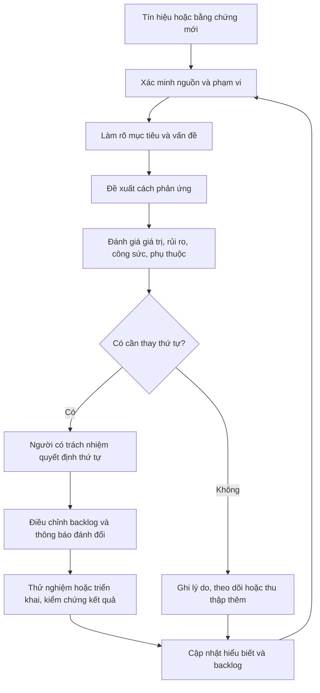

# Thay đổi thứ tự ưu tiên khi xuất hiện bằng chứng mới

## Mục tiêu học tập

Sau bài học, bạn có thể:

- Giải thích vì sao **thứ tự Product Backlog là một quyết định cần được xem xét lại**, đặc biệt khi nhóm có phản hồi, dữ liệu hoặc kiến thức mới.
- Phân biệt **bằng chứng**, **giả định**, **ý kiến**, **tín hiệu nhiễu** và **ràng buộc bắt buộc** trước khi quyết định đổi ưu tiên.
- Áp dụng quy trình tiếp nhận, kiểm tra, đánh giá tác động, đổi thứ tự và thông báo quyết định mà vẫn minh bạch về **chi phí cơ hội**.
- Thực hành xếp lại backlog dựa trên mục tiêu sản phẩm, giá trị người dùng, độ cấp thiết, rủi ro, mức tin cậy của bằng chứng và năng lực có sẵn.
- Giải thích cách xử lý thông tin mới trong **Scrum**, **Kanban** và khi công việc đang thực hiện dở.
- Thiết kế phép kiểm chứng sau thay đổi: liệu thứ tự mới có tạo ra kết quả người dùng mong muốn hay chỉ khiến nhóm bận rộn hơn?

## 1. Vì sao thứ tự ưu tiên có thể phải thay đổi?

Một **Product Backlog** không đơn thuần là danh sách việc phải làm một lần rồi giữ nguyên. Trong Scrum, đây là một **danh sách nổi lên theo thời gian, có thứ tự** về những gì cần thiết để cải thiện sản phẩm. Thứ tự đó thể hiện quyết định hiện tại dựa trên những điều nhóm đã biết, mục tiêu sản phẩm và các ràng buộc đang áp dụng.

Trong dự án phần mềm có nhiều bất định, nhóm thường chưa hiểu hết người dùng, thị trường, hành vi hệ thống và phương án kỹ thuật khi lập kế hoạch. Mỗi bản dùng thử, lần phát hành, cuộc phỏng vấn, sự cố hoặc thay đổi quy định có thể mang lại kiến thức mới.

**Ví dụ:** một nền tảng học trực tuyến dự định ưu tiên tạo chứng chỉ PDF. Sau khi quan sát người học, nhóm phát hiện nhiều học viên không tìm được bài đang học dở và bỏ cuộc trước khi hoàn tất khóa. Nếu mục tiêu hiện tại là **tăng tỷ lệ học viên hoàn thành**, việc ưu tiên tính năng **“Tiếp tục học”** có thể tạo tác động sớm hơn chứng chỉ. Nhóm cần kiểm tra chất lượng bằng chứng rồi mới quyết định thay đổi thứ tự.

Tinh thần Agile được thể hiện trong hai ý:

- **Phản ứng với thay đổi hơn bám sát kế hoạch**: kế hoạch được điều chỉnh khi thông tin đáng tin cậy cho thấy lựa chọn tốt hơn.
- **Đón nhận thay đổi yêu cầu vì lợi thế của khách hàng**: việc học được điều gì mới có thể làm thay đổi nội dung, thứ tự hoặc cách triển khai sản phẩm.

Tuy vậy, **thay đổi ưu tiên không có nghĩa thay mục tiêu và làm lại mọi thứ mỗi ngày**. Mục tiêu sản phẩm và các cam kết hiện có là điểm tựa để đánh giá bằng chứng, còn backlog là nơi nhóm có thể sắp lại đường đi đến mục tiêu.

### Đầu ra và kết quả cần được phân biệt

| Mức đánh giá | Câu hỏi | Ví dụ |
| --- | --- | --- |
| **Hoạt động** | Chúng ta đã làm gì? | Tổ chức ba buổi phỏng vấn và thực hiện một Sprint. |
| **Đầu ra (output)** | Sản phẩm đã có khả năng nào? | Triển khai nút “Tiếp tục học”. |
| **Kết quả (outcome)** | Hành vi hoặc giá trị cho người dùng có thay đổi không? | Người học quay lại bài dở dễ hơn và tiếp tục học nhiều hơn. |
| **Tác động dài hạn** | Mục tiêu kinh doanh và người dùng có cải thiện bền vững không? | Tỷ lệ hoàn thành khóa tăng mà không gây thêm lỗi dữ liệu tiến độ. |

Xong một chức năng chưa chứng minh thứ tự ưu tiên đã đúng. **Bằng chứng mới phải dẫn tới một quyết định có thể kiểm chứng**, chứ không chỉ thêm tính năng.

## 2. Điều gì được xem là bằng chứng mới?

**Bằng chứng** là thông tin có nguồn gốc và ngữ cảnh rõ, giúp củng cố hoặc bác bỏ một giả định liên quan đến quyết định sản phẩm. Bằng chứng có thể định lượng hoặc định tính; chất lượng của nó phụ thuộc cách thu thập, tính đại diện, sự nhất quán và mức liên quan đến câu hỏi đang xét.

| Nguồn thông tin | Ví dụ cụ thể | Giá trị và giới hạn |
| --- | --- | --- |
| **Dữ liệu sử dụng sản phẩm** | Trong một nhóm người học xác định, tỷ lệ quay lại bài đang dở thấp. | Cho thấy điều gì xảy ra; không tự chỉ ra nguyên nhân. |
| **Quan sát người dùng** | Người học thử không nhìn thấy đường dẫn tiếp tục bài cũ. | Giúp thấy trở ngại và hình thành giả thuyết; mẫu nhỏ không đại diện cho mọi người. |
| **Phỏng vấn và hỗ trợ khách hàng** | Nhiều học viên mô tả khó tìm phần đang học dở. | Bổ sung bối cảnh; cần tránh chỉ nghe người phản hồi mạnh nhất. |
| **Thử nghiệm có so sánh** | Một thay đổi luồng học tập được so sánh trên nhóm phù hợp. | Có thể tăng độ tin cậy khi thiết kế và đo lường tốt; chú ý sai số và tác động phụ. |
| **Sự cố và lỗi có thể tái hiện** | Ghi danh trùng dẫn tới thu tiền hai lần. | Có thể đặt ra yêu cầu xử lý ngay do tác động nghiêm trọng, kể cả số trường hợp chưa lớn. |
| **Yêu cầu bắt buộc** | Quy định bảo vệ dữ liệu có thời điểm áp dụng xác định. | Cần xác minh văn bản, phạm vi và ngày có hiệu lực; đây thường là ràng buộc, không chỉ là mong muốn. |
| **Phát hiện kỹ thuật** | Thiết kế hiện tại không đáp ứng độ an toàn dữ liệu đã yêu cầu. | Ảnh hưởng khả năng thực hiện các hạng mục khác; cần xác minh bằng phân tích và kiểm tra cụ thể. |
| **Thông tin thị trường** | Một đối thủ ra mắt tính năng mới. | Có thể gợi ý cơ hội nhưng chưa chứng minh người dùng của mình cần tính năng đó. |

Một ý kiến kiểu “người dùng chắc chắn thích điều này” hoặc “ban lãnh đạo muốn có ngay” là **đầu vào cần tìm hiểu**, chưa tự động là bằng chứng đủ mạnh để đảo thứ tự backlog.

### 2.1. Đánh giá mức đáng tin của bằng chứng

Trước khi quyết định, nhóm nên hỏi:

1. **Nguồn nào?** Ai thu thập, khi nào, bằng phương pháp gì? Có thể kiểm tra lại không?
2. **Liên quan tới ai?** Đây là học viên mới, học viên trả phí, giảng viên hay toàn bộ người dùng? Nhóm quan sát có đúng đối tượng mục tiêu không?
3. **Mức ảnh hưởng là gì?** Số người, mức độ nghiêm trọng, tần suất và tác động lên mục tiêu?
4. **Có giải thích khác không?** Tỷ lệ quay lại thấp do thiết kế, nội dung khó, thời điểm thi cử hay lỗi ghi nhận dữ liệu?
5. **Có bằng chứng bổ sung không?** Log sản phẩm, phỏng vấn, thử nghiệm, báo cáo hỗ trợ có nhất quán không?
6. **Điều gì sẽ làm ta đổi ý lần nữa?** Nêu điều kiện kiểm chứng trước để tránh chỉ tìm dữ liệu ủng hộ nhận định sẵn có.

Đôi khi **một sự cố bảo mật đã được xác nhận** đủ để ưu tiên cao ngay vì hậu quả lớn. Với một gợi ý giao diện ít rủi ro, nhiều nhóm có thể chọn thử nghiệm nhỏ trước khi cam kết phát triển rộng. **Ngưỡng bằng chứng nên tương xứng chi phí sai lầm**, không phải mọi đề xuất đều cần cùng lượng dữ liệu.

### 2.2. Phân biệt tín hiệu với kết luận nhân quả

Giả sử sau một bản phát hành, tỷ lệ hoàn thành khóa học giảm. Đồng thời, nhiều người học phàn nàn việc tìm bài dở. Hai sự kiện có thể liên quan, nhưng chỉ từ đó chưa thể khẳng định **thiếu nút “Tiếp tục học” là nguyên nhân duy nhất**.

Một cách xử lý hợp lý:

- Kiểm tra định nghĩa tỷ lệ hoàn thành, tập người dùng, khoảng thời gian và chất lượng dữ liệu.
- Quan sát hoặc phỏng vấn người học để hiểu trở ngại cụ thể.
- Tạo giả thuyết có thể kiểm chứng: “Nếu người học thấy bài gần nhất ngay, thời gian quay lại bài sẽ giảm”.
- Thử thay đổi nhỏ với tiêu chí đo và điều kiện an toàn rõ.
- So sánh kết quả và xem có tác động phụ đến tốc độ trang, quyền truy cập hoặc lỗi lưu tiến độ không.

**Bằng chứng mới có thể đủ để thay đổi thứ tự một thử nghiệm**, ngay cả khi chưa đủ để cam kết xây toàn bộ tính năng. Đây là cách Agile giảm rủi ro của quyết định lớn khi hiểu biết còn hạn chế.

## 3. Dấu hiệu cho thấy backlog cần được xem xét lại

Không cần thay đổi thứ tự mỗi khi xuất hiện thông tin mới. Nhưng các tình huống sau đáng được đánh giá:

| Tín hiệu | Câu hỏi ưu tiên |
| --- | --- |
| Giá trị một hạng mục thấp hơn giả định | Hạng mục này còn đóng góp đáng kể cho Product Goal không? |
| Vấn đề người dùng mới được phát hiện | Bao nhiêu người chịu ảnh hưởng; thử nghiệm nhỏ nào sẽ giúp hiểu hơn? |
| Lỗi nghiêm trọng, an toàn hoặc bảo mật | Mức thiệt hại là gì; có phải xử lý sự cố ngay theo chính sách riêng không? |
| Nghĩa vụ pháp lý hoặc hợp đồng có thời hạn | Điều gì bắt buộc phải đạt, hạn nào được xác nhận, ai chịu trách nhiệm? |
| Một giải pháp dự kiến tốn kém hơn nhiều | Có phương án nhỏ hơn hoặc thứ tự phụ thuộc nào cần điều chỉnh? |
| Một rủi ro kỹ thuật được xác nhận | Có hạng mục nền tảng nào cần xử lý trước để tránh chặn cả hành trình không? |
| Một thử nghiệm bác bỏ giả thuyết sản phẩm | Tiếp tục đầu tư có hợp lý hay nên dừng, điều chỉnh, chuyển hướng? |
| Điều kiện kinh doanh đổi | Mục tiêu hoặc ràng buộc nào thực sự đã thay đổi và được xác nhận? |

Đối với một dự án phần mềm thích ứng, backlog có thể thay đổi ở **thứ tự**, **nội dung**, **mức chi tiết**, **số lượng hạng mục** và **phạm vi thử nghiệm**. Đôi khi quyết định tốt nhất là **loại bỏ một hạng mục**, thay vì tiếp tục giữ nó vì đã được ghi từ đầu.

## 4. Quy trình đổi thứ tự ưu tiên dựa trên bằng chứng

Một quy trình đủ nhẹ nhưng minh bạch giúp nhóm tránh hai cực đoan: bám kế hoạch cứng nhắc hoặc đổi ưu tiên theo ý kiến mới nhất.



### Bước 1. Ghi nhận sự kiện và nguồn

Ghi điều quan sát được trước khi đề xuất giải pháp.

**Chưa đủ rõ:** “Cần làm chức năng tiếp tục học ngay.”

**Rõ hơn:** “Trong buổi thử với học viên đang theo học, nhiều người mất thời gian tìm lại bài chưa xong; chúng ta cần xác định ảnh hưởng tới việc học tiếp.”

Bản ghi nên có thời điểm, đối tượng, nguồn và người có thể giải thích thêm. Không cần tạo thủ tục phức tạp cho từng phản hồi, nhưng các quyết định có tác động lớn nên truy lại được căn cứ.

### Bước 2. Xác minh và phân loại mức khẩn cấp

Phân biệt:

- **Sự cố phải xử lý ngay:** ảnh hưởng nghiêm trọng tới an toàn, bảo mật, tiền bạc, dữ liệu hoặc khả năng dùng dịch vụ. Có thể cần dùng quy trình ứng phó sự cố, sau đó cập nhật backlog phần khắc phục lâu dài.
- **Ràng buộc có hạn chót:** yêu cầu pháp lý, hợp đồng hoặc phụ thuộc đã được xác minh. Cần đưa thời hạn vào đánh giá.
- **Cơ hội tạo giá trị:** trở ngại người dùng hoặc giả thuyết có thể cải thiện trải nghiệm. Cần so sánh với các cơ hội khác.
- **Thông tin chưa đủ chắc:** đề xuất có thể đáng thử ở quy mô nhỏ, cần tìm thêm bằng chứng hoặc giữ lại để xem sau.

Không nên gán nhãn “khẩn cấp” chỉ vì một yêu cầu đến từ người có chức danh cao. Hãy hỏi **điều gì thực sự mất đi nếu xử lý muộn**.

### Bước 3. Nêu lại mục tiêu và giả thuyết

Viết rõ quyết định sắp đổi nhằm cải thiện điều gì.

Ví dụ:

> Mục tiêu: tăng khả năng học viên quay lại và hoàn thành khóa Java nhập môn. Giả thuyết: hiển thị bài chưa hoàn thành gần nhất sẽ giảm thời gian tìm bài và tăng tỷ lệ tiếp tục học.

Khi không tìm được mối liên hệ với mục tiêu sản phẩm, một ý tưởng hấp dẫn có thể cần chờ dù nó dễ phát triển.

### Bước 4. Xem các phương án, kể cả “chưa làm”

Không phải phản hồi nào cũng buộc phát triển đầy đủ tính năng. Các phương án có thể là:

1. Sửa lỗi hoặc nội dung hướng dẫn hiện có.
2. Làm một thay đổi giao diện nhỏ và kiểm chứng.
3. Phỏng vấn/quan sát thêm để xác nhận nguyên nhân.
4. Xây một lát cắt chức năng giới hạn phạm vi.
5. Đổi thứ tự backlog và triển khai phần lớn hơn.
6. Giữ nguyên thứ tự, ghi rõ vì sao bằng chứng chưa đủ hoặc giá trị thấp.

Nếu rủi ro của việc chậm quyết định lớn, nhóm có thể phải hành động sớm. Nếu rủi ro thấp mà hiểu biết còn yếu, **mua thêm thông tin với chi phí nhỏ** thường tốt hơn cam kết quá rộng.

### Bước 5. Đánh giá với cùng một hệ tiêu chí

So sánh cả hạng mục mới lẫn hạng mục đang ở đầu backlog bằng những câu hỏi tương đồng:

| Tiêu chí | Câu hỏi |
| --- | --- |
| **Giá trị và mục tiêu** | Hạng mục làm thay đổi kết quả người dùng hoặc kinh doanh nào? |
| **Mức độ cấp thiết** | Trì hoãn gây mất lợi ích hoặc tăng tổn thất như thế nào? |
| **Độ tin cậy** | Bằng chứng trực tiếp đến đâu? Điều gì vẫn là giả định? |
| **Công sức và độ phức tạp** | Có thể làm một lát cắt nhỏ hơn không? Ước lượng bất định ở đâu? |
| **Rủi ro chất lượng** | Có ảnh hưởng bảo mật, dữ liệu, vận hành, khả năng dùng hoặc tương thích không? |
| **Phụ thuộc** | Cần năng lực hoặc quyết định nào trước? Hạng mục này có mở đường cho công việc khác không? |
| **Chi phí cơ hội** | Đẩy việc này lên thì phần việc nào lùi, dừng hoặc phải thương lượng lại? |
| **Khả năng học hỏi** | Có thể kiểm chứng giả thuyết sớm và ít tốn kém đến mức nào? |

Có thể tham khảo các phương pháp ưu tiên như **RICE**, **MoSCoW**, **Cost of Delay** hoặc **WSJF** nếu đội hiểu giả định của từng phương pháp. Nhưng không có một công thức áp dụng cho mọi backlog; **điểm số chính xác giả tạo** có thể che giấu khác biệt về rủi ro và chất lượng bằng chứng. Hãy dùng bảng điểm để hỗ trợ thảo luận, không tự động thay thế quyết định của người chịu trách nhiệm.

### Bước 6. Đổi thứ tự và công khai đánh đổi

Trong Scrum, **Product Owner** chịu trách nhiệm quản lý hiệu quả Product Backlog, trong đó có thứ tự. Người này có thể tham khảo đội phát triển và các bên liên quan; những người khác không nên tự ý giao việc làm gián đoạn nhóm chỉ vì họ muốn “chen hàng”.

Khi đổi thứ tự, cần nêu:

- Hạng mục nào **được đưa lên** và vì sao?
- Hạng mục nào **lùi xuống, giảm phạm vi hoặc dừng**?
- Những ràng buộc nào **không được phép bỏ qua**?
- Công việc nào đang làm dở và chi phí thay đổi vào lúc này?
- Ai cần được thông báo về ảnh hưởng đến dự kiến giao hàng?

Đổi ưu tiên có thể ảnh hưởng kế hoạch phát hành và cam kết bên ngoài. Một quyết định minh bạch chỉ ra **đánh đổi cụ thể**, chứ không ngầm yêu cầu nhóm làm thêm mọi việc trong cùng thời gian.

### Bước 7. Kiểm chứng kết quả sau khi thực hiện

Đặt tiêu chí theo dõi **trước hoặc ngay khi** bắt đầu thử nghiệm:

- Mục tiêu: người học trở lại bài dở dễ hơn.
- Tín hiệu chính: tỷ lệ người học tiếp tục bài trong khoảng thời gian đã định, thời gian từ lúc mở nền tảng đến lúc tiếp tục học.
- Tín hiệu bảo vệ: số lỗi lưu tiến độ, quyền truy cập sai, tỷ lệ thoát trang hoặc suy giảm hiệu năng.
- Thời điểm xem lại: sau khi có đủ dữ liệu ở nhóm người dùng phù hợp, không khẳng định thành công chỉ từ vài lượt truy cập đầu.

Một thay đổi có thể thất bại về giả thuyết nhưng vẫn đem lại hiểu biết quý giá. Nhóm cần **cập nhật backlog theo điều quan sát được**, thay vì giữ ưu tiên mới chỉ để bảo vệ quyết định cũ.

## 5. Tình huống tính toán: thay thứ tự backlog từ dữ liệu người học

### 5.1. Trạng thái ban đầu

Giả sử Product Goal trong quý là: **giúp nhiều học viên đang theo học hoàn thành khóa Java nhập môn hơn**.

Ba hạng mục đã được thảo luận trước khi có dữ liệu mới:

| ID | Hạng mục | Giá trị kỳ vọng ban đầu | Nỗ lực tương đối ước lượng | Thứ tự ban đầu |
| --- | --- | --- | ---: | ---: |
| A | Tùy chỉnh mẫu chứng chỉ PDF | Học viên có động lực hoàn thành và chia sẻ kết quả. | 6 | 1 |
| C | Lọc danh mục theo cấp độ | Người mới tìm được khóa phù hợp nhanh hơn. | 4 | 2 |
| B | Mở lại bài học chưa hoàn thành | Học viên quay lại bài dở thuận tiện hơn. | 5 | 3 |

**Lưu ý:** các số **6, 4, 5** chỉ là **đơn vị nỗ lực tương đối giả định**, không phải số ngày công chắc chắn. Thứ tự ban đầu cũng là giả định trong ví dụ để thể hiện cách ra quyết định.

### 5.2. Bằng chứng mới xuất hiện

Sau khi phát hành phiên bản hiện có, nhóm quan sát và phân tích theo một tập người dùng đã xác định:

- Dữ liệu sử dụng gợi ý **nhiều học viên đã bắt đầu khóa nhưng không quay lại bài dở**, dù nội dung tiếp theo vẫn có sẵn.
- Trong phiên quan sát, một số người học **phải mở lại danh mục rồi tìm bài từ đầu**. Họ không nhận ra đường vào bài đang học.
- Bộ phận hỗ trợ ghi nhận nhiều câu hỏi về cách quay lại bài cũ.
- Chưa có dữ liệu cho thấy **tùy chỉnh mẫu chứng chỉ** làm tăng tỷ lệ hoàn thành khóa ở nhóm người học hiện tại.

Đây vẫn là bằng chứng để **ưu tiên kiểm chứng giả thuyết B**, chưa đủ để tuyên bố B chắc chắn làm tăng hoàn thành khóa. Nhóm kiểm tra tính đại diện, chất lượng đo lường và liệu có nguyên nhân khác như nội dung quá khó hay không.

### 5.3. Quyết định được đề xuất

Product Owner trao đổi với Developers và người liên quan, sau đó cân nhắc:

| Hạng mục | Thông tin mới | Đánh giá liên quan đến Product Goal | Thứ tự sau đánh giá |
| --- | --- | --- | ---: |
| **B — Mở lại bài dở** | Có phản hồi và quan sát trực tiếp về trở ngại ở bước tiếp tục học. | Đáng làm lát cắt nhỏ sớm để kiểm chứng tác động tới hành trình hiện tại. | **1** |
| **C — Lọc theo cấp độ** | Vẫn có ích; chưa có tín hiệu mới cho thấy phải tăng/giảm gấp. | Giữ sau B nếu không phát hiện vấn đề cấp bách hơn. | **2** |
| **A — Tùy chỉnh chứng chỉ** | Chưa xác nhận tác động tới mục tiêu hoàn thành khóa. | Giảm ưu tiên, có thể thử nghiệm nhu cầu với chi phí nhỏ trước khi xây rộng. | **3** |

**Đánh đổi năng lực:** giả sử nhóm còn khoảng **10 đơn vị nỗ lực khả dụng** trong khoảng kế hoạch đang xem xét. Theo ước lượng ban đầu, chọn **A + C = 6 + 4 = 10**; sau khi đổi ưu tiên, một lựa chọn khác là **B + C = 5 + 4 = 9**, còn A được dời lại. Phép cộng giúp lộ **chi phí cơ hội**, không bảo đảm B và C chắc chắn hoàn thành trong kỳ. Nhóm vẫn phải xét phụ thuộc, độ bất định, người thực hiện, chất lượng và thời gian thực tế.

Nếu C sau đó có ít giá trị hơn dự kiến, nhóm có thể chọn **B trước, rồi đánh giá lại** thay vì cam kết cả B và C. Backlog luôn có thể tiếp tục được tinh chỉnh.

### 5.4. Chọn lát cắt nhỏ cho hạng mục B

Một user story:

> Là một học viên đang theo học, tôi muốn mở lại bài chưa hoàn thành gần nhất để tiếp tục học mà không phải tìm từ đầu.

Lát đầu có thể giới hạn ở **một khóa đang học**, một thiết bị và một quy tắc “bài chưa hoàn thành gần nhất” đã được xác định. Nếu sản phẩm đang có dữ liệu nhiều thiết bị, nhóm vẫn phải bảo đảm an toàn và tính nhất quán theo ràng buộc thực tế; không được dùng “lát nhỏ” để bỏ qua lỗi dữ liệu đã biết.

Ví dụ tiêu chí chấp nhận:

```gherkin
Feature: Tiếp tục học khóa đang theo dõi

  Scenario: Có bài chưa hoàn thành
    Given Lan đã đăng nhập và đang theo học khóa Java nhập môn
    And Lan có một bài đã bắt đầu nhưng chưa hoàn thành
    When Lan mở trang khóa học
    Then Lan thấy lựa chọn "Tiếp tục học"
    And lựa chọn dẫn đến đúng bài chưa hoàn thành theo quy tắc đã thống nhất

  Scenario: Chưa bắt đầu bài nào
    Given Lan đã đăng nhập và đã ghi danh khóa Java nhập môn
    And Lan chưa bắt đầu bài học nào
    When Lan mở trang khóa học
    Then Lan thấy lựa chọn "Bắt đầu học"
```

Những kịch bản trên mới bao phủ hành vi chính. Nhóm cần thảo luận thêm khi có **nhiều bài học dở, nhiều thiết bị, dữ liệu đồng bộ trễ, khóa đã hết quyền truy cập** hoặc lỗi lưu tiến độ. Các trường hợp ảnh hưởng tính đúng đắn và bảo mật của lát hiện tại không thể bỏ qua.

### 5.5. Cách biết quyết định đổi ưu tiên có đúng không

Định nghĩa trước tiêu chí theo dõi, ví dụ:

- **Chỉ số hành trình:** tỷ lệ học viên đang học trở lại được bài dở trong cùng phiên.
- **Độ thuận tiện:** thời gian cần để mở lại nội dung chưa hoàn thành.
- **Kết quả dài hơn:** tỷ lệ quay lại học và hoàn thành khóa trong một khoảng quan sát phù hợp.
- **Chỉ số bảo vệ:** lỗi tiến độ, tỷ lệ mở sai bài, sự cố quyền truy cập.

Nếu sau thử nghiệm thời gian trở lại bài giảm nhưng tỷ lệ hoàn thành không cải thiện, nhóm cần xem lại nguyên nhân bỏ dở. Có thể vấn đề chính là **nội dung học quá khó**, không phải tìm bài. Lúc đó backlog phải tiếp tục thích ứng theo thông tin mới, tránh khẳng định thành công chỉ vì đã giao tính năng.

## 6. Thay đổi ưu tiên khi đang có công việc dở dang

Một quyết định đổi backlog có thể dễ trên bảng nhưng tốn kém khi nhiều hạng mục đang được triển khai. Dừng một công việc gần hoàn thành có thể tạo chi phí đổi ngữ cảnh, mã chưa tích hợp, công việc đang chờ kiểm thử hoặc rủi ro kỹ thuật.

Trước khi chen việc mới vào, hỏi:

1. Mức độ khẩn cấp **có thật và đã được xác nhận** không?
2. Nếu đợi hạng mục đang dở được hoàn thành đúng tiêu chuẩn, thiệt hại là gì?
3. Hạng mục đang làm có thể sớm mang giá trị tới người dùng không?
4. Có cần hủy công việc, thương lượng lại phạm vi hay chỉ sắp việc mới vào vị trí tiếp theo?
5. Nhóm có đủ năng lực mà vẫn bảo vệ **Definition of Done** và nhịp làm việc bền vững không?

| Tình huống | Phản ứng thường hợp lý | Điều cần tránh |
| --- | --- | --- |
| Ý tưởng có giá trị nhưng chưa cấp bách | Đưa vào thứ tự backlog tiếp theo, tiếp tục hoàn tất việc đang dở. | Dừng mọi việc ngay chỉ vì yêu cầu mới đến. |
| Bằng chứng về trở ngại người dùng cần được xác minh | Thử nghiệm/khảo sát nhỏ, sau đó quyết định phạm vi triển khai. | Chuyển cả nhóm sang xây tính năng lớn khi chưa rõ nguyên nhân. |
| Sự cố nghiêm trọng đã xác nhận | Áp dụng quy trình xử lý sự cố với người có quyền quyết định, cập nhật kế hoạch bị ảnh hưởng. | Chờ buổi ưu tiên định kỳ nếu thiệt hại đang tiếp diễn. |
| Hạng mục đang làm không còn tạo giá trị | Đánh giá chi phí tiếp tục/dừng, quyết định công khai và quản lý phần dở dang. | Tiếp tục chỉ vì đã bỏ nhiều công sức. |
| Yêu cầu pháp lý có hạn xác định | Tái sắp xếp phạm vi và cam kết theo hạn chót, bảo đảm kiểm chứng tuân thủ. | Xem yêu cầu bắt buộc như một ý tưởng có thể hoãn tùy thích. |

**Chi phí đã bỏ ra là chi phí chìm (sunk cost)**. Nó không tự khiến việc tiếp tục có lợi hơn. Tuy vậy, chi phí để **dừng hoặc đổi hướng ngay lúc này** là chi phí tương lai cần được đưa vào quyết định. Phân biệt hai loại chi phí sẽ giúp nhóm tránh cả cố chấp lẫn thay đổi vội vàng.

## 7. Scrum: linh hoạt backlog và bảo vệ Sprint Goal

Trong **Scrum Guide 2020**, Product Owner chịu trách nhiệm **quản lý hiệu quả Product Backlog**, bao gồm phát triển, truyền đạt Product Goal và sắp xếp thứ tự Product Backlog Items. Product Owner có thể ủy quyền một phần công việc, nhưng vẫn chịu trách nhiệm cuối cùng.

Product Backlog **có thể được điều chỉnh khi nhóm hiểu thêm**. Tuy nhiên, cần phân biệt **đổi thứ tự Product Backlog** với **đổi công việc trong Sprint đang diễn ra**.

### 7.1. Thông tin mới đến trước Sprint Planning

Đây là thời điểm thuận tiện để Product Owner làm rõ bằng chứng và điều chỉnh thứ tự backlog. Trong Sprint Planning, Scrum Team thảo luận giá trị, chọn mục tiêu Sprint và Developers lập kế hoạch công việc phù hợp với năng lực.

### 7.2. Thông tin mới đến giữa Sprint

Theo Scrum Guide 2020:

- Không thực hiện thay đổi khiến **Sprint Goal bị nguy hại**.
- **Chất lượng không được giảm**.
- Product Backlog được **tinh chỉnh khi cần**.
- Phạm vi có thể **được làm rõ và thương lượng lại với Product Owner** khi nhóm hiểu hơn.

Vì vậy, khi có yêu cầu mới, Product Owner và Developers đánh giá tác động:

- **Không khẩn cấp, ngoài Sprint Goal:** thường đưa vào Product Backlog để cân nhắc cho Sprint kế tiếp.
- **Phù hợp Sprint Goal và có giá trị:** có thể thương lượng lại chi tiết/phạm vi công việc trong Sprint, trong khi giữ mục tiêu.
- **Làm Sprint Goal trở nên lỗi thời:** Product Owner có quyền **hủy Sprint** theo Scrum Guide. Đây là tình huống đặc biệt, không phải cơ chế thường xuyên để phản ứng với từng ý tưởng.
- **Sự cố ngoài dự kiến:** cần ứng phó theo mức độ nguy hiểm và chính sách tổ chức, đồng thời minh bạch tác động tới Sprint.

Ví dụ Sprint Goal là “Học viên có thể quay lại đúng bài đang học”. Dữ liệu mới cho thấy nút hiện tại khó tìm; cải thiện cách truy cập có thể vẫn phục vụ Sprint Goal. Ngược lại, thêm hệ thống chứng chỉ phức tạp không liên quan không nên tự động chen vào Sprint.

### 7.3. Sprint Review là cơ hội học hỏi, không phải cửa duy nhất

Sprint Review giúp Scrum Team và các bên liên quan kiểm tra kết quả, thảo luận thay đổi môi trường và điều chỉnh các bước tiếp theo. Nhưng không nên chờ tới Sprint Review mới ghi nhận thông tin quan trọng; trao đổi với người dùng và phản hồi có thể diễn ra liên tục.

**Product Goal, Sprint Goal và DoD** giúp nhóm cân bằng khả năng thích ứng với tập trung và chất lượng. Agile không yêu cầu Sprint phải cứng nhắc như một hợp đồng phạm vi bất biến, cũng không cho phép đổi mục tiêu tùy tiện từng ngày.

## 8. Kanban: tiếp nhận ưu tiên mới mà không phá dòng công việc

Kanban hỗ trợ quản lý công việc qua một **workflow minh bạch**, có chính sách rõ, giới hạn **WIP (work in progress)** và các thước đo dòng chảy. Một hệ thống có thể nhận nhiều yêu cầu mới nhưng vẫn giao giá trị chậm nếu người trong nhóm liên tục kéo việc mới thay vì hoàn tất công việc đang dở.

Một bảng minh họa:

```text
Đề xuất → Đã làm rõ → Sẵn sàng → Đang làm → Kiểm chứng → Hoàn thành
                                  WIP ≤ 3    WIP ≤ 2
```

Giới hạn WIP là **ví dụ**; cần điều chỉnh theo quy mô và cách nhóm làm việc.

Khi bằng chứng mới xuất hiện:

1. Ghi rõ đề xuất, nguồn và lý do ưu tiên.
2. Xem lại thứ tự trong danh sách công việc đủ điều kiện được kéo vào workflow.
3. **Tôn trọng chính sách WIP** và năng lực của nhóm khi quyết định bắt đầu.
4. Nếu có việc thật sự cấp bách, sử dụng **chính sách xử lý khẩn cấp đã thống nhất** và công khai hệ quả với các hạng mục khác.
5. Xem thời gian chờ, tuổi công việc đang làm và năng suất hoàn thành để đánh giá tác động.

Một số đội dùng **class of service** hoặc làn khẩn cấp (*expedite*) để phân loại việc cần xử lý đặc biệt. Đây là **chính sách tùy chọn do đội định nghĩa**, không đồng nghĩa mọi việc được gắn nhãn “khẩn cấp” đều được vượt WIP và chen hàng.

Nếu yêu cầu mới quan trọng nhưng chưa cấp bách, việc **xếp nó đầu hàng chờ cho lần kéo việc kế tiếp** có thể bảo vệ dòng công việc và giảm chi phí đổi ngữ cảnh hơn là dừng ba hạng mục đang gần hoàn thành.

## 9. Backlog, user story và XP sau khi đổi ưu tiên

Thay đổi thứ tự chỉ có ích nếu hạng mục được chọn có thể triển khai và kiểm chứng.

### 9.1. Tinh chỉnh user story theo kết quả mới

Một ý tưởng ban đầu có thể là “Xây tính năng lưu tiến độ học đa thiết bị”. Sau bằng chứng mới, nhóm phát hiện trở ngại trước mắt đơn giản hơn: người học không thấy **bài gần nhất** trên thiết bị hiện tại.

Thay vì giữ nguyên giải pháp lớn, đội có thể bắt đầu bằng user story nhỏ hơn, tiêu chí chấp nhận rõ và đánh giá phản hồi. **Backlog refinement** giúp chia hạng mục, làm rõ giá trị, rủi ro và phụ thuộc khi thông tin xuất hiện. Khi có bản thử nghiệm, nhóm điều chỉnh backlog tiếp.

### 9.2. Chất lượng kỹ thuật giúp đổi ưu tiên với chi phí thấp

Các thực hành của **Extreme Programming (XP)** như kiểm thử tự động, tích hợp liên tục, TDD, tái cấu trúc mã và thiết kế đơn giản giúp thay đổi hành vi phần mềm mà không làm hỏng phần đã hoạt động.

Một đội thường xuyên đổi ưu tiên nhưng mỗi lần sửa phải kiểm thử thủ công nhiều tuần hoặc tích hợp mã rất muộn sẽ mất khả năng phản ứng. **Đầu tư kỹ thuật nền tảng có thể là công việc ưu tiên cao** nếu nó làm giảm rủi ro và thời gian để tạo các kết quả tiếp theo.

Nhưng cũng không nên biện hộ mọi dự án kỹ thuật bằng câu “sẽ giúp đội nhanh hơn”. Hãy làm rõ **nút thắt nào**, bằng chứng nào về tác động và cách biết đầu tư đã cải thiện khả năng giao sản phẩm.

## 10. Truyền đạt quyết định để các bên cùng hiểu

Đổi thứ tự ưu tiên là một quyết định sản phẩm có thể làm thay đổi kỳ vọng của khách hàng, lãnh đạo, phát triển, kiểm thử và vận hành. Nhóm nên có **bản ghi quyết định ngắn**, vừa đủ để người liên quan hiểu và chất vấn.

Mẫu minh họa:

```text
Quyết định: Ưu tiên B - "Tiếp tục học" trước A - "Tùy chỉnh chứng chỉ"
Ngày đánh giá: [ngày nhóm quyết định]
Mục tiêu liên quan: tăng khả năng quay lại và hoàn thành khóa học
Bằng chứng: [nguồn dữ liệu, phạm vi, ngày, quan sát]
Mức tin cậy: [đã xác nhận / còn giả định nào]
Phương án đã cân nhắc: [sửa điều hướng nhỏ / thử nghiệm / triển khai đầy đủ]
Người chịu trách nhiệm quyết định thứ tự: [vai trò hoặc người có thẩm quyền]
Đánh đổi: A dời lại; phạm vi B bắt đầu ở một khóa và thiết bị phù hợp
Ảnh hưởng cam kết và phụ thuộc: [ai, mốc nào, việc nào]
Chỉ số kiểm chứng và thời điểm xem lại: [tín hiệu kết quả, chất lượng]
Điều kiện đảo quyết định: [bằng chứng nào cho thấy giả thuyết sai]
```

Trong giao tiếp, tránh trình bày rằng “A không còn quan trọng” nếu thực tế chỉ là “B **có giá trị kỳ vọng cao hơn ở thời điểm này**”. Sự khác biệt giúp giảm tranh luận cá nhân và giữ niềm tin với các bên đã đề xuất A.

Một thông điệp ngắn có thể là:

> “Dựa trên quan sát người học và mục tiêu tăng tỷ lệ hoàn thành khóa, chúng tôi đưa thử nghiệm 'Tiếp tục học' lên trước phần tùy chỉnh chứng chỉ. Nhóm sẽ hoàn tất phạm vi nhỏ và xem số liệu quay lại bài dở; phần chứng chỉ được dời sang lần đánh giá ưu tiên tiếp theo. Việc dời này đã được ghi vào backlog.”

**Minh bạch** không có nghĩa mọi người đều phải đồng ý ngay. Người chịu trách nhiệm ưu tiên cần lắng nghe, giải thích bằng chứng và chấp nhận chất vấn có căn cứ.

## 11. Đo lường chất lượng quyết định đổi thứ tự

Có ba nhóm câu hỏi cần tách bạch:

| Nhóm | Tín hiệu có thể dùng | Cảnh báo |
| --- | --- | --- |
| **Giá trị sản phẩm** | Tỷ lệ người học quay lại bài dở, tỷ lệ hoàn thành, thời gian tìm nội dung, mức hài lòng theo nhiệm vụ. | Không mặc định tương quan là nguyên nhân; cần đối chiếu ngữ cảnh và mẫu người dùng. |
| **Dòng công việc** | Lead time, cycle time, WIP, throughput, tuổi công việc đang làm, thời gian bị chặn. | Nếu đổi ưu tiên liên tục làm nhiều việc dở, thời gian hoàn thành có thể tăng. |
| **Chất lượng và khả năng học hỏi** | Lỗi mới, sự cố vận hành, giả thuyết được xác nhận/bác bỏ, quyết định tiếp theo từ dữ liệu. | Không chỉ đếm số buổi phỏng vấn hoặc số thẻ được chuyển lên đầu backlog. |

**Lead time** và **cycle time** phải được định nghĩa rõ mốc bắt đầu/kết thúc theo workflow của đội. **Throughput** là số hạng mục hoàn thành trong một kỳ; **WIP** là lượng công việc đang xử lý. Những chỉ số này mô tả dòng công việc, không tự chứng minh ưu tiên kinh doanh đúng.

### 11.1. Tại sao cần theo dõi cả sự ổn định ưu tiên?

Nhóm thích ứng cần đổi ưu tiên **khi có lý do**, không cố đạt tỷ lệ thay đổi cao. Hãy nhìn lại:

- Bao nhiêu thay đổi được giải thích bằng **bằng chứng** hoặc ràng buộc xác nhận?
- Bao nhiêu hạng mục bị dừng giữa chừng do đổi ý không rõ căn cứ?
- Quyết định có được ghi lại và kiểm chứng sau đó không?
- Những lần thay đổi có làm tăng WIP, lỗi hoặc chi phí chuyển ngữ cảnh không?
- Nếu không đổi ưu tiên, nhóm có bỏ lỡ cơ hội rõ ràng nào không?

Một nhóm có ít lần đổi ưu tiên có thể đang rất tập trung **hoặc** quá cứng nhắc. Một nhóm đổi thường xuyên có thể học nhanh **hoặc** thiếu định hướng. **Không dùng số lần đổi ưu tiên làm chỉ số thành tích độc lập.**

## 12. Sai lầm thường gặp

### 12.1. Đổi ưu tiên theo người nói lớn nhất

**Dấu hiệu:** đề xuất của người có chức danh cao tự động lên đầu backlog, không xét mục tiêu hay chi phí cơ hội.

**Cải thiện:** sử dụng cùng tiêu chí giá trị, mức khẩn cấp, rủi ro và bằng chứng; người có trách nhiệm sản phẩm đưa ra quyết định minh bạch.

### 12.2. Dùng một phản hồi để suy ra nhu cầu của mọi người

**Dấu hiệu:** từ một lời phàn nàn, nhóm quyết định xây hẳn một chức năng lớn cho toàn bộ người dùng.

**Cải thiện:** xác định đối tượng bị ảnh hưởng, đối chiếu số liệu khác, cân nhắc thử nghiệm giới hạn. Tuy nhiên, lỗi có hậu quả nghiêm trọng vẫn cần xử lý dù tần suất thấp.

### 12.3. Chỉ chọn theo công sức nhỏ nhất

**Dấu hiệu:** đội luôn kéo hạng mục dễ để tăng số việc hoàn thành, còn vấn đề quan trọng nhưng khó vẫn bị né tránh.

**Cải thiện:** xem giá trị, độ cấp thiết và rủi ro; dùng chia nhỏ để giảm độ bất định, không dùng độ dễ làm tiêu chuẩn duy nhất.

### 12.4. Bỏ qua việc gì sẽ bị đẩy lùi

**Dấu hiệu:** thêm việc khẩn vào Sprint/kế hoạch nhưng giữ nguyên mọi cam kết về phạm vi và thời hạn.

**Cải thiện:** thương lượng rõ phạm vi, thứ tự và tác động tới cam kết; không dựa vào tăng giờ làm liên tục để che giấu chi phí cơ hội.

### 12.5. Đánh đồng ưu tiên với quyền bỏ qua chất lượng

**Dấu hiệu:** vì một việc mới được đưa lên đầu, nhóm bỏ kiểm thử bảo mật, kiểm tra quyền hoặc khâu vận hành cần thiết.

**Cải thiện:** giữ DoD, ràng buộc bắt buộc và cách xử lý rủi ro tương xứng. Có thể giảm **phạm vi chức năng**, nhưng không được loại bỏ kiểm soát cốt lõi của phạm vi đã chọn.

### 12.6. Xem điểm RICE hoặc WSJF là sự thật tuyệt đối

**Dấu hiệu:** đội tranh luận các con số không đáng tin đến mức quên xem nguồn và tác động thực tế; điểm cao được coi như lệnh triển khai.

**Cải thiện:** công khai giả định, độ tin cậy, cách tính và ngoại lệ; dùng công thức như **công cụ giúp thảo luận**. Ràng buộc an toàn hoặc pháp lý không nên bị loại chỉ vì điểm tính thấp.

### 12.7. Không kiểm chứng sau khi đổi thứ tự

**Dấu hiệu:** một đề xuất được đẩy lên, hoàn thành rồi không ai đo kết quả.

**Cải thiện:** đặt giả thuyết và tín hiệu từ trước; xem dữ liệu sau thử nghiệm và sẵn sàng hạ ưu tiên phần mở rộng nếu lợi ích không xuất hiện.

## 13. Bài tập vận dụng

### Bài tập 1. Chọn ưu tiên khi bằng chứng không cùng chất lượng

Một đội phát triển nền tảng học trực tuyến có Product Goal **giảm số người bỏ dở khóa học**. Product Backlog đang xếp:

1. Tùy chỉnh mẫu chứng chỉ.
2. Thêm bộ lọc danh mục.
3. Cho phép tiếp tục bài học đang dở.
4. Tùy chỉnh ảnh đại diện.

Trong tuần, đội nhận ba tín hiệu:

- **Tín hiệu X:** một giám đốc cho rằng sản phẩm nên có ảnh đại diện đẹp hơn vì đối thủ có.
- **Tín hiệu Y:** quan sát thử nghiệm cho thấy nhiều học viên mất thời gian tìm bài dở; dữ liệu sử dụng cũng gợi ý vấn đề quay lại học.
- **Tín hiệu Z:** phát hiện lỗi có thể tái hiện khiến một số học viên xem được tiến độ của tài khoản khác.

Hãy trả lời:

1. Tín hiệu nào liên quan đến **ràng buộc bảo mật** và có thể cần xử lý sự cố ngay?
2. Tín hiệu nào có khả năng hỗ trợ Product Goal nhưng vẫn cần kiểm chứng nguyên nhân?
3. Tín hiệu nào hiện chỉ là **ý kiến/giả thuyết thị trường**?
4. Hãy đề xuất thứ tự công việc mới và ghi rõ **việc nào bị dời**.
5. Bạn sẽ đo kết quả của việc ưu tiên tiếp tục bài dở như thế nào?

**Gợi ý:** Z là nguy cơ bảo mật đã xác nhận và cần được ứng phó phù hợp ngay; Y đáng ưu tiên kiểm chứng vì liên quan trực tiếp mục tiêu; X nên được làm rõ nhu cầu trước khi đầu tư. Thứ tự backlog cuối cùng còn phụ thuộc tác động, mức khẩn và năng lực thực tế của nhóm. Không có đủ dữ kiện để biến X thành một nhu cầu có giá trị cao chỉ vì đối thủ đã làm.

### Bài tập 2. Đánh đổi năng lực hữu hạn

Giả sử nhóm có **8 đơn vị nỗ lực khả dụng** cho một đợt công việc, các hạng mục được ước lượng:

| Hạng mục | Nỗ lực ước lượng | Giá trị kỳ vọng sau đánh giá |
| --- | ---: | --- |
| A — Tùy chỉnh chứng chỉ | 5 | Thấp đến trung bình, chưa được kiểm chứng. |
| B — Sửa đường vào bài học đang dở | 3 | Cao, có quan sát người dùng hỗ trợ. |
| C — Bổ sung kiểm tra ghi danh trùng | 2 | Cao nếu lỗi thực tế ảnh hưởng dữ liệu hoặc người dùng. |
| D — Bộ lọc danh mục nâng cao | 4 | Trung bình, còn bất định. |

Bạn có thể chọn B + C + một phần có giá trị của A/D **nếu tách được** mà vẫn đạt chất lượng; không được tự giả định nửa tính năng tương đương nửa giá trị. Hoặc chọn B + C rồi giữ năng lực dự phòng cho rủi ro xác nhận. Hãy giải thích **tại sao chọn**, **công việc nào hoãn**, **khi nào xem lại** và **tín hiệu nào sẽ làm đổi thứ tự tiếp**. Không có đáp án số học duy nhất vì giá trị và phụ thuộc còn bất định.

### Bài tập 3. Scrum và Kanban trong cùng một tình huống

Một yêu cầu có bằng chứng mới xuất hiện khi một hạng mục gần hoàn thành.

- Nếu đội **đang trong Sprint**, bạn sẽ dùng Sprint Goal và thương lượng với Product Owner để ra quyết định ra sao?
- Nếu đội **quản lý công việc theo Kanban**, bạn sẽ xem WIP, tuổi công việc đang làm và chính sách nhận việc mới thế nào?
- Trong trường hợp nào bạn sẽ xử lý ngay mà không chờ nhịp ưu tiên thông thường?

**Gợi ý:** phân biệt việc cấp bách thực sự với cơ hội có thể chờ; tôn trọng chất lượng và các quyền quyết định; tránh đổi ngữ cảnh liên tục; với sự cố nghiêm trọng, ưu tiên bảo vệ người dùng và vận hành theo quy trình ứng phó thích hợp.

### Bảng tự đánh giá quyết định

| Câu hỏi | Dấu hiệu trả lời đạt |
| --- | --- |
| Vì sao cần đổi thứ tự? | Có bằng chứng được mô tả rõ, liên quan đến mục tiêu sản phẩm. |
| Mức tin cậy ra sao? | Phân biệt điều đã biết, điều còn giả định và cách kiểm tra. |
| Việc nào sẽ lùi? | Có chi phí cơ hội và ảnh hưởng cam kết được công khai. |
| Ai chịu trách nhiệm quyết định? | Quyền quyết định và trao đổi với người liên quan được xác định. |
| Khi nào thực hiện? | Xét công việc dở dang, WIP/Sprint Goal, năng lực và sự cấp thiết. |
| Làm thế nào biết quyết định tốt? | Có tín hiệu outcome, chất lượng và thời điểm xem lại. |

## 14. Ghi nhớ cốt lõi

- **Backlog có thứ tự là ảnh chụp của quyết định hiện tại**, cần cập nhật khi hiểu biết và điều kiện thay đổi.
- **Bằng chứng mới** có thể đến từ người dùng, số liệu, sự cố, ràng buộc hoặc kỹ thuật; cần phân biệt độ tin cậy, phạm vi và tính cấp thiết.
- **Thay đổi ưu tiên là một quyết định đánh đổi**: đẩy việc này lên thường làm việc khác lùi lại. Hãy nói rõ chi phí cơ hội và ảnh hưởng tới cam kết.
- **Product Goal** giúp bảo vệ phương hướng. **Scrum** dùng trách nhiệm Product Owner, Sprint Goal và Increment; **Kanban** dùng chính sách workflow và WIP để tiếp nhận thay đổi có kiểm soát.
- **User story, backlog refinement và kỹ thuật XP** giúp biến ưu tiên mới thành lát sản phẩm nhỏ, có chất lượng và có thể nhận phản hồi sớm.
- **Đo kết quả sau thay đổi** là bước bắt buộc để học hỏi. Thứ tự mới cũng có thể sai và cần được xem xét tiếp.

Khi nhận một tín hiệu mới, đừng chỉ hỏi **“Việc nào phải làm ngay?”**. Hãy hỏi: **“Bằng chứng đã thay đổi điều gì ta tin về giá trị, và thay đổi quyết định nào là nhỏ nhất nhưng đủ để kiểm chứng điều vừa học?”**

## Nguồn tham khảo

- [Manifesto for Agile Software Development](https://agilemanifesto.org/) — bốn giá trị Agile, đặc biệt phản ứng với thay đổi.
- [Principles behind the Agile Manifesto](https://agilemanifesto.org/principles.html) — nguyên tắc đón nhận thay đổi yêu cầu và giao phần mềm sớm, thường xuyên.
- [The Scrum Guide (2020)](https://scrumguides.org/scrum-guide.html) — Product Goal, Product Backlog, trách nhiệm Product Owner, Sprint Goal và quy tắc trong Sprint.
- [The Kanban Guide](https://kanbanguides.org/the-kanban-guide/) — workflow, WIP, throughput, cycle time và work item age.
