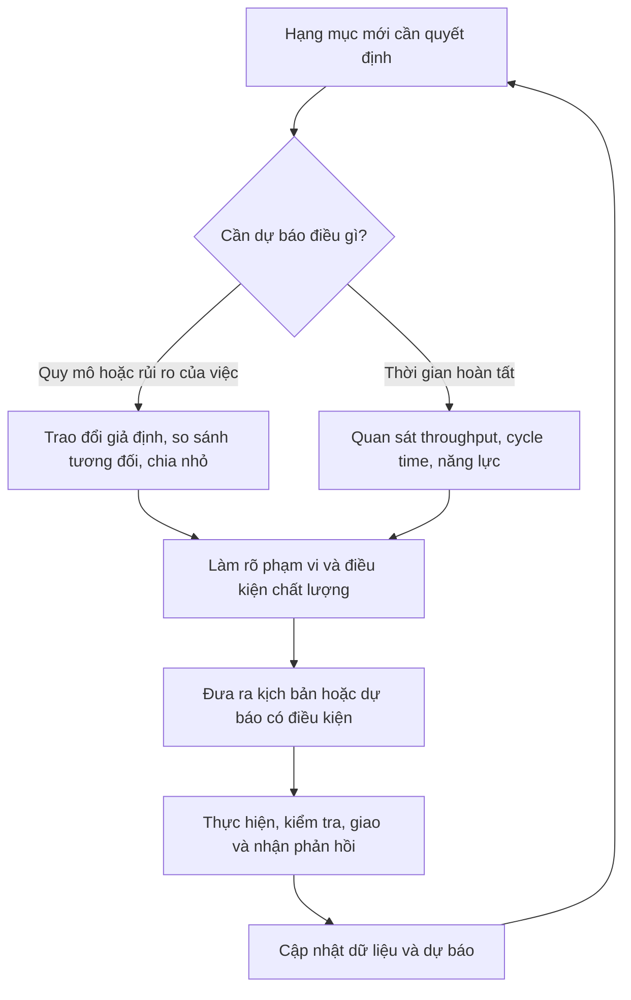

# Mục đích của ước lượng trong trao đổi và lập kế hoạch

“Chức năng này mất bao lâu?” là một trong những câu hỏi phổ biến nhất khi phát triển phần mềm. Nếu lập trình viên trả lời “khoảng hai tuần”, bên liên quan có thể hiểu đó là **lời hứa chắc chắn**. Trong khi ấy, người trả lời có thể chỉ hình dung phần lập trình, chưa tính việc làm rõ nghiệp vụ, kiểm thử, tích hợp, chờ phê duyệt và triển khai. Hai tuần sau, mọi người đều thất vọng dù đã dùng cùng một con số.

Một cuộc trao đổi hữu ích hơn bắt đầu bằng các câu hỏi: **Đang ước lượng điều gì? Để quyết định việc gì? Các giả định nào phải đúng? Chúng ta chưa biết điều gì? Có thể giảm phạm vi, chia nhỏ hoặc học thêm trước khi cam kết không?**

Trong Agile, **ước lượng (*estimation*) là công cụ hỗ trợ trao đổi, làm rõ bất định và ra quyết định lập kế hoạch**. Nó giúp đội so sánh lựa chọn, phát hiện rủi ro, dự kiến năng lực và trao đổi kỳ vọng. Ước lượng không phải một phép đo chắc chắn về tương lai, không tự động là hạn giao và cũng không chứng minh một hạng mục có giá trị chỉ vì nó có con số.

Bài học thuộc chương **Ước lượng và dự báo** của mô-đun **AGILE_DEVELOPMENT**. Nó đặt ước lượng trong vòng làm việc thích ứng: hiểu giá trị người dùng, làm rõ user story và backlog, lựa chọn nhịp phối hợp bằng Scrum hoặc Kanban, giữ năng lực giao sản phẩm nhờ thực hành XP, quan sát dòng công việc và cập nhật dự báo khi có phản hồi mới.

## 1. Kết quả học tập

Sau bài này, bạn có thể:

- Giải thích **ước lượng phục vụ quyết định và đối thoại gì** trong phát triển phần mềm Agile.
- Phân biệt **ước lượng, dự báo, mục tiêu, hạn chót và cam kết**; không đánh đồng chúng khi giao tiếp.
- Phân biệt **quy mô công việc, công sức, thời gian trôi qua, năng lực và giá trị**.
- Trình bày cách dùng ước lượng để làm rõ giả định, rủi ro, phụ thuộc và mức độ chưa chắc chắn của một Product Backlog Item.
- So sánh ở mức phù hợp các cách tiếp cận như ước lượng tương đối, story point, T-shirt size, khoảng thời gian, throughput và dự báo dựa trên dữ liệu lịch sử.
- Xây dựng một **dự báo có điều kiện**, nêu rõ cách tính, giả định và giới hạn, thay vì hứa một ngày hoàn thành giả chính xác.
- Trao đổi kế hoạch với Product Owner, Developers, bên liên quan và người phụ trách vận hành mà vẫn bảo vệ chất lượng.
- Nhận biết các sai lầm như dùng velocity chấm điểm cá nhân, ép đồng thuận, làm đẹp ước lượng hay dành quá nhiều thời gian cho con số không giúp quyết định nào.

## 2. Ước lượng là gì và khác những khái niệm nào?

### 2.1. Ước lượng không phải đo chính xác một việc chưa xảy ra

**Ước lượng (*estimate*)** là nhận định có căn cứ về một đại lượng chưa biết đủ chắc chắn, dựa trên hiểu biết và giả định hiện có. Trong phần mềm, đối tượng có thể là:

- **Độ lớn tương đối** của một hạng mục so với những hạng mục quen thuộc.
- **Công sức** cần sử dụng, chẳng hạn tổng giờ hoặc ngày công.
- **Thời lượng thực hiện** một phần việc trong điều kiện cụ thể.
- **Chi phí/nguồn lực** dự kiến cho một giải pháp.
- **Độ bất định hoặc rủi ro**, chẳng hạn phạm vi công việc có thể thay đổi khi thử API đối tác.

Độ chính xác của ước lượng phụ thuộc chất lượng thông tin, mức lặp lại của công việc, kinh nghiệm với hệ thống và sự ổn định của điều kiện. Công việc phần mềm thường chứa yếu tố khám phá: đôi khi chính việc triển khai mới cho thấy có vấn đề chưa ai biết.

**Ví dụ:** “Tích hợp cổng thanh toán khoảng 8 ngày công” có thể bỏ qua việc chờ cấp tài khoản, xác nhận hợp đồng API, xử lý retry và kiểm tra đối soát. Nếu chưa làm rõ đơn vị và ranh giới, con số không đủ để lập lịch phát hành.

### 2.2. Ước lượng, dự báo, mục tiêu và cam kết

| Thuật ngữ | Câu hỏi nó trả lời | Ví dụ | Điều cần lưu ý |
| --- | --- | --- | --- |
| **Ước lượng (*estimate*)** | Việc này có quy mô/công sức hoặc mức bất định ra sao? | “Lát cắt này khoảng 5 điểm theo thang của đội.” | Điểm là thước đo nội bộ, không tự chuyển thành ngày. |
| **Dự báo (*forecast*)** | Với dữ liệu, năng lực và giả định hiện tại, điều gì có khả năng xảy ra và trong khoảng nào? | “Khả năng hoàn tất 20 hạng mục còn lại cần khoảng 4–6 tuần trong các kịch bản được nêu.” | Phải chỉ rõ dữ liệu, phạm vi và điều kiện; không phải lời hứa. |
| **Mục tiêu (*goal/target*)** | Đội muốn đạt kết quả gì? | “Giúp học viên tiếp tục bài học đang dở trong đợt phát hành tiếp theo.” | Là hướng ưu tiên; kết quả người dùng quan trọng hơn số lượng hạng mục. |
| **Hạn chót (*deadline*)** | Thời điểm nào là ràng buộc bên ngoài hoặc cần được quản lý? | “Chiến dịch bắt đầu ngày 30/6.” | Có thể cố định do pháp lý/kinh doanh; phạm vi và phương án cần điều chỉnh theo ràng buộc. |
| **Cam kết (*commitment*)** | Những người liên quan thực sự đồng ý chịu trách nhiệm về điều gì? | “Đội cam kết theo đuổi Sprint Goal và làm việc theo Definition of Done.” | Phải nói rõ nội dung và điều kiện của cam kết, không suy từ một ước lượng. |

Một hạn chót cố định **không khiến ước lượng chắc chắn hơn**. Nó chỉ làm thay đổi cách lựa chọn phạm vi, phương án, mức độ chuẩn bị và kế hoạch dự phòng. Ngược lại, nếu cần cam kết có ý nghĩa, các bên phải thống nhất kỳ vọng, quyền quyết định và cách xử lý khi giả định thay đổi.

### 2.3. Công sức khác thời gian lịch

Giả sử một thay đổi cần:

- 2 ngày công phát triển;
- 1 ngày công kiểm thử;
- 0,5 ngày công hỗ trợ triển khai.

Tổng công sức theo giả định là **3,5 ngày công**. Nhưng nếu phải chờ môi trường kiểm thử ba ngày và người review chỉ có lịch vào tuần sau, **thời gian từ bắt đầu đến hoàn tất** có thể dài hơn nhiều.

Cần phân biệt:

| Đại lượng | Ý nghĩa |
| --- | --- |
| **Effort — công sức** | Tổng lượng thời gian con người thực sự sử dụng để làm việc, tùy phạm vi và cách tính. |
| **Elapsed time — thời gian trôi qua** | Khoảng thời gian lịch giữa hai mốc đã định; bao gồm nhiều khoảng chờ. |
| **Cycle time** | Thời gian một hạng mục đi từ mốc bắt đầu xử lý đến mốc hoàn tất được đội định nghĩa. |
| **Lead time** | Thời gian từ mốc yêu cầu/cam kết được chọn đến khi hoàn tất, theo định nghĩa luồng của đội. |
| **Capacity — năng lực khả dụng** | Khả năng xử lý công việc trong một khoảng thời gian, sau khi xét nghỉ phép, hỗ trợ, sự cố và nhiệm vụ khác. |

Tên gọi *lead time* và *cycle time* có thể được dùng với ranh giới khác nhau ở những hệ thống đo; cần công bố rõ **điểm bắt đầu và kết thúc** trước khi sử dụng số liệu. Một ước lượng công sức không đủ để suy ra ngày giao nếu chưa xét năng lực và hàng chờ.

## 3. Mục đích thứ nhất: tạo cuộc trao đổi và làm rõ cách hiểu

### 3.1. Con số có giá trị khi làm lộ khác biệt trong nhận định

Một Product Backlog Item có tên “Đăng nhập bằng tài khoản bên thứ ba” được ba người nhận định:

- Người A: **3 điểm**, vì nghĩ chỉ cần thêm nút và gọi thư viện xác thực sẵn có.
- Người B: **8 điểm**, vì nhớ phải xử lý hợp nhất tài khoản và quyền truy cập.
- Người C: **13 điểm**, vì lo rủi ro khác biệt giữa hai nhà cung cấp danh tính và kiểm thử trên môi trường thật.

Điều hữu ích nhất không phải tính trung bình số điểm. **Chênh lệch là tín hiệu rằng ba người đang hiểu phạm vi và rủi ro khác nhau.** Sau khi trao đổi, đội có thể tách công việc:

1. Xác minh quy tắc hợp nhất tài khoản và yêu cầu quyền riêng tư.
2. Thử tích hợp một nhà cung cấp trong phạm vi nhỏ.
3. Bổ sung xử lý lỗi, tài khoản đã tồn tại và các trường hợp ngoại lệ.
4. Chọn lát cắt đầu có thể kiểm chứng, rồi ước lượng lại nếu con số vẫn giúp ích.

Nếu không có câu hỏi “việc này lớn cỡ nào?”, những giả định khác nhau có thể chỉ lộ ra khi đã bắt đầu triển khai.

### 3.2. Planning Poker và sự khác biệt quan điểm

*Planning Poker* là một kỹ thuật trao đổi thường dùng với ước lượng tương đối: mọi người xem yêu cầu, chọn đánh giá độc lập, cùng công bố, rồi thảo luận sự khác biệt lớn. Mục tiêu nên là **tìm ra thông tin bị bỏ sót** và đạt cách hiểu đủ tốt, thay vì tranh luận nhiều vòng để giành được một điểm số “đúng tuyệt đối”.

Một phiên ngắn có thể diễn ra:

> **Product Owner:** “Mục tiêu là để người học đăng nhập thuận tiện. Lát cắt này chỉ hỗ trợ một nhà cung cấp tài khoản.”
>
> **Developer 1:** “Tôi nghĩ 3 điểm vì phần giao diện khá nhỏ.”
>
> **Developer 2:** “Tôi chọn 8 điểm vì cần quyết định nếu email của tài khoản mới trùng email tài khoản cũ.”
>
> **Người kiểm thử:** “Tôi còn thắc mắc khi nhà cung cấp từ chối quyền truy cập, hệ thống hiển thị gì.”
>
> **Cả nhóm:** “Ta xác minh quy tắc hợp nhất tài khoản trước, rồi chia lát cắt và đánh giá lại.”

Người có chuyên môn ít hơn cũng cần có cơ hội nêu giả định. Nếu người có thẩm quyền nói “5 điểm là đủ, ghi đi”, ước lượng có thể làm **mất thông tin**, trái với mục đích trao đổi của nó.

### 3.3. Những câu hỏi thường có ích hơn câu “bao nhiêu điểm?”

- Điều kiện hoàn thành và chất lượng cần đạt là gì?
- Có trường hợp ngoại lệ, bảo mật hoặc dữ liệu nào chưa được làm rõ?
- Chúng ta đã từng làm việc tương tự chưa? Khác ở đâu?
- Phụ thuộc lớn nhất là người khác, hệ thống ngoài hay một quyết định nghiệp vụ?
- Điều gì sẽ khiến ước lượng hiện tại sai đáng kể?
- Có thể chia việc thành một lát cắt nhỏ hơn để nhận phản hồi sớm không?
- Cần một thử nghiệm kỹ thuật (*spike*) hoặc nói chuyện với người dùng trước khi ước lượng tiếp không?
- Nếu quyết định ưu tiên đã rõ và việc rất nhỏ, có thực sự cần một phiên ước lượng nữa không?

**Ước lượng tốt làm tăng hiểu biết chung**. Tạo được hiểu biết chung mà không dùng con số vẫn có thể là kết quả tốt hơn một con số rất chi tiết nhưng thiếu căn cứ.

## 4. Mục đích thứ hai: hỗ trợ lựa chọn và sắp thứ tự backlog

### 4.1. So sánh giá trị, quy mô và rủi ro

Nguồn lực phát triển luôn hữu hạn. Product Owner và đội cần cân nhắc **việc nào đáng làm trước** khi có nhiều nhu cầu cạnh tranh. Ước lượng là một đầu vào hỗ trợ so sánh **quy mô tương đối hoặc chi phí cơ hội**, bên cạnh:

- Giá trị kỳ vọng cho người dùng và mục tiêu sản phẩm.
- Mức độ khẩn cấp, thời điểm có ích và tác động của việc trì hoãn.
- Rủi ro bảo mật, pháp lý, vận hành và chất lượng.
- Sự không chắc chắn về nhu cầu và giải pháp.
- Phụ thuộc, khả năng chia nhỏ và học hỏi sớm.
- Năng lực thực tế của đội.

Ví dụ có hai lựa chọn:

| Hạng mục | Giá trị giả định | Quy mô tương đối ước lượng | Câu hỏi cần hỏi trước khi ưu tiên |
| --- | --- | --- | --- |
| A: Hiển thị tổng chi phí thanh toán trước khi xác nhận | Cao; có phản hồi người dùng về chi phí không rõ | Nhỏ đến trung bình | Phí có tính đúng ở mọi địa chỉ? Có thể thử lát cắt nhỏ không? |
| B: Xây hệ thống mẫu giao diện tùy biến nâng cao | Chưa rõ vì ít người dùng yêu cầu | Lớn | Có bằng chứng cần toàn bộ khả năng này hay nên thử nguyên mẫu? |

Không cần chia “giá trị” cho “điểm” để tạo ra một con số khách quan nếu hai đại lượng chỉ là ước lệ và bất định cao. **Con số không thay thế thảo luận về giá trị**. Với các hạng mục bắt buộc để bảo vệ dữ liệu hoặc tuân thủ, việc so sánh “giá trị thương mại trên mỗi điểm” cũng có thể dẫn đến quyết định sai.

### 4.2. Ước lượng giúp tìm cách chia nhỏ

Một hạng mục ước lượng quá lớn có thể đang gồm nhiều nhu cầu:

> “Người học quản lý toàn bộ tiến độ học tập, lịch sử, đồng bộ thiết bị, nhắc học và báo cáo chi tiết.”

Thay vì cố thảo luận “34 hay 55 điểm?”, nhóm có thể tìm lát cắt dọc:

1. Người học **tiếp tục bài đang dở** trên một thiết bị.
2. Người học xem **tiến độ cơ bản** theo từng khóa.
3. Người học **đồng bộ vị trí** khi dùng hai thiết bị.
4. Người học đặt **nhắc học** theo thời gian mong muốn.

Mỗi lát cắt cần đủ giao diện, dữ liệu, quy tắc, kiểm thử và chất lượng để có thể sử dụng/kiểm chứng. “Làm database rồi mới làm frontend” có thể là chuỗi task kỹ thuật, nhưng từng phần chưa hẳn có giá trị người dùng độc lập.

### 4.3. Đừng để “cái dễ” thay thế “cái có giá trị”

Nếu đội luôn chọn hạng mục có điểm nhỏ nhất, họ có thể bỏ qua cải tiến quan trọng, nợ kỹ thuật nghiêm trọng hoặc rủi ro bảo mật. Ước lượng phục vụ **quyết định ưu tiên có ý thức**, không phải tiêu chí ưu tiên duy nhất.

Một hạng mục nhiều bất định có thể xứng đáng được khám phá sớm để tránh mất nhiều tháng đi sai hướng. Khi đó **công việc học hỏi nhỏ** (phỏng vấn, prototype, spike) có thể là lựa chọn tốt hơn cả xây tính năng lớn lẫn bỏ qua vấn đề.

## 5. Mục đích thứ ba: hỗ trợ lập kế hoạch với năng lực có thật

### 5.1. Năng lực không bằng tổng giờ lý thuyết

Giả sử một đội có bốn người, mỗi người làm tám giờ một ngày và tuần có năm ngày. Tổng số giờ trên danh nghĩa là:

```text
4 người × 8 giờ/ngày × 5 ngày = 160 giờ/tuần
```

Nhưng đội còn phải hỗ trợ vận hành, trao đổi với khách hàng, kiểm tra PR, xử lý sự cố, học hỏi, nghỉ phép và phối hợp kỹ thuật. **160 giờ không tự động là 160 giờ làm tính năng mới**. Lịch cá nhân, tính chuyên môn và phụ thuộc cũng có thể khiến việc không thể song song hóa hoàn toàn.

Nếu có dữ liệu đã hoàn thành từ những tuần gần đây, nó thường phản ánh thực tế của hệ thống tốt hơn phép nhân tổng giờ, với điều kiện dữ liệu còn phù hợp. Khi công việc mới rất khác quá khứ, cần thận trọng với việc ngoại suy.

### 5.2. Kế hoạch là sự lựa chọn dưới các ràng buộc

Một kế hoạch có ích nên giải thích:

- Mục tiêu kết quả nào có ưu tiên cao?
- Những lát cắt nào có khả năng đưa tới Done trong thời gian/năng lực hiện có?
- Các phần việc nào không thể làm cùng lúc do phụ thuộc?
- Điều kiện kiểm thử, vận hành và bảo mật nào không thể bỏ?
- Bất định lớn nhất là gì, cần học khi nào?
- Nếu phát sinh việc khẩn, lịch nghỉ hoặc thay đổi phạm vi, cách điều chỉnh là gì?
- Khi nào đội sẽ cập nhật dự báo theo dữ liệu mới?

Ước lượng cung cấp thông tin **để lựa chọn phạm vi và thứ tự**, không làm cho tất cả lựa chọn đều khả thi.

### 5.3. Lập kế hoạch tăng dần

Có thể dùng ba chân trời để thay đổi độ chi tiết:

| Chân trời | Câu hỏi | Vai trò của ước lượng |
| --- | --- | --- |
| **Later — còn xa** | Cơ hội này đáng theo đuổi không? Bất định nào có thể thay đổi quyết định? | Ước lượng rất thô hoặc chưa ước lượng; ưu tiên nhận diện rủi ro, giá trị và điều cần học. |
| **Next — sắp cân nhắc** | Có nên đưa việc này vào lựa chọn gần nhất? Phụ thuộc và lát cắt nào? | So sánh quy mô tương đối, làm rõ vấn đề lớn; có thể ước lượng lại sau khi chia nhỏ. |
| **Now — chuẩn bị làm** | Đội có thể hoàn thành an toàn trong nhịp hiện tại không? | Đánh giá đủ rõ để quyết định chọn việc, kế hoạch phối hợp và dự báo ngắn hạn. |

**Lập kế hoạch tăng dần** không phải đợi đến phút cuối mới nhìn rủi ro. Hợp đồng API đối tác, phê duyệt hay di chuyển dữ liệu có thời gian chuẩn bị dài phải được tìm hiểu đủ sớm dù chức năng còn ở chân trời Later.

## 6. Mục đích thứ tư: quản lý bất định và kỳ vọng

### 6.1. Vì sao một con số đơn lẻ dễ gây hiểu nhầm?

Giả sử nhóm nói “xong trong 10 ngày”. Không ai biết đó là:

- Mười ngày công của một người?
- Mười ngày làm việc nếu không có sự cố?
- Mười ngày lịch từ hôm nay kể cả chờ kiểm thử?
- Mốc có xác suất thành công cao hay chỉ là một kịch bản lạc quan?
- Có gồm kiểm tra bảo mật, dữ liệu lịch sử và phát hành hay chưa?

Một câu trả lời tốt hơn:

> “Với phạm vi chỉ hỗ trợ một nhà cung cấp đăng nhập, nếu API và quy tắc tài khoản được xác minh trong hai ngày tới, chúng tôi dự kiến hoàn tất phát triển và kiểm chứng trong khoảng hai đến ba tuần làm việc. Phụ thuộc lớn nhất là xử lý tài khoản trùng email; sau khi kiểm tra API, chúng tôi sẽ cập nhật dự báo.”

Khoảng thời gian trên chỉ là **ví dụ minh họa**, không phải kết quả được tính từ dữ liệu đội thật. Nó hữu ích vì làm rõ điều kiện và thời điểm học lại.

### 6.2. Dùng khoảng và kịch bản đúng cách

Đội có thể trình bày nhiều kịch bản dựa trên giả định:

| Kịch bản | Điều kiện minh họa | Dự kiến |
| --- | --- | --- |
| **Thuận lợi** | API ổn định, dữ liệu phù hợp, không có gián đoạn lớn | Hoàn thành trong khoảng ngắn hơn |
| **Cơ sở** | Có vài vấn đề tích hợp thông thường và thời gian review/kiểm thử | Hoàn thành trong khoảng trung tâm |
| **Bất lợi có thể xảy ra** | Phụ thuộc bị chậm, phát hiện thêm trường hợp nghiệp vụ | Cần phạm vi nhỏ hơn, thời gian dài hơn hoặc quyết định mới |

Đừng tùy tiện gọi một khoảng là “xác suất 90%” nếu không có mô hình, dữ liệu hoặc đánh giá phù hợp để hỗ trợ tỷ lệ đó. Có thể nói rõ **“đây là kịch bản, không phải khoảng tin cậy thống kê”**. Nếu dùng mô phỏng lịch sử để đưa ra phân vị xác suất, phải kiểm tra chất lượng dữ liệu và mức độ tương đồng với công việc tương lai.

### 6.3. Rủi ro cần được nêu, không giấu vào điểm số

Một story “13 điểm” không cho biết rủi ro nằm ở đâu. Có thể dùng ghi chú:

| Điều chưa biết | Hệ quả có thể xảy ra | Cách giảm bất định |
| --- | --- | --- |
| Đối tác chưa xác nhận hợp đồng API | Chậm tích hợp, phải đổi giải pháp | Spike kiểm tra hợp đồng và sandbox |
| Quy tắc tính phí theo địa chỉ còn mơ hồ | Làm lại logic, sai tiền khi thanh toán | Trao đổi ví dụ với người hiểu nghiệp vụ và kiểm thử |
| Dữ liệu lịch sử thiếu trường | Migration/phạm vi chuyển đổi lớn hơn dự kiến | Khảo sát mẫu dữ liệu, thử chuyển đổi có giới hạn |
| Pipeline kiểm thử không ổn định | Khó biết thay đổi nào an toàn | Cải thiện tính tin cậy CI trước khi mở rộng giao thường xuyên |

Sau khi giải quyết một điều chưa biết, **ước lượng hoặc dự báo có thể thay đổi**. Đây là cập nhật hợp lý theo thông tin mới, không tự động là bằng chứng rằng ai đó “ước lượng kém”.

## 7. Các cách ước lượng thường gặp: chọn theo câu hỏi cần trả lời

Không có phương pháp nào luôn phù hợp nhất. Sự khác biệt quan trọng là **đơn vị đo, đối tượng và quyết định cần hỗ trợ**.

### 7.1. Ước lượng tuyệt đối bằng giờ/ngày công

Ví dụ: “cần khoảng 12–18 giờ công để hiện thực và kiểm thử quy tắc này trong phạm vi đã thống nhất”.

**Hữu ích khi:** công việc quen thuộc, nhỏ, có cách thực hiện rõ; cần phối hợp năng lực với chuyên môn hoặc tính chi phí.

**Giới hạn:** con số dễ bị hiểu thành thời gian lịch; công việc phát triển mới có nhiều bất định và thời gian chờ có thể vượt thời gian làm. Để thành dự báo, cần thêm thông tin về năng lực và luồng.

### 7.2. Ước lượng tương đối

Đội chọn một vài hạng mục mốc và so sánh công việc mới theo **độ lớn tương đối trong bối cảnh của chính đội**. Có thể dùng:

- T-shirt size: **S / M / L / XL**.
- Dãy điểm, ví dụ **1 / 2 / 3 / 5 / 8 / 13**.
- Nhóm mức độ: nhỏ / trung bình / lớn / cần khám phá thêm.

**Hữu ích khi:** cần đối thoại về sự tương quan giữa các hạng mục và chia nhỏ việc quá lớn mà chưa muốn gán thời gian chính xác.

**Giới hạn:** “5 điểm” không có ý nghĩa phổ quát. Hai đội có kiến trúc, Definition of Done, kỹ năng và cách chia hạng mục khác nhau có thể gán điểm khác nhau; **không so sánh velocity hoặc điểm giữa các đội để xếp hạng hiệu suất**.

### 7.3. Từ dữ liệu dòng công việc đến dự báo

Với công việc đủ tương đồng và hệ thống đo ổn định, đội có thể xem:

- **Throughput:** số hạng mục hoàn tất trong một khoảng thời gian.
- **Cycle time:** thời gian một hạng mục đi qua phần luồng đã định.
- **WIP:** lượng công việc đang xử lý cùng lúc.
- **Work item age:** thời gian một hạng mục chưa hoàn thành đã ở trong luồng.

Đây là dữ liệu thực nghiệm giúp dự báo các công việc tương lai, đặc biệt khi đội thường xuyên giao những hạng mục được chia ở mức tương đối nhất quán. Dự báo từ luồng **không có nghĩa mọi hạng mục giống hệt nhau**; đội cần kiểm tra sự phân tán, loại công việc và thay đổi quy trình.

### 7.4. Khi nào không cần ước lượng dạng điểm?

Có thể không cần story point khi:

- Các hạng mục đủ nhỏ và tương đối đồng đều để quản lý theo dòng.
- Dữ liệu throughput/cycle time đáp ứng câu hỏi về khả năng hoàn tất tốt hơn.
- Chi phí họp ước lượng lặp lại lớn hơn giá trị quyết định mà nó mang lại.
- Đội có thể chọn việc theo ưu tiên, năng lực, rủi ro và chính sách rõ mà không cần quy đổi sang điểm.
- Việc quá bất định: đầu tư một **thử nghiệm học hỏi nhỏ** hữu ích hơn tạo một số điểm giả chắc chắn.

Điều này không có nghĩa “không ước lượng” là một nguyên tắc Agile bắt buộc hoặc không cần lập kế hoạch. Đội vẫn phải **giải thích năng lực, thứ tự, rủi ro và dự báo** theo cách phù hợp với bên liên quan.

## 8. Từ ước lượng đến dự báo: một ví dụ định lượng có điều kiện

Giả sử nhóm duy trì sản phẩm có lịch sử **throughput theo tuần** như sau. Tất cả con số đều là **dữ liệu giả định phục vụ học tập**.

| Tuần gần nhất | 1 | 2 | 3 | 4 | 5 | 6 | 7 | 8 |
| --- | ---: | ---: | ---: | ---: | ---: | ---: | ---: | ---: |
| Hạng mục hoàn tất | 6 | 8 | 7 | 9 | 5 | 8 | 7 | 6 |

Tổng số hạng mục hoàn tất là **56 trong 8 tuần**, trung bình **7 hạng mục/tuần**; giá trị thấp nhất trong mẫu là **5**, cao nhất là **9**.

Backlog đã làm rõ có **21 hạng mục còn lại** trong phạm vi được đề xuất. Một tính toán rất đơn giản:

```text
Theo mức trung bình: 21 / 7 = 3 tuần

Nếu chỉ hoàn tất 5 hạng mục/tuần: 21 / 5 = 4,2 → cần ít nhất 5 tuần trọn

Nếu hoàn tất 9 hạng mục/tuần: 21 / 9 ≈ 2,33 → cần ít nhất 3 tuần trọn
```

Vậy theo **các kịch bản tốc độ giả định 5–9 hạng mục/tuần**, kết quả số học là khoảng **3–5 tuần trọn**. Không được diễn giải đây là khoảng xác suất có bảo đảm. Vì sao?

1. **Mẫu chỉ có tám tuần:** chưa cho thấy toàn bộ biến động theo mùa, sự cố lớn hoặc kỳ nghỉ.
2. **Hạng mục có thể khác kích thước:** nếu 21 việc sắp tới nặng hơn lịch sử, throughput có thể giảm.
3. **Có phụ thuộc và thứ tự thực hiện:** nhiều việc không thể làm song song hoặc cần bên ngoài phê duyệt.
4. **Điều kiện chất lượng và phát hành:** “Done” phải được định nghĩa nhất quán; nếu còn kiểm chứng trước khi đưa đến người dùng, phải tính thêm.
5. **Phạm vi thay đổi:** các hạng mục mới phát sinh hoặc bị hủy làm thay đổi mẫu số.

Nếu đội cần một mức tin cậy được lượng hóa, có thể xem xét **mô phỏng Monte Carlo dựa trên phân bố dữ liệu lịch sử** sau khi xác minh đầu vào và giả định. Không nên tự bịa “85% khả năng xong trong bốn tuần” chỉ từ bảng trên.

### 8.1. Dùng điểm ước lượng để dự báo: điều kiện và giới hạn

Giả sử đội tự chọn story point và hoàn thành lần lượt **20, 24, 22, 18 điểm** trong bốn Sprint gần đây. Trung bình theo hệ quy chiếu của đội là **21 điểm/Sprint**.

Nếu còn **63 điểm** đã được ước lượng bằng cùng quy ước, phép chia thô cho kết quả:

```text
63 điểm / 21 điểm mỗi Sprint ≈ 3 Sprint
```

Đây chỉ là một **kịch bản sơ bộ** nếu đội, Definition of Done, cách ước lượng, loại công việc và năng lực giữ tương đối ổn định. Nó không biến story point thành đơn vị thời gian, không bảo đảm ngày kết thúc và không có ý nghĩa để so với velocity của một đội khác.

Nếu Product Owner bổ sung hạng mục mới, Developers chia lại PBI hoặc có một thành viên đi hỗ trợ sự cố lâu ngày, dữ liệu cần được xem lại. Cách dự báo có ích là **cập nhật liên tục theo tiến độ hoàn tất thật**.

## 9. Một cuộc trao đổi dự báo nên gồm những gì?

Thay vì chỉ trình bày “ETA = 3 tuần”, một bản trao đổi ngắn có thể gồm:

| Thành phần | Ví dụ |
| --- | --- |
| **Câu hỏi quyết định** | Có thể đưa chức năng tiếp tục bài học vào đợt phát hành kế tiếp không? |
| **Kết quả mục tiêu** | Học viên quay lại đúng vị trí đang dở để giảm thời gian tìm bài |
| **Phạm vi đang xét** | Lưu vị trí và tiếp tục trên cùng một thiết bị; đồng bộ thiết bị khác là lựa chọn sau |
| **Dữ liệu/ước lượng đầu vào** | Lịch sử thông lượng, quy mô hạng mục, trường hợp tích hợp đã xác minh |
| **Giả định** | API lưu tiến độ ổn định; đội vẫn dành năng lực dự kiến cho phát triển và kiểm thử |
| **Dự báo có điều kiện** | Khoảng hoặc kịch bản, nói rõ chưa phải cam kết về ngày |
| **Rủi ro lớn** | Đồng bộ phiên đăng nhập; dữ liệu tiến độ cũ; thiết bị ngoại tuyến |
| **Phương án khi lệch dự báo** | Thu hẹp phạm vi trước; thử nghiệm dữ liệu; điều chỉnh thời điểm với bên liên quan |
| **Điểm cập nhật tiếp theo** | Sau thử nghiệm tích hợp hoặc sau mỗi nhịp quan sát throughput |

Điều quan trọng là bên liên quan hiểu **mình cần quyết định điều gì**. Nếu họ cần biết có nên tổ chức chiến dịch tiếp thị vào một ngày cố định hay không, chỉ một giá trị trung bình chưa đủ; đội cần thảo luận rủi ro, lựa chọn phạm vi và thời điểm đánh giá lại.

## 10. Ước lượng trong Scrum: hỗ trợ thực nghiệm và lựa chọn Sprint

### 10.1. Scrum Guide nói gì về quy mô hạng mục?

Theo *Scrum Guide 2020*:

- **Product Backlog** là danh sách có thứ tự, phát triển dần của những gì cần để cải thiện sản phẩm.
- **Product Backlog refinement** là hoạt động liên tục chia nhỏ và định nghĩa rõ hơn các Product Backlog Item (PBI), có thể bổ sung mô tả, thứ tự và quy mô.
- **Developers chịu trách nhiệm về việc xác định quy mô PBI**; Product Owner có thể tác động bằng cách giúp nhóm hiểu hạng mục và những đánh đổi.
- Trong **Sprint Planning**, Developers lựa chọn PBI dựa trên thảo luận cùng Scrum Team về mục tiêu và khả năng có thể hoàn thành, cân nhắc hiệu suất trước đó, năng lực sắp tới và Definition of Done.

Scrum Guide **không bắt buộc dùng story point, Planning Poker, dãy Fibonacci hoặc velocity**. Một đội có thể dùng các phương pháp khác để trao đổi và dự báo.

### 10.2. Kết nối ước lượng với Sprint Goal

Sprint Goal là cam kết đối với **Sprint Backlog** theo Scrum Guide, giúp đội có mục tiêu chung và tạo tính linh hoạt về cách thực hiện khi phát hiện thêm điều mới. Không nên dùng ước lượng để biến toàn bộ tập PBI được lựa chọn thành một lời hứa cứng không thể điều chỉnh trong bất cứ trường hợp nào.

Ví dụ, mục tiêu Sprint là:

> “Người học có thể quay lại đúng vị trí đang học dở trong khóa trên cùng một thiết bị.”

Đội có thể chọn các PBI hỗ trợ kết quả này và làm rõ phần còn lại. Nếu trong Sprint phát hiện đồng bộ đa thiết bị là rủi ro lớn, đội có thể hoãn phần đồng bộ vốn chưa thuộc mục tiêu cốt lõi, giữ Definition of Done và trao đổi với Product Owner về điều chỉnh kế hoạch.

### 10.3. Kết quả ước lượng phải cải thiện cuộc trao đổi

Khi hai Developers đánh giá một PBI khác nhau, cả nhóm cần kiểm tra:

- Có hiểu cùng một hành vi và tiêu chí chấp nhận không?
- Có bao gồm kiểm thử tích hợp, dữ liệu cũ và rủi ro quyền truy cập?
- Có phần nào đang là một yêu cầu khác nên tách riêng?
- Việc này có thuộc Sprint Goal không, hay nên nằm lại backlog?

Nếu Product Owner yêu cầu “hãy sửa 13 điểm xuống 5 để vừa Sprint”, **con số thấp hơn không làm khối lượng thực tế nhỏ hơn**. Hãy điều chỉnh phạm vi, giảm bất định hoặc đổi lựa chọn bằng trao đổi minh bạch.

## 11. Ước lượng và dự báo trong Kanban: quan sát dòng công việc

Kanban Method chú trọng trực quan hóa, giới hạn WIP, quản lý dòng chảy, công khai chính sách, thiết lập vòng phản hồi và cải tiến. Với một hệ thống nhận công việc liên tục, **dự báo từ dữ liệu thực tế** có thể phù hợp hơn việc chấm điểm mọi ticket.

### 11.1. Câu hỏi “khi nào xong việc này?”

Đội có thể xem **cycle time của những hạng mục tương tự đã hoàn thành** để hiểu sự biến thiên. Nếu luồng ổn định và điểm đo nhất quán, phân vị cycle time lịch sử có thể hỗ trợ dự báo thận trọng.

Ví dụ: “Với định nghĩa hạng mục hiện tại và loại việc tương tự, phần lớn hạng mục trước đây hoàn thành trong khoảng thời gian X–Y.” Câu này cần kèm theo **thời kỳ quan sát, phân bố và điều kiện của hệ thống**. Nếu có sự cố, công việc mới khác hẳn hoặc WIP vượt kiểm soát, dữ liệu quá khứ không còn đủ đại diện.

### 11.2. Service Level Expectation (SLE) và diễn giải đúng

Trong *Kanban Guide*, **Service Level Expectation (SLE)** là dự báo về thời gian một hạng mục có thể đi qua luồng từ bắt đầu đến hoàn tất, thường dựa trên dữ liệu lịch sử và có thể thể hiện bằng thời lượng kèm xác suất.

SLE **không phải cam kết tuyệt đối** rằng mọi việc đều hoàn tất trước cùng một hạn. Khi hệ thống chưa đủ dữ liệu, đội có thể bắt đầu bằng kỳ vọng được thống nhất, rồi kiểm chứng và điều chỉnh bằng dữ liệu. Cần chú ý bản hướng dẫn/thuật ngữ cụ thể được tổ chức áp dụng vì “Kanban Method” và các tài liệu hướng dẫn có những phạm vi và phiên bản khác nhau.

### 11.3. WIP và tuổi công việc giúp thấy rủi ro trước khi quá muộn

Hạng mục càng nằm lâu trong luồng, nhóm càng nên xem nó đang chờ gì và có bị chặn không. Một dự báo thời gian đẹp nhưng lượng WIP liên tục tăng có thể báo hiệu hệ thống không ổn định.



Điểm mấu chốt: **càng sớm phát hiện thay đổi của dòng công việc, càng có cơ hội điều chỉnh kế hoạch trước khi mọi người chờ đến hạn mới biết rủi ro**.

## 12. XP và chất lượng kỹ thuật tác động gì đến ước lượng?

**Extreme Programming (XP)** nhấn mạnh các thực hành như test-first/TDD, tích hợp liên tục (CI), refactoring, pair programming, thiết kế đơn giản và phát hành nhỏ. Những thực hành này không khiến tương lai chắc chắn, nhưng có thể giúp:

- Kiểm chứng thay đổi nhỏ nhanh hơn và giảm lỗi hồi quy.
- Phát hiện rủi ro tích hợp sớm, giảm biến động bất ngờ vào cuối chu kỳ.
- Chia nhỏ công việc, cải thiện khả năng hiểu và điều chỉnh thiết kế.
- Duy trì phần mềm ở trạng thái có thể giao giá trị sớm.
- Tạo dữ liệu luồng công việc tin cậy hơn qua những lần giao tương đối đều đặn.

**Không giảm ước lượng bằng cách bỏ kiểm thử hoặc bỏ qua chất lượng.** Nếu nhóm “dự kiến” hoàn tất ngày thứ ba chỉ vì chưa tính tích hợp và kiểm chứng, đó là ước lượng phạm vi thiếu đầy đủ.

Một hệ thống có nợ kỹ thuật cao, pipeline thường xuyên đỏ hoặc phải kiểm thử thủ công rất lâu sẽ có độ biến động khác đội vận hành ổn định. Khi dự báo, cần phản ánh **hệ thống thực đang có**, không lấy năng lực lý tưởng làm mặc định.

## 13. Tình huống xuyên suốt: dự báo chức năng “Tiếp tục bài đang học dở”

Giả sử nhóm làm nền tảng học trực tuyến nhận thấy người học phải tự tìm lại bài khi quay lại khóa học. Product Owner muốn cải thiện trải nghiệm trong đợt phát hành sắp tới, đồng thời có một chiến dịch truyền thông dự kiến bắt đầu sau sáu tuần.

### 13.1. Bước 1 — Làm rõ vấn đề và quyết định cần hỗ trợ

**Giá trị kỳ vọng:** học viên quay lại đúng vị trí học, giảm thời gian tìm bài và tăng khả năng hoàn thành khóa.

**Câu hỏi lập kế hoạch:** “Chúng ta có thể giao một lát cắt đủ giá trị và an toàn trước chiến dịch không? Phần nào chắc chắn cần thiết, phần nào có thể để sau?”

Đội tránh câu trả lời chung chung “tính năng này 20 điểm” trước khi xác định **lát cắt**.

### 13.2. Bước 2 — Trao đổi và chia phạm vi

| Lát cắt | Giá trị có thể kiểm chứng | Bất định/rủi ro |
| --- | --- | --- |
| **A — Lưu và tiếp tục trên một thiết bị** | Người học quay lại đúng bài, vị trí đã lưu | Quy tắc lưu thời điểm, quyền truy cập khóa học |
| **B — Đồng bộ giữa nhiều thiết bị** | Học trên điện thoại rồi tiếp tục trên máy tính | Xung đột tiến độ khi các thiết bị cùng cập nhật |
| **C — Hỗ trợ mất kết nối** | Không mất tiến độ khi mạng gián đoạn | Đồng bộ lại, dữ liệu cũ, xử lý xung đột |
| **D — Nhắc học cá nhân hóa** | Người học quay lại theo thời điểm phù hợp | Mức độ hữu ích, quyền nhận thông báo |

Nếu lịch sáu tuần là ràng buộc, đội có thể xem **A là ứng viên phát hành đầu tiên**, còn B/C/D cần thêm bằng chứng hoặc năng lực. Những yêu cầu thiết yếu như phân quyền, tính đúng đắn của tiến độ và kiểm thử vẫn thuộc A.

### 13.3. Bước 3 — Ước lượng để phát hiện điều chưa rõ

Trong refinement:

> **Developer A:** “A khá nhỏ nếu cơ sở dữ liệu đã lưu được vị trí.”
>
> **Developer B:** “Tôi chưa biết điều gì xảy ra khi người học hoàn thành bài rồi hệ thống vẫn lưu vị trí trước đó.”
>
> **Người kiểm thử:** “Cần kiểm tra học viên mất quyền truy cập khóa, không được dùng vị trí cũ để mở nội dung đã khóa.”
>
> **Product Owner:** “Mục tiêu đầu là học viên tiếp tục đúng bài gần nhất. Đồng bộ đa thiết bị có thể đưa vào ưu tiên sau nếu nhu cầu rõ.”

Kết quả chính không phải số điểm cuối cùng. Đội đã:

- Thống nhất lát cắt có giá trị.
- Làm rõ quy tắc hoàn thành bài và quyền truy cập.
- Tách rủi ro đồng bộ nhiều thiết bị khỏi lần giao đầu.
- Có cơ sở lựa chọn kỹ thuật, kiểm thử và thời điểm nhận phản hồi.

### 13.4. Bước 4 — Dự báo và nêu phương án

Giả sử nhóm có dữ liệu tương đối ổn định về thời gian hoàn tất các hạng mục tương tự. Họ lập các kịch bản cho lát cắt A với những giả định rõ. Ví dụ minh họa:

| Phương án | Điều kiện | Quyết định có thể thực hiện |
| --- | --- | --- |
| **A đủ nhỏ và API dữ liệu hiện có phù hợp** | Có thể phát triển, kiểm thử và phát hành trong khung thời gian dự kiến | Chọn A để kiểm chứng kết quả, giữ B/C/D trong backlog |
| **Phát hiện dữ liệu tiến độ cũ không đáng tin** | Cần kiểm tra/chuyển đổi dữ liệu hoặc thu hẹp tập người dùng phù hợp | Ưu tiên spike, giảm phạm vi có kiểm soát và cập nhật dự báo |
| **Rủi ro phân quyền chưa giải quyết** | Lát cắt không đạt tiêu chuẩn an toàn | Hoãn phát hành hoặc chọn cách khác; không cắt kiểm tra phân quyền chỉ để đúng lịch |
| **Phản hồi cho thấy người dùng cần đồng bộ nhiều thiết bị hơn lưu vị trí** | Giả thuyết giá trị thay đổi | Xem lại ưu tiên và chiến dịch, thay vì cố hoàn tất toàn bộ kế hoạch cũ |

Nếu cần ra quyết định liên quan chiến dịch, nhóm cần nói rõ **thời điểm sẽ kiểm tra lại tiến độ và ai điều chỉnh phạm vi/hướng truyền thông**.

### 13.5. Bước 5 — Giao và cập nhật dự báo

Sau vài thay đổi nhỏ, đội quan sát dữ liệu thực tế: tốc độ hoàn tất, lỗi, tình trạng blocker, phản hồi học viên. Khi có kết quả, họ cập nhật phần việc còn lại và cách phát hành. Nếu A hoàn thành tốt nhưng học viên vẫn bỏ dở vì luồng điều hướng khó hiểu, đội nên điều chỉnh thứ tự backlog để giải quyết đúng vấn đề thay vì mặc định B phải được xây ngay.

**Đây là vai trò thực sự của ước lượng trong Agile:** hỗ trợ lựa chọn ban đầu, rồi được **kiểm tra và thay thế bằng hiểu biết mới** khi đội giao sản phẩm tăng dần.

## 14. Những sai lầm làm mất giá trị của ước lượng

| Cách làm dễ gặp | Tác hại | Hướng điều chỉnh |
| --- | --- | --- |
| **Xem ước lượng là lời hứa bất biến** | Che giấu bất định, gây áp lực làm đẹp báo cáo | Phân biệt estimate, forecast, target, commitment và cập nhật khi giả định đổi |
| **Ép giảm điểm để vừa kế hoạch** | Không thay đổi phạm vi/rủi ro thực; tạo dữ liệu sai | Thảo luận chia nhỏ, đổi phạm vi hoặc năng lực trước khi chốt kế hoạch |
| **So sánh velocity giữa các đội** | Điểm là quy ước nội bộ; khuyến khích tăng điểm nhân tạo | So hiệu quả theo giá trị, chất lượng và xu hướng của từng hệ thống |
| **Dùng điểm hay số giờ đánh giá cá nhân** | Khiến người làm giấu khó khăn, không nhận việc khó, giảm cộng tác | Đo để cải tiến hệ thống, không chấm điểm con người |
| **Ước lượng hàng trăm backlog item còn xa rất chi tiết** | Lãng phí khi ưu tiên và nhu cầu thay đổi | Làm rõ dần theo thời điểm và rủi ro |
| **Không tính kiểm thử, review, vận hành** | Kế hoạch quá lạc quan và dồn lỗi về cuối | Đưa Definition of Done và chính sách chất lượng vào cách đánh giá |
| **Chỉ dùng giá trị trung bình lịch sử** | Che giấu phân bố và trường hợp xấu | Xem biến động, hạng mục bị tắc, rủi ro và các kịch bản |
| **Gộp mọi bất định thành một số lớn** | Không biết cần làm gì để giảm rủi ro | Ghi rõ giả định, phụ thuộc, điều cần xác minh và người phụ trách |
| **Họp nhiều lần để thống nhất một điểm** | Chi phí trao đổi vượt lợi ích | Dừng khi đã đủ quyết định; chia nhỏ hoặc thử nghiệm nếu bất đồng lớn |
| **Tin rằng không dùng ước lượng nghĩa là không cần dự báo** | Bên liên quan không có cơ sở ra quyết định | Sử dụng năng lực và dữ liệu luồng thực nghiệm khi phù hợp |
| **Coi tăng throughput là tăng giá trị** | Có thể chỉ do chia hạng mục nhỏ hơn | Kết hợp kết quả người dùng, chất lượng và dòng công việc |
| **Phát hành đúng ngày dù chưa đạt chất lượng** | Tăng lỗi, nợ kỹ thuật, nguy cơ dữ liệu người dùng | Giữ rào chắn chất lượng và điều chỉnh phạm vi/thời điểm |

Một dấu hiệu cảnh báo quan trọng: **trong cuộc họp, mọi người tranh luận “đúng mấy điểm” lâu hơn “đang giải quyết vấn đề gì và rủi ro ở đâu”**. Khi ấy, nên quay lại câu hỏi quyết định mà cuộc ước lượng định hỗ trợ.

## 15. Cách tổ chức một cuộc trao đổi ước lượng ngắn và hữu ích

Có thể dùng trình tự dưới đây cho một PBI có khả năng được chọn sớm.

1. **Nhắc lại kết quả mong muốn.** Ai được lợi và có bằng chứng gì về nhu cầu? Hạng mục góp phần vào Product Goal hoặc mục tiêu dòng công việc nào?
2. **Làm rõ ranh giới.** Hành vi gì nằm trong/phần nào nằm ngoài phạm vi? Điều kiện chấp nhận, lỗi và chất lượng cốt lõi là gì?
3. **Xác định khác biệt về hiểu biết.** Mỗi người nêu rủi ro, giả định hoặc cách tiếp cận, nhất là góc nhìn trái với số đông.
4. **Chọn dạng ước lượng phù hợp.** Độ lớn tương đối, khoảng công sức hay chỉ cần kiểm tra khả năng hoàn tất? Có dữ liệu throughput đáng tin để dùng không?
5. **Thảo luận chênh lệch thay vì mặc cả con số.** Nếu đánh giá rất khác, tìm nguyên nhân và chia nhỏ hoặc tạo spike khi cần.
6. **Ghi kết quả có điều kiện.** Ghi giả định quan trọng, phụ thuộc, mức bất định và câu hỏi chưa giải quyết.
7. **Kết nối với quyết định.** Giờ đội có thể sắp thứ tự, chọn vào Sprint/luồng, đổi phạm vi hoặc làm một bước khám phá không?
8. **Định thời điểm cập nhật.** Khi có thông tin mới, khối lượng đã hoàn thành hoặc thay đổi ưu tiên, ai sẽ xem lại ước lượng/dự báo?

Không cần làm đủ tám bước như một nghi thức với mọi yêu cầu. Một lỗi nhỏ có cách tái hiện rõ có thể được đánh giá nhanh; một thay đổi thanh toán có phụ thuộc đối tác cần thời gian làm rõ nhiều hơn.

### 15.1. Mẫu ghi chép tối thiểu

```text
Hạng mục: Người học tiếp tục bài đang dở
Mục tiêu: Giảm thời gian tìm lại bài khi quay lại khóa học
Phạm vi đầu: Lưu vị trí và tiếp tục trên cùng một thiết bị
Chưa gồm: Đồng bộ ngoại tuyến và đa thiết bị
Chất lượng bắt buộc: Không truy cập nội dung đã mất quyền; dữ liệu tiến độ đúng
Ước lượng hoặc căn cứ dự báo: [đơn vị/nguồn dữ liệu được đội chọn]
Giả định chính: Hệ thống lưu tiến độ hiện có thể dùng lại
Rủi ro/câu hỏi mở: Cách xử lý bài đã hoàn thành và tiến độ lịch sử
Việc cần làm rõ: Kiểm tra API và dữ liệu mẫu cùng người phụ trách
Điểm cập nhật: Sau khi xác minh API và có lát cắt chạy được
```

Mẫu cố ý **không điền số điểm hoặc ngày giả định**. Đội chỉ thêm khi có câu hỏi cần quyết định và căn cứ đủ phù hợp.

## 16. Đánh giá chất lượng của hoạt động ước lượng

“Ước lượng tốt” không đồng nghĩa mọi hạng mục đều hoàn tất chính xác theo điểm hoặc ngày dự đoán. Cần quan sát **cuộc trao đổi và quyết định có tốt hơn không**.

| Tín hiệu | Ý nghĩa có thể có | Cần lưu ý |
| --- | --- | --- |
| Các rủi ro quan trọng được phát hiện trước khi bắt đầu | Ước lượng giúp làm rõ hiểu biết | Không chỉ đếm số rủi ro; phải xem chúng có được xử lý |
| Hạng mục lớn được chia thành lát cắt có giá trị | Dễ giao tăng dần và nhận phản hồi | Tránh chia theo tầng kỹ thuật thuần túy |
| Ít thời gian chờ vì thiếu quyết định nghiệp vụ | Refinement và phối hợp cải thiện | Cần xem nguyên nhân hệ thống, không đổ lỗi cá nhân |
| Dự báo được cập nhật theo số liệu thực tế | Kế hoạch phản ánh điều mới học | Không phạt người cập nhật trung thực khi tình hình xấu đi |
| Sự biến động được giải thích và quản lý | Đội hiểu ảnh hưởng của phụ thuộc/năng lực/loại công việc | Không cố loại bỏ mọi thay đổi, vì thích ứng cũng tạo biến động |
| Chất lượng giao phần mềm ổn định | Ước lượng có bao gồm tiêu chuẩn hoàn thành | Tốc độ tăng nhưng lỗi và sự cố tăng có thể là dấu hiệu xấu |
| Bên liên quan ra quyết định phạm vi rõ hơn | Con số đã phục vụ lựa chọn thực | Số điểm càng chính xác không tự tạo quyết định tốt |
| Outcome người dùng được quan sát | Công việc chọn có ích cho sản phẩm | Không đồng nhất “đúng dự báo” với “đúng nhu cầu” |

Trong retrospective, đội có thể hỏi: “Lần này chúng ta biết được điều gì nhờ ước lượng?”, “Lỗi chênh lệch lớn nhất đến từ giả định nào?”, “Có cần thay cách chia việc, chính sách WIP, kiểm thử hoặc trao đổi với bên liên quan không?”. Mục đích là **nâng chất lượng dự báo qua học hỏi**, không tìm người từng nói sai một con số.

## 17. Bài tập thực hành

### Bài tập 1 — Xác định câu hỏi quyết định

Product Owner hỏi “Chức năng học ngoại tuyến mất bao lâu?”. Hãy đề xuất **năm câu hỏi** để làm rõ người dùng, giá trị, phạm vi, điều kiện chất lượng và phụ thuộc trước khi đưa ước lượng. Sau đó viết một câu trả lời thể hiện **giả định và khoảng bất định**, tránh khẳng định chắc chắn.

### Bài tập 2 — Tách effort và thời gian lịch

Một việc có 3 ngày công phát triển, 2 ngày công kiểm thử, chờ dữ liệu đối tác trong 4 ngày và chờ review tối đa 2 ngày. Vì sao không thể kết luận chắc chắn việc sẽ xong sau 5 ngày lịch? Hãy mô tả một vài cách công việc có thể đi qua luồng và những giả định cần xác minh trước khi lập lịch.

### Bài tập 3 — Chọn công cụ ước lượng

Có ba bối cảnh:

1. Đội sản phẩm đã giao ổn định những hạng mục cùng loại trong một năm.
2. Đội bắt đầu tích hợp một công nghệ chưa từng dùng.
3. Đội có backlog đa dạng, mỗi lần refinement mất rất nhiều thời gian để tranh luận điểm.

Bạn sẽ cân nhắc cách nào: ước lượng tương đối, spike giảm bất định, dự báo dựa throughput/cycle time hoặc bỏ chấm điểm? Giải thích **quyết định cần hỗ trợ** và dữ liệu cần có.

### Bài tập 4 — Đọc số liệu throughput

Với tám tuần minh họa **6, 8, 7, 9, 5, 8, 7, 6** hạng mục/tuần và 21 hạng mục còn lại:

1. Tính throughput trung bình.
2. Nêu kịch bản số tuần nếu tốc độ là 5, 7 và 9 hạng mục/tuần.
3. Vì sao không thể gọi khoảng số tuần này là **“90% chắc chắn”**?
4. Nêu bốn điều kiện khiến dự báo cần cập nhật.

### Bài tập 5 — Đối thoại khi ước lượng chênh lệch

Một story được đánh giá 3, 5 và 13 điểm. Hãy viết một cuộc hội thoại ngắn khiến nhóm phát hiện ít nhất **hai giả định khác nhau**. Hãy đề xuất việc làm rõ hoặc lát cắt nhỏ, thay vì chỉ tính điểm trung bình.

### Bài tập 6 — Ràng buộc ngày phát hành

Chiến dịch truyền thông sẽ bắt đầu sau bốn tuần, trong khi đội có một hạng mục tính năng lớn, một hạng mục bảo mật bắt buộc và hai cải tiến trải nghiệm nhỏ. Hãy trình bày cách thảo luận **mục tiêu, phạm vi có thể cắt, điều kiện bắt buộc, rủi ro và phương án dự phòng**. Vì sao việc giảm điểm ước lượng không giải quyết được ràng buộc lịch?

## 18. Ghi nhớ

**Ước lượng trong Agile là phương tiện giúp mọi người cùng hiểu công việc, phát hiện giả định, so sánh lựa chọn và lập kế hoạch có căn cứ.** Một con số chỉ có ích khi người nghe biết **nó đo điều gì, giả định nào đi kèm và quyết định nào sẽ thay đổi nhờ nó**.

Ước lượng **khác dự báo**, còn dự báo **khác mục tiêu, hạn chót hoặc cam kết**. Có thể dùng story point, T-shirt size, ngày công hoặc dữ liệu throughput/cycle time tùy bối cảnh; không có đơn vị bắt buộc cho mọi đội. Scrum khuyến khích làm rõ PBI và giao Increment có chất lượng, Kanban giúp dự báo từ dòng công việc, còn thực hành XP giúp giảm rủi ro kỹ thuật và cải thiện khả năng giao thay đổi.

Khi hạng mục được chia nhỏ, giao an toàn và quan sát kết quả, đội có thêm thông tin để **cập nhật dự báo và ưu tiên backlog**. Đó mới là cách ước lượng phục vụ phát triển phần mềm thích ứng: **trao đổi trung thực → lựa chọn hợp lý → giao tăng dần → học từ thực tế → điều chỉnh kế hoạch**.

## Tài liệu tham khảo

1. [Manifesto for Agile Software Development](https://agilemanifesto.org/) và [Principles behind the Agile Manifesto](https://agilemanifesto.org/principles.html) — giá trị cộng tác, phản hồi với thay đổi, giao phần mềm và thích ứng.
2. [The Scrum Guide](https://scrumguides.org/scrum-guide.html), phiên bản tháng 11/2020 — Product Backlog refinement, Developers xác định quy mô PBI, Sprint Planning, Sprint Goal và Definition of Done.
3. Mike Cohn, *Agile Estimating and Planning* (2005) — ước lượng tương đối, lập kế hoạch thích ứng và giao tiếp bất định.
4. Mike Cohn, *User Stories Applied: For Agile Software Development* (2004) — trao đổi về user story và làm rõ quy mô hạng mục.
5. [Kanban University — The Official Guide to the Kanban Method](https://kanban.university/kanban-guide/) — quản lý dòng công việc, giới hạn WIP và cải tiến qua phản hồi.
6. [Kanban Guide](https://kanbanguides.org/english/) — các thước đo dòng công việc, SLE và dự báo từ dữ liệu luồng.
7. Daniel S. Vacanti, *Actionable Agile Metrics for Predictability: An Introduction* (2015) — sử dụng cycle time, throughput, WIP và dự báo dựa trên dữ liệu thực nghiệm.
8. [Agile Alliance — Extreme Programming](https://agilealliance.org/glossary/xp/) — các thực hành phát triển kỹ thuật giúp phản hồi sớm và giao thay đổi an toàn.
