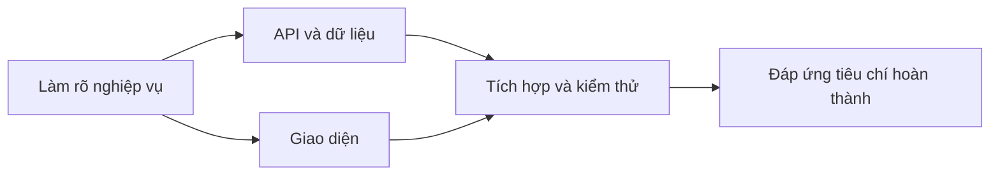

# Phân biệt công sức, độ phức tạp, thời gian theo lịch và bất định

## Mục tiêu học tập

Sau bài học này, bạn có thể:

- Phân biệt bốn khái niệm **công sức (effort)**, **độ phức tạp (complexity)**, **thời gian theo lịch (elapsed/calendar time)** và **bất định (uncertainty)** trong phát triển phần mềm Agile.
- Giải thích vì sao hai công việc tốn công sức tương đương vẫn có thể hoàn thành vào những thời điểm rất khác nhau.
- Đọc một ước lượng hoặc dự báo mà không nhầm **story points**, **giờ công**, **ngày làm việc**, **ngày trên lịch** và **mức tin cậy**.
- Phân tích tác động của phụ thuộc, số người, thời gian chờ, công việc dở dang (WIP), lịch nghỉ, kiểm thử và rủi ro lên ngày giao.
- Dùng ví dụ từ sản phẩm học trực tuyến để tính thử tổng công sức, lập trình tự công việc, dự báo theo thông lượng và nêu rõ giả định.
- Giao tiếp dự báo bằng **khoảng, điều kiện và xác suất được hiệu chỉnh bằng dữ liệu** khi có cơ sở; cập nhật dự báo sau mỗi vòng phản hồi.

## 1. Một yêu cầu “mất bao lâu?” có thể hỏi bốn điều khác nhau

Giả sử Product Owner hỏi nhóm phát triển nền tảng học trực tuyến:

> “Tính năng tiếp tục bài học đang dở mất bao lâu?”

Người trả lời có thể đang nói đến những thứ khác nhau:

- **Công sức:** tổng số giờ mà các thành viên thực sự cần làm để phân tích, thiết kế, lập trình, kiểm thử và đưa hạng mục tới trạng thái hoàn thành.
- **Độ phức tạp:** mức khó để hiểu, thiết kế và hiện thực hành vi, gồm quan hệ phụ thuộc, số trường hợp, rủi ro tích hợp và chi phí suy luận.
- **Thời gian theo lịch:** khoảng thời gian thực tế trôi qua từ một mốc bắt đầu tới mốc kết thúc đã định, bao gồm thời gian làm, chờ, phối hợp, ngày nghỉ và gián đoạn.
- **Bất định:** mức độ chúng ta **chưa biết hoặc không dự đoán chắc** về phạm vi, cách thực hiện, công sức và thời gian; được phản ánh bằng giả định, khoảng giá trị và độ tin cậy.

Bốn khái niệm liên quan nhưng **không thể dùng thay thế cho nhau**.

| Khái niệm | Câu hỏi cần trả lời | Đơn vị hoặc cách diễn đạt thường gặp | Không nên nhầm với |
| --- | --- | --- | --- |
| **Công sức** (effort) | Tổng lượng lao động chủ động cần bỏ ra là bao nhiêu? | Giờ công, ngày công theo quy ước rõ ràng | Số ngày trên lịch để giao |
| **Độ phức tạp** (complexity) | Bài toán có bao nhiêu tương tác, điều kiện khó và khó khăn kỹ thuật? | Nhận định định tính, bậc tương đối; đôi khi phản ánh trong ước lượng tương đối | Tổng số giờ công hoặc số dòng mã |
| **Thời gian theo lịch** (elapsed time) | Từ lúc bắt đầu đếm đến lúc hoàn thành mất bao nhiêu thời gian? | Ngày làm việc, ngày lịch, tuần; phải ghi rõ mốc | Tổng công sức của nhiều người |
| **Bất định** (uncertainty) | Chúng ta chưa biết điều gì và dự báo có thể sai lệch đến mức nào? | Giả định, kịch bản, khoảng, phân bố và độ tin cậy | Một con số “dự phòng” tùy ý |
| **Dự báo** (forecast) | Với dữ liệu và điều kiện hiện tại, khả năng giao là khi nào/bao nhiêu? | Khoảng ngày, kịch bản, xác suất có căn cứ | Cam kết chắc chắn tuyệt đối |

Ví dụ, một công việc cần **40 giờ công** không đồng nghĩa “sẽ xong sau năm ngày”. Hai người có thể cùng làm một số phần; các phần khác phải đợi nhau. Người có chuyên môn có thể chỉ rảnh vào một số ngày. Tài khoản tích hợp của đối tác có thể được cấp sau hai tuần. Thời gian trôi qua vì vậy không suy ra trực tiếp từ số giờ công.

## 2. Công sức: tổng lượng việc chủ động cần hoàn thành

**Công sức (effort)** mô tả lao động thực tế cần để đưa một hạng mục tới mức hoàn thành đã thỏa thuận. Trong một cách đo theo giờ, tổng công sức bằng tổng thời gian làm việc thực tế của những người tham gia:

```text
Tổng công sức = công sức phân tích + thiết kế + phát triển
              + tích hợp + kiểm thử + công việc cần thiết khác
```

Đây là phép cộng **giờ/ngày công**, không phải công thức tính lịch giao hàng. Nếu hai người làm tám giờ mỗi người trong cùng một ngày, họ tạo ra **16 giờ công** trong **một ngày theo lịch làm việc**.

### 2.1. Ví dụ tính công sức

Để tạo một lát cắt tính năng “Học viên mở lại bài chưa hoàn thành gần nhất”, nhóm đưa ra bảng **minh họa**, chưa phải kết quả ước lượng đã kiểm chứng:

| Phần việc cần thiết | Công sức giả định |
| --- | ---: |
| Làm rõ quy tắc “bài đang dở” và các trường hợp ngoại lệ | 4 giờ công |
| Điều chỉnh dữ liệu tiến độ và API | 16 giờ công |
| Xây giao diện và xử lý trạng thái người dùng | 12 giờ công |
| Kiểm thử tích hợp, hồi quy và xử lý lỗi phát hiện | 12 giờ công |
| Kiểm thử khám phá, hướng dẫn vận hành cần thiết | 8 giờ công |
| **Tổng cộng** | **52 giờ công** |

Con số 52 giờ công nghĩa là **tổng lao động được dự kiến**, không có nghĩa công việc sẽ xong sau **52 giờ đồng hồ liên tục**, cũng không mặc nhiên là 6,5 ngày lịch. Mức công sức còn phụ thuộc vào **tiêu chí chấp nhận** và **Definition of Done**. Nếu bỏ phần kiểm thử để báo thấp hơn, đó là thay đổi phạm vi chất lượng, không phải tự nhiên trở nên nhanh hơn.

### 2.2. Ngày công khác ngày lịch

Quy ước “1 ngày công = 8 giờ” chỉ có ý nghĩa nếu tổ chức thỏa thuận như vậy. Khi dùng, phải nêu rõ:

- Một người có mấy giờ làm việc có thể dành cho hạng mục mỗi ngày?
- Có bao gồm trao đổi, đánh giá mã và sửa lỗi sau kiểm thử không?
- “Ngày” được hiểu là **ngày công**, **ngày làm việc** hay **ngày lịch**?
- Có phải công việc của nhiều người đều có thể làm song song không?

Trong ví dụ trên, 52 giờ công theo quy ước 8 giờ/ngày tương đương **6,5 ngày công cộng dồn**. Nếu nhóm chỉ có một người và người đó thật sự dành trọn tám giờ mỗi ngày cho hạng mục, thời lượng thực hiện *có thể* xấp xỉ 6,5 ngày làm việc trước khi xét chờ đợi và phát sinh. Nhưng với nhiều vai trò, lịch thực tế phải tính riêng.

### 2.3. Công sức không tuyến tính với số người

Một hiểu lầm là “nếu một người làm 10 ngày, hai người chắc chắn làm 5 ngày”. Điều này chỉ có thể gần đúng khi công việc **có thể chia độc lập**, mọi người đủ năng lực, và chi phí phối hợp không đáng kể.

Trong sản phẩm phần mềm, nhiều công việc có thứ tự bắt buộc: phải thống nhất quy tắc trước khi chốt hành vi; dữ liệu và API phải đủ ổn định trước khi kiểm chứng toàn luồng; các thành viên phải trao đổi và tích hợp phần làm chung. Thêm người có thể giúp, nhưng cũng tạo **thời gian làm quen, giao tiếp, kiểm tra và hợp nhất**.

Một công thức tính nhanh mang tính khái niệm:

```text
Thời gian triển khai theo lịch
  phụ thuộc vào: khối lượng công việc
               + năng lực thực có ở từng thời điểm
               + thứ tự phụ thuộc
               + thời gian chờ và gián đoạn
               + công việc phải làm lại
```

Vì vậy, không thể lấy tổng công sức rồi chia cho số người để coi như một lời hứa về ngày hoàn thành.

## 3. Độ phức tạp: mức khó của vấn đề, không chỉ lượng việc

**Độ phức tạp (complexity)** xuất hiện khi một công việc có nhiều thành phần và quan hệ tương tác khiến khó hiểu, khó thay đổi hoặc khó kiểm chứng toàn bộ hành vi.

Các dấu hiệu thường gặp:

- Có nhiều **quy tắc nghiệp vụ** và trường hợp ngoại lệ tác động qua lại.
- Các thành phần phần mềm **phụ thuộc chặt** hoặc có hành vi đồng thời.
- Phải phối hợp giữa nhiều dịch vụ, đối tác hay hệ thống dữ liệu.
- Việc thay đổi một chỗ dễ tạo **hệ quả ngoài dự kiến** ở chỗ khác.
- Khó kiểm thử đầy đủ vì nhiều trạng thái, luồng và dữ liệu biên.
- Nhóm phải giải quyết lựa chọn thiết kế với những đánh đổi khó.

Độ phức tạp có thể góp phần làm tăng công sức, nhưng **không có phép đổi chung “độ phức tạp X = Y giờ”**.

### 3.1. Bốn công việc dễ gây nhầm lẫn

| Công việc | Công sức có thể có | Độ phức tạp | Lý do thời gian theo lịch hoặc bất định có thể khác |
| --- | --- | --- | --- |
| Nhập lại và kiểm tra thủ công nhiều bản ghi học viên | Cao vì nhiều thao tác lặp lại | Có thể thấp nếu quy tắc đơn giản | Công việc lớn nhưng có thể chia lô, tự động hóa hoặc làm song song |
| Sửa lỗi hiếm gặp khi hai học viên tranh chỗ cuối | Chưa rõ; có thể nhỏ hoặc lớn | Cao vì đồng thời, giao dịch và trạng thái dữ liệu | Khó tái hiện, phải thử nhiều phương án và kiểm chứng tính nhất quán |
| Tích hợp dịch vụ cấp chứng chỉ bên ngoài | Phần mã có thể ngắn | Trung bình hoặc cao tùy giao thức | Có thể chờ đối tác cấp quyền, tài liệu hoặc môi trường kiểm thử |
| Thay nhãn nút “Ghi danh” sau khi đã chốt câu chữ | Thấp | Thấp | Có thể được triển khai nhanh nếu pipeline và quy trình sẵn sàng |

Một chức năng có vài dòng mã vẫn có thể **phức tạp** nếu phải bảo đảm giao dịch dữ liệu không bị sai khi nhiều người dùng cùng thao tác. Ngược lại, chuyển đổi hàng nghìn bản ghi theo quy tắc rõ ràng có thể **tốn nhiều công sức** nhưng ít phức tạp về suy luận.

### 3.2. Độ phức tạp và kích thước tương đối

Nhiều đội dùng **story points**, kích thước áo (*T-shirt sizing*: S/M/L/XL) hoặc thang tương đối để thảo luận hạng mục lớn hay khó so với những hạng mục đã biết. Tùy thỏa thuận của đội, đánh giá tương đối có thể phản ánh **công sức, độ phức tạp, rủi ro hoặc bất định** ở những mức khác nhau.

Điều quan trọng:

- **Story point không có định nghĩa quy đổi toàn ngành sang giờ hoặc ngày công.**
- Hai đội dùng cùng nhãn “5 points” chưa chắc đang mô tả cùng một lượng công việc.
- Một hạng mục 8 points không có nghĩa luôn hoàn thành gấp đôi thời gian hạng mục 4 points.
- **Scrum Guide không bắt buộc story points, Planning Poker hoặc velocity**. Đó là những kỹ thuật tùy chọn ngoài các yêu cầu cốt lõi của Scrum.

Khi sử dụng điểm tương đối, nhóm cần **thống nhất mình đang đánh giá cái gì**, dùng ví dụ tham chiếu và không biến điểm thành thước đo năng suất cá nhân.

## 4. Thời gian theo lịch: vì sao giờ công chưa cho biết ngày giao?

**Thời gian theo lịch (elapsed time)** đo khoảng thời gian trôi qua giữa **hai mốc được định nghĩa rõ**. Ví dụ: “từ lúc một user story bắt đầu được triển khai tới lúc đáp ứng Definition of Done”. Nếu tính bằng ngày lịch, khoảng này gồm cả cuối tuần, ngày nghỉ và thời gian chờ. Nếu báo bằng ngày làm việc, cần nêu rõ cách loại trừ các ngày nghỉ.

Một số yếu tố làm tăng thời gian theo lịch dù công sức trực tiếp không thay đổi:

1. **Phụ thuộc tuần tự:** bước B phải chờ A mới có thể làm đúng.
2. **Năng lực không liên tục:** chuyên gia hoặc kiểm thử viên chia thời gian cho nhiều hạng mục.
3. **Hàng đợi:** công việc chờ rà soát, chờ môi trường, chờ phê duyệt.
4. **Giới hạn WIP và đổi ngữ cảnh:** nhiều việc đang mở làm tăng thời gian chờ hoàn thành.
5. **Gián đoạn:** xử lý sự cố, nghỉ phép, họp và công việc vận hành bắt buộc.
6. **Tích hợp và kiểm chứng:** cần thời gian kiểm tra hệ thống thực tế, dữ liệu và quyền truy cập.

### 4.1. Cùng 52 giờ công nhưng hai lịch hoàn thành khác nhau

Với ví dụ “Tiếp tục học” ở phần trước, giả sử API và giao diện có thể thực hiện phần lớn song song sau khi thống nhất quy tắc. Việc kiểm thử toàn luồng vẫn cần hai phần được tích hợp.

**Kịch bản A — ít chờ đợi:** người liên quan có mặt đúng lúc, công việc ít bị ngắt, môi trường sẵn và nhóm có thể hoàn tất một phần sau phần khác. Nhóm có thể đi từ làm rõ tới tích hợp, kiểm thử và hoàn thành trong **khoảng một đến hai tuần làm việc**, tùy lịch phân bổ thực tế.

**Kịch bản B — có phụ thuộc ngoài nhóm:** công sức phát triển vẫn khoảng 52 giờ, nhưng yêu cầu phải chờ chuyên gia quyền truy cập xem xét một tuần và môi trường thử nghiệm chỉ sẵn sàng vào tuần kế tiếp. Ngày hoàn thành có thể **muộn hơn đáng kể**, dù số giờ lao động trực tiếp gần như không đổi.

Khoảng thời gian trong hai kịch bản là **giả định minh họa**, không phải kết quả dự báo đáng tin cho mọi dự án. Để đưa ra ngày giao thật, nhóm cần lịch năng lực, phụ thuộc, dữ liệu quá khứ và định nghĩa trạng thái hoàn thành.

### 4.2. Đường găng và việc song song

Hãy nhìn một lát cắt công việc:



B và C có thể làm đồng thời, nhưng D phụ thuộc **cả B và C**. Nhánh chậm hơn có thể quyết định khi nào kiểm thử tích hợp bắt đầu. Việc thêm người vào nhánh vốn đã nhanh hơn chưa chắc giúp ngày giao sớm hơn.

Đây là lý do cần xem **cấu trúc phụ thuộc**, không chỉ cộng tổng giờ rồi chia cho số thành viên.

### 4.3. Lead time và cycle time phải có mốc cụ thể

Trong thực hành quản lý dòng công việc, người ta thường dùng:

- **Lead time:** thời gian từ một mốc đầu vào đã thỏa thuận, chẳng hạn yêu cầu được cam kết xử lý, đến khi hoàn thành theo định nghĩa của đội.
- **Cycle time:** thời gian từ khi thực sự bắt đầu thực hiện đến khi hoàn thành theo định nghĩa của đội.

Các tổ chức có thể chọn **mốc bắt đầu khác nhau**. Vì vậy, luôn ghi rõ trạng thái đầu và cuối khi đo. Không nên so sánh cycle time của đội A (từ “In progress”) với lead time của đội B (từ “Requested”) rồi kết luận ai làm nhanh hơn.

Một hạng mục có thể cần **12 giờ công**, nhưng cycle time dài **10 ngày làm việc** vì chờ phê duyệt, kiểm thử và phối hợp. Con số đó không mâu thuẫn: chúng đo hai hiện tượng khác nhau.

## 5. Bất định: điều chúng ta chưa biết và biên độ có thể xảy ra

**Bất định (uncertainty)** không chỉ là “công việc khó”. Nó mô tả giới hạn của hiểu biết và độ biến thiên của tương lai. Hai công việc có mức phức tạp tương đương vẫn có bất định khác nhau nếu một việc nhóm đã thực hiện nhiều lần, còn việc kia phụ thuộc công nghệ chưa thử nghiệm.

Có thể phân biệt hai nguồn theo mục đích học:

| Nguồn bất định | Bản chất | Cách giảm hoặc quản lý |
| --- | --- | --- |
| **Thiếu hiểu biết** (*epistemic*) | Chưa biết quy tắc nghiệp vụ, chất lượng API ngoài, khả năng chịu tải hoặc thiết kế phù hợp. | Phỏng vấn, thử nghiệm, spike, bản mẫu, kiểm thử tích hợp sớm. |
| **Biến thiên vốn có** (*aleatory*) | Số yêu cầu hỗ trợ, sự cố bất ngờ, thời gian phản hồi người dùng hoặc đối tác dao động. | Thu thập dữ liệu phân bố, duy trì năng lực dự phòng, giảm phụ thuộc và theo dõi thường xuyên. |

Việc phân biệt này là **công cụ suy nghĩ**, không phải luôn tách bạch tuyệt đối. Một lần thử nghiệm có thể làm giảm phần “chưa biết”, nhưng không xóa hết biến thiên tự nhiên.

### 5.1. Độ phức tạp cao chưa chắc bất định cao

Một hệ thống thanh toán có nhiều quy tắc, nhiều trạng thái và yêu cầu bảo mật có thể **phức tạp**, nhưng nếu nhóm đã xây các hệ thống tương tự nhiều lần, có chuyên gia và kiểm thử tốt thì bất định của một thay đổi nhỏ có thể tương đối thấp.

Ngược lại, tích hợp một API tưởng đơn giản có thể có **bất định cao** nếu tài liệu thiếu, đối tác chưa cấp môi trường và chưa ai từng thử luồng lỗi.

Hãy hỏi riêng:

1. Việc này **khó về mặt kỹ thuật/nghiệp vụ** đến mức nào?
2. Chúng ta **hiểu vấn đề** đến đâu?
3. Chúng ta có **dữ liệu quá khứ phù hợp** không?
4. Những phụ thuộc có **nằm trong khả năng chủ động của nhóm** không?
5. Điều gì có thể khiến ước lượng hiện tại sai nhiều nhất?

### 5.2. Điểm ước lượng là một giả định, không phải định luật

Câu “hạng mục này 3 ngày” thường che giấu nhiều giả định. Đội có thể trình bày rõ hơn:

> “Nếu API đối tác hoạt động đúng theo tài liệu, dữ liệu thử sẵn sàng và không cần thêm bước phê duyệt, phần triển khai dự kiến mất khoảng 2–4 ngày làm việc chủ động. Thời gian giao phụ thuộc ngày cấp quyền tích hợp và kết quả kiểm thử. Nhóm sẽ cập nhật sau khi thử kết nối.”

Cách nói này tách **điều ước lượng được**, **điều chưa biết** và **mốc cập nhật thông tin**.

### 5.3. Giảm bất định bằng một phép thử nhỏ

Giả sử chưa biết hệ thống học tập có lưu vị trí bài học chính xác trên hai thiết bị hay không. Thay vì ước lượng ngay toàn bộ tính năng đồng bộ, nhóm có thể thực hiện một **spike có giới hạn**:

- **Câu hỏi cần trả lời:** hai thiết bị cập nhật cùng tiến độ thì trạng thái nào được giữ?
- **Phạm vi:** dựng luồng dữ liệu thử cho một học viên, hai thiết bị và hai kiểu cập nhật.
- **Giới hạn nỗ lực:** một khoảng công việc nhỏ, được nhóm thỏa thuận trước.
- **Đầu ra mong đợi:** kết quả kiểm thử, lựa chọn thiết kế khả thi và các rủi ro còn mở.
- **Điểm ra quyết định:** tiếp tục làm lát nhỏ, cần thêm thử nghiệm hay thay phương án.

Spike tạo **kiến thức**, chưa nhất thiết tạo chức năng người dùng có thể sử dụng. Nó có thể làm thay đổi đáng kể dự báo sau đó. Nhóm nên đánh giá spike theo câu hỏi đã được giải đáp, không chỉ theo số dòng mã viết ra.

## 6. Ước lượng khác với dự báo

Hai từ dễ bị dùng lẫn nhau:

**Ước lượng (estimate)** là đánh giá gần đúng về một đại lượng chưa biết, chẳng hạn lượng công sức của một tính năng hoặc mức kích thước tương đối của một hạng mục. Ước lượng có thể dựa vào chuyên gia, so sánh công việc tương tự hoặc phân tích các phần cần làm.

**Dự báo (forecast)** là nhận định về **kết quả tương lai trong một điều kiện cụ thể**, chẳng hạn khi nào một tập backlog items có khả năng hoàn thành hoặc nhóm có thể giao bao nhiêu việc trong khoảng thời gian nhất định. Dự báo cần đưa vào **năng lực, dòng công việc, lịch, phụ thuộc và bất định**.

| Câu hỏi | Phù hợp với | Cần bổ sung |
| --- | --- | --- |
| “Cần bao nhiêu giờ công để triển khai API?” | Ước lượng công sức | Phạm vi và DoD rõ |
| “Story này tương đối lớn hơn story đã làm không?” | Ước lượng tương đối | Mốc so sánh chung của đội |
| “Với 20 hạng mục và tốc độ hoàn thành thực tế, khi nào có thể xong?” | Dự báo hoàn thành | Dữ liệu throughput, đặc điểm backlog, bất định |
| “Có khả năng giao lát sản phẩm trước mốc X không?” | Dự báo có điều kiện | Phân bố thời gian, điều kiện hiện tại và mức tin cậy |
| “Nếu một chuyên gia chỉ rảnh hai ngày mỗi tuần thì khi nào xong?” | Dự báo lịch và năng lực | Lịch chuyên gia, phụ thuộc, ưu tiên công việc |

Một ước lượng công sức tốt vẫn chưa đủ để suy ra ngày giao. Ngược lại, một đội có dữ liệu dòng công việc ổn định đôi khi có thể đưa ra **dự báo hữu ích mà không cần gán story points cho từng hạng mục**.

## 7. Các cách ước lượng thường gặp trong Agile

Agile không yêu cầu một đơn vị hay kỹ thuật ước lượng duy nhất. Công cụ phù hợp tùy mục đích, độ bất định, dữ liệu có sẵn và chi phí để ước lượng.

### 7.1. Ước lượng tương đối

Đội so sánh hạng mục mới với những hạng mục đã hoàn thành:

- S: nhỏ, đã rõ và ít phụ thuộc.
- M: vừa, có vài trường hợp cần giải quyết.
- L: lớn, nhiều tương tác hoặc cần chia.
- XL: quá lớn/chưa rõ, nên tìm cách tách hoặc giảm bất định.

Các nhãn này **do đội quy ước**. Story points cũng là dạng đánh giá tương đối khi được đội sử dụng. Điểm mạnh là nhóm tập trung thảo luận sự khác biệt và rủi ro, không bị buộc tạo ra một số giờ công có vẻ chính xác ngay khi còn ít thông tin.

Hạn chế: kích thước tương đối **không tự cung cấp ngày trên lịch**. Sự thay đổi nhân sự, công nghệ hoặc cách phân loại có thể làm dữ liệu điểm qua các kỳ không còn so sánh tốt.

### 7.2. Planning Poker và thảo luận bất đồng

Với **Planning Poker**, các thành viên cân nhắc và đưa ra đánh giá tương đối độc lập, sau đó thảo luận các chênh lệch lớn. Giá trị của hoạt động không nằm ở việc bỏ phiếu cho một con số “đúng”, mà ở việc **phát hiện thông tin hoặc giả định khác nhau**.

Ví dụ người A chọn “3” vì nghĩ hệ thống đã có API lưu tiến độ; người B chọn “8” vì biết API chưa xử lý khi nhiều thiết bị cập nhật đồng thời. Cuộc trao đổi này quan trọng hơn việc lấy trung bình 5,5. Nhóm nên làm rõ API, quyết định phạm vi và chỉ sau đó mới đánh giá lại.

### 7.3. Ước lượng theo công việc tương tự hoặc phân rã

Khi có công việc lặp lại tương đối ổn định, đội có thể dùng dữ liệu từ những lần trước. Với hạng mục mới nhưng đủ rõ, đội có thể **phân rã để nhìn công việc còn thiếu**, cộng một ước lượng có điều kiện và kiểm tra phụ thuộc.

Tránh phân rã thành hàng chục tác vụ chỉ để giả vờ chắc chắn. Nếu một rủi ro lớn chưa giải quyết, cộng các con số nhỏ vẫn không làm mất rủi ro đó.

### 7.4. Khi nào không đáng ước lượng chi tiết?

Nếu hạng mục rất nhỏ, có quy tắc rõ và có thể hoàn thành nhanh, **chi phí họp để ước lượng** có thể lớn hơn lợi ích. Nếu đội có dữ liệu luồng công việc tốt, họ có thể chọn dùng **kích thước tương đối đơn giản, throughput hoặc cycle time** để dự báo.

Tuy nhiên, không ước lượng chi tiết cũng **không có nghĩa không quản lý rủi ro hoặc không giao tiếp ngày dự kiến**. Cần lựa chọn cách dự báo phù hợp và công khai giới hạn của nó.

## 8. Dự báo bằng dữ liệu dòng công việc

Các thước đo thường được dùng trong Kanban và các đội Agile khác:

| Thước đo | Định nghĩa thực hành | Cần chú ý |
| --- | --- | --- |
| **Throughput** | Số hạng mục hoàn thành trong một khoảng thời gian. | Hạng mục có quá chênh kích thước không? Định nghĩa “hoàn thành” có ổn định không? |
| **Cycle time** | Thời gian hạng mục ở trạng thái bắt đầu xử lý đến hoàn thành theo workflow đã định. | Bao gồm chờ/gián đoạn trong khoảng đo; không phải giờ công thuần. |
| **Work item age** | Thời gian công việc đang dở đã trôi qua từ mốc bắt đầu tới hiện tại. | Công việc già có thể là dấu hiệu tắc nghẽn cần xem xét. |
| **WIP** | Số hạng mục đang thực hiện theo ranh giới workflow. | WIP cao có thể làm tăng chờ và phân tán tập trung. |
| **Lead time** | Thời gian từ mốc yêu cầu/được cam kết tới hoàn thành theo định nghĩa của nhóm. | Phải ghi rõ mốc đo; không mặc định giống cycle time. |

### 8.1. Ví dụ dự báo sơ bộ theo throughput

Một đội đo số hạng mục hoàn thành trong **10 tuần liên tiếp** theo cùng quy ước “Done”:

```text
Tuần:        1  2  3  4  5  6  7  8  9  10
Hoàn thành:  3  4  5  2  6  4  5  3  4   4
Tổng: 40 hạng mục / 10 tuần = 4 hạng mục/tuần (trung bình)
```

Giả sử còn **20 hạng mục tương tự**, nhóm không có thay đổi lớn về năng lực, chính sách Done hoặc loại việc. Phép chia **20 / 4 = 5 tuần** cho một **ước lượng điểm để định hướng thảo luận**.

**Không nên kết luận “chắc chắn sau đúng 5 tuần sẽ xong”.** Dữ liệu cho thấy từng tuần đã hoàn thành từ 2 đến 6 hạng mục. Phần backlog còn lại có thể khác độ lớn; có thể xuất hiện công việc khẩn hoặc sự cố. Nếu lấy tốc độ 2 hạng mục/tuần, phép chia cho **10 tuần**; nếu dùng 6 hạng mục/tuần thì cần ít nhất **4 tuần trọn** để vượt 20. Đây là **kịch bản theo nhịp giả định**, không phải khoảng tin cậy thống kê.

Một câu giao tiếp chính xác hơn:

> “Với dữ liệu 10 tuần vừa qua, thông lượng trung bình là bốn hạng mục/tuần nên mốc trung tâm sơ bộ cho 20 hạng mục tương tự là khoảng năm tuần. Chúng ta chưa có đủ phân tích về phân bố và phụ thuộc để khẳng định xác suất hoàn thành ở mốc này. Dự báo sẽ được cập nhật khi backlog được tinh chỉnh và có thêm số liệu.”

### 8.2. Dự báo xác suất bằng mô phỏng

Khi có đủ lịch sử phù hợp, nhóm có thể dùng **mô phỏng Monte Carlo** để xem nhiều kịch bản giao hàng, thay vì giả định một tuần điển hình luôn bằng trung bình.

Một quy trình khái niệm:

1. Thu thập throughput theo những khoảng thời gian nhất quán trong điều kiện vận hành tương đối so sánh được.
2. Xác định số hạng mục còn lại và mức độ tương đồng với dữ liệu lịch sử.
3. Lấy mẫu các kỳ throughput từ phân bố lịch sử hoặc mô hình phù hợp.
4. Trong từng lần mô phỏng, cộng số hạng mục hoàn thành cho tới khi đủ số cần giao; ghi lại thời gian.
5. Lặp lại đủ nhiều lần để quan sát phân bố kết quả; chọn các mốc phù hợp với rủi ro ra quyết định.
6. Kiểm tra lại giả định sau khi thay đổi năng lực, WIP, quy trình, loại việc hoặc phạm vi backlog.

Nếu mô phỏng đã được hiệu chỉnh và kiểm chứng phù hợp, nhóm có thể phát biểu, chẳng hạn: **“mốc T tương ứng khoảng 85% kịch bản mô phỏng hoàn thành trước hoặc tại T”**. Đây là xác suất **theo mô hình và dữ liệu giả định**, không phải bảo đảm chắc chắn về thực tế.

**Không gán nhãn P50, P85 hoặc 95% chỉ vì đã cộng thêm vài ngày dự phòng.** Những nhãn xác suất cần có cơ sở phân bố, phương pháp ước lượng và kiểm tra hiệu chỉnh phù hợp.

### 8.3. Điều kiện khiến forecast theo throughput kém tin cậy

- Thay đổi lớn về **kích thước hoặc loại hạng mục** giữa dữ liệu quá khứ và backlog sắp làm.
- Thời gian đo quá ngắn hoặc có ít dữ liệu.
- Thay đổi cách định nghĩa “Done”, trạng thái workflow hoặc cách đếm một hạng mục.
- Có nhiều **phụ thuộc tuần tự bắt buộc**, mốc bên ngoài hoặc nhóm chuyên gia hiếm.
- Công việc chưa được chia nhỏ, một hạng mục lớn chi phối toàn bộ thời gian.
- Nhóm vừa thay đổi thành viên, công nghệ, chính sách WIP hoặc lịch năng lực.

Trong những trường hợp này, nên **giảm độ tự tin**, phân đoạn dữ liệu, xem xét dự báo theo tình huống hoặc làm rõ vấn đề trước. Mô phỏng với dữ liệu không phù hợp chỉ tạo ra nhiều con số từ những giả định yếu.

## 9. Little's Law và giới hạn khi suy luận thời gian

Một quan hệ phổ biến trong lý thuyết hàng đợi là **Little's Law**:

```text
L = λ × W

L: số hạng mục trung bình trong hệ thống
λ: tốc độ hoàn thành/đến trung bình khi hệ thống ổn định
W: thời gian trung bình trong hệ thống
```

Nếu một workflow được xác định rõ, đủ ổn định và dữ liệu phù hợp, có thể diễn giải gần đúng trong ngữ cảnh Kanban:

```text
WIP trung bình ≈ Throughput trung bình × Cycle time trung bình
```

Ví dụ **minh họa**: hệ thống trung bình có 12 hạng mục đang xử lý và hoàn thành 3 hạng mục mỗi tuần trong trạng thái ổn định, thì thời gian trong hệ thống trung bình có thể khoảng **12 / 3 = 4 tuần**.

Đây **không phải cách chứng minh** mọi hạng mục sẽ xong trong 4 tuần hoặc rằng giảm WIP một nửa luôn làm giảm mọi lead time một nửa. Điều kiện áp dụng và định nghĩa ranh giới phải phù hợp; các số trung bình che giấu độ biến thiên và hạng mục bất thường. Dùng quan hệ này để **đặt câu hỏi về dòng chảy**, không biến thành cam kết cho một story cụ thể.

## 10. Trường hợp đầy đủ: từ ước lượng đến lịch giao tính năng

Xét yêu cầu trên nền tảng học trực tuyến:

> “Là một học viên, tôi muốn tiếp tục bài học đang dở gần nhất để không mất thời gian tìm lại nội dung.”

### 10.1. Làm rõ phạm vi trước khi đo

Nhóm xác nhận:

- Bản đầu hỗ trợ một khóa học đang theo dõi và định nghĩa thế nào là “bài chưa hoàn thành gần nhất”.
- Khi chưa bắt đầu bài nào, hệ thống hiển thị “Bắt đầu học”.
- Quyền truy cập khóa và dữ liệu tiến độ phải chính xác.
- Các trường hợp nhiều thiết bị, lỗi đồng bộ và nhiều khóa đang học cần được **đánh giá rủi ro**, không mặc định bỏ qua nếu hệ thống thực tế có chúng.
- Hạng mục chỉ “Done” khi đạt tiêu chí chấp nhận và chuẩn chất lượng đã thỏa thuận.

Một vài ví dụ nghiệp vụ:

```gherkin
Feature: Tiếp tục bài đang học

  Scenario: Có bài chưa hoàn thành
    Given Lan đã đăng nhập và có quyền truy cập khóa "Java căn bản"
    And Lan có một bài đã bắt đầu nhưng chưa hoàn thành
    When Lan mở trang khóa học
    Then hệ thống hiển thị lựa chọn "Tiếp tục học"
    And lựa chọn đó dẫn đến đúng bài chưa hoàn thành theo quy tắc đã thống nhất

  Scenario: Chưa bắt đầu bài nào
    Given Lan đã ghi danh khóa "Java căn bản"
    And Lan chưa bắt đầu bài nào
    When Lan mở trang khóa học
    Then hệ thống hiển thị lựa chọn "Bắt đầu học"
```

### 10.2. Phân tích theo bốn khái niệm

| Góc nhìn | Đánh giá minh họa | Lưu ý khi trao đổi |
| --- | --- | --- |
| **Công sức** | Khoảng 52 giờ công theo các phần việc đã liệt kê ở mục 2. | Tổng lao động giả định, có thể sửa khi phạm vi và kiểm thử thay đổi. |
| **Độ phức tạp** | Trung bình cho luồng một thiết bị; tăng nếu tiến độ đồng bộ đồng thời hoặc dữ liệu di trú phức tạp. | Cần xem số tương tác và trường hợp ngoại lệ, không chỉ số màn hình. |
| **Thời gian theo lịch** | Phụ thuộc lịch của các vai trò, thời gian tích hợp và mức chờ phê duyệt/kiểm thử. | Không suy ra bằng 52 giờ / số thành viên. |
| **Bất định** | Chưa biết rõ tính nhất quán tiến độ trên các thiết bị và quy tắc khi mất kết nối. | Có thể cần spike hoặc kiểm thử sớm để giảm bất định. |

### 10.3. Xây thứ tự phụ thuộc và rà soát năng lực

Nhóm có hai lập trình viên và một kỹ sư chất lượng hỗ trợ theo lịch chia sẻ. Họ không giả định ba người đều sẵn sàng trọn ngày cho cùng hạng mục. Từ sơ đồ phụ thuộc ở mục 4, nhóm xác định:

- Làm rõ quy tắc trước những quyết định API/giao diện quan trọng.
- API và giao diện có thể làm song song ở phần không phụ thuộc.
- Kiểm thử tích hợp toàn luồng cần kết nối được hai phía.
- Kiểm thử khám phá và rà soát quyền truy cập cần có thời gian của người phụ trách phù hợp.
- Những ngày không có chuyên gia hoặc môi trường kiểm thử sẽ tạo chờ đợi.

Nhóm **không thể** kết luận ngày giao chỉ từ tổng 52 giờ công. Họ xem thêm lịch phân bổ, lịch nghỉ, các công việc đang làm dở và thời gian chờ lịch sử để hình thành dự báo.

### 10.4. Dùng dự báo có điều kiện thay vì ngày hứa vô căn cứ

Một câu trao đổi phù hợp:

> “Đây là lát cắt có công sức sơ bộ khoảng 52 giờ và có rủi ro ở cách lưu tiến độ. Nếu quy tắc được thống nhất, môi trường sẵn và các vai trò có thời gian theo kế hoạch, chúng tôi sẽ kiểm tra nhịp hoàn thành hiện tại để dự báo mốc giao. Sau thử nghiệm dữ liệu đồng bộ và khi có lịch hỗ trợ kiểm thử, chúng tôi sẽ cập nhật khoảng thời gian và độ tin cậy.”

Khi đã có dữ liệu tương tự phù hợp, nhóm có thể bổ sung **khoảng ngày dự báo** và giải thích mốc đó tương ứng kịch bản nào. Không tự gắn một mức xác suất khi chưa có cơ sở.

### 10.5. Sau một vòng phản hồi

Giả sử spike xác nhận dữ liệu tiến độ trên thiết bị hiện tại hoạt động ổn nhưng phát hiện vấn đề tranh chấp cập nhật từ hai thiết bị. Nhóm có thể:

1. Làm rõ đối tượng và phạm vi mà lát phát hành phải hỗ trợ.
2. Nếu đa thiết bị thuộc phạm vi hiện tại, bổ sung công việc bảo toàn dữ liệu, cập nhật công sức và rủi ro.
3. Nếu được phép giới hạn lát đầu, ghi rõ điều kiện và bảo đảm ứng dụng không gây hư hại dữ liệu người đang sử dụng thiết bị khác.
4. Cập nhật dự báo theo thông tin mới; không che giấu thay đổi chỉ vì đã nói một con số cũ.
5. Sau phát hành, quan sát người học quay lại bài dở và các lỗi liên quan.

Cách làm này thể hiện đúng tinh thần **ước lượng và dự báo thích ứng**: dùng phản hồi để ra quyết định tốt hơn, không dùng ước lượng ban đầu như một cam kết không thể xem lại.

## 11. Giao tiếp ước lượng và dự báo rõ ràng

Một thông điệp chất lượng nên trả lời **bốn câu hỏi**:

1. **Đang nói về đại lượng nào?** 40 giờ công, 5 story points, 8 ngày làm việc hay ngày phát hành dự kiến?
2. **Mốc và phạm vi nào?** Từ “Ready” đến “Done”, từ bắt đầu Sprint đến hết Sprint hay tới lúc người dùng có thể sử dụng?
3. **Giả định/ràng buộc là gì?** Năng lực hiện tại, đối tác cấp quyền, các rủi ro bảo mật, mức độ hoàn chỉnh của backlog?
4. **Độ tin cậy và lúc xem lại?** Đây là kịch bản, khoảng ước lượng, hay phân bố đã được kiểm tra bằng dữ liệu?

| Cách nói dễ gây hiểu lầm | Cách diễn đạt hữu ích hơn |
| --- | --- |
| “Việc này mất 5 ngày.” | “Chúng tôi ước lượng khoảng 5 ngày công; thời gian giao phụ thuộc lịch QA và tích hợp.” |
| “8 điểm nên sẽ mất 8 ngày.” | “8 điểm là kích thước tương đối của đội; chúng tôi sẽ dùng dữ liệu giao việc thực tế để dự báo ngày.” |
| “Có hai người thì thời gian còn một nửa.” | “Một số phần có thể làm song song, nhưng vẫn có bước phụ thuộc và chi phí phối hợp.” |
| “Chắc chắn giao thứ Sáu.” | “Theo điều kiện hiện tại, chúng tôi dự kiến mốc X; cần xác minh phụ thuộc Y để biết mức chắc chắn.” |
| “Dự phòng 30%, nên xác suất đúng là 90%.” | “30% là giả định dự phòng quản lý, chưa phải một xác suất đã hiệu chỉnh bằng dữ liệu.” |
| “Dự báo đã sai nên đội phải làm nhanh hơn.” | “Ta sẽ xem phạm vi, phụ thuộc, nguồn bất định và cập nhật mô hình dự báo từ dữ liệu thực tế.” |

### Mẫu trao đổi ngắn với người liên quan

```text
Hạng mục / mục tiêu: [Tên và giá trị người dùng]
Phạm vi được tính: [Luồng chính, các trường hợp quan trọng, DoD]
Công sức ước lượng: [Số/ khoảng + đơn vị, hoặc chưa thể ước lượng đáng tin]
Độ phức tạp: [Điểm khó và phụ thuộc cụ thể]
Dự báo thời gian: [Khoảng / kịch bản / ngày; mốc bắt đầu và kết thúc]
Bằng chứng sử dụng: [Việc tương tự, dữ liệu throughput/cycle time, lịch năng lực]
Bất định chính: [Điều chưa biết, tác động nếu giả định sai]
Phương án giảm bất định: [Spike, phỏng vấn, thử nghiệm hoặc xử lý phụ thuộc]
Mốc cập nhật: [Khi có kết quả nào hoặc sau chu kỳ nào]
Người chịu trách nhiệm ra quyết định: [Vai trò phù hợp]
```

Không cần điền bảng lớn cho một thay đổi rất nhỏ. Chọn độ chi tiết tương xứng với **tác động của quyết định**. Với mốc giao ảnh hưởng hợp đồng hoặc nhiều đội, minh bạch các giả định càng quan trọng.

## 12. Những hiểu lầm thường gặp

### “Công sức 10 ngày công nghĩa là giao sau 10 ngày”

Sai vì ngày công là tổng lao động, còn lịch giao gồm thời gian chờ, phụ thuộc, thứ tự thực hiện, lịch nghỉ và mức tập trung. Muốn dự báo ngày cần xem hệ thống công việc thực tế.

### “Độ phức tạp tăng gấp đôi thì giờ công chắc chắn tăng gấp đôi”

Không có quan hệ tuyến tính chung như vậy. Một quy tắc đồng thời phức tạp có thể được giải bằng một thay đổi nhỏ sau khi hiểu rõ; hoặc một thay đổi ít dòng mã lại kéo theo nhiều kiểm chứng.

### “Story points là thời gian được mã hóa”

Không có quy đổi chuẩn giữa points và giờ. Nếu một đội cố định ngầm “1 point = 1 ngày”, cần gọi rõ đây là **quy ước của đội**, không phải bản chất bắt buộc của story points hay Scrum.

### “Ước lượng càng chi tiết thì dự báo càng chắc”

Chi tiết có thể giúp phát hiện công việc bị thiếu, nhưng không xóa bất định về nhu cầu, kỹ thuật và phụ thuộc. Một bảng 30 tác vụ với độ chính xác đến nửa giờ có thể tạo **cảm giác chắc chắn giả tạo**.

### “Thêm người luôn rút ngắn thời gian”

Không đúng khi công việc bị giới hạn bởi phụ thuộc tuần tự, chuyên gia hiếm, lịch đối tác hoặc chi phí phối hợp. Hãy tìm **nút thắt và việc có thể làm song song** trước khi tăng nhân lực.

### “Velocity cao nghĩa là nhóm hiệu quả hơn đội khác”

Velocity dựa trên **quy ước điểm của từng đội** và các hạng mục mà đội đó hoàn thành. Nó không phù hợp để xếp hạng chéo các nhóm và không tự chứng minh giá trị người dùng. Việc tăng điểm bằng cách thay thang đo cũng không làm sản phẩm giao nhanh hơn.

### “Một ngày dự báo là một cam kết chắc chắn”

Dự báo là nhận định có điều kiện; **cam kết** là quyết định quản lý trách nhiệm, phạm vi và rủi ro. Hai điều có thể liên quan nhưng không tự đồng nhất. Khi cần cam kết, các bên phải hiểu điều kiện, mức rủi ro chấp nhận và cách xử lý khi thông tin mới xuất hiện.

### “Mô phỏng ra P85 thì chắc chắn giao đúng”

P85, nếu được tạo đúng, chỉ mô tả **xác suất trong mô hình và dữ liệu đã dùng**. Nếu backlog thay đổi hoặc dữ liệu không đại diện, độ tin cậy thực tế có thể khác. Cần cập nhật và kiểm tra hiệu chỉnh dự báo.

## 13. Bài tập thực hành

### Bài tập A: Phân loại bốn khái niệm

Với từng tình huống, hãy chỉ ra **công sức, độ phức tạp, thời gian theo lịch và bất định** khác nhau thế nào:

1. Một người chuyển 2.000 bản ghi học viên theo quy tắc đã rõ, với công cụ kiểm tra kết quả.
2. Nhóm sửa lỗi rất hiếm khi hai người cùng ghi danh chỗ cuối.
3. Lập trình viên hoàn thành mã tích hợp trong một ngày nhưng phải chờ đối tác cấp chứng chỉ số thêm hai tuần.
4. Tính năng mới dùng thư viện chưa ai trong nhóm thử, đặc tả API bên ngoài đang thay đổi.

**Gợi ý:** (1) có thể nhiều công sức nhưng ít phức tạp nếu quy tắc đơn giản; (2) có thể phức tạp cao và khó ước lượng; (3) công sức và lịch giao chênh lớn do thời gian chờ; (4) bất định cao, nên có thử nghiệm giảm rủi ro.

### Bài tập B: Tính công sức nhưng không đánh đồng lịch

Một lát chức năng ghi danh khóa học được phân rã:

| Công việc | Công sức giả định | Phụ thuộc |
| --- | ---: | --- |
| Làm rõ quy tắc | 6 giờ | Không |
| API ghi danh | 18 giờ | Sau làm rõ |
| Giao diện | 12 giờ | Sau làm rõ |
| Kiểm thử tích hợp | 14 giờ | Sau API và giao diện |
| Kiểm thử khám phá/đánh giá cuối | 10 giờ | Sau tích hợp |

Hãy trả lời:

1. Tổng công sức bao nhiêu **giờ công**?
2. Nếu quy ước 8 giờ một ngày công, tổng cộng bao nhiêu **ngày công**?
3. Vì sao không thể khẳng định ngày giao chỉ từ hai con số trên?
4. Công việc nào có thể song song và công việc nào nằm sau những phụ thuộc?
5. Nêu ba dữ liệu bổ sung cần có để dự báo ngày theo lịch.

**Đáp án định hướng:** tổng **60 giờ công**, tương đương **7,5 ngày công** theo quy ước 8 giờ/ngày. API và giao diện có thể làm song song sau bước làm rõ; kiểm thử tích hợp phải chờ cả hai. Cần lịch năng lực, trạng thái công việc đang dở, phụ thuộc môi trường/kiểm thử và dữ liệu dòng công việc để dự báo thời gian giao.

### Bài tập C: Phân biệt dự báo điểm và khoảng có cơ sở

Một nhóm đã hoàn thành **40 hạng mục trong 10 tuần**; tuần cao nhất có 6, tuần thấp nhất có 2. Họ còn 20 hạng mục.

1. Trung bình throughput là bao nhiêu hạng mục/tuần?
2. Nếu dùng trung bình làm phép chia đơn giản, mốc sơ bộ là bao nhiêu tuần?
3. Vì sao không thể tự gọi mốc đó là “P85”?
4. Những thay đổi nào về backlog hoặc năng lực có thể làm dự báo sai?
5. Nếu cần mốc giao có mức tin cậy xác định, bạn sẽ đề xuất phương pháp và dữ liệu nào?

**Đáp án định hướng:** trung bình **4 hạng mục/tuần**, mốc phép chia **5 tuần**. Để có P85 cần một phân bố dự báo và giả định phù hợp, có thể từ mô phỏng dựa trên lịch sử và kiểm tra hiệu chỉnh; không suy ra P85 từ phép chia trung bình.

### Bài tập D: Nêu bất định và cách giảm

Một tính năng “Tiếp tục học trên hai thiết bị” có các thông tin:

- Hai thiết bị có thể cập nhật cùng một tiến độ.
- Nhóm chưa biết hệ thống xử lý xung đột dữ liệu hiện tại ra sao.
- Đội vận hành chỉ có một môi trường kiểm thử tích hợp chia sẻ.
- Người học cần giữ tiến độ chính xác để không bị mất kết quả.

Hãy liệt kê các **nguồn bất định**, rủi ro kỹ thuật/nghiệp vụ, một **spike giới hạn** để học sớm và điều kiện cập nhật ước lượng sau spike. Trình bày một câu dự báo có điều kiện mà không tự gán xác suất khi chưa có dữ liệu.

### Bảng tự kiểm tra sau bài tập

| Câu hỏi | Dấu hiệu hiểu đúng |
| --- | --- |
| Có tách effort và elapsed time không? | Không suy ra ngày giao bằng phép chia giờ công đơn giản. |
| Có mô tả complexity bằng điều khó cụ thể không? | Nêu tương tác, quy tắc, đồng thời, dữ liệu và phụ thuộc. |
| Có nhận diện uncertainty không? | Ghi giả định, điều chưa biết và cách giảm hoặc quản lý. |
| Có nguồn cho forecast không? | Nêu lịch năng lực, dữ liệu luồng hoặc cơ sở mô phỏng thích hợp. |
| Có phân biệt ước lượng với cam kết không? | Nêu điều kiện, rủi ro và mốc cần xem lại. |
| Có giữ mục tiêu Agile không? | Dùng phản hồi và chất lượng thực tế để điều chỉnh dự báo và phạm vi. |

## 14. Ghi nhớ cốt lõi

- **Công sức** là lượng lao động chủ động; **độ phức tạp** là mức khó; **thời gian theo lịch** là thời gian trôi qua giữa hai mốc; **bất định** là mức chưa biết và biến thiên của kết quả.
- **Không có công thức chuyển đổi phổ quát** giữa story points, giờ công và ngày giao. Mọi quy đổi đều cần phạm vi, dữ liệu và giả định rõ ràng.
- Công việc có thể làm song song nhưng cũng phải chịu **phụ thuộc, thời gian chờ, lịch năng lực và giới hạn WIP**. Giảm chờ đợi đôi khi cải thiện thời gian giao hơn tăng tốc thao tác cá nhân.
- **Ước lượng** giúp thảo luận kích thước, công sức và rủi ro; **dự báo** dùng hiểu biết hiện có và dữ liệu vận hành để mô tả thời điểm hoặc khối lượng có khả năng giao.
- **Bất định cần được quản lý bằng học hỏi sớm**: chia nhỏ lát giá trị, làm rõ yêu cầu, spike, kiểm thử, phát hành tăng dần và nhận phản hồi.
- Khi cần xác suất, hãy dùng **phân bố và mô hình có căn cứ**, kiểm tra các giả định và cập nhật theo dữ liệu. Đừng gắn nhãn P50/P85 cho một số ngày dự phòng tùy ý.

Trong một nhóm Agile, câu trả lời tốt cho “bao giờ xong?” không chỉ là một con số. Đó là **đại lượng đang nói đến, điều kiện để đạt kết quả, bằng chứng cho dự báo và điều gì sẽ khiến nhóm cập nhật dự báo**.

## Nguồn tham khảo

- [Manifesto for Agile Software Development](https://agilemanifesto.org/) — các giá trị Agile về phần mềm hoạt động được, phản hồi và thích nghi.
- [Principles behind the Agile Manifesto](https://agilemanifesto.org/principles.html) — giao sản phẩm thường xuyên, tốc độ bền vững và liên tục cải tiến.
- [The Scrum Guide (2020)](https://scrumguides.org/scrum-guide.html) — empiricism, Product Backlog, Sprint Planning và Sprint Goal; không quy định phải sử dụng story points.
- [The Kanban Guide](https://kanbanguides.org/the-kanban-guide/) — Work in Progress, throughput, work item age và cycle time.
- John D. C. Little, “A Proof for the Queuing Formula: L = λW”, *Operations Research* (1961) — cơ sở lý thuyết về mối quan hệ giữa lượng việc trong hệ thống, thông lượng và thời gian trung bình trong hệ thống.
