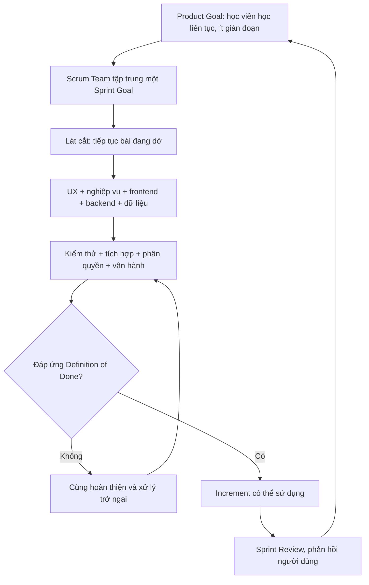

# Scrum Team như một nhóm nhỏ đa chức năng và tự quản

Một đội phát triển nền tảng học trực tuyến cam kết giúp học viên **tiếp tục bài học đang dở** trong Sprint tới. Công việc đi qua bốn nhóm riêng: nhóm phân tích viết yêu cầu, nhóm thiết kế giao diện, nhóm backend triển khai API, nhóm kiểm thử nhận bàn giao ở cuối Sprint. Khi API bị lỗi, mỗi nhóm đều nói mình “đã xong phần việc”. Kết thúc Sprint, không có trải nghiệm hoàn chỉnh nào để học viên sử dụng.

Đội này có thể đang tổ chức các cuộc họp mang tên Scrum nhưng **chưa thực sự vận hành như một Scrum Team**. Scrum không thiết kế để tối ưu số ticket mà từng bộ phận hoàn tất. Nó hướng một nhóm nhỏ, có đủ năng lực cần thiết và được trao quyền tự quản công việc, cùng chịu trách nhiệm tạo ra **Increment có giá trị, sử dụng được** trong mỗi Sprint.

Bài học thuộc chương **Nền tảng Scrum** của mô-đun **AGILE_DEVELOPMENT**. Nó làm rõ vì sao Scrum Team cần nhỏ, **đa chức năng (*cross-functional*)** và **tự quản (*self-managing*)**, đồng thời kết nối với tư duy Agile: cộng tác, phản hồi sớm, giao sản phẩm tăng dần, cải tiến liên tục và thực hành user story, backlog, Kanban, XP cùng các chỉ số dòng công việc.

## 1. Mục tiêu học tập

Sau bài này, bạn có thể:

- Giải thích định nghĩa **Scrum Team** theo *Scrum Guide 2020*, bao gồm quy mô nhỏ, tính đa chức năng và tự quản.
- Phân biệt ba **nhóm trách nhiệm (*accountabilities*)** của Scrum: **Product Owner**, **Scrum Master** và **Developers**, tránh hiểu chúng đơn giản là các chức danh nhân sự.
- Mô tả **ai quyết định mục tiêu, thứ tự backlog, phạm vi Sprint và cách thực hiện**, cùng ranh giới của quyền tự quản.
- Phân biệt nhóm đa chức năng với một nhóm tập hợp nhiều phòng ban nhưng vẫn phải bàn giao theo silo.
- Mô tả cách cùng tạo một Increment theo **Sprint Goal** và **Definition of Done**, thay vì mỗi người chỉ hoàn tất task cá nhân.
- Đề xuất cách cải thiện thiếu kỹ năng, phụ thuộc, quá tải, xung đột và kém minh bạch mà không tạo thêm bộ máy điều hành công việc.
- Nhận diện dấu hiệu hoạt động theo đúng tinh thần Scrum và đo kết quả ở mức nhóm, sản phẩm, chất lượng và luồng công việc.

## 2. Scrum Team là gì?

Theo *The Scrum Guide* do Ken Schwaber và Jeff Sutherland công bố năm 2020, **Scrum Team là đơn vị nền tảng của Scrum**, gồm:

- **Một Scrum Master**.
- **Một Product Owner**.
- **Developers** — những người chịu trách nhiệm tạo ra các khía cạnh của một Increment có thể sử dụng trong mỗi Sprint.

Scrum Team **không có các nhóm con hay hệ thống phân cấp bên trong**. Cả đội là một đơn vị gắn kết tập trung vào **một mục tiêu sản phẩm (*Product Goal*) tại một thời điểm**. Đội có năng lực đa chức năng và tự quản, nghĩa là về tập thể họ có những kỹ năng cần thiết để tạo giá trị trong mỗi Sprint, đồng thời tự quyết định bên trong đội **ai làm gì, khi nào và như thế nào**.

Một cách mô tả ngắn:

> **Scrum Team = một nhóm nhỏ cùng chịu trách nhiệm tạo giá trị cho sản phẩm, có các trách nhiệm rõ ràng nhưng không bị chia thành những tiểu đội bàn giao và chỉ đạo lẫn nhau.**

### 2.1. Scrum Team không đồng nghĩa “nhóm lập trình viên”

Những người đóng góp tạo Increment có thể có chuyên môn:

- Phân tích và làm rõ nghiệp vụ.
- Thiết kế trải nghiệm người dùng.
- Phát triển frontend, backend, mobile.
- Thiết kế dữ liệu.
- Kiểm thử và kiểm chứng chất lượng.
- Bảo mật, tích hợp, triển khai và vận hành.
- Nghiên cứu hoặc thí nghiệm sản phẩm khi cần.

Trong Scrum, **Developers không chỉ có nghĩa người viết mã**. Đây là tên của nhóm trách nhiệm dành cho những thành viên cam kết tạo ra **bất kỳ khía cạnh nào** của Increment có thể sử dụng trong Sprint. Một người chuyên kiểm thử hoặc UX có thể thuộc Developers nếu họ cùng chịu trách nhiệm tạo Increment, thay vì đứng ở một nhóm độc lập chỉ nhận việc bàn giao.

Không cần mọi loại chuyên môn đều có một vị trí nhân sự riêng ở từng Scrum Team. Điều quan trọng là đội có đủ năng lực và quyền phối hợp để hoàn thành công việc sản phẩm mình nhận, giải quyết kịp thời những phụ thuộc cần thiết.

### 2.2. Scrum Team không phải “ai cũng làm mọi thứ”

**Đa chức năng** là thuộc tính của **cả đội**. Một người có thể giỏi kiểm thử và biết mức đủ để thảo luận API; người khác chuyên backend nhưng giúp viết test hoặc phân tích hành vi người dùng. Không ai phải trở thành chuyên gia về mọi công nghệ.

Điều cần tránh là mô hình trong đó:

1. Developers chỉ có thể viết mã sau khi phòng phân tích hoàn tất toàn bộ tài liệu.
2. Nhóm UX bàn giao thiết kế rồi không còn tham gia nhận phản hồi.
3. Nhóm kiểm thử độc lập chỉ được mời vào cuối Sprint.
4. Việc triển khai và vận hành bị xem là “vấn đề của người khác”.
5. Mỗi nhóm hoàn thành KPI riêng nhưng không ai chịu trách nhiệm Increment có thể dùng.

Trong cách phối hợp đa chức năng, chuyên môn vẫn có ý nghĩa, nhưng thành viên **cùng tối ưu việc hoàn tất một lát cắt sản phẩm**, thay vì tối ưu hàng chờ tại ranh giới phòng ban.

## 3. Vì sao Scrum Team nên nhỏ?

Scrum Guide 2020 mô tả Scrum Team là nhóm nhỏ, **thông thường từ 10 người trở xuống** (*typically 10 or fewer people*), đủ nhỏ để linh hoạt và đủ lớn để hoàn thành công việc có ý nghĩa trong một Sprint. Đây là một **hướng dẫn thiết kế theo tính hiệu quả**, không phải công thức bảo đảm cứ đúng 10 người là thành công.

### 3.1. Quy mô nhỏ giúp giảm chi phí phối hợp

Khi số người tăng, số quan hệ trao đổi có thể tăng nhanh. Với mô hình mọi người đều có thể cần kết nối với nhau, số cặp quan hệ lý thuyết là:

```text
Số cặp giao tiếp = n × (n - 1) / 2

6 người  -> 6 × 5 / 2   = 15 cặp
10 người -> 10 × 9 / 2  = 45 cặp
15 người -> 15 × 14 / 2 = 105 cặp
```

Đây chỉ là **minh họa độ phức tạp tiềm năng**; không phải mọi cặp người đều trao đổi trong thực tế và không phải mọi mối quan hệ đều có chi phí như nhau. Nhưng khi đội quá đông, việc duy trì hiểu biết chung, ra quyết định và điều chỉnh kế hoạch có thể nặng nề hơn.

Đội nhỏ thường có lợi thế:

- Thành viên biết ai có thông tin cần hỏi.
- Phản biện và quyết định thiết kế dễ diễn ra trực tiếp hơn.
- Sprint Goal có cơ hội trở thành mục tiêu chung thực sự.
- Trở ngại được nhìn thấy và xử lý sớm.
- Việc phối hợp có thể diễn ra trong nhóm thay vì qua nhiều cấp phê duyệt.

### 3.2. “Nhỏ” phải đi cùng “đủ năng lực”

Một đội gồm hai người mà phải chờ ba bộ phận bên ngoài cho mọi thay đổi quan trọng chưa chắc linh hoạt hơn đội tám người có đủ chuyên môn và chính sách phối hợp rõ.

Khi thiết kế đội, cần xem **khả năng tạo Increment trọn vẹn**:

- Có người hiểu kết quả sản phẩm, người dùng và thứ tự ưu tiên?
- Có người đủ năng lực hiện thực hành vi phần mềm?
- Có cách kiểm chứng chất lượng, tích hợp, triển khai và vận hành an toàn?
- Có khả năng làm rõ rủi ro nghiệp vụ, quyền truy cập và dữ liệu?
- Khi một chuyên gia bận hoặc vắng, đội có phương án hỗ trợ hay bị tê liệt?

**Tối ưu quy mô** là tối ưu khả năng giao giá trị, không chỉ giảm số người trên sơ đồ tổ chức.

### 3.3. Khi đội trở nên quá lớn

Theo Scrum Guide, nếu Scrum Team trở nên quá lớn, nên cân nhắc **tổ chức lại thành nhiều Scrum Team gắn kết**, mỗi đội tập trung vào cùng một sản phẩm. Các đội này phải **chia sẻ cùng Product Goal, Product Backlog và Product Owner**.

Không nên đơn giản chia 16 người thành “Scrum Team frontend” và “Scrum Team backend” rồi giữ nguyên cơ chế bàn giao. Khi đó, một trải nghiệm người dùng có thể vẫn phải đi qua hai đội và chỉ hoàn thành ở cuối chuỗi phụ thuộc.

Một lựa chọn tốt hơn là hình thành những đội có khả năng thực hiện **lát cắt dọc**; chẳng hạn một đội tập trung trải nghiệm học và một đội tập trung giao dịch thanh toán trong cùng sản phẩm, nhưng cần nhìn rõ những phần tích hợp và cùng giữ tiêu chuẩn chất lượng.

Nếu có nhiều Scrum Team trên cùng một sản phẩm, việc chia trách nhiệm cụ thể phải được thiết kế sao cho các Increment tích hợp được và không tạo xung đột về thứ tự backlog.

## 4. Ba nhóm trách nhiệm bên trong Scrum Team

Scrum Guide dùng thuật ngữ **accountabilities** để nhấn mạnh trách nhiệm rõ ràng. Các nhóm trách nhiệm này không nhất thiết tương ứng 1:1 với mọi chức danh, cấp bậc hay phòng ban của doanh nghiệp.

| Nhóm trách nhiệm | Chịu trách nhiệm chính | Cách đóng góp vào giá trị |
| --- | --- | --- |
| **Product Owner (PO)** | **Tối đa hóa giá trị sản phẩm** từ công việc Scrum Team; quản lý Product Backlog hiệu quả | Làm rõ Product Goal, nội dung và thứ tự backlog, đảm bảo minh bạch về điều cần tạo ra |
| **Developers** | Tạo các khía cạnh của **Increment có thể sử dụng** trong mỗi Sprint | Xây Sprint Backlog, duy trì chất lượng theo DoD, điều chỉnh kế hoạch hằng ngày hướng tới Sprint Goal |
| **Scrum Master (SM)** | Thiết lập Scrum đúng theo Scrum Guide và **hiệu quả của Scrum Team** | Giúp đội và tổ chức hiểu/vận dụng Scrum, loại bỏ trở ngại, cải tiến sự tự quản và đa chức năng |

Các nhóm trách nhiệm **hợp tác chứ không phải xếp hàng chỉ đạo**. PO không được hiểu là “sếp giao việc từng người”; SM không phải “người đi hỏi tiến độ để chấm điểm”; Developers không phải “bộ phận tiếp nhận đơn hàng tính năng”.

### 4.1. Product Owner: chịu trách nhiệm tối đa hóa giá trị

Product Owner **là một người, không phải một ủy ban**. Người này có thể đại diện nhu cầu của nhiều bên liên quan, nhưng phải có trách nhiệm rõ đối với quyết định sản phẩm.

Product Owner chịu trách nhiệm về việc quản lý Product Backlog hiệu quả, bao gồm:

1. Phát triển và truyền đạt rõ **Product Goal**.
2. Tạo và truyền đạt rõ **Product Backlog Item**.
3. Sắp thứ tự **Product Backlog Item**.
4. Đảm bảo Product Backlog minh bạch, được nhìn thấy và hiểu được.

PO có thể **ủy quyền thực hiện những hoạt động trên**, nhưng vẫn chịu trách nhiệm cuối cùng về hiệu quả quản lý backlog. Ví dụ, một chuyên gia UX có thể giúp mô tả nhu cầu người dùng; một Developers có thể giúp làm rõ hạng mục; tuy nhiên việc PO bận không đồng nghĩa các quyết định ưu tiên sẽ bị đẩy sang một ủy ban không có người chịu trách nhiệm.

**PO không mặc nhiên quyết định cách viết mã, phân công task hoặc loại bỏ tiêu chuẩn chất lượng.** Những quyết định đó cần được thực hiện theo các trách nhiệm và ranh giới đã thiết lập trong Scrum Team.

### 4.2. Developers: chịu trách nhiệm tạo Increment

Theo Scrum Guide, Developers luôn chịu trách nhiệm:

- **Tạo kế hoạch cho Sprint**, thể hiện qua Sprint Backlog.
- **Bảo đảm chất lượng** bằng cách tuân thủ Definition of Done.
- **Điều chỉnh kế hoạch mỗi ngày** hướng tới Sprint Goal.
- **Giữ trách nhiệm lẫn nhau như những người làm nghề chuyên nghiệp**.

Ở đây, trách nhiệm của Developers không chỉ là “viết code đúng phần được giao”. Khi rủi ro về test, dữ liệu, deploy hoặc trải nghiệm xuất hiện, đội phải phối hợp để tạo ra Increment đáp ứng chất lượng chứ không đẩy lỗi sang vai trò khác.

**Developers xác định quy mô của các Product Backlog Item**; Product Owner có thể tác động bằng cách giúp đội hiểu hạng mục và các đánh đổi. Điều này không bắt buộc đội dùng story point hay một đơn vị ước lượng cố định.

Ví dụ, khi Developers nhận thấy một hạng mục thanh toán gồm quá nhiều trường hợp để có thể hoàn tất an toàn, họ nên nêu rủi ro, trao đổi với PO để giảm phạm vi hoặc chia lát cắt, thay vì ghi điểm nhỏ đi nhằm làm đẹp Sprint Planning.

### 4.3. Scrum Master: lãnh đạo phục vụ và cải thiện hệ thống

Scrum Master là **leader who serves** — người lãnh đạo thông qua phục vụ Scrum Team và tổ chức, không phải chỉ là người đặt lịch và điều phối cuộc họp.

Scrum Master giúp:

- Thành viên hiểu lý thuyết và thực hành Scrum.
- Scrum Team cải thiện **hiệu quả** của mình.
- Developers phát triển khả năng **tự quản và đa chức năng**.
- Đội tập trung tạo Increment giá trị cao, đáp ứng DoD.
- Tháo gỡ hoặc thúc đẩy việc tháo gỡ các trở ngại gây chậm luồng công việc.
- Đảm bảo các Scrum event diễn ra và có giá trị, giữ trong timebox.
- PO tìm kỹ thuật xác định Product Goal, quản lý Product Backlog hiệu quả, lập kế hoạch sản phẩm dựa trên thực nghiệm.
- Tổ chức áp dụng Scrum đúng, thiết kế cơ chế phối hợp giữa các bên liên quan khi cần.

**SM không phải người duyệt mọi dòng code hay phân phát task cho Developers.** Nếu SM tự trở thành trung tâm mọi quyết định, Scrum Team có thể phụ thuộc hơn thay vì tự quản tốt hơn.

### 4.4. Trách nhiệm không có nghĩa hoạt động tách biệt

PO, SM và Developers đều ở **trong một Scrum Team**, cùng quan tâm Product Goal, chất lượng và kết quả. PO có thể tham gia trao đổi giải pháp với Developers; Developers có thể đưa ra dữ liệu sản phẩm; SM có thể hỗ trợ cải thiện cách ra quyết định. Ranh giới trách nhiệm giúp đội biết **ai accountable cho điều gì**, không được dùng để chặn cộng tác.

## 5. Tự quản: ai quyết định điều gì?

**Self-managing** nghĩa là Scrum Team tự quyết định bên trong **ai làm gì, khi nào, bằng cách nào**. Đây không phải khẩu hiệu “mọi người muốn làm gì cũng được”. Quyền tự quản cần đi cùng Product Goal, các cam kết về chất lượng, chính sách tổ chức và trách nhiệm công khai.

### 5.1. Bản đồ quyết định thực hành

| Quyết định | Người/nhóm chịu trách nhiệm | Cách phối hợp |
| --- | --- | --- |
| **Product Goal** | PO chịu trách nhiệm phát triển và truyền đạt | Lắng nghe người dùng, bên liên quan và toàn Scrum Team |
| **Thứ tự Product Backlog** | PO chịu trách nhiệm | Thu nhận dữ liệu về giá trị, rủi ro, phụ thuộc và khả năng thực hiện |
| **Quy mô PBI** | Developers chịu trách nhiệm | PO giúp làm rõ hạng mục và các đánh đổi |
| **Sprint Goal** | Cả Scrum Team cùng xác định trong Sprint Planning | PO đề xuất giá trị, Developers trao đổi khả năng thực hiện |
| **PBI được chọn vào Sprint** | Developers chọn thông qua thảo luận với PO | Xem Sprint Goal, năng lực dự kiến, hiệu suất trước và DoD |
| **Kế hoạch thực hiện/Sprint Backlog** | Developers tạo và điều chỉnh | Có thể trao đổi với PO khi làm rõ phạm vi |
| **Phân công và phối hợp công việc hằng ngày** | Scrum Team tự quản; Developers cùng điều chỉnh kế hoạch Sprint | Không cần một “dispatcher” chia từng task cho từng người |
| **Definition of Done** | Nếu tổ chức có chuẩn thì đội tuân thủ tối thiểu; nếu không, Scrum Team tạo DoD phù hợp | Developers duy trì chất lượng theo DoD trong từng Increment |
| **Cải tiến việc áp dụng Scrum** | SM chịu trách nhiệm về hiệu quả Scrum Team và hướng dẫn áp dụng Scrum | Toàn đội học hỏi, chủ động thử thay đổi và xem kết quả |

Bảng là cách diễn giải trách nhiệm trong thực hành Scrum, không phải một hệ thống RACI đầy đủ cho mọi doanh nghiệp. Những quyết định về **ngân sách, tuyển dụng, tuân thủ pháp lý hoặc chính sách an ninh** có thể thuộc quyền của tổ chức, không phải một Scrum Team tự ý thay đổi.

### 5.2. “PO quyết định cái gì, Developers quyết định làm thế nào” có đủ không?

Đây là câu dễ nhớ nhưng **quá đơn giản** nếu dùng như ranh giới cứng:

- PO chịu trách nhiệm tối đa hóa giá trị và quản lý Product Backlog, cần hiểu giá trị/rủi ro của những lựa chọn kỹ thuật.
- Developers chịu trách nhiệm lập kế hoạch và tạo Increment, nhưng cần hiểu lý do kinh doanh và phản hồi người dùng.
- Sprint Goal được **cả Scrum Team** xây dựng trong Sprint Planning, không phải PO đơn phương giao chỉ tiêu không thể thương lượng.
- SM giúp đội duy trì cơ chế thực nghiệm và tháo gỡ những trở ngại làm méo các quyết định.

Vì thế, tốt hơn hãy coi Scrum Team như **một nhóm có các accountability rõ ràng và một kết quả chung**, không phải một chuỗi cấp trên yêu cầu – cấp dưới thực hiện.

### 5.3. Quyền tự quản cần thông tin và giới hạn rõ

Một đội không thể tự quản tốt nếu:

- Không biết mục tiêu nào quan trọng.
- Mọi quyết định nhỏ đều phải xin phép quản lý ngoài Scrum Team.
- Các tiêu chuẩn chất lượng thay đổi không được công bố.
- Thành viên bị đánh giá theo số task cá nhân thay vì kết quả chung.
- Sự phụ thuộc vào một chuyên gia không có kế hoạch giảm thiểu.
- Thông tin về rủi ro bị giữ riêng hoặc người nêu bất đồng bị phạt.

Các điều kiện hỗ trợ tự quản gồm:

1. **Mục tiêu đủ rõ:** Product Goal, Sprint Goal và kết quả kỳ vọng.
2. **Thông tin minh bạch:** backlog, tiến độ, chất lượng, rủi ro và phản hồi thực.
3. **Ranh giới quyền hạn:** đội biết điều gì tự quyết, khi nào cần người có trách nhiệm khác.
4. **Năng lực thực thi:** kỹ năng, công cụ và khả năng hợp tác cần thiết.
5. **Tin cậy có trách nhiệm:** có thể báo trở ngại sớm, thừa nhận sai sót và cùng sửa.
6. **Vòng kiểm tra, thích ứng:** kết quả của quyết định được quan sát và cách làm được cải tiến.

## 6. Đa chức năng: cùng hoàn tất giá trị thay vì bàn giao theo silo

### 6.1. Phân biệt “nhiều chức năng có mặt” và “đa chức năng thực sự”

Một đội gồm BA, UX, frontend, backend và tester có thể trông đa chức năng trên sơ đồ tổ chức. Nhưng nếu mọi người làm việc theo thứ tự cố định và chỉ quan tâm phần mình, một user story vẫn phải đi qua nhiều hàng chờ.

**Đa chức năng hiệu quả** đòi hỏi đội có khả năng tổ chức phối hợp để đáp ứng một nhu cầu người dùng **từ đầu đến cuối**.

| Mô hình giao việc theo silo | Mô hình phối hợp đa chức năng |
| --- | --- |
| BA viết xong toàn bộ tài liệu rồi giao cho Developers | Người hiểu nghiệp vụ, Developers và kiểm thử cùng trao đổi ví dụ sớm |
| UX hoàn thiện tất cả màn hình trước khi đội bắt đầu code | UX cùng Developers chọn một luồng tối thiểu có giá trị và xem phản hồi |
| Frontend và backend có backlog riêng không nối vào kết quả | Cùng ưu tiên một lát cắt dọc, phối hợp hợp đồng dữ liệu và tích hợp sớm |
| Kiểm thử chỉ bắt đầu sau khi đã code xong | Kiểm thử và tiêu chí xác nhận được trao đổi từ lúc làm rõ PBI |
| Chờ nhóm vận hành ở cuối Sprint | Xem khả năng triển khai và quan sát từ đầu khi rủi ro yêu cầu |
| “Tôi xong task của tôi rồi” | “Increment của chúng ta đã đáp ứng DoD và tạo được hành vi có ích chưa?” |

### 6.2. Lát cắt dọc (*vertical slice*) là đơn vị học hỏi

Giả sử cần tạo khả năng **tiếp tục bài học đang dở**. Một lát cắt đầu có giá trị có thể gồm:

- Người học mở lại khóa và thấy vị trí học gần nhất.
- Hệ thống lưu và đọc tiến độ cho đúng tài khoản.
- Người học chỉ được truy cập nội dung mà mình có quyền sử dụng.
- Trường hợp chưa có tiến độ hoặc bài đã hoàn thành có hành vi rõ ràng.
- Kiểm thử liên quan, triển khai và quan sát lỗi đáp ứng tiêu chuẩn chất lượng.

Đây là một **trải nghiệm hoạt động xuyên suốt giao diện, logic nghiệp vụ, dữ liệu và kiểm chứng**. Phân chia task bên trong lát cắt theo chuyên môn vẫn hoàn toàn hợp lý; điểm khác là cả đội cùng chịu trách nhiệm làm cho lát cắt thật sự có thể dùng.



Sơ đồ chỉ thể hiện quan hệ phối hợp và phản hồi. Nó **không quy định thứ tự tuyến tính bắt buộc** rằng UX phải hoàn tất rồi mới được lập trình; các hoạt động có thể đan xen.

### 6.3. Dùng kỹ năng chữ T và học hỏi chung

Một cách phát triển năng lực là mô hình **T-shaped skills**: mỗi thành viên có chuyên môn sâu ở một lĩnh vực và đủ hiểu biết các lĩnh vực liên quan để cộng tác.

Ví dụ:

- Backend Developer có thể hỗ trợ viết kiểm thử hành vi ở API.
- QA hiểu nghiệp vụ và biết cách đọc log, dựng dữ liệu kiểm tra.
- UX designer có thể làm rõ các trạng thái lỗi cùng Developers.
- Frontend Developer hiểu các rủi ro hợp đồng API và quyền truy cập.
- Người có kinh nghiệm vận hành chia sẻ checklist phát hành và hướng dẫn theo dõi lỗi.

**Kỹ năng chữ T là hướng phát triển**, không phải tiêu chuẩn bắt buộc của Scrum. Hãy tránh tạo áp lực khiến mọi người đều phải giỏi như nhau ở mọi lĩnh vực.

### 6.4. Giảm “nút cổ chai một người”

Nếu mọi thay đổi database chỉ một người có thể làm, Sprint có thể bị chậm khi người đó bận. Đội có thể cải thiện bằng:

- **Pair programming / pairing** cho công việc khó hoặc có rủi ro.
- **Code review có mục tiêu học hỏi**, không chỉ duyệt nhanh.
- **Swarming:** vài người cùng tập trung hoàn tất hạng mục quan trọng đang bị kẹt.
- Hướng dẫn chạy thử, tài liệu vận hành và ví dụ kiểm thử đủ dùng.
- Chia sẻ kiến thức có kế hoạch, với mục tiêu tránh phụ thuộc một người.

Giảm điểm nghẽn không có nghĩa ai cũng thay đổi database sản xuất tùy ý. Quyền truy cập, quy trình bảo mật và chính sách dữ liệu vẫn phải được tuân thủ.

## 7. Tự quản không đồng nghĩa thiếu trách nhiệm giải trình

Một Scrum Team tự quản cần có **quyết định và trách nhiệm rõ ràng**, không phải thảo luận vô hạn đến khi mọi người đều hoàn toàn đồng ý.

### 7.1. Working agreement như cơ chế phối hợp

Đội có thể thống nhất một *working agreement* ngắn:

> **Mỗi Sprint chúng tôi cùng hướng đến Sprint Goal và tạo Increment đáp ứng DoD.** Khi gặp blocker, chúng tôi báo sớm và ưu tiên gỡ tắc nghẽn trước khi bắt đầu thêm việc. Chúng tôi chia sẻ thông tin, review theo rủi ro, bảo vệ dữ liệu người dùng và phản biện dựa trên bằng chứng. Quyết định cần ghi người chịu trách nhiệm và thời điểm xem lại khi có thông tin mới.

Nó có thể được sửa sau retrospective. Không nên tạo một quyển quy định dài thay thế sự phối hợp trực tiếp.

### 7.2. Trách nhiệm tập thể và trách nhiệm cá nhân cùng tồn tại

Một đội có thể cùng chịu trách nhiệm về Increment, trong khi mỗi cá nhân vẫn chịu trách nhiệm chuyên môn với hành vi và cam kết của mình.

Ví dụ:

- Người làm một thay đổi gây lỗi cần **báo sớm, phối hợp khắc phục và chia sẻ điều đã xảy ra**.
- Người review cần **xem xét đúng rủi ro** theo chính sách, không chỉ bấm duyệt.
- Người phụ trách môi trường cần làm rõ hạn chế, chính sách an toàn và biện pháp khôi phục.
- Cả Scrum Team cần xem vì sao quy trình kiểm chứng để lỗi lọt qua và cải tiến hệ thống.

Không nên dùng “trách nhiệm tập thể” để xóa trách nhiệm giải trình khi có vi phạm nghiêm trọng; cũng không nên dùng trách nhiệm cá nhân để né tránh việc cải thiện hệ thống.

### 7.3. An toàn tâm lý giúp tự quản hiệu quả

Một đội tự quản khó thành công nếu thành viên ngại đặt câu hỏi hoặc báo tin xấu. Các hành vi hỗ trợ gồm:

- Mời người ít nói chia sẻ góc nhìn trước khi chốt một quyết định lớn.
- Phản biện **ý tưởng, dữ liệu, quy trình**, không công kích con người.
- Thừa nhận điều chưa biết và đưa ra phép thử có thể kiểm chứng.
- Nhận trách nhiệm với quyết định của mình, không quy kết động cơ cá nhân.
- Báo rủi ro chất lượng hoặc bảo mật ngay, kể cả khi điều đó làm kế hoạch khó hơn.

**An toàn tâm lý không có nghĩa thiếu tiêu chuẩn.** Các thành viên cần được phép nêu sai sót mà không bị sỉ nhục, đồng thời vẫn phải xử lý sự cố và tuân thủ chất lượng.

## 8. Scrum Team và ba cam kết giúp cùng hướng vào một kết quả

Scrum có ba **artifact** và ba **commitment** đi kèm:

| Artifact | Commitment | Vai trò đối với Scrum Team |
| --- | --- | --- |
| **Product Backlog** | **Product Goal** | Cung cấp mục tiêu dài hạn giúp đánh giá các lựa chọn và thứ tự công việc |
| **Sprint Backlog** | **Sprint Goal** | Tạo một hướng đi chung trong Sprint, giúp đội linh hoạt điều chỉnh kế hoạch |
| **Increment** | **Definition of Done** | Làm minh bạch chất lượng cần đạt để phần sản phẩm được coi là hoàn thành |

### 8.1. Product Goal: không chỉ đóng nhiều ticket

Nếu Product Goal là “học viên có thể học liên tục trên nhiều phiên”, backlog có thể gồm lưu tiến độ, hiển thị bài gần nhất, sửa lỗi đồng bộ hoặc cải thiện trải nghiệm điều hướng.

PO phải cân nhắc thứ tự dựa trên giá trị, rủi ro và phản hồi. Developers góp ý khả năng thực hiện và những phụ thuộc; SM hỗ trợ cách phối hợp để mục tiêu vẫn minh bạch.

**Product Goal không phải công việc riêng của PO.** PO accountable phát triển và truyền đạt mục tiêu; **Scrum Team** tập trung vào nó và học hỏi từ kết quả tạo ra.

### 8.2. Sprint Goal: điểm quy tụ tự quản

Sprint Goal là **mục tiêu duy nhất của Sprint**, tạo tính gắn kết và linh hoạt về công việc chính xác cần làm.

Ví dụ:

> “Người học có thể mở khóa đang học và quay lại bài gần nhất một cách an toàn.”

Một danh sách công việc như “xong 10 API, 3 màn hình, 7 test” không tự tạo thành Sprint Goal có ý nghĩa. Nếu xuất hiện khó khăn, đội có thể cùng PO làm rõ và thương lượng lại phạm vi khi học thêm, **không thực hiện thay đổi gây nguy hại Sprint Goal**.

Không cần mọi người làm cùng một task. Nhưng họ nên hiểu **task của mình góp phần thế nào vào Sprint Goal**.

### 8.3. Definition of Done: cùng một chuẩn chất lượng

Trong Scrum, Definition of Done là mô tả chính thức trạng thái Increment khi đáp ứng các tiêu chuẩn chất lượng yêu cầu cho sản phẩm.

Ví dụ DoD có thể bao gồm:

- Các hành vi được chọn thỏa tiêu chí chấp nhận có liên quan.
- Kiểm thử tự động trọng yếu đạt và các trường hợp tích hợp được kiểm tra theo rủi ro.
- Quyền truy cập dữ liệu, log và thông tin riêng tư được kiểm tra theo tiêu chuẩn áp dụng.
- Mã đã được tích hợp, có thể triển khai/vận hành an toàn.
- Tài liệu/hướng dẫn cần thiết cho người sử dụng hoặc vận hành đã cập nhật.

Đây là **ví dụ**, không phải checklist cố định do Scrum Guide áp đặt. Nếu tổ chức có chuẩn DoD, Scrum Team phải tuân thủ ít nhất chuẩn đó; nếu chưa, Scrum Team tạo định nghĩa phù hợp. **Một PBI chưa đáp ứng DoD không được coi là một phần của Increment**.

### 8.4. Không đánh đổi DoD để “thể hiện tự quản”

Một đội tự quản có thể chọn **phần việc**, **cách phối hợp**, **giải pháp kỹ thuật**, nhưng không thể đơn phương bỏ các yêu cầu an toàn, quyền riêng tư hoặc tiêu chuẩn chất lượng bắt buộc chỉ để báo hoàn thành.

Nếu không thể đưa toàn bộ phạm vi tới Done, đội cần minh bạch, trao đổi và điều chỉnh kế hoạch; không biến trạng thái “đã code” thành “đã tạo Increment sử dụng được”.

## 9. Những sự kiện Scrum hỗ trợ phối hợp và tự quản ra sao?

Sprint là **khung chứa** các sự kiện Scrum khác; đó là nhịp giúp đội tạo giá trị, kiểm tra kết quả và thích ứng. Các sự kiện không phải lịch báo cáo để bên ngoài chỉ đạo từng người.

| Sự kiện | Câu hỏi hợp tác | Tác dụng đối với Scrum Team |
| --- | --- | --- |
| **Sprint Planning** | Vì sao Sprint này có giá trị? Làm được gì? Sẽ thực hiện ra sao? | Cùng xây Sprint Goal, lựa chọn công việc và kế hoạch khả thi |
| **Daily Scrum** | Chúng ta tiến đến Sprint Goal ra sao? Có cần đổi kế hoạch hôm nay? | Developers kiểm tra tiến độ và tự điều chỉnh Sprint Backlog |
| **Sprint Review** | Increment tạo được gì? Điều gì thay đổi trong môi trường/sản phẩm? | Cùng bên liên quan xem lại hướng đi, điều chỉnh Product Backlog |
| **Sprint Retrospective** | Làm sao tăng chất lượng và hiệu quả ở Sprint tiếp theo? | Cùng cải tiến cách phối hợp, công cụ và thực hành |
| **Sprint** | Tạo giá trị nào trong khung thời gian một tháng hoặc ngắn hơn? | Nhịp thực nghiệm nhất quán, tạo ít nhất một Increment có giá trị khi điều kiện cho phép |

### 9.1. Sprint Planning không phải “PO giao việc, Developers nhận”

Product Owner trao đổi giá trị và các hạng mục quan trọng; toàn Scrum Team cùng xác định Sprint Goal; Developers lựa chọn công việc và lập kế hoạch thực hiện. Nếu hạng mục chưa rõ hoặc quá lớn, Developers có trách nhiệm nêu điều đó, và đội tìm lát cắt phù hợp.

**Cam kết không phải đồng nghĩa giả vờ mọi điều đều đã biết.** Scrum vận hành trong môi trường phức tạp; đội cần giữ khả năng thương lượng phạm vi khi có thông tin mới.

### 9.2. Daily Scrum không phải báo cáo cho Scrum Master

Daily Scrum là sự kiện **15 phút cho Developers** nhằm kiểm tra tiến độ hướng tới Sprint Goal và điều chỉnh Sprint Backlog khi cần. Cách tổ chức không bắt buộc phải là ba câu “hôm qua làm gì, hôm nay làm gì, gặp trở ngại gì”.

Một cuộc Daily Scrum tốt có thể hỏi:

- Lát cắt quan trọng nhất đã có thể kiểm chứng chưa?
- Có gì đang chặn việc đạt Sprint Goal?
- Việc nào cần nhiều người cùng xử lý để đến Done?
- Có phụ thuộc hoặc rủi ro vừa xuất hiện cần trao đổi với PO không?

SM có thể giúp đội cải thiện sự kiện, nhưng không nên biến nó thành cuộc họp nộp tiến độ cá nhân cho SM.

### 9.3. Sprint Review không phải buổi diễn demo lấy điểm

Sprint Review nhằm **kiểm tra kết quả Sprint và quyết định điều chỉnh tương lai** với các bên liên quan. Đội có thể trình bày một phần sản phẩm hoạt động tốt nhưng **chưa tạo outcome kỳ vọng**, ví dụ tính năng lưu vị trí học xong nhưng người dùng vẫn khó tìm khóa đang học.

Thông tin ấy là căn cứ để PO cập nhật backlog. Nếu mọi phản hồi chỉ nhận được câu “để Sprint sau tính”, đội có thể bỏ lỡ khả năng thích ứng.

### 9.4. Retrospective tạo môi trường cải tiến hệ thống

Trong retrospective, Scrum Team nhìn lại chất lượng, công cụ, tương tác và quy trình để tìm thay đổi có ích. Một cải tiến thực tế có thể là:

> “Sprint vừa qua có bốn hạng mục chờ review quá hai ngày. Sprint tiếp theo, chúng ta sẽ giảm WIP ở cột review, ưu tiên hoàn tất việc đang dở và xem lại thời gian chờ sau một Sprint.”

**Đây là cải tiến dựa trên hệ thống**, không phải cuộc họp để tìm người có ticket lâu nhất rồi đánh giá cá nhân.

## 10. Tình huống xuyên suốt: Scrum Team xây tính năng tiếp tục bài học

Giả sử một nền tảng học lập trình có nhiều học viên quay lại nhưng phải tìm thủ công bài đang học dở. Product Owner muốn cải thiện khả năng học liên tục. Đội được tổ chức thành một Scrum Team nhỏ gồm **bảy người** (số lượng và chuyên môn chỉ để minh họa):

| Thành viên chuyên môn | Accountability Scrum | Đóng góp chính |
| --- | --- | --- |
| 1 người phụ trách sản phẩm | Product Owner | Product Goal, ưu tiên và phản hồi người dùng |
| 1 người hướng dẫn Scrum | Scrum Master | Hỗ trợ Scrum được hiểu và đội cải tiến hiệu quả |
| 2 người chuyên backend/dữ liệu | Developers | Quy tắc lưu tiến độ, API và an toàn dữ liệu |
| 1 người chuyên frontend | Developers | Trải nghiệm người học và tích hợp API |
| 1 người chuyên UX | Developers | Luồng sử dụng, nghiên cứu và kiểm chứng trải nghiệm |
| 1 người chuyên kiểm thử/tự động hóa | Developers | Ví dụ hành vi, kiểm thử hệ thống và chất lượng |

**Điểm quan trọng:** thành viên có chuyên môn UX hoặc kiểm thử vẫn thuộc **Developers** theo accountability khi họ cùng tạo Increment; chuyên môn không quyết định mức độ được lên tiếng hay trách nhiệm cuối với sản phẩm.

### 10.1. Product Goal và Sprint Goal

**Product Goal minh họa:**

> “Giúp học viên học tiếp một cách liền mạch qua các lần truy cập, giảm ma sát khiến họ bỏ dở khóa học.”

**Sprint Goal minh họa:**

> “Học viên có thể mở lại khóa học và tiếp tục từ bài đang dở trên cùng một thiết bị, với tiến độ được lưu đúng và bảo vệ theo tài khoản.”

Không cần chọn tất cả ý tưởng “thống kê tiến độ”, “nhắc học” và “đồng bộ đa thiết bị” vào cùng Sprint. Đội tập trung lát cắt đầu có thể dùng và có thể kiểm chứng.

### 10.2. Refinement: cùng đặt câu hỏi trước khi ước lượng

Trong trao đổi backlog:

- **PO:** “Người học phàn nàn phải tìm lại bài, mục tiêu là giảm thời gian quay lại học.”
- **UX Developer:** “Khi học viên đã hoàn thành bài gần nhất, có chuyển sang bài tiếp theo không?”
- **Backend Developer:** “Nếu học viên mất quyền truy cập khóa, có được dùng URL tiến độ cũ không?”
- **Testing Developer:** “Tôi muốn có ví dụ đăng nhập tài khoản khác trên cùng thiết bị.”
- **Frontend Developer:** “Chúng ta có thể làm lát cắt chỉ gồm vị trí bài, chưa cần vị trí video từng giây.”
- **SM:** “Các rủi ro nào cần kiểm chứng trước khi cả đội đánh giá khả năng hoàn tất?”

Cuộc trao đổi làm rõ nhu cầu và rủi ro. Một ước lượng tương đối nếu có sẽ giúp đội nhận diện phần chưa hiểu, **không phải mệnh lệnh rằng mọi người phải làm hết trong một ngày cố định**.

### 10.3. Sprint Planning: tự tạo kế hoạch

Developers chọn một tập PBI để đạt Sprint Goal và tạo Sprint Backlog. Một kế hoạch theo lát cắt có thể là:

1. Xác nhận hành vi lưu tiến độ và quyền truy cập.
2. Xây luồng từ chọn khóa đến tiếp tục bài.
3. Bổ sung kiểm thử cho trạng thái mới, khóa hoàn thành và tài khoản khác.
4. Tích hợp liên tục, xác minh dữ liệu thật đã được ẩn danh trong môi trường kiểm thử khi phù hợp.
5. Chuẩn bị cách phát hành và giám sát lỗi trọng yếu.

Đội có thể chia task theo chuyên môn nhưng **không chờ từng bộ phận giao xong toàn bộ trước khi phối hợp**. Nếu một hạng mục chờ kiểm thử, người phát triển có thể giúp tạo fixture dữ liệu hoặc sửa test; nếu trải nghiệm chưa rõ, UX và kỹ thuật cùng làm rõ thay vì chuyển ticket qua lại.

### 10.4. Trong Sprint: xử lý phụ thuộc và thay đổi

Giữa Sprint, đội phát hiện dữ liệu tiến độ cũ không nhất quán cho một số khóa. Nhóm cần quyết định **điều gì có thể làm mà vẫn giữ mục tiêu và chất lượng**:

- **Developers** phân tích ảnh hưởng và đề xuất xử lý an toàn, ví dụ bỏ qua giá trị không hợp lệ rồi hiển thị bài đầu nếu không có dữ liệu đủ tin.
- **PO** xem tác động trải nghiệm và giúp làm rõ các lựa chọn phạm vi theo giá trị.
- **SM** hỗ trợ nhóm xử lý trở ngại giao tiếp, giúp quyết định được ghi nhận và không kéo dài không cần thiết.
- **Cả Scrum Team** tiếp tục tập trung vào Sprint Goal và các giới hạn chất lượng.

Nếu rủi ro không thể xử lý trong phạm vi hiện tại, đội phải minh bạch và điều chỉnh kế hoạch hợp lệ. **Không được đánh dấu phần dữ liệu chưa an toàn là Done** chỉ để có một biểu đồ đẹp.

### 10.5. Sprint Review và dữ liệu thực tế

Khi có một Increment đáp ứng DoD, đội trình bày trải nghiệm với bên liên quan. Bên cạnh việc xác minh hành vi, họ có thể theo dõi sau phát hành:

- Tỷ lệ người học đủ điều kiện dùng chức năng tiếp tục.
- Thời gian từ lúc mở khóa đến khi bắt đầu bài.
- Tỷ lệ quay lại học trong một khoảng thời gian được định nghĩa rõ.
- Lỗi lưu tiến độ, sai quyền truy cập và tác dụng phụ.
- Phản hồi định tính về việc vị trí tiếp tục có chính xác không.

Nếu nhiều người dùng chuyển giữa điện thoại và máy tính, PO có thể đưa đồng bộ thiết bị vào ưu tiên cao hơn; nếu nhu cầu chính là “tìm bài”, đội có thể cải tiến giao diện tìm khóa thay vì mặc định xây hệ thống đồng bộ phức tạp.

**Scrum Team không chỉ chịu trách nhiệm giao xong một danh sách PBI.** Cả đội cùng quan tâm năng lực giao phần sản phẩm có thể sử dụng, nhận phản hồi và tạo giá trị.

## 11. Những trở ngại phổ biến khi hình thành Scrum Team

### 11.1. Silo chuyên môn vẫn kiểm soát dòng công việc

**Dấu hiệu:** “Frontend Done”, “Backend Done”, “QA chưa bắt đầu” nhưng không có Increment hoàn chỉnh.

**Cải thiện:** chọn một lát cắt dọc nhỏ, thảo luận yêu cầu và kiểm thử từ đầu, tích hợp sớm, ưu tiên hoàn tất công việc chung trước khi bắt đầu thêm. Có thể hiển thị trạng thái trên bảng Kanban để nhìn thấy chỗ chờ, nhưng bảng chỉ là công cụ.

### 11.2. Product Owner trở thành người quản lý task

**Dấu hiệu:** PO phân việc cá nhân, ra lệnh cách thiết kế, ép sửa story point hoặc kéo Developer ra làm việc mới trong Sprint mà không xét Sprint Goal.

**Cải thiện:** PO tập trung giá trị, Product Goal, thứ tự backlog và làm rõ điều kiện; Developers chủ động lập kế hoạch và báo rủi ro. Thay vì ép điểm thấp hơn, đội cùng cắt phạm vi, chia story hoặc làm spike cần thiết.

### 11.3. Scrum Master chỉ làm người tổ chức họp

**Dấu hiệu:** SM đặt lịch họp và tổng hợp trạng thái nhưng đội vẫn bị phụ thuộc phê duyệt, quá tải hoặc có một người quyết định mọi việc.

**Cải thiện:** SM quan sát **hiệu quả của Scrum Team**, hỗ trợ tự quản, cải thiện cách xử lý trở ngại, minh bạch quyết định và thay đổi điều kiện tổ chức đang gây tắc nghẽn.

### 11.4. Nhóm nhỏ nhưng kỹ năng quá thiếu

**Dấu hiệu:** mọi thay đổi cần chuyên gia ngoài đội xử lý nhiều ngày, không ai đủ khả năng chạy test hoặc deploy an toàn.

**Cải thiện:** cân nhắc điều chỉnh cấu trúc, bổ sung/chia sẻ năng lực, pairing, tự động hóa kiểm thử và thiết lập cách cộng tác rõ với chuyên gia hỗ trợ. Không nên giả định “đã có đủ chức danh” nghĩa là đã đủ năng lực.

### 11.5. “Tự quản” biến thành bỏ mặc

**Dấu hiệu:** đội không biết Product Goal, chính sách chất lượng mơ hồ và quản lý không hỗ trợ xử lý phụ thuộc; kết quả được đánh giá mà không có quyền quyết định tương xứng.

**Cải thiện:** làm rõ mục tiêu và ranh giới; bảo đảm đội có quyền, thông tin và nguồn lực cần thiết; duy trì cơ chế phản hồi với bên liên quan và trách nhiệm phù hợp.

### 11.6. Mọi thành viên phải luôn bận 100%

**Dấu hiệu:** khi một PBI bị kẹt kiểm thử, người khác tiếp tục mở thêm nhiều việc mới; WIP tăng nhưng số Increment hoàn tất không tăng.

**Cải thiện:** ưu tiên **hoàn tất việc đang làm**, hạn chế chuyển ngữ cảnh, swarming có chủ đích và đo thời gian chờ. Mục tiêu là dòng giá trị ổn định, không phải biểu đồ sử dụng từng cá nhân luôn tối đa.

### 11.7. Chuyên môn mạnh nhưng phản biện yếu

**Dấu hiệu:** người mới ngại báo nguy cơ bảo mật; quyết định kỹ thuật không có phản biện; retrospective chỉ nói tin tốt.

**Cải thiện:** lãnh đạo mời câu hỏi, nêu giả định, phân biệt bằng chứng với ý kiến và xử lý sai sót công bằng. An toàn tâm lý **không xóa yêu cầu giải trình**, nhưng giúp đội biết tin xấu sớm hơn.

## 12. Phối hợp với các bên ngoài Scrum Team

Scrum Team không thể tự quản tốt nếu hiểu “tự quản” thành cô lập. Họ cần **cộng tác với người dùng, stakeholder và chuyên gia trong tổ chức**.

### 12.1. Vai trò của stakeholder

Stakeholder có thể là khách hàng, người vận hành dịch vụ, kinh doanh, hỗ trợ, pháp chế hoặc lãnh đạo có liên quan. Họ cung cấp nhu cầu, dữ liệu, phản hồi và ràng buộc cần thiết.

Trong Scrum:

- PO chịu trách nhiệm tối đa hóa giá trị sản phẩm và sắp thứ tự Product Backlog.
- Stakeholder có thể đề xuất hoặc phản biện lựa chọn, đặc biệt trong Sprint Review.
- Developers trao đổi trực tiếp khi cần làm rõ kỹ thuật hoặc hành vi, không bắt buộc mọi thông tin phải đi qua PO theo kiểu “bức tường”.
- SM giúp tổ chức hiểu Scrum và cải thiện tương tác khi chính sách hiện tại cản trở hiệu quả.

Không nên để một stakeholder khác nhau liên tục **chỉ đạo trực tiếp những task trái ngược nhau** cho từng Developer, khiến Sprint Goal mất ý nghĩa. Hãy đưa các nhu cầu vào cơ chế sản phẩm minh bạch để cùng quyết định.

### 12.2. Chuyên gia hỗ trợ không nhất thiết thuộc biên chế đội

Một Scrum Team có thể cần tư vấn từ nhóm bảo mật, quản trị cơ sở dữ liệu hoặc vận hành nền tảng. Đây không nhất thiết là vi phạm tính đa chức năng.

Điều quan trọng là đội **có khả năng tạo Increment sử dụng được** và quản lý được phụ thuộc:

- Hỏi sớm về điều kiện bảo mật và triển khai.
- Có người liên hệ và chính sách phản hồi rõ.
- Không chờ đến cuối Sprint mới gửi toàn bộ việc cho một cổng phê duyệt ngoài đội.
- Tìm cách giảm sự phụ thuộc lặp đi lặp lại bằng tự động hóa, học hỏi hoặc cải tiến tổ chức.

**Đa chức năng là năng lực tạo giá trị của đội, không phải yêu cầu mọi thành viên đều có toàn bộ chứng chỉ chuyên môn.**

## 13. Khi nhiều Scrum Team cùng làm một sản phẩm

Một sản phẩm lớn có thể có nhiều Scrum Team. Theo Scrum Guide, khi Scrum Team được tổ chức lại do quá lớn, các đội trên **cùng sản phẩm** cần chia sẻ **Product Goal, Product Backlog và Product Owner**.

### 13.1. Vì sao cần chung một hướng?

Giả sử nền tảng học có hai Scrum Team:

- Đội A tập trung **hành trình học và tiến độ**.
- Đội B tập trung **tìm kiếm khóa học và đăng ký**.

Nếu mỗi đội tự có một backlog ưu tiên riêng không liên kết và công bố những mục tiêu xung đột, cùng một dữ liệu học viên có thể bị sửa theo hai cách không tương thích.

Cùng Product Goal/Backlog/PO giúp việc đánh đổi ở cấp **sản phẩm** được minh bạch. Các đội vẫn tự quản trong cách lập kế hoạch thực hiện; cần cộng tác để xử lý phụ thuộc và tích hợp.

### 13.2. Cùng một tiêu chuẩn chất lượng

Nếu nhiều Scrum Team làm cùng sản phẩm, họ phải **cùng xác định và tuân thủ một Definition of Done** cho sản phẩm, ngoài việc đáp ứng chuẩn tối thiểu của tổ chức nếu có.

Điều này ngăn tình trạng:

- Đội A gọi “Done” khi unit test đạt.
- Đội B chỉ gọi “Done” khi đã tích hợp và kiểm tra an ninh.
- Khi ghép hai phần, không ai biết trạng thái thực sự có thể phát hành chưa.

Một Increment cần được kiểm chứng ở cấp sản phẩm chứ không chỉ ở cấp module.

### 13.3. Tránh tái tạo mô hình chia theo tầng kỹ thuật

Tách Scrum Team thành “frontend” và “backend” không phải lúc nào cũng bất khả thi, nhưng **thường làm tăng phụ thuộc** khi mỗi trải nghiệm người dùng phải đi qua nhiều đội.

Khi thiết kế nhiều Scrum Team, nên hỏi:

- Đội nào có thể tạo một lát cắt giá trị từ đầu đến cuối?
- Có cần cùng sử dụng API, dữ liệu hay pipeline phát hành không?
- Chúng ta đang tối ưu tính chuyên môn cục bộ hay khả năng giao sản phẩm tổng thể?
- Có thể giảm phụ thuộc bằng hợp đồng giao tiếp, kiểm thử tích hợp, công việc chuẩn hóa hoặc tổ chức lại trách nhiệm không?

Không có một sơ đồ đội duy nhất phù hợp mọi sản phẩm. **Sự linh hoạt thực tế được thể hiện bằng tốc độ học hỏi và năng lực giao giá trị**, không phải tên bộ phận.

## 14. Scrum Team khác nhóm dự án truyền thống và nhóm Kanban/XP ở đâu?

Các mô hình phối hợp không nên bị trình bày như các “đối thủ” loại trừ nhau.

| Góc nhìn | Đặc điểm | Điểm học được |
| --- | --- | --- |
| **Scrum Team** | Đơn vị nhỏ, đa chức năng, tự quản; ba accountability và Sprint làm khung thực nghiệm | Cùng hướng tới Product Goal/Sprint Goal và tạo Increment có thể sử dụng |
| **Nhóm dự án phân chia theo chức năng** | Có thể có các bộ phận chuyên môn riêng và cơ chế bàn giao tuần tự | Có nguy cơ nhiều hàng chờ; có thể cải thiện bằng hợp tác xuyên chức năng và trách nhiệm đầu-cuối |
| **Kanban Method** | Phương pháp quản lý/cải tiến dòng công việc hiện có, giới hạn WIP, chính sách rõ và vòng phản hồi | Giúp Scrum Team quan sát thời gian chờ, work item age, throughput và nút thắt |
| **Extreme Programming (XP)** | Phương pháp phát triển với thực hành kỹ thuật như TDD, CI, refactoring, pairing | Giúp Developers tạo Increment dễ thay đổi, kiểm chứng và phát hành an toàn |
| **Tư duy Lean/phát triển sản phẩm** | Tập trung giá trị, dòng tạo giá trị, loại bỏ lãng phí và học từ người dùng | Giúp đội tránh hoàn tất nhiều task mà không tạo outcome có ích |

Một Scrum Team có thể sử dụng **Kanban board, WIP limit, TDD, CI, pair programming và story mapping** khi những thực hành đó giúp cải thiện công việc. Scrum không bắt buộc một bộ công cụ cụ thể cho mọi môi trường.

## 15. Đánh giá đội có thực sự đa chức năng và tự quản không

Không nên chỉ đếm đủ một PO, một SM và một số Developers rồi kết luận đội đã thành công. Hãy quan sát **hành vi, dòng giá trị và kết quả**.

### 15.1. Câu hỏi quan sát theo các chiều

| Chiều | Câu hỏi đánh giá | Tín hiệu đáng theo dõi |
| --- | --- | --- |
| **Mục tiêu chung** | Thành viên có thể giải thích vì sao Sprint Goal có ích? | Khi có rủi ro, đội cùng điều chỉnh để giữ mục tiêu thay vì chỉ chăm task riêng |
| **Quyền tự quản** | Đội có thể tự quyết định thứ tự thực hiện và phân phối việc theo giới hạn đã rõ? | Ít phụ thuộc phê duyệt cá nhân không cần thiết; quyết định được ghi minh bạch |
| **Đa chức năng** | Lát cắt giá trị có hoàn thành trong đội mà không chờ chuỗi bàn giao kéo dài? | Ít hàng chờ ở ranh giới chuyên môn; phối hợp test/UX/dev từ sớm |
| **Chất lượng** | Increment có đáp ứng DoD và rủi ro quan trọng? | Ít lỗi hồi quy, tích hợp đáng tin, khả năng triển khai và quan sát phù hợp |
| **Phản hồi sản phẩm** | Đội có nhận và dùng phản hồi để chỉnh backlog? | Sprint Review dẫn tới quyết định có căn cứ về bước tiếp theo |
| **Dòng công việc** | Công việc đang mở, chờ review hoặc chờ phụ thuộc được quản lý ra sao? | WIP, throughput, cycle time và work item age được dùng để cải tiến |
| **Học hỏi và cộng tác** | Thành viên có thể nêu thiếu hiểu biết, phản biện và xin giúp đỡ? | Trở ngại được nêu sớm; retrospective tạo thay đổi được kiểm chứng |

### 15.2. Chỉ số nào cần thận trọng?

**Velocity, story point, số commit, số pull request, giờ bận rộn** không trực tiếp thể hiện hiệu suất giao giá trị và không nên dùng để xếp hạng cá nhân. Chúng có thể gây lệch hành vi: đội chia hạng mục nhỏ giả tạo hoặc tránh nhiệm vụ khó.

Nếu sử dụng dữ liệu dòng công việc, cần xác định rõ:

- **Throughput:** số hạng mục hoàn thành trong khoảng thời gian.
- **Cycle time:** thời gian từ mốc bắt đầu đến mốc hoàn tất đã định.
- **WIP:** số hạng mục đang xử lý.
- **Work item age:** thời gian hạng mục chưa hoàn tất đã nằm trong luồng.

Hãy kết hợp với outcome người dùng, chất lượng, năng lực phát hành và các câu chuyện cụ thể về phụ thuộc. Một Scrum Team có thể tăng throughput nhưng không làm người học quay lại nhiều hơn; đó là tín hiệu cần **xem lại giá trị**, không chỉ tối ưu tốc độ.

### 15.3. Một phản tư ngắn cho Sprint Retrospective

Đội có thể tự hỏi:

1. Lần gần nhất một người cần hỗ trợ, có được hỗ trợ trước khi task bị kẹt lâu không?
2. Có hạng mục nào “xong theo chuyên môn” nhưng không thành Increment không?
3. Quyết định quan trọng được đưa ra bởi đội với thông tin phù hợp hay phụ thuộc một người ngoài đội?
4. Có yêu cầu chất lượng nào bị hoãn để đạt một con số tiến độ không?
5. Phản hồi Sprint Review có dẫn tới thay đổi Product Backlog và việc học tiếp theo không?
6. Một thay đổi nhỏ nào sẽ làm đội tự quản và đa chức năng tốt hơn ở Sprint tiếp theo?

Nếu trả lời được bằng ví dụ công việc thực thay vì cảm giác chung, việc cải tiến dễ có tác động hơn.

## 16. Kế hoạch chuyển đổi thực hành trong bốn tuần

Một nhóm đang tổ chức theo silo có thể thử từng bước dưới đây. Đây là **mẫu minh họa**, không phải phương án bắt buộc cho mọi tổ chức.

| Giai đoạn | Thử nghiệm | Điều cần quan sát |
| --- | --- | --- |
| **Tuần 1 — Hiểu dòng hiện tại** | Vẽ đường đi của một nhu cầu từ backlog đến Increment; xác định hàng chờ và phụ thuộc | Những điểm phải bàn giao hoặc xin quyết định? Ai thiếu thông tin? |
| **Tuần 2 — Một lát cắt chung** | Chọn user story nhỏ có giá trị; UX, phát triển, kiểm thử cùng làm rõ AC và DoD | Có tạo phần mềm dùng được trong nhịp ngắn không? Chờ ai lâu nhất? |
| **Tuần 3 — Tăng tự quản** | Thử để Developers tự tạo kế hoạch và cùng ưu tiên hoàn tất việc; SM hỗ trợ gỡ trở ngại | Công việc có đi tới Done sớm hơn, ít chờ cấp quản lý không? |
| **Tuần 4 — Kiểm tra và điều chỉnh** | Sprint Review quan sát outcome, retrospective chọn 1–2 cải tiến tiếp theo | Chất lượng, giá trị và khả năng cộng tác có biến chuyển thật không? |

Nên chọn một hoặc hai thước đo và một vài ví dụ định tính phù hợp, không tạo dashboard quá nặng. Quan trọng hơn việc “đã tổ chức đủ buổi họp” là **đội có thể tự phối hợp để tạo Increment chất lượng và học từ phản hồi**.

## 17. Các ngộ nhận thường gặp

| Ngộ nhận | Cách hiểu chính xác hơn |
| --- | --- |
| “Scrum Team phải có đúng 10 người.” | Scrum Guide nói thường 10 người hoặc ít hơn; mục đích là nhóm nhỏ, gắn kết và đủ năng lực. |
| “Đa chức năng nghĩa là mỗi người phải giỏi frontend, backend, UX và kiểm thử.” | Cả **đội** có những kỹ năng cần thiết; chuyên môn cá nhân vẫn tồn tại và được bổ trợ bởi cộng tác. |
| “Developers chỉ là lập trình viên.” | Trong Scrum, Developers bao gồm những người tạo ra các khía cạnh của Increment, không chỉ người viết mã. |
| “Product Owner là sếp của Developers.” | PO accountable tối đa hóa giá trị và backlog; Developers chịu trách nhiệm lập kế hoạch và tạo Increment. |
| “Scrum Master là quản lý dự án giao việc và chấm tiến độ.” | SM là người lãnh đạo phục vụ, hỗ trợ áp dụng Scrum và tăng hiệu quả Scrum Team. |
| “Tự quản là ai muốn làm gì cũng được.” | Tự quản trong ranh giới mục tiêu, accountability, DoD và chính sách bắt buộc. |
| “Cứ bỏ quản lý thì tự khắc thành tự quản.” | Đội còn cần năng lực, quyền quyết định, thông tin, khả năng cộng tác và hỗ trợ tháo gỡ trở ngại. |
| “Một nhóm backend, một nhóm frontend là tối ưu vì ai cũng đúng chuyên môn.” | Tổ chức theo tầng có thể tăng phụ thuộc; nên xem khả năng tạo lát cắt giá trị đầu-cuối. |
| “QA là nhóm ngoài Scrum Team, đến cuối Sprint mới kiểm thử.” | Kiểm chứng chất lượng là một phần việc tạo Increment; Scrum không yêu cầu một nhóm QA tách biệt. |
| “Có Sprint Goal nghĩa là mọi hạng mục phải khóa cứng.” | Sprint Goal tạo mục đích chung và linh hoạt; phạm vi có thể làm rõ/đàm phán với PO khi học thêm, không làm hại mục tiêu. |
| “Hoàn thành mọi task cá nhân nghĩa là Increment Done.” | Increment phải đáp ứng Definition of Done, tích hợp và có thể sử dụng. |
| “Scrum Team hoàn toàn không cần chuyên gia hoặc stakeholder bên ngoài.” | Đội cần cộng tác và có thể nhận hỗ trợ, nhưng phải quản lý phụ thuộc để vẫn giao giá trị. |
| “Nhiều Scrum Team cùng sản phẩm nên có mỗi đội một Product Owner/backlog.” | Nếu cùng một sản phẩm, Scrum Guide yêu cầu chia sẻ Product Goal, Product Backlog và Product Owner. |
| “Velocity cao nhất chứng minh đội đa chức năng tốt nhất.” | Velocity không đo trực tiếp giá trị hay chất lượng và không dùng để xếp hạng các đội. |

## 18. Bài tập và câu hỏi tự đánh giá

### Bài tập 1 — Xác định Scrum Team có thực sự đa chức năng

Một đội gồm sáu người: hai backend, hai frontend, một UX và một người kiểm thử. Mỗi Sprint, UX làm toàn bộ thiết kế trước, frontend chờ backend xong API, người kiểm thử chỉ tham gia ngày cuối.

Hãy trả lời:

1. Vì sao đội **có nhiều chuyên môn** nhưng vẫn có thể **chưa phối hợp đa chức năng**?
2. Đề xuất một lát cắt dọc cho chức năng “tiếp tục bài học đang dở”.
3. Đề xuất hai thay đổi về cách phối hợp để giảm thời gian chờ.
4. Khi một task riêng đã hoàn tất nhưng Increment chưa đạt DoD, nhóm nên báo trạng thái thế nào?

### Bài tập 2 — Chọn đúng accountability

Với từng câu hỏi, hãy nêu accountability chịu trách nhiệm và cách phối hợp cần thiết:

1. Ai accountable về thứ tự Product Backlog?
2. Ai xác định quy mô PBI?
3. Ai xây Sprint Backlog?
4. Ai chịu trách nhiệm bảo đảm Scrum được hiểu và thực hiện?
5. Ai cùng tạo Sprint Goal?
6. Ai chịu trách nhiệm tối đa hóa giá trị sản phẩm?
7. Khi phát hiện một điểm kiểm tra bảo mật chưa đạt, đội nên làm gì để bảo vệ chất lượng Increment?

### Bài tập 3 — Tự quản có giới hạn

Giả sử Developers muốn bỏ kiểm thử phân quyền để kịp Sprint Goal. PO đồng ý vì chiến dịch ra mắt đang gần. Hãy phân biệt:

- Quyết định **có thể thương lượng**: phạm vi, lát cắt, lựa chọn triển khai.
- Quyết định **không thể bỏ qua**: yêu cầu bảo mật, chất lượng bắt buộc và DoD.
- Cách đối thoại minh bạch cần thực hiện, để vừa giữ mục tiêu sản phẩm vừa không đánh đổi dữ liệu người dùng.

### Bài tập 4 — Sửa một Sprint Planning không hiệu quả

Một cuộc Sprint Planning có quy trình: PO đưa danh sách 15 PBI, giao tên Developer cho từng PBI và yêu cầu mọi người nhận việc mà không trao đổi năng lực hay phụ thuộc.

Hãy thiết kế lại buổi họp để:

1. Có câu trả lời rõ **vì sao Sprint này có giá trị**.
2. Developers có thể xác định phần việc khả thi.
3. Cả Scrum Team xây Sprint Goal.
4. Những rủi ro, phụ thuộc và điều kiện chất lượng được nêu sớm.

### Bài tập 5 — Nhóm lớn làm cùng một sản phẩm

Sản phẩm có 17 người phát triển, một Product Goal và nhiều phụ thuộc dữ liệu. Hãy đề xuất cách cân nhắc chia thành hai Scrum Team:

- Đội nào có thể tạo lát cắt giá trị độc lập tương đối?
- Những thông tin và tiêu chuẩn nào phải được chia sẻ?
- Vì sao hai đội nên cùng Product Goal, Product Backlog và Product Owner?
- Cần tránh kiểu chia nào chỉ làm tăng bàn giao từ frontend sang backend?

### Bài tập 6 — Đo lường sự cải thiện

Sau khi đội bắt đầu pairing và giới hạn WIP, thời gian chờ review giảm nhưng số task cá nhân hoàn tất không tăng. Hãy nêu:

1. Vì sao không nên kết luận ngay rằng năng suất giảm?
2. Những chỉ số dòng công việc và chất lượng nào nên xem?
3. Outcome người dùng nào chứng minh Increment có ích?
4. Bạn sẽ đặt câu hỏi gì trong retrospective để quyết định giữ hay điều chỉnh thực hành mới?

## 19. Tóm tắt kiến thức cốt lõi

**Scrum Team là nhóm nhỏ, đa chức năng và tự quản, tập trung tạo giá trị sản phẩm.** Theo Scrum Guide 2020, đội thường có **10 người hoặc ít hơn**, gồm **một Product Owner, một Scrum Master và Developers**, **không có nhóm con hoặc hệ thống phân cấp trong Scrum Team**.

**Đa chức năng** nghĩa là đội có tập hợp kỹ năng cần thiết để đưa một lát cắt sản phẩm đến trạng thái sử dụng được; không có nghĩa mỗi thành viên biết làm tất cả. **Tự quản** nghĩa là đội chủ động quyết định ai làm gì, khi nào, như thế nào trong những giới hạn, mục tiêu và tiêu chuẩn chất lượng đã rõ; không phải quyền bỏ mọi trách nhiệm hoặc chính sách bắt buộc.

**Product Owner** chịu trách nhiệm tối đa hóa giá trị và quản lý Product Backlog hiệu quả. **Developers** chịu trách nhiệm tạo Increment, kế hoạch Sprint, tuân thủ DoD và điều chỉnh kế hoạch hằng ngày. **Scrum Master** chịu trách nhiệm thiết lập Scrum và hiệu quả của Scrum Team. Ba accountability **bổ trợ nhau trong một nhóm gắn kết**, không tạo chuỗi sếp giao việc – nhân viên báo cáo.

Khi cả đội cùng hướng tới **Product Goal, Sprint Goal và Definition of Done**, phối hợp xuyên chuyên môn, nhận phản hồi sớm và cải tiến liên tục, Scrum mới thực sự giúp phát triển sản phẩm **thích ứng** thay vì chỉ chia dự án thành các Sprint ngắn.

## Tài liệu tham khảo

1. [Ken Schwaber & Jeff Sutherland — The Scrum Guide (2020)](https://scrumguides.org/scrum-guide.html) — nguồn chuẩn về Scrum Team, Product Owner, Developers, Scrum Master, tự quản, đa chức năng, artifact, commitment và các sự kiện.
2. [Manifesto for Agile Software Development](https://agilemanifesto.org/) và [Principles behind the Agile Manifesto](https://agilemanifesto.org/principles.html) — giá trị tương tác, cộng tác, giao phần mềm có ích và tự tổ chức của đội.
3. [Kanban University — The Official Guide to the Kanban Method](https://kanban.university/kanban-guide/) — trực quan hóa công việc, quản lý WIP, chính sách và cải tiến dòng chảy.
4. [Agile Alliance — Extreme Programming (XP)](https://agilealliance.org/glossary/xp/) — thực hành kỹ thuật, tích hợp liên tục, kiểm thử và chia sẻ tri thức khi giao thay đổi thường xuyên.
5. [Scrum.org — What is Scrum?](https://www.scrum.org/resources/what-is-scrum) — tài liệu tham khảo về Scrum và cách các thành phần phối hợp để tạo giá trị.
