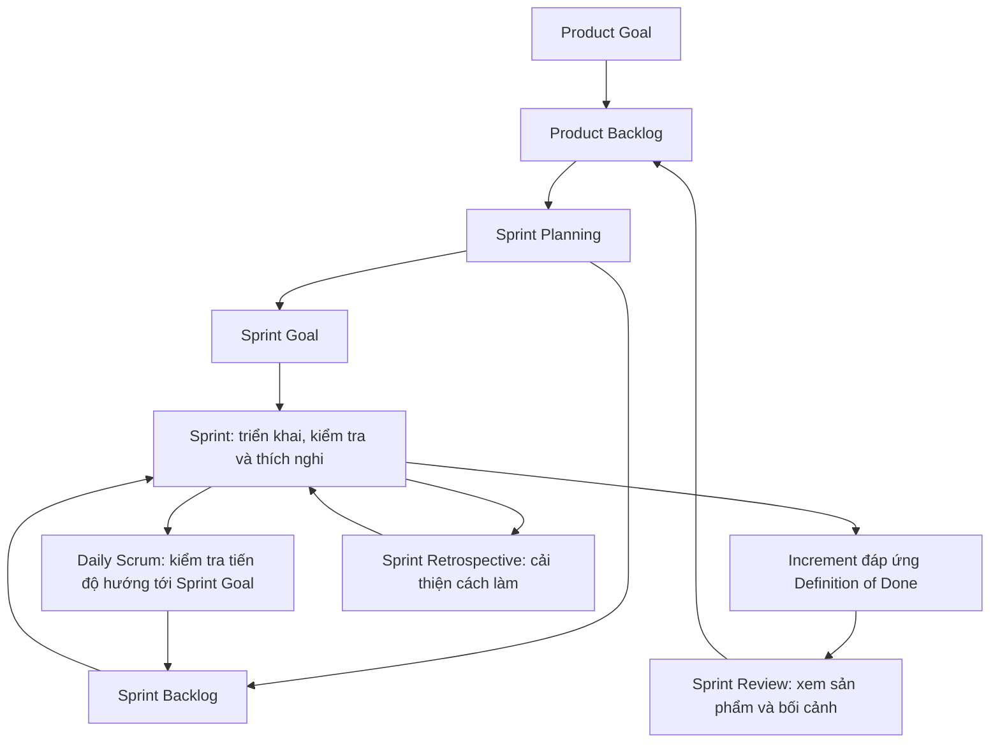
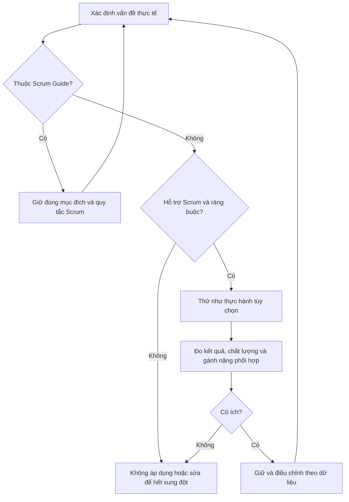

# Phân biệt quy định của Scrum với thực hành nhóm tự bổ sung

## Mục tiêu học tập

Sau bài học, bạn có thể:

- Đọc **Scrum Guide 2020** để nhận diện điều thuộc định nghĩa của Scrum và điều chỉ là **cách một đội lựa chọn thực hiện Scrum**.
- Nêu đúng các thành phần cốt lõi: **Scrum Team với ba trách nhiệm giải trình**, **năm sự kiện**, **ba hiện vật** và **ba cam kết gắn với hiện vật**.
- Phân biệt những thực hành phổ biến nhưng **không được Scrum Guide bắt buộc**, như story points, Planning Poker, velocity, burndown chart, Jira, Definition of Ready, họp refinement theo lịch cố định và các kỹ thuật XP.
- Nhận diện một quy tắc nội bộ **hỗ trợ** Scrum, chỉ là **quy ước tùy chọn**, hay **mâu thuẫn** với khung Scrum.
- Xây dựng cách cộng tác phù hợp cho đội phát triển nền tảng học trực tuyến mà vẫn bảo vệ **Sprint Goal**, **Definition of Done** và việc tạo **Increment hữu dụng**.
- Chọn và đánh giá một thực hành bổ sung bằng kết quả thực tế, khả năng phản hồi và chất lượng thay vì làm theo nghi thức máy móc.

## 1. Hai câu hỏi dễ bị nhầm: “Scrum quy định gì?” và “Đội tôi làm gì?”

Trong công việc thực tế, ta thường nghe:

> “Theo Scrum thì mỗi story phải có story points, phải cập nhật burndown hằng ngày, và chỉ được đưa vào Sprint khi đạt Definition of Ready.”

Câu nói này gom ba thực hành có thể hữu ích vào thành **quy định bắt buộc của Scrum**. Tuy nhiên, Scrum Guide không quy định phải dùng story points, burndown chart hay một Definition of Ready (DoR) riêng.

Điều đó không có nghĩa đội không được dùng chúng. Nhóm có thể tự chọn vì thấy chúng giúp hoạch định, làm rõ yêu cầu hoặc minh bạch dòng công việc. Sai lầm là **đánh đồng quy ước địa phương với cấu trúc được định nghĩa trong Scrum**.

Theo **Scrum Guide 2020**, Scrum là một **khung làm việc nhẹ** giúp con người, đội nhóm và tổ chức tạo giá trị thông qua các giải pháp thích ứng cho vấn đề phức tạp. Scrum có cấu trúc được định nghĩa; bên trong cấu trúc ấy, đội có thể sử dụng nhiều kỹ thuật và phương pháp khác nhau.

Vì vậy, có ba nhóm nội dung cần phân biệt:

| Nhóm | Tiêu chí nhận diện | Ví dụ |
| --- | --- | --- |
| **Thành phần, quy tắc hoặc trách nhiệm của Scrum** | Được định nghĩa trong Scrum Guide là một phần của khung, phải được tôn trọng khi nói rằng đội đang áp dụng Scrum. | Sprint; Sprint Goal; Product Owner; Increment; Definition of Done. |
| **Thực hành đội tự bổ sung** | Không phải điều kiện do Scrum Guide bắt buộc; đội chọn, thay đổi hoặc ngừng sử dụng theo nhu cầu. | Planning Poker; thẻ story; bảng Jira; WIP limit; TDD; burndown chart. |
| **Quy tắc nội bộ có nguy cơ xung đột Scrum** | Có thể làm mất mục đích của sự kiện, làm sai trách nhiệm giải trình hoặc khiến đội không tạo Increment đúng chuẩn. | Quản lý ép đổi Sprint Goal hằng ngày; tuyên bố Increment “Done” dù chưa đạt DoD. |

Một chính sách có thể **bắt buộc theo tổ chức hoặc pháp luật** nhưng **không phải do Scrum quy định**. Ví dụ, quy trình rà soát dữ liệu cá nhân có thể là yêu cầu bắt buộc trong công ty. Khi dạy hoặc đánh giá Scrum, hãy nêu rõ **nguồn của yêu cầu**, tránh gán mọi ràng buộc bên ngoài cho Scrum.

> **Nguyên tắc thực hành:** Khi một người nói “Scrum bắt buộc làm X”, hãy tìm X trong Scrum Guide; nếu không có, hỏi X giải quyết vấn đề gì và nó có giữ nguyên mục đích, trách nhiệm, cam kết của Scrum hay không.

## 2. Nền tảng cần giữ: tư duy thực nghiệm, các giá trị và khung Scrum

Scrum dựa trên **thực nghiệm (empiricism)** và tư duy tinh gọn. Trong cách diễn giải của Scrum Guide, các quyết định dựa trên điều được quan sát, và cách làm cần giúp hạn chế lãng phí để tập trung vào điều thiết yếu.

Ba trụ cột thực nghiệm:

1. **Minh bạch (transparency):** trạng thái công việc, sản phẩm và các cam kết phải đủ rõ để mọi người hiểu cùng một điều.
2. **Thanh tra/kiểm tra (inspection):** thường xuyên kiểm tra các hiện vật và tiến độ hướng tới mục tiêu, nhận diện sai lệch hoặc vấn đề.
3. **Thích nghi (adaptation):** điều chỉnh cách làm hoặc kết quả dự kiến kịp thời khi thông tin cho thấy tình trạng không như mong muốn.

Năm giá trị Scrum là **Commitment (cam kết), Focus (tập trung), Openness (cởi mở), Respect (tôn trọng), Courage (can đảm)**. Các giá trị hướng dẫn hành vi khi đội đưa ra quyết định và hợp tác; không phải bảng điểm đánh giá tính cách thành viên.

### 2.1. Bức tranh cấu trúc Scrum

| Nhóm thành phần | Thành phần được Scrum Guide định nghĩa | Ý nghĩa |
| --- | --- | --- |
| **Scrum Team** | Một **Product Owner**, một **Scrum Master**, và **Developers**. | Một đội nhỏ, đa chức năng và tự quản; tập trung vào Product Goal. |
| **Sự kiện (events)** | **Sprint**, **Sprint Planning**, **Daily Scrum**, **Sprint Review**, **Sprint Retrospective**. | Tạo nhịp minh bạch, kiểm tra và thích nghi; Sprint bao chứa các sự kiện còn lại. |
| **Hiện vật (artifacts)** | **Product Backlog**, **Sprint Backlog**, **Increment**. | Thể hiện công việc và giá trị theo cách có thể kiểm tra. |
| **Cam kết (commitments)** | **Product Goal** gắn với Product Backlog; **Sprint Goal** gắn với Sprint Backlog; **Definition of Done** gắn với Increment. | Giúp làm rõ mục tiêu và chuẩn chất lượng để đo tiến độ. |

Một nguyên tắc quan trọng: **không được coi các thành phần Scrum là tùy chọn như kỹ thuật bổ sung**. Scrum Guide trình bày Scrum như một khung có những phần liên kết với nhau; bỏ đi phần cốt lõi sẽ làm thay đổi khung được gọi là Scrum.

Ngược lại, **Scrum cố ý không chỉ định chi tiết cách phát triển phần mềm**. Đội có thể chọn kỹ thuật thiết kế, ngôn ngữ lập trình, công cụ kiểm thử và quy trình triển khai phù hợp với sản phẩm.

### 2.2. Sơ đồ liên hệ giữa mục tiêu, công việc và phần mềm hữu dụng



Sơ đồ chỉ minh họa vòng thông tin, **không phải quy trình tuần tự tuyệt đối**. Sprint Review không phải cổng phát hành bắt buộc; có thể có nhiều Increment trong Sprint và việc phát hành có thể diễn ra trước Sprint Review. Các sự kiện diễn ra theo quy tắc Scrum, nhưng việc trao đổi và cải tiến không chỉ giới hạn bên trong sự kiện.

## 3. Trách nhiệm giải trình: ba accountabilities, không phải một chuỗi phòng ban

Scrum Guide 2020 gọi **Product Owner**, **Scrum Master** và **Developers** là các **trách nhiệm giải trình (accountabilities)** trong một Scrum Team. Đây không đơn giản là ba chức danh công ty, càng không phải ba phòng ban bàn giao việc cho nhau.

### 3.1. Product Owner

**Theo Scrum Guide:**

- Chịu trách nhiệm tối đa hóa giá trị sản phẩm từ công việc của Scrum Team.
- Chịu trách nhiệm quản lý hiệu quả Product Backlog, gồm phát triển và truyền đạt Product Goal, tạo/diễn đạt Product Backlog Items, sắp thứ tự và bảo đảm backlog minh bạch, dễ thấy, dễ hiểu.
- Có thể **ủy quyền một phần công việc quản lý backlog**, nhưng vẫn chịu trách nhiệm giải trình về kết quả.
- Product Owner là **một người**, không phải một hội đồng. Những người muốn đổi Product Backlog cần thuyết phục Product Owner.

**Không phải bắt buộc theo Scrum:**

- Product Owner phải tự viết mọi user story.
- Product Owner phải duyệt từng commit, từng dòng mã hoặc phân từng task cho mỗi Developer.
- Product Owner phải có chức danh quản lý sản phẩm chính thức trong sơ đồ nhân sự.
- Mọi quyết định của Product Owner đều phải được thực hiện bằng một biểu mẫu được phê duyệt qua nhiều cấp.

**Ví dụ:** trên nền tảng học trực tuyến, Product Owner quyết định đưa “Tiếp tục học” lên trên “Tùy chỉnh chứng chỉ” dựa trên bằng chứng hành vi người học. Đội có thể cùng soạn story và tiêu chí chấp nhận; quyết định thứ tự backlog thuộc trách nhiệm Product Owner.

### 3.2. Developers

**Theo Scrum Guide:** Developers là những người trong Scrum Team chịu trách nhiệm tạo ra các khía cạnh của **Increment hữu dụng** trong mỗi Sprint. Họ chịu trách nhiệm lập kế hoạch cho Sprint (Sprint Backlog), bảo đảm chất lượng bằng DoD, điều chỉnh kế hoạch hằng ngày theo Sprint Goal và giữ trách nhiệm với nhau trong công việc chuyên môn.

**Điều thường bị hiểu sai:**

- “Developers” trong Scrum **không chỉ có lập trình viên**. Người kiểm thử, UX, phân tích dữ liệu, thiết kế, bảo mật hay vận hành có thể là Developers khi trực tiếp tham gia tạo Increment.
- Developers **không nhận kế hoạch chi tiết được cấp trên giao cố định**; họ tự quản cách biến các hạng mục đã chọn thành Increment.
- Một người có thể thiên về backend và một người thiên về kiểm thử. **Đa chức năng** nghĩa là đội có đủ kỹ năng tập thể, không có nghĩa mọi người phải làm giỏi mọi thứ.

**Ví dụ:** để giao chức năng ghi danh, Developers phối hợp thiết kế, xây API, giao diện, kiểm thử quyền truy cập và tích hợp. Không ai có thể báo Increment đã xong chỉ vì phần việc của vai trò mình hoàn thành nhưng luồng ghi danh chưa sử dụng được.

### 3.3. Scrum Master

**Theo Scrum Guide:** Scrum Master chịu trách nhiệm thiết lập Scrum như được định nghĩa trong Scrum Guide và **tính hiệu quả của Scrum Team**. Scrum Master phục vụ Scrum Team, Product Owner và tổ chức bằng huấn luyện, hỗ trợ, gỡ trở ngại và giúp các sự kiện Scrum diễn ra tích cực, hiệu quả, đúng timebox.

**Không phải bắt buộc:**

- Scrum Master phải là người quản lý dự án phân công công việc, chấm KPI cá nhân hoặc duyệt giờ làm.
- Scrum Master phải chủ trì và phát biểu thay Developers trong mọi Daily Scrum.
- Scrum Master phải tự xử lý mọi vấn đề kỹ thuật; Scrum Master giúp loại bỏ trở ngại, nhưng đội vẫn chủ động chịu trách nhiệm về cách thực hiện.

### 3.4. Một đội Scrum, không phải các tiểu đội cạnh tranh

Theo Scrum Guide, **Scrum Team không có tiểu đội hoặc cấp bậc nội bộ như một cơ chế phân chia trách nhiệm Scrum**. Đội tập trung vào một mục tiêu chung, thường có **10 người hoặc ít hơn**; nếu quá lớn nên cân nhắc tổ chức lại thành các Scrum Team gắn với cùng sản phẩm, chia sẻ Product Goal, Product Backlog và Product Owner.

Điều này không có nghĩa doanh nghiệp không được có trưởng nhóm kỹ thuật, người cố vấn hay chuyên gia. Nhưng các chức danh đó **không được làm sai cơ chế tự quản, trách nhiệm Developers và Product Owner** trong Scrum Team.

## 4. Sự kiện Scrum: điều được quy định và cách tổ chức tùy chọn

Scrum Guide xác định **năm sự kiện**. Sự kiện giúp tạo cơ hội **kiểm tra và thích nghi chính thức**; đội vẫn có thể trao đổi công việc ở ngoài các sự kiện khi cần.

| Sự kiện | Nội dung/giới hạn thuộc Scrum | Phần đội có thể tự chọn |
| --- | --- | --- |
| **Sprint** | Nhịp làm việc **cố định, một tháng hoặc ngắn hơn**; Sprint mới bắt đầu ngay sau Sprint trước; mọi công việc cần để đạt Product Goal diễn ra trong các Sprint. | Chọn Sprint một hay hai tuần, cách trực quan hóa tiến độ, cách triển khai kỹ thuật. |
| **Sprint Planning** | Khởi động Sprint, cả Scrum Team cộng tác để xác định vì sao Sprint có giá trị, làm gì và làm như thế nào; timebox tối đa **8 giờ** cho Sprint một tháng, thường ngắn hơn với Sprint ngắn. | Mẫu kế hoạch, kỹ thuật tách hạng mục, công cụ, cách dự báo và cách ghi task. |
| **Daily Scrum** | Sự kiện **15 phút** cho Developers, tập trung kiểm tra tiến độ hướng tới Sprint Goal và thích nghi Sprint Backlog; cùng thời gian, địa điểm mỗi ngày làm việc của Sprint để giảm phức tạp. | Hình thức đi qua bảng, thảo luận theo mục tiêu, cách ghi blockers. |
| **Sprint Review** | Kiểm tra kết quả Sprint và quyết định thích nghi tiếp theo cùng stakeholders; timebox tối đa **4 giờ** cho Sprint một tháng, thường ngắn hơn với Sprint ngắn. | Cách trình diễn, mời nhóm người dùng, dữ liệu sử dụng, cấu trúc trao đổi. |
| **Sprint Retrospective** | Scrum Team lên kế hoạch tăng chất lượng và hiệu quả; khép lại Sprint; timebox tối đa **3 giờ** cho Sprint một tháng, thường ngắn hơn với Sprint ngắn. | Kỹ thuật Start/Stop/Continue, 4Ls, biểu quyết chấm điểm, cách ghi hành động cải tiến. |

### 4.1. Sprint: thời hạn cố định, không phải hợp đồng đóng băng mọi thứ

Trong một Sprint:

- Không có thay đổi nào được phép làm **Sprint Goal bị nguy hại**.
- **Chất lượng không được giảm**.
- Product Backlog được **tinh chỉnh khi cần**.
- Phạm vi công việc có thể được làm rõ và thương lượng lại với Product Owner khi nhóm hiểu thêm.

Do đó, câu “Scrum cấm đổi bất kỳ công việc nào giữa Sprint” là **sai**. Ngược lại, câu “cứ có yêu cầu mới thì đổi Sprint Goal ngay” cũng **sai**. Mục tiêu Sprint tạo trọng tâm; chi tiết phạm vi có thể thích nghi trong giới hạn đó.

**Hủy Sprint:** chỉ **Product Owner** có thẩm quyền hủy khi Sprint Goal đã trở nên lỗi thời, theo Scrum Guide. Đây không phải thao tác quản lý phạm vi thường ngày để đổi ý giữa chừng.

### 4.2. Sprint Planning: ba chủ đề, không phải biểu mẫu story point bắt buộc

Sprint Planning xử lý ba chủ đề:

1. **Why — Vì sao Sprint này có giá trị?** Scrum Team cộng tác xác định Sprint Goal có ý nghĩa.
2. **What — Có thể làm gì trong Sprint?** Developers chọn Product Backlog Items thông qua thảo luận với Product Owner, cân nhắc hiệu quả trước đây, năng lực và DoD.
3. **How — Công việc đã chọn được thực hiện thế nào?** Developers lập kế hoạch thực hiện để tạo Increment đáp ứng DoD.

Scrum Guide có mô tả việc chia Product Backlog Items thành các phần việc nhỏ, thường khoảng một ngày hoặc ít hơn, nhưng **cách chia là quyết định của Developers**, không phải quy tắc phải có task đúng tám giờ.

Không bắt buộc phải chốt điểm story, phải điền một mẫu Excel hay chọn chính xác số giờ làm việc cho từng người. Kỹ thuật dự báo có thể giúp kế hoạch minh bạch, nhưng nó không thay trách nhiệm xác định Sprint Goal và tạo kế hoạch có thể thích nghi.

### 4.3. Daily Scrum: sự kiện của Developers, không phải buổi báo cáo cho cấp trên

Mục đích là **kiểm tra tiến độ tới Sprint Goal** và điều chỉnh kế hoạch khi cần. Scrum Guide **không bắt buộc** mỗi người phải trả lời ba câu “hôm qua làm gì, hôm nay làm gì, có khó khăn gì?” theo vòng tròn.

Một cách điều phối phù hợp có thể là đi qua Sprint Backlog từ mục tiêu tới các hạng mục đang bị chặn. Nếu PO hoặc Scrum Master **đang trực tiếp làm công việc trong Sprint Backlog với tư cách Developers**, họ cũng tham gia Daily Scrum như Developers; ngoài ra sự kiện này không biến thành buổi yêu cầu Developers báo cáo riêng cho người quản lý.

Nếu một vấn đề cần thảo luận kỹ, nhóm có thể kết nối sau Daily Scrum để giữ mục đích và thời lượng sự kiện.

### 4.4. Sprint Review: xem sản phẩm, bối cảnh và bước kế tiếp

Scrum Guide mô tả Sprint Review như một phiên làm việc cùng stakeholders, không chỉ là buổi **demo để xin chữ ký nghiệm thu**. Nhóm thảo luận mục tiêu, thành tựu, thay đổi môi trường, kiến thức mới và điều chỉnh Product Backlog nếu cần.

**Phát hành không buộc phải chờ Sprint Review.** Một Increment hữu dụng có thể được đưa cho stakeholders trước khi kết thúc Sprint. Sự kiện Review không phải cổng kiểm soát để quyết định phần mềm có thể phát hành hay không.

### 4.5. Sprint Retrospective: cải tiến thực tế, không chỉ chia sẻ cảm xúc

Scrum Team kiểm tra cách Sprint đã diễn ra về con người, tương tác, quy trình, công cụ và DoD, rồi chọn cải tiến có tác động lớn. Nhóm có thể đưa cải tiến vào Sprint Backlog của Sprint tiếp theo, nhưng Scrum Guide **không bắt buộc** dùng một mô hình họp riêng, số lượng phiếu bình chọn hay biểu mẫu nhất định.

Ví dụ: nếu hạng mục liên tục chờ kiểm thử, nhóm thử viết tiêu chí chấp nhận sớm hơn, ghép cặp kiểm thử và giảm số việc đang làm; Sprint sau kiểm tra cycle time và lỗi phát hiện muộn để đánh giá.

## 5. Hiện vật và cam kết: không được nhầm DoD với DoR

Scrum có **ba hiện vật** và mỗi hiện vật chứa **một cam kết** để làm rõ đối tượng kiểm tra và hướng tới mục tiêu.

### 5.1. Product Backlog và Product Goal

**Product Backlog** là danh sách có thứ tự, nổi lên theo thời gian về những gì cần để cải thiện sản phẩm; đây là **nguồn công việc duy nhất** mà Scrum Team thực hiện. **Product Goal** là mục tiêu dài hạn cho Scrum Team trong Product Backlog, tạo định hướng cho các quyết định ưu tiên.

Đội có thể trình bày Product Backlog Items dưới dạng user story, bug, thí nghiệm kỹ thuật hoặc cách khác có ý nghĩa; Scrum không bắt buộc mẫu:

> “Là một [vai trò], tôi muốn [tính năng], để [giá trị].”

Mẫu user story giúp tạo đối thoại nhưng **không phải điều kiện Scrum**. Product Owner chịu trách nhiệm thứ tự; việc tinh chỉnh Product Backlog được thực hiện liên tục khi có hiểu biết mới.

**Backlog refinement** là một hoạt động Scrum Guide mô tả, **không phải một trong năm Scrum events** và không có timebox bắt buộc riêng như Daily Scrum. Nhóm có thể dành 45 phút mỗi tuần, thảo luận theo nhu cầu hoặc tinh chỉnh liên tục. Điều cần giữ là backlog đủ minh bạch và rõ để lựa chọn công việc phù hợp.

### 5.2. Sprint Backlog và Sprint Goal

**Sprint Backlog** bao gồm **Sprint Goal (vì sao)**, **Product Backlog Items được chọn (làm gì)** và **kế hoạch khả thi của Developers (làm thế nào)**. Developers tạo và cập nhật kế hoạch khi có thêm hiểu biết trong Sprint.

**Sprint Goal** là mục tiêu duy nhất của Sprint, giúp đội tập trung và có chỗ để thương lượng chi tiết công việc nhằm đạt kết quả. Một bảng task có thể hỗ trợ Sprint Backlog, nhưng **bảng task không tự thay thế Sprint Goal**.

Ví dụ:

- Sprint Goal: “Học viên đã ghi danh khóa miễn phí có thể mở được bài học đầu tiên.”
- Các hạng mục có thể chọn: xử lý ghi danh hợp lệ, cấp quyền truy cập sau ghi danh, giao diện mở bài đầu, kiểm tra trường hợp trùng.
- Những cách triển khai như tách task backend/frontend, ghép cặp hoặc phân bổ công cụ do Developers quyết định.

### 5.3. Increment và Definition of Done

**Increment** là bước tiến cụ thể hướng tới Product Goal. Nó cộng thêm vào các Increment trước đó, được kiểm chứng để các phần hoạt động cùng nhau và phải **hữu dụng**. Trong một Sprint có thể có nhiều Increment; mỗi Increment phải đáp ứng **Definition of Done**.

**Definition of Done (DoD)** là mô tả chính thức về trạng thái của Increment khi đạt các thước đo chất lượng được yêu cầu cho sản phẩm. Nếu tổ chức có DoD tối thiểu, các Scrum Team phải tuân theo chuẩn đó; nếu không, Scrum Team xây dựng DoD thích hợp. Khi nhiều Scrum Team cùng làm một sản phẩm, họ phải **cùng định nghĩa và tuân thủ chung DoD**.

Nếu một Product Backlog Item chưa đạt DoD, nó **không phải phần của Increment**, không được trình bày ở Sprint Review như công việc đã hoàn thành theo chuẩn đó và cần quay lại Product Backlog để xem xét trong tương lai.

DoD không phải một “checkbox cho có”. Ví dụ với tính năng ghi danh:

- Hành vi ghi danh được kiểm chứng theo tiêu chí chấp nhận.
- Không tạo ghi danh trùng theo quy tắc đã xác định.
- Phân quyền và dữ liệu học viên được kiểm tra phù hợp rủi ro.
- Mã đã tích hợp, kiểm thử liên quan đạt, bản phần mềm hữu dụng.
- Yêu cầu vận hành và khả năng quan sát cần thiết đã được đáp ứng.

Tập điều kiện cụ thể phụ thuộc sản phẩm và tổ chức. Scrum **bắt buộc khái niệm DoD**, nhưng không chỉ định một danh sách kiểm thử kỹ thuật giống nhau cho mọi hệ thống.

### 5.4. Definition of Ready khác Definition of Done

Một số đội tự đặt **Definition of Ready (DoR)**, ví dụ: hạng mục phải rõ giá trị, có ví dụ chấp nhận, ít phụ thuộc chưa giải quyết và đủ nhỏ để cân nhắc trong Sprint Planning.

- **DoD là cam kết được Scrum Guide định nghĩa** cho Increment.
- **DoR không phải hiện vật, cam kết hoặc cổng bắt buộc của Scrum**.
- Một checklist sẵn sàng có thể giúp phát hiện yêu cầu mơ hồ; nhưng nếu biến nó thành thủ tục cứng nhắc khiến Product Owner không thể trao đổi, Developers không thể tự quyết định hoặc backlog bị khóa trong nhiều tuần, nó có thể **cản trở tính thích nghi**.

DoR không được thay DoD: một story đủ rõ để bắt đầu chưa chứng tỏ nó đủ chất lượng để được coi là hoàn thành.

## 6. Bảng đối chiếu: “Bắt buộc Scrum” hay “đội tự chọn”?

Bảng dưới giúp tránh lan truyền các quy ước nội bộ thành quy tắc của Scrum.

| Điều thường nghe | Phân loại đúng | Giải thích ngắn |
| --- | --- | --- |
| “Phải có Product Owner, Scrum Master và Developers.” | **Thuộc Scrum** | Ba trách nhiệm giải trình trong một Scrum Team. |
| “Phải có Product Goal, Sprint Goal và Definition of Done.” | **Thuộc Scrum** | Ba cam kết gắn với ba hiện vật. |
| “Sprint phải dài đúng hai tuần.” | **Tùy chọn trong giới hạn Scrum** | Sprint có độ dài cố định, **không quá một tháng**; hai tuần là lựa chọn phổ biến. |
| “Phải có Daily Scrum.” | **Thuộc Scrum** | Một trong năm sự kiện, **15 phút** cho Developers. |
| “Daily bắt buộc trả lời ba câu hỏi.” | **Tùy chọn** | Mục đích là kiểm tra Sprint Goal và điều chỉnh kế hoạch; Scrum không quy định ba câu. |
| “Phải dùng Jira/Azure DevOps/Trello.” | **Tùy chọn** | Scrum không quy định nhà cung cấp công cụ. |
| “Phải viết mọi hạng mục theo mẫu user story.” | **Tùy chọn** | User story hỗ trợ diễn đạt nhu cầu nhưng không bắt buộc. |
| “Phải dùng story points và Fibonacci.” | **Tùy chọn** | Scrum không quy định thang điểm, cách ước lượng. |
| “Phải dùng Planning Poker để ước lượng.” | **Tùy chọn** | Kỹ thuật thảo luận có thể hữu ích, không phải sự kiện Scrum. |
| “Phải theo dõi velocity qua các Sprint.” | **Tùy chọn** | Có thể hỗ trợ dự báo nhưng không phải quy định; không nên so sánh velocity giữa đội khác thang điểm. |
| “Phải có burndown/burnup chart.” | **Tùy chọn** | Có thể hỗ trợ minh bạch; không thay việc thanh tra và thích nghi thực tế. |
| “Phải có Definition of Ready.” | **Tùy chọn** | Không phải một cam kết trong Scrum Guide. |
| “Refinement là sự kiện thứ sáu với timebox cố định.” | **Không đúng về cấu trúc Scrum** | Refinement là hoạt động liên tục, không phải một trong năm Scrum events. |
| “Phải có Sprint Review.” | **Thuộc Scrum** | Kiểm tra kết quả và thích nghi cùng stakeholders. |
| “Chỉ phát hành sau Sprint Review.” | **Không phải quy định Scrum** | Increment có thể được phát hành trước Review; Review không phải cổng phát hành. |
| “Phải phát hành production cuối mỗi Sprint.” | **Không phải quy định Scrum** | Cần Increment **hữu dụng, đạt DoD**; phát hành là quyết định phù hợp sản phẩm. |
| “Phải có Sprint Retrospective.” | **Thuộc Scrum** | Sự kiện cải thiện chất lượng và hiệu quả. |
| “Phải sử dụng TDD, pair programming, CI/CD.” | **Tùy chọn** | Thực hành kỹ thuật có thể giúp tạo Increment chất lượng, không được Scrum Guide chỉ định bắt buộc. |
| “Phải giới hạn WIP bằng con số trên mỗi cột.” | **Tùy chọn** | Kỹ thuật Kanban có thể bổ sung khi hữu ích. |
| “Trong Sprint không được điều chỉnh bất kỳ phạm vi nào.” | **Không đúng** | Có thể làm rõ, thương lượng phạm vi với Product Owner khi hiểu thêm, không gây nguy hại Sprint Goal. |
| “Scrum Master giao task cho từng Developer.” | **Không phải quy định, có nguy cơ xung đột** | Developers tự quản cách thực hiện và lập Sprint Backlog. |
| “Story chưa đạt DoD vẫn được gọi là Increment hoàn thành.” | **Trái Scrum** | Chưa đáp ứng DoD thì không là phần của Increment. |
| “Product Owner là một hội đồng phê duyệt.” | **Trái định nghĩa Scrum** | PO là một người, không phải committee. |

**Cách sử dụng bảng:** khi chọn một thực hành bổ sung, hãy hỏi nó có giúp đội minh bạch, kiểm tra và thích nghi tốt hơn không; hay chỉ tạo báo cáo mà không làm tăng giá trị và chất lượng.

## 7. Ba dạng quyết định: giữ, tùy biến hoặc loại bỏ

Không phải mọi thực hành bổ sung đều có tác dụng giống nhau. Phân loại giúp nhóm tránh thay đổi bừa bãi.

### 7.1. Giữ nguyên thành phần thuộc Scrum

Ví dụ: **Sprint Goal** là cam kết cần có. Đội không nên xóa Sprint Goal vì “đã có bảng Jira”, hoặc đổi Daily Scrum thành cuộc họp báo cáo hằng tuần vì thấy nhanh hơn. Làm vậy khiến khung Scrum không còn nguyên vẹn.

Đội có thể linh hoạt **cách diễn đạt mục tiêu và dùng công cụ gì để ghi**, nhưng **mục đích và sự tồn tại của cam kết** phải được giữ.

### 7.2. Tùy biến thực hành hỗ trợ

Ví dụ: nhóm dùng Planning Poker để ước lượng; sau vài Sprint, nhóm phát hiện các hạng mục đã nhỏ, việc đánh điểm gây tốn thời gian nhưng không cải thiện dự báo. Nhóm có thể thử **phân loại kích thước đơn giản** hoặc dự báo bằng throughput. Scrum không yêu cầu phải giữ Planning Poker.

Tương tự, đội có thể thay burndown bằng một bảng công việc và phân tích cycle time nếu cách đó cho thấy trở ngại tốt hơn. Điều quan trọng là các hiện vật vẫn **minh bạch** và nhóm vẫn **kiểm tra, thích nghi** theo Scrum.

### 7.3. Loại bỏ hoặc sửa quy tắc xung đột

Ví dụ: quy định “mọi story phải được quản lý ký duyệt trước khi Developers được bắt đầu, và quản lý có thể thay Sprint Goal bất kỳ lúc nào” có thể tạo hàng đợi, làm suy yếu tự quản và xung đột Sprint Goal.

Nhóm cần làm rõ ranh giới quyền quyết định. Nếu doanh nghiệp có thủ tục bắt buộc vì kiểm toán, pháp lý hay rủi ro, đội không thể bỏ qua. Nhưng họ có thể **làm các kiểm tra cần thiết sớm hơn**, tự động hóa phần phù hợp, hoặc thiết kế đường duyệt không cản trở việc thực hiện đúng trách nhiệm Scrum.

## 8. Ví dụ thực tế: đội phát triển nền tảng học trực tuyến

Giả sử một Scrum Team gồm Product Owner, Scrum Master và các Developers có năng lực frontend, backend, kiểm thử, UX và vận hành. Product Goal trong thời gian này là:

> **Giúp học viên mới có thể tự tìm, ghi danh và bắt đầu học một khóa Java nhập môn.**

### 8.1. Phần thuộc cấu trúc Scrum

| Thành phần | Minh họa |
| --- | --- |
| **Product Goal** | Học viên mới tự thực hiện được hành trình bắt đầu học. |
| **Product Backlog** | Các hạng mục được sắp thứ tự như xem khóa, xem điều kiện, ghi danh, mở bài đầu tiên, xử lý lỗi và cải thiện trải nghiệm. |
| **Sprint** | Nhóm chọn Sprint hai tuần, phù hợp giới hạn tối đa một tháng. **Hai tuần là lựa chọn**, còn Sprint là thành phần Scrum. |
| **Sprint Goal** | “Học viên đã chọn khóa miễn phí có thể ghi danh hợp lệ và mở được bài đầu tiên.” |
| **Sprint Backlog** | Sprint Goal + hạng mục được chọn + kế hoạch Developers dùng để đạt Increment. |
| **Daily Scrum** | Developers kiểm tra tiến độ hướng tới mục tiêu và thích nghi kế hoạch. |
| **Increment và DoD** | Luồng ghi danh hoạt động, đã tích hợp, có kiểm thử và kiểm soát quyền truy cập phù hợp. |
| **Sprint Review** | Trao đổi với người dùng và stakeholders về bản chạy được và điều cần điều chỉnh. |
| **Sprint Retrospective** | Đội xem vì sao kiểm thử tích hợp chậm, chọn cách cải thiện vòng sau. |

Một Sprint Goal **không phải danh sách mọi task**. Nếu nhóm phát hiện cần thay cách hiển thị thông báo ghi danh để đạt mục tiêu, họ có thể thương lượng chi tiết với Product Owner. Nhưng nhóm không được gọi phần mềm lỗi quyền truy cập là “Done” chỉ vì cần giữ biểu đồ burndown đẹp.

### 8.2. Phần nhóm tự bổ sung

Nhóm quyết định thử trong hai Sprint:

- **User story** để diễn đạt nhu cầu học viên, thay vì chỉ viết tên tính năng.
- **Given–When–Then** để làm rõ hành vi ghi danh và chống ghi danh trùng.
- **Planning Poker** cho những hạng mục khó so sánh, không bắt buộc mọi hạng mục đều phải đánh điểm.
- **Jira** để lưu Product Backlog và Sprint Backlog vì công ty đang dùng công cụ này.
- **Giới hạn WIP** ở cột đang làm nhằm giảm việc mở quá nhiều hạng mục cùng lúc.
- **Kiểm thử tự động và CI** để phát hiện lỗi hồi quy, giữ Increment đủ chất lượng.
- **Burndown hoặc biểu đồ luồng** nếu thực sự giúp nhóm nhìn ra trở ngại.

Các quyết định này **không trở thành quy tắc của Scrum** chỉ vì đội sử dụng. Nhóm có thể giữ, thay hoặc bỏ chúng sau khi quan sát tác động, miễn không làm mất các thành phần và mục đích của Scrum.

### 8.3. Hai chính sách dễ gây xung đột

**Chính sách A:** “Nếu UI hoàn thành nhưng kiểm thử chưa chạy, story vẫn được đánh dấu Done; QA sẽ xử lý trong Sprint sau.”

Vấn đề: nếu tiêu chuẩn kiểm thử là một phần DoD, công việc đó **chưa đáp ứng DoD** và không thể tính vào Increment hoàn thành. Nhóm cần sửa cách thể hiện trạng thái và phối hợp để hoàn tất một phần giá trị xuyên suốt.

**Chính sách B:** “Mọi ngày, Scrum Master chỉ định ai làm task nào, rồi yêu cầu từng người báo cáo số giờ cho quản lý trong Daily Scrum.”

Vấn đề: Daily Scrum bị biến thành báo cáo và Developers mất khả năng tự quản kế hoạch. Nhóm nên để Developers chủ động lập và điều chỉnh công việc hướng tới Sprint Goal; nếu doanh nghiệp cần số liệu giờ công phục vụ tài chính, dùng cơ chế phù hợp **không đánh tráo mục đích Daily Scrum**.

### 8.4. Vòng phản hồi từ phát hành

Sau Increment đầu, nhóm quan sát rằng học viên có thể ghi danh nhưng nhiều người không nhận ra nút “Bắt đầu học”. Product Owner điều chỉnh thứ tự Product Backlog để ưu tiên cải thiện đường vào bài học; Developers làm rõ tiêu chí và chọn giải pháp kỹ thuật thích hợp.

Nhóm có thể dùng story mapping hoặc buổi phỏng vấn nhanh để tìm nguyên nhân. Đây là **thực hành tùy chọn hỗ trợ empiricism**, không phải sự kiện Scrum mới. Giá trị cốt lõi là **bằng chứng khiến quyết định sản phẩm tốt hơn**.

## 9. Những nhầm lẫn thường gặp khi “áp dụng Scrum”

### “Scrum = các cuộc họp”

Không đúng. Scrum là khung gồm trách nhiệm giải trình, sự kiện, hiện vật và cam kết, dựa trên thực nghiệm và giá trị. Có đủ lịch họp nhưng thiếu Product Goal, Increment hữu dụng hoặc DoD thì nhóm chưa thể nói đã áp dụng đúng Scrum.

### “Đội nào cũng phải có velocity cao hơn Sprint trước”

Velocity là thước đo tùy chọn dựa trên quy ước điểm của đội. Ép tăng velocity có thể khiến nhóm **thổi điểm** hoặc ưu tiên hạng mục dễ để đẹp số liệu. Scrum tập trung vào **giá trị và khả năng tạo Increment hữu dụng**, không phải điểm số giữa các đội.

### “Không có DoR thì không được Sprint Planning”

Không đúng. DoR có thể là checklist hỗ trợ, nhưng không phải cam kết Scrum. Product Backlog Items sẵn sàng khi đủ minh bạch để đội lựa chọn và thực hiện với mức rủi ro chấp nhận được. Việc tinh chỉnh vẫn là hoạt động liên tục và Developers tự quyết định kế hoạch thực hiện.

### “Sprint Review là buổi ký nghiệm thu bắt buộc để release”

Không đúng. Scrum yêu cầu Sprint Review để kiểm tra kết quả và thích nghi. Increment có thể được đưa đến người dùng trước Review nếu đạt DoD và các điều kiện phát hành cần thiết. Tổ chức có thể có phê duyệt tuân thủ riêng, nhưng không được gọi đó là quy định của Scrum Guide.

### “Scrum Master là trưởng nhóm kỹ thuật và Project Manager”

Không phải định nghĩa Scrum. Một người có thể kiêm nhiệm một chức danh quản lý trong tổ chức, nhưng trách nhiệm Scrum Master là **Scrum được hiểu và dùng đúng, đội có hiệu quả**. Việc phân công task, chọn kỹ thuật và lập kế hoạch thuộc Developers; quyết định giá trị và thứ tự Product Backlog thuộc Product Owner.

### “Nếu Scrum không bắt buộc TDD thì có thể bỏ kiểm thử”

Không đúng. Scrum không ra lệnh một **kỹ thuật kiểm thử cụ thể**, nhưng Increment phải đáp ứng **DoD** và chất lượng không được giảm trong Sprint. Đội cần chọn các phương pháp thích hợp để đảm bảo chất lượng, an toàn và tính hữu dụng theo bối cảnh.

### “Mọi đội dùng Scrum phải có đúng ba chức danh nhân sự”

Scrum xác định **ba trách nhiệm giải trình**, không quy định công ty phải xóa chức danh UX, QA, security hay DevOps. Một người có thể mang nhiều kỹ năng; các thành viên tham gia tạo Increment thuộc Developers theo nghĩa của Scrum. Điều cốt yếu là trách nhiệm minh bạch và đội đa chức năng, tự quản.

## 10. Cách chọn thực hành bổ sung mà không phá khung Scrum

Một đội có thể tạo một vòng cải tiến ngắn cho một thực hành, ví dụ thử **giới hạn WIP** để giảm thời gian chờ kiểm thử:

1. **Nêu vấn đề cụ thể:** các story thường dở dang lâu ở bước kiểm thử và nhóm mở quá nhiều việc mới.
2. **Kiểm tra thành phần Scrum bị ảnh hưởng:** Sprint Goal, Developers, DoD và Increment vẫn được giữ.
3. **Đề xuất một thực hành tùy chọn:** giới hạn số story đang làm, ưu tiên hoàn tất việc đã bắt đầu.
4. **Giới hạn thử nghiệm:** thử trong một hoặc vài Sprint theo điều kiện có thể quan sát.
5. **Đặt tín hiệu đánh giá:** cycle time, số hạng mục dở dang, số lỗi lọt ra và mức hoàn thành mục tiêu Sprint.
6. **Thanh tra và thích nghi:** trong Sprint Retrospective, xem thực hành có tạo giá trị hay không; giữ, điều chỉnh hoặc bỏ.



Những phương pháp có thể bổ sung bao gồm kỹ thuật **Kanban** (trực quan hóa dòng chảy, WIP, cycle time) hoặc **XP** (TDD, pair programming, refactoring, CI). Cần hiểu đây là **các thực hành bổ sung bên trong khung Scrum**, không phải lựa chọn để bỏ đi Product Owner, Sprint Goal, DoD hoặc Sprint Review.

### 10.1. Chính sách nhóm nên nêu nguồn của yêu cầu

Một ví dụ ghi chính sách rõ ràng:

```text
BẮT BUỘC THEO SCRUM:
- Có Sprint Goal rõ trong Sprint Backlog.
- Developers điều chỉnh kế hoạch để đạt Sprint Goal.
- Increment phải đáp ứng Definition of Done.
- Thực hiện các sự kiện Scrum đúng mục đích và timebox.

THỰC HÀNH NHÓM ĐANG THỬ:
- Dùng bảng điện tử để trực quan hóa Sprint Backlog.
- Giới hạn WIP ở trạng thái đang phát triển.
- Dùng Given–When–Then cho quy tắc nghiệp vụ khó.
- Theo dõi cycle time và lỗi hồi quy để đánh giá cải tiến.

RÀNG BUỘC TỔ CHỨC / SẢN PHẨM:
- Bảo vệ dữ liệu học viên và các quyền truy cập theo chính sách áp dụng.
- Kiểm soát triển khai khi thay đổi ảnh hưởng hệ thống sản xuất.

ĐIỂM XEM LẠI:
- Sau mỗi Sprint, đội xem các thực hành bổ sung có thực sự hữu ích không.
```

Nội dung là **minh họa cách phân loại**, không phải tệp cấu hình Scrum hay bộ quy tắc áp dụng cho mọi tổ chức.

## 11. Bảng rà soát thực tế: đội có đang nhầm quy ước với Scrum?

Dùng các câu hỏi dưới đây trong một cuộc rà soát nhẹ. Mục tiêu là tìm cơ hội cải tiến, không chấm điểm hoặc truy lỗi cá nhân.

| Câu hỏi | Điều nên kiểm tra |
| --- | --- |
| Product Backlog có thứ tự rõ và gắn với Product Goal không? | Phân biệt danh sách việc với quyết định về giá trị. |
| Product Owner có thẩm quyền thực tế với thứ tự backlog không? | Nếu một hội đồng thay đổi mọi quyết định, trách nhiệm có bị mờ không? |
| Developers có lập và điều chỉnh Sprint Backlog không? | Hay kế hoạch được cấp trên giao cứng từng ngày? |
| Sprint có Sprint Goal giúp định hướng không? | Hay chỉ có một tập task không cùng mục tiêu? |
| Daily Scrum giúp Developers kiểm tra và thích nghi không? | Hay chủ yếu báo cáo cho quản lý? |
| Có Increment hữu dụng đạt DoD không? | Hay “Done” chỉ là code hoàn tất và kiểm thử để lại kỳ sau? |
| Sprint Review có tạo phản hồi để điều chỉnh backlog không? | Hay chỉ là buổi trình diễn một chiều? |
| Sprint Retrospective có chọn và kiểm tra cải tiến không? | Hay nhóm lặp lại đúng vấn đề từ Sprint này sang Sprint khác? |
| Story points, burndown, Jira hoặc DoR có được xem là quy ước tùy chọn không? | Chúng có đang phục vụ vấn đề thực tế hay thành nghĩa vụ hình thức? |
| Các ràng buộc tổ chức có được nêu nguồn rõ không? | Hay yêu cầu tuân thủ/duyệt bị gán nhầm cho Scrum? |

Một đội có thể thực hiện đủ sự kiện mà vẫn chưa tạo hiệu quả nếu các hiện vật không minh bạch, chất lượng không được bảo vệ hoặc phản hồi không làm thay đổi cách làm. Ngược lại, đội rất giỏi về kỹ thuật, Kanban hay XP nhưng cố ý bỏ các thành phần cơ bản **không nên gọi đó là Scrum đầy đủ**; họ có thể đang dùng một cách làm Agile khác có giá trị.

## 12. Bài tập vận dụng

### Bài tập A — Phân loại 12 phát biểu

Hãy gắn nhãn cho mỗi phát biểu:

- **S:** thuộc cấu trúc/quy định Scrum.
- **T:** thực hành tùy chọn của đội.
- **X:** phát biểu trái định nghĩa hoặc gán nhầm cho Scrum.

| STT | Phát biểu |
| ---: | --- |
| 1 | Sprint dài tối đa một tháng. |
| 2 | Mọi Product Backlog Item phải có story points. |
| 3 | Scrum Team có Product Owner, Scrum Master và Developers. |
| 4 | Mỗi Daily Scrum phải đi qua ba câu hỏi. |
| 5 | Definition of Done là cam kết gắn với Increment. |
| 6 | Sprint Review là cổng bắt buộc trước mọi lần phát hành. |
| 7 | Nhóm có thể dùng Jira để quản lý backlog. |
| 8 | Product Owner là một hội đồng gồm trưởng phòng kinh doanh và IT. |
| 9 | Backlog refinement là một sự kiện Scrum có timebox bắt buộc 2 giờ mỗi tuần. |
| 10 | Developers chủ động lập và điều chỉnh kế hoạch Sprint. |
| 11 | Nhóm có thể bổ sung TDD và CI để bảo vệ chất lượng. |
| 12 | Một hạng mục không đạt DoD vẫn là Increment hoàn thành nếu quản lý đồng ý. |

**Đáp án tham khảo:** 1–S, 2–T, 3–S, 4–T, 5–S, 6–X, 7–T, 8–X, 9–X, 10–S, 11–T, 12–X.

Lưu ý phát biểu 2 và 4: bản thân story points và ba câu hỏi là **thực hành tùy chọn**, nhưng khi ai đó khẳng định “Scrum bắt buộc”, phần **gán nguồn** là sai. Trong bài tập, nhãn T nhấn mạnh tính chất thực hành; người học cần nói thêm rằng câu bắt buộc là không đúng.

### Bài tập B — Sửa chính sách nội bộ

Một đội đang có chính sách:

> “Scrum Master giao task vào đầu Sprint. Daily Scrum là buổi báo cáo cho quản lý mỗi sáng. Mỗi story phải có ít nhất một số story points. Chỉ code đã được lập trình viên kiểm tra là đủ để chuyển Done; kiểm thử hệ thống làm trong Sprint kế tiếp.”

Hãy viết lại chính sách sao cho:

1. Developers có quyền chủ động lập, cập nhật Sprint Backlog và phối hợp để đạt Sprint Goal.
2. Daily Scrum là hoạt động kiểm tra tiến độ của Developers, không phải báo cáo cá nhân lên cấp trên.
3. Ước lượng được sử dụng khi hữu ích, không bị gắn nhầm thành quy định của Scrum.
4. DoD và Increment bảo vệ kiểm thử, tích hợp, chất lượng trong phạm vi sản phẩm.
5. Nếu tổ chức bắt buộc báo cáo tài chính hay thời gian làm việc, nhóm giữ quy trình cần thiết **riêng với mục đích Daily Scrum**.

### Bài tập C — Tình huống “sản phẩm chưa Done”

Sprint Goal: “Học viên ghi danh khóa miễn phí và mở được bài học đầu tiên.”

Đến Sprint Review, giao diện ghi danh đã hoạt động nhưng lỗi quyền truy cập khiến người **chưa ghi danh** đôi lúc mở được nội dung khóa. Trong DoD hiện tại có yêu cầu kiểm thử phân quyền phải đạt.

Hãy trả lời:

1. Có thể tính phần lỗi này là Increment đã Done không?
2. Scrum Team cần thể hiện trạng thái sản phẩm thế nào cho minh bạch?
3. Product Owner, Scrum Master và Developers cần thực hiện trách nhiệm gì?
4. Đội có thể bổ sung thực hành kỹ thuật nào để giảm nguy cơ tương tự về sau?
5. Cách xử lý nào giữ được **Scrum** và tránh che giấu chất lượng để đẹp báo cáo?

**Định hướng:** phần chưa đạt DoD không được coi là Increment hoàn thành; Developers cần xử lý và kiểm chứng chất lượng, Product Owner điều chỉnh backlog/ưu tiên dựa trên giá trị và rủi ro, Scrum Master hỗ trợ đội giữ đúng Scrum và cải tiến. Thực hành như kiểm thử phân quyền tự động, tích hợp liên tục và làm rõ tiêu chí chấp nhận có thể được chọn để nâng chất lượng.

### Bài tập D — Đề xuất một thực hành tự bổ sung

Một Scrum Team nhận thấy **kiểm thử tích hợp thường xảy ra muộn**, làm nhiều story dở dang tới cuối Sprint. Hãy đề xuất một thực hành không bắt buộc theo Scrum Guide, ví dụ:

- Giới hạn WIP.
- Ghép cặp phát triển – kiểm thử.
- TDD hoặc tự động hóa API tests.
- Tạo ví dụ nghiệp vụ trước khi viết mã.

Với thực hành đã chọn, ghi:

1. Vấn đề cụ thể cần giải quyết.
2. Vì sao thực hành tương thích với các phần cốt lõi của Scrum.
3. Cách thử nghiệm trong khoảng thời gian thích hợp.
4. Hai tín hiệu đo lường lợi ích và một tín hiệu bảo vệ chất lượng.
5. Điều kiện để tiếp tục, điều chỉnh hoặc dừng sử dụng.

Điểm đánh giá không nằm ở việc chọn công cụ “đúng mốt”, mà ở khả năng **giải thích quyết định và dùng bằng chứng để thích nghi**.

## 13. Ghi nhớ cốt lõi

1. **Scrum là một khung làm việc được định nghĩa**, không phải bộ sưu tập các mẹo quản lý công việc. Nên kiểm tra Scrum Guide trước khi nói một hoạt động là bắt buộc.
2. **Ba trách nhiệm giải trình, năm sự kiện, ba hiện vật cùng ba cam kết** là thành phần Scrum cần giữ đúng mục đích.
3. **Story points, Planning Poker, user story, Jira, burndown, Definition of Ready, họp refinement cố định, WIP limit, TDD và CI/CD** là các thực hành hoặc công cụ đội có thể bổ sung, không phải yêu cầu bắt buộc của Scrum Guide.
4. **Product Goal, Sprint Goal và Definition of Done** giúp giữ định hướng và chất lượng, để nhóm linh hoạt về giải pháp mà không biến khả năng thích nghi thành đổi ý vô kỷ luật.
5. **Refinement là hoạt động liên tục**, không phải “sự kiện Scrum thứ sáu” với timebox bắt buộc.
6. **Increment phải hữu dụng và đạt DoD**; không cần chờ Sprint Review mới được phát hành, nhưng cũng không được gọi phần chưa đạt chất lượng là Done.
7. Hãy bổ sung thực hành chỉ khi nó **giúp minh bạch, kiểm tra, thích nghi, tạo giá trị hoặc giảm rủi ro**. Khi dữ liệu cho thấy thực hành không còn hữu ích, đội có thể thay đổi nó mà không phải thay đổi khung Scrum.

Câu hỏi quan trọng nhất trong thực tế là: **“Quy định này đến từ Scrum Guide, yêu cầu của tổ chức, hay lựa chọn của đội — và nó đang giúp hay cản trở khả năng tạo Increment có giá trị?”**

## Nguồn tham khảo

- [The Scrum Guide — bản chính thức năm 2020](https://scrumguides.org/scrum-guide.html): nguồn chính để kiểm tra định nghĩa Scrum, Scrum Team, events, artifacts, commitments và tính thực nghiệm.
- [Scrum Guides — các bản dịch chính thức](https://scrumguides.org/): tham khảo thuật ngữ Scrum bằng nhiều ngôn ngữ khi áp dụng trong đội.
- [Manifesto for Agile Software Development](https://agilemanifesto.org/): bốn giá trị về cộng tác, phần mềm chạy được, làm việc cùng khách hàng và thích nghi.
- [Principles behind the Agile Manifesto](https://agilemanifesto.org/principles.html): các nguyên tắc giao sản phẩm thường xuyên, giao tiếp, chất lượng và cải tiến.
- [The Kanban Guide](https://kanbanguides.org/the-kanban-guide/): nguồn tham khảo về workflow, WIP, throughput và cycle time khi bổ sung thực hành quản lý dòng công việc.
