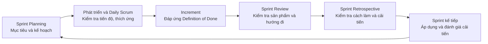

# Sprint Retrospective để cải thiện chất lượng và hiệu quả

Một Scrum Team phát triển nền tảng học trực tuyến kết thúc Sprint với sáu Product Backlog Item được đánh dấu “Done”. Tuy nhiên, các thành viên phải làm thêm giờ vào cuối Sprint, kiểm thử chỉ bắt đầu sau khi phần lớn mã đã hoàn tất và một lỗi quyền truy cập suýt lọt vào bản phát hành. Trong Sprint Review, bên liên quan hài lòng vì nhìn thấy chức năng **tiếp tục bài học đang dở**. Nhưng nếu đội giữ nguyên cách làm, những khó khăn tương tự có thể lặp lại ở Sprint sau.

**Sprint Retrospective** là thời điểm Scrum Team kiểm tra **cách mình đã làm việc** và lên kế hoạch **cải thiện chất lượng cùng hiệu quả**. Đội không chỉ hỏi “chúng ta đã làm xong gì?” mà còn hỏi: “Điều gì giúp hoặc cản trở việc tạo giá trị? Những giả định nào không đúng? Cần thay đổi điều gì trong cách phối hợp, quy trình, công cụ hay tiêu chuẩn chất lượng ở Sprint kế tiếp?”.

Bài học thuộc chương **Sự kiện Scrum** trong mô-đun **AGILE_DEVELOPMENT**. Nội dung kết nối Sprint Retrospective với các giá trị và nguyên tắc Agile, vòng phản hồi sớm, giao Increment tăng dần, cải tiến liên tục, user story, backlog, Scrum, Kanban, XP và đo lường dòng công việc. Trọng tâm không phải một trò chơi trong cuộc họp, mà là **học từ bằng chứng rồi biến điều học thành cải tiến thực tế**.

## 1. Mục tiêu học tập

Sau bài này, bạn có thể:

- Giải thích **mục đích, vị trí, người tham gia và timebox** của Sprint Retrospective theo *Scrum Guide 2020*.
- Phân biệt **Sprint Retrospective** với **Sprint Review**, Daily Scrum và hoạt động xử lý sự cố.
- Nhận diện những chủ đề cần kiểm tra: **con người, tương tác, quy trình, công cụ, Definition of Done**, chất lượng và năng lực tạo giá trị.
- Chuẩn bị dữ liệu vừa đủ và điều phối một retrospective để thành viên có thể nói thẳng mà không bị công kích.
- Phân biệt **triệu chứng, sự kiện, giả định, nguyên nhân góp phần** và giải pháp đề xuất.
- Chuyển một quan sát thành **hành động cải tiến có người phụ trách, giới hạn phạm vi và tín hiệu đánh giá**.
- Lựa chọn chỉ số như WIP, cycle time, work item age, lỗi hồi quy hoặc thời gian CI theo đúng vấn đề; tránh biến chỉ số thành công cụ đánh giá cá nhân.
- Xử lý tình huống retro bị lặp ý kiến, thiếu tham gia, đổ lỗi, nêu quá nhiều action item hoặc không theo dõi kết quả.
- Thiết kế một vòng cải tiến ngắn gắn với Sprint Goal và chất lượng Increment, thay vì chỉ tối ưu việc hoàn tất ticket.

## 2. Sprint Retrospective là gì theo Scrum Guide?

### 2.1. Mục đích chính thức

*The Scrum Guide* (tháng 11/2020) nêu mục đích của Sprint Retrospective là:

> **Lên kế hoạch cho những cách nâng cao chất lượng và hiệu quả.**

Scrum Team kiểm tra Sprint vừa qua xét theo **cá nhân, tương tác, quy trình, công cụ và Definition of Done**. Các yếu tố được kiểm tra sẽ khác nhau theo lĩnh vực công việc. Đội xem xét những giả định đã khiến mình đi chệch hướng và nguồn gốc của chúng; thảo luận điều đã diễn ra tốt, vấn đề đã gặp và cách đã hoặc chưa giải quyết những vấn đề đó.

Sau khi xem xét, Scrum Team xác định những thay đổi **hữu ích nhất** nhằm tăng hiệu quả. Những cải tiến có tác động lớn được xử lý **sớm nhất có thể** và thậm chí có thể đưa vào **Sprint Backlog của Sprint tiếp theo**.

**Sprint Retrospective kết thúc Sprint**. Nó là một sự kiện chính thức của Scrum, không phải cuộc họp tùy chọn chỉ tổ chức khi Sprint thất bại.

### 2.2. Nó nằm ở đâu trong Sprint?

Scrum có **Sprint** là khung chứa các sự kiện khác: Sprint Planning, Daily Scrum, Sprint Review và Sprint Retrospective. Một Sprint dài **một tháng hoặc ngắn hơn**. Trong chuỗi này, retrospective diễn ra về cuối Sprint, thông thường sau Sprint Review.



Sơ đồ giúp hình dung nhịp phản hồi, **không có nghĩa đội phải đợi đến retrospective mới được sửa một vấn đề**. Khi thấy quy trình đang gây lỗi nghiêm trọng, Scrum Team nên cải thiện hoặc xử lý trở ngại ngay khi phù hợp. Retrospective là cơ hội chính thức để xem xét toàn diện hơn và làm rõ điều cần duy trì cho Sprint tới.

### 2.3. Timebox

Theo Scrum Guide 2020:

- Với Sprint **một tháng**, Sprint Retrospective được giới hạn tối đa **ba giờ**.
- Với Sprint ngắn hơn, sự kiện thường **ngắn hơn tương ứng**.

Không có quy định Scrum bắt buộc một Sprint hai tuần phải họp đúng 90 phút, hoặc phải dùng một bộ bước điều phối cố định. Ví dụ 60–90 phút có thể hữu ích cho đội nhỏ và mục tiêu rõ, nhưng cần xem quy mô nhóm, độ phức tạp, sự kiện vừa xảy ra và thời gian cần trao đổi thực chất.

**Timebox là giới hạn tối đa, không phải chỉ tiêu phải sử dụng hết.** Một retrospective 45 phút nhưng tạo được cải tiến rõ và có người theo dõi tốt hơn cuộc họp hai giờ chỉ liệt kê cảm xúc mà không thay đổi gì.

## 3. Phân biệt Retrospective với các sự kiện và hoạt động khác

| Hoạt động | Trọng tâm kiểm tra | Câu hỏi chủ đạo | Đầu ra hữu ích |
| --- | --- | --- | --- |
| **Sprint Review** | Increment và tiến triển hướng Product Goal, thay đổi của môi trường sản phẩm | “Đã tạo giá trị gì, học được gì từ người dùng và bên liên quan, nên điều chỉnh Product Backlog thế nào?” | Backlog và định hướng sản phẩm được cập nhật theo phản hồi |
| **Sprint Retrospective** | Cách Scrum Team làm việc, chất lượng và hiệu quả | “Điều gì trong tương tác, quy trình, công cụ hoặc DoD nên được cải thiện?” | Những hành động cải tiến được ưu tiên và cách kiểm tra hiệu quả |
| **Daily Scrum** | Tiến độ hướng Sprint Goal và kế hoạch của Developers | “Hôm nay cần thích ứng Sprint Backlog ra sao để tiến tới Sprint Goal?” | Developers điều chỉnh kế hoạch công việc gần hạn |
| **Sprint Planning** | Giá trị Sprint, những gì có thể làm và cách dự kiến thực hiện | “Vì sao Sprint này có giá trị, có thể làm gì và làm như thế nào?” | Sprint Goal và Sprint Backlog |
| **Incident review/postmortem** | Sự cố cụ thể, tác động, chuỗi sự kiện và điều kiện góp phần | “Sự cố xảy ra thế nào và cần bảo vệ hệ thống ra sao?” | Biện pháp khắc phục, phòng ngừa và học hỏi từ sự cố |
| **One-on-one/trao đổi nhân sự** | Tình huống và nhu cầu hỗ trợ riêng tư của một người | “Cần giúp đỡ, phản hồi hoặc xử lý vấn đề nhạy cảm nào?” | Hành động phù hợp kênh cá nhân hoặc tổ chức |

**Sprint Review và Sprint Retrospective bổ sung cho nhau**: Review giúp học về **sản phẩm và giá trị**; Retrospective giúp học về **cách đội tạo giá trị**. Nếu Sprint Review cho thấy khách hàng khó dùng tính năng, PO có thể sắp lại Product Backlog. Nếu retrospective cho thấy kiểm thử trải nghiệm được mời quá muộn khiến lỗi lặp lại, đội nên cải thiện cách chuẩn bị và kiểm chứng.

Một sự cố bảo mật nghiêm trọng cần được xử lý ngay theo quy trình khẩn cấp và có thể cần điều tra chính thức; retrospective **không thay thế** những hoạt động đó. Tuy nhiên, đội có thể sử dụng điều học được từ sự cố để cải thiện quy trình Sprint.

## 4. Ai tham gia và ai chịu trách nhiệm?

### 4.1. Toàn Scrum Team cùng kiểm tra cách làm

**Scrum Team** gồm một **Product Owner**, một **Scrum Master** và **Developers**. Đây là sự kiện của **Scrum Team**, không chỉ của Developers và cũng không chỉ để Scrum Master “nghe báo cáo”.

Mỗi nhóm trách nhiệm đóng góp góc nhìn khác nhau:

| Thành phần | Góc nhìn cần mang vào | Ví dụ câu hỏi |
| --- | --- | --- |
| **Product Owner** | Giá trị, chất lượng hạng mục, sự hiểu biết chung về backlog, trao đổi với stakeholder | “Yêu cầu nào đã làm rõ quá muộn khiến phải sửa nhiều?” |
| **Developers** | Thiết kế, kiểm thử, tích hợp, phụ thuộc, luồng công việc và thực hành kỹ thuật | “Vì sao CI đỏ lâu? Việc nào bị chặn ở review và vì sao?” |
| **Scrum Master** | Hiệu quả của Scrum Team, ứng dụng Scrum, trở ngại tổ chức, khả năng tự quản | “Cách phối hợp nào đang khiến thông tin bị che khuất hoặc quyết định bị chậm?” |

Theo Scrum Guide, **Scrum Master chịu trách nhiệm về hiệu quả Scrum Team** và đảm bảo các sự kiện Scrum diễn ra, có giá trị và giữ trong timebox. Điều này không có nghĩa Scrum Master luôn bắt buộc phải là người điều phối duy nhất. Scrum Team có thể tự lựa chọn người điều phối phù hợp; trong tình huống căng thẳng, một người hỗ trợ trung lập có thể hữu ích.

### 4.2. Vì sao PO nên tham gia?

Nếu PO vắng mặt thường xuyên, retrospective có thể bỏ sót vấn đề trong việc làm rõ nhu cầu, chia lát cắt hoặc trao đổi thứ tự ưu tiên. Ví dụ Developers báo “chúng tôi phải viết lại do tiêu chí chấp nhận thay đổi ở cuối Sprint”; PO có thể giải thích thông tin khách hàng chỉ xuất hiện muộn và cùng đội cải tiến cách tiếp nhận phản hồi sớm.

Sự tham gia của PO không biến retrospective thành buổi phán xét hiệu suất Developers. **PO cũng là thành viên Scrum Team và cùng xem cách phối hợp của chính mình.**

### 4.3. Có nên mời quản lý hoặc stakeholder bên ngoài?

Retrospective chính thức dành cho Scrum Team. Một số vấn đề cần thông tin hoặc hỗ trợ từ ngoài đội, nhưng việc tự động mời cấp quản lý đến mọi retrospective có thể làm thành viên ngại nêu khó khăn.

Một cách làm thực tế:

1. Scrum Team tự kiểm tra tình huống và xác định điều cần hỗ trợ.
2. Ghi những trở ngại nằm ngoài quyền tự giải quyết.
3. Thống nhất ai sẽ trao đổi với bên liên quan hoặc quản lý và cần phản hồi gì.
4. Trong trường hợp thật sự cần thiết, mời chuyên gia hỗ trợ **một phần có mục đích rõ**, với sự đồng thuận phù hợp của đội và bảo vệ những thông tin nhạy cảm.

**Minh bạch về vấn đề không có nghĩa công khai toàn bộ lời nói cá nhân của thành viên.** Nên chia sẻ các quyết định/hành động cần thiết hơn là ghi nguyên văn mọi ý kiến riêng tư.

## 5. Chất lượng và hiệu quả: đội nên kiểm tra điều gì?

Retrospective không chỉ nhằm “cải thiện tinh thần” hoặc “làm nhanh hơn”. Chất lượng và hiệu quả của Scrum Team có nhiều chiều liên quan trực tiếp đến giá trị sản phẩm.

### 5.1. Con người và tương tác

- Những ai không có cơ hội lên tiếng hoặc thường bị ngắt lời?
- Kiến thức đang phụ thuộc vào một người hay được chia sẻ?
- Khi một người cần hỗ trợ, họ có thể yêu cầu kịp thời không?
- Bất đồng về thiết kế, ưu tiên hay tiêu chí chấp nhận được giải quyết ra sao?
- Có vấn đề về lịch họp, múi giờ hoặc kênh giao tiếp làm chậm quyết định?
- Đội có thể báo lỗi, thừa nhận sai sót và phản biện trên cơ sở bằng chứng không?

### 5.2. Quy trình và dòng công việc

- Product Backlog Item có được làm rõ đủ để bắt đầu hay liên tục phải hỏi lại?
- Hạng mục có quá lớn dẫn đến tích hợp muộn không?
- WIP có tăng trong khi nhiều việc chưa đi tới Done không?
- Có quá nhiều hàng chờ ở bước review, kiểm thử, triển khai hoặc phê duyệt?
- Daily Scrum có giúp Developers thích ứng kế hoạch hướng Sprint Goal không?
- Công việc gấp có liên tục chen ngang mà đội không có chính sách xử lý?

### 5.3. Công cụ và hệ thống kỹ thuật

- Pipeline CI có nhanh và tin cậy đủ để cho phản hồi không?
- Test tự động bắt được lỗi quan trọng hay có nhiều test không ổn định?
- Có môi trường kiểm thử, dữ liệu giả lập và log phù hợp để chẩn đoán?
- Kiến trúc/cấu trúc mã có khiến mỗi thay đổi nhỏ tác động nhiều khu vực không?
- Việc triển khai, rollback và quan sát sau phát hành có được chuẩn bị?
- Công cụ backlog đang giúp phối hợp hay tạo thêm cập nhật thủ công?

### 5.4. Definition of Done và chất lượng Increment

- Có PBI nào được gọi “Done” dù chưa đáp ứng Definition of Done?
- Đội có thường hoãn kiểm thử/bảo mật sang Sprint sau để đạt con số kế hoạch?
- Các tiêu chí chất lượng có rõ và có thể kiểm chứng không?
- Lỗi lọt ra người dùng thuộc tình huống nào, những cơ chế phòng ngừa nào chưa đủ?
- Khi dùng nhiều Scrum Team, Definition of Done chung có được áp dụng nhất quán?

### 5.5. Khả năng tạo giá trị và học từ phản hồi

- Những gì hoàn tất có đưa đội gần Product Goal và Sprint Goal không?
- Việc chia story có tạo lát cắt dọc sử dụng được hay chỉ tạo task theo tầng kỹ thuật?
- Bên liên quan có phản hồi đủ sớm để đội điều chỉnh?
- Có nhiều công việc ít giá trị làm phân tán tập trung?
- Sprint Review có cung cấp dữ liệu giúp đội điều chỉnh hướng đi không?

Retrospective cần chọn trọng tâm phù hợp, **không phải cố bàn hết mọi câu hỏi**. Dữ liệu có ích khi giúp tìm một trở ngại quan trọng và quyết định hành động cụ thể.

## 6. Chuẩn bị trước cuộc họp: dữ liệu vừa đủ, không dựng hồ sơ buộc tội

### 6.1. Thu thập những sự kiện có thể kiểm tra

Một bộ dữ liệu đầu vào minh họa:

| Dữ liệu | Câu hỏi mà nó giúp trả lời |
| --- | --- |
| Sprint Goal và những gì đã thực sự giao | Đội đạt mục tiêu ở mức nào? Có gì không thể hoàn tất đúng DoD? |
| Sprint Backlog thay đổi trong Sprint | Những công việc ngoài kế hoạch hoặc phụ thuộc nào xuất hiện? |
| Bảng công việc và tuổi hạng mục | Việc nào nằm lâu trong review hoặc kiểm thử? |
| Lịch sử build/test CI | Pipeline đỏ hoặc chạy chậm ở thời điểm nào, nguyên nhân nào? |
| Lỗi được phát hiện và sự cố | Những rủi ro nào thoát khỏi kiểm soát chất lượng? |
| Phản hồi Product Owner/người dùng | Điều gì từ trải nghiệm thật khiến đội phải thay đổi cách làm? |
| Các action item từ retrospective trước | Việc cải tiến nào đã làm, kết quả ra sao? |
| Ghi nhận của thành viên | Điều kiện nào khiến việc thực hiện thuận lợi hoặc khó khăn? |

Không nhất thiết phải có dashboard phức tạp. Một bảng timeline đơn giản, số liệu cơ bản và vài ví dụ cụ thể có thể đủ để thảo luận.

### 6.2. Tách sự kiện, diễn giải và cảm nhận

Ví dụ:

- **Sự kiện:** “Ba PBI chuyển vào Review trong hai ngày cuối Sprint.”
- **Sự kiện:** “Hàng chờ Review có bốn hạng mục tồn quá hai ngày.”
- **Diễn giải:** “Có thể việc tích hợp dồn cuối Sprint là nguyên nhân.”
- **Cảm nhận:** “Tôi thấy căng thẳng khi không biết còn kịp kiểm tra hay không.”
- **Giả thuyết cần kiểm chứng:** “Chia story nhỏ hơn và review sớm sẽ giảm chờ đợi.”

Cảm nhận là thông tin có giá trị về trải nghiệm nhóm, nhưng không tự chứng minh nguyên nhân. Ngược lại, số liệu không nói được mọi điều về động lực, áp lực và kỳ vọng. Retrospective nên **đặt dữ liệu và trải nghiệm cạnh nhau** để tìm cách cải thiện.

### 6.3. Chuẩn bị nguyên tắc an toàn

Nhóm có thể cùng xác nhận:

> “Chúng ta kiểm tra công việc và hệ thống, không sỉ nhục con người. Được phép nêu bất đồng, báo sai sót và yêu cầu giúp đỡ. Mỗi vấn đề phải được xem với bối cảnh và bằng chứng. Chúng ta có trách nhiệm khắc phục hậu quả và học cách tránh lặp lại.”

Không bắt buộc thành viên chia sẻ vấn đề sức khỏe, đời sống riêng hoặc trải nghiệm nhạy cảm trong cuộc họp chung. Những vấn đề như quấy rối, phân biệt đối xử, gian lận hay vi phạm an toàn nghiêm trọng cần được chuyển tới kênh chính thức phù hợp; retrospective không thay thế quá trình xử lý đó.

## 7. Một cấu trúc Retrospective thực hành

Một cấu trúc nổi tiếng được mô tả trong sách *Agile Retrospectives* của Esther Derby và Diana Larsen gồm năm hoạt động: **Set the Stage, Gather Data, Generate Insights, Decide What to Do, Close the Retrospective**. Đây là một **khuôn điều phối hữu ích**, không phải trình tự bắt buộc được Scrum Guide quy định.

### 7.1. Ví dụ agenda cho Scrum Team dùng Sprint hai tuần

Giả sử đội có bảy người và dành **90 phút**. Thời lượng dưới đây là lựa chọn minh họa, cần tùy chỉnh theo tình huống.

| Hoạt động | Thời gian ví dụ | Câu hỏi và sản phẩm mong đợi |
| --- | ---: | --- |
| **1. Thiết lập bối cảnh (*Set the Stage*)** | 10 phút | Nhắc mục đích, Sprint Goal, quy ước an toàn và cách tham gia |
| **2. Thu thập dữ liệu (*Gather Data*)** | 20 phút | Timeline, số liệu, điều tốt/chưa tốt, sự kiện đáng chú ý |
| **3. Tìm hiểu nguyên nhân (*Generate Insights*)** | 25 phút | Nhóm vấn đề theo chủ đề, kiểm tra giả thuyết/điều kiện góp phần |
| **4. Chọn hành động (*Decide What to Do*)** | 25 phút | Ưu tiên 1–2 thay đổi, mô tả việc thử, người phụ trách và tín hiệu đo |
| **5. Kết thúc (*Close*)** | 10 phút | Xác nhận quyết định, cách theo dõi, phản hồi về cuộc họp |

**Tổng: 90 phút.** Đây không phải giới hạn chính thức cho Sprint hai tuần. Nếu phát sinh vấn đề sâu, có thể ưu tiên một chủ đề và lên kế hoạch xử lý phần còn lại đúng người/đúng kênh thay vì chạy quá giờ chỉ để “bao phủ mọi chuyện”.

### 7.2. Thiết lập bối cảnh

Một lời mở đầu:

> “Mục tiêu hôm nay không phải xem ai sai hoặc chấm năng suất cá nhân. Chúng ta muốn hiểu điều gì đã giúp và cản trở việc tạo Increment chất lượng trong Sprint vừa rồi. Cuối buổi, hãy chọn một thay đổi thực tế để thử ở Sprint tiếp theo.”

Có thể dùng một vòng ngắn, không ép buộc: “Một từ mô tả Sprint”, “Điều đáng ghi nhận”, “Điều muốn làm rõ”. Cho phép mọi người ghi ý riêng trước khi ai đó có quyền lực cao phát biểu để giảm tâm lý thuận theo số đông.

### 7.3. Thu thập dữ liệu

Ví dụ timeline:

```text
Ngày 1       Sprint Planning, chọn lát cắt tiếp tục bài học
Ngày 3       Phát hiện dữ liệu tiến độ cũ thiếu trường trạng thái
Ngày 5       Hai PBI chờ làm rõ trường hợp tài khoản hết quyền
Ngày 7       Tích hợp frontend/backend; CI bắt đầu báo test không ổn định
Ngày 8       Bốn PBI dồn vào review
Ngày 9       Kiểm thử tích hợp phát hiện một lỗi quyền truy cập
Ngày 10      Đã khắc phục lỗi; một PBI chưa đáp ứng DoD
```

Các mốc là **tình huống giả định**. Timeline giúp nhìn thấy mối quan hệ giữa sự kiện, nhưng không tự chứng minh nguyên nhân. Đội có thể thêm những điều làm tốt như “có người phát hiện lỗi phân quyền kịp thời” và “PO phản hồi nhanh sau khi được hỏi rõ”.

### 7.4. Tìm hiểu điều kiện và giả định

Thay vì kết luận ngay “tester làm chậm”, hãy hỏi:

- Vì sao nhiều PBI chỉ đến Review ở cuối Sprint?
- Có phải vì story quá lớn, phụ thuộc API, thiếu test sớm hay WIP không được kiểm soát?
- Đội biết những tín hiệu nào tại thời điểm quyết định?
- Các chính sách làm rõ yêu cầu, code review và CI có đủ hữu ích?
- Điều gì giúp phát hiện lỗi trước khi đến người dùng, có thể nhân rộng?
- Nếu thay đổi một điều nhỏ nhất, điều gì có khả năng cải thiện rõ nhất?

### 7.5. Quyết định và khép vòng

Ví dụ kết quả tốt:

> “Sprint tới, Developers sẽ giới hạn tối đa **hai PBI** đồng thời ở bước In Progress (mức thử nghiệm của đội), ưu tiên hoàn tất test và review trước khi kéo việc mới. Một thành viên phụ trách nhắc kiểm tra WIP trong Daily Scrum; cả đội theo dõi tuổi công việc tại Review và số PBI đạt DoD. Chúng ta xem kết quả trong retrospective tiếp theo.”

Kết quả kém hữu ích:

> “Mọi người cố gắng tập trung hơn, phối hợp tốt hơn và phải làm nhanh hơn.”

Câu thứ hai thiếu hành vi có thể kiểm tra và không nêu điều kiện hệ thống cần thay đổi.

## 8. Các kỹ thuật điều phối thường dùng

Không có “mẫu retrospective tốt nhất” cho mọi Sprint. Có thể chọn kỹ thuật theo **loại câu hỏi** cần giải quyết và tâm thế nhóm.

### 8.1. Start – Stop – Continue

Hỏi đội nên:

- **Start:** Bắt đầu điều gì để cải thiện chất lượng và hiệu quả?
- **Stop:** Dừng thói quen nào làm tăng rủi ro hoặc lãng phí?
- **Continue:** Giữ điều gì đang mang lại kết quả tích cực?

Ví dụ:

| Start | Stop | Continue |
| --- | --- | --- |
| Viết ví dụ phân quyền từ khi refinement | Dồn toàn bộ review vào hai ngày cuối | Tích hợp mã nhỏ và thường xuyên |
| Công khai blocker API sớm | Bắt đầu PBI mới khi hai PBI chưa kiểm chứng | Hỏi phản hồi người dùng ngay khi có lát cắt chạy được |

**Hợp khi:** đội muốn nhìn nhanh cả điều tốt và việc cần thay đổi. **Hạn chế:** nếu dừng ở danh sách ý kiến, đội chưa biết nguyên nhân và chưa xác định hành động.

### 8.2. 4Ls: Liked – Learned – Lacked – Longed For

- **Liked:** Điều gì có ích hoặc đáng ghi nhận?
- **Learned:** Đội học được điều gì?
- **Lacked:** Thiếu công cụ, thông tin hoặc hỗ trợ nào?
- **Longed For:** Muốn có điều gì trong cách phối hợp tương lai?

**Hợp khi:** đội cần phản tư cân bằng hoặc mới bắt đầu retrospective. **Hạn chế:** những mong muốn rộng như “cần giao tiếp tốt” cần được chuyển thành một thay đổi cụ thể.

### 8.3. Timeline của Sprint

Cùng đánh dấu các sự kiện nổi bật theo ngày, thêm dấu hiệu về rủi ro, quyết định, blocker, kiểm thử và phản hồi.

**Hợp khi:** có nhiều thay đổi hoặc sự cố cần tìm hiểu chuỗi thời gian. **Hạn chế:** tránh nhầm việc “xảy ra trước” với nguyên nhân; hai sự kiện có thể cùng do yếu tố thứ ba.

### 8.4. Sailboat hoặc hình ẩn dụ hành trình

Có thể dùng hình chiếc thuyền:

- **Đích:** Sprint Goal/Product Goal.
- **Gió đẩy:** điều giúp tạo giá trị.
- **Mỏ neo:** điều kéo chậm.
- **Đá ngầm:** rủi ro chưa được xử lý.

**Hợp khi:** đội cần cách diễn đạt trực quan, khuyến khích nhiều người tham gia. **Hạn chế:** biểu tượng chỉ tạo cuộc trao đổi; cần quay về dữ liệu và hành động có thể thực hiện.

### 8.5. Five Whys và sơ đồ nguyên nhân

Liên tục hỏi “vì sao?” có thể giúp tránh chỉ sửa triệu chứng. Tuy nhiên, lỗi trong hệ thống phần mềm hiếm khi chỉ có **một chuỗi nguyên nhân tuyến tính**. Có thể dùng sơ đồ nhân quả, fishbone hoặc phân nhóm điều kiện góp phần để khám phá **nhiều nguyên nhân tương tác**.

Ví dụ: review bị chậm có thể đồng thời do PBI quá lớn, một reviewer đang hỗ trợ sự cố và pipeline không ổn định. Không nên lấy “vì sao lần thứ năm” làm một chân lý tuyệt đối.

### 8.6. Lean Coffee hoặc thảo luận theo chủ đề được đội chọn

Đội ghi các chủ đề, cùng sắp ưu tiên rồi thảo luận theo timebox ngắn. Khi hết giờ, quyết định tiếp tục hoặc chuyển chủ đề.

**Hợp khi:** đội có nhiều vấn đề đang tranh luận và muốn tự quản thời gian. **Hạn chế:** cần bảo đảm việc chọn chủ đề không khiến vấn đề quan trọng nhưng khó nói luôn bị bỏ qua.

### 8.7. Không để kỹ thuật chiếm mục đích

Một retrospective có thể có trò khởi động, bảng note màu sắc hoặc bình chọn chấm điểm. Những hoạt động này chỉ có ích nếu giúp **hiểu vấn đề và đưa ra thay đổi thực tế**. Đổi mẫu họp mỗi Sprint không tự tạo cải tiến, và dùng cùng một mẫu mãi cũng không mặc nhiên sai nếu đội còn học được.

## 9. An toàn tâm lý và phản biện trong retrospective

### 9.1. Khi mọi người sợ nói thật, dữ liệu cải tiến bị méo

Một thành viên phát hiện test CI sai nhưng không dám nói vì người viết test là senior. PO thấy nhiều câu chuyện chưa được làm rõ nhưng ngại nhận việc mình đưa thông tin muộn. Người mới thấy quy trình review khó hiểu nhưng lo bị đánh giá kém. Trong tình huống ấy, retrospective có thể kết thúc bằng câu “Sprint ổn, không có gì cần thay đổi” dù thực tế đầy rủi ro.

**An toàn tâm lý** là niềm tin chung rằng người trong nhóm có thể hỏi, xin giúp đỡ, nêu bất đồng và thừa nhận sai sót mà không bị sỉ nhục hoặc trừng phạt bất công. Nó **không** có nghĩa bỏ qua trách nhiệm, tiêu chuẩn chất lượng hay các hành vi gây hại.

### 9.2. Quy ước hội thoại thực tế

| Thói quen gây hại | Cách diễn đạt giúp học hỏi |
| --- | --- |
| “Bạn lại làm trễ review.” | “Ba PR đã chờ review hơn hai ngày; điều gì khiến hàng chờ tăng?” |
| “PO luôn đổi yêu cầu.” | “Có bốn tiêu chí được làm rõ sau khi bắt đầu; làm sao trao đổi ví dụ sớm hơn?” |
| “QA quá chậm nên Sprint thất bại.” | “Những hạng mục nào chỉ đến bước kiểm chứng ở cuối Sprint? Ta có thể kiểm chứng sớm một phần không?” |
| “Ai gây ra lỗi?” | “Hệ thống đã có những rào chắn nào, vì sao chúng không phát hiện trước lỗi?” |
| “Mọi người cần làm việc có trách nhiệm hơn.” | “Chính sách nào về WIP, review hoặc DoD cần rõ để trách nhiệm được thực hiện?” |

Có thể phê bình hành vi, quyết định và kết quả **một cách thẳng thắn**. Đừng biến phê bình thành quy kết động cơ hoặc tấn công năng lực con người. Nếu có vi phạm cố ý, quấy rối, rò rỉ dữ liệu hoặc hành vi nghiêm trọng, cần xử lý qua cơ chế trách nhiệm phù hợp ngoài cuộc họp, không dùng khẩu hiệu “blameless” để che đậy.

### 9.3. Tạo cơ hội cho tiếng nói thiểu số

Một số cách:

1. Cho thành viên ghi ý riêng trước khi người có thẩm quyền nêu ý kiến.
2. Luân phiên người phát biểu; cho phép “pass” nếu chưa sẵn sàng.
3. Có hình thức viết ẩn danh khi phù hợp và có thể bảo vệ danh tính thật sự.
4. Hỏi “Ai nhìn vấn đề theo cách khác?” trước khi chốt nguyên nhân.
5. Tách ý kiến, dữ kiện và giả thuyết lên bảng.
6. Ghi kết luận và phản hồi cho người nêu rủi ro, không chỉ cảm ơn rồi bỏ qua.

Nếu nhóm rất nhỏ, một phiếu “ẩn danh” có thể vẫn bị nhận diện qua nội dung. **Đừng hứa tính ẩn danh mà công cụ/quy mô nhóm không bảo đảm**.

### 9.4. Tránh ép kể chuyện cá nhân

Retrospective tập trung vào **cách Scrum Team làm việc**. Thành viên không bắt buộc công khai sức khỏe, gia đình hoặc mâu thuẫn nhạy cảm. Những vấn đề cần bảo mật, can thiệp nhân sự hoặc quy trình phản ánh chính thức nên xử lý qua kênh phù hợp.

An toàn tâm lý được thể hiện ở **cách người khác phản ứng khi nghe thông tin khó**, không phải ở việc mọi người luôn cười và không có bất đồng.

## 10. Từ triệu chứng đến nguyên nhân góp phần

### 10.1. Đừng sửa biểu hiện mà bỏ nguyên nhân

Giả sử đội ghi nhận: “Kiểm thử dồn cuối Sprint”. Phản ứng nhanh có thể là “tester phải làm nhanh hơn”. Nhưng câu này không giải quyết nguyên nhân nếu phần mã chỉ được đưa đến kiểm thử trong hai ngày cuối.

Một bản phân tích tốt hơn:

| Lớp xem xét | Ví dụ |
| --- | --- |
| **Triệu chứng** | Nhiều PBI chưa đạt DoD vào ngày cuối Sprint |
| **Dữ kiện** | Bốn PBI chuyển sang Review trong hai ngày cuối; CI đỏ nhiều lần |
| **Giả thuyết 1** | Story quá lớn, nên thay đổi không được tích hợp từng phần |
| **Giả thuyết 2** | Đội mở quá nhiều việc cùng lúc, làm review bị dồn |
| **Giả thuyết 3** | Acceptance criteria cho trường hợp lỗi được làm rõ quá muộn |
| **Giả thuyết 4** | Pipeline không ổn định khiến phải chạy lại nhiều |
| **Thử nghiệm** | Giảm WIP, chia lát cắt, thêm kiểm thử sớm, xử lý test flaky |
| **Tín hiệu đánh giá** | Work item age ở review, tỷ lệ PBI đạt DoD, lỗi hồi quy |

Không thể suy ra từ “nhiều PBI dồn vào Review” rằng đội có **một nguyên nhân duy nhất**. Cần kiểm tra những giả thuyết có bằng chứng và thử những thay đổi khả thi.

### 10.2. Đặt câu hỏi theo thời điểm quyết định

Với một quyết định có vẻ sai sau khi đã biết kết quả, hãy hỏi:

- Ở thời điểm ấy, đội biết điều gì?
- Điều nào là giả định chưa xác minh?
- Áp lực, phụ thuộc hoặc giới hạn năng lực nào tồn tại?
- Dữ liệu hoặc công cụ nào có thể giúp nhận ra vấn đề sớm?
- Nếu tình huống tương tự xảy ra ở Sprint sau, cần một rào chắn nào?

Cách hỏi này giảm **thiên kiến nhìn lại (*hindsight bias*)**, nhưng không xóa trách nhiệm cá nhân hoặc sự cần thiết của quyết định minh bạch.

### 10.3. Ghi nhận điều đã tốt

Nếu kiểm thử tích hợp phát hiện lỗi quyền truy cập trước phát hành, đội nên ghi nhận **hệ thống kiểm chứng đã hoạt động ở điểm nào**. Có thể cần đưa kiểm thử đó đến sớm hơn, nhân rộng ví dụ kiểm chứng cho luồng khác hoặc tiếp tục giữ chính sách review đang giúp phòng ngừa.

Retrospective chỉ tập trung vào điều tiêu cực dễ khiến đội bỏ mất những thực hành hiệu quả cần duy trì.

## 11. Hành động cải tiến: càng cụ thể, càng dễ kiểm chứng

### 11.1. Một action item tốt có những gì?

Để chuyển cuộc thảo luận thành thay đổi thực tế, đội cần làm rõ:

| Thành phần | Câu hỏi |
| --- | --- |
| **Vấn đề được chọn** | Điều gì đang làm giảm chất lượng hoặc hiệu quả? Dữ kiện nào hỗ trợ? |
| **Hành động/thử nghiệm** | Cụ thể chúng ta sẽ làm khác đi điều gì? |
| **Giả thuyết cải tiến** | Vì sao thay đổi này có thể tác động đến vấn đề? |
| **Người điều phối theo dõi** | Ai nhắc và giúp công việc không bị bỏ quên? |
| **Trách nhiệm thực hiện** | Ai tham gia làm, ai có quyền quyết định những phần liên quan? |
| **Khoảng thử** | Bắt đầu khi nào, kiểm tra ở mốc nào? |
| **Tín hiệu thành công** | Dữ liệu/hành vi nào cho biết thử nghiệm có ích? |
| **Rào chắn an toàn** | Chất lượng, quyền truy cập, trách nhiệm nào không được đánh đổi? |

**Người theo dõi không nhất thiết là người làm một mình.** Ví dụ khi quyết định giới hạn WIP, toàn Developers phối hợp thực hiện, còn một người nhắc cả đội xem số liệu trong Daily Scrum.

### 11.2. Biến lời kêu gọi chung thành thử nghiệm

| Kết luận mơ hồ | Hành động có thể thử |
| --- | --- |
| “Giao tiếp tốt hơn” | “Mỗi PBI về thanh toán sắp triển khai phải có ít nhất một phiên trao đổi ví dụ nghiệp vụ cùng người hiểu quy tắc phí trước khi kéo vào làm.” |
| “Kiểm thử sớm hơn” | “Khi refinement lát cắt mới, cùng ghi các trường hợp lỗi và phân quyền quan trọng trước khi viết mã.” |
| “Review nhanh hơn” | “Giới hạn số PR chờ review và dành thời gian xử lý hàng chờ trước khi mở việc mới.” |
| “Giảm lỗi CI” | “Trong Sprint tới, xác định và sửa hai test không ổn định có ảnh hưởng nhiều nhất, đo tỷ lệ chạy lại.” |
| “Làm việc tập trung” | “Thử WIP limit cho In Progress trong một Sprint, đo tuổi hạng mục và số việc đạt DoD.” |

Chú ý tránh quy định quá mức: một “phiên trao đổi ví dụ” không nhất thiết là một cuộc họp dài nếu câu hỏi nhỏ có thể giải đáp trực tiếp.

### 11.3. Ví dụ một bản ghi hoàn chỉnh

```yaml
improvement:
  problem: "Nhiều PBI dồn đến Review cuối Sprint"
  observation: "4 PBI vào Review trong 2 ngày cuối Sprint vừa qua"
  hypothesis: "Giảm số việc mở song song giúp tích hợp và review sớm hơn"
  experiment: "Giới hạn 2 PBI In Progress trong Sprint tới"
  participants: "Developers; Product Owner hỗ trợ làm rõ phạm vi khi cần"
  follow_up_owner: "Một Developer được đội thống nhất theo dõi"
  start: "Sprint kế tiếp"
  review_point: "Sprint Retrospective kế tiếp"
  measures:
    - "Số PBI/PR chờ Review và work item age"
    - "Số PBI đạt Definition of Done"
  guardrails:
    - "Không bỏ kiểm thử phân quyền và tích hợp cần thiết"
    - "Không đổi định nghĩa Done để tăng số lượng"
```

Đây là **mẫu minh họa**, không phải định dạng YAML bắt buộc trong Scrum hoặc chỉ thị tạo file khác. Các giá trị như “2 PBI” và “4 PBI” là giả định phục vụ bài tập; đội cần chọn mức phù hợp thực tế.

### 11.4. Có nên đưa cải tiến vào Sprint Backlog?

Scrum Guide nói những cải tiến có tác động lớn **có thể được đưa vào Sprint Backlog của Sprint tiếp theo**, chứ không phải mọi ý tưởng retro đều bắt buộc thành Product Backlog Item hay user story riêng.

Nếu cải tiến đòi công việc rõ và chiếm năng lực, đội có thể đưa nó vào kế hoạch Sprint, công khai sự ảnh hưởng và theo dõi hoàn thành. Nếu là thay đổi cách làm hằng ngày như “hỏi rủi ro trước khi kết thúc Daily Scrum”, đội có thể ghi ngay trong working agreement.

Điểm quan trọng: **không để cải tiến biến thành việc vô hình**, luôn bị tính năng đẩy xuống cuối và không bao giờ được thử.

## 12. Chọn ít việc nhưng làm thật

Một cuộc retrospective có thể phát hiện mười vấn đề. Cố thực hiện cả mười trong Sprint tới thường dẫn đến quá tải.

### 12.1. Ưu tiên theo tác động và khả năng thực hiện

Có thể cân nhắc:

- Mức ảnh hưởng đến **chất lượng Increment, an toàn người dùng và mục tiêu sản phẩm**.
- Tần suất và mức độ nghiêm trọng của trở ngại.
- Mức độ đội có thể kiểm soát hoặc tác động.
- Chi phí thử và khả năng học được trong một Sprint.
- Phụ thuộc với tổ chức hoặc chuyên gia ngoài đội.
- Nguy cơ tạo tác dụng phụ khi thay đổi quy trình.

Một phương án ảnh hưởng lớn nhưng ngoài quyền đội có thể cần người chịu trách nhiệm **trao đổi và vận động tổ chức**. Một phương án nhỏ, trực tiếp và dễ kiểm chứng có thể được thực hiện ngay. Không nên bỏ qua các rủi ro an toàn nghiêm trọng chỉ vì chúng khó và không “vừa Sprint”.

### 12.2. Dot voting chỉ giúp chọn chủ đề để bàn

Cho thành viên đặt phiếu vào các ý tưởng là cách nhanh để nhìn mức quan tâm, nhưng số phiếu **không tự chứng minh** mức ảnh hưởng. Một cảnh báo của một người về nguy cơ rò rỉ dữ liệu có thể quan trọng hơn chủ đề “họp hơi dài” được nhiều phiếu.

Sau khi bình chọn, đội cần đánh giá **dữ kiện, rủi ro và quyền quyết định** trước khi chọn hành động.

### 12.3. Khi không thống nhất được nguyên nhân

Không nhất thiết phải thống nhất hoàn toàn một giải thích. Có thể ghi hai giả thuyết cạnh tranh và chọn thử nghiệm phân biệt chúng:

> “Có thể review chậm vì hạng mục quá lớn hoặc vì reviewer bị gián đoạn bởi hỗ trợ vận hành. Sprint tới, ta ghi thời điểm PR sẵn sàng, thời điểm bắt đầu review, kích thước thay đổi và thời gian hỗ trợ sự cố để tìm nút thắt chính.”

Một cuộc retrospective trưởng thành **có thể kết thúc với câu hỏi rõ ràng cần kiểm chứng**, thay vì vội đưa ra một kết luận không có căn cứ.

## 13. Theo dõi cải tiến bằng số liệu đúng mục đích

Retrospective cần thấy việc thay đổi có thực sự giúp đội không. Tuy nhiên, **đo sai có thể làm môi trường kém an toàn** và tạo hành vi tối ưu con số thay vì cải thiện.

### 13.1. Chọn chỉ số theo vấn đề

| Vấn đề | Tín hiệu có thể dùng | Tránh diễn giải sai |
| --- | --- | --- |
| Công việc dồn cuối Sprint | WIP, work item age, số PBI đã hoàn tất theo từng thời điểm, thời gian chờ review | Nhiều task hoàn tất không chắc tạo nhiều Increment giá trị |
| CI không tin cậy | Thời gian pipeline, tỷ lệ build thất bại do test không ổn định, số lần chạy lại | Không được “tăng tỷ lệ xanh” bằng cách bỏ test quan trọng |
| Lỗi lọt sản xuất | Tỷ lệ sự cố liên quan thay đổi, lỗi hồi quy, thời gian phát hiện và khôi phục | Ít lỗi báo cáo không có nghĩa ít lỗi thật; có thể người dùng ít hơn hoặc ít báo |
| Story liên tục phải sửa | Số lần làm lại do thiếu hiểu biết nghiệp vụ, thời gian chờ quyết định, ví dụ AC phát sinh muộn | Không coi mọi thay đổi là xấu; phản hồi có thể làm đổi hướng hợp lý |
| Đội làm quá nhiều việc song song | WIP, cycle time, tỷ lệ hạng mục bị chặn, mức gián đoạn | Cần giữ định nghĩa hạng mục và mốc đo nhất quán |
| Người dùng không nhận được giá trị | Tỷ lệ hoàn tất tác vụ, phản hồi trải nghiệm, lỗi và mức sử dụng tính năng | Outcome chịu nhiều yếu tố; không quy kết biến động ngay cho một Sprint |
| Khó chia sẻ kiến thức | Số điểm nghẽn phụ thuộc một người, thời gian xin trợ giúp, phạm vi có thể pairing | Không dùng số lần giúp đỡ để xếp hạng người hỗ trợ |

**Không dùng velocity, story point, số commit hay số lỗi cá nhân như thước đo thưởng/phạt.** Những chỉ số đó không trực tiếp đo khả năng tạo giá trị và rất dễ bị thao túng.

### 13.2. Trước – sau không tự chứng minh quan hệ nhân quả

Ví dụ nhóm giới hạn WIP và thấy cycle time trung bình giảm từ 8 ngày xuống 6 ngày. Có thể thử nghiệm có tác dụng, nhưng cũng có thể Sprint mới có hạng mục nhỏ hơn hoặc ít sự cố hơn.

Cần xét:

1. Ranh giới đo có giữ nguyên không?
2. Hạng mục có cùng loại và kích thước tương đối không?
3. Có biến động bất thường như nghỉ phép, sự cố hoặc phụ thuộc bên ngoài không?
4. Chất lượng/DoD có bị nới lỏng không?
5. Phản hồi định tính có phù hợp với xu hướng số liệu không?
6. Có nên giữ cách làm, điều chỉnh hay thử thêm một nhịp?

Một vài Sprint chưa đủ để đưa ra kết luận thống kê mạnh. Retrospective có thể dùng số liệu như **tín hiệu cho cuộc trao đổi**, không biến số liệu thành phán quyết tuyệt đối.

### 13.3. Kết hợp ba loại bằng chứng

Một cách nhìn cân bằng:

- **Dòng công việc:** WIP, cycle time, work item age, thời gian chờ.
- **Chất lượng:** lỗi hồi quy, độ tin cậy CI, sự cố, đáp ứng DoD.
- **Giá trị và cộng tác:** phản hồi người dùng, khả năng đạt Sprint Goal, cách đội chủ động hỗ trợ nhau.

Nếu thời gian chờ review giảm nhưng lỗi hồi quy tăng, đội cần xem lại chất lượng review. **Tối ưu chỉ một con số có thể làm giảm hiệu quả tổng thể**.

## 14. Tình huống xuyên suốt: cải tiến đội phát triển nền tảng học tập

Một Scrum Team bảy người đang phát triển chức năng **tiếp tục bài học đang dở**. Họ có PO, SM và Developers với chuyên môn frontend, backend, kiểm thử và trải nghiệm người dùng. Sprint kéo dài hai tuần.

### 14.1. Bối cảnh và sự kiện

Trong Sprint vừa qua:

- Sprint Goal là tạo hành vi tiếp tục bài gần nhất an toàn cho tài khoản đã đăng nhập.
- Nhiều story được chia theo các phần frontend, backend và kiểm thử, khiến kiểm chứng đầu-cuối xuất hiện muộn.
- CI có test không ổn định; mỗi lần thất bại khiến một số người chạy lại thay vì tìm nguyên nhân.
- PO và Developers chưa làm rõ trường hợp học viên đã mất quyền truy cập khóa.
- Hệ thống phát hiện kịp một lỗi phân quyền trước phát hành, nhưng một PBI chưa đạt DoD.

Mọi dữ kiện ở đây là **giả định phục vụ phân tích**, không phải số liệu của một đội thật.

### 14.2. Sprint Review đã học điều gì?

Trong Sprint Review, bên liên quan thấy lát cắt tiếp tục bài gần nhất hoạt động. Một số người dùng thử báo rằng họ không hiểu biểu tượng “tiếp tục”, khiến PO cân nhắc một cách hiển thị rõ hơn. Đây là **phản hồi về sản phẩm** và có thể dẫn đến thay đổi Product Backlog.

Retrospective tiếp theo có câu hỏi khác: **vì sao tích hợp và kiểm thử xảy ra muộn, vì sao trạng thái đã hoàn thành của một PBI bị hiểu khác nhau, và điều gì giúp phát hiện lỗi quyền truy cập trước phát hành?**

### 14.3. Thu thập bằng chứng

Một timeline giả định:

| Mốc | Sự kiện | Tín hiệu |
| --- | --- | --- |
| Ngày 1 | Sprint Planning; chọn những hạng mục liên quan lưu tiến độ | Sprint Goal rõ nhưng chưa ghi đủ các trường hợp phân quyền |
| Ngày 3 | UX và backend phát hiện hai cách hiểu khác nhau về bài đã hoàn thành | Có việc phải làm lại |
| Ngày 5 | Hai PR cùng chờ review; CI có test không ổn định | Hàng chờ và thời gian kiểm chứng tăng |
| Ngày 8 | Nhiều PBI mới đi đến kiểm thử tích hợp | Rủi ro dồn cuối Sprint |
| Ngày 9 | Test phát hiện lỗi dùng tiến độ tài khoản khác | Một rào chắn chất lượng đã hoạt động |
| Ngày 10 | Đã sửa lỗi chính; một PBI chưa đạt DoD | Cần minh bạch phần việc chưa hoàn thành |

Đội không nên dùng timeline để nói “ai ngày nào cũng chậm”. Thay vào đó, timeline giúp xem **những thời điểm nào thông tin có thể được trao đổi sớm hơn**.

### 14.4. Phân tích nguyên nhân góp phần

Nhóm đưa ra các giả thuyết:

1. Story được tách thành task theo tầng kỹ thuật thay vì một lát cắt dọc, khiến tích hợp bị dồn.
2. Có quá nhiều PBI được bắt đầu đồng thời, hàng chờ review tăng.
3. Trường hợp phân quyền và tài khoản hết quyền chưa được đưa vào cuộc trao đổi refinement.
4. CI flaky làm giảm niềm tin vào kiểm tra tự động và kéo dài thời gian xác minh.

**Không cần kết luận toàn bộ bốn giả thuyết đều đúng**. Nhóm kiểm tra sự kiện và chọn một thử nghiệm đủ nhỏ, có khả năng tác động đến nhiều vấn đề.

### 14.5. Chọn hai hành động cải tiến

**Hành động A — Chia lát cắt dọc và trao đổi ví dụ sớm**

> Trong refinement của những PBI liên quan quyền truy cập và tiến độ, PO cùng Developers viết ít nhất các ví dụ người dùng hợp lệ, đã hết quyền và tài khoản khác. Mỗi PBI được chọn cho Sprint cần có hành vi xuyên suốt có thể kiểm chứng thay vì chỉ một tầng kỹ thuật. Đội thử trong Sprint kế tiếp và xem số hạng mục phải làm lại do chưa rõ nghiệp vụ.

**Hành động B — Hạn chế WIP và tích hợp sớm**

> Developers thử giới hạn hai PBI In Progress cùng lúc (mức thử của đội), ưu tiên review và CI cho việc đang làm trước khi nhận thêm. Kiểm tra work item age, thời gian chờ review và số PBI đáp ứng DoD vào cuối Sprint. Không bỏ kiểm thử để làm đẹp tốc độ.

Cả hai hành động đều phải có người giúp theo dõi, thời điểm xem lại và cách thực hiện. Nếu đội thấy hai cải tiến cùng lúc quá nặng, có thể chọn một hành động trước.

### 14.6. Sprint kế tiếp: kiểm tra thử nghiệm

Sau Sprint mới, đội có thể xem:

| Câu hỏi | Dữ liệu/quan sát cần xem |
| --- | --- |
| Các PBI có được tích hợp và kiểm chứng sớm hơn? | Thời điểm đạt hành vi end-to-end, work item age ở Review |
| Số PBI đạt DoD có ổn định hơn? | PBI được hoàn thành theo đúng DoD, không thay đổi định nghĩa để đạt số lượng |
| Có giảm làm lại do hiểu sai quy tắc? | Các trường hợp phát hiện trong refinement so với trong lúc code |
| CI có tin cậy hơn không? | Tỷ lệ test flaky, thời gian phản hồi build và số lần chạy lại |
| Có tác dụng phụ không? | Trì hoãn phản hồi sản phẩm, lỗi hồi quy, áp lực làm thêm giờ |
| Hành vi người dùng có cải thiện? | Dữ liệu từ Review/quan sát sau phát hành, trao đổi với PO |

Nếu kết quả tích cực, đội có thể giữ cách làm như một chính sách. Nếu không, đội chỉnh giả thuyết và thử phương án khác. **Mục tiêu của retrospective là một vòng học lặp lại, không phải hoàn thành một danh sách action item.**

## 15. Khi vấn đề nằm ngoài quyền quyết định của Scrum Team

Có những trở ngại mà đội không thể tự giải quyết: môi trường staging dùng chung thường xuyên bị khóa, tổ chức yêu cầu ba cấp phê duyệt không cần thiết hoặc đội phải chờ một bên ngoài cung cấp dữ liệu.

Retrospective vẫn có thể tạo kết quả:

1. Diễn đạt trở ngại bằng sự kiện và tác động lên chất lượng/hiệu quả.
2. Phân biệt phần đội tự giải quyết được với phần cần tổ chức hỗ trợ.
3. Xác định người liên hệ có thẩm quyền, đề xuất giải pháp và thông tin cần cung cấp.
4. Thống nhất cách giảm tác động trong lúc chờ quyết định.
5. Theo dõi phản hồi và thông báo lại cho đội.

Ví dụ:

> “Mỗi lần cần phát hành môi trường kiểm thử, nhóm phải chờ trung bình hai ngày vì chỉ một người ngoài đội có quyền chạy pipeline. Scrum Master phối hợp với đơn vị vận hành để thảo luận cơ chế self-service có kiểm soát. Developers ghi rõ rủi ro và đề xuất cách cấp quyền an toàn; PO trình bày tác động đến khả năng thử nghiệm người dùng. Cả đội kiểm tra phản hồi vào Sprint tới.”

**Scrum Master giúp Scrum Team tháo gỡ trở ngại**, nhưng không nên trở thành người duy nhất đi “xin phép” mọi việc. Đội vẫn có thể tham gia đề xuất, thử nghiệm và trao đổi phù hợp với trách nhiệm của mình.

## 16. Retrospective trong môi trường từ xa hoặc nhiều múi giờ

Retrospective từ xa không bắt buộc sao chép nguyên cách họp tại văn phòng. Cần bảo đảm thông tin đến được người cần tham gia và cuộc hội thoại đủ an toàn.

### 16.1. Chuẩn bị không đồng bộ

Có thể gửi trước:

- Sprint Goal và tóm tắt kết quả.
- Những số liệu dòng công việc/chất lượng phù hợp.
- Một bảng thu thập ý kiến với câu hỏi cụ thể, không hỏi quá rộng.
- Cách đề xuất chủ đề và yêu cầu bảo mật thông tin.
- Agenda, mốc thời gian và quy định sử dụng kết quả.

Mọi người có thể ghi ý kiến trước nếu cần suy nghĩ hoặc không tự tin phát biểu bằng ngôn ngữ chung. Tuy nhiên, **việc điền bảng không thay thế đối thoại về nguyên nhân và hành động**.

### 16.2. Điều phối khi có người tham gia ít

Người nói ít không chắc không có ý kiến. Có thể:

- Cho thời gian ghi riêng trước khi phát biểu.
- Mời các góc nhìn lần lượt mà không ép buộc.
- Hỏi “Ý kiến nào chưa được đề cập?”.
- Tránh để quản lý hoặc senior kết luận ngay từ đầu.
- Kết thúc bằng văn bản nêu rõ quyết định, hành động và câu hỏi chưa đóng.

Nếu đội ở nhiều múi giờ, nên luân phiên thời gian bất tiện và tránh đánh giá mức đóng góp bằng số phút phát biểu.

### 16.3. Dữ liệu nhạy cảm và an toàn thông tin

Không nên lưu nguyên văn câu chuyện cá nhân nhạy cảm lên bảng công khai; tránh chia sẻ token, mật khẩu, dữ liệu khách hàng thật trong ví dụ sự cố. Người điều phối cần làm rõ ai có quyền xem ghi chép, thông tin nào được chia sẻ ra ngoài và cách dùng dữ liệu khảo sát.

Việc công khai hành động cải tiến nên đủ minh bạch, nhưng **không đồng nghĩa công khai danh tính người nêu phàn nàn**.

## 17. Những tình huống khó thường gặp và cách xử lý

### 17.1. “Không có gì để cải thiện”

Một Sprint đạt Sprint Goal vẫn có thể có điều đáng học: cơ chế nào đã giúp đội làm tốt? Có phụ thuộc nào được gỡ nhanh? Test hay review nào nên được duy trì? Đội có thể chọn **củng cố một thực hành tốt** thay vì cố tìm lỗi.

Đặt câu hỏi: “Điều gì chúng ta muốn chắc chắn **tiếp tục làm** trong Sprint tới?” Nếu không có cải tiến mới rõ ràng, vẫn cần kiểm tra kết quả các thử nghiệm trước và giữ sự kiện có ý nghĩa; không tự bịa vấn đề để đủ danh sách.

### 17.2. “Mọi người chỉ than phiền”

Cảm xúc khó chịu có thể cho biết một trở ngại có thật. Người điều phối nên ghi nhận rồi chuyển sang:

- “Sự kiện cụ thể nào khiến điều đó xảy ra?”
- “Những ai chịu tác động và mức độ nào?”
- “Điều gì chúng ta kiểm soát được?”
- “Một thay đổi nhỏ có thể thử là gì?”

Không nên chặn mọi phàn nàn bằng câu “chỉ được nói giải pháp tích cực”, vì đội có thể chưa hiểu đủ nguyên nhân. Nhưng cũng không nên kết thúc mà không có quyết định hoặc câu hỏi cần xác minh.

### 17.3. “Chúng ta nói mãi vấn đề này”

Trước khi đưa vấn đề cũ trở lại, kiểm tra:

1. Action item lần trước có thực hiện chưa?
2. Nếu chưa, vì thiếu năng lực, phụ thuộc hay hành động không rõ?
3. Nếu đã thử, kết quả và tác dụng phụ là gì?
4. Có cần đổi giả thuyết, giải pháp, người hỗ trợ hoặc kênh xử lý?
5. Vấn đề đang nằm ngoài quyền đội, cần tổ chức can thiệp?

**Lặp lại một chủ đề không tự chứng minh đội thiếu quyết tâm.** Có thể cơ chế cải tiến đang không đủ điều kiện để thành công.

### 17.4. “Retrospective trở thành cuộc họp báo cáo cho quản lý”

Nếu thành viên chỉ nói điều lãnh đạo muốn nghe, nên xem lại người tham gia, cách sử dụng ghi chép và phản ứng của người có quyền lực. Scrum Team có thể tập trung tạo không gian trao đổi nghề nghiệp với quy ước rõ về bảo mật, đồng thời công khai **những action item cần phối hợp bên ngoài**.

Cần tránh lẫn lộn giữa **trách nhiệm minh bạch về tiến độ/cải tiến** và **yêu cầu công khai mọi phát biểu cá nhân**.

### 17.5. “Ai cũng muốn sửa tất cả”

Hãy giới hạn số cải tiến theo năng lực thực, chọn rủi ro lớn và phương án học được nhiều. Nếu một chủ đề quá rộng, tạo spike hoặc phân tích có thời hạn. Retrospective không nên trở thành dự án cải tổ không có phạm vi.

### 17.6. “Có lỗi nghiêm trọng nhưng mọi người ngại nói”

Tạo điều kiện báo tin xấu và ưu tiên giảm tác động tới người dùng. Với sự cố bảo mật, sai tiền, dữ liệu cá nhân hoặc nghĩa vụ pháp lý, phải thực hiện quy trình xử lý chính thức ngay và có thể làm postmortem chuyên sâu; retro xem **những cải tiến nào cần tích hợp vào cách làm hằng ngày**.

### 17.7. “Thành viên mới không hiểu những chuyện đã xảy ra”

Dùng timeline, mô tả sự kiện và giải thích ngữ cảnh. Người mới có thể đưa ra góc nhìn giá trị vì chưa quen với những giả định cũ, nhưng không nên đòi họ đánh giá những quyết định khi họ chưa có thông tin.

## 18. Các ngộ nhận cần sửa

| Ngộ nhận | Cách hiểu phù hợp hơn |
| --- | --- |
| “Retrospective chỉ cần tổ chức khi Sprint thất bại.” | Đây là sự kiện chính thức kết thúc mỗi Sprint để cải tiến chất lượng và hiệu quả, kể cả khi Sprint thành công. |
| “Sprint Review và Retrospective là một.” | Review kiểm tra sản phẩm/định hướng; Retrospective kiểm tra cách Scrum Team làm việc. |
| “Retrospective là cuộc họp chỉ dành cho Developers.” | Đây là sự kiện của **Scrum Team**, gồm PO, SM và Developers. |
| “Scrum Master luôn phải tự mình dẫn và quyết mọi hành động.” | SM chịu trách nhiệm giúp Scrum hiệu quả; đội cùng kiểm tra, quyết định và thực hiện cải tiến. |
| “Sprint hai tuần bắt buộc retro đúng 90 phút.” | Timebox chính thức là tối đa 3 giờ cho Sprint một tháng; Sprint ngắn hơn thường có retro ngắn hơn. |
| “Chỉ cần nêu thật nhiều vấn đề là cuộc họp tốt.” | Cần xác định vấn đề đáng ưu tiên và biến thành hành động/điều học được. |
| “Blameless nghĩa là không có trách nhiệm.” | Không quy kết cá nhân vô căn cứ, nhưng vẫn phải khắc phục hậu quả và xử lý vi phạm công bằng. |
| “Mọi người phải kể hết cảm xúc riêng tư.” | Retrospective tập trung vào công việc; ranh giới cá nhân và kênh hỗ trợ nhạy cảm phải được tôn trọng. |
| “Dot voting chọn được nguyên nhân quan trọng nhất.” | Phiếu chỉ gợi mức quan tâm; rủi ro cần đánh giá bằng chứng và tác động. |
| “Bắt buộc mỗi retro có ba action item.” | Một thử nghiệm nhỏ được làm và đo tốt hơn nhiều mục hành động không ai theo dõi. |
| “Mọi action item phải là user story trong Product Backlog.” | Cải tiến lớn có thể đưa vào Sprint Backlog; nhiều thay đổi chỉ cần working agreement hoặc cách làm. |
| “Không được sửa quy trình giữa hai Retrospective.” | Có thể và nên điều chỉnh kịp thời khi phát hiện vấn đề quan trọng. |
| “Velocity tăng chứng minh retro hiệu quả.” | Velocity không đo trực tiếp chất lượng hoặc giá trị và có thể bị tối ưu sai. |
| “Giảm lỗi CI bằng cách bỏ test là cải tiến.” | Cần giảm nguyên nhân gây lỗi không ổn định, không hạ tiêu chuẩn chất lượng. |
| “Sau retro chỉ cần lưu bảng note để dùng lần sau.” | Quyết định phải được thực hiện, theo dõi và đánh giá. |

## 19. Checklist trước, trong và sau Retrospective

### 19.1. Trước sự kiện

- [ ] Biết rõ Sprint Goal, kết quả và những PBI chưa đạt DoD.
- [ ] Có đủ dữ liệu/timeline quan trọng, không dùng số liệu để công kích cá nhân.
- [ ] Xem lại action item từ Sprint trước và kết quả đã quan sát.
- [ ] Chọn timebox và hình thức điều phối phù hợp quy mô, bối cảnh đội.
- [ ] Chuẩn bị cách để người ít nói và người làm từ xa có thể đóng góp.
- [ ] Phân biệt vấn đề nhóm có thể bàn công khai với nội dung nhạy cảm cần kênh riêng.

### 19.2. Trong sự kiện

- [ ] Nhắc mục đích: **tăng chất lượng và hiệu quả**.
- [ ] Có cơ hội nêu điều tốt, khó khăn và giả định đang tranh cãi.
- [ ] Phân biệt dữ kiện, cảm nhận, diễn giải và nguyên nhân giả định.
- [ ] Tập trung vào điều kiện hệ thống, đồng thời giữ trách nhiệm nghề nghiệp.
- [ ] Chọn một vài chủ đề có tác động, không đếm số note cho đẹp.
- [ ] Thống nhất hành động/thử nghiệm, người theo dõi, thời điểm xem lại và tín hiệu kiểm chứng.
- [ ] Làm rõ vấn đề cần chuyển cho người hoặc bộ phận ngoài đội.

### 19.3. Sau sự kiện

- [ ] Hành động quan trọng được đưa vào cách làm hoặc kế hoạch Sprint thích hợp.
- [ ] Người liên quan biết ai phối hợp, cần làm gì và khi nào kiểm tra.
- [ ] Đội không bỏ chất lượng/DoD để đạt mục tiêu đo.
- [ ] Các tín hiệu trước–sau được thu thập vừa đủ, có xét bối cảnh.
- [ ] Retrospective tiếp theo kiểm tra **đã thử gì và học được gì**.
- [ ] Những kết luận cần chia sẻ được truyền đạt phù hợp, không lộ thông tin riêng tư.

Checklist nhằm phục vụ đối thoại và học hỏi, **không phải biểu mẫu bắt buộc phải đạt từng ô trong mọi Sprint**.

## 20. Bài tập ứng dụng

### Bài tập 1 — Phân biệt Review và Retrospective

Sau Sprint, người dùng báo không biết nút “Tiếp tục bài học” ở đâu. Trong nội bộ, đội thấy chức năng này được kiểm thử rất muộn vì UX và backend làm việc tách biệt.

Hãy chỉ rõ:

1. Chủ đề nào nên trao đổi ở **Sprint Review**?
2. Chủ đề nào nên trao đổi ở **Sprint Retrospective**?
3. Những thay đổi nào có thể xuất hiện trong Product Backlog?
4. Một thử nghiệm cải thiện cách phối hợp nào đáng đưa vào Sprint kế tiếp?

### Bài tập 2 — Chuyển lời phàn nàn thành hành động

Trong retro, một thành viên nói: “Review của chúng ta rất chậm; không ai hỗ trợ tôi”. Hãy viết:

1. Hai câu hỏi giúp thu thập **dữ kiện**.
2. Hai giả thuyết về điều kiện **góp phần**.
3. Một thay đổi nhỏ có thể thử trong Sprint kế tiếp.
4. Một chỉ số dòng công việc và một rào chắn chất lượng.

### Bài tập 3 — Xử lý bất đồng

PO cho rằng việc thay đổi acceptance criteria làm Sprint chậm; Developers cho rằng yêu cầu chưa rõ từ ban đầu. Hãy đề xuất cách điều phối đối thoại để hai bên làm rõ timeline, giả định và thông tin đã biết ở từng thời điểm, tránh biến cuộc họp thành tranh luận ai đúng.

### Bài tập 4 — Dùng dữ liệu thận trọng

Hai Sprint liên tiếp có dữ liệu minh họa:

| Chỉ số | Sprint A | Sprint B |
| --- | ---: | ---: |
| PBI đạt DoD | 5 | 7 |
| Thời gian chờ review trung bình | 2,5 ngày | 1,5 ngày |
| Lỗi hồi quy sau phát hành | 1 | 4 |
| Số test CI không ổn định được ghi nhận | 3 | 6 |

Một thành viên nói: “B nhiều PBI Done hơn nên đội đã cải tiến thành công”. Hãy phân tích vì sao chưa đủ cơ sở, những giả thuyết cần xem và hành động thử tiếp theo.

### Bài tập 5 — Một retro 60 phút

Bạn là người điều phối một Scrum Team tám người, Sprint hai tuần. Hãy tự xây agenda 60 phút dựa trên năm hoạt động Set the Stage, Gather Data, Generate Insights, Decide What to Do, Close. Cần để đủ thời gian **chọn hành động có thể kiểm chứng**, không chỉ thu thập note.

### Bài tập 6 — Vấn đề ngoài quyền đội

Một đội phải chờ ba ngày để được cấp môi trường kiểm thử bởi bộ phận hạ tầng. Retro đã nhắc chuyện này ba Sprint liên tiếp nhưng chưa thay đổi. Hãy nêu:

- Dữ liệu nào chứng minh tác động?
- Scrum Team có thể giảm tác động trước mắt ra sao?
- Scrum Master và các thành viên nên trao đổi với tổ chức thế nào?
- Làm sao theo dõi tiến triển, không chỉ lặp lại phàn nàn?

### Bài tập 7 — Phản tư về an toàn tâm lý

Trong retrospective, thành viên mới không phát biểu; senior liên tục đưa ra kết luận và bác bỏ phản biện.

Hãy đề xuất ba thay đổi cụ thể về điều phối, cách thu thập ý kiến và phản hồi sau cuộc họp. Đồng thời giải thích vì sao **không nên ép** thành viên mới phải kể một trải nghiệm nhạy cảm trước nhóm.

## 21. Tóm tắt trọng tâm

**Sprint Retrospective là sự kiện Scrum nhằm lập kế hoạch nâng cao chất lượng và hiệu quả.** Scrum Team cùng kiểm tra Sprint vừa qua qua các chiều **con người, tương tác, quy trình, công cụ và Definition of Done**, nhận diện điều đã tốt, vấn đề gặp phải và các giả định không đúng. Sự kiện kết thúc Sprint; với Sprint một tháng, timebox tối đa ba giờ và với Sprint ngắn hơn thường ngắn hơn.

**Retrospective khác Sprint Review**: Review tập trung vào sản phẩm, Increment và phản hồi để điều chỉnh Product Backlog; Retrospective tập trung vào **cách đội tạo Increment và cải tiến cách làm**. Cả hai cùng củng cố vòng lặp kiểm tra và thích ứng của Agile.

Một retrospective có giá trị không đo bằng số note, số trò chơi hay số lời phàn nàn. Nó thành công khi đội **hiểu vấn đề đủ sâu, chọn một vài thay đổi có tác động, thử trong công việc thật, quan sát chất lượng cùng dòng giá trị và cập nhật cách làm theo kết quả**. Công cụ như Start–Stop–Continue, 4Ls, timeline, Five Whys hoặc Lean Coffee chỉ hỗ trợ quá trình ấy.

Khi liên kết cải tiến với **Sprint Goal, Definition of Done, backlog, kỹ thuật XP, WIP và flow metrics**, Scrum Team có cơ hội giao phần mềm an toàn hơn, phản hồi nhanh hơn và ngày càng hiệu quả — đúng với tinh thần **cải tiến liên tục** của Agile.

## Tài liệu tham khảo

1. [Ken Schwaber và Jeff Sutherland — The Scrum Guide](https://scrumguides.org/scrum-guide.html), phiên bản tháng 11/2020 — mục đích, người tham gia, timebox và nội dung của Sprint Retrospective; ba trụ cột Scrum; Sprint, artifact và commitment.
2. [Manifesto for Agile Software Development](https://agilemanifesto.org/) và [12 Principles](https://agilemanifesto.org/principles.html) — đặc biệt nguyên tắc về việc nhóm thường xuyên nhìn lại để trở nên hiệu quả hơn và điều chỉnh hành vi tương ứng.
3. Esther Derby và Diana Larsen, *Agile Retrospectives: Making Good Teams Great* (2006) — năm hoạt động điều phối retrospective và kỹ thuật tạo hiểu biết, hành động.
4. Esther Derby, Diana Larsen và David Horowitz, *Agile Retrospectives: A Practical Guide for Catalyzing Team Learning and Improvement*, ấn bản 2 (2024) — facilitation và cải tiến thông qua học hỏi nhóm.
5. [Agile Alliance — Retrospective](https://agilealliance.org/glossary/retrospective/) — khái niệm và thực hành nhìn lại trong Agile.
6. [Kanban University — The Official Guide to the Kanban Method](https://kanban.university/kanban-guide/) — quản lý WIP, đo dòng công việc và vòng phản hồi cải tiến.
7. [Agile Alliance — Extreme Programming (XP)](https://agilealliance.org/glossary/xp/) — các thực hành phát triển kỹ thuật như kiểm thử, tích hợp liên tục và refactoring để cải tiến chất lượng.
8. Amy C. Edmondson, *Psychological Safety and Learning Behavior in Work Teams* (1999), [DOI: 10.2307/2666999](https://doi.org/10.2307/2666999) — an toàn tâm lý và hành vi học hỏi trong nhóm.
