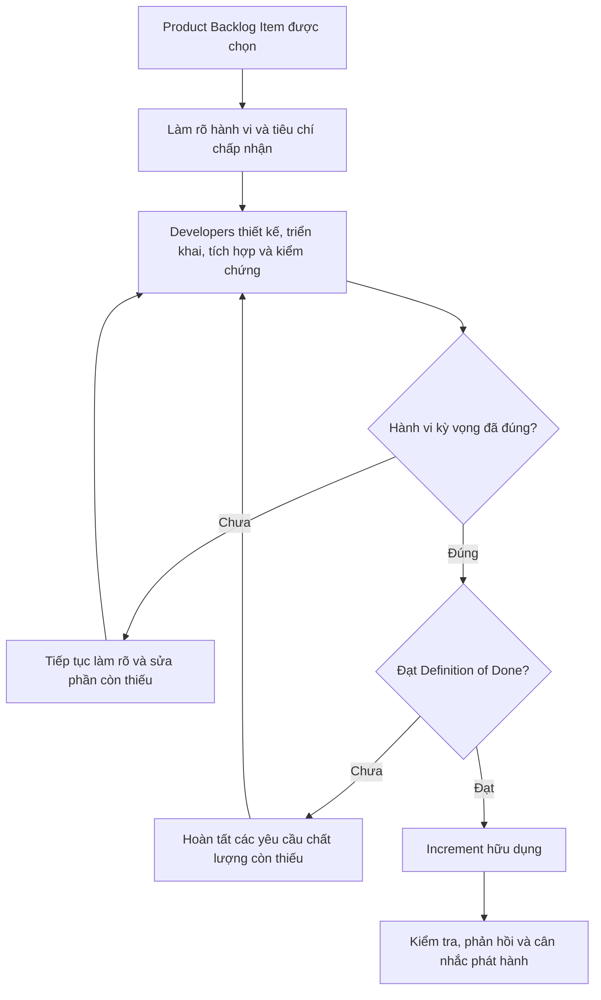

# Phân biệt Definition of Done với tiêu chí chấp nhận của từng hạng mục

## Mục tiêu học tập

Sau bài học, bạn có thể:

- Giải thích chính xác **Definition of Done (DoD)** là cam kết gắn với **Increment** trong Scrum, còn **tiêu chí chấp nhận (acceptance criteria)** thường mô tả hành vi cần đạt của **một Product Backlog Item (PBI)**.
- Phân biệt câu hỏi **“Hạng mục này có làm đúng điều người dùng cần?”** với **“Phần sản phẩm này có đạt chuẩn chất lượng để được xem là hoàn thành?”**.
- Đọc một ví dụ user story, viết tiêu chí chấp nhận theo các trường hợp thông thường, ngoại lệ và ranh giới, rồi xác định những kiểm tra chung phù hợp để đưa vào DoD.
- Xử lý tình huống tiêu chí chấp nhận đạt nhưng DoD chưa đạt, hoặc một checklist DoD có vẻ đạt nhưng hành vi thực tế vẫn sai.
- Trình bày vai trò của **Product Owner, Developers và Scrum Team** khi làm rõ yêu cầu, xác lập chất lượng, kiểm tra Increment và thảo luận kết quả.
- Nhận diện sự khác biệt giữa **DoD, tiêu chí chấp nhận, Definition of Ready, kiểm thử chấp nhận và quyết định phát hành**.
- Áp dụng vào một nền tảng học trực tuyến và phối hợp Agile qua phản hồi sớm, giao sản phẩm tăng dần, cải tiến liên tục.

## 1. Hai khái niệm cùng nói về “xong”, nhưng trả lời hai câu hỏi khác nhau

Giả sử nhóm đang xây chức năng **ghi danh khóa học miễn phí** cho một nền tảng học trực tuyến.

Product Owner nêu nhu cầu:

> “Là học viên đã đăng nhập, tôi muốn ghi danh một khóa học miễn phí còn mở để có thể bắt đầu học ngay.”

Nhóm thống nhất hành vi dự kiến:

- Học viên chưa ghi danh, khóa còn mở và còn chỗ → ghi danh thành công.
- Học viên đã ghi danh gửi yêu cầu lần nữa → không tạo bản ghi ghi danh trùng.
- Học viên chưa ghi danh nhưng khóa đã hết chỗ → không tạo lượt ghi danh mới và hiển thị lý do.

Những điều trên là ví dụ của **tiêu chí chấp nhận**: chúng mô tả **hành vi cụ thể phải đúng cho hạng mục “Ghi danh”**.

Nhưng nhóm còn phải giải quyết:

- Mã đã tích hợp vào phiên bản sản phẩm chung chưa?
- Kiểm thử thích hợp đã đạt chưa?
- Quyền truy cập và dữ liệu cá nhân đã được bảo vệ theo yêu cầu chưa?
- Thay đổi có ảnh hưởng tới chức năng ghi danh cũ hoặc khóa đang học không?
- Bản phần mềm có thực sự hữu dụng và có thể kiểm chứng không?

Những câu hỏi này thuộc **tiêu chuẩn chất lượng chung và khả năng hoàn thành**; một tập tiêu chuẩn như vậy được mô tả trong **Definition of Done**.

| Góc nhìn | Tiêu chí chấp nhận của hạng mục | Definition of Done |
| --- | --- | --- |
| **Câu hỏi chính** | Hạng mục này phải thể hiện hành vi, quy tắc và kết quả gì? | Phần sản phẩm phải đạt trạng thái chất lượng nào để gọi là hoàn thành? |
| **Phạm vi thông thường** | Một PBI, user story, lỗi hoặc khả năng sản phẩm cụ thể. | Chuẩn chung áp dụng cho Increment và công việc góp vào Increment theo chính sách đã xác lập. |
| **Mức đặc thù** | Rất cụ thể theo nghiệp vụ hoặc tình huống. | Có tính dùng chung, đủ rõ để mọi người hiểu cùng một chuẩn. |
| **Ví dụ** | “Ghi danh trùng không tạo bản ghi mới.” | “Mã được tích hợp; kiểm thử cần thiết đạt; kiểm soát quyền truy cập phù hợp được kiểm chứng.” |
| **Vị trí trong Scrum Guide** | Không được quy định là một artifact, commitment hay biểu mẫu bắt buộc. | Là **cam kết gắn với Increment** trong Scrum Guide 2020. |
| **Ai cùng làm rõ?** | Những người hiểu giá trị, hành vi và cách kiểm chứng; Product Owner và Developers thường cộng tác. | Scrum Team xác lập/tuân thủ theo quy định Scrum Guide, trong khuôn khổ chuẩn tổ chức nếu có. |
| **Tín hiệu chưa đạt** | Hành vi của hạng mục chưa đáp ứng kỳ vọng đã thống nhất. | Phần sản phẩm chưa đáp ứng chuẩn chất lượng để được xem là Increment hoàn thành. |

**Điểm then chốt:** tiêu chí chấp nhận giúp xác định **đúng cái gì** đối với một hạng mục; DoD giúp xác định **đạt chuẩn hoàn thành ở mức nào** đối với phần sản phẩm tạo ra.

Hai loại điều kiện **có thể giao nhau**. Ví dụ, một hạng mục liên quan phân quyền có tiêu chí chấp nhận về truy cập không hợp lệ; đồng thời DoD chung yêu cầu thay đổi phải được kiểm chứng phù hợp về bảo mật. Không cần cố chia chúng thành hai hộp tách biệt tuyệt đối.

## 2. DoD thuộc Scrum như thế nào?

Theo **Scrum Guide 2020**, Scrum có ba hiện vật (*artifacts*) và ba cam kết tương ứng:

| Hiện vật Scrum | Cam kết gắn với hiện vật | Trọng tâm |
| --- | --- | --- |
| **Product Backlog** | **Product Goal** | Mục tiêu dài hạn để định hướng cải thiện sản phẩm. |
| **Sprint Backlog** | **Sprint Goal** | Mục tiêu duy nhất mà Scrum Team cùng hướng tới trong Sprint. |
| **Increment** | **Definition of Done** | Chuẩn chất lượng minh bạch để một phần sản phẩm được coi là hoàn thành. |

Trong Scrum Guide, **Definition of Done** là mô tả chính thức về trạng thái của Increment khi nó đáp ứng những thước đo chất lượng được yêu cầu cho sản phẩm. Khi một Product Backlog Item đáp ứng DoD, một Increment được tạo ra. Mỗi Increment phải đáp ứng DoD và có thể kiểm tra để chắc chắn các Increment hoạt động cùng nhau.

Điều này có các hệ quả quan trọng:

1. **DoD không phải đề xuất “có cũng được”.** Nó là cam kết thuộc cấu trúc Scrum, khác với các checklist hoặc công cụ đội tự chọn.
2. **DoD không chỉ đánh giá từng người đã hoàn thành phần mình.** Nó bảo vệ khả năng tạo một phần **sản phẩm tích hợp và hữu dụng**.
3. **Công việc chưa đáp ứng DoD không được xem là một phần Increment hoàn thành.** Theo Scrum Guide, nó không được trình bày ở Sprint Review như công việc đã Done; nó cần quay lại Product Backlog để cân nhắc trong tương lai.
4. **Chất lượng không được giảm trong Sprint** để chạy theo hạn hoặc làm đẹp biểu đồ tiến độ.
5. **DoD tạo ra sự minh bạch:** khi đội nói “Done”, người liên quan hiểu cùng một mức chất lượng.

### 2.1. Ai định nghĩa và tuân thủ DoD?

Scrum Guide đặt ra các tình huống sau:

- Nếu tổ chức đã có **DoD tối thiểu** áp dụng cho sản phẩm, **mọi Scrum Team phải tuân thủ mức tối thiểu đó**.
- Nếu tổ chức chưa có chuẩn như vậy, **Scrum Team phải tạo DoD phù hợp cho sản phẩm**.
- Khi **nhiều Scrum Team cùng làm trên một sản phẩm**, họ phải **cùng định nghĩa và tuân thủ một DoD chung**.

Scrum Guide không đưa ra một danh sách áp dụng cho mọi sản phẩm, chẳng hạn “phải có 80% code coverage” hoặc “mọi thay đổi phải được ký bởi đúng ba người”. Những con số và thủ tục cụ thể, nếu cần, xuất phát từ **bối cảnh sản phẩm và chính sách tổ chức**, không phải quy tắc định lượng phổ quát của Scrum.

**Developers** chịu trách nhiệm giữ chất lượng bằng cách tuân thủ DoD. **Product Owner** không thể chỉ nói “tôi chấp nhận rồi” để biến phần việc chưa đạt DoD thành Increment đã hoàn thành. **Scrum Master** hỗ trợ đội hiểu và dùng Scrum đúng cách, bao gồm bảo vệ sự minh bạch của chất lượng.

### 2.2. DoD áp dụng ở đâu trong vòng Scrum?



Sơ đồ là **một mô hình giảng dạy để kiểm tra hai khía cạnh**, không phải quy trình bắt buộc phải kiểm tra tiêu chí chấp nhận rồi mới kiểm tra DoD. Trên thực tế, nghiệp vụ và chất lượng nên được thiết kế, kiểm chứng **xuyên suốt quá trình thực hiện**.

## 3. Tiêu chí chấp nhận của một hạng mục là gì?

**Acceptance criteria** là các điều kiện cụ thể, có thể quan sát hoặc kiểm tra để các bên thống nhất **hành vi cần có** khi một Product Backlog Item được thực hiện.

Ví dụ, yêu cầu mơ hồ:

> “Cho phép người học tiếp tục bài đang dở.”

Nếu chỉ đọc câu này, các bên có thể hình dung khác nhau:

- “Bài đang dở” là bài được mở gần nhất hay bài chưa hoàn thành đầu tiên?
- Nếu học viên chưa bắt đầu bài nào thì hiển thị gì?
- Nếu học viên không còn quyền vào khóa, có được truy cập bài dở không?
- Nếu người học dùng hai thiết bị, tiến độ nào là nguồn đáng tin?
- Khi không thể tải tiến độ, hệ thống có được tự chọn một bài bất kỳ?

Tiêu chí chấp nhận giúp biến cách hiểu thành những kết quả cụ thể để trao đổi và kiểm chứng.

### 3.1. Tiêu chí chấp nhận tốt nên có đặc điểm nào?

Một bộ tiêu chí hữu ích thường:

- **Gắn với giá trị và phạm vi hạng mục**: làm rõ điều người dùng cần, không đưa thêm các tính năng không liên quan.
- **Có thể kiểm chứng**: với một trạng thái đầu vào và hành động xác định, mọi người có thể quan sát kết quả.
- **Bao phủ tình huống quan trọng**: đường đi thông thường, từ chối, lỗi, trường hợp biên và rủi ro có tác động.
- **Sử dụng thuật ngữ nghiệp vụ rõ**: “đã ghi danh”, “còn chỗ”, “hoàn thành bài” cần có định nghĩa được thống nhất.
- **Không trói vào thiết kế kỹ thuật không cần thiết**: “API phải dùng lớp X” chỉ nên trở thành ràng buộc nếu có lý do bắt buộc.
- **Có người xác nhận quyết định nghiệp vụ**: các giả định chưa rõ cần được thảo luận với Product Owner hoặc người có thẩm quyền phù hợp.

Scrum Guide **không áp đặt một mẫu ghi acceptance criteria**. Đội có thể dùng danh sách gạch đầu dòng, bảng ví dụ, Given–When–Then hoặc công cụ khác.

### 3.2. Mối liên hệ với Product Backlog

Product Backlog là danh sách được sắp thứ tự về những gì cần để cải thiện sản phẩm. Product Backlog Items được làm rõ trong quá trình **refinement** khi Scrum Team học thêm. Tiêu chí chấp nhận có thể là một phần thông tin được làm rõ ở đó; chúng **không phải một artifact Scrum riêng**.

Các tiêu chí cũng có thể được cập nhật khi xuất hiện kiến thức mới. Nhưng thay đổi phạm vi nghiệp vụ cần được trao đổi minh bạch; không được lặng lẽ bỏ các trường hợp quan trọng chỉ để báo hạng mục đã Done.

## 4. Viết tiêu chí chấp nhận bằng ví dụ cụ thể

Giả sử user story:

> **Là học viên đã đăng nhập, tôi muốn ghi danh một khóa miễn phí đang mở để có thể bắt đầu học mà không cần nhân viên hỗ trợ.**

Nhóm thỏa thuận các quy tắc minh họa:

1. Chỉ chấp nhận một lượt ghi danh mới khi khóa còn mở và còn chỗ.
2. Người đã có lượt ghi danh được xác nhận không tạo thêm một lượt nữa nếu gửi lại yêu cầu.
3. Người chưa ghi danh nhưng khóa đã đầy nhận thông báo phù hợp và không chiếm chỗ.
4. Quyền truy cập nội dung dành cho học viên chỉ được cấp khi ghi danh hợp lệ.
5. Khi thất bại, không tạo trạng thái nửa chừng làm học viên bị tính đã ghi danh nhưng chưa có quyền cần thiết.

Đây là **quy tắc được chọn cho ví dụ học tập**, không phải chính sách mặc định của mọi nền tảng.

### 4.1. Diễn đạt bằng Given–When–Then

```gherkin
Feature: Ghi danh khóa học miễn phí

  Scenario: Ghi danh thành công khi còn chỗ
    Given Lan đã đăng nhập và chưa ghi danh khóa "Java nhập môn"
    And khóa "Java nhập môn" đang mở ghi danh và còn chỗ
    When Lan xác nhận ghi danh khóa học
    Then hệ thống ghi nhận đúng một lượt ghi danh hợp lệ
    And Lan nhìn thấy thông báo ghi danh thành công
    And Lan có thể mở bài học đầu tiên

  Scenario: Gửi lại yêu cầu ghi danh
    Given Lan đã đăng nhập và đã ghi danh khóa "Java nhập môn"
    When Lan gửi lại yêu cầu ghi danh khóa học
    Then hệ thống không tạo thêm lượt ghi danh
    And Lan nhìn thấy trạng thái đã ghi danh

  Scenario: Khóa học đã đủ chỗ
    Given Nam đã đăng nhập và chưa ghi danh khóa "Java nhập môn"
    And khóa "Java nhập môn" đã đủ chỗ theo quy tắc nghiệp vụ
    When Nam xác nhận ghi danh
    Then hệ thống không tạo lượt ghi danh cho Nam
    And Nam nhìn thấy thông báo khóa đã hết chỗ

  Scenario: Người chưa ghi danh không được xem bài riêng
    Given Nam đã đăng nhập nhưng chưa ghi danh khóa "Java nhập môn"
    When Nam yêu cầu mở bài học chỉ dành cho học viên đã ghi danh
    Then hệ thống từ chối truy cập nội dung riêng của bài học
```

Các kịch bản trên có thể dùng để trao đổi và thiết kế kiểm thử. **Văn bản Gherkin chưa tự chạy được**: cần có bước ánh xạ (*step definitions*), dữ liệu và môi trường tương ứng nếu muốn thực thi bằng công cụ như Cucumber.

### 4.2. Tìm trường hợp biên trước khi chốt

Một bảng ví dụ có thể làm lộ các giả định:

| ID | Tình huống | Câu hỏi cần thống nhất | Kết quả minh họa |
| --- | --- | --- | --- |
| A1 | Khóa sức chứa 2, đã có 1 người xác nhận. | “Còn chỗ” tính theo lượt nào? | Một học viên mới có thể ghi danh; tổng xác nhận là 2. |
| A2 | Khóa sức chứa 2, đã đủ 2 người. | Có danh sách chờ hay từ chối? | Trong lát này từ chối và không tạo ghi danh mới. |
| A3 | Học viên đã ghi danh bấm lại. | Trả trạng thái nào, có ghi thêm dữ liệu không? | Không tạo bản ghi mới, báo “đã ghi danh”. |
| A4 | Hai học viên cùng yêu cầu chỗ cuối. | Có thể xác nhận cả hai không? | Không được vượt sức chứa; chỉ một yêu cầu nhận chỗ cuối. |
| A5 | Học viên chưa đăng nhập. | Có ghi danh ẩn danh không? | Yêu cầu xác thực phù hợp; không tạo lượt xác nhận. |
| A6 | Ghi danh thành công nhưng cấp quyền mở bài gặp lỗi. | Có chấp nhận trạng thái không nhất quán không? | Cần quy tắc nhất quán/khôi phục được xác định trước; chưa thể chốt hạng mục. |

A6 cho thấy một điểm quan trọng: **không thể chỉ đánh dấu thành công ở giao diện** rồi coi yêu cầu đã đạt. Nếu người dùng chưa thực hiện được điều hứa hẹn và hệ thống có dữ liệu sai, hạng mục còn thiếu hành vi chấp nhận.

## 5. Xây Definition of Done chung cho sản phẩm

Một Scrum Team xây nền tảng học trực tuyến cần một DoD có thể áp dụng cho **các Increment của sản phẩm**, không chỉ cho riêng hạng mục ghi danh.

### 5.1. Ví dụ DoD minh họa

Một DoD phù hợp có thể được mô tả như sau:

| Nhóm tiêu chuẩn chung | Điều kiện minh họa để Increment được xem là hoàn thành | Vì sao quan trọng? |
| --- | --- | --- |
| **Hành vi và tích hợp** | Phần mới hoạt động với các phần sản phẩm liên quan; các hành vi đã thống nhất được kiểm chứng. | Tránh “từng module xong nhưng người dùng chưa dùng được”. |
| **Mã và thiết kế** | Mã được tích hợp, rà soát theo chính sách đội; không có lỗi nghiêm trọng đã biết ngăn mục tiêu. | Giảm nguy cơ lỗi và khó bảo trì. |
| **Kiểm thử** | Các kiểm thử tự động/thủ công cần thiết theo mức rủi ro được thực hiện và đạt; lỗi có tác động chưa xử lý được đánh giá minh bạch. | Bảo vệ tính đúng đắn và khả năng thay đổi. |
| **Bảo mật/quyền truy cập** | Thay đổi được kiểm tra theo tiêu chuẩn bảo mật, dữ liệu cá nhân và quyền cần áp dụng. | Tránh hỏng chức năng kèm lộ dữ liệu. |
| **Khả năng sử dụng** | Hành vi quan trọng có thể thực hiện được; yêu cầu trải nghiệm/khả năng tiếp cận liên quan được đáp ứng. | Increment phải hữu dụng, không chỉ chạy về mặt kỹ thuật. |
| **Triển khai và vận hành** | Cấu hình, dữ liệu, ghi log/metric và cách khôi phục phù hợp rủi ro đã sẵn sàng theo chính sách. | Giảm rủi ro khi đưa thay đổi đến người dùng. |
| **Tài liệu cần thiết** | Tài liệu hỗ trợ vận hành, giao diện lập trình hoặc chính sách nghiệp vụ được cập nhật nếu thay đổi ảnh hưởng. | Hạn chế kiến thức chỉ nằm trong đầu người viết mã. |

**Lưu ý:** đây là **bộ tiêu chuẩn giảng dạy để nhóm cân nhắc**, không phải danh sách bắt buộc từ Scrum Guide. Cần biến những câu còn trừu tượng như “kiểm thử phù hợp” thành **chính sách đủ rõ trong bối cảnh thực tế**; tránh dùng checklist dài nhưng không ai hiểu điều kiện đạt.

Ví dụ một dịch vụ xử lý thanh toán có thể cần chính sách nghiêm hơn về giao dịch, nhật ký và bảo mật; thay đổi văn bản thuần túy có thể có một số kiểm tra không áp dụng. DoD cần thể hiện rõ **điều kiện và ngoại lệ hợp lệ**, không cho phép mỗi người tự quyết tùy ý rằng chất lượng là đủ.

### 5.2. “DoD chung” không có nghĩa mọi PBI đều có cùng test case

Đội thống nhất **chuẩn và cách kiểm soát chung**. Nội dung kiểm tra cụ thể vẫn phụ thuộc thay đổi.

Ví dụ:

- Hạng mục “đổi tiêu đề khóa” cần kiểm tra giao diện, nội dung, khả năng tiếp cận theo phạm vi.
- Hạng mục “ghi danh có phí” cần kiểm tra tính nhất quán giao dịch, hoàn tiền/không thu trùng theo yêu cầu, quyền truy cập và tích hợp thanh toán.
- Hạng mục “lưu tiến độ” cần kiểm tra bảo toàn dữ liệu và hành vi cập nhật cạnh tranh khi rủi ro liên quan.

DoD có thể yêu cầu “kiểm chứng bảo mật tương xứng rủi ro”; tiêu chí chấp nhận của **một hạng mục quyền truy cập cụ thể** mô tả chính xác ai có thể hay không thể xem nội dung.

### 5.3. Vì sao DoD không chỉ là “đã qua QA”?

Nếu kiểm thử viên là người cuối cùng kiểm tra một phần mềm chưa được tích hợp đầy đủ, việc gắn nhãn “QA passed” có thể tạo cảm giác Done sai. Chất lượng trong Scrum là **trách nhiệm của Developers với tư cách tập thể**, không phải một “cửa chuyển giao” để đẩy trách nhiệm cho một chức danh.

DoD nên giúp cả nhóm làm đúng từ sớm: cùng làm rõ hành vi, tích hợp thường xuyên, kiểm thử ở tầng phù hợp, xử lý các ràng buộc và quan sát kết quả.

## 6. Hai lớp điều kiện trong một hạng mục cụ thể

Lấy PBI **“Tiếp tục bài học chưa hoàn thành gần nhất”**:

**Tiêu chí chấp nhận theo hạng mục:**

- Nếu học viên có một bài đang dở, trang khóa hiển thị lựa chọn “Tiếp tục học” dẫn đến đúng bài theo quy tắc đã thống nhất.
- Nếu chưa bắt đầu bài nào, trang khóa hiển thị “Bắt đầu học”.
- Nếu học viên mất quyền truy cập khóa, không mở được nội dung riêng dù có URL cũ.
- Nếu không tải được tiến độ, giao diện không giả vờ mở bài thành công hoặc ghi đè dữ liệu sai.

**DoD chung có thể yêu cầu:**

- Chức năng mới đã tích hợp với sản phẩm hiện tại.
- Các kiểm thử theo rủi ro, gồm quyền truy cập và hồi quy liên quan, đạt.
- Không có lỗi nghiêm trọng đã biết ngăn luồng người dùng đã chọn.
- Thay đổi cấu hình/dữ liệu, quan sát và tài liệu cần thiết sẵn sàng theo chính sách.
- Increment có thể dùng và kiểm chứng ở môi trường phù hợp, không còn phần triển khai cần thiết bị để dành.

Có thể xem hai lớp qua một ma trận:

| Tiêu chí của PBI đã đạt? | DoD đã đạt? | Cách hiểu và quyết định |
| --- | --- | --- |
| **Có** | **Có** | Hạng mục đáp ứng hành vi kỳ vọng và chuẩn chất lượng; có thể đóng góp Increment hữu dụng. |
| **Có** | **Chưa** | Chưa Done: có thể hành vi hoạt động trên máy lập trình nhưng chưa tích hợp/kiểm thử cần thiết. |
| **Chưa** | **Có trên checklist** | **Không thể kết luận Done.** Hành vi sai cho thấy cách áp dụng hoặc nội dung DoD còn thiếu; phải sửa phần mềm và rà soát chuẩn kiểm chứng. |
| **Chưa** | **Chưa** | Chưa Done: cần tiếp tục làm rõ, phát triển và bảo đảm chất lượng. |

Hàng thứ ba rất quan trọng. Không nên tuyên bố “DoD đã đạt, vì đã tick hết checkbox” khi hành vi cốt lõi mà hạng mục hứa hẹn **chưa đúng**. Một định nghĩa hoàn thành không phản ánh tính đúng đắn và khả năng sử dụng của sản phẩm **chưa phục vụ mục đích của DoD**.

### 6.1. Khi hai loại tiêu chí trùng nhau

Ví dụ tiêu chí chấp nhận viết: “Tài khoản khác không được xem bài riêng của Lan.” DoD chung viết: “Các ràng buộc quyền truy cập liên quan đến thay đổi phải được kiểm chứng.”

Đây **không phải trùng lặp vô ích**:

- Tiêu chí chấp nhận chỉ ra **quy tắc quyền của hạng mục cụ thể**.
- DoD quy định **nguyên tắc bảo đảm quyền được kiểm chứng với mọi Increment có liên quan**.

Nhóm có thể dùng một kiểm thử hoặc tập bằng chứng chung để đáp ứng cả hai, miễn kết quả rõ ràng. Không cần nhân đôi toàn bộ hoạt động kiểm tra chỉ để có hai dấu tick.

## 7. DoD, acceptance criteria, kiểm thử chấp nhận và DoR khác nhau thế nào?

Bốn thuật ngữ đều thường xuất hiện trên bảng Agile, nhưng chúng phục vụ các câu hỏi khác nhau.

| Thuật ngữ | Câu hỏi | Tính chất trong Scrum | Ví dụ |
| --- | --- | --- | --- |
| **Acceptance criteria** | Hạng mục cụ thể phải thể hiện kết quả nào? | Thực hành làm rõ PBI; không phải commitment được Scrum Guide quy định. | Ghi danh trùng không tạo lượt mới. |
| **Acceptance test** | Cách nào kiểm tra hành vi mong đợi? | Kỹ thuật kiểm chứng do nhóm lựa chọn. | Chạy kịch bản API/UI với học viên đã ghi danh. |
| **Definition of Done** | Increment phải đạt chuẩn chất lượng chung nào để Done? | **Cam kết Scrum bắt buộc**, gắn với Increment. | Mã tích hợp, kiểm thử liên quan đạt, kiểm soát dữ liệu đúng. |
| **Definition of Ready (DoR)** | Hạng mục đã đủ rõ để cân nhắc bắt đầu chưa? | Quy ước tùy chọn, không phải commitment/sự kiện bắt buộc. | Mục tiêu rõ, các giả định chính được nhận diện, có ví dụ chấp nhận ban đầu. |

### 7.1. DoR không bảo đảm Done

Một PBI có mô tả rõ và đã được chọn vào Sprint vẫn có thể chưa hoàn thành do lỗi tích hợp hoặc kiểm thử. DoR, nếu đội sử dụng, giúp **giảm bất định trước khi bắt đầu**. DoD kiểm tra **trạng thái phần sản phẩm được tạo ra**.

Không nên dùng DoR như cổng xét duyệt cứng nhắc làm nhóm không thể học thêm trong Sprint; cũng không được dùng nó để hạ yêu cầu DoD.

### 7.2. Acceptance test khác “Product Owner ký nhận”

Một kiểm thử chấp nhận có thể chứng minh một số tình huống nghiệp vụ đúng. Product Owner có thể xem xét hành vi, phản hồi và điều chỉnh Product Backlog, nhưng Scrum Guide **không quy định một sự kiện ký nghiệm thu riêng cho từng story**.

Việc Product Owner đồng ý với một màn hình minh họa **không tự làm biến mất lỗi tích hợp, bảo mật hay thiếu điều kiện DoD**. Ngược lại, việc một kỹ sư nói “test đều xanh” cũng không đủ nếu bài toán sản phẩm đang được hiểu sai.

### 7.3. Done khác Released

- **Done:** phần sản phẩm đáp ứng DoD và đóng góp vào Increment hữu dụng.
- **Released:** phần mềm được cung cấp cho đối tượng sử dụng theo quyết định và quy trình phát hành phù hợp.

Scrum cho phép **nhiều Increment trong một Sprint**, và một Increment có thể được đưa tới stakeholders trước khi kết thúc Sprint. **Sprint Review không phải cổng phát hành bắt buộc.**

Một Increment đạt DoD có thể chưa được mở cho tất cả người dùng vì chiến lược sản phẩm, thời điểm truyền thông hoặc chính sách triển khai; điều đó **không đồng nghĩa Increment chưa Done**. Ngược lại, tự ý triển khai phần chưa đạt các kiểm soát bắt buộc không thể được biện minh bằng câu “chúng ta Agile”.

## 8. Khi nào phải nói “chưa Done”?

Một Scrum Team cần tránh việc đổi nhãn trạng thái để khớp kế hoạch nhưng làm sai sự thật về sản phẩm.

### Tình huống A — “Đã qua acceptance criteria nhưng chưa tích hợp”

Học viên có thể ghi danh trên môi trường riêng của lập trình viên, các ví dụ thông thường đều qua. Tuy nhiên, thay đổi chưa tích hợp với hệ thống quyền truy cập của sản phẩm, kiểm thử hồi quy chưa thực hiện.

**Kết luận:** chưa đạt DoD nếu tích hợp và kiểm thử liên quan là điều kiện bắt buộc. Không đánh dấu Increment hoàn thành; tập trung hoàn tất phần còn thiếu.

### Tình huống B — “Mọi bước QA đã tick nhưng khóa hết chỗ vẫn được ghi danh”

Danh sách chất lượng ghi rằng “build xanh, code review xong, tài liệu đã cập nhật”. Nhưng kiểm thử nghiệp vụ phát hiện học viên vẫn ghi danh khi khóa đã đủ chỗ.

**Kết luận:** không thể gọi hành vi sai là hoàn thành chỉ vì checklist xanh. Developers sửa lỗi và cần xem vì sao các điều kiện kiểm chứng không phát hiện vi phạm quy tắc cốt lõi.

### Tình huống C — “Product Owner nói chấp nhận tạm để kịp Sprint Review”

Product Owner thấy giao diện đẹp và muốn báo Done dù quyền truy cập bài học bị lỗi. Nếu quyền truy cập thuộc DoD, Product Owner **không có thẩm quyền hạ DoD theo cách đó**.

**Kết luận:** minh bạch phần đã thực hiện, phần chưa đạt DoD và tác động. Thương lượng lại phạm vi tương lai hoặc tiếp tục sửa; không báo một Increment chưa đáp ứng tiêu chuẩn là Done.

### Tình huống D — “Story quá lớn, không thể hoàn tất trong Sprint”

Một PBI “học offline trên mọi thiết bị” còn quá nhiều luồng lỗi, dữ liệu và kiểm thử. Nhóm đã làm được một phần nhưng chưa có Increment hữu dụng theo phạm vi và DoD đã thống nhất.

**Kết luận:** không dùng “80% Done” để tính vào Increment. Phần chưa Done quay về Product Backlog để cân nhắc; nhóm có thể trao đổi với Product Owner về cách tách thành **lát dọc có giá trị và chất lượng** ở lần tiếp theo. Đừng ngầm cắt phần kiểm thử để hợp thức hóa tiến độ.

### Tình huống E — “Phần hoàn thành nhỏ hơn dự kiến”

Nhóm nhận ra toàn bộ chức năng gồm nhiều trường hợp ngoại lệ. Sau trao đổi với Product Owner và làm rõ Sprint Goal, nhóm chọn lát nhỏ hơn nhưng **vẫn tạo hành vi hữu dụng, có thể kiểm chứng và đạt DoD**.

**Kết luận:** đây có thể là thích nghi hợp lệ. Phạm vi của lát cắt được quyết định minh bạch; **chuẩn chất lượng không đổi**. Không được gọi việc bỏ mất hành vi cốt lõi mà người dùng cần là “chia nhỏ” nếu kết quả không còn giá trị.

## 9. Trách nhiệm phối hợp của Product Owner và Developers

**Product Owner** chịu trách nhiệm tối đa hóa giá trị sản phẩm và quản lý hiệu quả Product Backlog. **Developers** chịu trách nhiệm tạo các khía cạnh của Increment hữu dụng trong mỗi Sprint và giữ chất lượng thông qua tuân thủ DoD. **Scrum Master** chịu trách nhiệm thiết lập Scrum như định nghĩa và hỗ trợ hiệu quả của Scrum Team.

Trong thực tế, ba trách nhiệm bổ sung nhau:

| Hoạt động | Cách phối hợp hợp lý |
| --- | --- |
| Xác định giá trị PBI | Product Owner trao đổi nhu cầu, mục tiêu và thứ tự ưu tiên với Developers và người liên quan. |
| Làm rõ acceptance criteria | Nghiệp vụ, phát triển và kiểm thử cùng đưa ví dụ, tìm phản ví dụ; Product Owner xác nhận quyết định thuộc giá trị/quy tắc sản phẩm. |
| Lập kế hoạch làm PBI | Developers quyết định cách hiện thực và kiểm chứng, phối hợp để đạt Sprint Goal. |
| Xây dựng và kiểm tra | Developers chịu trách nhiệm chất lượng Increment và tuân thủ DoD; không đẩy hết việc “đảm bảo Done” cho một người QA. |
| Nhận phản hồi | Scrum Team cùng stakeholders kiểm tra kết quả, hành vi và hoàn cảnh mới; Product Backlog được điều chỉnh khi cần. |
| Xử lý DoD chưa đạt | Developers minh bạch phần thiếu, phối hợp khắc phục; Product Owner đánh giá lại thứ tự và phạm vi nếu cần. |
| Cải thiện DoD/cách làm | Scrum Team xem xét các lỗi lọt, giới hạn của chính sách chất lượng và lựa chọn cải tiến thích hợp. |

**DoD không phải quyền “duyệt kỹ thuật” độc quyền của Scrum Master**, và acceptance criteria không phải đơn vị để Product Owner phân công chi tiết task cho từng Developer. Mục tiêu là **cùng hiểu kết quả cần tạo và cùng bảo vệ chất lượng**.

### 9.1. Trao đổi ba góc nhìn để phát hiện khác biệt

Một cuộc trao đổi ngắn có thể có:

- **Góc nhìn nghiệp vụ:** “Khi học viên đã ghi danh khóa học nhưng bị khóa tài khoản, có được mở bài không?”
- **Góc nhìn phát triển:** “Quyền truy cập có được kiểm tra lại trên mỗi yêu cầu không? Điều gì xảy ra nếu trạng thái thay đổi giữa hai lần gọi API?”
- **Góc nhìn kiểm thử:** “Tôi sẽ tạo ví dụ tài khoản bị khóa sau khi đã ghi danh và kiểm tra không lộ nội dung.”

Kết quả có thể là **tiêu chí chấp nhận mới** cho hạng mục quyền truy cập. Đồng thời, đội xem **DoD có yêu cầu kiểm tra quyền đối với các thay đổi liên quan hay không**. Hai loại điều kiện được cải thiện theo hai góc nhìn, không cạnh tranh nhau.

## 10. Đọc trạng thái một Sprint bằng tiêu chí chấp nhận và DoD

Giả sử Sprint Goal là:

> “Học viên đã ghi danh một khóa miễn phí có thể mở bài học đầu tiên với quyền truy cập chính xác.”

Đến gần cuối Sprint:

| PBI | Tiêu chí chấp nhận | DoD chung | Trạng thái thực tế |
| --- | --- | --- | --- |
| **P1 — Ghi danh hợp lệ** | Đạt tất cả trường hợp quan trọng trong phạm vi đã chốt. | Tích hợp, kiểm thử và tiêu chuẩn dữ liệu đạt. | **Done** — đóng góp Increment. |
| **P2 — Mở bài đầu** | Giao diện hiển thị đúng nhưng trường hợp học viên chưa ghi danh còn lọt quyền. | Kiểm soát quyền chưa đạt. | **Chưa Done**. |
| **P3 — Xem khóa của tôi** | Hành vi đúng theo ví dụ. | Chưa chạy kiểm thử hồi quy bắt buộc và chưa hoàn tất tích hợp. | **Chưa Done**. |
| **P4 — Cải thiện câu chữ** | Hành vi/hiển thị đã thống nhất đạt. | Tích hợp, kiểm thử liên quan và DoD đạt. | **Done** — đóng góp Increment. |

Trong Sprint Review, Scrum Team trình bày **những gì đã hoàn thành thật**, kiểm tra sản phẩm cùng stakeholders và thảo luận điều tiếp theo. P2/P3 có thể được trao đổi như những **phần việc chưa hoàn thành, trở ngại hoặc rủi ro**, nhưng **không được trình bày như Increment Done**.

Nếu Sprint Goal chưa đạt, đội không nên đổi tên mục tiêu hoặc đánh dấu Done giả. Họ cần làm rõ thực trạng, nhận phản hồi và học từ nguyên nhân trong Sprint Retrospective.

### 10.1. “Giao nhiều story” không đồng nghĩa “có Increment tốt”

Có thể có mười thẻ “code xong” nhưng không thẻ nào đạt DoD. Kết quả khi đó là **nhiều công việc dở dang**, không phải mười phần giá trị hữu dụng.

Một cách nhìn tốt hơn là hỏi:

- Người dùng có thực hiện được hành trình mục tiêu không?
- Những phần đã Done có hoạt động chung với sản phẩm hiện tại không?
- Lỗi nào còn tồn tại và rủi ro của chúng là gì?
- Có thể chứng minh chuẩn chất lượng bằng kiểm thử và quan sát không?
- Đội cần thay đổi cách phối hợp gì để hoàn thành sớm và liên tục hơn?

Đội có thể sử dụng Kanban, giới hạn WIP hoặc thực hành XP như TDD, CI, lập trình cặp để giảm tồn đọng. Đây là **thực hành bổ sung**, không thay DoD hoặc các artifact Scrum.

## 11. Chất lượng tiêu chí: đủ cụ thể nhưng không “viết lại toàn bộ hệ thống”

Tiêu chí chấp nhận quá ít khiến mọi người hiểu khác nhau; quá nhiều chi tiết không cần thiết khiến hạng mục khó thích nghi.

### 11.1. Nhận diện tiêu chí mơ hồ

| Tiêu chí chưa đủ rõ | Câu hỏi làm rõ | Phiên bản cụ thể hơn |
| --- | --- | --- |
| “Ghi danh phải nhanh.” | Nhanh với ai, điều kiện tải nào, đo từ mốc nào? | “Trong điều kiện tải thử đã thống nhất, người dùng nhận phản hồi trong ngưỡng hiệu năng do đội chốt.” |
| “Người học đủ điều kiện được vào bài.” | “Đủ điều kiện” dựa trên quyền gì? | “Tài khoản đã đăng nhập và có lượt ghi danh hợp lệ được xem nội dung khóa tương ứng.” |
| “Không có lỗi.” | Không có lỗi loại nào, được phát hiện bằng cách nào? | “Các tình huống quyền truy cập, ghi danh trùng và lỗi giao dịch quan trọng đã được kiểm chứng.” |
| “Tiến độ luôn đúng.” | Khi hai thiết bị gửi cập nhật đồng thời thì sao? | “Quy tắc giải quyết cập nhật đồng thời được xác nhận; ví dụ hai thiết bị không làm mất trạng thái hoàn thành theo quy tắc đó.” |
| “Hoàn thành khóa thì có chứng chỉ.” | Hoàn thành là xem đủ bài, đạt bài thi hay cả hai? | “Học viên đạt toàn bộ điều kiện đã chốt, gồm ngưỡng điểm và quy tắc làm tròn, mới được cấp chứng chỉ.” |

Những tiêu chí “cụ thể hơn” trong bảng vẫn cần **ngưỡng hoặc ví dụ chính thức** nếu sản phẩm thực sự yêu cầu. Ví dụ không nên tự bịa con số hiệu năng để trông có vẻ kiểm chứng được.

### 11.2. Trường hợp nên tách PBI

Nếu một user story có hàng chục quy tắc về khóa miễn phí, khóa có phí, hoàn tiền, danh sách chờ, mã giảm giá và chứng chỉ, nhóm nên cân nhắc **tách thành các lát giá trị dọc**.

Ví dụ:

1. Ghi danh khóa miễn phí còn chỗ.
2. Xử lý điều kiện tiên quyết.
3. Quản lý danh sách chờ khi hết chỗ.
4. Ghi danh khóa có phí với kiểm soát giao dịch phù hợp.

Mỗi lát vẫn cần **đủ hành vi có ý nghĩa** và **đáp ứng cùng chuẩn chất lượng** trong phạm vi áp dụng. Tách PBI không phải chuyển kiểm thử hoặc bảo mật sang “story chất lượng” làm sau nếu phần hiện tại đang thiếu kiểm soát bắt buộc.

## 12. Thay đổi DoD hoặc tiêu chí chấp nhận khi có hiểu biết mới

Agile khuyến khích điều chỉnh khi có bằng chứng mới. Tuy vậy, **điều chỉnh phạm vi** và **giảm chất lượng** không giống nhau.

### 12.1. Tiêu chí chấp nhận có thể được làm rõ

Nếu Product Owner và Developers phát hiện từ người dùng rằng **ghi danh trùng phải trả về trạng thái hiện có thay vì thông báo lỗi chung**, họ có thể cập nhật tiêu chí chấp nhận cho PBI liên quan, trao đổi tác động lên kế hoạch và kiểm thử.

Đây là cách **học thêm về hành vi cần có**.

### 12.2. DoD có thể được cải thiện, không được hạ để che lỗi

Nếu nhóm phát hiện lỗi cấp quyền lọt ra sau khi phát hành, một cải tiến hợp lý là bổ sung hướng dẫn hoặc kiểm tra bắt buộc về phân quyền trong DoD, tăng tự động hóa hoặc đưa kiểm thử quyền vào quá trình thực hiện sớm.

Ngược lại, nếu cuối Sprint có ít thời gian, việc xóa yêu cầu kiểm thử quan trọng khỏi DoD để chuyển nhiều story sang Done là **trái mục tiêu minh bạch và nguyên tắc không giảm chất lượng**. Nếu thay đổi DoD, cần đánh giá chính sách sản phẩm, tiêu chuẩn tổ chức và tác động đến khả năng kiểm chứng Increment; không dùng sự thay đổi để hợp thức hóa việc chưa hoàn thành.

### 12.3. Một tình huống về sự khác nhau

- **Thay đổi tiêu chí chấp nhận hợp lệ:** ban đầu “người học thấy danh sách tất cả khóa đã ghi danh”; sau phản hồi, nhóm chọn lát đầu chỉ hiển thị khóa đang học và ghi rõ các trường hợp dữ liệu liên quan.
- **Hạ chất lượng không hợp lệ:** “vì bản đầu nhỏ, bỏ kiểm tra quyền truy cập giữa hai tài khoản”; nếu quyền riêng tư là yêu cầu bắt buộc, không thể cắt bỏ.
- **Cải thiện DoD:** sau nhiều lỗi do chưa tích hợp, đội bổ sung điều kiện kiểm thử xuyên suốt đối với các luồng trọng yếu và tiêu chuẩn rõ khi áp dụng.

Điểm chung của cách thích nghi đúng là **thỏa thuận minh bạch về giá trị và phạm vi**, đồng thời **giữ chất lượng cần có**.

## 13. Khi nhiều Scrum Team làm cùng một sản phẩm

Một sản phẩm học trực tuyến lớn có thể có Scrum Team phụ trách ghi danh và Scrum Team phụ trách nội dung học tập. Nếu mỗi đội có nghĩa khác nhau của “Done” thì Increment tích hợp có thể rủi ro:

- Đội ghi danh nói Done khi API chạy được nhưng chưa kiểm thử phân quyền.
- Đội học tập nói Done chỉ khi kiểm thử đầy đủ, có quan sát và sẵn sàng vận hành.
- Khi tích hợp, người học không thể đi từ ghi danh tới mở bài theo cách nhất quán.

Scrum Guide nêu rõ: **nhiều Scrum Team cùng làm một sản phẩm phải cùng xác định và tuân thủ một DoD**. Như vậy, tất cả phần đóng góp cùng một chuẩn hoàn thành, giữ khả năng tạo Increment hợp nhất.

Các tiêu chí chấp nhận **vẫn có thể khác theo PBI**:

| PBI / Nhóm chức năng | Tiêu chí chấp nhận riêng | DoD chung |
| --- | --- | --- |
| Đăng ký khóa | Không ghi danh trùng, không vượt sức chứa, cấp quyền đúng. | Tích hợp, kiểm chứng chất lượng, bảo mật và vận hành theo chuẩn sản phẩm. |
| Tiếp tục học | Mở đúng bài dở, không mất dữ liệu tiến độ. | Cùng chuẩn chất lượng được hai Scrum Team tuân thủ. |
| Cấp chứng chỉ | Chỉ cấp khi đạt điều kiện hoàn thành đã xác nhận. | Cùng chuẩn chất lượng được hai Scrum Team tuân thủ. |

Các đội có thể áp dụng kiểm tra **chuyên biệt hơn theo rủi ro** mà không làm mâu thuẫn hoặc hạ thấp DoD chung. Quan trọng là **cùng hiểu trạng thái hoàn thành** và có thể tích hợp thành phần sản phẩm hữu dụng.

## 14. Hướng dẫn thực hành: thiết lập và kiểm tra hai loại điều kiện

Một cách làm thực tế cho nhóm đang triển khai Scrum:

### Bước 1 — Xác định Product Goal và một PBI nhỏ có giá trị

Ví dụ Product Goal là **“học viên có thể tự bắt đầu một khóa học”**, PBI là **“Ghi danh khóa miễn phí còn chỗ”**.

### Bước 2 — Làm rõ tiêu chí chấp nhận bằng ví dụ

Mời góc nhìn sản phẩm, phát triển và chất lượng thảo luận các trường hợp thông thường và phản ví dụ. Ghi quy tắc đã thống nhất, câu hỏi còn mở và ai cần quyết định.

### Bước 3 — Kiểm tra DoD chung của sản phẩm

Đối chiếu yêu cầu tổ chức và DoD đội với các rủi ro thực tế. Nếu chưa có DoD phù hợp, Scrum Team tạo chuẩn trước khi xem phần việc là hoàn thành theo Scrum.

### Bước 4 — Lập kế hoạch kiểm chứng sớm

Developers xác định kiểm thử ở các tầng phù hợp, dữ liệu, môi trường, quyền truy cập, cách tích hợp và phối hợp. Không dồn tất cả kiểm thử sang cuối Sprint.

### Bước 5 — Triển khai lát dọc, kiểm tra cả hành vi lẫn chất lượng

Khi có Increment tiềm năng, nhóm xem **hành vi của PBI đã đúng chưa**, **các yêu cầu DoD đã đạt chưa**, **tích hợp có hoạt động không**. Cần bằng chứng thực tế, không chỉ dấu tick.

### Bước 6 — Minh bạch trạng thái

Nếu còn điều kiện bắt buộc chưa đạt, **không gọi hạng mục là Done**. Nêu phần thiếu, tác động lên Sprint Goal và cách xử lý. Developers điều chỉnh kế hoạch; Product Owner tham gia nếu phải thương lượng phạm vi giá trị.

### Bước 7 — Học từ phản hồi

Dùng Sprint Review và các lần kiểm chứng người dùng để điều chỉnh Product Backlog, các ví dụ chấp nhận và thứ tự ưu tiên. Dùng Sprint Retrospective để cải thiện chất lượng, sự phối hợp, cách kiểm thử và nội dung DoD khi thích hợp.

### Checklist thảo luận ngắn

```text
PBI: [Tên hạng mục và giá trị người dùng]

TIÊU CHÍ CHẤP NHẬN
[ ] Hành vi thông thường được mô tả cụ thể.
[ ] Ngoại lệ và ranh giới quan trọng đã được làm rõ.
[ ] Quy tắc quyền truy cập/dữ liệu liên quan đã được kiểm chứng.
[ ] Những câu hỏi còn mở được nêu minh bạch.
[ ] Ví dụ có kết quả quan sát được và người có thẩm quyền nghiệp vụ xác nhận.

DEFINITION OF DONE (theo chuẩn sản phẩm hiện hành)
[ ] Thay đổi đã tích hợp với sản phẩm.
[ ] Kiểm thử cần thiết theo phạm vi/rủi ro đạt.
[ ] Các tiêu chuẩn bảo mật, dữ liệu và vận hành liên quan đạt.
[ ] Không còn điều kiện DoD bắt buộc chưa hoàn thành.
[ ] Increment hữu dụng và hoạt động cùng các phần đã có.

QUYẾT ĐỊNH
[ ] Chỉ báo Done nếu sản phẩm đáp ứng đầy đủ yêu cầu.
[ ] Nếu chưa Done, ghi phần thiếu và kế hoạch xử lý.
```

Đây là **mẫu minh họa**, không phải DoD toàn ngành hay công cụ bắt buộc của Scrum. Đội cần áp dụng **DoD chính thức của chính sản phẩm**, không dùng checklist trong bài để thay thế.

## 15. Bài tập vận dụng

### Bài tập A — Phân loại DoD hay tiêu chí chấp nhận

Với mỗi phát biểu, hãy xác định nó phù hợp nhất với **tiêu chí chấp nhận của PBI**, **DoD chung**, hoặc **cần làm rõ thêm**:

| STT | Phát biểu |
| ---: | --- |
| 1 | Khi học viên đã ghi danh gửi lại yêu cầu, không tạo thêm lượt ghi danh. |
| 2 | Mọi thay đổi cần được tích hợp và qua các kiểm tra bắt buộc theo chuẩn sản phẩm. |
| 3 | Học viên chưa đăng nhập được chuyển sang bước xác thực trước khi ghi danh. |
| 4 | Increment đáp ứng các yêu cầu quyền truy cập và bảo mật được xác định cho sản phẩm. |
| 5 | Chức năng phải hoạt động nhanh. |
| 6 | Nếu khóa chỉ có một chỗ và hai người đăng ký đồng thời, hệ thống không xác nhận quá sức chứa. |
| 7 | Tài liệu API và hướng dẫn vận hành liên quan được cập nhật khi cần theo chính sách chất lượng chung. |
| 8 | Khi bài học chưa hoàn thành, nút “Tiếp tục học” dẫn đến đúng bài được xác định bởi quy tắc nghiệp vụ. |

**Định hướng:** 1, 3, 6, 8 là tiêu chí theo PBI; 2, 4, 7 là DoD chung minh họa; 5 cần thêm bối cảnh và ngưỡng đo. Một số nội dung có thể xuất hiện ở cả hai cấp nếu được diễn đạt đúng vai trò và không tạo kiểm tra trùng lặp vô ích.

### Bài tập B — PBI qua acceptance tests nhưng chưa Done

Tính năng “Ghi danh khóa Java” vượt qua ba kiểm thử chấp nhận trên môi trường riêng: còn chỗ, hết chỗ, gửi lại yêu cầu. Nhưng bản xây dựng chưa tích hợp vào sản phẩm, chưa kiểm thử quyền truy cập và đã có một lỗi ảnh hưởng dữ liệu được xác nhận.

Trả lời:

1. Có được báo hạng mục là **Done** không? Vì sao?
2. Phần nào thuộc acceptance criteria, phần nào thuộc DoD?
3. Developers cần làm gì trước khi gọi đây là Increment hữu dụng?
4. Product Owner có thể “chấp nhận ngoại lệ” để bỏ kiểm thử bảo mật đã nằm trong DoD không?
5. Trong Sprint Review, đội nên mô tả trạng thái như thế nào để tránh đánh lừa stakeholders?

**Gợi ý:** các bài kiểm thử nghiệp vụ đã đạt không loại bỏ điều kiện DoD. Đội phải hoàn tất kiểm tra và tích hợp cần thiết, hoặc báo minh bạch rằng hạng mục chưa Done. Không dùng một quyết định mang tính cá nhân để biến sản phẩm chưa đạt chuẩn chất lượng thành Increment hoàn thành.

### Bài tập C — Xây hai lớp điều kiện cho “Tiếp tục học”

User story:

> “Là học viên đang học khóa Java, tôi muốn quay lại bài chưa hoàn thành gần nhất để tiếp tục mà không phải tìm từ đầu.”

Hãy viết:

1. **Năm tiêu chí chấp nhận**: có bài dở, chưa bắt đầu bài, hết quyền truy cập, nhiều thiết bị hoặc lỗi tải tiến độ, trạng thái hoàn thành.
2. **Một DoD chung mẫu** gồm 5–7 tiêu chuẩn áp dụng cho sản phẩm học trực tuyến, không viết riêng cho user story này.
3. Chỉ ra **hai điểm giao nhau** giữa quy tắc của story và kiểm tra chất lượng chung.
4. Mô tả bằng Given–When–Then một tình huống có thể được tự động hóa.
5. Giải thích **khi nào hạng mục được coi là Done** và khi nào phải đưa lại phần chưa Done vào Product Backlog.

### Bài tập D — Xử lý tranh luận vào cuối Sprint

Sprint Goal: “Học viên ghi danh và mở được bài đầu tiên.” Trong ngày cuối, giao diện đã hoàn tất nhưng người chưa ghi danh đôi khi vẫn mở được bài riêng. Product Owner muốn trình diễn vì “đã đạt gần hết yêu cầu”; Developers phát hiện tình huống không đạt tiêu chí quyền truy cập và DoD.

Thảo luận:

- Điều gì được phép trình bày tại Sprint Review, và điều gì **không được gọi là Increment Done**?
- Ai chịu trách nhiệm sửa và giữ chất lượng, ai quyết định ưu tiên/phạm vi sản phẩm?
- Có thể chọn một lát nhỏ hơn có giá trị mà vẫn đáp ứng DoD không?
- Retrospective nên đề xuất cải tiến nào để lỗi quyền không bị phát hiện muộn?
- Nếu hai Scrum Team cùng làm sản phẩm, sự khác biệt trong cách hiểu DoD được giải quyết ra sao?

### Tự kiểm tra mức hiểu bài

| Câu hỏi | Trả lời đạt khi... |
| --- | --- |
| DoD gắn với hiện vật nào? | Nêu được **Increment** và cam kết trong Scrum Guide. |
| Acceptance criteria có bắt buộc theo Scrum Guide không? | Phân biệt thực hành làm rõ PBI với thành phần Scrum chính thức. |
| Có thể Done nếu behavior đúng nhưng chưa đạt DoD? | Trả lời **không** và giải thích rủi ro. |
| Có thể Done nếu checklist xanh nhưng hành vi sai? | Trả lời **không**; cần xem lại tính đúng đắn và chất lượng. |
| DoD có bắt buộc một mẫu kỹ thuật cố định toàn ngành không? | Trả lời **không**; tuân thủ chuẩn tổ chức nếu có và DoD phù hợp sản phẩm. |
| Nhiều Scrum Team cùng làm sản phẩm thì sao? | Họ **cùng định nghĩa và tuân thủ DoD chung**. |
| Done có bằng “đã phát hành ra production” không? | Giải thích được hai khái niệm khác nhau. |

## 16. Ghi nhớ cốt lõi

- **Tiêu chí chấp nhận** giúp các bên thống nhất **hành vi của từng hạng mục**; chúng thường thay đổi theo user story, lỗi hoặc PBI cụ thể.
- **Definition of Done** là **cam kết của Increment** trong Scrum, mô tả trạng thái chất lượng cần đạt để phần sản phẩm được coi là hoàn thành. Đây là cấu trúc Scrum, không chỉ một checklist tùy chọn.
- Hai lớp điều kiện **bổ sung và có thể giao nhau**: hành vi đúng nhưng chưa đạt chất lượng thì chưa Done; checklist chất lượng “xanh” nhưng hành vi sai cũng không chứng minh đã hoàn thành.
- **Developers giữ trách nhiệm về chất lượng Increment** và tuân thủ DoD. Product Owner giúp làm rõ giá trị, phạm vi và Product Backlog; Scrum Master hỗ trợ hiểu và áp dụng Scrum hiệu quả.
- **DoD không phải DoR**, kiểm thử chấp nhận không phải việc “ký nhận” thay cho chất lượng, và **Done không tự đồng nghĩa Released**.
- Khi nhiều Scrum Team làm cùng một sản phẩm, họ phải **cùng định nghĩa và tuân thủ DoD chung** để phần sản phẩm tích hợp thực sự có chất lượng.
- Agile thích ứng bằng cách **làm rõ quy tắc, chia lát giá trị, kiểm chứng sớm và cải tiến liên tục**; không phải bằng cách hạ chất lượng để nhiều thẻ chuyển sang Done.

Khi một người tuyên bố “story này đã xong”, hãy hỏi hai câu: **“Hành vi đã đúng với nhu cầu được thỏa thuận chưa?”** và **“Phần sản phẩm có thực sự đáp ứng Definition of Done của sản phẩm không?”** Chỉ khi trả lời có căn cứ cho cả hai, trạng thái hoàn thành mới đủ minh bạch để tạo sự tin cậy.

## Nguồn tham khảo

- [The Scrum Guide (2020)](https://scrumguides.org/scrum-guide.html) — nguồn chính thức về Increment, Definition of Done, cam kết của các hiện vật và trách nhiệm Developers.
- [Scrum Guides](https://scrumguides.org/) — các bản hướng dẫn và bản dịch chính thức để đối chiếu thuật ngữ.
- [Manifesto for Agile Software Development](https://agilemanifesto.org/) — các giá trị Agile về phần mềm hoạt động được, hợp tác và thích nghi.
- [Principles behind the Agile Manifesto](https://agilemanifesto.org/principles.html) — các nguyên tắc giao phần mềm thường xuyên, tập trung vào chất lượng và cải tiến.
- [Cucumber: Gherkin Reference](https://cucumber.io/docs/gherkin/reference/) — cách diễn đạt ví dụ chấp nhận dưới dạng Given–When–Then.
