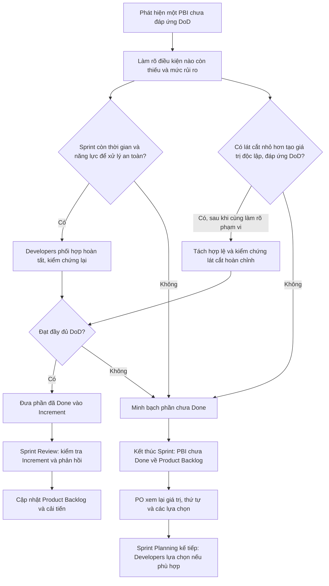

# Xử lý công việc chưa đáp ứng Definition of Done

Trong Sprint hai tuần, một Scrum Team phát triển chức năng **“Tiếp tục bài học đang dở”**. Đến ngày cuối, giao diện chạy tốt trên máy của lập trình viên, API đã được hợp nhất và người phụ trách sản phẩm rất muốn trình diễn. Nhưng kiểm thử tích hợp phát hiện một lỗi: người học có thể dùng đường dẫn tiến độ cũ để truy cập bài của khóa mà họ đã mất quyền sử dụng. Một thành viên đề xuất: “Cứ đánh dấu Done, lỗi này sửa Sprint sau, còn demo thì dùng tài khoản bình thường”.

Nếu đội chấp nhận, bảng công việc trông đẹp hơn nhưng thông tin về chất lượng trở nên sai lệch. Bên liên quan có thể hiểu rằng tính năng đã sẵn sàng sử dụng, trong khi nó chưa đạt yêu cầu an toàn của sản phẩm.

**Definition of Done (DoD)** là ranh giới giúp Scrum Team phân biệt **đã thực hiện một số hoạt động** với **đã tạo ra phần sản phẩm có chất lượng cần thiết và sử dụng được**. Khi một Product Backlog Item (PBI) chưa đáp ứng DoD, Scrum có cách xử lý rõ ràng: **không coi đó là Increment hoàn thành, không phát hành hoặc giới thiệu nó tại Sprint Review như phần công việc đã xong; đưa hạng mục trở lại Product Backlog để cân nhắc trong tương lai**.

Bài thuộc chương **Tạo tác Scrum** của mô-đun **AGILE_DEVELOPMENT**. Trọng tâm là xử lý minh bạch công việc chưa Done, giữ chất lượng của Increment, cập nhật backlog và dự báo, đồng thời học từ nguyên nhân để giao sản phẩm tăng dần, nhận phản hồi sớm và cải tiến liên tục. Các ví dụ liên hệ user story, Scrum, Kanban, XP và đo lường dòng công việc.

## 1. Mục tiêu học tập

Sau bài này, bạn có thể:

- Phân biệt **Product Backlog Item, Sprint Backlog, Increment, Definition of Done, acceptance criteria và điều kiện phát hành**.
- Giải thích **quy tắc trong Scrum Guide 2020** khi một PBI chưa đáp ứng DoD vào cuối Sprint.
- Phân loại minh bạch các tình trạng: chưa bắt đầu, đang làm, đang chờ, đã viết mã nhưng chưa kiểm chứng, đã đạt DoD và đã phát hành.
- Thực hiện chuỗi xử lý: **phát hiện → đánh giá tác động → lựa chọn trong Sprint → cập nhật Product Backlog → quyết định Sprint tiếp theo**.
- Hiểu khi nào có thể chia nhỏ phạm vi thành Increment nhỏ thật sự Done và khi nào việc “tách” chỉ để làm đẹp tiến độ là sai.
- Giao tiếp với Product Owner, Developers, Scrum Master và stakeholder về công việc còn lại mà không che rủi ro hoặc đánh đổi chất lượng.
- Xây dựng các cải tiến như chia lát cắt dọc, kiểm thử sớm, CI, WIP limit, làm rõ phụ thuộc và dùng dữ liệu dòng chảy đúng mục đích.
- Phân tích tình huống chưa đạt DoD, đề xuất hành động phù hợp và giải thích hậu quả nếu bỏ qua quy tắc.

## 2. Ba tạo tác Scrum và ba cam kết

Để hiểu công việc “chưa Done” đi về đâu, cần đặt nó trong cấu trúc tạo tác (*artifacts*) và cam kết (*commitments*) của Scrum.

| Tạo tác | Cam kết đi kèm | Chức năng |
| --- | --- | --- |
| **Product Backlog** | **Product Goal** | Danh sách có thứ tự, phát triển dần về những gì cần để cải thiện sản phẩm; Product Goal định hướng dài hạn. |
| **Sprint Backlog** | **Sprint Goal** | Sprint Goal, tập PBI Developers chọn và kế hoạch tạo Increment; thể hiện kế hoạch đang được cập nhật. |
| **Increment** | **Definition of Done** | Phần sản phẩm được xác minh, có thể sử dụng và bổ sung vào các Increment trước; DoD thể hiện tiêu chuẩn chất lượng bắt buộc. |

**PBI** có thể là user story, sửa lỗi, thay đổi kỹ thuật, hạng mục giảm rủi ro hoặc cách mô tả khác phù hợp. Scrum không bắt buộc mọi PBI phải ở dạng “Là một…, tôi muốn…, để…”.

**Increment** không phải chỉ là bản demo hay số ticket hoàn tất. Scrum Guide 2020 mô tả Increment như một bước tiến cụ thể hướng đến Product Goal, có tính cộng dồn với các Increment trước và được kiểm chứng đầy đủ để các phần hoạt động cùng nhau. **Increment phải có thể sử dụng được**.

**Definition of Done** là mô tả chính thức trạng thái Increment khi nó đáp ứng các tiêu chuẩn chất lượng cần thiết cho sản phẩm. Khi một PBI đạt DoD, một Increment hình thành; những phần chưa đạt DoD **không thể được tính là một phần Increment**.

### 2.1. DoD giúp minh bạch điều gì?

Hãy tưởng tượng hai người cùng dùng từ “xong”:

- Người A: “Tôi đã viết mã và đẩy pull request”.
- Người B: “Chức năng đã tích hợp, test đạt, kiểm tra quyền truy cập phù hợp và có thể sử dụng an toàn”.

Nếu nhóm không có ranh giới chất lượng chung, Sprint Review có thể thể hiện tiến độ sai, dự báo release dễ bị lệch và lỗi bị đẩy đến người dùng.

DoD giúp mọi người cùng hiểu **khi nào một phần công việc đáp ứng tiêu chuẩn chất lượng của Increment**. Nó hỗ trợ ba trụ cột Scrum: **minh bạch – kiểm tra – thích ứng** (*transparency – inspection – adaptation*).

### 2.2. Có thể có nhiều Increment trong một Sprint

Không cần đợi ngày cuối Sprint mới tạo ra Increment. Khi một PBI đáp ứng DoD, một Increment có thể được tạo; nhiều Increment có thể xuất hiện trong cùng Sprint. Một Increment cũng **có thể được chuyển giao cho stakeholder trước khi Sprint kết thúc**.

Sprint Review **không phải cổng phê duyệt bắt buộc trước khi phát hành**. Đồng thời, “đã demo thành công” không tự khiến một hạng mục chưa đạt DoD biến thành Increment.

## 3. Quy tắc cốt lõi: PBI chưa đạt DoD thì xử lý thế nào?

Theo [Scrum Guide 2020](https://scrumguides.org/scrum-guide.html), khi Product Backlog Item **không đạt Definition of Done**:

1. **Không được coi là một phần của Increment hoàn thành**.
2. **Không được phát hành hoặc trình bày tại Sprint Review như một PBI đã hoàn thành**.
3. **Được đưa trở lại Product Backlog để cân nhắc trong tương lai**.

Quy tắc này có vài hệ quả quan trọng:

- “Đã code 95%” **không phải** trạng thái tương đương Done.
- “Đã kiểm thử ở máy cá nhân” không đủ nếu DoD yêu cầu kiểm tra tích hợp phù hợp.
- “PO đã đồng ý nhận” không làm phần chưa đạt tiêu chuẩn chất lượng trở thành Increment.
- “Sprint đã hết” không có nghĩa mọi PBI được kéo vào Sprint tự động Done.
- Hạng mục quay lại Product Backlog **không đương nhiên được chọn cho Sprint kế tiếp**; thứ tự và lựa chọn tiếp theo cần được xem xét dựa trên giá trị, rủi ro và năng lực thực tế.
- Đội có thể **trao đổi minh bạch rằng có công việc chưa hoàn thành và vì sao** với stakeholder; điều này khác với việc giới thiệu tính năng chưa Done như một Increment đã sử dụng được.

**Không đạt DoD không tự động đồng nghĩa Sprint thất bại hoàn toàn.** Scrum Team còn đánh giá Sprint Goal, những Increment đã đạt DoD, giá trị tạo ra và điều học được. Một số PBI có thể hoàn thành trong khi PBI khác chưa hoàn thành; cần nói rõ từng phần.

### 3.1. Bảng quyết định nhanh

| Tình huống | Có được tính là Increment Done? | Xử lý |
| --- | --- | --- |
| Đã viết mã, chưa chạy kiểm thử bắt buộc | **Không** | Hoàn tất kiểm chứng nếu còn khả thi trong Sprint; nếu hết Sprint, đưa phần chưa Done về Product Backlog. |
| Unit test đạt, nhưng kiểm thử phân quyền bắt buộc thất bại | **Không** | Ưu tiên khắc phục lỗ hổng; không phát hành hoặc trình bày như Done. |
| Đã đạt đầy đủ DoD, chưa bật cho người dùng cuối do lịch phát hành | **Có thể có** | Increment có thể đã Done nếu thật sự sử dụng được và đáp ứng DoD; quyết định phát hành là vấn đề riêng. |
| Giao một lát cắt nhỏ hoàn chỉnh, phần nâng cao được tách ra hợp lệ | **Có, với lát cắt đã đạt DoD** | Chỉ tính phần có hành vi giá trị độc lập, đã kiểm chứng và đáp ứng DoD; phần còn lại vào backlog. |
| Đã demo thành công “happy path”, nhưng chưa đáp ứng DoD | **Không** | Demo không thay thế việc đáp ứng DoD. |
| Lỗi nội bộ không thuộc hành vi hay chất lượng bắt buộc | **Cần xem bối cảnh** | Đánh giá theo DoD, chính sách sản phẩm và rủi ro thực; không tự ý hạ chuẩn để có Done. |
| PBI chưa được chọn, vẫn ở Product Backlog | **Không liên quan đến Increment Sprint hiện tại** | Tiếp tục làm rõ và sắp thứ tự khi phù hợp. |

## 4. Definition of Done khác những tiêu chí nào?

Đội cần phân biệt **tiêu chí chấp nhận riêng của hạng mục**, **tiêu chuẩn chất lượng chung** và **quyết định phát hành**.

| Khái niệm | Câu hỏi cần trả lời | Ví dụ với “Tiếp tục bài học đang dở” |
| --- | --- | --- |
| **Acceptance criteria (AC)** | Hạng mục này cần thể hiện hành vi nào? | Khi người học mở lại khóa, ứng dụng hiển thị đúng bài đang dở. |
| **Definition of Done (DoD)** | Increment phải đạt tiêu chuẩn chất lượng nào? | Tích hợp đúng, các kiểm tra quan trọng đạt, quyền truy cập được kiểm chứng, hệ thống có thể sử dụng. |
| **Sprint Goal** | Sprint hướng đến kết quả chung nào? | Cho phép người học tiếp tục khóa học mà không phải tìm lại bài. |
| **Product Goal/outcome** | Sản phẩm muốn tạo kết quả dài hạn nào? | Người học quay lại dễ hơn và duy trì tiến độ học. |
| **Release policy/điều kiện phát hành** | Khi nào và bằng cơ chế nào đưa Increment đã Done ra nhóm người sử dụng? | Bật tính năng cho 10% tài khoản và theo dõi tác dụng phụ. |

Nếu tính năng đáp ứng AC nhưng **chưa vượt qua các kiểm tra an toàn thuộc DoD**, chưa thể tính Done. Ngược lại, một Increment đạt DoD về kỹ thuật chưa chứng minh người dùng được lợi như giả thuyết; cần nhận phản hồi và đánh giá outcome.

### 4.1. DoD được thiết lập thế nào?

Theo Scrum Guide 2020:

- Nếu **DoD đã là một tiêu chuẩn của tổ chức**, các Scrum Team phải tuân thủ tối thiểu tiêu chuẩn đó.
- Nếu **không có tiêu chuẩn tổ chức**, Scrum Team phải tạo DoD phù hợp với sản phẩm.
- Nếu **nhiều Scrum Team cùng làm một sản phẩm**, họ phải cùng xác định và tuân thủ **một Definition of Done chung**.

Developers chịu trách nhiệm bảo đảm chất lượng bằng cách tuân thủ DoD. Scrum Team cùng quan tâm đến việc DoD minh bạch và có khả năng thực thi; **Scrum Master** hỗ trợ đội hiểu và áp dụng Scrum, còn **Product Owner** chịu trách nhiệm tối đa hóa giá trị và quản lý Product Backlog hiệu quả.

DoD cần cụ thể và có thể xác minh. “Mã sạch, kiểm thử tốt, sẵn sàng triển khai” quá chung nếu mọi người hiểu khác nhau. Ngược lại, DoD không nên biến thành một danh sách khổng lồ không liên quan tới bối cảnh, ngăn mọi lát cắt giá trị được hoàn thành.

### 4.2. Ví dụ DoD minh họa cho phần mềm web

| Lĩnh vực | Tiêu chuẩn chất lượng minh họa | Cách xác minh |
| --- | --- | --- |
| Hành vi và tính đúng | Hành vi đã thống nhất được thực hiện và các tình huống ranh giới trọng yếu được kiểm tra | Acceptance test, review ví dụ, test phù hợp |
| Mã nguồn | Thay đổi được tích hợp, cấu trúc đủ dễ hiểu và tuân thủ chính sách review | CI, code review hoặc pairing theo chính sách |
| Kiểm thử | Bộ kiểm tra bắt buộc đạt và các kiểm tra không ổn định được xử lý minh bạch | Kết quả pipeline/kiểm thử đáng tin |
| Bảo mật và dữ liệu | Những yêu cầu phân quyền, quyền riêng tư và xử lý dữ liệu áp dụng đã được kiểm chứng | Kiểm thử truy cập trái phép, kiểm tra cấu hình phù hợp |
| Khả năng sử dụng | Luồng quan trọng hoạt động trong điều kiện sử dụng đã xác định | Kiểm tra end-to-end và khả năng tiếp cận theo rủi ro |
| Vận hành | Có thể triển khai, chẩn đoán và khôi phục theo chính sách hiện hành | Kiểm tra cấu hình, logging, theo dõi lỗi, phương án rollback khi cần |
| Tài liệu thiết yếu | Hợp đồng API hoặc hướng dẫn vận hành bị tác động được cập nhật | Review phần thông tin thay đổi |

Đây là **mẫu gợi ý**, không phải checklist bắt buộc do Scrum Guide quy định. Đội phải lựa chọn tiêu chuẩn phù hợp sản phẩm và tổ chức, đồng thời tránh bỏ qua những rủi ro trọng yếu chỉ vì khó đạt trong một Sprint.

## 5. Tình trạng công việc: “In Progress” khác “Done”

Đội có thể dùng bảng công việc với nhiều trạng thái để hỗ trợ phối hợp, nhưng các trạng thái ấy **không thay thế quy tắc DoD**.

| Trạng thái hiển thị minh họa | Ý nghĩa công việc | Có thể tính Done theo Scrum? |
| --- | --- | --- |
| **To Do** | Chưa bắt đầu thực hiện | Không |
| **In Progress** | Đang xây dựng hoặc nghiên cứu | Không |
| **Code Complete** | Mã đã được viết, một số kiểm tra có thể chưa có | Không, trừ khi điều này thực sự bao gồm toàn bộ DoD, điều thường không đúng |
| **In Review** | Đang chờ hoặc thực hiện review | Chưa |
| **Verification** | Đang kiểm tra tích hợp, bảo mật và các điều kiện liên quan | Chưa, nếu còn yêu cầu DoD chưa đạt |
| **Blocked** | Không thể tiếp tục vì phụ thuộc hoặc vấn đề chưa giải quyết | Không |
| **Done** | Hạng mục đáp ứng DoD, phần Increment có thể sử dụng | Có |
| **Released** | Đã đưa đến người sử dụng theo chính sách phát hành | Có thể là trạng thái sau Done; không phải đồng nghĩa tự động với DoD |

Tên các cột là **quy ước nội bộ minh họa**, không phải các trạng thái được Scrum Guide bắt buộc. Một đội có thể dùng ít cột hơn, nhưng phải thống nhất rõ **Done là gì**.

### 5.1. Không tính phần trăm tiến độ thay cho kết quả

Một story có thể mất 90% công sức để viết mã, 10% còn lại dành cho kiểm chứng nhưng phần còn lại chứa rủi ro lớn nhất. Vì vậy, “90% Done” chỉ có thể là nhận định về tiến triển công việc, **không biến thành 0,9 Increment có giá trị**.

Trong báo cáo, nên phân biệt:

- **Công sức đã bỏ ra:** các phần việc thực sự đã thực hiện.
- **Những gì đã học:** rủi ro hoặc quy tắc mới được phát hiện.
- **Phần sản phẩm đáp ứng DoD:** có thể sử dụng, đóng góp vào Increment.
- **Phần còn lại/rủi ro:** vẫn cần xử lý và quyết định ưu tiên.

Không nên phạt đội vì nói thật rằng một hạng mục chưa Done; che giấu công việc dở dang làm các vòng thực nghiệm của Scrum thiếu dữ kiện.

## 6. Sơ đồ quyết định khi PBI chưa đạt DoD



Sơ đồ nhấn mạnh **kiểm tra điều kiện chất lượng trước khi công nhận Done**. Trong thực tế, quyết định tách lát cắt, xử lý phụ thuộc và trao đổi với Product Owner có thể diễn ra đồng thời, không nhất thiết theo một chuỗi máy móc.

## 7. Xử lý trong Sprint: phát hiện càng sớm càng tốt

Đừng chờ đến tối ngày cuối mới quyết định một PBI chưa Done. Khi có tín hiệu rủi ro, Developers cần chủ động kiểm tra kế hoạch hướng Sprint Goal, phối hợp với PO khi cần điều chỉnh phạm vi và báo trở ngại minh bạch.

### 7.1. Bước 1 — Xác định chính xác điều kiện chưa đạt

Tránh ghi: “Chưa xong do thiếu thời gian”.

Hãy mô tả cụ thể:

- “Kiểm thử tài khoản khác có thể đọc được tiến độ học chưa đạt.”
- “Bản tích hợp dùng cơ sở dữ liệu thật bị lỗi khi khóa đã hoàn thành.”
- “Pipeline bắt buộc đang đỏ vì test không ổn định chưa được xác minh.”
- “Tài liệu vận hành cần cập nhật theo DoD còn thiếu.”
- “Mã chưa được tích hợp vào nhánh chung; kiểm thử mới chạy ở máy cá nhân.”

Những mô tả này giúp đội lựa chọn hành động, biết rủi ro nào cản trở việc tạo Increment và cần ai hỗ trợ.

### 7.2. Bước 2 — Đánh giá mức độ ảnh hưởng đến người dùng và Sprint Goal

Không phải mọi vấn đề có tác động giống nhau:

| Vấn đề | Câu hỏi cần đặt |
| --- | --- |
| Lỗi phân quyền | Có nguy cơ truy cập dữ liệu không được phép không? Cần ngăn phát hành và xử lý sự cố theo chính sách? |
| Kiểm thử tích hợp chưa chạy | Phần nào chưa được xác minh? Điều kiện DoD yêu cầu là gì? |
| API đối tác chưa sẵn sàng | Có thể tạo lát cắt độc lập có ích mà không cần API ấy không? |
| PBI lớn hơn dự kiến | Có thể tách hành vi thành hai phần sử dụng được, mỗi phần tuân thủ DoD không? |
| Công việc hỗ trợ phát sinh | Có cần xem lại năng lực và kế hoạch trong Sprint để vẫn hướng tới Sprint Goal? |

Đội cần ưu tiên **giảm rủi ro cho người dùng và sản phẩm**, không chỉ cứu con số hoàn thành.

### 7.3. Bước 3 — Cùng tập trung hoàn tất thay vì mở thêm việc

Một số chiến thuật:

- **Swarming:** nhiều Developers cùng xử lý một hạng mục đang gần Done, phù hợp chuyên môn và mức rủi ro.
- **Pairing:** người hiểu nghiệp vụ hoặc hệ thống cùng người thực hiện làm rõ điều kiện, viết test và sửa lỗi.
- **Giới hạn WIP:** hạn chế số hạng mục đang làm để giảm thời gian chờ review và kiểm chứng.
- **Chia thay đổi nhỏ:** tích hợp sớm, xác nhận từng phần theo chiều dọc thay vì dồn mã lớn vào cuối Sprint.
- **Tự động hóa hợp lý:** ưu tiên kiểm thử cho những rủi ro lặp lại; đừng xem build xanh nhưng bỏ qua kiểm chứng quan trọng là chất lượng.
- **Nêu blocker rõ:** ai cung cấp dữ liệu, ai quyết định quy tắc, khi nào có thông tin và phương án nếu bị chậm.

Đây là các **thực hành bổ trợ**, không phải nghi thức Scrum bắt buộc. Chúng nên được lựa chọn theo khả năng giúp đội tạo Increment đạt DoD.

### 7.4. Bước 4 — Điều chỉnh phạm vi khi có thông tin mới

Trong Scrum, Developers có thể điều chỉnh Sprint Backlog khi học thêm. Khi phần việc cần làm hóa ra khác dự kiến, phạm vi có thể được **làm rõ và thương lượng với Product Owner**, với điều kiện không thực hiện những thay đổi gây nguy hại Sprint Goal.

Các lựa chọn có thể gồm:

1. Giữ mục tiêu, giảm những biến thể không thiết yếu.
2. Tách một lát cắt đầy đủ hành vi thành phần có thể sử dụng.
3. Xử lý trước rủi ro lớn, dời phần mở rộng chưa cần.
4. Thống nhất rõ phần nào không kịp Done để cập nhật kỳ vọng.

**Không được thay đổi định nghĩa chất lượng để biến kết quả còn lỗi thành “Done”.** Điều chỉnh **phạm vi sản phẩm** và điều chỉnh **tiêu chuẩn chất lượng bắt buộc** là hai quyết định khác nhau.

## 8. Chia nhỏ PBI hợp lệ hay “cắt story” để lấy điểm?

Một cách giảm công việc dở dang là giao **một phần giá trị nhỏ hơn nhưng hoàn chỉnh**. Tuy nhiên, nếu chỉ đổi tên ticket hoặc tách việc đã làm ra khỏi phần kiểm thử để nhận “Done”, đó là báo cáo sai.

### 8.1. Ví dụ tách hợp lệ

PBI ban đầu:

> “Là học viên, tôi muốn tiếp tục bài học đang dở **trên mọi thiết bị** để không mất thời gian tìm lại vị trí.”

Sau khi trao đổi với PO, Developers có thể tách:

- **A — Tiếp tục bài đang dở trên cùng một thiết bị:** người học đăng nhập, vị trí được lưu và đọc lại đúng tài khoản, quyền truy cập được kiểm tra; phần này có thể hoàn thành và đáp ứng DoD.
- **B — Đồng bộ tiến độ giữa nhiều thiết bị:** xử lý cập nhật đồng thời và xung đột tiến độ; giữ trong Product Backlog để cân nhắc tiếp.

Nếu **A** tạo hành vi có giá trị riêng, toàn bộ các kiểm tra quan trọng của A đạt và nhóm thống nhất phạm vi trước khi xác nhận kết quả, A có thể là một Increment Done. **B** chưa Done không được tính vào Increment.

### 8.2. Ví dụ tách không hợp lệ

Nhóm tạo các mục:

- “Đã viết frontend” — Done.
- “Đã viết API” — Done.
- “Kiểm thử quyền truy cập” — chưa Done.

Nếu frontend/API không tạo phần sản phẩm **có thể sử dụng và đáp ứng DoD**, chúng chỉ là **task kỹ thuật đã làm**, không phải hai Increment hoàn chỉnh. Không thể chỉ đặt tên các task là PBI để lấy hai hạng mục Done.

### 8.3. Những điều cần kiểm tra trước khi công nhận lát cắt

- Người dùng/bên thụ hưởng có thể thực hiện hành vi **có ý nghĩa** với phần này không?
- Phần này có đáp ứng **mọi điều kiện DoD áp dụng** không?
- Các kiểm tra bảo mật, dữ liệu, tích hợp và khả năng sử dụng có bị bỏ lại không?
- Các thành phần có hoạt động chung với những Increment trước không?
- PO, Developers và người liên quan có hiểu **phạm vi thực sự được giao** không?
- Phần chưa làm có được giữ minh bạch trong Product Backlog không?

**Chia nhỏ là công cụ giảm thời gian phản hồi, không phải thủ thuật báo cáo.** Tránh đổi ranh giới sau khi Sprint kết thúc chỉ để hợp thức hóa việc chưa đạt DoD.

## 9. Cuối Sprint: công việc chưa Done đi về đâu?

### 9.1. Đưa trở lại Product Backlog, không tự động kéo tiếp

Scrum Guide chỉ rõ: PBI chưa đạt DoD **trở lại Product Backlog để cân nhắc trong tương lai**. Một số đội gọi đây là “carry-over”, nhưng không nên hiểu là “mặc định nó có mặt ở Sprint kế tiếp”.

Tại thời điểm này:

1. **Xác định trạng thái thật:** điều gì đã làm, điều gì chưa kiểm chứng và vì sao chưa Done.
2. **Cập nhật PBI:** mô tả rõ phần việc/rủi ro còn lại, thay đổi hiểu biết hoặc phạm vi nếu cần.
3. **Đưa về Product Backlog:** không giữ hạng mục trong Increment hoàn thành hay gắn Done giả.
4. **Product Owner xem lại thứ tự:** giá trị, rủi ro, mục tiêu, phụ thuộc và những hạng mục khác đã thay đổi ra sao?
5. **Developers đánh giá lại khả năng thực hiện:** không coi ước lượng cũ vẫn đúng khi phạm vi hoặc rủi ro đã đổi.
6. **Trong Sprint Planning kế tiếp**, Developers lựa chọn công việc phù hợp với Sprint Goal và năng lực, dựa trên trao đổi với PO.

Nếu lỗi liên quan an toàn nghiêm trọng, có thể cần ưu tiên xử lý ngay theo chính sách sản phẩm/tổ chức, nhưng điều đó vẫn **không biến PBI chưa Done thành Done**.

### 9.2. Không tự động trừ “phần đã làm” theo tỷ lệ tùy ý

Một câu như “story 8 điểm, làm được 75%, Sprint này nhận 6 điểm” tạo độ chính xác giả. Nếu đội dùng story point, đây thường là đơn vị **ước lượng tương đối của PBI theo quy ước đội**, không phải tiền công trả theo phần trăm mã đã viết.

Một cách minh bạch:

- Ghi **PBI chưa Done** trong Sprint vừa rồi.
- Ghi nhận **công việc và điều đã học** để không mất thông tin.
- Khi cân nhắc lại, **ước lượng phần còn lại** nếu việc ước lượng giúp ra quyết định; không nhất thiết giữ nguyên điểm hoặc cộng/trừ điểm theo tỉ lệ.
- Nếu đội theo dõi velocity, cần thống nhất chính sách tính hoàn thành theo **hạng mục đáp ứng DoD**, tránh ghi điểm chưa hoàn tất vào kết quả Done.

Scrum Guide **không quy định phải dùng story point hoặc velocity**. Đội có thể dự báo dựa trên throughput, cycle time hoặc cách đánh giá năng lực khác, miễn số liệu phản ánh trạng thái thật.

### 9.3. Không được làm mờ lịch sử

Việc PBI trở lại backlog không có nghĩa xóa mọi dấu vết cho thấy Sprint vừa rồi chưa hoàn thành. Hãy giữ lịch sử cần thiết để retrospective nhìn được:

- Khi nào hạng mục bắt đầu?
- Ở đâu bị chờ hoặc bị chặn?
- Kiểm tra nào phát hiện rủi ro?
- Những giả định nào đã thay đổi?
- Hệ quả đối với Sprint Goal, chất lượng và người dùng?
- Lần sau cần làm rõ hoặc chia nhỏ thế nào?

Hệ thống công cụ có thể thực hiện bằng trạng thái, ghi chú hoặc ticket mới có liên kết. **Không có thao tác phần mềm quản lý backlog duy nhất bắt buộc trong Scrum**. Điều bắt buộc về mặt khái niệm là giữ minh bạch trạng thái Done và ưu tiên sản phẩm.

## 10. Sprint Review: minh bạch nhưng không demo “giả Done”

Sprint Review nhằm **kiểm tra kết quả Sprint** và xem xét những thích ứng tiếp theo với stakeholder. Nếu có Increment đã đạt DoD, đội kiểm tra phần đó cùng bối cảnh Product Goal, thị trường, người dùng và các lựa chọn tương lai.

### 10.1. Điều được phép và điều phải phân biệt

Đội có thể nói:

> “Trong Sprint này, chức năng xem bài gần nhất và lưu tiến độ trên cùng thiết bị đã đáp ứng Definition of Done. Phần đồng bộ giữa thiết bị chưa đạt DoD do kiểm tra xung đột dữ liệu chưa hoàn thành; chúng tôi đưa phần đó về Product Backlog để xem xét thứ tự tiếp theo.”

Đây là **minh bạch tình trạng công việc và tác động đến kế hoạch**. Nó khác với việc trình diễn phần đồng bộ đang lỗi và tuyên bố “Increment đã hoàn tất, còn bug nhỏ xử lý Sprint sau”.

Scrum Guide 2020 quy định **PBI chưa đạt DoD không được phát hành hoặc trình bày tại Sprint Review như phần đã hoàn thành**. Đội có thể thảo luận rủi ro, bài học và kế hoạch thay đổi, nhưng không đánh tráo khái niệm **đã quan sát một bản chưa hoàn thiện** với **đã tạo Increment dùng được**.

### 10.2. Nếu Sprint Goal chưa đạt thì sao?

Một Sprint có thể có một hoặc nhiều Increment Done nhưng **chưa đạt Sprint Goal**. Ngược lại, có thể đạt mục tiêu Sprint theo kết quả chính trong khi một hạng mục mở rộng chưa Done. Cần đánh giá tình huống dựa trên:

- Sprint Goal thực sự đã được xác định như thế nào?
- Increment nào đạt DoD và đem lại hành vi gì?
- Hạng mục chưa Done có phải phần thiết yếu của mục tiêu hay chỉ là phạm vi bổ trợ?
- Tác động đối với người dùng và các lựa chọn tiếp theo là gì?
- Điều gì cần thay đổi trong cách lập kế hoạch và phối hợp?

**Không sửa lại mục tiêu Sprint sau khi kết thúc** chỉ để báo thành công. Cũng không kết luận Sprint vô giá trị chỉ vì một hạng mục chưa Done nếu những Increment khác đã tạo giá trị thật.

### 10.3. Không cần đợi Sprint Review để giao phần Done

Khi Increment thực sự đáp ứng DoD, nó có thể được chuyển giao trước cuối Sprint theo chính sách tổ chức và sản phẩm. Sprint Review không phải cuộc họp cho phép release. Sự phân biệt này quan trọng vì nếu đội xem Sprint Review như “cổng xuất xưởng”, việc phát hành nhỏ và nhận phản hồi sớm sẽ bị trì hoãn không cần thiết.

## 11. Sprint Retrospective: tìm điều kiện khiến hạng mục chưa Done

Retrospective là cơ hội Scrum Team **lập kế hoạch nâng cao chất lượng và hiệu quả**, không phải phiên truy trách nhiệm cá nhân vì ticket không kịp.

### 11.1. Hỏi về hệ thống trước khi kết luận

Một số câu hỏi:

- Story có quá lớn để tạo Increment trọn vẹn trong Sprint không?
- Acceptance criteria hoặc rủi ro bảo mật có được hỏi sớm?
- Việc kiểm thử, tích hợp và review có diễn ra liên tục không?
- Pipeline có chậm hoặc không ổn định khiến đội bỏ qua tín hiệu?
- Quá nhiều việc mở song song làm giảm khả năng hoàn tất?
- Có phụ thuộc vào một người hoặc hệ thống ngoài đội không?
- Sprint Goal có rõ, nhóm có ưu tiên làm xong phần quan trọng trước?
- Có áp lực “báo xanh” khiến rủi ro không được nói ra?

### 11.2. Không dùng retrospective để thương lượng lại DoD của Sprint đã qua

Nếu chất lượng không đạt, không nên hồi tố nói “Sprint này coi như test tích hợp không bắt buộc” chỉ để biến PBI thành Done. Đội có thể **xem xét cải thiện DoD cho tương lai** dựa trên mục đích và tiêu chuẩn tổ chức, nhưng phải thận trọng, minh bạch và không hạ những rào chắn thiết yếu như bảo mật hoặc tính đúng dữ liệu.

Việc DoD quá mơ hồ, quá nặng hoặc không cập nhật khi sản phẩm thay đổi có thể là một chủ đề cải tiến hợp lệ. Tuy nhiên **việc cải tiến tiêu chuẩn chất lượng khác với bỏ tiêu chuẩn vì hiện tại chưa đạt**.

### 11.3. Hành động nhỏ, có người theo dõi và phép đo

Ví dụ:

> **Vấn đề:** Bốn PBI chỉ đến kiểm thử trong hai ngày cuối Sprint.
>
> **Giả thuyết:** Giới hạn WIP và chia lát cắt nhỏ hơn sẽ giảm hàng chờ review, kiểm thử.
>
> **Thử nghiệm:** Sprint tới chỉ mở tối đa hai PBI ở In Progress; khi có blocker, Developers ưu tiên phối hợp gỡ trước khi kéo việc mới.
>
> **Theo dõi:** Một Developer hỗ trợ ghi nhận tuổi công việc ở Review; cả đội xem tỷ lệ PBI đạt DoD và lỗi hồi quy.
>
> **Rào chắn:** Không bỏ kiểm thử hoặc thay DoD để làm đẹp số lượng.
>
> **Điểm đánh giá:** Sprint Retrospective kế tiếp.

Các số lượng là **giả định minh họa**; đội cần chọn thử nghiệm theo dữ liệu thực tế. Hành động quan trọng có thể được đưa vào Sprint Backlog tiếp theo nếu phù hợp.

## 12. Những trường hợp chưa Done hay gặp và cách phản ứng

### 12.1. “Code xong nhưng test chưa chạy”

**Hiện trạng:** mã đã viết hoặc đã merge, nhưng bộ kiểm thử bắt buộc chưa được chạy hoặc còn thất bại.

**Xử lý:** chưa Done. Xác định test đang thiếu, người hỗ trợ và khả năng kiểm chứng trước khi Sprint kết thúc. Nếu không kịp, đưa về Product Backlog; xem lại việc chia lát cắt, kiểm thử sớm và CI.

**Không nên:** đổi trạng thái Done vì “không còn bug mà mình biết”, hay để QA xử lý một mình Sprint sau.

### 12.2. “Unit test xanh nhưng phân quyền sai”

**Hiện trạng:** test đơn vị qua, nhưng truy cập API cho thấy tài khoản khác đọc được dữ liệu riêng.

**Xử lý:** chưa Done và là rủi ro nghiêm trọng. Phối hợp sửa lỗi, bổ sung kiểm thử thích hợp và cân nhắc quy trình xử lý an toàn nếu lỗi đã xuất hiện ở môi trường có người dùng. Không phát hành tính năng chưa đủ bảo vệ.

**Không nên:** loại bỏ kiểm thử phân quyền khỏi DoD hay hứa “bổ sung bảo mật sau”.

### 12.3. “Chờ môi trường kiểm thử hoặc đối tác”

**Hiện trạng:** kiểm chứng tích hợp bắt buộc bị chặn vì môi trường chưa sẵn sàng.

**Xử lý:** hạng mục chưa Done nếu chưa đạt điều kiện DoD. Công khai blocker, thời gian chờ, phương án thay thế hợp lệ (ví dụ môi trường tương đương đã được chấp thuận, contract test có giới hạn) và kế hoạch giảm phụ thuộc.

**Không nên:** coi sự cố bên ngoài là lý do miễn DoD. Bối cảnh giải thích nguyên nhân, không thay đổi trạng thái chất lượng.

### 12.4. “Feature flag đã tắt nên không có rủi ro”

**Hiện trạng:** mã mới có thể nằm sau một feature flag, chưa công bố cho người dùng.

**Xử lý:** phân biệt **trạng thái phát hành** với **chất lượng Increment**. Việc chưa bật flag không tự động làm hạng mục chưa Done; cũng không tự động chứng minh Done. Nếu phần mềm thực sự tích hợp, có thể sử dụng đúng như phạm vi đã chọn và đạt DoD, việc bật cho người dùng có thể là quyết định release riêng. Nếu chưa xác minh được hành vi hoặc còn rủi ro khi bật flag, chưa Done.

**Không nên:** dùng feature flag để hợp thức hóa mã chưa tích hợp hoặc chưa đáp ứng chất lượng bắt buộc.

### 12.5. “Có lỗi nhỏ không nằm trong tiêu chí chấp nhận”

**Hiện trạng:** một lỗi được phát hiện, nhưng đội cho rằng “không có trong AC nên không tính”.

**Xử lý:** xem ảnh hưởng tới DoD, tính đúng của sản phẩm, ràng buộc bảo mật, khả năng sử dụng và chính sách chất lượng. Không nên hiểu AC là danh sách đóng của mọi hành vi cần an toàn. Nếu lỗi thực sự không cản trở DoD và không làm Increment không thể sử dụng, cần xử lý theo chính sách quản lý lỗi có lý do rõ.

**Không nên:** mặc định mọi lỗi không ghi trong AC đều được bỏ qua hoặc mặc định mọi lỗi vặt đều tương đương rủi ro nghiêm trọng.

### 12.6. “PO chấp nhận nhưng Developers chưa đạt chất lượng”

**Hiện trạng:** PO nói “tôi chấp nhận, tính xong đi”, trong khi DoD vẫn chưa đạt.

**Xử lý:** PO có quyền về giá trị và backlog nhưng không thể một mình biến phần chưa đạt DoD thành Increment. Developers chịu trách nhiệm chất lượng theo DoD; Scrum Team trao đổi thay đổi phạm vi hoặc hướng xử lý phù hợp.

**Không nên:** dùng chữ ký chấp thuận của một vai trò thay thế kiểm chứng.

### 12.7. “Một phần dùng được, một phần chưa”

**Hiện trạng:** tính năng có lát cắt cơ bản đã đạt DoD nhưng phần nâng cao chưa đạt.

**Xử lý:** nếu lát cắt cơ bản thực sự là một phần sản phẩm độc lập có giá trị và được xác định minh bạch, nó có thể được công nhận Done; phần chưa hoàn thành trở lại backlog. Nếu các phần không thể dùng riêng hoặc chưa đạt DoD, không được ghi Done giả.

### 12.8. “Có bug phát hiện sau khi đã Done”

Nếu lỗi mới xuất hiện sau khi đội đã xác minh và công nhận Done theo thông tin lúc đó, cần **phân tích mức ảnh hưởng, xử lý lỗi, bảo vệ người dùng và điều chỉnh DoD/thực hành kiểm chứng khi phù hợp**. Không nên viết lại lịch sử tùy tiện để che giấu sự cố, cũng không khẳng định DoD bảo đảm phần mềm không bao giờ có lỗi.

Nếu phát hiện một điều kiện DoD thực tế **chưa từng được đáp ứng** mà trước đó bị ghi nhầm Done, đội cần sửa trạng thái và thông tin báo cáo phù hợp, đồng thời xem lại nguyên nhân. Trạng thái chất lượng phải phản ánh bằng chứng, không giữ Done bằng mọi giá.

## 13. Tình huống xuyên suốt: Scrum Team phát triển chức năng học trực tuyến

Một Scrum Team bảy người đang xây nền tảng học lập trình. Đội gồm Product Owner, Scrum Master và Developers với các kỹ năng frontend, backend, UX và kiểm thử. Sprint dài hai tuần.

**Sprint Goal minh họa:**

> “Học viên đã đăng nhập có thể quay lại bài học đang dở một cách đáng tin cậy và đúng quyền truy cập.”

Nhóm chọn năm Product Backlog Item:

| PBI | Hành vi mong muốn | Trạng thái thực ở cuối Sprint |
| --- | --- | --- |
| **A — Xem bài gần nhất** | Người học thấy bài gần nhất thuộc khóa được phép truy cập | Đạt AC và DoD |
| **B — Lưu vị trí theo tài khoản** | Tiến độ được lưu và đọc đúng tài khoản | Đạt AC và DoD |
| **C — Tiếp tục từ vị trí cũ** | Nhấp “Tiếp tục” đưa người dùng đến đúng nội dung | Luồng thường chạy được nhưng **kiểm thử quyền truy cập thất bại** |
| **D — Đồng bộ hai thiết bị** | Tiến độ cập nhật giữa điện thoại và máy tính | Đang chờ xác định quy tắc xung đột |
| **E — Cải thiện thông báo lỗi** | Trường hợp tiến độ cũ không hợp lệ có hướng xử lý rõ | Đạt AC và DoD |

### 13.1. Ngày thứ tám: cảnh báo sớm

Người kiểm thử phát hiện tình huống tài khoản đã hết quyền vẫn truy cập bài thông qua URL cũ. Một Developer còn cho biết dữ liệu từ hai thiết bị có thể ghi đè lẫn nhau; quy tắc xử lý xung đột chưa được làm rõ.

Nhóm không tiếp tục mở thêm PBI mới. Họ trao đổi:

- **Developers:** điều kiện DoD nào còn thiếu, sửa lỗi cần thay đổi những gì, có thể cùng nhau hoàn tất PBI C an toàn không?
- **Product Owner:** phạm vi giá trị nào là thiết yếu cho Sprint Goal; đồng bộ đa thiết bị có thể để sau không?
- **Scrum Master:** có trở ngại phối hợp nào làm thông tin đến muộn và làm thế nào giúp đội tự quản gỡ?

Nhóm ưu tiên xử lý rủi ro C vì liên quan quyền truy cập. Dù Sprint đã gần kết thúc, điều quan trọng là **trạng thái chất lượng được báo đúng**.

### 13.2. Ngày cuối: quyết định đúng ranh giới Done

Giả sử đội không thể kiểm chứng đầy đủ sửa lỗi C trước khi Sprint kết thúc. Khi ấy:

- **A, B, E:** nếu thực sự đáp ứng DoD và tích hợp hoạt động, chúng thuộc những Increment Done.
- **C:** chưa đạt DoD; không được tính là Increment, không được phát hành hoặc trình bày như chức năng hoàn thành tại Sprint Review.
- **D:** chưa có hành vi hoàn chỉnh và chưa đạt DoD; không được tính Done.
- **C và D:** trở lại Product Backlog để PO xem lại thứ tự và để Developers cân nhắc ở Sprint Planning sau nếu phù hợp.

Sprint Goal trong tình huống này **có thể chưa đạt đầy đủ**, vì khả năng “Tiếp tục” đáng tin cậy vẫn chưa có. Đội cần trình bày điều đó trung thực, không đổi lại Sprint Goal sau sự kiện.

### 13.3. Sprint Review: trao đổi kết quả thật

Một cách báo cáo:

> “Ba phần công việc đã đạt Definition of Done và giúp người học nhìn thấy/lưu tiến độ hợp lệ. Tuy nhiên, đường đi ‘Tiếp tục’ chưa đạt tiêu chuẩn bảo vệ quyền truy cập và phần đồng bộ hai thiết bị vẫn chưa giải quyết xung đột. Hai phần này chưa được tính là Increment hoàn thành. Chúng tôi đã ghi nhận rủi ro và đưa về Product Backlog để đánh giá ưu tiên tiếp.”

Stakeholder có thể phản hồi về phần Done và yêu cầu xử lý sớm rủi ro quyền truy cập. **PO xem lại Product Backlog** dựa trên giá trị, an toàn và thay đổi của sản phẩm; đây không phải buổi “nhắm mắt chấp nhận” phần chưa đạt DoD.

### 13.4. Sprint Retrospective: thay đổi cách làm

Nhóm xem timeline và phát hiện:

1. PBI C được chia theo frontend/backend/test, không có kiểm chứng end-to-end sớm.
2. Kiểm thử phân quyền chỉ được hoàn thiện vào cuối Sprint.
3. D được kéo vào làm khi quy tắc xung đột dữ liệu chưa rõ.
4. Nhiều việc mở song song, review và CI bị dồn cuối.

Họ chọn hai thử nghiệm:

- **Thử nghiệm 1:** với PBI có dữ liệu tài khoản, trao đổi ví dụ phân quyền ngay trong refinement và viết kiểm thử cần thiết trước khi tích hợp lớn.
- **Thử nghiệm 2:** giới hạn WIP, ưu tiên hoàn tất PBI quan trọng đến DoD trước khi mở thêm phần mở rộng.

Ở Sprint tiếp theo, đội xem **thời gian chờ Review, số PBI đạt DoD, mức độ phát hiện rủi ro sớm và lỗi hồi quy**. Không dùng số ticket đơn lẻ làm bằng chứng hoàn toàn.

### 13.5. Sprint Planning kế tiếp không tự động “nhặt lại tất cả”

Khi bước sang Sprint mới:

- PO trình bày thứ tự Product Backlog cập nhật: C có thể rất cấp thiết vì ảnh hưởng quyền truy cập; D có thể hoãn nếu người dùng chưa cần đồng bộ ngay.
- Developers xem công sức còn lại, tình trạng mã, test và phụ thuộc; không giả định “đã làm 80% thì chắc một ngày là xong”.
- Cả Scrum Team xác định Sprint Goal mới dựa trên mục tiêu sản phẩm và năng lực.
- Developers lựa chọn những PBI thích hợp rồi lập kế hoạch.

**Kết quả học được không phải “hãy cố hoàn thành mọi thứ bằng mọi giá”**, mà là bảo vệ khả năng giao giá trị an toàn trong mỗi Sprint.

## 14. Kiểm thử như bằng chứng của Done

Để DoD không trở thành một nhãn mơ hồ, đội cần các cách kiểm chứng đủ tin cậy. Ví dụ cho PBI “Tiếp tục bài đang dở”:

```gherkin
Feature: Tiếp tục bài học đang dở

  Scenario: Người học còn quyền truy cập có thể tiếp tục
    Given học viên A đã đăng nhập
    And học viên A còn quyền truy cập khóa K
    And bài B là bài gần nhất học viên A đang học dở
    When học viên A chọn "Tiếp tục"
    Then hệ thống mở đúng bài B thuộc khóa K
    And không hiển thị tiến độ của tài khoản khác

  Scenario: Người học đã mất quyền truy cập không thể mở bài cũ
    Given học viên A đã từng học khóa K
    And hiện học viên A không còn quyền truy cập khóa K
    When học viên A dùng URL tiến độ cũ để mở bài B
    Then hệ thống từ chối truy cập bài B
    And không trả nội dung học riêng của khóa K

  Scenario: Tiến độ cũ không hợp lệ
    Given học viên A đã đăng nhập và còn quyền truy cập khóa K
    And tiến độ cũ của học viên A trỏ đến bài không tồn tại
    When học viên A mở lại khóa K
    Then hệ thống đưa ra cách tiếp tục hợp lệ theo quy tắc sản phẩm
    And không hiển thị lỗi hệ thống chưa được xử lý
```

Các kịch bản trên **là ví dụ về hành vi**, chưa tự động biến thành bộ test chạy được. Đội cần xác định dữ liệu thử, quyền truy cập và tầng kiểm tra thích hợp (unit, integration, end-to-end, bảo mật).

### 14.1. Test xanh có đủ chứng minh Done?

Không nhất thiết. Một bộ test có thể thiếu trường hợp quan trọng hoặc chạy trong môi trường không phù hợp. DoD còn có thể yêu cầu review, tính tích hợp, vận hành và những tiêu chuẩn khác.

Ví dụ:

- Unit test cho hàm `getLastLesson()` đạt nhưng endpoint không kiểm tra quyền truy cập: **chưa đáp ứng chất lượng bảo mật**.
- Test E2E chạy trên dữ liệu mẫu đạt nhưng migration dữ liệu thật chưa được kiểm chứng theo DoD: **chưa đủ bằng chứng**.
- Tất cả test đã chạy nhưng pipeline vẫn báo lỗi không ổn định ở kiểm tra bắt buộc: **không được tự coi là đạt** mà cần xác minh nguyên nhân.

### 14.2. Test thất bại không luôn có cùng nguyên nhân

Một test đỏ có thể do:

- Hành vi sản phẩm sai.
- Kỳ vọng test sai so với quy tắc nghiệp vụ đã thống nhất.
- Môi trường hoặc dữ liệu thử sai.
- Test không ổn định (*flaky*) vì đồng bộ hoặc phụ thuộc bên ngoài.
- Mã chưa tích hợp đúng.

Đội cần **phân loại và xử lý bằng chứng**, không chỉ chạy lại nhiều lần cho đến khi pipeline có màu xanh. Nếu test là một phần DoD bắt buộc mà chưa đạt hoặc chưa được xác minh phù hợp, chưa thể tuyên bố Done.

## 15. Ước lượng, dự báo và báo cáo khi có PBI chưa Done

### 15.1. Không thưởng “điểm hoàn thành một phần”

Nếu nhóm dùng story point, hãy thống nhất quy tắc đo dựa trên **PBI đã đạt DoD**. Story 8 điểm nhưng chưa Done không được quy đổi máy móc thành “đã nhận 6 điểm vì xong 75%”.

Có thể ghi tiến triển kỹ thuật để hỗ trợ lập kế hoạch, nhưng phải tách thông tin ấy khỏi **sản lượng Increment Done**. Scrum Guide không bắt buộc story point hoặc velocity, và không định nghĩa một hệ thống tính điểm thưởng.

### 15.2. Công việc dang dở ảnh hưởng thế nào tới dự báo?

Giả sử đội có kế hoạch ba Sprint để hoàn thành mười hai PBI. Sau Sprint đầu, bốn PBI đạt DoD và hai PBI chưa Done. Không nên kết luận:

> “Chúng ta đã xử lý sáu PBI, nên chỉ còn sáu.”

Cần phân biệt **bốn PBI Done** với **hai PBI có công sức đã đầu tư nhưng chưa hoàn tất**. Product Backlog còn lại và dự báo cần xem cả hai, cộng với mọi thay đổi phạm vi.

Khi dự báo, đội có thể xem:

- Số hạng mục **thực sự hoàn tất theo DoD** (*throughput*).
- Thời gian mỗi hạng mục đi qua luồng đến Done (*cycle time*).
- Hạng mục đang làm cùng lúc (*WIP*).
- Tuổi của hạng mục đang chờ (*work item age*).
- Số lỗi hoặc rủi ro làm chậm DoD.
- Sự khác biệt kích thước/loại công việc, tình trạng phụ thuộc và năng lực Sprint kế tiếp.

**Ước lượng khác cam kết**; khi phát hiện rủi ro mới, dự báo cần cập nhật dựa trên sự thật, không giữ ngày cũ bằng cách sửa định nghĩa Done.

### 15.3. Một cách báo cáo tối giản và trung thực

| Nhóm thông tin | Ví dụ báo cáo |
| --- | --- |
| **Đã Done** | 4 PBI đạt DoD, tạo khả năng xem và lưu tiến độ học an toàn |
| **Chưa Done** | 2 PBI: một chưa xác minh phân quyền, một đang chờ quy tắc đồng bộ |
| **Tác động** | Chưa có Increment hỗ trợ đồng bộ nhiều thiết bị |
| **Quyết định tiếp theo** | PO xem lại ưu tiên; Developers đánh giá lại phần việc/rủi ro |
| **Trở ngại nổi bật** | Test tích hợp muộn và phụ thuộc quy tắc dữ liệu |
| **Hành động cải tiến** | Chia lát cắt nhỏ hơn và bổ sung kiểm chứng sớm |
| **Mốc cập nhật** | Sau refinement và Sprint Planning kế tiếp |

Báo cáo này hữu ích hơn con số “87% hoàn tất” không có định nghĩa.

## 16. Kết hợp với Kanban và XP để giảm công việc chưa Done

Scrum định nghĩa trách nhiệm, sự kiện và các tạo tác. Scrum không bắt buộc chi tiết cách tổ chức CI, review hay giới hạn WIP. Đội có thể bổ sung thực hành **Kanban** và **Extreme Programming (XP)** nếu chúng giúp đáp ứng DoD liên tục.

### 16.1. Kanban: hoàn tất việc đang làm trước khi mở thêm

Một bảng dòng công việc minh họa:

```text
Ready -> In Progress -> Review -> Verification -> Done
              WIP 2      WIP 2         WIP 2
```

Đây **không phải bảng trạng thái bắt buộc** trong Scrum hay Kanban. Những giới hạn WIP chỉ mang tính ví dụ, cần điều chỉnh theo năng lực đội.

Nếu cột Review có nhiều việc đang chờ, thay vì bắt đầu thêm hạng mục mới, đội có thể **tập trung giảm WIP, giúp hoàn tất phần đã làm và xử lý blocker**.

Các tín hiệu hữu ích gồm:

- **WIP:** số hạng mục đồng thời ở trong luồng.
- **Work item age:** thời gian một hạng mục chưa hoàn thành đã nằm trong luồng.
- **Cycle time:** thời gian từ mốc bắt đầu đến Done theo định nghĩa.
- **Throughput:** số hạng mục Done trong một khoảng thời gian.

Đừng dùng những chỉ số này để chỉ trích người có ticket lâu; thời gian chờ chịu ảnh hưởng của thiết kế hệ thống, phụ thuộc và cách chia công việc.

### 16.2. XP: xây chất lượng từ sớm

Các thực hành có thể hỗ trợ:

| Thực hành | Vì sao giúp giảm PBI chưa Done? |
| --- | --- |
| **TDD/test-first** | Làm rõ hành vi sớm, phát hiện thiếu quy tắc và tạo phản hồi về tính đúng. |
| **Continuous Integration** | Phát hiện lỗi tích hợp trước khi nhiều thay đổi chồng lên nhau. |
| **Pair programming** | Chia sẻ kiến thức và xử lý phần khó ngay trong lúc phát triển. |
| **Refactoring** | Giảm chi phí thay đổi, giúp hạng mục sau dễ kiểm chứng và sửa an toàn hơn. |
| **Simple design** | Tránh thiết kế quá phức tạp khiến một lát cắt nhỏ không thể hoàn thành. |
| **Small releases** | Giao thay đổi nhỏ khi đã Done và nhận phản hồi sớm hơn. |

Không nên coi TDD hoặc CI là bằng chứng Done tự động. Chúng là **cơ chế giảm rủi ro**; Increment vẫn phải đáp ứng DoD của sản phẩm.

## 17. Những ngộ nhận cần tránh

| Ngộ nhận | Cách hiểu đúng |
| --- | --- |
| “Hết Sprint thì tất cả việc đã chọn tự động Done.” | Chỉ PBI đáp ứng DoD mới được tính vào Increment; phần chưa Done về Product Backlog. |
| “Mã chạy trên máy tôi là xong.” | Cần đáp ứng tiêu chuẩn chất lượng đã thống nhất cho Increment. |
| “PO chấp nhận là đủ để vượt DoD.” | PO chịu trách nhiệm giá trị và backlog; chất lượng DoD vẫn phải được đáp ứng. |
| “Đã demo thì phải tính Done.” | Demo không thay thế DoD, và PBI chưa Done không được trình bày tại Review như Increment hoàn thành. |
| “Không Done nghĩa là mọi công sức trước đó vô ích.” | Công sức và điều học được vẫn có ích, nhưng phải phân biệt với kết quả Increment Done. |
| “PBI chưa Done tự động chuyển sang Sprint kế tiếp.” | Nó trở lại Product Backlog để PO xem lại thứ tự; Developers chọn khi lập kế hoạch Sprint tiếp. |
| “Story 8 điểm làm được 75% thì nhận 6 điểm.” | Điểm không phải đơn vị thanh toán từng phần; không được biến công việc chưa đạt DoD thành số Done giả. |
| “Cứ tách frontend và backend thành hai story Done là được.” | Các task theo tầng kỹ thuật chưa chắc tạo hai phần sản phẩm độc lập, sử dụng được và đạt DoD. |
| “Có feature flag thì mã chưa test cũng an toàn.” | Flag có thể hỗ trợ kiểm soát phát hành nhưng không xóa chất lượng bắt buộc. |
| “Muốn giao kịp thì giảm DoD trong ngày cuối.” | Cần điều chỉnh phạm vi/kế hoạch, không bỏ rào chắn bắt buộc để báo xanh. |
| “Không được sửa kế hoạch trong Sprint.” | Sprint Backlog được điều chỉnh khi học thêm; phạm vi có thể làm rõ/thương lượng với PO khi phù hợp Sprint Goal. |
| “Retrospective là tìm người làm hỏng kế hoạch.” | Mục đích là cải thiện chất lượng và hiệu quả bằng học hỏi và hành động hệ thống. |
| “Done nghĩa là đã phát hành cho mọi người.” | Done là trạng thái chất lượng của Increment; quyết định phát hành có thể tách riêng. |
| “DoD bảo đảm sản phẩm không bao giờ có lỗi.” | DoD minh bạch tiêu chuẩn chất lượng cần đạt; vẫn cần quan sát và học từ sự cố. |
| “Càng nhiều PBI Done càng chắc có giá trị.” | Cần xem Product Goal, outcome người dùng và chất lượng, không chỉ số ticket. |

## 18. Checklist xử lý công việc chưa đạt DoD

### 18.1. Khi PBI có nguy cơ chưa Done

- [ ] Nêu **chính xác điều kiện DoD nào chưa đạt** và bằng chứng hiện có.
- [ ] Xác định rủi ro tới người dùng, dữ liệu, bảo mật, tính đúng và Sprint Goal.
- [ ] Báo sớm trong phối hợp hằng ngày; không giấu blocker đến cuối Sprint.
- [ ] Kiểm tra khả năng cùng hoàn tất bằng pairing/swarming, giảm WIP hoặc xử lý phụ thuộc.
- [ ] Nếu cần, trao đổi với PO về chia lát cắt/phạm vi; không giảm yêu cầu chất lượng bắt buộc.
- [ ] Ghi rõ phần việc và câu hỏi còn mở.

### 18.2. Khi Sprint kết thúc

- [ ] Chỉ tính những phần **đã đáp ứng DoD** là Increment hoàn thành.
- [ ] Không phát hành/trình bày PBI chưa Done như phần sản phẩm đã hoàn tất.
- [ ] Đưa PBI chưa Done về **Product Backlog** để cân nhắc trong tương lai.
- [ ] Minh bạch điều đã làm, điều chưa kiểm chứng và tác động tới Sprint Goal.
- [ ] Không cộng điểm/tỷ lệ hoàn thành một phần vào chỉ số Done theo quy ước sai lệch.
- [ ] Giữ đủ lịch sử và dữ kiện để học từ nguyên nhân.

### 18.3. Trước và trong Sprint tiếp theo

- [ ] PO xem lại thứ tự dựa trên giá trị, rủi ro và Product Goal.
- [ ] Developers làm rõ lại phần còn lại và khả năng hoàn tất.
- [ ] Cả đội cùng xây Sprint Goal; không tự động nhét tất cả việc cũ vào Sprint mới.
- [ ] Thực hiện và theo dõi một hoặc hai cải tiến giảm công việc dở dang.
- [ ] Quan sát WIP, thời gian chờ, tỷ lệ PBI đạt DoD và lỗi hồi quy.
- [ ] Giữ tiêu chuẩn chất lượng ổn định, chia sẻ kết quả và điều chỉnh theo phản hồi.

Checklist nhằm hỗ trợ ra quyết định, **không phải một quy trình hành chính mới buộc mọi PBI đi qua thêm nhiều cổng phê duyệt**.

## 19. Bài tập áp dụng

### Bài tập 1 — Nhận diện Done

Một PBI tạo tính năng thanh toán có:

- Mã đã merge.
- Unit test đạt.
- Một kiểm thử tích hợp về timeout thất bại.
- PO đã xem demo và nói hài lòng.
- DoD của đội yêu cầu kiểm thử tích hợp trọng yếu đạt.

Hãy kết luận PBI có Done không, nó có thể được công nhận là Increment không, và đội nên làm gì khi Sprint kết thúc.

### Bài tập 2 — AC, DoD và quyết định phát hành

Với story “Người học có thể tiếp tục bài đang dở”, hãy viết:

1. Hai **acceptance criteria** cho hành vi người dùng.
2. Ba điều kiện **Definition of Done** áp dụng nhất quán với Increment.
3. Một quyết định **release** có thể đưa ra sau khi phần đã Done.
4. Một ví dụ “code complete” nhưng chưa Done.

### Bài tập 3 — Chia lát cắt hay chia task?

PBI “Đồng bộ tiến độ qua hai thiết bị, hỗ trợ ngoại tuyến, gợi ý bài tiếp theo” chưa xong. Nhóm đề xuất tạo ba ticket: frontend Done, backend Done, test chưa Done.

Hãy phân tích vì sao cách này không nhất thiết tạo Increment. Đề xuất **hai lát cắt dọc có giá trị riêng** và những điều chất lượng không được hoãn.

### Bài tập 4 — Quyết định Product Backlog

Cuối Sprint, có hai hạng mục chưa Done:

- A: lỗi phân quyền trong khả năng sử dụng lại tài khoản.
- B: chủ đề giao diện tùy biến được phát hiện là ít người dùng cần.

Hãy mô tả cách Product Owner đánh giá lại thứ tự; Developers cân nhắc phần việc; Scrum Team tạo Sprint Goal tiếp theo. Vì sao không nên tự động mang cả A và B sang Sprint sau?

### Bài tập 5 — Sprint Review trung thực

Một team có ba PBI đạt DoD và hai PBI chưa đạt. Hãy soạn đoạn báo cáo ngắn cho stakeholder phân biệt:

- Increment thực sự đã có.
- Điều chưa Done và rủi ro.
- Tác động tới Sprint Goal.
- Điều kiện để quyết định tiếp theo.

Không trình bày phần chưa hoàn thành như “đã gần xong nên dùng được”.

### Bài tập 6 — Dùng dữ liệu cải tiến

Trong hai Sprint minh họa:

| Chỉ số | Sprint A | Sprint B |
| --- | ---: | ---: |
| PBI đạt DoD | 5 | 6 |
| PBI chưa đạt DoD cuối Sprint | 4 | 2 |
| Thời gian chờ Review trung bình | 2,5 ngày | 1,2 ngày |
| Lỗi hồi quy sau phát hành | 1 | 4 |

Có thể kết luận B hiệu quả hơn hoàn toàn không? Nêu ít nhất bốn câu hỏi về cách chia hạng mục, chất lượng, điều kiện đội và tác dụng phụ trước khi quyết định giữ cải tiến.

### Bài tập 7 — Trường hợp feature flag

Một tính năng đã được tích hợp sau feature flag, nhưng chưa bật cho mọi người và chưa có test phân quyền theo DoD. Một thành viên nói “đã tắt flag nên Done”.

Hãy phân biệt **khả năng phát hành có kiểm soát** và **chất lượng Increment**, rồi đề xuất hành động đúng.

### Bài tập 8 — Retrospective tập trung vào hệ thống

Trong ba Sprint liên tiếp, kiểm thử bị dồn ngày cuối. Scrum Master muốn thêm một buổi họp báo cáo tiến độ mỗi ngày. Đội có thể đề xuất cách nào khác tập trung vào **WIP, chia story, CI, trao đổi acceptance criteria và hỗ trợ chéo**? Chọn một thử nghiệm đo được, có người theo dõi và rào chắn chất lượng.

## 20. Tóm tắt kiến thức cốt lõi

**Definition of Done là cam kết gắn với Increment và là ranh giới chất lượng không được làm mờ.** Trong Scrum, khi PBI chưa đáp ứng DoD, nó **không được coi là một phần của Increment, không được phát hành/trình bày như phần đã hoàn thành tại Sprint Review, và trở lại Product Backlog để cân nhắc trong tương lai**. Đội cần minh bạch phần đã làm, chưa làm và các rủi ro liên quan.

**Product Owner** xem lại giá trị và thứ tự Product Backlog; **Developers** chịu trách nhiệm tạo Increment chất lượng và lựa chọn công việc phù hợp trong Sprint Planning; **Scrum Master** hỗ trợ cải thiện hiệu quả của Scrum Team và tháo gỡ trở ngại. Công việc dang dở **không tự động được kéo sang Sprint tiếp theo** và cũng không được tính như “75% Done” để làm đẹp kết quả.

Để giảm tình trạng chưa Done, đội cần phát hiện rủi ro sớm, chọn lát cắt dọc nhỏ có thể sử dụng, tích hợp và kiểm thử liên tục, giới hạn WIP khi phù hợp, đồng thời đưa bài học từ Sprint Review và Retrospective vào kế hoạch tiếp theo. **Chất lượng được xây trong từng lần giao, không phải kiểm tra để hợp thức hóa kết quả ở ngày cuối Sprint**.

Giữ đúng DoD giúp Scrum Team **minh bạch để kiểm tra, kiểm tra để thích ứng, và thích ứng để giao giá trị bền vững** — đúng tinh thần Agile.

## Tài liệu tham khảo

1. [Ken Schwaber & Jeff Sutherland — The Scrum Guide (2020)](https://scrumguides.org/scrum-guide.html) — nguồn chuẩn về Product Backlog, Sprint Backlog, Increment, Definition of Done, PBI chưa Done và Sprint Review.
2. [Manifesto for Agile Software Development](https://agilemanifesto.org/) và [Principles behind the Agile Manifesto](https://agilemanifesto.org/principles.html) — giá trị cộng tác, chất lượng kỹ thuật, giao phần mềm hoạt động và phản hồi trước thay đổi.
3. [Scrum.org — What is Scrum?](https://www.scrum.org/resources/what-is-scrum) — tài liệu nền về Scrum, các accountability, artifact và commitment.
4. [Kanban University — The Official Guide to the Kanban Method](https://kanban.university/kanban-guide/) — WIP, dòng công việc và cải tiến theo phản hồi.
5. [Kanban Guide](https://kanbanguides.org/english/) — khái niệm đo lường luồng công việc, WIP, work item age, throughput và cycle time.
6. [Agile Alliance — Extreme Programming (XP)](https://agilealliance.org/glossary/xp/) — TDD, CI, pairing, refactoring và phát hành nhỏ.
7. Martin Fowler, [Continuous Integration](https://martinfowler.com/articles/continuousIntegration.html) — thực hành tích hợp thường xuyên với phản hồi kiểm tra tự động.
8. Esther Derby & Diana Larsen, *Agile Retrospectives: Making Good Teams Great* (2006) — hoạt động nhìn lại nhằm tìm cải tiến chất lượng, phối hợp và hiệu quả.
