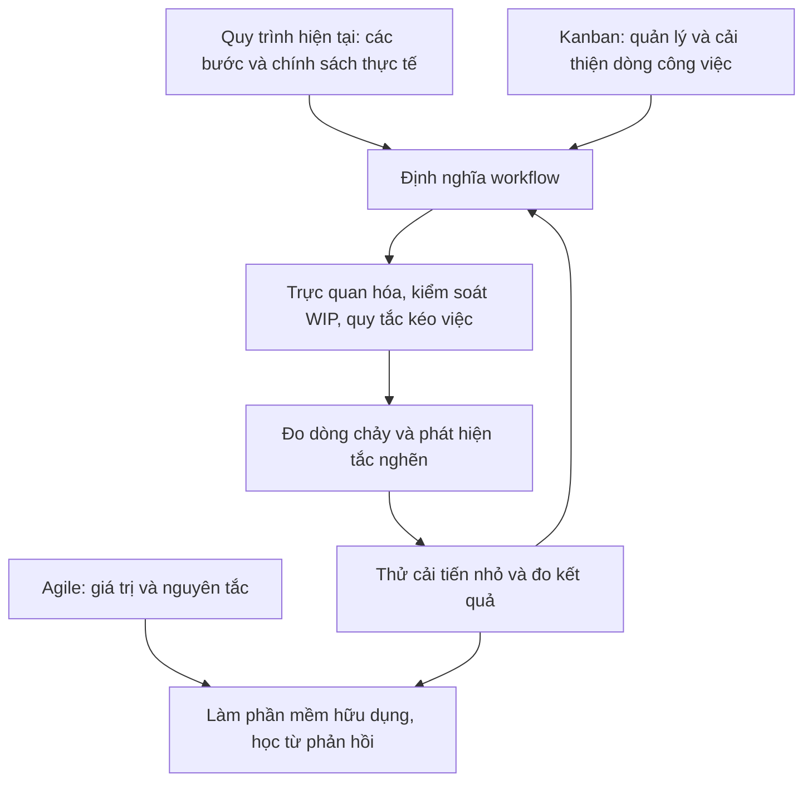
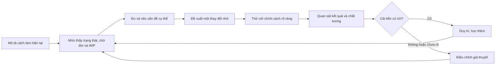

# Mối liên hệ giữa Kanban, Agile và quy trình hiện có

## Mục tiêu học tập

Sau bài học, bạn có thể:

- Phân biệt **Agile** là hệ giá trị và nguyên tắc, **Kanban** là một cách quản lý và cải thiện dòng công việc, còn **quy trình hiện có** là cách tổ chức đang thực sự tạo giá trị.
- Giải thích vì sao một đội có thể **bổ sung Kanban mà không cần thay toàn bộ quy trình**, cũng như vì sao chỉ treo bảng thẻ chưa có nghĩa đã quản lý dòng công việc tốt.
- Thiết kế **Definition of Workflow (DoW)** ở mức phù hợp: đơn vị công việc, điểm bắt đầu/kết thúc, trạng thái, chính sách, kiểm soát **WIP** và kỳ vọng mức dịch vụ (**SLE**).
- Sử dụng **pull, giới hạn công việc đang làm, phản hồi thường xuyên và cải tiến tiến hóa** để giảm tắc nghẽn, thay vì cố bắt tất cả mọi người luôn bận.
- Phân biệt **WIP, throughput, work item age, cycle time**, sử dụng chúng đúng mục đích và không đánh đồng tốc độ của hệ thống với năng suất cá nhân.
- Nêu cách **Kanban kết hợp với Scrum**, XP hoặc quy trình bảo trì, hỗ trợ, triển khai sản phẩm hiện hành mà không tạo ra những quy tắc không có trong mỗi phương pháp.
- Thực hành chuyển đổi một luồng công việc của nền tảng học trực tuyến, nhận diện tắc nghẽn, đề xuất chính sách và chọn tín hiệu để kiểm chứng cải tiến.

## 1. Ba lớp khái niệm cần tách biệt

Một nhóm phát triển nền tảng học tập đang dùng quy trình:

> Yêu cầu từ Product Owner → Phân tích → Thiết kế → Lập trình → Kiểm thử → Phát hành.

Sau khi nghe về Kanban, một thành viên đề xuất: “Bỏ quy trình cũ, lập bảng To do / Doing / Done là đã chuyển sang Agile.”

Đề xuất này nhầm ba thứ:

1. **Agile** trả lời chủ yếu: *Chúng ta coi trọng cách cộng tác và ra quyết định nào để giao giá trị trong bối cảnh thay đổi?*
2. **Kanban** trả lời: *Chúng ta định nghĩa, nhìn thấy, quản lý và liên tục cải thiện dòng công việc như thế nào?*
3. **Quy trình hiện có** trả lời: *Tổ chức hiện đang nhận yêu cầu, quyết định, triển khai, kiểm tra và đưa kết quả tới người dùng ra sao?*

Kanban có thể được áp dụng **trên quy trình hiện có**, thay vì mặc định thay thế nó. Điều này đặc biệt hữu ích khi công việc đến không đều, nhiều yêu cầu bảo trì/xử lý sự cố, hoặc một nhóm muốn cải thiện khả năng giao hàng mà chưa thể thay đổi mọi trách nhiệm và quy định tổ chức.

### 1.1. Bảng phân biệt

| Góc nhìn | Agile | Kanban | Quy trình hiện có |
| --- | --- | --- | --- |
| **Bản chất** | Các giá trị và nguyên tắc phát triển phần mềm thích ứng. | Chiến lược và thực hành quản lý luồng giá trị, tối ưu cách công việc đi qua hệ thống. | Tập hợp các bước, chính sách, vai trò, công cụ và thói quen đang vận hành. |
| **Câu hỏi chính** | Làm sao tạo phần mềm hữu dụng, cộng tác, đón nhận phản hồi và thay đổi? | Công việc bắt đầu, chờ, di chuyển và hoàn thành ra sao; cần cải thiện điều gì? | Hiện đội thực hiện những bước nào và ai đang ra quyết định gì? |
| **Thay đổi bắt buộc ngay?** | Không áp đặt một quy trình duy nhất. | Không đòi phá bỏ mọi công đoạn từ đầu; cần định nghĩa và quản lý workflow. | Có thể giữ phần đang hữu ích, sửa phần gây lãng phí. |
| **Thước đo giá trị** | Kết quả người dùng, phản hồi và chất lượng phần mềm. | Độ trôi chảy, khả năng dự báo và hiệu quả giao công việc/giá trị. | Tùy hiện trạng; có thể đang thiên về sử dụng nhân lực hay tuân thủ. |
| **Ví dụ** | Giao lát sản phẩm nhỏ, nhận phản hồi sớm. | Giới hạn WIP, dùng cycle time, theo dõi công việc bị chặn. | Có bước kiểm thử bảo mật bắt buộc và chính sách triển khai sản xuất. |

Kanban **không tự động đồng nghĩa Agile**. Một bộ phận có thể dùng Kanban để quản lý công việc ổn định, không có phát triển phần mềm lặp–tăng dần. Ngược lại, một Scrum Team có thể tuân thủ các nguyên tắc Agile dù chưa dùng các thước đo Kanban. Khi kết hợp, Kanban có thể giúp đội **giao giá trị thường xuyên hơn, phản hồi nhanh hơn và cải thiện liên tục**.

### 1.2. Một sơ đồ về mối quan hệ



Mũi tên từ Kanban đến Agile trong sơ đồ diễn đạt **khả năng hỗ trợ mục tiêu Agile**, không có nghĩa Kanban là điều kiện bắt buộc để được gọi là Agile.

## 2. Vì sao Kanban phù hợp với tư duy cải tiến tiến hóa?

Một đặc điểm nổi bật của **Kanban Method** được phổ biến trong quản lý công việc tri thức là **bắt đầu từ những gì đội đang làm**, quan sát hệ thống hiện hữu và thay đổi bằng các bước có thể kiểm chứng.

Các ý tưởng thường được nhấn mạnh:

- **Bắt đầu với điều đang làm hiện tại**: nhận diện cách yêu cầu đi qua tổ chức trước khi đề xuất một workflow lý tưởng.
- **Tôn trọng vai trò, trách nhiệm và chính sách đang có**: không mặc định xóa chức danh hoặc thủ tục cần thiết chỉ vì làm Kanban.
- **Khuyến khích thay đổi tiến hóa**: làm rõ vấn đề, thử cách cải thiện, quan sát tác động và điều chỉnh tiếp.
- **Thúc đẩy hành vi lãnh đạo ở mọi cấp**: người nhìn thấy tắc nghẽn có thể đóng góp bằng chứng và đề xuất thay đổi.

Đây là **cách tiếp cận thay đổi tổ chức**, không phải chỉ một danh sách cột cố định. Cách mô tả này thường gắn với *Kanban Method*; trong khi đó **The Kanban Guide** diễn đạt Kanban như một **chiến lược tối ưu hóa dòng giá trị qua một quy trình**. Hai cách diễn đạt có trọng tâm khác nhau, nhưng cùng hướng tới việc thấy rõ, kiểm soát và cải thiện dòng công việc.

### 2.1. Thay đổi nhỏ không có nghĩa chấp nhận mọi vấn đề hiện tại

“Bắt đầu từ cách đang làm” **không** có nghĩa:

- Giữ mãi một bước phê duyệt gây chờ không có giá trị.
- Duy trì chia việc theo phòng ban dù làm đứt gãy khả năng giao tính năng xuyên suốt.
- Xem một bảng đầy thẻ là đủ, không giới hạn WIP hoặc không đo thời gian chờ.
- Từ chối xử lý sự cố bảo mật nghiêm trọng vì “thay đổi phải từ từ”.

Thay đổi tiến hóa nghĩa là **có căn cứ và kiểm chứng từng bước**. Những rủi ro nghiêm trọng hoặc ràng buộc bắt buộc vẫn cần xử lý kịp thời theo mức ảnh hưởng.

### 2.2. Ví dụ về một cải tiến nhỏ nhưng có tác động

Hiện trạng: một tính năng được lập trình xong nhưng phải chờ kiểm thử trung bình nhiều ngày; nhóm lập trình tiếp tục khởi động tính năng mới.

Thay vì mua ngay công cụ mới hoặc thay toàn bộ quy trình, đội thử:

1. Tách rõ trạng thái **“Chờ kiểm thử”** và **“Đang kiểm thử”** trên bảng.
2. Đặt chính sách không bắt đầu quá nhiều hạng mục mới khi vùng kiểm thử bị tắc.
3. Khi không có hạng mục nào sẵn sàng kiểm thử, Developers hỗ trợ chuẩn bị dữ liệu và kiểm thử tự động.
4. Đo cycle time, tuổi các hạng mục bị chặn và lỗi phát hiện muộn trước/sau thay đổi.
5. Tiếp tục, chỉnh hoặc bỏ chính sách dựa trên bằng chứng.

Đây là **một thử nghiệm cải tiến dòng công việc**, phù hợp với việc giao sản phẩm tăng dần và cải tiến liên tục trong Agile.

## 3. Từ quy trình đang làm tới Definition of Workflow

Muốn sử dụng Kanban hiệu quả, trước hết cần biết **đang quản lý luồng giá trị nào**. The Kanban Guide gọi sự định nghĩa và hình dung chung đó là **Definition of Workflow (DoW)**.

Một DoW đủ rõ thường làm sáng tỏ:

1. **Đơn vị giá trị/công việc** nào đang chảy trong hệ thống: user story, lỗi, yêu cầu hỗ trợ, thí nghiệm, thay đổi cấu hình?
2. **Điểm bắt đầu**: khi nào một hạng mục được tính là đã bắt đầu trong workflow?
3. **Điểm kết thúc**: khi nào hạng mục được tính là hoàn thành?
4. **Các trạng thái** công việc đi qua giữa hai mốc.
5. **Cách kiểm soát WIP**: giới hạn hoặc chính sách điều tiết số hạng mục đang làm.
6. **Chính sách rõ ràng** để công việc đi qua workflow, bao gồm các điều kiện chuyển trạng thái và cách xử lý việc bị chặn.
7. **Service Level Expectation (SLE)**: kỳ vọng về khoảng thời gian một hạng mục có thể hoàn thành, dựa trên bằng chứng phù hợp khi có.

Không phải mọi đội phải có cùng số cột hoặc cùng quy tắc. DoW cần đủ minh bạch để **mọi người hiểu cùng ranh giới**, nếu không các thước đo sẽ trở nên vô nghĩa.

### 3.1. Điểm bắt đầu và kết thúc quan trọng hơn tên cột

Một tổ chức có thể xem công việc “bắt đầu” ngay khi người dùng gửi yêu cầu; tổ chức khác chỉ tính “bắt đầu” khi đội chủ động nhận xử lý. Hai cách cho thời gian đo khác nhau.

Ví dụ:

```text
Nơi nhận yêu cầu              BÊN TRONG DO W
      │                    ┌──────────────────────────────────────────────┐
      ▼                    ▼                                              ▼
   Ý tưởng → Cần làm rõ → Sẵn sàng → Phát triển → Chờ kiểm thử → Kiểm thử → Done
                              ↑                                      ↑
                           Start                                   Finish
```

Nếu DoW bắt đầu ở **Sẵn sàng** và kết thúc tại **Done**, cycle time theo DoW **không tính thời gian ý tưởng nằm ở hàng chờ chưa được kéo vào làm**. Nếu mục tiêu người dùng quan tâm tới thời gian từ gửi yêu cầu đến được phục vụ, đội cũng cần đo hoặc phân tích **lead time trên một ranh giới rộng hơn**.

Không được lấy hai chỉ số có mốc khác nhau rồi so sánh như thể chúng giống nhau.

### 3.2. Hiện trạng thật trước, lý tưởng sau

Đội thường có sơ đồ quy trình trên tài liệu nhưng hành vi thực tế khác:

- Tài liệu nói “lập trình → kiểm thử → triển khai”; thực tế có thêm chờ đánh giá bảo mật.
- Tài liệu nói “xong kiểm thử là phát hành”; thực tế chỉ một người có quyền cấp môi trường staging.
- Tài liệu nói một công việc tại một thời điểm; thực tế người đang làm thường bị ngắt để hỗ trợ sự cố.

Kanban giúp **đưa những điểm chờ và bước ẩn ra ánh sáng**, để nhóm có thể phân biệt **vấn đề của hệ thống** với việc quy trách nhiệm tùy tiện cho cá nhân.

## 4. Trực quan hóa công việc và luồng giá trị

Bảng Kanban là một cách hữu ích để nhìn DoW. Nó có thể là bảng giấy hoặc công cụ trực tuyến; **công cụ không tự tạo ra Kanban**.

Một workflow minh họa cho đội làm nền tảng học trực tuyến:

```text
Backlog | Ready | Developing (WIP 3) | Reviewing | Testing (WIP 2) | Done
   8   |   4   | S1  S2  S3         |    S4     |   S5  S6         | S7  S8

Chính sách minh họa:
- Mọi thẻ có tên hạng mục, giá trị, người cần phối hợp, thời điểm bắt đầu.
- Thẻ đang bị chặn được đánh dấu rõ và vẫn được tính trong WIP nếu còn
  nằm trong ranh giới công việc đang thực hiện.
- Chỉ kéo việc mới khi có năng lực và không phá giới hạn WIP đã thống nhất.
- Done phải đáp ứng tiêu chuẩn chất lượng/hoàn thành của sản phẩm.
```

**Giới hạn WIP = 3 hay 2 chỉ là số minh họa**, không có giới hạn đúng cho mọi đội. Nếu đội chọn WIP tổng cho toàn workflow, WIP theo cột hay chính sách khác, cần ghi rõ cách tính, điều kiện ngoại lệ và cách phản ứng khi vượt giới hạn.

### 4.1. Thẻ công việc nên thể hiện điều gì?

| Thông tin | Lợi ích khi quản lý luồng |
| --- | --- |
| Kết quả người dùng hoặc sản phẩm cần đạt | Tránh tối ưu số thẻ mà quên giá trị. |
| Loại hạng mục và mức độ ưu tiên | Phân biệt lỗi nghiêm trọng với cải tiến thông thường. |
| Thời điểm bắt đầu theo DoW | Tính tuổi công việc đang làm (work item age). |
| Trạng thái và ngày vào trạng thái | Nhìn thấy hàng đợi, tắc nghẽn, thời gian chờ. |
| Trở ngại/phụ thuộc | Biết cần hỗ trợ từ đâu, không “ẩn” phần bị chặn. |
| Điều kiện để được xem là Done | Giữ chất lượng và điểm kết thúc nhất quán. |

Tránh biến thẻ thành biểu mẫu phải điền hàng chục trường không giúp quyết định. **Mức minh bạch phù hợp** quan trọng hơn lượng metadata.

### 4.2. Không phải mọi cột đều tạo thêm giá trị

Một bước rà soát có thể là yêu cầu kiểm soát chất lượng cần thiết; bước khác chỉ tồn tại vì thói quen giao việc qua nhiều phòng ban. Khi xem bản đồ luồng, nhóm nên hỏi:

- Bước này bảo vệ chất lượng, an toàn hoặc quyền nào?
- Nó tạo thông tin quyết định hay chỉ phát sinh thời gian chờ?
- Có thể làm kiểm tra **sớm hơn hoặc song song** để giảm thời gian đợi không?
- Có thể tự động hóa kiểm tra lặp lại mà vẫn giữ trách nhiệm phù hợp không?

Mục tiêu là **tăng khả năng giao giá trị an toàn và dự đoán được**, không phải tùy tiện xóa kiểm thử, bảo mật hay bước tuân thủ để có cycle time đẹp.

## 5. Kéo việc (pull) và giới hạn WIP: quản lý thay vì chất thêm

### 5.1. Push và pull khác nhau ra sao?

**Push:** khi một người hoặc một nhóm hoàn thành phần việc của mình, họ chuyển công việc sang người tiếp theo mà không quan tâm nhóm sau đang đủ sức nhận hay chưa.

**Pull:** nhóm hoặc công đoạn nhận việc mới **khi có năng lực và theo chính sách đã thống nhất**. Công việc được kéo qua workflow theo khả năng xử lý, thay vì chỉ được đẩy tới.

Ví dụ:

- Lập trình viên hoàn tất năm story trong khi kiểm thử chỉ xử lý được hai story, tạo hàng đợi ba story.
- Nếu mỗi ngày lập trình cứ tiếp tục tạo thêm việc, số story “code xong” tăng nhưng **ngày hoàn thành sản phẩm** có thể không tiến nhanh.
- Nếu nhóm cùng hỗ trợ kiểm thử, chia nhỏ story, chuẩn bị dữ liệu và giữ số story đang làm ở mức phù hợp, họ có thể hoàn thành từng lát giá trị nhanh hơn.

**Pull không có nghĩa người làm xong phải đứng chờ vô ích**. Họ có thể hỗ trợ công đoạn đang tắc, giảm rủi ro, tự động hóa kiểm thử, làm rõ yêu cầu hoặc cải thiện năng lực toàn đội.

### 5.2. WIP và tác động tới thời gian hoàn thành

**Work in Progress (WIP)** là số đơn vị công việc đã bắt đầu nhưng chưa hoàn thành theo ranh giới DoW. Mở quá nhiều công việc cùng lúc thường khiến năng lực bị chia nhỏ, tăng chuyển đổi ngữ cảnh, hàng đợi và khó nhận diện công việc nào cần hoàn tất trước.

Giới hạn WIP tạo ra **tín hiệu buộc đội thảo luận về dòng chảy**:

1. Khi cột đang phát triển đã đủ giới hạn, không tự động kéo việc mới.
2. Tìm hạng mục gần Done hoặc bị chặn cần hỗ trợ.
3. Nếu kiểm thử đang tắc, ưu tiên phối hợp giải quyết tắc.
4. Khi hoàn thành một hạng mục và có năng lực thực sự, mới kéo công việc tiếp theo.

Giới hạn WIP **không nhằm chấm năng suất cá nhân**. Đôi khi một người phải tạm rời việc chuyên môn riêng để giúp đồng đội hoàn thành một lát dọc; điều này có thể cải thiện kết quả của cả hệ thống.

### 5.3. Xử lý khi WIP bị vượt

Có lúc sự cố sản xuất buộc đội phải nhận việc khẩn. Khi đó nên:

- Nêu rõ **lý do ngoại lệ** và người có quyền quyết định.
- Đánh dấu hạng mục bị ngắt hoặc hoãn, phản ánh WIP thật.
- Thông báo ảnh hưởng tới dự báo của các công việc khác.
- Sau khi ổn định, xem vì sao ngoại lệ xuất hiện và có cần thay chính sách không.

Nếu đội luôn “ngoại lệ” để vượt WIP, giới hạn không còn giúp điều tiết. Vấn đề là **chính sách không được quản lý thực sự**, không chỉ là con số quá thấp.

## 6. Chính sách rõ ràng: điều kiện để người khác hiểu cách làm

Kanban khuyến khích công khai **cách công việc được nhận, xử lý, chuyển bước, xử lý rủi ro và hoàn thành**. Đây là chính sách vận hành của workflow, không phải yêu cầu phải tạo văn bản hành chính dài.

Bảng ví dụ:

| Chính sách | Ví dụ cho sản phẩm học trực tuyến | Rủi ro nếu không rõ |
| --- | --- | --- |
| **Nhận việc** | Story mới chỉ được kéo khi rõ giá trị cần đạt, có điều kiện kiểm chứng phù hợp và còn năng lực. | Việc mơ hồ được bắt đầu rồi kẹt giữa chừng. |
| **Kéo việc** | Khi có chỗ trong WIP, ưu tiên hạng mục đã được xếp theo giá trị và phụ thuộc. | Ai cũng tự chọn việc dễ hoặc việc của riêng mình. |
| **Chuyển sang kiểm thử** | Có phiên bản tích hợp và dữ liệu tối thiểu để kiểm tra hành vi. | Kiểm thử liên tục bị ngắt vì build thiếu hoặc sai môi trường. |
| **Xử lý bị chặn** | Gắn dấu “Blocked”, mô tả lý do và bước tháo gỡ; vẫn phản ánh WIP phù hợp. | Hạng mục biến mất khỏi tầm nhìn và số liệu sai. |
| **Hoàn thành** | Đạt Definition of Done hoặc tiêu chuẩn chất lượng tương ứng của sản phẩm. | Thẻ Done nhưng người dùng chưa sử dụng được. |
| **Công việc khẩn** | Phân loại có tiêu chí cụ thể, thông báo ảnh hưởng và xử lý theo chính sách sự cố. | Ai cũng gọi việc của mình là khẩn. |

Nếu đội dùng Scrum, cần **giữ đúng Product Owner, Sprint Goal, Sprint Backlog, Increment và DoD**; chính sách Kanban không được thay thế hoặc làm mờ các cam kết của Scrum.

## 7. Bốn thước đo dòng công việc cốt lõi

The Kanban Guide nhấn mạnh đo **dòng chảy** bằng những thước đo tối thiểu sau: **WIP, throughput, work item age và cycle time**.

| Thước đo | Diễn giải | Ví dụ | Lưu ý |
| --- | --- | --- | --- |
| **WIP** | Số hạng mục đã bắt đầu nhưng chưa hoàn thành tại thời điểm xem. | Hôm nay có 6 story trong DoW. | Phải nhất quán ranh giới và cách đếm thẻ bị chặn. |
| **Throughput** | Số hạng mục hoàn thành trong một đơn vị thời gian. | Tuần này đạt Done 4 story. | Không so sánh tùy tiện nếu story rất khác kích thước/loại việc. |
| **Work item age** | Thời gian đã trôi qua kể từ khi một hạng mục đang làm bắt đầu. | Story S2 đã ở trong hệ thống 9 ngày và chưa Done. | Hữu ích để can thiệp sớm; không phải thời gian còn lại. |
| **Cycle time** | Thời gian trôi qua từ lúc bắt đầu đến khi hoàn thành của **một hạng mục đã xong**. | S1 mất 4 ngày lịch từ Start tới Done. | Không đồng nghĩa giờ công; cần thống nhất mốc đo. |

Ngoài bốn thước đo này, nhóm có thể xem **lead time**, thời gian chờ theo trạng thái, tỷ lệ bị chặn, tỷ lệ lỗi hoặc các chỉ số kết quả người dùng. Chúng có giá trị nếu định nghĩa rõ và giúp ra quyết định.

### 7.1. Ví dụ số học với một tuần công việc

Giả sử theo DoW từ **Started** đến **Done**, đội hoàn thành bốn hạng mục:

| Hạng mục hoàn thành | Cycle time |
| --- | ---: |
| S1 — Trang mô tả khóa | 3 ngày lịch |
| S2 — Ghi danh miễn phí | 5 ngày lịch |
| S3 — Mở bài đầu | 7 ngày lịch |
| S4 — Sửa lỗi hiển thị tiến độ | 9 ngày lịch |
| **Trung bình minh họa** | **6 ngày lịch** |

Công thức: (3 + 5 + 7 + 9) / 4 = **6 ngày lịch**. Đây là **trung bình của bốn hạng mục**, không phải một lời hứa rằng hạng mục tiếp theo sẽ xong trong 6 ngày.

Nếu còn story S5 đang làm 11 ngày, nó **không nằm trong bảng cycle time của các hạng mục đã Done**, nhưng **work item age = 11 ngày** có thể là tín hiệu nguy cơ chậm trễ đáng quan tâm ngay hôm nay.

Đội nên xem **phân bố** và các công việc bất thường, không chỉ nhìn trung bình. Nhóm có nhiều hạng mục nhỏ kết thúc trong hai ngày và vài hạng mục lớn mất ba tuần sẽ cần phân tích khác với nhóm có các hạng mục tương đối đồng đều.

### 7.2. Little's Law — hiểu đúng giới hạn

Trong hệ thống có điều kiện ổn định và ranh giới đo nhất quán, **Little's Law** cho mối quan hệ:

```text
L = λ × W

L: số hạng mục trung bình trong hệ thống
λ: tốc độ hoàn thành trung bình (khi hệ thống ổn định)
W: thời gian trung bình trong hệ thống
```

Trong workflow phần mềm có thể viết gần đúng:

```text
WIP trung bình ≈ Throughput trung bình × Cycle time trung bình
```

Ví dụ **minh họa**: nếu WIP trung bình bằng **8** và throughput trung bình bằng **2 hạng mục/tuần**, thì thời gian trung bình trong hệ thống xấp xỉ **8 / 2 = 4 tuần**, khi điều kiện áp dụng hợp lệ.

Không được kết luận:

- Mọi hạng mục sẽ luôn xong đúng bốn tuần.
- Giảm WIP một nửa chắc chắn làm giảm cycle time một nửa trong mọi hoàn cảnh.
- WIP càng thấp càng tốt mà không cần xét năng lực, loại việc và mục tiêu.
- Tăng throughput bằng cách chia nhỏ thẻ tùy tiện chắc chắn làm tăng giá trị người dùng.

Đây là quan hệ **giúp hiểu và đặt câu hỏi về hệ thống**, không phải công thức cam kết thời hạn một story cụ thể.

## 8. Dự báo với SLE: “khi nào có khả năng xong?” thay vì “hứa ngày nào?”

**Service Level Expectation (SLE)** mô tả kỳ vọng về thời gian một hạng mục có thể đi qua workflow từ bắt đầu tới hoàn thành. SLE thường được biểu đạt với **mốc thời gian và xác suất** khi có dữ liệu lịch sử phù hợp.

Ví dụ sau khi thống kê cycle time của một nhóm hạng mục đồng loại, đội có thể nói:

> “Theo dữ liệu lịch sử phù hợp, khoảng **85% hạng mục** đã hoàn thành trong **10 ngày lịch hoặc ít hơn** từ Start đến Done.”

Đó là **mô tả phân bố trong dữ liệu đã quan sát**. Nó có thể là cơ sở xây **SLE cho loại công việc tương tự**, nhưng không phải bảo đảm rằng story bất kỳ chắc chắn xong trong 10 ngày. Đội phải kiểm tra sự tương đồng về kích thước hạng mục, chính sách, năng lực và dữ liệu trước khi dùng để dự báo.

### 8.1. SLE khác SLA

- **SLE:** kỳ vọng về hiệu năng dòng công việc, giúp đội và stakeholders thảo luận rủi ro giao hàng; trong thực hành Kanban có thể là kỳ vọng dựa trên xác suất.
- **SLA (Service Level Agreement):** thỏa thuận mức dịch vụ có cam kết và hệ quả tùy hợp đồng/chính sách, ví dụ nghĩa vụ phản hồi hoặc xử lý sự cố cho khách hàng.

Hai khái niệm có thể liên quan nhưng **không được đánh đồng**. Một SLE không tự biến thành bảo đảm hợp đồng.

### 8.2. Dùng tuổi công việc để hành động trước khi quá muộn

Giả sử SLE nội bộ là “85% hạng mục loại này hoàn tất trong 10 ngày”. Hôm nay:

| Story | Tuổi đang làm | Tình trạng | Phản ứng phù hợp |
| --- | ---: | --- | --- |
| S6 | 2 ngày | Đang triển khai, chưa có chặn. | Tiếp tục theo dõi. |
| S7 | 7 ngày | Chờ dữ liệu kiểm thử. | Xác định phụ thuộc, phối hợp tháo gỡ. |
| S8 | 11 ngày | Bị chặn ở tích hợp ngoài. | Ưu tiên trao đổi, đánh giá rủi ro dự báo và chính sách xử lý. |

**Không suy ra** S8 chắc chắn thất bại hoặc cá nhân chịu trách nhiệm kém năng lực. Tuổi công việc chỉ cho biết **việc đã ở trong hệ thống bao lâu**; nhóm cần hiểu nguyên nhân và quyết định cách giảm rủi ro.

## 9. Ví dụ xuyên suốt: áp dụng Kanban lên quy trình hiện có của nền tảng học trực tuyến

### 9.1. Hiện trạng ban đầu

Một đội đang phát triển các tính năng ghi danh, học tập và chứng chỉ. Họ sử dụng:

1. Product Owner hoặc bộ phận nghiệp vụ đưa yêu cầu.
2. Nhóm phân tích làm rõ.
3. Lập trình viên xây tính năng.
4. Kiểm thử viên kiểm tra.
5. Người vận hành đưa phiên bản tới người dùng.

Đội đã có chất lượng phát hành, có công cụ issue tracker và một lịch họp hằng tuần. Tuy nhiên, **công việc thường chờ ở giữa các bước**:

- Lập trình viên hoàn thành mã rồi chuyển qua kiểm thử khi kiểm thử đang quá tải.
- Kiểm thử phát hiện thiếu tiêu chí chấp nhận nên yêu cầu quay lại làm rõ.
- Một số lỗi tích hợp phải chờ chuyên gia dữ liệu hoặc quyền vận hành.
- Quản lý nhìn số lượng ticket “đã code xong” nhưng khó biết khi nào sản phẩm **thật sự Done**.

Không nhất thiết hủy bỏ Product Owner, người kiểm thử, phần mềm quản lý hay các chính sách cần tuân thủ. Trước tiên, nhóm cần **nhìn đúng luồng công việc đang xảy ra**.

### 9.2. Xây DoW cho một loại hạng mục

Chọn **user story và lỗi sản phẩm thông thường** là đơn vị công việc trong một workflow; những sự cố nghiêm trọng có chính sách riêng.

| Thành phần DoW | Lựa chọn minh họa đã thống nhất |
| --- | --- |
| **Đơn vị công việc** | Một story hoặc lỗi có kết quả/điều kiện hoàn thành rõ. |
| **Điểm Start** | Khi được kéo từ “Ready” sang “In progress”. |
| **Điểm Finish** | Khi đáp ứng chuẩn “Done”, đã tích hợp và kiểm chứng cần thiết. |
| **Các trạng thái** | Ready → Developing → Reviewing → Testing → Done; việc bị chặn thể hiện rõ. |
| **Kiểm soát WIP** | Tối đa 4 hạng mục đang xử lý trên toàn luồng trong giai đoạn thử; có thể đổi nếu dữ liệu cho thấy không phù hợp. |
| **Chính sách kéo việc** | Kéo từ thứ tự ưu tiên khi còn WIP, rõ người phối hợp và không có điều kiện bắt buộc bị bỏ qua. |
| **Chính sách hoàn thành** | Đáp ứng yêu cầu sản phẩm/DoD; không chỉ “code complete”. |
| **SLE ban đầu** | Cần đo dữ liệu trước khi tuyên bố tỷ lệ thời gian đáng tin; có thể ghi rõ “chưa đủ dữ liệu”. |

Giới hạn **4** ở đây là con số **thử nghiệm**, không phải quy tắc chung. Một đội có thể chọn giới hạn theo cột, theo loại hạng mục hoặc khác, miễn công khai và thực sự quản lý WIP. Nếu story quá khác nhau về kích thước, nhóm cũng cần phân loại hoặc tách nhỏ để thước đo có ý nghĩa.

### 9.3. Thay đổi nhỏ đầu tiên

Trước khi thay đổi, đội liên tục **mở việc mới** dù ba story đang chờ kiểm thử. Thay đổi được đề xuất:

- Thấy rõ hạng mục nào đã bắt đầu, hạng mục nào bị chặn và tuổi của chúng.
- Khi gần chạm giới hạn WIP, **ưu tiên hoàn thành** story đang chờ thay vì kéo story tiếp theo.
- Developers ghép cặp với người kiểm thử để chuẩn bị ví dụ nghiệp vụ và dữ liệu sớm hơn.
- Lựa chọn tự động hóa kiểm thử tích hợp quan trọng theo rủi ro, không “đẩy QA” sang cuối.
- Trong các buổi xem luồng ngắn, tập trung vào thẻ già, điểm chờ và cách tháo gỡ.

Đội **không đổi toàn bộ sơ đồ nhân sự**, vẫn giữ quyền quyết định ưu tiên của người phụ trách sản phẩm và chuẩn chất lượng bắt buộc.

### 9.4. So sánh kết quả theo chỉ số phù hợp

Giả sử nhóm thu thập dữ liệu với **định nghĩa Start/Done không đổi**, loại hạng mục tương đối tương đồng và không có thay đổi lớn về nhân sự. Dữ liệu dưới đây **hoàn toàn minh họa**:

| Tín hiệu | Giai đoạn trước | Giai đoạn thử nghiệm | Điều cần điều tra |
| --- | ---: | ---: | --- |
| WIP trung bình | 9 story | 5 story | WIP giảm do hoàn thành nhanh hơn hay do chưa nhận việc? |
| Cycle time trung vị | 13 ngày lịch | 8 ngày lịch | Có khác biệt về kích thước story hoặc thời gian chờ không? |
| Throughput trung bình | 4 story/tuần | 4 story/tuần | Giao hàng ổn định hơn mà không cần tăng số thẻ? |
| Thẻ bị chặn lâu hơn 5 ngày | 5 | 2 | Chính sách tháo chặn có thực sự hiệu quả không? |
| Lỗi nghiêm trọng sau phát hành | 1 trong kỳ | 1 trong kỳ | Chưa có cơ sở nói chất lượng tốt hơn; phải theo dõi. |

Đừng vội kết luận **Kanban đã làm cycle time giảm 38,5%** từ hai mẫu nhỏ nếu chưa kiểm tra dữ liệu và các yếu tố nhiễu. Với dữ liệu giả định 13 xuống 8 ngày, chênh lệch số học là 5 ngày, nhưng **nguyên nhân của chênh lệch cần được xác minh**.

Quan trọng hơn, đội còn phải xem **người học có được dùng tính năng sớm hơn, ít lỗi hơn và dễ phản hồi hơn không**. Một bảng đẹp và WIP thấp không tự tạo ra giá trị người dùng.

### 9.5. Điều chỉnh tiếp sau phản hồi

Nếu sau thử nghiệm vẫn có lỗi do tiêu chí chấp nhận mơ hồ, đội bổ sung **trao đổi ba góc nhìn trước khi kéo việc**, viết ví dụ cụ thể và kiểm thử rủi ro sớm. Nếu việc bị chặn chủ yếu do cấp quyền môi trường, nhóm tập trung vào chính sách truy cập, tự phục vụ môi trường hoặc cải tiến phối hợp với vận hành.

Kanban đưa ra cách **quan sát và cải thiện**, nhưng giải pháp cho từng điểm nghẽn phải xuất phát từ **nguyên nhân của hệ thống thực tế**.

## 10. Kanban và Scrum: có thể dùng cùng nhau không?

**Có.** Scrum và Kanban giải quyết các khía cạnh khác nhau:

- **Scrum** là một khung gồm trách nhiệm giải trình, sự kiện, hiện vật và cam kết, giúp đội tạo giá trị theo **Sprint** và **Increment**.
- **Kanban** giúp đội **định nghĩa, quản lý và cải thiện dòng công việc**, không quy định phải thay các trách nhiệm giải trình và sự kiện của Scrum.

Một **Scrum Team** có thể dùng kỹ thuật Kanban để quản lý flow trong Sprint, chẳng hạn bảng workflow, giới hạn WIP, phân tích tuổi hạng mục và cycle time.

### 10.1. Ví dụ kết hợp

Một Scrum Team có Sprint Goal:

> “Học viên đã ghi danh khóa Java nhập môn có thể tiếp tục đúng bài học đang dở.”

Các Developers dùng workflow:

```text
Sprint Backlog → Developing (WIP 2) → Testing (WIP 2) → Done (đạt DoD)
```

Trong **Daily Scrum**, Developers kiểm tra Sprint Goal và Sprint Backlog; họ cũng nhìn thẻ bị chặn và tuổi công việc. Khi kiểm thử có hai thẻ đang chờ, cả đội ưu tiên hỗ trợ hoàn thành chúng trước khi mở thêm hạng mục mới.

Điều này **không biến Daily Scrum thành một sự kiện khác**, không thay Sprint Goal bằng một con số throughput, và không biến Scrum Master thành người cấp việc. Nó là cách **bổ sung quản lý flow** trong khuôn khổ trách nhiệm Scrum.

### 10.2. Những điều phải được giữ nếu vẫn nói đang dùng Scrum

| Thành phần Scrum | Điều không được đánh mất khi bổ sung Kanban |
| --- | --- |
| **Product Owner** | Chịu trách nhiệm tối đa hóa giá trị và quản lý hiệu quả Product Backlog. |
| **Scrum Master** | Chịu trách nhiệm thiết lập Scrum đúng khung và hiệu quả Scrum Team. |
| **Developers** | Tự quản kế hoạch, tạo Increment hữu dụng và tuân thủ DoD. |
| **Sprint và các sự kiện** | Giữ Sprint cùng Sprint Planning, Daily Scrum, Sprint Review, Sprint Retrospective đúng mục đích và timebox. |
| **Product Goal / Sprint Goal** | Dùng mục tiêu để định hướng lựa chọn và đánh giá tiến độ; không để chỉ số dòng công việc thay mục tiêu. |
| **Increment / DoD** | Hạng mục chưa đạt DoD chưa được coi là Increment hoàn thành. |

**Kanban không bắt buộc Scrum Team chuyển sang phát hành liên tục**, dù đội có thể phát hành Increment nhiều lần khi sản phẩm và chính sách cho phép. Scrum Guide cũng không quy định chỉ được phát hành vào cuối Sprint.

### 10.3. Kanban có phải “Scrum không có Sprint” không?

Không. Nếu một nhóm bỏ Sprint và các sự kiện, họ không còn áp dụng Scrum nguyên vẹn chỉ vì vẫn giữ thẻ user story hoặc vai trò Product Owner. Họ có thể đang dùng một cách làm dựa trên flow, Kanban hoặc sự kết hợp khác. Điều cần làm là **gọi đúng cách đang vận hành và nêu rõ các trách nhiệm, chính sách**.

Ngược lại, một Scrum Team dùng bảng kéo việc và WIP limit vẫn là Scrum Team, với điều kiện các phần cốt lõi Scrum được duy trì.

## 11. Kanban, XP và phát triển phần mềm chất lượng

Kanban không chỉ định mọi kỹ thuật kỹ nghệ phần mềm. Nó có thể phát hiện hệ thống bị kẹt ở kiểm thử, tích hợp hoặc triển khai; **Extreme Programming (XP)** và các thực hành kỹ thuật khác có thể giúp giải quyết nguyên nhân.

| Dấu hiệu qua Kanban | Cách thực hành kỹ thuật có thể hỗ trợ | Điều cần kiểm chứng |
| --- | --- | --- |
| Story chờ kiểm thử quá lâu | Kiểm thử tự động, TDD khi phù hợp, ghép cặp phát triển–kiểm thử. | Thời gian chờ và lỗi hồi quy có giảm không? |
| Nhiều lỗi khi tích hợp | Tích hợp liên tục (CI), chia thay đổi nhỏ, kiểm thử hợp đồng API. | Tỷ lệ build lỗi, thời gian khắc phục và số story bị chặn. |
| Các thay đổi nhỏ kéo dài vì mã khó sửa | Refactoring, thiết kế đơn giản, review và pair programming. | Cycle time, lỗi phát sinh và khả năng thay đổi có cải thiện không? |
| Mỗi lần phát hành phải thực hiện nhiều thao tác thủ công | Tự động hóa triển khai, kiểm chứng sau triển khai và rollback thích hợp. | Thời gian từ Done tới người dùng, số sự cố triển khai. |

**TDD, CI, pair programming không phải “quy định bắt buộc của Kanban”**. Chúng là lựa chọn kỹ thuật để tăng chất lượng và khả năng thích nghi. Với một đội Agile, mục đích cuối cùng vẫn là giao **phần mềm hoạt động được**, nhận phản hồi và tiếp tục cải tiến.

## 12. Kanban với quy trình khác Scrum

Kanban cũng có thể dùng trong những môi trường không tổ chức công việc theo Sprint:

### 12.1. Đội bảo trì và hỗ trợ sản xuất

Công việc đến liên tục và mức độ cấp thiết khác nhau. Đội có thể có workflow:

```text
Tiếp nhận → Phân loại → Đang xử lý → Chờ xác minh → Hoàn thành
```

Cần chính sách rõ cho **sự cố nghiêm trọng**, yêu cầu hỗ trợ thông thường và công việc cải tiến. Có thể đặt SLE riêng theo loại hạng mục khi dữ liệu phù hợp. Không nên lấy một SLE chung cho “sửa lỗi chính tả” và “khôi phục hệ thống thanh toán” nếu mức rủi ro quá khác nhau.

### 12.2. Quy trình nhiều cổng kiểm soát

Một sản phẩm có yêu cầu pháp lý hoặc kiểm toán có thể buộc giữ các bước phê duyệt. Kanban giúp:

- Hiện rõ công việc đang chờ phê duyệt và tuổi chờ.
- Chuẩn bị hồ sơ sớm để giảm việc bị trả lại.
- Ghi chính sách tiếp nhận và ưu tiên khi năng lực kiểm duyệt hạn chế.
- Đo thời gian đi qua từng công đoạn và đề xuất cải tiến không làm mất kiểm soát bắt buộc.

Kanban **không phải lý do bỏ qua tuân thủ**. Ngược lại, nó giúp người liên quan thấy các chi phí và điểm nghẽn của quy trình, từ đó cải tiến chính sách khi có quyền và bằng chứng.

### 12.3. Quy trình theo giai đoạn hoặc kế hoạch dự đoán trước

Một tổ chức đang dùng các giai đoạn “phân tích → thiết kế → thực hiện → kiểm thử” vẫn có thể áp dụng Kanban để làm minh bạch hàng đợi, chính sách và thời gian chờ. Việc này **không tự biến mô hình dự đoán trước thành Agile**; để có khả năng thích nghi Agile, tổ chức còn cần thay đổi cách nhận phản hồi, giao lát giá trị và ra quyết định.

Đối với các dự án phần mềm có nhiều bất định, nhóm có thể cân nhắc **cắt lát theo hành vi người dùng** để kiểm chứng sớm, tránh chỉ tối ưu tốc độ di chuyển tài liệu giữa các công đoạn mà chưa giao được phần mềm hữu dụng.

## 13. Cải tiến Kanban nên đi theo một vòng học hỏi

Một cách tiếp cận thực dụng:



### 13.1. Các câu hỏi nên dùng trong buổi xem xét flow

- Công việc nào **đang già nhất** và điều gì khiến nó chưa xong?
- Chúng ta đang **bắt đầu quá nhiều** hay thực sự hoàn thành nhiều?
- Hạng mục nào đang chờ sự kiện, chuyên gia, quyền truy cập hoặc kiểm thử?
- Chính sách WIP và kéo việc có được áp dụng không? Nếu không, lý do gì?
- Chất lượng, bảo mật và giá trị người dùng có bị đánh đổi để “đẹp chỉ số” không?
- Thử nghiệm nhỏ nào có thể cho bằng chứng sớm về một cải tiến?

Đội có thể chọn nhịp xem xét hằng ngày, hằng tuần hoặc theo nhu cầu. **Kanban không quy định phải có các sự kiện Scrum**; nhịp phù hợp phụ thuộc loại công việc, mức biến động và cách tổ chức đang làm.

### 13.2. Xử lý các hạng mục có kích thước khác nhau

Throughput theo số thẻ có thể bị méo nếu một thẻ chỉ đổi nhãn nút, còn thẻ khác là dự án đồng bộ tiến độ đa thiết bị. Nếu nhóm muốn dự báo tin cậy hơn, họ có thể:

- Chia công việc lớn thành **lát có giá trị độc lập** và kiểm chứng được.
- Phân loại hạng mục tương đối đồng nhất khi phân tích dữ liệu.
- Giữ định nghĩa Started/Done và cách đếm ổn định trong từng tập dữ liệu.
- Kết hợp dữ liệu định lượng với hiểu biết về rủi ro, phụ thuộc và chất lượng.

Không được chia một user story thành mười thẻ vô nghĩa chỉ để tăng throughput. **Cải thiện dòng chảy phải phục vụ kết quả thật**.

## 14. Những ngộ nhận thường gặp

### 14.1. “Có bảng To do / Doing / Done là đang làm Kanban”

Một bảng đơn giản có thể bắt đầu tạo minh bạch, nhưng chưa đủ để quản lý dòng công việc nếu **không có ranh giới, chính sách, kiểm soát WIP, đo lường và cải tiến**.

**Khắc phục:** nêu DoW, các điểm Start/Finish, điều kiện chuyển trạng thái và cách quản lý việc đang làm.

### 14.2. “Kanban có nghĩa là không cần kế hoạch hay thứ tự ưu tiên”

Kanban không xóa nhu cầu ra quyết định giá trị. Các hạng mục cần có **chính sách chọn việc phù hợp** với mục tiêu, mức cấp thiết và năng lực. Nếu dùng Scrum, Product Owner vẫn chịu trách nhiệm thứ tự Product Backlog.

**Khắc phục:** công khai cách chọn việc, nguồn ưu tiên và chính sách khẩn cấp.

### 14.3. “WIP càng thấp thì đội càng tốt”

Giới hạn WIP quá thấp trong một hệ thống phụ thuộc nhiều người hoặc có nhiều công việc chờ ngoài có thể khiến năng lực không được sử dụng hợp lý hoặc tạo điểm nghẽn mới.

**Khắc phục:** thử, đo, quan sát, điều chỉnh chính sách theo khả năng giao giá trị và mức rủi ro; không coi số WIP là mục tiêu tự thân.

### 14.4. “Chỉ cần mọi người luôn bận là throughput cao”

Mỗi người bận 100% chưa chắc giúp công việc hoàn thành nhanh: hàng đợi, chia ngữ cảnh và thiếu phối hợp có thể khiến cycle time tăng.

**Khắc phục:** tối ưu **dòng giá trị ở cấp hệ thống**, ưu tiên hoàn tất và hỗ trợ nút thắt thay vì bắt đầu thêm việc.

### 14.5. “Kanban loại bỏ hết họp, vai trò và chính sách”

Kanban không mặc định yêu cầu một cơ cấu vai trò mới hoặc lịch sự kiện cứng. Điều đó không có nghĩa có thể bỏ trách nhiệm ra quyết định, quy định sản phẩm hoặc mọi điểm phản hồi.

**Khắc phục:** giữ những cấu trúc có ích và bắt buộc; xem lại những bước gây chờ không cần thiết.

### 14.6. “Thấy cycle time giảm là chắc chắn tạo nhiều giá trị hơn”

Một nhóm có thể chia nhỏ thẻ hoặc bỏ kiểm thử để số liệu đẹp. Người dùng vẫn có thể gặp lỗi hoặc chưa nhận được chức năng họ cần.

**Khắc phục:** đo thêm kết quả người dùng, khả năng phát hành, lỗi, công việc làm lại và tuân thủ DoD/chính sách chất lượng.

### 14.7. “Kanban và Scrum không thể dùng chung”

Kanban có thể **bổ sung thực hành quản lý flow** cho Scrum mà không thay đổi các accountability, event và commitment của Scrum.

**Khắc phục:** giữ đúng khung Scrum, dùng Kanban để minh bạch tắc nghẽn và cải thiện cách tạo Increment.

### 14.8. “SLE 85% nghĩa là mỗi story có bảo đảm 85% giao đúng”

SLE dựa trên dữ liệu mô tả **kỳ vọng có điều kiện cho một nhóm hạng mục tương tự**, không phải cam kết chắc chắn cho mỗi story hoặc hợp đồng SLA.

**Khắc phục:** ghi ranh giới, loại việc, nguồn dữ liệu và điều kiện thay đổi có thể làm dự báo khác đi.

## 15. Bài tập thực hành

### Bài tập A — Tách ba lớp khái niệm

Một đội nói:

> “Chúng tôi đang làm Scrum theo Sprint hai tuần, dùng Jira để theo dõi ticket và muốn giới hạn WIP vì QA thường quá tải.”

Hãy phân loại:

1. **Tư duy Agile** được hỗ trợ bởi điều gì?
2. **Phần Scrum** được nhắc tới là gì?
3. **Thực hành Kanban** dự kiến bổ sung là gì?
4. Công cụ Jira có phải điều kiện bắt buộc của Scrum hoặc Kanban không?
5. Đội có được bỏ Sprint Goal để chạy theo throughput sau khi thêm WIP limit không?

**Gợi ý:** giao phần mềm hữu dụng, phối hợp và phản hồi nhanh phù hợp Agile; Sprint hai tuần là cách chọn độ dài Sprint trong Scrum; WIP limit và quản lý flow là kỹ thuật Kanban; Jira là công cụ tùy chọn; Sprint Goal vẫn là cam kết của Scrum.

### Bài tập B — Xác định DoW từ quy trình đang làm

Một nền tảng học trực tuyến có các bước:

```text
Yêu cầu → Làm rõ → Chờ lập trình → Lập trình
        → Chờ kiểm thử → Kiểm thử → Chờ triển khai → Hoàn thành
```

Hãy xác định:

1. Đơn vị công việc là gì và **điểm Start/Finish** nên đặt ở đâu nếu đội muốn đo thời gian từ bắt đầu thực hiện đến Done?
2. Vì sao cần hiển thị các cột **Chờ kiểm thử** và **Chờ triển khai** thay vì gộp tất cả vào “Đang làm”?
3. Điều kiện chuyển từ “Lập trình” sang “Kiểm thử” và sang “Hoàn thành” nên như thế nào?
4. Hãy chọn một chính sách **kiểm soát WIP** và giải thích nó được áp dụng cho cột nào hoặc toàn workflow.
5. Nếu việc bị chặn lâu ở môi trường triển khai, nên thử cải tiến gì mà không loại bỏ kiểm soát chất lượng bắt buộc?

**Định hướng:** cần làm minh bạch thời gian chờ, phụ thuộc và trạng thái thật; cách đặt Start/Finish phải phản ánh câu hỏi cần đo. Không có một số WIP chuẩn cho mọi đội.

### Bài tập C — Phân tích số liệu thay vì suy luận vội

Một đội có dữ liệu giả định:

- WIP trung bình: **8 hạng mục**.
- Throughput trung bình: **2 hạng mục/tuần**.
- Một story đang làm đã **6 tuần** nhưng chưa Done.
- Có một phụ thuộc môi trường kiểm thử được xác nhận.

Hãy trả lời:

1. Với điều kiện Little's Law có thể áp dụng, thời gian trung bình trong hệ thống là bao nhiêu tuần?
2. Vì sao đó **không phải thời gian dự báo chắc chắn** cho story hiện tại?
3. Story đã làm 6 tuần cung cấp thông tin **work item age** gì?
4. Hai quyết định nào có thể giúp giảm nguy cơ trễ mà không đánh đổi kiểm thử?
5. Nếu nhóm muốn tuyên bố SLE “85% trong 5 tuần”, cần thêm dữ liệu hoặc kiểm chứng gì?

**Đáp án định hướng:** thời gian trung bình theo quan hệ nêu trên là **8 / 2 = 4 tuần**, với điều kiện ổn định và mốc đo thống nhất. Story đang dở **6 tuần tuổi**, cần xem vì sao bị chặn; không thể tự suy ra xác suất hay ngày hoàn thành từ một số trung bình. SLE cần dữ liệu cycle time lịch sử phù hợp và cách tính phân bố đáng tin.

### Bài tập D — Xây kế hoạch cải tiến tiến hóa

Nhóm phát triển sản phẩm học trực tuyến gặp ba vấn đề:

- Nhiều story chờ kiểm thử, trong khi Developers liên tục mở story mới.
- Yêu cầu nghiệp vụ mơ hồ khiến kiểm thử trả lại nhiều lần.
- Lỗi bảo mật liên quan quyền xem bài học xuất hiện sau phát hành.

Hãy lập kế hoạch **ba thử nghiệm cải tiến**, mỗi thử nghiệm gồm:

| Thành phần | Câu hỏi cần trả lời |
| --- | --- |
| **Vấn đề** | Biểu hiện thực tế và nguồn bằng chứng là gì? |
| **Giả thuyết** | Thay đổi nào có thể giúp và vì sao? |
| **Chính sách thử** | Ai cần biết, phạm vi nào, cách áp dụng ra sao? |
| **Tín hiệu flow** | WIP, age, cycle time hay throughput nào phù hợp? |
| **Tín hiệu chất lượng** | Lỗi quyền truy cập, lỗi hồi quy, kiểm thử đạt hay chưa? |
| **Điều kiện xem lại** | Sau khi có dữ liệu nào thì giữ, chỉnh hoặc dừng? |

**Gợi ý:** xem xét giới hạn WIP ở giai đoạn thử; trao đổi ví dụ chấp nhận trước khi bắt đầu; tự động hóa hoặc ghép cặp kiểm thử phân quyền sớm. Không dùng cách “bỏ bớt test” để làm đẹp cycle time.

### Bài tập E — Chọn giữa Kanban độc lập và Scrum có Kanban

Xét hai đội:

- **Đội A:** xây phiên bản phần mềm theo Product Goal, Sprint Goal và Increment; có sự kiện Scrum ổn định nhưng các story kẹt ở kiểm thử.
- **Đội B:** xử lý sự cố và yêu cầu bảo trì đến liên tục, mức ưu tiên thay đổi theo tình trạng sản xuất; hiện chưa dùng Sprint.

Bạn sẽ đề xuất đội nào **bổ sung kỹ thuật Kanban vào Scrum**, và đội nào có thể **quản lý luồng Kanban trực tiếp trên quy trình hỗ trợ**? Giải thích bằng loại công việc, trách nhiệm hiện có, mục tiêu, lịch nhận yêu cầu và yêu cầu chất lượng. Không giả định một lựa chọn tốt cho mọi tổ chức.

### Tự đánh giá sau bài tập

| Câu hỏi | Dấu hiệu nắm vững |
| --- | --- |
| Kanban có bắt buộc thay mọi quy trình không? | Giải thích được cách bắt đầu từ hiện trạng và cải tiến có bằng chứng. |
| Có chỉ ra ranh giới DoW không? | Nêu được đơn vị công việc, Start/Finish, trạng thái, WIP và chính sách. |
| Có hiểu WIP và pull không? | Ưu tiên hoàn tất thay vì liên tục đẩy thêm việc đang làm. |
| Có biết bốn flow metrics không? | Phân biệt WIP, throughput, age và cycle time với mốc đo nhất quán. |
| Có hiểu SLE không? | Phân biệt kỳ vọng xác suất với một cam kết SLA. |
| Có hiểu quan hệ với Scrum/Agile không? | Không gán WIP limit thành quy định Scrum hay thay Sprint Goal bằng throughput. |
| Có kiểm tra giá trị và chất lượng không? | Đo cả kết quả người dùng và rủi ro, không tối ưu số thẻ đơn thuần. |

## 16. Ghi nhớ cốt lõi

- **Agile** nêu giá trị và nguyên tắc thích ứng; **Kanban** giúp định nghĩa, quản lý và cải thiện dòng công việc; **quy trình hiện có** là điểm xuất phát thực tế, không phải thứ phải bị xóa ngay lập tức.
- **Kanban không chỉ là bảng thẻ.** Cần rõ đơn vị giá trị, điểm Start/Finish, trạng thái, WIP, chính sách và kỳ vọng dịch vụ theo dữ liệu phù hợp.
- **Pull và kiểm soát WIP** giúp đội tập trung vào hoàn thành giá trị thay vì mở nhiều công việc rồi chờ nhau. Giới hạn WIP là công cụ học hỏi và điều tiết, không phải mục tiêu năng suất cá nhân.
- **WIP, throughput, work item age, cycle time** làm rõ tình trạng dòng công việc; đo trong ranh giới thống nhất và xem phân bố, ngoại lệ.
- **SLE** giúp trao đổi kỳ vọng thời gian có điều kiện; không phải bảo đảm một ngày cố định hay SLA tự động.
- **Kanban có thể bổ sung Scrum, XP hoặc quy trình hỗ trợ hiện có**, miễn trách nhiệm, chất lượng và các cam kết thực sự của mỗi cách làm được giữ rõ ràng.
- **Cải tiến tiến hóa** là quan sát, thử một thay đổi có mục đích, đo cả flow lẫn chất lượng/kết quả người dùng rồi học tiếp. Không thay mọi thứ chỉ vì muốn gắn nhãn Agile hoặc Kanban.

Câu hỏi quan trọng nhất khi áp dụng Kanban không phải **“Bảng của chúng ta có bao nhiêu cột?”** mà là: **“Giá trị đang bị chờ ở đâu, chính sách nào khiến điều đó xảy ra, và thử nghiệm nhỏ nào có thể giúp giao kết quả tốt hơn?”**

## Nguồn tham khảo

- [The Kanban Guide](https://kanbanguides.org/the-kanban-guide/) — chiến lược tối ưu hóa dòng giá trị, Definition of Workflow, chính sách, WIP, SLE và các thước đo flow.
- [Kanban University](https://kanban.university/) — tài nguyên về Kanban Method, cách bắt đầu từ quy trình hiện có và cải tiến tiến hóa.
- [Manifesto for Agile Software Development](https://agilemanifesto.org/) — bốn giá trị Agile, đặc biệt phần mềm hoạt động được, cộng tác và thích nghi.
- [Principles behind the Agile Manifesto](https://agilemanifesto.org/principles.html) — giao sản phẩm thường xuyên, chất lượng kỹ thuật và cải tiến liên tục.
- [The Scrum Guide (2020)](https://scrumguides.org/scrum-guide.html) — trách nhiệm, sự kiện, hiện vật và cam kết cần giữ khi Scrum Team bổ sung thực hành Kanban.
- John D. C. Little, “A Proof for the Queuing Formula: L = λW”, *Operations Research* (1961) — nền tảng lý thuyết của quan hệ giữa lượng việc trung bình, thông lượng và thời gian trong hệ thống.
