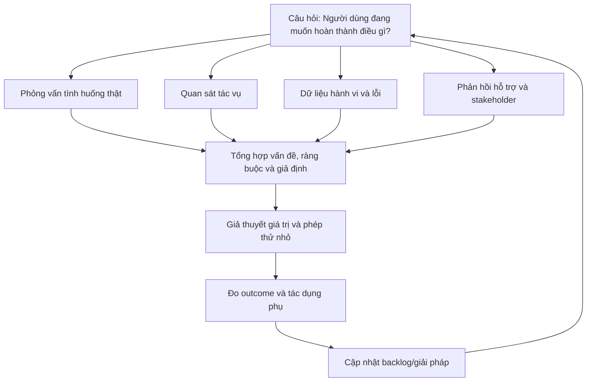
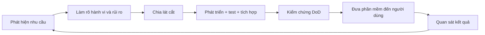
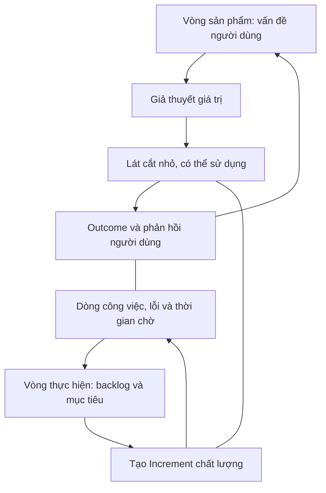

# Nhận diện giá trị từ góc nhìn người sử dụng

Một nhóm phát triển nền tảng học trực tuyến được yêu cầu bổ sung **bảng điều khiển tiến độ học với 12 biểu đồ**. Sau ba Sprint, toàn bộ biểu đồ đã có, giao diện đẹp và mọi user story đều được đánh dấu Done. Nhưng người học vẫn mất vài phút tìm lại bài đang học dở mỗi lần quay lại khóa. Trong phỏng vấn, họ nói: “Tôi không cần xem nhiều thống kê như thế. Tôi chỉ muốn mở lại và học tiếp ngay”.

Đội đã giao đúng danh sách tính năng được yêu cầu, nhưng **chưa chắc tạo ra giá trị mà người sử dụng thật sự cần**.

Tư duy **Lean** bắt đầu từ việc xác định điều gì là **giá trị (*value*) dưới góc nhìn người nhận giá trị**, rồi xem toàn bộ hoạt động tạo ra giá trị đó. Trong phát triển phần mềm, một tính năng, bản thiết kế hay dòng mã không có giá trị chỉ vì đội đã dành nhiều công sức để tạo ra nó. Giá trị xuất hiện khi sản phẩm giúp một người hoặc nhóm người **hoàn thành mục tiêu quan trọng, giảm trở ngại, giảm rủi ro hoặc đạt kết quả đáng mong đợi** trong điều kiện phù hợp.

Bài học thuộc chương **Lean** của mô-đun **AGILE_DEVELOPMENT**. Nội dung kết nối việc nhận diện giá trị với phát triển sản phẩm thích ứng: tìm hiểu nhu cầu, viết user story, ưu tiên backlog, giao phần mềm tăng dần bằng Scrum hoặc Kanban, áp dụng thực hành kỹ thuật XP, nhận phản hồi sớm và đo lường dòng công việc để cải tiến liên tục.

## 1. Mục tiêu học tập

Sau bài học, bạn có thể:

- Giải thích vì sao **giá trị trong Lean phải được xem từ người nhận giá trị**, thay vì chỉ từ hoạt động hoặc sản lượng nội bộ.
- Phân biệt **người sử dụng trực tiếp, người mua, người trả tiền, người ra quyết định và người chịu tác động**.
- Nhận diện **mục tiêu, bối cảnh, trở ngại, lợi ích và rủi ro** của người sử dụng bằng quan sát và phỏng vấn.
- Phân biệt **tính năng được giao (*output*)**, **kết quả sử dụng (*outcome*)** và **tác động rộng hơn (*impact*)**.
- Diễn đạt một **giả thuyết giá trị có thể kiểm chứng** và chọn chỉ số phù hợp với vấn đề.
- Liên hệ **giá trị người dùng** với **dòng tạo giá trị (*value stream*)**, lãng phí (*waste*) và các hoạt động bảo đảm chất lượng.
- Sử dụng nhu cầu thực để cải thiện **user story, backlog, lựa chọn lát cắt sản phẩm và quyết định ưu tiên**.
- Tránh những sai lầm phổ biến như hỏi người dùng “bạn thích tính năng nào?” rồi coi ý kiến đó là bằng chứng chắc chắn, chạy theo số lượt nhấp hoặc chỉ tối ưu tỷ lệ chuyển đổi ngắn hạn.
- Thực hành phân tích hai tình huống sản phẩm và xây một kế hoạch khám phá, kiểm chứng giá trị khả thi.

## 2. Lean bắt đầu bằng giá trị, không bắt đầu bằng giải pháp

### 2.1. “Giá trị” trong Lean là gì?

Trong cách tiếp cận **Lean Thinking** của James P. Womack và Daniel T. Jones, bước mở đầu là **xác định giá trị dưới góc nhìn khách hàng cuối cùng**, đối với một sản phẩm hoặc dịch vụ trong bối cảnh cụ thể. Từ giá trị đã nhận diện, tổ chức mới tiếp tục nhìn dòng tạo giá trị, tạo dòng chảy, vận hành theo nhu cầu kéo và cải tiến liên tục.

Năm ý tưởng thường được trình bày trong Lean Thinking:

1. **Specify Value — Xác định giá trị:** người nhận giá trị thật sự cần kết quả nào?
2. **Identify the Value Stream — Nhận diện dòng tạo giá trị:** những bước nào góp phần tạo ra kết quả đó và bước nào gây lãng phí?
3. **Create Flow — Tạo dòng chảy:** giảm chờ đợi, bàn giao và tắc nghẽn.
4. **Establish Pull — Đáp ứng nhu cầu kéo:** làm việc phù hợp nhu cầu thực và năng lực của hệ thống, tránh sản xuất trước quá nhiều.
5. **Pursue Perfection — Cải tiến liên tục:** quan sát kết quả, học hỏi và tiếp tục giảm lãng phí.

Trong phần mềm, “khách hàng cuối cùng” cần được diễn giải cẩn thận: **người sử dụng trực tiếp có thể khác người mua hoặc người trả tiền**. Vì vậy, câu hỏi cốt lõi nên là: **Ai đang cố làm điều gì, vì sao kết quả đó quan trọng đối với họ, và sản phẩm có thật sự giúp họ không?**

### 2.2. Ví dụ: người dùng muốn nhanh hơn chứ không muốn thêm nhiều màn hình

Một bên liên quan yêu cầu:

> “Cần làm một dashboard gồm 12 biểu đồ cho người quản lý cửa hàng.”

Nhóm có thể đặt các câu hỏi khác:

- Người quản lý đang phải **ra quyết định gì** mỗi sáng?
- Họ dùng những dữ kiện nào khi quyết định đặt thêm hàng?
- Điều gì khiến họ mất thời gian hoặc quyết định sai?
- Có loại thông tin nào tuy ít nhưng phải **được nhìn thấy ngay**?
- Một bảng danh sách “5 mặt hàng sắp hết” có giúp hơn 12 biểu đồ không?
- Làm sao biết quyết định nhập hàng được đưa ra nhanh và chính xác hơn?

Giả sử sau khi quan sát, vấn đề chính là **người quản lý không biết mặt hàng nào có nguy cơ hết trong 48 giờ tới**. Một danh sách cảnh báo đáng tin, có thể xem tồn kho và thời gian nhận hàng, có thể tạo giá trị sớm hơn một dashboard lớn.

Điều này không khẳng định dashboard luôn vô ích. Nó cho thấy **giải pháp phải được đánh giá từ công việc và kết quả cần đạt**, thay vì coi yêu cầu ban đầu là bằng chứng đầy đủ về giá trị.

### 2.3. Giá trị phụ thuộc vào bối cảnh

Cùng một chức năng có thể mang giá trị khác nhau:

| Bối cảnh | Điều người sử dụng coi trọng | Giải pháp có khả năng hữu ích |
| --- | --- | --- |
| Học viên quay lại bài học đang dở | Tiếp tục nhanh, không mất vị trí, đúng quyền truy cập | Nút “Tiếp tục học” rõ ràng và lưu tiến độ tin cậy |
| Nhân viên chăm sóc khách hàng xử lý yêu cầu khẩn | Tìm được thông tin đủ đúng để trả lời ngay | Tìm kiếm theo mã yêu cầu và lịch sử liên hệ |
| Người mua đang ở bước thanh toán | Biết chính xác số tiền và nơi nhận trước khi xác nhận | Tổng tiền cập nhật kịp thời, địa chỉ dễ kiểm tra |
| Người quản trị hệ thống trong sự cố | Phát hiện đúng dịch vụ lỗi và giảm thời gian khôi phục | Cảnh báo có ngữ cảnh, log liên kết và thao tác rollback an toàn |
| Người dùng có hạn chế thị lực | Hoàn thành tác vụ độc lập, không bị cản bởi giao diện | Luồng truy cập bàn phím, nhãn rõ, hỗ trợ công nghệ trợ giúp |

Không thể rút ra một bảng xếp hạng giá trị chung cho mọi người dùng và mọi tình huống. **Xác định đúng nhóm người, thời điểm sử dụng và điều kiện thực tế** là điều kiện để nhận diện giá trị.

## 3. Người sử dụng, khách hàng và bên liên quan không phải lúc nào cũng là một

### 3.1. Những vai trò thường khác nhau

Trong một sản phẩm B2B hoặc nền tảng nhiều bên, người trả tiền, người ký hợp đồng và người sử dụng mỗi ngày thường không trùng nhau.

| Vai trò | Họ quan tâm điều gì? | Ví dụ với nền tảng học tập |
| --- | --- | --- |
| **Người sử dụng trực tiếp (*end user*)** | Hoàn thành tác vụ với ít trở ngại, đáng tin cậy | Học viên tìm bài, học tiếp, làm bài tập |
| **Người mua/khách hàng (*buyer/customer*)** | Giải pháp có đáng chi trả và mang lại kết quả không? | Doanh nghiệp mua gói đào tạo nhân viên |
| **Người trả tiền (*payer*)** | Chi phí, điều kiện thanh toán và kiểm soát ngân sách | Bộ phận tài chính của doanh nghiệp |
| **Người ra quyết định (*decision-maker*)** | Rủi ro, kết quả, chiến lược và sự phù hợp | Giám đốc đào tạo chọn nhà cung cấp |
| **Người quản trị/vận hành** | Khả năng cấu hình, theo dõi, hỗ trợ và khôi phục | Admin theo dõi tài khoản học viên |
| **Người chịu tác động gián tiếp** | Quyền riêng tư, công bằng, gánh nặng hoặc lợi ích phát sinh | Người được báo cáo tiến độ học, nhân viên hỗ trợ |

Trong tư duy Lean, **bắt đầu từ người sử dụng** không đồng nghĩa **bỏ qua người trả tiền và ràng buộc kinh doanh**. Một giải pháp chỉ làm học viên vui nhưng khiến dữ liệu bị lộ, chi phí không bền vững hoặc nhà trường không thể vận hành thì chưa phải hệ thống tạo giá trị tốt.

### 3.2. Giá trị của ai đang được tối ưu?

Ví dụ một doanh nghiệp muốn tính năng **tự động đăng ký nhân viên vào khóa học bắt buộc**:

- Nhân sự cần báo cáo số người hoàn thành.
- Nhân viên học cần hiểu nội dung và thực hiện khóa học trong thời gian hợp lý.
- Quản trị viên cần kiểm soát quyền truy cập.
- Doanh nghiệp cần đáp ứng nghĩa vụ đào tạo và bảo vệ dữ liệu.

Nếu chỉ tối ưu “số tài khoản được đăng ký”, hệ thống có thể làm đẹp báo cáo mà không tăng **khả năng học được hoặc hoàn tất khóa học**. Cần xác định **giá trị cho nhiều nhóm có liên quan**, xử lý đánh đổi minh bạch và không gán lợi ích của một vai trò cho tất cả vai trò.

### 3.3. Người sử dụng không phải một nhóm đồng nhất

Nên phân nhóm dựa trên **bối cảnh và hành vi có ảnh hưởng đến vấn đề**, chẳng hạn:

- Học viên lần đầu khác học viên quay lại.
- Người học trên điện thoại với mạng chập chờn khác người học trên máy tính có mạng ổn định.
- Người dùng bàn phím/công nghệ trợ giúp khác người dùng chuột.
- Học viên có một khóa đang học khác người theo nhiều khóa.
- Người học trả phí cá nhân khác nhân viên tham gia chương trình của doanh nghiệp.

Không nên tự suy diễn hành vi chỉ từ tuổi tác, giới tính hoặc những đặc điểm cá nhân. **Phân nhóm phải giúp hiểu nhu cầu và đảm bảo tiếp cận công bằng**, không tạo định kiến.

## 4. Phân biệt công việc cần làm, nỗi đau và giá trị mong đợi

### 4.1. Người dùng muốn đạt kết quả, không nhất thiết muốn đúng giải pháp đề xuất

Cách tiếp cận *Jobs to Be Done (JTBD)* đặt câu hỏi: **Trong hoàn cảnh cụ thể, người ta đang cố hoàn thành “công việc” nào và tiến bộ họ mong muốn là gì?**

Ví dụ:

> “Khi tôi quay lại khóa học sau một ngày bận rộn, tôi muốn tìm đúng nơi đã dừng mà không phải nhớ tên bài, để có thể bắt đầu học ngay trong quãng thời gian rảnh ngắn.”

“Công việc” ở đây không chỉ là “nhấp nút Tiếp tục”. Nó gồm:

- **Hoàn cảnh:** quay lại sau một khoảng gián đoạn.
- **Mục tiêu:** tiếp tục đúng nội dung.
- **Trở ngại:** phải tìm lại vị trí, có nguy cơ mở sai bài.
- **Kết quả mong đợi:** bắt đầu học nhanh và tự tin.
- **Ràng buộc:** đúng quyền truy cập, không mất tiến độ, hoạt động trên thiết bị phù hợp.

Lúc này đội có thể cân nhắc nút Tiếp tục, danh sách “Đang học”, liên kết từ email hay khả năng tìm kiếm tốt hơn. **Giải pháp nào tốt cần được kiểm chứng**, không quyết định chỉ bằng khuôn mẫu JTBD.

### 4.2. Phân biệt năm thành tố

| Thành tố | Câu hỏi | Ví dụ |
| --- | --- | --- |
| **Bối cảnh** | Khi nào và trong điều kiện nào? | Mở lại khóa học vào cuối ngày trên điện thoại |
| **Việc muốn hoàn thành** | Người dùng đang cố làm gì? | Tiếp tục từ phần học gần nhất |
| **Trở ngại (*pain*)** | Điều gì đang làm chậm, gây lỗi hoặc tăng rủi ro? | Không nhớ tên bài; danh sách khóa quá dài |
| **Lợi ích (*gain*)** | Trạng thái tốt hơn nào đáng đạt? | Bắt đầu học trong vài giây, không sợ mất vị trí |
| **Ràng buộc** | Điều kiện nào bắt buộc phải giữ? | Không truy cập nội dung đã mất quyền; tiến độ chính xác |

Nếu chỉ ghi “người dùng muốn tính năng lưu tiến độ”, đội đã trộn **giải pháp dự kiến** với **nhu cầu gốc**.

### 4.3. Phân biệt điều người dùng nói với điều họ làm

Trong phỏng vấn, một người có thể nói “tôi muốn thêm biểu đồ nâng cao”, nhưng trong thực tế họ chỉ xem danh sách “đơn hàng trễ” mỗi sáng. Hai thông tin đều đáng chú ý nhưng khác bản chất:

- **Phát biểu về mong muốn:** cho biết nhận thức và ngôn ngữ của người nói.
- **Hành vi quan sát:** cho biết cách họ đang hoàn thành công việc trong bối cảnh hiện tại.
- **Dữ liệu sử dụng:** cho biết mức độ phổ biến hoặc tần suất của một hành vi nếu được đo đúng.
- **Kết quả khi thử giải pháp mới:** cho biết mức độ phù hợp và tác dụng phụ, nhưng vẫn cần xem bối cảnh.

Không nên kết luận người dùng “không biết mình cần gì”. Họ **hiểu trải nghiệm của mình**, còn đội có trách nhiệm cùng họ khám phá vấn đề và đánh giá những phương án có thể giải quyết.

## 5. Từ ý tưởng tính năng đến phát biểu vấn đề

Một yêu cầu ban đầu thường là **đề xuất giải pháp**:

> “Cần thêm tính năng gửi email nhắc học hằng ngày.”

Trước khi ưu tiên, hãy làm rõ:

1. **Ai** đang gặp vấn đề?
2. **Khi nào** vấn đề xuất hiện?
3. **Họ đang cố đạt kết quả gì**?
4. **Trở ngại** hiện tại là gì?
5. **Bằng chứng** đến từ đâu?
6. **Hệ quả** của việc không giải quyết là gì?
7. **Giới hạn** về quyền riêng tư, sự đồng ý, thông báo và khả năng tiếp cận là gì?

Một phát biểu vấn đề tốt hơn:

> “Một nhóm học viên có ý định học đều đặn nhưng khó quay lại sau các ngày gián đoạn vì không nhớ phần đang học và không có điểm bắt đầu rõ ràng. Chúng ta cần kiểm chứng phần nào của trải nghiệm quay lại gây ma sát lớn nhất trước khi chọn cách hỗ trợ.”

Phát biểu này **không khóa giải pháp email**. Đội có thể thử nút Tiếp tục, mục “Đang học”, gợi ý tại trang chủ hoặc một cơ chế nhắc học tùy chọn nếu có bằng chứng.

### 5.1. Mẫu mô tả cơ hội

```text
Người sử dụng/nhóm: [Ai đang gặp vấn đề?]
Bối cảnh: [Khi nào và ở đâu trong hành trình?]
Công việc muốn hoàn thành: [Kết quả mong muốn]
Trở ngại hiện tại: [Điều đang cản trở]
Bằng chứng đã có: [Quan sát, phỏng vấn, sự kiện sản phẩm, hỗ trợ]
Giá trị kỳ vọng: [Điều người dùng sẽ làm tốt hơn]
Giả định còn mở: [Điều chưa xác minh]
Rủi ro/ràng buộc: [Bảo mật, dữ liệu, khả năng tiếp cận, chi phí]
Cách kiểm chứng tiếp: [Thử nghiệm nhỏ hoặc quan sát]
```

Đây là **khung trao đổi**, không phải biểu mẫu bắt buộc cho mọi Product Backlog Item. Với việc nhỏ và rõ, một vài dòng có thể đủ; với thay đổi rủi ro cao, cần nghiên cứu và kiểm chứng chi tiết hơn.

## 6. Khám phá giá trị bằng cách hỏi và quan sát

### 6.1. Phỏng vấn: hỏi về trường hợp gần đây

Một cuộc phỏng vấn giá trị nên khuyến khích người dùng kể **việc họ đã làm và trở ngại thật**.

Câu hỏi hữu ích:

- “Lần gần nhất bạn quay lại một khóa đang học dở là khi nào?”
- “Bạn đã làm gì từ lúc mở ứng dụng tới khi bắt đầu học?”
- “Bạn bị kẹt ở bước nào? Bạn giải quyết tạm ra sao?”
- “Điều gì khiến bạn quyết định dừng hoặc tiếp tục?”
- “Khi nào bạn cần làm điều này nhanh nhất?”
- “Nếu bước ấy không thành công, điều gì xảy ra tiếp theo?”
- “Bạn từng thử cách nào khác chưa? Vì sao chưa phù hợp?”
- “Bạn có thể cho xem quy trình thực tế bằng dữ liệu không nhạy cảm không?”

Câu hỏi dễ dẫn dắt:

- “Bạn sẽ thích nút Tiếp tục mới này đúng không?”
- “Nếu có AI nhắc học, bạn có chắc sẽ học mỗi ngày không?”
- “Tính năng này tiện như vậy, bạn có muốn không?”

Câu dẫn dắt khiến câu trả lời phản ánh **mong muốn làm hài lòng người hỏi hoặc tưởng tượng về tương lai**, chứ chưa đủ làm bằng chứng về hành vi thật.

### 6.2. Quan sát người dùng thực hiện tác vụ

Nếu có điều kiện và được đồng ý phù hợp, quan sát một người học quay lại khóa:

1. Họ mở từ đâu: ứng dụng, dấu trang hay đường dẫn trong email?
2. Họ tìm tên khóa bằng bộ lọc hay cuộn danh sách?
3. Khi thấy nhiều bài, họ dựa vào dấu hiệu nào để chọn?
4. Họ mất bao lâu để bắt đầu lại?
5. Họ có bỏ cuộc, tìm kiếm hỗ trợ hoặc chọn nhầm bài không?
6. Điều gì họ nói là khó, điều gì hành vi cho thấy khó?

Không nên can thiệp quá nhiều khiến hành vi trở thành “thực hiện theo hướng dẫn của người nghiên cứu”. Nếu dùng bản ghi màn hình hoặc log, cần bảo vệ dữ liệu riêng tư và công bố mục đích thu thập.

### 6.3. Phản hồi hỗ trợ và công việc vòng ngoài

Các yêu cầu hỗ trợ, bình luận, lỗi tìm kiếm hoặc thao tác thủ công bên ngoài sản phẩm có thể tiết lộ giá trị chưa được đáp ứng.

Ví dụ:

- Học viên gửi email “không tìm thấy bài đang học”.
- Nhân viên hỗ trợ phải tự tra tiến độ rồi gửi link lại.
- Quản trị viên dùng bảng tính để đối chiếu kết quả khóa học.
- Người quản lý cửa hàng chụp màn hình nhiều báo cáo rồi ghép bằng tay để biết hàng nào cần nhập.

Các giải pháp tạm (*workaround*) cho thấy công việc có tồn tại. **Nhưng tần suất yêu cầu hỗ trợ không phản ánh đầy đủ toàn bộ người dùng**: nhiều người gặp khó vẫn không gửi yêu cầu.

### 6.4. Phân tích dữ liệu sản phẩm

Có thể theo dõi những sự kiện có ý nghĩa:

- Người học mở khóa đang học.
- Người học chọn một bài và bắt đầu học.
- Người học quay lại sau một khoảng gián đoạn.
- Người học thử tiếp tục nhưng gặp lỗi.
- Người dùng sửa địa chỉ sau khi hệ thống tự chọn.
- Người quản lý hoàn tất quyết định nhập hàng sau khi xem báo cáo.

Dữ liệu cần được định nghĩa cẩn thận:

| Câu hỏi | Điều cần xác định |
| --- | --- |
| “Tỷ lệ sử dụng” | Người nào đủ điều kiện dùng tính năng? Mẫu số là tất cả người dùng hay chỉ người đã từng học? |
| “Hoàn tất tác vụ” | Mốc bắt đầu và mốc kết thúc có ý nghĩa gì? |
| “Thời gian thực hiện” | Có khoảng người dùng rời màn hình, mạng chậm hay tác vụ chạy nền không? |
| “Lỗi” | Lỗi được ghi từ server, client hay phản hồi người dùng? Có lỗi bị bỏ sót không? |
| “Giá trị cải thiện” | Có mốc so sánh và điều kiện nào khác thay đổi đồng thời? |

Dữ liệu sự kiện có thể rất lớn nhưng vẫn không trả lời câu hỏi **vì sao**. Phỏng vấn và quan sát bổ sung ngữ cảnh, còn dữ liệu định lượng giúp đánh giá phạm vi.

### 6.5. Kết hợp nhiều nguồn bằng chứng



Không cần thu thập đủ bốn nguồn với mọi thay đổi. **Chọn mức bằng chứng tương xứng với rủi ro và chi phí quyết định**. Ví dụ một lỗi phân quyền đã được tái hiện cần xử lý ngay; không cần phỏng vấn hàng chục người để chứng minh có giá trị.

## 7. Bản đồ hành trình: giá trị nằm ở trải nghiệm đầu-cuối

### 7.1. Người dùng không nhìn sản phẩm theo cấu trúc phòng ban

Trong một hành trình học tập, học viên không quan tâm “backend API đã hoàn tất chưa”. Họ quan tâm:

> “Tôi mở ứng dụng, tìm khóa mình đã học, tiếp tục đúng bài, hiểu nội dung và không mất tiến độ.”

Một bản đồ hành trình (*user journey map*) có thể giúp nhìn rõ:

| Bước của người học | Mục tiêu | Trở ngại có thể có | Bằng chứng cần tìm |
| --- | --- | --- | --- |
| **Mở lại ứng dụng** | Trở lại hoạt động học | Không nhớ khóa đã học, màn hình chính quá nhiều mục | Quan sát đường đi, tác vụ bắt đầu từ đâu |
| **Tìm khóa** | Chọn đúng khóa đang học | Danh sách dài, sắp xếp không phù hợp | Thời gian tìm, số lần cuộn/tìm kiếm |
| **Tìm bài** | Tiếp tục đúng nơi dừng | Tiến độ không rõ, tên bài giống nhau | Tỷ lệ chọn sai, thời gian tìm bài |
| **Bắt đầu học** | Học được nội dung ngay | Load chậm, lỗi quyền truy cập | Tỷ lệ mở thành công, thời gian chờ, lỗi |
| **Ghi nhận tiến độ** | Không phải làm lại phần đã học | Lưu sai, mất kết nối, đồng bộ xung đột | Lỗi lưu, phản hồi của người học |
| **Quay lại lần sau** | Tiếp tục dễ dàng hơn | Không biết điểm bắt đầu phù hợp | Tỷ lệ hoàn tất tác vụ quay lại và trải nghiệm định tính |

Bảng là công cụ **gợi ý điều cần kiểm chứng**, không phải kết luận tất cả vấn đề đều tồn tại trong một sản phẩm.

### 7.2. Tìm “khoảnh khắc giá trị”

Trong mỗi hành trình, nên hỏi: **lúc nào người sử dụng thật sự nhận được kết quả họ cần?**

Với tính năng “Tiếp tục”, không phải lúc đội merge mã, không phải lúc API lưu dữ liệu trả HTTP 200, cũng không phải lúc người dùng nhìn thấy nút. Giá trị dự kiến xuất hiện khi **người học quay lại và bắt đầu đúng nội dung nhanh hơn, với sự tin cậy vào tiến độ của mình**.

Điều này giúp chọn nơi kiểm chứng:

- Bắt đầu đo từ lúc người dùng quay lại khóa.
- Kết thúc khi họ vào đúng bài và có thể học.
- Xem trường hợp thất bại hoặc chọn nhầm.
- Giữ chỉ số bảo vệ quyền truy cập và dữ liệu.
- Quan sát xem việc học có tiếp diễn tốt hơn, thay vì chỉ đếm số lần bấm.

### 7.3. Giá trị có thể là loại bỏ một bước

Lean thường tìm cơ hội bằng cách **loại bỏ trở ngại hoặc hoạt động không cần thiết**, không nhất thiết thêm tính năng:

- Tự điền thông tin đã có quyền sử dụng thay vì bắt người dùng nhập lại.
- Hiển thị tổng tiền minh bạch thay vì thêm màn hình giải thích.
- Loại bỏ hai lần xác nhận không cần thiết trong một quy trình ít rủi ro.
- Cho phép tìm lại yêu cầu hỗ trợ bằng mã thay vì gọi điện cho nhân viên.
- Rút ngắn thời gian chờ khi một thao tác hoàn toàn có thể tự phục vụ an toàn.

**Đơn giản hóa phải bảo vệ yêu cầu bắt buộc.** Không được bỏ xác thực giao dịch, consent dữ liệu hoặc kiểm tra phân quyền chỉ vì chúng khiến hành trình có nhiều bước hơn.

## 8. Giá trị người dùng và dòng tạo giá trị: hai góc nhìn bổ sung

### 8.1. User journey khác value stream

**User journey** cho thấy các bước và cảm nhận của người sử dụng khi muốn đạt kết quả. **Value stream** nhìn toàn bộ hoạt động của tổ chức cần để tạo và chuyển giao giá trị đó, gồm nhiều bước nội bộ mà người dùng không thấy.

Ví dụ với “Tiếp tục bài đang dở”:



Người học chỉ trực tiếp trải nghiệm **phần mềm và kết quả**, nhưng các bước bên trong ảnh hưởng khả năng giao đúng và nhanh. Nếu ý tưởng quan trọng mất nhiều tuần chờ phê duyệt, đội có thể rất bận mà người dùng vẫn chưa nhận được giá trị.

### 8.2. Phân loại hoạt động trong dòng giá trị

Một cách tư duy thực hành:

| Loại hoạt động | Đặc điểm | Ví dụ |
| --- | --- | --- |
| **Trực tiếp tạo giá trị** | Góp phần thay đổi trải nghiệm hoặc kết quả mà người sử dụng cần | Làm luồng tiếp tục bài hoạt động đúng và dễ dùng |
| **Cần thiết để bảo đảm giá trị/giảm rủi ro** | Người dùng có thể không thấy trực tiếp nhưng không thể bỏ nếu muốn sản phẩm an toàn và bền vững | Kiểm tra phân quyền, kiểm thử tích hợp, tuân thủ lưu trữ dữ liệu |
| **Có khả năng là lãng phí** | Tốn nguồn lực mà không giúp kết quả hoặc kiểm soát rủi ro tương xứng | Chờ bàn giao không cần thiết, nhập cùng dữ liệu nhiều lần, xây chức năng không ai cần |
| **Hoạt động học hỏi** | Giảm bất định để tránh đầu tư lớn sai hướng | Phỏng vấn, prototype, spike giới hạn thời gian |

Đừng dùng phân loại này một cách máy móc để gọi **mọi kiểm thử, bảo mật hoặc tài liệu là lãng phí** vì “người dùng không trực tiếp trả tiền cho chúng”. Chất lượng, khả năng vận hành và tuân thủ là điều kiện giúp giá trị được tạo **an toàn, ổn định và có thể duy trì**.

### 8.3. Lãng phí thường gặp trong phát triển phần mềm

Tinh thần Lean Software Development thường khuyến khích nhận diện:

- **Tính năng thừa:** xây nhiều thứ chưa có bằng chứng về giá trị.
- **Chờ đợi:** công việc bị chặn bởi review, quyết định, môi trường hoặc đối tác.
- **Bàn giao và mất ngữ cảnh:** thông tin truyền qua nhiều nhóm nhưng không giữ hiểu biết chung.
- **Chuyển ngữ cảnh liên tục:** quá nhiều việc đang mở, tiến độ bị phân mảnh.
- **Làm lại:** hiểu sai yêu cầu, lỗi tích hợp hoặc quy tắc không được trao đổi sớm.
- **Lỗi và sự cố:** phần mềm sai hoặc không an toàn làm người dùng mất thời gian và tin cậy.
- **Công việc dở dang:** nhiều thay đổi chưa đạt chất lượng, chưa đến tay người dùng.
- **Kiến thức chưa được tận dụng:** người có thông tin không được tham gia lúc quyết định.

Một bước trông như “không trực tiếp tạo giá trị” vẫn có thể bắt buộc. Hãy hỏi: **Nó phục vụ kiểm soát rủi ro nào? Có thể làm đơn giản hoặc tự động hơn mà vẫn an toàn không?**

## 9. Output, outcome và impact: đừng nhầm giao việc với tạo giá trị

### 9.1. Ba tầng kết quả

| Tầng | Câu hỏi | Ví dụ |
| --- | --- | --- |
| **Output — đầu ra** | Đội đã tạo/giao gì? | Nút “Tiếp tục”, API lưu tiến độ, log, bài kiểm thử |
| **Outcome — thay đổi với người dùng** | Người dùng có làm được việc tốt hơn không? | Quay lại đúng bài nhanh hơn, ít lần tìm nhầm, ít mất tiến độ |
| **Impact — tác động rộng hơn** | Kết quả lâu dài cho người dùng và tổ chức là gì? | Người học duy trì thói quen học tốt hơn, tỷ lệ hoàn thành khóa tăng, hỗ trợ ít tốn công hơn |

Các tầng liên hệ với nhau nhưng **không tự động suy ra nhau**. Một output có thể hoạt động đúng nhưng người dùng không dùng; một outcome có thể cải thiện mà chưa đủ chứng minh impact lâu dài.

### 9.2. Ví dụ những chỉ số dễ đánh lừa

- **Số user story Done:** cho biết công việc đã hoàn tất theo quy ước, không đo giá trị.
- **Số biểu đồ trong dashboard:** đo output, không cho thấy quyết định nhập hàng tốt hơn.
- **Số lượt nhấp “Tiếp tục”:** thể hiện hoạt động nhưng có thể người dùng phải bấm nhiều lần vì lỗi.
- **Thời gian trên trang tăng:** có thể do nội dung hấp dẫn hoặc do người dùng bị kẹt.
- **Số email nhắc học đã gửi:** không chứng minh người học được giúp đỡ; có thể là sự làm phiền.
- **Velocity tăng:** có thể do cách chia story đổi, không phải outcome tăng.
- **Throughput tăng:** có thể do hạng mục nhỏ hơn hoặc chất lượng bị hạ.

Để nhận diện giá trị, hãy liên hệ chỉ số với **việc người dùng muốn hoàn thành**, đi kèm tín hiệu về chất lượng và tác dụng phụ.

### 9.3. Sản phẩm không phải lúc nào cũng cần tăng tần suất sử dụng

Một tính năng “tìm hóa đơn” tốt có thể khiến người dùng tìm được hóa đơn trong một lần và **không cần liên hệ hỗ trợ**. Một hệ thống cảnh báo tốt có thể giảm số lần người vận hành phải mở dashboard vì mọi thứ ổn định.

Giá trị không đồng nghĩa **giữ người dùng ở lại ứng dụng càng lâu càng tốt**. Đôi khi kết quả tốt là người dùng **hoàn tất việc nhanh rồi rời đi**.

## 10. Tạo giả thuyết giá trị có thể kiểm chứng

### 10.1. Tách điều đã biết và điều đang tin

Một phát biểu như “nút Tiếp tục sẽ tăng tỷ lệ hoàn thành khóa học 20%” chỉ là giả định nếu chưa có dữ liệu hỗ trợ.

Hãy trình bày rõ:

> **Chúng tôi tin rằng** học viên quay lại khóa sau gián đoạn gặp khó khi tìm đúng bài. **Nếu** cung cấp cách tiếp tục từ vị trí đã lưu, **thì** họ có thể bắt đầu học nhanh hơn và ít bỏ cuộc ở bước tìm bài. **Chúng tôi sẽ kiểm chứng bằng** quan sát tác vụ, thời gian từ mở khóa đến bắt đầu bài và tỷ lệ truy cập đúng nội dung, đồng thời theo dõi lỗi phân quyền và mất tiến độ.

Cách này làm rõ **người dùng, cơ chế, thay đổi mong đợi và bằng chứng kiểm tra**.

### 10.2. Viết giả thuyết theo các thành phần

| Thành phần | Ví dụ |
| --- | --- |
| **Nhóm người dùng** | Học viên đã học ít nhất một bài và quay lại sau một khoảng gián đoạn |
| **Vấn đề** | Khó tìm lại đúng bài, mất thời gian và có thể bỏ dở |
| **Giải pháp dự kiến** | Một nút “Tiếp tục” rõ ràng dùng vị trí đã lưu đúng tài khoản |
| **Outcome chính** | Rút ngắn thời gian bắt đầu đúng bài khi quay lại |
| **Chỉ số bảo vệ (*guardrail*)** | Không tăng lỗi mở nhầm bài, mất tiến độ, truy cập sai quyền |
| **Giới hạn thử nghiệm** | Bản đầu hỗ trợ một thiết bị; không giả định đã giải quyết đồng bộ ngoại tuyến |
| **Điều khiến đội đổi hướng** | Người học không dùng vì vấn đề thực nằm ở tìm khóa hoặc nội dung bài |

**Một giả thuyết giá trị tốt phải có khả năng bị bác bỏ bởi bằng chứng.** Nếu mọi kết quả đều được coi là thành công, đội không thật sự đang học.

### 10.3. Phép thử nhỏ giúp giảm lãng phí

Tùy rủi ro và phạm vi, đội có thể:

1. **Quan sát tác vụ hiện tại** trước khi xây.
2. **Prototype có thể thử** để xem người dùng nhận ra vị trí tiếp tục không.
3. **Lát cắt phần mềm nhỏ** đáp ứng chất lượng, phát hành có kiểm soát.
4. **So sánh nhóm sử dụng** khi thiết kế và điều kiện cho phép, để giảm nhầm lẫn do yếu tố ngoài.
5. **Phỏng vấn sau trải nghiệm** để hiểu trường hợp thành công và thất bại.
6. **Đo và điều chỉnh backlog** theo kết quả.

Không nên thử nghiệm theo cách làm tổn hại người dùng hoặc bỏ qua nghĩa vụ pháp lý, quyền riêng tư và yêu cầu chất lượng. “MVP” không đồng nghĩa sản phẩm lỗi hoặc không an toàn.

## 11. Chọn thước đo giá trị từ hành vi thật

### 11.1. Bắt đầu từ câu hỏi thay vì chọn KPI có sẵn

Với nhu cầu “tiếp tục bài đang dở”, nên hỏi:

- Người học có thể **bắt đầu đúng bài** không?
- Họ mất bao lâu để đạt điều đó?
- Họ có phải thử đi thử lại hay tìm hỗ trợ?
- Những người có điều kiện mạng hoặc khả năng tiếp cận khác nhau có đạt kết quả không?
- Tính năng có gây lỗi tiến độ hoặc truy cập sai nội dung không?
- Kết quả này có giúp người học **tiếp tục học** chứ không chỉ bấm nút?

### 11.2. Ghép một chỉ số outcome với guardrail

| Giả thuyết giá trị | Chỉ số outcome khả dĩ | Chỉ số bảo vệ |
| --- | --- | --- |
| Tiếp tục học nhanh hơn | Thời gian từ mở khóa đến bắt đầu đúng bài | Lỗi mất tiến độ, mở sai quyền, tỷ lệ không bắt đầu được |
| Thanh toán minh bạch hơn | Tỷ lệ người mua hoàn tất với tổng tiền được hiểu rõ | Khiếu nại phí sai, hoàn tiền bất thường, thanh toán lặp |
| Quản lý tồn kho ra quyết định nhanh hơn | Thời gian nhận diện và xử lý mặt hàng cần đặt | Tỷ lệ đặt dư/thiếu, sai dữ liệu tồn kho |
| Nhân viên hỗ trợ giải quyết nhanh hơn | Thời gian xử lý yêu cầu phù hợp, tỷ lệ giải quyết đúng | Trả lời sai, lộ dữ liệu, yêu cầu phải mở lại |
| Người dùng truy cập được với công nghệ trợ giúp | Tỷ lệ hoàn thành tác vụ và số bước bị kẹt | Lỗi bàn phím, lỗi đọc nhãn, phản hồi về khả năng tiếp cận |

Chỉ số trên là **gợi ý**, không tự động phù hợp với mọi sản phẩm. Cần xác định cách thu thập và xem tác dụng phụ trước khi dùng làm mục tiêu.

### 11.3. Có baseline trước khi kết luận cải thiện

Giả sử một phép quan sát có kiểm soát trong bài tập ghi:

- Trước cải tiến, 20 người thử hoàn thành tác vụ “quay lại đúng bài”; có **12 người** hoàn tất không cần hỗ trợ.
- Sau cải tiến trên một nhóm so sánh phù hợp, 20 người thử; có **17 người** hoàn tất không cần hỗ trợ.

Tỷ lệ hoàn tất quan sát được lần lượt là **60%** và **85%**. Chênh lệch là **25 điểm phần trăm** trong **hai mẫu minh họa**.

Không thể kết luận chắc chắn tính năng tạo hiệu quả 25 điểm phần trăm cho toàn bộ người dùng, bởi:

- Cỡ mẫu nhỏ và có thể khác về kỹ năng, thiết bị, khóa học.
- Người dùng có thể đã quen với tác vụ sau lần thử đầu.
- Điều kiện mạng, giao diện hoặc nội dung có thể đổi cùng lúc.
- Thành công trong thử nghiệm ngắn chưa chứng minh tác động lâu dài.

Hãy dùng kết quả như **tín hiệu để kiểm tra tiếp**, kết hợp quan sát, phỏng vấn và đo ở quy mô phù hợp. Không được công bố tỷ lệ như số liệu sản phẩm thật khi đây chỉ là ví dụ giả định.

### 11.4. Cẩn trọng với dữ liệu nhạy cảm và tác dụng phụ

Để biết người học tiếp tục đúng bài, đội **không nhất thiết phải lưu toàn bộ nội dung họ đã đọc hoặc mọi hành vi cá nhân**. Cần xác định mục đích đo, mức dữ liệu tối thiểu, quyền truy cập, thời gian lưu giữ và lựa chọn phù hợp với chính sách/pháp luật liên quan.

Một cải tiến trải nghiệm không có giá trị bền vững nếu nó đạt tỷ lệ nhấp cao bằng thông báo gây áp lực, nút đánh lừa hoặc khai thác dữ liệu người dùng ngoài kỳ vọng hợp lý. **Giá trị phải được cân bằng với quyền tự chủ, sự tin cậy và an toàn**.

## 12. Tình huống xuyên suốt: nền tảng học trực tuyến

Phần này xây một ví dụ **giả định hoàn toàn** từ ý tưởng ban đầu đến kiểm chứng. Mục tiêu là cho thấy sự khác nhau giữa **làm tính năng** và **giải quyết công việc của người học**.

### 12.1. Bối cảnh ban đầu

Một Product Owner nhận được yêu cầu:

> “Cần thêm dashboard tiến độ gồm 12 biểu đồ, lịch hoạt động và bảng xếp hạng.”

Đội phát triển có thể chọn bắt đầu lập user story cho các biểu đồ. Nhưng họ đề xuất xác minh trước liệu **vấn đề nào quan trọng nhất** đang ảnh hưởng trải nghiệm học.

Nguồn thông tin ban đầu:

- Một số học viên nói khó tìm lại bài gần nhất.
- Nhân viên hỗ trợ nhận yêu cầu “không biết tôi học đến đâu”.
- Có tín hiệu người học quay lại khóa nhưng chưa bắt đầu xem bài.
- Chưa có bằng chứng rằng người học muốn xem 12 biểu đồ mỗi ngày.

Đây là giả định bài tập, **không phải kết quả nghiên cứu thực tế**.

### 12.2. Xác định nhóm người và công việc

**Người dùng mục tiêu:** học viên đã bắt đầu một khóa và có ý định tiếp tục sau ít nhất một lần gián đoạn.

**Công việc muốn hoàn thành:** quay lại đúng bài để học tiếp nhanh và không mất tiến độ.

**Ràng buộc:** quyền truy cập theo tài khoản, thiết bị, tình trạng hoàn thành bài và dữ liệu tiến độ.

Nhóm mô tả vấn đề:

> “Học viên quay lại khóa sau gián đoạn nhưng phải tìm thủ công vị trí học, gây chậm bắt đầu buổi học và dễ nhầm bài. Chúng ta cần giúp họ tiếp tục đúng nội dung với ít thao tác hơn, không làm tăng lỗi tiến độ hoặc quyền truy cập.”

### 12.3. Khám phá bằng phỏng vấn và quan sát

Một phiên quan sát có thể cho thấy:

| Quan sát minh họa | Điều cần kiểm tra tiếp |
| --- | --- |
| Người học thường mở từ trang danh sách tất cả khóa | Có nên ưu tiên khóa đang học? |
| Có người chọn nhầm bài do tên bài giống nhau | Dấu tiến độ và bối cảnh khóa có đủ rõ? |
| Người dùng trên điện thoại cuộn khá lâu | Có cần đưa hành động tiếp tục lên vị trí đầu? |
| Người học mất mạng rồi mở lại ứng dụng | Tiến độ được lưu và xử lý ngoại tuyến ra sao? |
| Một người chia sẻ máy với thành viên gia đình | Tiến độ có được tách đúng tài khoản? |

Đội kiểm tra thêm dữ liệu sản phẩm nếu được thu thập hợp lệ. Họ không kết luận ngay **mọi người dùng** đều gặp những vấn đề trên.

### 12.4. Xây giả thuyết giá trị

> **Giả thuyết:** Với người học quay lại một khóa đang dở, một cách mở đúng bài gần nhất sẽ giảm thời gian tìm nội dung và tăng tỷ lệ bắt đầu buổi học thành công.
>
> **Kiểm chứng:** So sánh khả năng tìm đúng bài, thời gian thực hiện tác vụ và phản hồi sử dụng; theo dõi lỗi quyền truy cập và sai tiến độ.

Giả thuyết này **tập trung outcome**, không lấy số biểu đồ làm thước đo thành công.

### 12.5. Chọn lát cắt dọc đầu tiên

Một user story:

> Là học viên đã bắt đầu khóa học, tôi muốn tiếp tục từ bài gần nhất còn quyền truy cập để có thể học tiếp nhanh mà không phải tìm thủ công.

Lát cắt đầu có thể gồm:

1. Hiển thị rõ hành động “Tiếp tục” trong khóa đang học.
2. Lưu/đọc tiến độ gắn với đúng tài khoản.
3. Chọn bài phù hợp theo quy tắc khi bài cũ đã hoàn thành.
4. Ngăn dùng URL cũ để truy cập khóa đã mất quyền.
5. Kiểm chứng trải nghiệm trên thiết bị mục tiêu, các trạng thái lỗi và yêu cầu chất lượng.

Những khả năng như **phân tích sâu tiến độ, bảng xếp hạng, nhắc học hoặc đồng bộ ngoại tuyến** có thể được xem xét sau nếu bằng chứng cho thấy chúng giải quyết nhu cầu thật.

### 12.6. Acceptance criteria là bằng chứng hành vi, chưa phải bằng chứng giá trị

Các ví dụ kiểu Given–When–Then:

```gherkin
Feature: Tiếp tục bài học đang dở

  Scenario: Học viên quay lại khóa còn quyền truy cập
    Given học viên A đã đăng nhập và còn quyền truy cập khóa K
    And bài B là bài gần nhất còn phù hợp với tiến độ của A
    When A mở khóa K và chọn "Tiếp tục"
    Then hệ thống mở đúng bài B
    And A có thể bắt đầu học tiếp

  Scenario: Học viên đã mất quyền truy cập
    Given học viên A không còn quyền truy cập khóa K
    When A mở đường dẫn tiếp tục cũ của khóa K
    Then hệ thống không cho truy cập nội dung khóa K
    And hiển thị hướng xử lý phù hợp

  Scenario: Chưa có tiến độ
    Given học viên A còn quyền truy cập khóa K
    And A chưa bắt đầu bài nào trong K
    When A chọn hành động bắt đầu học
    Then hệ thống mở bài bắt đầu theo quy tắc của khóa K
```

Những kịch bản này giúp đội **xác nhận giải pháp hoạt động đúng theo quy tắc**, nhưng chưa chứng minh người dùng đã bắt đầu học nhanh hơn. Cần đo outcome sau khi có Increment đủ chất lượng.

### 12.7. Đưa vào Sprint hoặc luồng Kanban

Nếu nhóm dùng **Scrum**:

- Product Owner cân nhắc PBI theo Product Goal và bằng chứng.
- Developers làm rõ các ví dụ, quy mô và rủi ro để chọn lát cắt có thể hoàn tất.
- Scrum Team xác định Sprint Goal, ví dụ: “Học viên quay lại khóa và bắt đầu đúng bài đang dở”.
- Increment phải đáp ứng **Definition of Done**, không được bỏ qua kiểm thử quyền truy cập để demo đúng hạn.
- Sprint Review kiểm tra Increment và phản hồi, từ đó cập nhật Product Backlog.
- Sprint Retrospective cải thiện cách đội làm việc nếu kiểm thử hoặc tích hợp dồn muộn.

Nếu nhóm dùng **Kanban**, họ có thể công khai các bước công việc, giới hạn WIP và xem hạng mục đang chờ ở đâu. Giá trị vẫn được kiểm chứng qua trải nghiệm học viên, **không chỉ qua số ticket chuyển vào Done**.

### 12.8. Xem kết quả và quyết định tiếp

Có vài kết quả khả dĩ:

| Kết quả quan sát | Điều nên cân nhắc |
| --- | --- |
| Người học bắt đầu đúng bài nhanh hơn, không tăng lỗi | Tiếp tục triển khai phù hợp và kiểm tra tác động lâu hơn |
| Nút được bấm nhiều nhưng nhiều người mở sai bài | Xem lại logic tiến độ và chất lượng, không công bố thành công chỉ từ lượt nhấp |
| Ít người dùng nút vì họ tìm khóa bằng kênh khác | Xem lại nơi đặt hành động, nhóm người dùng hoặc giả thuyết vấn đề |
| Người học vẫn bỏ dở vì nội dung khó hiểu | Chuyển ưu tiên sang trợ giúp nội dung hoặc cấu trúc bài, thay vì thêm dashboard |
| Lỗi quyền truy cập hoặc mất tiến độ tăng | Ưu tiên bảo vệ người dùng, sửa lỗi và xem lại điều kiện phát hành |
| Nhóm doanh nghiệp cần báo cáo tuân thủ riêng | Tách nhu cầu báo cáo của quản trị viên thành cơ hội giá trị khác |

**Lean không yêu cầu tiếp tục xây mọi tính năng trong kế hoạch cũ.** Nếu bằng chứng mới cho thấy điều khác quan trọng hơn, nhóm nên điều chỉnh backlog để dùng nguồn lực vào giá trị thực.

## 13. Tình huống thứ hai: báo cáo tồn kho cho người quản lý cửa hàng

Để tránh hiểu nhầm giá trị chỉ liên quan giao diện cho người tiêu dùng, hãy xem một công việc B2B.

### 13.1. Yêu cầu ban đầu

> “Tạo dashboard tồn kho có thật nhiều biểu đồ cho quản lý.”

Người quản lý cửa hàng thực ra cần **quyết định mặt hàng nào phải đặt bổ sung trước khi thiếu**, nhưng đang phải xuất ba báo cáo rồi kết hợp trong bảng tính.

Từ góc nhìn người sử dụng:

- **Công việc:** quyết định nhập hàng đúng lúc.
- **Trở ngại:** dữ liệu phân tán, khó nhìn thời gian nhập hàng và tồn kho thực.
- **Outcome:** nhận diện đúng mặt hàng rủi ro nhanh hơn, đặt hàng với ít sai sót hơn.
- **Ràng buộc:** dữ liệu tồn phải đủ mới, đơn đặt không được trùng, quyền truy cập phù hợp.

### 13.2. Phương án thử nhỏ

Thay vì xây 12 biểu đồ, đội thử **danh sách mặt hàng cần chú ý** gồm số lượng tồn, mức tiêu thụ gần đây, thời gian dự kiến nhận bổ sung và lý do cảnh báo.

Lựa chọn này vẫn là giả thuyết. Đội cần kiểm chứng xem người quản lý:

- Có phát hiện đúng mặt hàng cần xử lý không?
- Mất bao lâu để ra quyết định?
- Có đưa ra hành động nhập hàng phù hợp không?
- Có tăng đơn nhập thừa hoặc bỏ sót mặt hàng không?
- Có hiểu vì sao hệ thống đưa cảnh báo không?

Một danh sách cảnh báo nếu dựa trên dữ liệu sai có thể **gây hại hơn việc không có cảnh báo**. Tính chính xác và khả năng giải thích thuộc giá trị của sản phẩm, không chỉ là chi tiết kỹ thuật hậu trường.

### 13.3. Nhiều nhóm giá trị cùng tồn tại

Người quản lý muốn quyết định nhanh; nhân viên kho muốn dữ liệu đáng tin; doanh nghiệp muốn giảm thiếu hàng và chi phí; khách mua muốn nhận được sản phẩm. Vì vậy, cần xem cả **kết quả người dùng trực tiếp và tác động hệ thống**. Chỉ tối ưu tốc độ bấm nút nhập hàng có thể tạo đơn nhập sai.

## 14. Từ giá trị đến Product Backlog và thứ tự ưu tiên

### 14.1. Một backlog tốt là danh sách những lựa chọn có lý do

Trong Scrum, **Product Backlog** là danh sách có thứ tự, phát triển dần về những gì cần để cải thiện sản phẩm; **Product Owner** chịu trách nhiệm quản lý backlog hiệu quả và tối đa hóa giá trị. Trong những môi trường khác, backlog vẫn có thể dùng để quản lý ý tưởng, cơ hội, công việc giảm rủi ro và thay đổi cần làm.

Một PBI nên trả lời đủ để trao đổi:

- **Ai nhận giá trị?**
- **Vấn đề hoặc công việc là gì?**
- **Kết quả mong đợi là gì?**
- **Bằng chứng và giả định ra sao?**
- **Rủi ro hoặc yêu cầu bắt buộc nào đi kèm?**
- **Lát cắt nhỏ nhất đáng thử là gì?**
- **Cách nhận biết thành công hoặc cần đổi hướng là gì?**

Không phải mọi PBI đều phải dùng mẫu user story. Sửa lỗi bảo mật, nâng cấp nền tảng hay giảm nợ kỹ thuật có thể được mô tả trực tiếp, gắn với **rủi ro hoặc khả năng tạo giá trị trong tương lai**.

### 14.2. Ưu tiên không chỉ theo số người yêu cầu

Một ý tưởng được nhiều người nhắc có thể quan trọng, nhưng cần xem thêm:

| Chiều xem xét | Câu hỏi |
| --- | --- |
| **Giá trị người dùng** | Kết quả nào cải thiện và cho nhóm nào? |
| **Mức độ vấn đề** | Vấn đề xuất hiện thường xuyên, nghiêm trọng hay ảnh hưởng một nhóm nhỏ nhưng dễ tổn thương? |
| **Bằng chứng** | Quan sát, dữ liệu và phản hồi có đáng tin không? |
| **Tính khẩn cấp/chi phí chậm trễ** | Trì hoãn có làm mất cơ hội hoặc tăng rủi ro không? |
| **Phụ thuộc và khả thi** | Có thể giao một phần an toàn và nhận phản hồi sớm không? |
| **Nỗ lực và bất định** | Độ lớn có đang che giấu công việc nghiên cứu cần làm trước? |
| **Ràng buộc bắt buộc** | Bảo mật, an toàn, pháp lý, khả năng tiếp cận có làm thay đổi thứ tự không? |
| **Tác động phụ** | Giải pháp có gây phiền nhiễu, sai lệch quyết định hoặc giảm tin cậy không? |

Không nên mặc định một tính năng có “giá trị trên story point” cao nhất luôn phải làm trước. **Điểm và giá trị thường là đánh giá tương đối hoặc giả định**, còn các yêu cầu an toàn không thể bị bỏ qua chỉ vì không mang doanh thu trực tiếp.

### 14.3. Chia nhỏ theo giá trị đầu-cuối

Một yêu cầu “làm hệ thống học tập cá nhân hóa đầy đủ” có thể được chia thành:

| Lát cắt | Giá trị có thể kiểm chứng | Phần có thể hoãn |
| --- | --- | --- |
| **A — Tiếp tục bài gần nhất** | Quay lại học không phải tìm thủ công | Phân tích chuyên sâu và nhắc học |
| **B — Xem tiến độ cơ bản** | Biết bài nào đã hoàn thành | Biểu đồ phức tạp |
| **C — Đồng bộ giữa thiết bị** | Chuyển thiết bị mà không mất vị trí | Hỗ trợ ngoại tuyến phức tạp |
| **D — Nhắc học tùy chọn** | Giúp người muốn nhắc quay lại có chủ đích | Cá nhân hóa tự động chưa kiểm chứng |

Mỗi lát cắt được chọn phải có hành vi sử dụng được, dữ liệu, kiểm thử và chất lượng phù hợp. **Không hoãn kiểm tra quyền truy cập** của lát cắt A sang D với lý do tối ưu thời gian giao.

### 14.4. Khi giá trị chưa rõ, học trước khi xây lớn

Nếu không biết người học có cần nhắc học hay không, một cuộc phỏng vấn có cấu trúc hoặc prototype nhỏ có thể hữu ích hơn triển khai cả hệ thống thông báo. Một **spike** kỹ thuật có thể giảm bất định về tích hợp, nhưng **không thay thế nghiên cứu người dùng** khi câu hỏi chính là nhu cầu.

## 15. Lean và Scrum, Kanban, XP: những cách phối hợp bổ trợ

### 15.1. Scrum giúp kiểm tra giá trị theo nhịp

Trong Scrum:

- **Product Goal** giúp đội tập trung giá trị dài hạn.
- **Product Backlog** minh bạch những lựa chọn đang được ưu tiên.
- **Sprint Planning** làm rõ vì sao Sprint có giá trị, những gì có thể hoàn tất và cách thực hiện.
- **Increment** phải có thể sử dụng và đạt **Definition of Done**.
- **Sprint Review** là cơ hội kiểm tra Increment và phản hồi cùng stakeholder để điều chỉnh Product Backlog.
- **Sprint Retrospective** giúp cải thiện chất lượng và hiệu quả của cách làm.

**Scrum không đồng nghĩa mọi sản phẩm đều đã xác định đúng giá trị**. Đội vẫn cần quan sát người dùng, đo outcome và đặt lại câu hỏi khi giả thuyết không đúng.

### 15.2. Kanban giúp thấy dòng giá trị bị chặn ở đâu

Một bảng Kanban có thể làm lộ những bước chờ:

```text
Options -> Ready -> In Progress -> Review -> Verify -> Done
                       WIP 2       WIP 2
```

Các cột và WIP limit chỉ là **ví dụ**, không phải cấu trúc bắt buộc. Đội có thể theo dõi:

- **WIP:** lượng hạng mục đang xử lý.
- **Work item age:** thời gian một hạng mục hiện chưa hoàn tất đã nằm trong luồng.
- **Cycle time:** thời gian một hạng mục từ mốc bắt đầu tới hoàn tất đã định.
- **Throughput:** số hạng mục hoàn tất theo kỳ.

Các chỉ số này giúp **cải thiện tốc độ dòng công việc** chứ không tự đo giá trị người dùng. Nếu đội làm nhiều tính năng sai nhu cầu nhanh hơn, Lean vẫn xem đó là vấn đề nghiêm trọng.

### 15.3. XP hỗ trợ giá trị bằng chất lượng kỹ thuật

Các thực hành **Extreme Programming (XP)** như TDD/test-first, pair programming, continuous integration, refactoring, simple design và phát hành nhỏ giúp đội:

- Kiểm chứng hành vi sớm, giảm hồi quy.
- Thay đổi giải pháp an toàn khi học thêm từ người dùng.
- Giảm chi phí tích hợp và thời gian chờ phản hồi kỹ thuật.
- Chia sẻ kiến thức, tránh một người thành điểm nghẽn.
- Duy trì Increment có thể sử dụng để thử nghiệm giá trị.

**Chất lượng kỹ thuật là điều kiện bảo vệ giá trị**. Một nút Tiếp tục giúp người học nhanh hơn nhưng làm lộ nội dung khóa học không được phép truy cập không phải kết quả Lean tốt.

### 15.4. Liên hệ ba vòng phản hồi



**Vòng học về sản phẩm** hỏi “chúng ta xây đúng điều có giá trị chưa?”. **Vòng học về cách làm** hỏi “chúng ta tạo và giao giá trị hiệu quả, bền vững chưa?”. Hai vòng cần nhau.

## 16. Khi nào nên nói “không” với một tính năng?

Đánh giá giá trị không chỉ giúp chọn việc làm, mà còn giúp **tránh xây việc chưa cần**.

Nên cân nhắc hoãn, giảm phạm vi hoặc bỏ một ý tưởng khi:

- Không xác định được nhóm người dùng và công việc cụ thể.
- Bằng chứng hiện có không hỗ trợ vấn đề được nêu.
- Giải pháp dự kiến phức tạp nhưng có lựa chọn đơn giản hơn tạo cùng kết quả.
- Chi phí duy trì vượt lợi ích kỳ vọng, hoặc tạo tác dụng phụ nghiêm trọng.
- Hạng mục đã mất liên hệ với Product Goal và ưu tiên mới.
- Có một rủi ro bảo mật/tuân thủ chưa xử lý khiến việc phát hành không hợp lý.
- Một thử nghiệm nhỏ cho thấy giả thuyết ban đầu không đúng.

**Không làm một tính năng** có thể là quyết định tạo giá trị nếu nhờ đó đội tập trung vào nhu cầu quan trọng hơn. Nhưng cũng không nên dùng “chưa đo được giá trị” để tự ý bỏ những ràng buộc pháp lý, an toàn, vận hành hoặc nhiệm vụ bảo vệ người dùng.

### 16.1. Phản hồi từ người dùng không phải cuộc bỏ phiếu tuyệt đối

Nếu 60% người tham gia khảo sát muốn thêm thông báo, điều đó cần được xem trong bối cảnh:

- Họ là người dùng nào? Mẫu có đại diện không?
- Câu hỏi có dẫn dắt không?
- Họ có thực sự sử dụng nếu có quyền tắt thông báo?
- Những người không muốn nhận có bị làm phiền?
- Có cách nào đáp ứng công việc cơ bản mà không gửi thông báo?

Đội cần **lắng nghe người dùng và sử dụng phán đoán nghề nghiệp có trách nhiệm** để cân bằng các nhóm nhu cầu và giới hạn sản phẩm. Không chỉ lấy số phiếu làm lệnh triển khai.

## 17. Sai lầm thường gặp khi nhận diện giá trị

| Ngộ nhận hoặc anti-pattern | Vì sao chưa đúng | Cách làm tốt hơn |
| --- | --- | --- |
| “Giá trị là số tính năng đã giao.” | Output không cho biết outcome. | Quan sát người dùng hoàn thành công việc nào tốt hơn. |
| “Người có chức vụ cao yêu cầu thì chắc chắn có giá trị.” | Quyền quyết định và bằng chứng về nhu cầu là hai chuyện khác nhau. | Hỏi mục tiêu, người dùng, kết quả và rủi ro của quyết định. |
| “Phỏng vấn một người là đủ chứng minh mọi khách hàng đều giống nhau.” | Mẫu nhỏ, bối cảnh không đại diện. | Kết hợp nhiều nguồn và phân nhóm phù hợp. |
| “Hỏi người dùng thích giải pháp nào là nghiên cứu giá trị.” | Mong muốn giả định khác hành vi thật. | Hỏi lần gần nhất họ gặp vấn đề; quan sát tác vụ. |
| “Tăng thời gian dùng ứng dụng là tốt.” | Có thể phản ánh khó khăn, gây nghiện hoặc bị kẹt. | Đo mức hoàn thành công việc và sự hài lòng thực. |
| “Nhiều lượt nhấp chứng minh tính năng thành công.” | Người dùng có thể bấm nhiều lần vì không hiểu hoặc lỗi. | Đo kết quả sau khi nhấp và guardrail. |
| “Chỉ có tính năng người dùng thấy mới tạo giá trị.” | Bảo mật, tính tin cậy và khả năng vận hành bảo vệ giá trị. | Đánh giá cả hoạt động tạo, bảo vệ và duy trì giá trị. |
| “Lean nghĩa là bỏ hết tài liệu và kiểm thử.” | Loại bỏ rào chắn chất lượng làm tăng lỗi, làm lại và rủi ro. | Giữ kiểm soát cần thiết, đơn giản hóa phần thừa. |
| “Cứ làm MVP dù chưa an toàn.” | Sản phẩm nhỏ không được phép vi phạm dữ liệu hoặc tiêu chuẩn thiết yếu. | Giảm **phạm vi**, không giảm **chất lượng bắt buộc**. |
| “Giá trị cho doanh nghiệp luôn bằng giá trị cho người sử dụng.” | Người trả tiền, người dùng và người chịu tác động có thể khác nhau. | Bản đồ các nhóm liên quan và những đánh đổi. |
| “Tất cả người dùng đều cần cùng một chức năng.” | Bối cảnh, thiết bị và khả năng tiếp cận khác nhau. | Phân nhóm theo hành vi, nhu cầu và hoàn cảnh thực. |
| “Tỷ lệ chuyển đổi tăng thì chắc không có tác dụng phụ.” | Có thể dùng dark pattern hoặc làm tăng hoàn tiền/khiếu nại. | Có guardrail về sự tin cậy, tính đúng và quyền tự chủ. |
| “Bảng Kanban xanh nghĩa là giá trị cao.” | Luồng tốt không bảo đảm làm đúng việc. | Kết hợp flow metrics với outcome. |
| “User story có chữ 'để' nghĩa là đã hiểu giá trị.” | Một câu mẫu vẫn có thể chứa lợi ích bịa hoặc chưa kiểm chứng. | Dùng story để mở đối thoại và thu thập bằng chứng. |
| “Đã xây nhiều nên phải tiếp tục dù người dùng không cần.” | Chi phí chìm không chứng minh lựa chọn đúng. | Ưu tiên theo bằng chứng hiện tại, có thể dừng việc. |

## 18. Quy trình thực hành nhận diện giá trị trong một tuần khám phá

Đây là **một ví dụ nhịp khám phá**, không phải quy định Agile/Lean bắt buộc.

| Ngày/hoạt động | Câu hỏi | Kết quả cần đạt |
| --- | --- | --- |
| **1 — Xác định vấn đề** | Ai đang gặp trở ngại nào, trong hành trình nào? | Phát biểu vấn đề chưa khóa giải pháp |
| **2 — Thu thập bằng chứng hiện có** | Có dữ liệu hành vi, hỗ trợ hoặc sự cố nào? | Danh sách điều đã biết và giả định còn mở |
| **3 — Quan sát/phỏng vấn ngắn** | Người dùng thực sự làm gì, phải xử lý vòng ngoài ra sao? | Ví dụ thực tế và các ngoại lệ đáng chú ý |
| **4 — Thiết kế phép thử nhỏ** | Cách ít tốn kém nhất để giảm bất định trọng yếu? | Prototype, phép thử tác vụ hoặc PBI lát cắt đầu |
| **5 — Thảo luận quyết định** | Bằng chứng đủ để xây, thử thêm, hoãn hay bỏ? | Giả thuyết giá trị, tiêu chí đo, ưu tiên backlog |

Nếu thay đổi thuộc lĩnh vực an toàn, tài chính, dữ liệu nhạy cảm hoặc có rủi ro cao, một tuần có thể **không đủ**; cần nghiên cứu, rà soát và thử nghiệm theo yêu cầu. Không nên lấy tốc độ khám phá làm lý do bỏ kiểm soát bắt buộc.

### 18.1. Checklist trước khi ưu tiên một tính năng

- [ ] Đã biết **người sử dụng hoặc bên thụ hưởng** là ai?
- [ ] Đã xác định **công việc họ muốn hoàn thành**?
- [ ] Có mô tả **bối cảnh** và **trở ngại thực**?
- [ ] Đã phân biệt **yêu cầu giải pháp** với **vấn đề cần giải quyết**?
- [ ] Có **bằng chứng** và đã ghi rõ điều còn giả định?
- [ ] Có một **outcome quan sát được** thay vì chỉ danh sách tính năng?
- [ ] Có **chỉ số bảo vệ** về chất lượng, quyền riêng tư, an toàn và tính đúng?
- [ ] Đã xét các nhóm người dùng dễ bị bỏ sót và yêu cầu tiếp cận?
- [ ] Có thể chia thành **lát cắt nhỏ nhưng dùng được**?
- [ ] Đã nghĩ đến **cách đo sau phát hành** và điều kiện xem lại quyết định?
- [ ] Có rủi ro/hoạt động bắt buộc dù người dùng không trực tiếp thấy không?
- [ ] Nếu giả thuyết sai, đội có thể **đổi hướng hoặc dừng đầu tư** không?

Một checklist tốt là **lời nhắc trao đổi**, không phải cổng hành chính yêu cầu mọi ô phải được điền với cùng mức chi tiết.

## 19. Bài tập thực hành

### Bài tập 1 — Tìm công việc người dùng

Một bên liên quan yêu cầu: “Tạo 20 biểu đồ phân tích cho quản lý bán hàng”.

Hãy viết:

1. Ba câu hỏi về **quyết định người quản lý cần đưa ra**.
2. Hai cách tìm bằng chứng về thao tác hiện tại.
3. Một phát biểu vấn đề không nhắc tới “20 biểu đồ”.
4. Một lát cắt đầu có thể kiểm chứng giá trị trong công việc thật.

### Bài tập 2 — Phân biệt người dùng và khách hàng

Một doanh nghiệp trả tiền mua nền tảng đào tạo cho nhân viên. Nhân viên bắt buộc hoàn thành khóa, quản lý cần báo cáo và phòng nhân sự cần bằng chứng tuân thủ.

Hãy lập bảng gồm **người sử dụng trực tiếp, người mua, người quyết định và người chịu tác động**. Với mỗi nhóm, nêu kết quả họ cần và rủi ro nếu tối ưu riêng nhu cầu của nhóm ấy.

### Bài tập 3 — Outcome khác output

Team hoàn tất ba user story: nút Tiếp tục, thông báo nhắc học và trang thống kê tiến độ. Hãy nêu:

- Ba chỉ số **output** có thể có.
- Hai chỉ số **outcome** gắn với công việc học viên.
- Hai **guardrail** về quyền riêng tư và tính đúng tiến độ.
- Vì sao hoàn tất cả ba story không đủ chứng minh giá trị?

### Bài tập 4 — Thiết kế phỏng vấn không dẫn dắt

Đội muốn biết người dùng có thật sự cần email nhắc học hằng ngày không. Hãy viết **năm câu hỏi mở về hành vi đã xảy ra**, tránh hỏi “bạn có muốn nhận email không?” như bằng chứng duy nhất.

### Bài tập 5 — Nhận diện lãng phí trong dòng giá trị

Một PBI trải qua: 2 ngày làm rõ yêu cầu, 4 ngày chờ phê duyệt, 1 ngày lập trình, 3 ngày chờ review và 1 ngày kiểm thử tích hợp. Hãy nêu:

1. Những bước nào có thể là **thời gian chờ cần xem lại**?
2. Bước nào tuy người dùng không nhìn thấy nhưng có thể là **bảo đảm chất lượng bắt buộc**?
3. Hai thử nghiệm cải thiện luồng mà không bỏ rủi ro?
4. Vì sao giảm thời gian luồng vẫn cần kết hợp đo outcome?

### Bài tập 6 — Đánh giá giả thuyết bằng dữ liệu nhỏ

Trong hai nhóm thử minh họa, mỗi nhóm có 20 người; nhóm A có 12 người hoàn tất tác vụ, nhóm B có 17 người.

Hãy tính tỷ lệ và chênh lệch điểm phần trăm. Sau đó giải thích **vì sao không thể khẳng định quan hệ nhân quả hoặc hiệu quả cho toàn bộ người dùng**, và cần thu thập thêm thông tin gì.

### Bài tập 7 — Chia nhỏ chức năng nhưng giữ giá trị

Ý tưởng lớn gồm: lưu tiến độ, bảng xếp hạng, nhắc học, đồng bộ nhiều thiết bị và phân tích nâng cao. Hãy đề xuất **ba lát cắt theo hành vi người học**, nêu phần nào có thể hoãn và phần bảo mật/chất lượng không được hoãn.

### Bài tập 8 — Chọn điều không làm

Người dùng được phỏng vấn ít quan tâm bảng xếp hạng, nhưng quản lý muốn đưa tính năng vào kế hoạch vì “đối thủ có rồi”. Hãy đề xuất cách trao đổi dựa trên **mục tiêu sản phẩm, bằng chứng, thử nghiệm nhỏ, chi phí cơ hội và rủi ro** mà không biến cuộc họp thành tranh luận quan điểm cá nhân.

## 20. Tóm tắt kiến thức cốt lõi

**Lean bắt đầu từ câu hỏi giá trị dành cho người nhận giá trị.** Trong phát triển phần mềm, đó là hiểu **ai đang cố hoàn thành việc gì, trong bối cảnh nào, gặp trở ngại gì và kết quả nào thật sự quan trọng**. Người sử dụng trực tiếp có thể khác người mua, người trả tiền và những nhóm chịu tác động; sản phẩm cần cân bằng các nhu cầu cùng ràng buộc an toàn, vận hành và tính bền vững.

**Output không tự động là outcome.** Số biểu đồ, user story, lượt nhấp hoặc tốc độ đóng ticket không chứng minh người dùng đã được giúp. Đội cần sử dụng phỏng vấn, quan sát, dữ liệu hành vi và phản hồi hỗ trợ để nêu **giả thuyết giá trị có thể kiểm chứng**, giao một lát cắt nhỏ nhưng đầy đủ chất lượng và quan sát kết quả, gồm cả **tác dụng phụ**.

Việc nhận diện giá trị giúp **ưu tiên Product Backlog đúng hơn**, tránh xây quá nhiều điều chưa cần. **Value stream, flow metrics và các thực hành Scrum/Kanban/XP** giúp chuyển giá trị đó tới người dùng hiệu quả, đáng tin và có khả năng thay đổi. Lean không phải chỉ làm nhanh hơn; đó là **học đúng vấn đề, tạo đúng giá trị, giảm lãng phí và cải tiến liên tục**.

## Tài liệu tham khảo

1. James P. Womack & Daniel T. Jones, *Lean Thinking: Banish Waste and Create Wealth in Your Corporation* (1996; bản sửa đổi 2003) — xác định giá trị theo khách hàng, dòng giá trị, flow, pull và cải tiến liên tục.
2. Mary & Tom Poppendieck, *Lean Software Development: An Agile Toolkit* (2003) — vận dụng tư duy Lean vào phát triển phần mềm, loại bỏ lãng phí và tăng học hỏi.
3. [Lean Enterprise Institute — Lean Lexicon](https://www.lean.org/lexicon-terms/) — thuật ngữ Lean về giá trị, value stream và dòng chảy.
4. Clayton M. Christensen, Taddy Hall, Karen Dillon & David S. Duncan, *Competing Against Luck: The Story of Innovation and Customer Choice* (2016) — tư duy Jobs to Be Done và hoàn cảnh sử dụng.
5. Jeff Patton & Peter Economy, *User Story Mapping: Discover the Whole Story, Build the Right Product* (2014) — bản đồ công việc người dùng và chia lát cắt sản phẩm theo giá trị.
6. Alexander Osterwalder, Yves Pigneur, Greg Bernarda & Alan Smith, *Value Proposition Design* (2014) — suy nghĩ về công việc, trở ngại, lợi ích và giả thuyết giá trị.
7. [Manifesto for Agile Software Development](https://agilemanifesto.org/) và [Principles behind the Agile Manifesto](https://agilemanifesto.org/principles.html) — cộng tác khách hàng, giao giá trị thường xuyên và thích ứng qua phản hồi.
8. [The Scrum Guide](https://scrumguides.org/scrum-guide.html), bản tháng 11/2020 — Product Goal, Product Backlog, Sprint Review, Increment và Definition of Done.
9. [Kanban University — The Official Guide to the Kanban Method](https://kanban.university/kanban-guide/) — quản lý dòng công việc, WIP, chính sách, phản hồi và cải tiến.
10. [Agile Alliance — Extreme Programming](https://agilealliance.org/glossary/xp/) — các thực hành kỹ thuật hỗ trợ giao phần mềm nhỏ, kiểm chứng và cải tiến an toàn.
