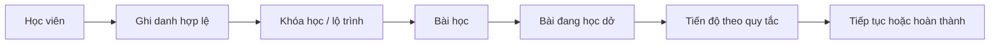

# Ẩn dụ hệ thống và ngôn ngữ chung để định hướng thiết kế

## Mục tiêu học tập

Sau bài học, bạn có thể:

- Giải thích **System Metaphor (ẩn dụ hệ thống)** trong Extreme Programming (XP): một câu chuyện/so sánh dễ hiểu giúp cả đội hình dung cách hệ thống hoạt động và trao đổi về thiết kế.
- Phân biệt **ẩn dụ, mô hình miền nghiệp vụ, ngôn ngữ chung, sơ đồ kiến trúc và quy tắc nghiệp vụ**; biết ẩn dụ hỗ trợ tư duy nhưng không thay thế kiểm chứng.
- Cùng người làm sản phẩm, Developers, kiểm thử và vận hành thống nhất thuật ngữ cho một hành trình người dùng, từ user story tới mã nguồn và kiểm thử.
- Sử dụng ẩn dụ để gợi ý **ranh giới trách nhiệm, cách đặt tên, nơi đặt hành vi và hướng chia nhỏ thay đổi**, mà không cưỡng ép mọi lớp phần mềm thành đồ vật trong phép so sánh.
- Thực hành qua ví dụ **nền tảng học trực tuyến**: xây ngôn ngữ chung về khóa học, ghi danh, bài học, tiến độ và quyền truy cập.
- Nhận diện khi một ẩn dụ trở nên gây hiểu nhầm, biết sửa hoặc bỏ nó bằng **phản hồi, kiểm thử và refactoring**.
- Kết nối kỹ thuật này với các thực hành XP như **simple design, pair programming, collective ownership, TDD, continuous integration**, đồng thời vận dụng trong Scrum/Kanban khi phù hợp.

## 1. Một nhóm có thể viết đúng mã nhưng hiểu sai cùng một từ

Giả sử đội phát triển nền tảng học Java có ba cách nói:

- Product Owner: “Khi học viên **hoàn thành bài**, hãy mở bài tiếp theo.”
- Developer: “Hoàn thành bài nghĩa là đã **xem hết video**.”
- Người kiểm thử: “Tôi tưởng phải **đạt câu hỏi kiểm tra cuối bài**.”
- Người thiết kế trải nghiệm: “Tôi chỉ định đánh dấu bài **đã xem**, chưa gọi là hoàn thành.”

Mỗi người dùng cùng một cụm từ nhưng nghĩ đến **một trạng thái khác nhau**. Nếu đội đi thẳng vào lập trình, họ có thể tạo API, giao diện và kiểm thử theo ba quy tắc không tương thích.

Đó là một trong những vấn đề mà XP muốn giảm bằng **trao đổi trực tiếp, phản hồi nhanh và một cách kể chung về hệ thống**.

Một ẩn dụ đơn giản cho trải nghiệm học tập có thể là:

> “Người học đi qua một **lộ trình** gồm những **chặng học tập**. Hệ thống ghi nhớ người học đang ở đâu và điều kiện để họ đi tiếp.”

Câu chuyện này giúp mọi người hỏi cùng một loại câu hỏi:

- “Một **chặng** tương ứng với bài học hay cả chương?”
- “Lộ trình này có bắt buộc đi theo thứ tự không?”
- “Đã **đi qua** chặng nghĩa là xem nội dung, làm bài hay đạt điểm?”
- “Một người đang ở hai lộ trình thì tiến độ được lưu ra sao?”
- “Ghi danh có giống một tấm vé để **truy cập** hay không, và vé có thể hết hiệu lực không?”

**Ẩn dụ tốt mở ra các câu hỏi đúng**. Nó chưa tự trả lời những câu hỏi đó. Nhóm vẫn phải thống nhất **quy tắc nghiệp vụ cụ thể** và kiểm chứng bằng ví dụ.

Điểm quan trọng: XP không dùng ẩn dụ để biến lập trình thành thơ văn. Mục tiêu là **giảm khoảng cách hiểu biết giữa người nói về nhu cầu và người hiện thực phần mềm**, tạo một hướng thiết kế đủ rõ để mọi người cùng cải tiến.

## 2. System Metaphor là gì trong XP?

Trong cách trình bày XP kinh điển, **System Metaphor** là một thực hành giúp tạo **câu chuyện đơn giản mà cả nhóm có thể kể** về việc hệ thống vận hành. Câu chuyện này định hướng khái niệm, cách gọi tên và sự hình dung chung về trách nhiệm của những phần quan trọng trong hệ thống.

Một ẩn dụ có thể mượn hình ảnh quen thuộc như **thư viện, dòng chảy, dây chuyền, hành trình, trạm trung chuyển**. Nó cũng có thể là **một mô tả miền nghiệp vụ trực tiếp**, không nhất thiết là so sánh văn chương.

Ví dụ:

- “Hệ thống quản lý học tập giống **thư viện cho mượn quyền truy cập**”: giúp nghĩ về danh mục, người được phép xem và hạn sử dụng.
- “Người học đi theo một **lộ trình**”: giúp nghĩ về bài học, tiến độ và điều kiện chuyển bước.
- “Yêu cầu hỗ trợ đi qua một **dòng công việc**”: giúp nghĩ về trạng thái, hàng đợi, người xử lý và điểm hoàn thành.

Mỗi hình ảnh chỉ có ích ở **một số khía cạnh**. “Thư viện” có thể gợi nhầm rằng mọi quyền truy cập đều hết hạn; “lộ trình” có thể khiến người nghe tưởng mọi khóa học bắt buộc học tuần tự. Các giả định này phải được **hỏi lại, không tự đưa vào code**.

### 2.1. Một ẩn dụ hệ thống hữu ích thường có đặc điểm gì?

1. **Ngắn, dễ kể lại:** người hiểu nghiệp vụ lẫn người viết mã có thể giải thích nó bằng một vài câu.
2. **Gắn với hành vi quan trọng:** giúp người nghe liên hệ tới những việc hệ thống thật sự làm.
3. **Gợi ý trách nhiệm và tên gọi:** hỗ trợ hình dung đâu là khái niệm chính và nơi đặt hành vi.
4. **Đủ nhất quán:** không dùng cùng một từ cho hai quy tắc khác nhau mà không phân biệt.
5. **Có giới hạn rõ:** nói được chỗ phép so sánh **không còn đúng**.
6. **Dễ điều chỉnh:** khi người dùng hoặc phần mềm cho thấy cách hiểu sai, nhóm sẵn sàng sửa tên, đổi mô hình hoặc bỏ ẩn dụ.
7. **Không chiếm chỗ của bằng chứng:** cần user story, ví dụ, kiểm thử và phản hồi để xác nhận.

Một ẩn dụ có thể rất dễ nhớ nhưng **không giúp ra quyết định thiết kế nào**. Khi đó nó chưa có nhiều giá trị thực hành.

### 2.2. Ẩn dụ hệ thống không phải bản thiết kế cố định

Ẩn dụ **không quy định** ngôn ngữ lập trình, cơ sở dữ liệu, số microservice, framework hay cấu trúc mọi package. Ví dụ nói “lộ trình học” không có nghĩa phải xây lớp `Train`, `Station`, `Ticket`, `Conductor` trong hệ thống học tập.

Nó định hướng câu hỏi và ngôn ngữ; **thiết kế cụ thể** phải dựa trên nhu cầu, dữ liệu, tương tác, chất lượng và phản hồi kỹ thuật.

Một cách nhớ:

> **Ẩn dụ giúp đội nhìn cùng một bức tranh; mô hình và mã nguồn phải mô tả chính xác thế giới sản phẩm.**

## 3. Phân biệt ẩn dụ, ngôn ngữ chung và mô hình nghiệp vụ

Các khái niệm liên quan nhưng không đồng nhất:

| Khái niệm | Mục đích | Ví dụ trong nền tảng học |
| --- | --- | --- |
| **System Metaphor** | Câu chuyện/hình ảnh giúp hình dung hệ thống, giao tiếp và gợi hướng thiết kế. | “Người học đi trên lộ trình và hệ thống nhớ chặng đã đi.” |
| **Ngôn ngữ chung (shared language)** | Bộ thuật ngữ có nghĩa thống nhất khi mọi người trao đổi. | “Ghi danh”, “quyền truy cập”, “bài đã bắt đầu”, “bài đã hoàn thành”. |
| **Mô hình miền (domain model)** | Biểu diễn các khái niệm, trạng thái, quan hệ và quy tắc thực của nghiệp vụ. | `Enrollment`, `Course`, `LessonProgress`, quy tắc xác định trạng thái hoàn thành. |
| **User story và acceptance criteria** | Nêu ai cần kết quả gì, với những hành vi có thể kiểm chứng. | Học viên đang học dở mở đúng bài gần nhất theo quy tắc đã chốt. |
| **Kiến trúc phần mềm** | Tổ chức các thành phần kỹ thuật, dữ liệu và giao tiếp để đáp ứng yêu cầu chất lượng. | Dịch vụ ghi danh, lưu tiến độ, kiểm soát quyền, giao diện học tập. |
| **Thiết kế và mã nguồn** | Hiện thực hóa hành vi, ràng buộc và tương tác trong phần mềm. | Mã xử lý `EnrollmentStatus.ACTIVE`, kiểm thử quyền truy cập. |

**Shared language** là mục tiêu rất gần với ý tưởng *ubiquitous language* trong Domain-Driven Design (DDD): thuật ngữ miền được dùng nhất quán trong trao đổi và mô hình. Tuy nhiên, **DDD và XP không phải cùng một phương pháp**; không nên tuyên bố mọi khái niệm của DDD đều bắt buộc trong XP hoặc ngược lại.

### 3.1. Khi nào chỉ cần thuật ngữ trực tiếp, không cần ẩn dụ?

Nếu đội đã hiểu rõ nghiệp vụ **đơn hàng, hóa đơn, thanh toán, hoàn tiền**, chính những thuật ngữ đó có thể là ngôn ngữ chung tốt nhất. Gắn thêm hình ảnh “đường ray” hoặc “nhà kho” có thể tạo nhầm lẫn.

Đừng tìm ẩn dụ chỉ để “đúng quy trình”. Trong thực hành XP hiện đại, các đội có thể đạt mục đích giao tiếp của System Metaphor bằng **câu chuyện hệ thống rõ ràng và mô hình miền dùng chung**, ngay cả khi không có một phép so sánh đầy màu sắc.

### 3.2. Từ ngữ giống nhau chưa bảo đảm cùng ý nghĩa

Hai bên có thể đều dùng từ “tiến độ” nhưng:

- Product Owner hiểu **phần trăm chương đã hoàn tất**.
- Developer hiểu **vị trí video được phát gần nhất**.
- Giảng viên hiểu **tỷ lệ đạt bài kiểm tra**.

Chọn một từ chung chưa đủ. Cần làm rõ:

1. Định nghĩa cụ thể.
2. Đối tượng liên quan.
3. Quy tắc tính hoặc chuyển trạng thái.
4. Trường hợp không áp dụng.
5. Ví dụ để phát hiện cách hiểu khác nhau.

Ngôn ngữ chung cần **được kiểm chứng trong trao đổi và trong hành vi phần mềm**, không chỉ nằm ở bảng thuật ngữ.

## 4. Vì sao XP coi cách kể chung là hữu ích?

XP tập trung vào khả năng thay đổi phần mềm với **chi phí phản hồi thấp**. Khi mọi người có một hình dung chung về hệ thống, họ có thể phối hợp qua nhiều thực hành XP.

### 4.1. Whole Team và trao đổi trực tiếp

Người đưa ra nhu cầu, Developers và người kiểm thử có thể cùng hỏi: “Điều gì xảy ra khi học viên mất quyền truy cập giữa chừng?” Thay vì dịch qua nhiều tài liệu và phòng ban, họ dùng **cùng thuật ngữ** để giải quyết quy tắc.

Ẩn dụ hỗ trợ trao đổi nhưng **không thay người hiểu nghiệp vụ**. Mọi quy tắc quan trọng cần được xác nhận với người có thẩm quyền phù hợp.

### 4.2. Simple Design — thiết kế đơn giản

Một ngôn ngữ chung giúp nhóm tránh tạo những lớp hoặc abstraction chưa cần thiết. Nếu sản phẩm chỉ cần ghi nhận bài đã hoàn thành, đội có thể bắt đầu bằng mô hình `LessonProgress` rõ ràng thay vì thiết kế một “máy điều phối hành trình vạn năng” với hàng chục trạng thái chưa có yêu cầu.

Đơn giản không đồng nghĩa bỏ qua rủi ro hoặc chất lượng. Nó nghĩa là **đủ đúng cho nhu cầu hiện tại, dễ hiểu, dễ thay đổi**, không đầu tư sớm vào khả năng giả định.

### 4.3. Pair Programming và Collective Code Ownership

Khi hai người cùng làm một phần mã, một hệ thuật ngữ thống nhất giúp họ hiểu trách nhiệm của lớp, tên phương thức và quy tắc được hiện thực. Đội có thể cải thiện mã của nhau mà ít lệ thuộc vào “người duy nhất hiểu module này”.

**Collective code ownership** trong XP giúp giảm các vùng mã độc quyền theo cá nhân. Nhưng nó đòi hỏi kiểm thử, giao tiếp và tiêu chuẩn thiết kế đủ tốt; không có nghĩa ai cũng được sửa tùy tiện mà bỏ qua sự kiểm chứng cần thiết.

### 4.4. Test-Driven Development (TDD) và kiểm thử hành vi

Nếu quy tắc được nói bằng ngôn ngữ chung, tên kiểm thử và các ví dụ có thể diễn đạt nghiệp vụ dễ hiểu hơn:

- “Học viên đã ghi danh được mở bài học.”
- “Học viên chưa ghi danh không được xem bài riêng.”
- “Hoàn thành bài theo quy tắc đã thống nhất mới cập nhật tiến độ.”

TDD là thực hành kỹ thuật thiết kế vòng lặp kiểm thử–mã–refactor. **Ẩn dụ không thay kiểm thử**, nhưng giúp nhóm đặt tên hành vi và phát hiện một phép trừu tượng đang che giấu nghiệp vụ.

### 4.5. Refactoring và Continuous Integration

Khi mô hình chung thay đổi, nhóm cần đủ an toàn để **đổi tên, tách trách nhiệm hoặc bỏ abstraction cũ**. Kiểm thử tự động và tích hợp thường xuyên giúp phát hiện hệ quả của việc sửa ngôn ngữ trong mã.

Một ẩn dụ bị biến thành kiến trúc bất biến sẽ đi ngược tinh thần phản hồi và thay đổi của XP. **Ẩn dụ là giả thuyết thiết kế có thể học lại**, không phải lý do từ chối refactor.

## 5. Chọn một ẩn dụ cho nền tảng học trực tuyến

Ta sẽ sử dụng ví dụ xuyên suốt:

**Người dùng chính:** học viên tự học Java căn bản.

**Mục tiêu:** tìm khóa phù hợp, ghi danh, mở bài học, quay lại bài đang dở và nhìn thấy tiến độ theo quy tắc rõ ràng.

**Ẩn dụ đề xuất:**

> “Mỗi khóa học tạo một **lộ trình học**. Học viên được phép vào lộ trình khi có **ghi danh hợp lệ**; họ học các bài trong lộ trình và hệ thống giữ lại **dấu mốc tiến độ** để họ có thể tiếp tục.”

Ẩn dụ này có ích vì gợi được ba nhóm câu hỏi:

- **Truy cập:** ai được phép học lộ trình nào?
- **Cấu trúc:** lộ trình gồm bài nào, có thứ tự hay nhánh rẽ không?
- **Tiến độ:** làm thế nào biết người học đã bắt đầu, đang dở hoặc hoàn thành?

### 5.1. Vẽ một bức tranh dễ kể



Sơ đồ thể hiện **câu chuyện tổng quát**, không phải khẳng định mọi sản phẩm đều có cùng luồng. Các điều kiện như bắt buộc học tuần tự, giới hạn thời gian, bài kiểm tra và thanh toán phải được xác định từ thực tế của sản phẩm.

### 5.2. Phân biệt từ của ẩn dụ với khái niệm thực

| Hình ảnh trong câu chuyện | Câu hỏi do ẩn dụ gợi ra | Thuật ngữ nghiệp vụ nên dùng trong hệ thống | Giới hạn của ẩn dụ |
| --- | --- | --- | --- |
| **Lộ trình** | Học viên muốn học theo cấu trúc nào? | `Course` hoặc `LearningPath`, tùy chính sách sản phẩm. | Khóa học không nhất thiết chỉ có một đường đi. |
| **Chặng** | Đơn vị nội dung nhỏ nhất cần theo dõi là gì? | `Lesson`, `Module`, `Unit` theo định nghĩa đã chốt. | Chặng không tự đồng nghĩa một bài học. |
| **Quyền vào lộ trình** | Khi nào học viên được mở nội dung? | `Enrollment`, `AccessPolicy` hoặc khái niệm quyền cụ thể. | Ghi danh không tự đồng nghĩa trả phí. |
| **Dấu mốc** | Trạng thái nào cần được lưu? | `LessonProgress`, `CompletionRecord`. | Vị trí xem gần nhất không tự đồng nghĩa hoàn thành. |
| **Đi tiếp** | Có điều kiện chuyển sang bài khác không? | `CompletionRule`, `Prerequisite`, `NextLessonPolicy` nếu nghiệp vụ cần. | Không mặc nhiên khóa bài sau khi chưa xong bài trước. |
| **Kết thúc hành trình** | Khi nào được gọi là hoàn thành khóa? | `CourseCompletion` và quy tắc tương ứng. | Chưa chắc phải có chứng chỉ hoặc điểm thi. |

**Thiết kế không nên có các class `Station` và `Ticket` chỉ vì phép ví von.** Tên mã nguồn nên phản ánh ngôn ngữ miền mà người liên quan hiểu chính xác.

### 5.3. Định nghĩa ngôn ngữ chung ban đầu

Một bảng thuật ngữ có thể bắt đầu như sau:

| Thuật ngữ | Định nghĩa làm việc | Ví dụ cụ thể | Câu hỏi còn mở |
| --- | --- | --- | --- |
| **Khóa học** | Tập nội dung đào tạo được cung cấp theo một cấu trúc và quy tắc riêng. | “Java nhập môn”. | Có phiên bản khóa học không? |
| **Ghi danh** | Quan hệ giữa học viên và khóa học theo các trạng thái đã thỏa thuận. | Lan có ghi danh `ACTIVE` ở khóa Java. | Khi hủy, tiến độ được xử lý thế nào? |
| **Quyền truy cập** | Quy tắc xác định ai được mở nội dung tại thời điểm yêu cầu. | Lan còn ghi danh hợp lệ nên mở được bài riêng. | Ghi danh có đủ để cấp quyền không? |
| **Bài học** | Đơn vị nội dung trong cấu trúc khóa, có mã nhận diện ổn định. | Bài “Biến và kiểu dữ liệu”. | Bài có thể thuộc nhiều khóa không? |
| **Đang học dở** | Bài đã bắt đầu nhưng chưa đạt điều kiện hoàn thành theo quy tắc đã chốt. | Lan mở bài 3 nhưng chưa hoàn thành. | “Bắt đầu” xảy ra khi mở trang hay thao tác nào? |
| **Hoàn thành bài** | Trạng thái được ghi khi học viên đáp ứng quy tắc hoàn thành của bài. | Đã đạt bài kiểm tra, nếu bài quy định phải đạt. | Có bài chỉ yêu cầu đọc/xem không? |
| **Hoàn thành khóa** | Đáp ứng các điều kiện kết thúc khóa đã xác định. | Các bài bắt buộc đã hoàn thành và bài kiểm tra cuối khóa đạt, nếu áp dụng. | Có điều kiện ngoài hệ thống không? |
| **Tiếp tục học** | Đưa học viên tới bước học phù hợp dựa trên quyền và tiến độ. | Mở đúng bài đang dở theo chính sách. | Nếu có nhiều bài dở, chọn bài nào? |

Đây là các **định nghĩa giả định cho bài thực hành**, không phải tiêu chuẩn của mọi LMS. Một từ có thể cần thay đổi khi người dùng hoặc chuyên gia nghiệp vụ xác nhận quy tắc khác.

## 6. Ngôn ngữ chung được dùng ở đâu?

Một hệ thuật ngữ thực sự hữu ích cần đi qua các lớp trao đổi và phần mềm, không chỉ tồn tại trên bảng workshop.

### 6.1. Trong user story và Product Backlog

Mô tả mơ hồ:

> “Thêm nút đi tiếp cho học viên.”

Mô tả rõ hơn:

> “Là một học viên đang theo học, tôi muốn **tiếp tục bài chưa hoàn thành gần nhất** để không phải tìm lại nội dung khi quay lại khóa.”

Từ **“chưa hoàn thành gần nhất”** phải có quy tắc nếu có nhiều bài dở. Ẩn dụ “dấu mốc trên hành trình” giúp nhóm nhận ra câu hỏi đó, nhưng **không quyết định thay người làm sản phẩm**.

### 6.2. Trong tên mô hình và mã nguồn

Nên cân nhắc những tên phản ánh thuật ngữ đã thống nhất:

- `Course`, `Lesson`, `Enrollment`.
- `LessonProgress`, `ProgressStatus`.
- `LessonAccessPolicy` hoặc tên phù hợp cách quản lý quyền thực tế.
- `findLastIncompleteLesson` nếu đó đúng là quy tắc.
- `isEligibleToOpenLesson` nếu nghiệp vụ cần kiểm tra điều kiện truy cập.

Không nên dùng tên **chung chung** như `DataManager`, `Handler2`, `ProcessThing` cho mọi hành vi; chúng không giúp người đọc nhận ra trách nhiệm hoặc quy tắc.

Cũng không nên đặt tên **quá cụ thể theo ẩn dụ** nếu nó gây lệch nghĩa, ví dụ `buyTicketToStation` cho thao tác ghi danh một khóa miễn phí.

### 6.3. Trong kiểm thử và báo lỗi

Tên kiểm thử hữu ích:

```text
givenActiveEnrollment_whenOpeningPrivateLesson_thenAccessAllowed
givenCancelledEnrollment_whenOpeningPrivateLesson_thenAccessDenied
givenIncompleteLesson_whenReturningToCourse_thenContinueLinkTargetsThatLesson
```

Những tên này giúp người đọc nhìn thấy **hành vi nghiệp vụ**, nhưng cần nhất quán với quy tắc thật: ví dụ `Cancelled` có nghĩa thu hồi quyền ngay hay có thời gian ân hạn? Nếu chính sách chưa chốt, không nên tự lập trình suy đoán.

### 6.4. Trong giao diện và tài liệu hỗ trợ

Nếu giao diện hiển thị **“Hoàn thành”**, API ghi `watched` và báo cáo gọi `passed`, người dùng và đội vận hành có thể hiểu sai kết quả.

Một bản đồ từ vựng nên nêu:

- Tên người dùng nhìn thấy.
- Tên nghiệp vụ nội bộ.
- Tên trường/API nếu khác vì lý do kỹ thuật hoặc tương thích.
- Quy tắc ánh xạ khi cần hỗ trợ nhiều phiên bản hoặc đa ngôn ngữ.

**Không nhất thiết tên tiếng Việt và tên biến tiếng Anh phải giống hệt nhau**; chúng phải **cùng diễn đạt đúng một khái niệm** và có quy tắc chuyển đổi rõ ràng.

## 7. Ví dụ thiết kế Java: đặt tên theo miền, không theo đồ vật ẩn dụ

Giả sử đội thống nhất một quy tắc tối thiểu cho bài học **chỉ dành cho người đã ghi danh**:

> “Một học viên được mở bài riêng của khóa khi có ghi danh `ACTIVE` cho đúng khóa và đúng tài khoản.”

Đoạn Java sau chỉ minh họa cách thuật ngữ miền có thể xuất hiện trong thiết kế. Nó **không đại diện toàn bộ chính sách quyền truy cập** của một nền tảng thực tế.

```java
import java.util.Objects;

enum EnrollmentStatus {
    ACTIVE,
    CANCELLED
}

record Enrollment(
        String learnerId,
        String courseId,
        EnrollmentStatus status) {
}

record Lesson(
        String lessonId,
        String courseId,
        boolean privateContent) {
}

final class LessonAccessPolicy {

    boolean canOpenPrivateLesson(
            String requestingLearnerId,
            Enrollment enrollment,
            Lesson lesson) {

        Objects.requireNonNull(requestingLearnerId);
        Objects.requireNonNull(lesson);

        if (!lesson.privateContent()) {
            // Chính sách nội dung công khai cần được làm rõ riêng.
            return false;
        }

        return enrollment != null
                && enrollment.status() == EnrollmentStatus.ACTIVE
                && requestingLearnerId.equals(enrollment.learnerId())
                && lesson.courseId().equals(enrollment.courseId());
    }
}
```

**Giải thích giới hạn của ví dụ:**

- Phương thức được đặt tên `canOpenPrivateLesson`, nên với bài công khai nó trả `false`; mã **không định nghĩa chính sách truy cập bài công khai**.
- Quy tắc về khóa hết hạn, người quản trị, khóa có phí, điều kiện tiên quyết hoặc quyền truy cập tạm thời **chưa được bao phủ**.
- `requestingLearnerId` phải đến từ **ngữ cảnh xác thực đáng tin**, không phải tham số người dùng tùy ý có thể giả mạo; ví dụ này chưa mô tả cơ chế xác thực.
- Hệ thống thật phải kiểm chứng dữ liệu, trạng thái nhất quán và các rủi ro liên quan trước khi đưa vào sản phẩm.

### 7.1. Điều ẩn dụ đã giúp ở thiết kế này là gì?

Ẩn dụ **“đi vào lộ trình”** làm đội nhớ hỏi về quyền bước vào hành trình. Nhưng quy tắc được hiện thực bằng **ngôn ngữ thực**: `Enrollment`, `Lesson`, `LessonAccessPolicy`, không phải `Ticket` hay `Gatekeeper`.

Đồng thời, đoạn mã đặt ra những câu hỏi cần đưa lại cho người hiểu sản phẩm:

- `CANCELLED` có luôn đồng nghĩa mất quyền truy cập ngay không?
- Bài công khai có cần ghi danh không?
- Nếu người dùng đã ghi danh hợp lệ nhưng khóa không còn mở, có được truy cập bài cũ?
- Một khóa có nhiều phiên bản nội dung thì quyền liên kết với phiên bản nào?

Một **mô hình có giá trị** là mô hình tạo ra các câu hỏi hữu ích và dễ sửa khi câu trả lời thay đổi.

### 7.2. Kiểm thử hành vi từ ngôn ngữ chung

```gherkin
Feature: Quyền truy cập bài học riêng

  Scenario: Học viên có ghi danh hợp lệ
    Given Lan đã đăng nhập vào tài khoản của mình
    And Lan có ghi danh ACTIVE cho khóa "Java nhập môn"
    And bài "Biến và kiểu dữ liệu" là nội dung riêng của khóa đó
    When Lan yêu cầu mở bài học
    Then Lan được phép xem nội dung bài

  Scenario: Người yêu cầu là tài khoản khác
    Given Lan có ghi danh ACTIVE cho khóa "Java nhập môn"
    And Nam đã đăng nhập vào tài khoản của Nam
    When Nam yêu cầu mở bài riêng bằng thông tin ghi danh của Lan
    Then Nam không được phép xem nội dung riêng của bài

  Scenario: Ghi danh đã bị hủy
    Given Lan có ghi danh CANCELLED cho khóa "Java nhập môn"
    And bài "Biến và kiểu dữ liệu" là nội dung riêng của khóa đó
    When Lan yêu cầu mở bài
    Then hệ thống từ chối truy cập theo quy tắc đã thống nhất
```

Đây là **ví dụ nghiệp vụ cần được người có thẩm quyền xác nhận**. Nếu hủy ghi danh vẫn cho quyền xem tới cuối tháng, tình huống thứ ba phải được sửa trước khi phát triển và kiểm thử theo quy tắc mới.

Từ ẩn dụ đến kiểm thử có một chuỗi:

```text
Câu chuyện chung → câu hỏi nghiệp vụ → thuật ngữ đã định nghĩa
                  → tiêu chí chấp nhận → mô hình/mã
                  → kiểm thử và phản hồi
```

Nếu có mâu thuẫn, đội quay lại **cách hiểu và ví dụ**, chứ không cố bảo vệ câu chuyện ví von ban đầu.

## 8. Dùng ẩn dụ để định hướng trách nhiệm và ranh giới thiết kế

Một sai lầm phổ biến là biến ẩn dụ thành **sơ đồ các lớp một–một**. Cách có ích hơn là dùng nó để hỏi hệ thống có những **trách nhiệm nào cần được tách rõ**.

Trong ví dụ lộ trình học:

| Câu hỏi từ câu chuyện | Trách nhiệm nghiệp vụ có thể phát sinh | Rủi ro thiết kế cần xem xét |
| --- | --- | --- |
| Ai được bước vào lộ trình? | Xác minh quyền truy cập khóa và bài học. | Không được đồng nhất thanh toán, ghi danh và quyền truy cập. |
| Lộ trình có những chặng nào? | Quản lý cấu trúc khóa/chương/bài và phiên bản. | Bài học có thể được tái sử dụng hoặc thay đổi vị trí. |
| Người học đang ở đâu? | Lưu và đọc tiến độ, bài học đang dở. | Tiến độ theo bài có khác vị trí phát video không? |
| Khi nào được đi tiếp? | Quy tắc hoàn thành và điều kiện tiên quyết. | Không giả định bắt buộc tuần tự nếu khóa cho phép học tự do. |
| Nếu quay lại sau một tháng? | Khôi phục trạng thái theo quyền và nội dung hiện hành. | Khóa có thể bị thay đổi/thu hồi, tiến độ cũ phải được xử lý nhất quán. |
| Nếu học trên hai thiết bị? | Xử lý cập nhật đồng thời và đồng bộ. | Mất dữ liệu khi một thiết bị ghi đè trạng thái mới hơn. |

Cách sử dụng đúng không phải ngay lập tức tạo sáu microservice. Một sản phẩm nhỏ có thể triển khai các trách nhiệm trên trong một ứng dụng được chia module rõ ràng. **Số lượng thành phần kỹ thuật là quyết định thiết kế riêng**, dựa trên độ phức tạp, nhu cầu vận hành và năng lực đội.

### 8.1. Simple design: tránh xây quá sớm

Giả sử lát phát hành đầu chỉ cần:

1. Học viên tìm khóa miễn phí.
2. Ghi danh hợp lệ.
3. Mở bài đầu tiên.
4. Xem tiến độ cơ bản.

Nếu nhóm thiết kế ngay hệ thống hỗ trợ **mười kiểu chặng, nhiều tuyến song song, cơ chế nhảy trạm có điều kiện, gợi ý AI và bản đồ toàn cầu**, phần lớn chỉ là suy đoán từ ẩn dụ.

Một hướng XP phù hợp hơn:

- Chọn **lát giá trị dọc nhỏ**.
- Làm rõ quy tắc cần dùng ngay.
- Viết kiểm thử thích hợp.
- Triển khai thiết kế đơn giản có khả năng sửa.
- Refactor khi thông tin mới cho thấy cần một abstraction khác.

Ẩn dụ định hướng **tư duy**, không phải một lời hứa rằng sản phẩm sẽ có đủ mọi chức năng giống thế giới được đem ra so sánh.

### 8.2. Đặt tên phản ánh trách nhiệm, không che giấu nó

So sánh:

| Tên khó hiểu hoặc lệch nghĩa | Tên miền có thể rõ hơn | Vì sao? |
| --- | --- | --- |
| `JourneyManager` quản lý mọi thứ | `EnrollmentService`, `ProgressService` nếu trách nhiệm thực sự được tách như vậy | Một “Manager” bao trùm dễ tích tụ logic không liên quan. |
| `Ticket` dùng cho cả thanh toán và ghi danh | `Payment`, `Enrollment`, `AccessGrant` nếu miền cần | Thanh toán thành công, ghi danh và quyền truy cập là các sự kiện/quan hệ khác nhau. |
| `StationReached` | `LessonCompleted` khi đúng là sự kiện đó | Tên trực tiếp gắn với điều nghiệp vụ cần kiểm chứng. |
| `isDone` không có bối cảnh | `hasCompletedLesson`, `hasPassedAssessment` | “Done” có thể chỉ nhiều trạng thái. |
| `goNext` | `findNextRequiredLesson` nếu có quy tắc bài bắt buộc | Tên biểu lộ chính sách, không chỉ thao tác điều hướng. |

Không phải lúc nào cũng cần tạo service riêng cho từng dòng; bảng minh họa **khả năng đặt tên và tách trách nhiệm**. Đừng tạo abstraction chỉ để trùng với cột trong bảng.

## 9. Ẩn dụ trở nên nguy hiểm khi bị hiểu theo nghĩa đen

Một ẩn dụ ban đầu giúp giao tiếp có thể bắt đầu gây hại khi sản phẩm phức tạp hơn.

### 9.1. “Lộ trình” không có nghĩa phải đi theo thứ tự

Một số khóa học cho phép người dùng học bài bất kỳ; một số khóa yêu cầu hoàn thành chương trước. Nếu ẩn dụ “chặng nối tiếp” khiến nhóm **mặc định khóa mọi bài sau**, họ đã áp đặt quy tắc chưa được người dùng xác nhận.

**Cách sửa:** phân biệt `LessonOrder` (thứ tự hiển thị) và `PrerequisitePolicy` (điều kiện được phép mở), nếu miền thực sự có hai khái niệm đó.

### 9.2. “Tấm vé” không có nghĩa trả phí

Khóa miễn phí cũng có thể yêu cầu ghi danh; khóa trả phí có thể có quyền dùng thử, học bổng hoặc quyền đã mua qua tổ chức. Nếu gọi mọi `Enrollment` là `TicketPurchase`, thiết kế dễ gắn quyền truy cập nhầm với giao dịch.

**Cách sửa:** mô hình hóa `Enrollment`, `Payment` và `AccessPolicy` theo quan hệ nghiệp vụ đã xác nhận.

### 9.3. “Đánh dấu chặng” không có nghĩa hoàn thành học tập

Một bài xem hết video chưa chắc đã **đạt bài kiểm tra** hoặc **đủ điều kiện cấp chứng chỉ**. Hệ thống cần các trạng thái và quy tắc được định nghĩa rõ.

**Cách sửa:** không dùng `completed=true` chung cho mọi khía cạnh nếu nghiệp vụ thực sự phân biệt **đã xem**, **đã hoàn thành yêu cầu**, **đã đạt đánh giá**.

### 9.4. “Một hành trình” không có nghĩa chỉ một khóa đang học

Người học có thể ghi danh nhiều khóa và học song song, đôi khi có một bài trong nhiều chương. Một mô hình ép học viên chỉ có một `currentCourse` toàn hệ thống sẽ hạn chế sản phẩm sai.

**Cách sửa:** làm rõ tiến độ thuộc **học viên–khóa–bài** hay thực thể khác theo quy tắc thực.

### 9.5. Dấu hiệu cần sửa hoặc bỏ ẩn dụ

- Người làm nghiệp vụ liên tục phải giải thích “đừng hiểu từ ấy theo nghĩa này”.
- Tên mã gây nhầm lẫn với tên trên giao diện và tài liệu sản phẩm.
- Đội tạo lớp chỉ để “cho đúng hình ảnh”, dù không có hành vi thực tế.
- Một thay đổi nhỏ liên tục buộc cập nhật nhiều thành phần không liên quan.
- Ẩn dụ khiến đội bỏ qua ngoại lệ quan trọng về quyền, dữ liệu hoặc giá trị người dùng.
- Phản hồi thực tế cho thấy cách kể không phản ánh hành trình người dùng.

Khi gặp các dấu hiệu này, **không cần giữ ẩn dụ vì đã đầu tư nhiều vào sơ đồ**. Thay đổi hệ từ vựng, refactor mô hình hoặc trở về ngôn ngữ miền trực tiếp.

## 10. Workshop xây ẩn dụ và ngôn ngữ chung cùng đội

Một buổi làm việc có thể diễn ra trong khoảng phù hợp năng lực nhóm; **XP không bắt buộc một mẫu workshop hoặc timebox cố định** cho System Metaphor. Điều cần là có người hiểu mục tiêu sản phẩm, kỹ thuật và cách kiểm chứng.

### Bước 1 — Chọn một mục tiêu người dùng rõ ràng

Ví dụ: “Học viên đã ghi danh quay lại được bài đang học dở và tiếp tục với quyền hợp lệ.”

Nếu bắt đầu bằng “hãy thiết kế kiến trúc tổng thể LMS năm năm tới”, nhóm sẽ dễ lao vào các giả định chưa cần thiết. Chọn **hành trình cụ thể** giúp câu chuyện chung có thể được kiểm chứng.

### Bước 2 — Để mọi người kể hành trình bằng từ của mình

Hỏi người hiểu sản phẩm: “Người học làm gì đầu tiên? Khi nào việc đó được coi là thành công? Khi nào không được phép?”

Ghi lại các từ hiện có, **không chuẩn hóa quá sớm**. Các khác biệt như “đã học” và “đã xem” là tín hiệu có giá trị.

### Bước 3 — Đề xuất một hoặc hai hình ảnh đơn giản

Ví dụ:

- Lộ trình và dấu mốc tiến độ.
- Danh mục khóa, quyền truy cập và nhật ký học tập.

Chọn hình ảnh giúp đặt câu hỏi hữu ích, chứ không phải hình ảnh vui nhất. Nếu không tìm được phép ví von tốt, dùng **một câu chuyện miền trực tiếp**.

### Bước 4 — Lập bảng từ vựng: định nghĩa và phản ví dụ

Với mỗi thuật ngữ chính, ghi:

- Định nghĩa một câu.
- Một ví dụ **đúng**.
- Một phản ví dụ **không đúng**.
- Câu hỏi chưa chốt.
- Người có thể xác nhận quy tắc.

Ví dụ “hoàn thành bài”:

> Đúng: học viên đã đạt điều kiện hoàn thành được quy định cho bài.
> Không đủ: học viên chỉ mở trang bài trong một giây, nếu điều kiện hoàn thành không phải là mở trang.

### Bước 5 — Kết nối với luồng và trách nhiệm phần mềm

Vẽ bước chính của người dùng, dữ liệu và điểm phải ra quyết định. Đánh dấu:

- Quy tắc nghiệp vụ.
- Kiểm soát quyền.
- Trạng thái và chuyển trạng thái.
- Tích hợp hoặc dữ liệu bên ngoài.
- Điểm có thể gây sai lệch giữa ngôn ngữ và mã.

Không cần xây một sơ đồ UML quá lớn. Bắt đầu với các khái niệm đủ dùng cho những câu chuyện sắp triển khai.

### Bước 6 — Kiểm chứng bằng ví dụ biên

Cùng thử các tình huống:

- Hai bài học đều đang dở, bài nào được tiếp tục?
- Học viên đổi thiết bị khi đang lưu tiến độ thì sao?
- Học viên đã trả phí nhưng ghi danh chưa được kích hoạt?
- Khóa cho phép học tự do, còn ẩn dụ “chặng” liệu có còn đúng?
- Quyền truy cập hết hạn nhưng vẫn còn dữ liệu tiến độ?

Những ví dụ này giúp phát hiện **giới hạn của ẩn dụ** và tinh chỉnh ngôn ngữ chung.

### Bước 7 — Gắn thuật ngữ vào hiện vật làm việc

Đưa những từ đã thống nhất vào:

- Product Backlog Items và tiêu chí chấp nhận.
- Tên class/method/sự kiện miền nếu phù hợp.
- Kiểm thử và log quan trọng.
- Giao diện, hướng dẫn hỗ trợ và báo cáo.
- Sơ đồ ngắn và bảng thuật ngữ dùng chung.

Không bắt buộc thay tên toàn bộ codebase ngay lập tức. Dùng refactoring có kiểm thử và **quản lý tương thích dữ liệu/API** khi đổi tên khái niệm đã công khai.

### Bước 8 — Xem lại sau khi giao một lát giá trị

Sau bản dùng thử, xem người học thực sự thực hiện hành trình như giả định không. Nếu thuật ngữ hay mô hình không còn đúng, ghi rõ điều học được và cập nhật.

**Một workshop thành công không phải tạo nhiều sơ đồ, mà giúp đội quyết định tốt hơn ở lần phát triển tiếp theo.**

## 11. Mẫu trao đổi ba góc nhìn để phát hiện cách hiểu khác nhau

Tình huống: Product Owner yêu cầu tính năng **“tiếp tục bài đang học”**.

**Người làm nghiệp vụ:** “Khi học viên quay lại, hãy đưa họ đến bài học gần nhất mà họ chưa hoàn thành.”

**Developer:** “Nếu Lan đã mở bài 5 rồi quay lại bài 2 để xem lại, ‘gần nhất’ nghĩa là theo thời điểm truy cập hay theo thứ tự trong khóa?”

**Người kiểm thử:** “Nếu bài 5 đã hoàn thành nhưng bài 4 chưa hoàn thành, hệ thống sẽ chọn bài nào? Nếu Lan bị hủy ghi danh thì có được mở lại bài không?”

**Người làm nghiệp vụ:** “Hãy chọn bài chưa hoàn thành được truy cập gần nhất, nhưng chỉ khi học viên còn quyền vào khóa. Nếu chưa có bài đang dở thì hiển thị ‘Bắt đầu học’ theo quy tắc của khóa.”

**Developer:** “Chúng ta cần lưu thời điểm truy cập đáng tin và trạng thái hoàn thành theo từng học viên–bài. Tôi sẽ kiểm tra hệ thống hiện tại đã có dữ liệu nào.”

**Người kiểm thử:** “Tôi sẽ viết ví dụ cho nhiều bài dở, không có bài dở và hết quyền truy cập. Chúng ta cũng cần chốt cách xử lý khi hai thiết bị gửi dữ liệu cùng lúc.”

Kết quả của cuộc đối thoại:

1. Cùng một cách dùng từ **“bài chưa hoàn thành được truy cập gần nhất”**.
2. Một số quy tắc đã được xác nhận và một số câu hỏi vẫn mở.
3. Các ví dụ có thể trở thành **tiêu chí chấp nhận**.
4. Thiết kế dữ liệu và phương pháp kiểm thử có hướng rõ hơn.
5. Ẩn dụ “dấu mốc trên lộ trình” vẫn giúp giải thích, nhưng không thay các quy tắc trên.

Đây là tinh thần **cộng tác và phản hồi sớm** của Agile. Chỉ viết câu “hành trình học thông minh” trên bảng sẽ không tạo ra kết quả tương tự.

## 12. Gắn ẩn dụ với user story, backlog và lát phát hành

Ẩn dụ hệ thống có thể giúp nhóm thấy **mối nối giữa những user story**, nhưng không thay công việc xếp thứ tự và lựa chọn phạm vi.

Ví dụ Product Goal là giúp học viên **tự bắt đầu và tiếp tục học**.

| Hành trình | PBI có thể xem xét | Liên hệ với ngôn ngữ chung | Có thể thuộc lát nào? |
| --- | --- | --- | --- |
| Khám phá | Xem mô tả khóa học. | `Course`, điều kiện tham gia. | Lát 1 — tìm và chọn khóa. |
| Ghi danh | Ghi danh khóa miễn phí còn mở. | `Enrollment`, trạng thái ghi danh. | Lát 1 — bắt đầu học. |
| Truy cập | Mở bài đầu với quyền hợp lệ. | `LessonAccessPolicy`, `Lesson`. | Lát 1 — bắt đầu học. |
| Quay lại học | Tiếp tục bài chưa hoàn thành gần nhất. | `LessonProgress`, quy tắc chọn bài. | Lát 2 — duy trì học tập. |
| Đánh giá | Hoàn thành bài kiểm tra cuối chương. | `Assessment`, tiêu chí đạt. | Lát sau theo bằng chứng giá trị. |
| Hoàn thành | Xác nhận hoàn thành khóa. | `CourseCompletion`, quy tắc học tập. | Lát sau theo mục tiêu. |

Các lát là **ví dụ lựa chọn sản phẩm**, không phải thứ tự bắt buộc. Product Owner hoặc người chịu trách nhiệm ưu tiên cần dựa vào giá trị, rủi ro, mức cần thiết và phản hồi.

Ẩn dụ có thể làm lộ một **khoảng trống trong hành trình**: nếu có “ghi danh” và “tiếp tục học” nhưng chưa xác định “ai được mở bài”, đội có thể phải bổ sung PBI liên quan quyền truy cập vào lát đầu. Nó cũng có thể giúp chia lớn thành nhỏ: thay vì “xây toàn bộ lộ trình học”, nhóm giao một **luồng giá trị xuyên suốt** có thể kiểm chứng.

## 13. Kết hợp System Metaphor với Scrum và Kanban

Ẩn dụ hệ thống là thực hành được gắn với XP. Đội có thể sử dụng nó **bên cạnh Scrum, Kanban hoặc quy trình đang có**, không cần tuyên bố rằng Scrum hay Kanban bắt buộc dùng System Metaphor.

### 13.1. Với Scrum

- Trong **Product Backlog refinement**, câu chuyện chung và ngôn ngữ miền giúp Product Owner và Developers làm rõ các Product Backlog Items.
- Trong **Sprint Planning**, Developers dùng hiểu biết chung để đề xuất cách triển khai và chia nhỏ công việc; **Sprint Goal** vẫn là cam kết của Sprint.
- Trong **Daily Scrum**, nếu nhiều hạng mục cùng phụ thuộc một quy tắc “ghi danh hợp lệ”, ngôn ngữ chung giúp phát hiện và giải quyết điểm nghẽn.
- Trong **Sprint Review**, nhóm xem sản phẩm chạy được và trao đổi bằng từ người dùng hiểu, không chỉ trình bày module kỹ thuật.
- Trong **Sprint Retrospective**, đội có thể cải thiện các nhầm lẫn thuật ngữ hoặc thiết kế đã gây công việc làm lại.

**System Metaphor không thay Product Goal, Sprint Goal, Increment hay Definition of Done.** Nếu một hạng mục chưa đạt DoD, việc mọi người kể cùng câu chuyện cũng không biến nó thành Increment hoàn thành.

### 13.2. Với Kanban

Một nhóm dùng Kanban quản lý luồng công việc có thể chọn thuật ngữ chung cho các loại việc, trạng thái và điều kiện kết thúc:

- “Đã bắt đầu” nghĩa là gì?
- “Chờ kiểm thử” khác “Đang kiểm thử” ra sao?
- “Hoàn thành” nghĩa là code xong hay đã có phần mềm tích hợp và kiểm chứng?
- Những loại PBI nào cần chính sách xử lý đặc biệt?

**Definition of Workflow** của Kanban và **System Metaphor** là hai khái niệm khác nhau. DoW xác định cách công việc chảy qua hệ thống; ẩn dụ giúp hiểu **chính sản phẩm và các khái niệm quan trọng**. Cả hai có thể tăng tính minh bạch nhưng không nên đánh đồng.

## 14. Khi nào ẩn dụ không hữu ích, hoặc cần ngừng sử dụng?

Không phải đội nào cũng cần một ẩn dụ nổi bật. Hãy so sánh chi phí tạo thêm thuật ngữ với giá trị mà nó mang lại.

| Dấu hiệu | Cách phản ứng |
| --- | --- |
| Ngôn ngữ miền đã rõ và đủ trực tiếp. | Giữ thuật ngữ trực tiếp; không thêm so sánh không cần thiết. |
| Các chuyên môn hiểu khác nhau về cùng khái niệm. | Tổ chức trao đổi ví dụ, thống nhất định nghĩa; ẩn dụ có thể hỗ trợ. |
| Sản phẩm có nhiều trạng thái và phụ thuộc khó kể. | Dùng sơ đồ hành trình, bảng trạng thái hoặc mô hình miền bên cạnh một câu chuyện ngắn. |
| Ẩn dụ khiến người dùng hiểu sai quy tắc. | Sửa hoặc bỏ phần gây nhầm; ưu tiên từ vựng nghiệp vụ được xác nhận. |
| Một lớp kỹ thuật được đặt tên theo ẩn dụ nhưng làm quá nhiều việc. | Refactor theo trách nhiệm thực, kiểm thử trước/sau khi sửa. |
| Tên API công khai đã được dùng rộng rãi. | Lập kế hoạch tương thích/di trú; không đổi tên tùy tiện chỉ để đẹp mô hình. |
| Các nhóm trong tổ chức dùng từ giống nhau với nghĩa khác nhau. | Nêu ranh giới ngữ cảnh; không ép một định nghĩa cho mọi bộ phận khi miền thực sự khác. |

### 14.1. Ngôn ngữ chung không nhất thiết thống nhất toàn công ty

Ví dụ từ “đã đăng ký” có thể nghĩa:

- Đã ghi danh một khóa học.
- Đã tạo tài khoản hệ thống.
- Đã đăng ký tham dự buổi học trực tiếp.

Đội phải nêu **ngữ cảnh**: `Enrollment` khác `AccountRegistration` và `SessionBooking`. Khái niệm này tương thích với tư duy ranh giới ngữ cảnh của DDD, nhưng không có nghĩa mọi đội XP phải áp dụng toàn bộ bộ kỹ thuật DDD.

### 14.2. Không lấy ẩn dụ làm bằng chứng

Một so sánh có thể nghe rất thuyết phục nhưng chưa được kiểm chứng. Ví dụ “học viên có đường đi tuần tự nên chắc chắn muốn khóa bài sau” là **suy đoán**. Cần quan sát hành vi, phỏng vấn, thử nghiệm hoặc quy tắc sản phẩm đã chốt.

Nếu dữ liệu cho thấy người học cần mở các bài theo thứ tự tự do, thiết kế phải thích nghi, kể cả khi điều đó làm mất vẻ đẹp của ẩn dụ ban đầu.

## 15. Sai lầm thường gặp khi sử dụng System Metaphor

### Sai lầm 1 — Chọn ẩn dụ quá xa lạ

**Biểu hiện:** cả nhóm mất nhiều thời gian học hình ảnh ví von trước khi bàn được nghiệp vụ.

**Điều chỉnh:** chọn câu chuyện **gần với công việc người dùng** hoặc dùng ngôn ngữ miền trực tiếp.

### Sai lầm 2 — Cưỡng ép một–một từ ẩn dụ sang lớp mã

**Biểu hiện:** mọi khái niệm trong phép ví von đều phải có một class riêng.

**Điều chỉnh:** chỉ hiện thực khái niệm khi có trách nhiệm hoặc dữ liệu thực. Đặt tên theo quy tắc nghiệp vụ thay vì đồ vật tưởng tượng.

### Sai lầm 3 — Mọi người dùng một từ nhưng không thống nhất quy tắc

**Biểu hiện:** ai cũng nói “hoàn thành bài”, trong khi người này hiểu “đã xem”, người khác hiểu “đạt điểm”.

**Điều chỉnh:** viết ví dụ cụ thể, phản ví dụ và tiêu chí chấp nhận cho những chỗ mơ hồ.

### Sai lầm 4 — Đóng băng ẩn dụ từ đầu dự án

**Biểu hiện:** dù sản phẩm đã có học song song và nhiều kiểu bài, đội vẫn ép mọi thứ theo “một đường ray”.

**Điều chỉnh:** xem ẩn dụ như giả thuyết cần **cập nhật cùng kiến thức mới**; dùng refactoring và kiểm thử để thay đổi an toàn.

### Sai lầm 5 — Dùng ẩn dụ thay kiểm thử hoặc thiết kế

**Biểu hiện:** “Vì có trạm kiểm soát nên chắc chắn không có lỗi quyền truy cập.”

**Điều chỉnh:** chính sách quyền phải được mô tả và kiểm chứng bằng hành vi, dữ liệu và kiểm thử thực tế.

### Sai lầm 6 — Tạo từ vựng chỉ dành cho kỹ sư

**Biểu hiện:** Product Owner không hiểu tên lớp, người kiểm thử phải liên tục dịch ngược sang thuật ngữ nghiệp vụ.

**Điều chỉnh:** phát triển ngôn ngữ chung cùng người hiểu người dùng. Tên mã có thể dùng tiếng Anh nhưng phải phản ánh khái niệm được xác nhận.

### Sai lầm 7 — Đổi tên mọi thứ ngay lập tức

**Biểu hiện:** đội đổi đồng loạt API, bảng dữ liệu, log và giao diện cho khớp ẩn dụ mới, gây lỗi tích hợp.

**Điều chỉnh:** ưu tiên thay đổi nhỏ, có kiểm thử hồi quy và kế hoạch tương thích; đổi những tên gây hiểu sai hoặc tạo chi phí bảo trì thực sự.

### Sai lầm 8 — Đánh giá workshop bằng số sơ đồ đã tạo

**Biểu hiện:** có nhiều bản vẽ đẹp nhưng user story vẫn mơ hồ và lỗi nghiệp vụ vẫn lọt.

**Điều chỉnh:** đo dấu hiệu thiết thực: giảm câu hỏi lặp lại, ít hiểu sai acceptance criteria, ít sửa đi sửa lại do lệch ngôn ngữ và nhanh phát hiện rủi ro hơn.

## 16. Bài tập thực hành

### Bài tập A — Tìm giới hạn của một phép ẩn dụ

Đội nói: “Nền tảng học của chúng ta là **chuyến tàu**, học viên đi từ ga bài đầu đến ga cuối.”

Hãy trả lời:

1. Ẩn dụ gợi ra **ba câu hỏi hữu ích** về hành trình học tập nào?
2. Nó có thể gây ra **ba giả định sai** nào về học tuần tự, ghi danh hay hoàn thành?
3. Những thuật ngữ nghiệp vụ nào nên thay cho `Train`, `Station`, `Ticket` trong mã?
4. Khi nào nên giữ ẩn dụ ở mức thảo luận nhưng **không sử dụng tên ẩn dụ trong code**?
5. Hãy viết lại một câu ẩn dụ đủ đúng cho sản phẩm có thể học bài tự do.

**Gợi ý:** ẩn dụ giúp hỏi về trình tự, điểm bắt đầu và tiến độ; nhưng không tự quyết quy tắc bắt buộc học tuần tự, thanh toán hay cấp chứng chỉ.

### Bài tập B — Lập ngôn ngữ chung cho nền tảng học Java

Nhóm có các từ: **đăng ký, ghi danh, bắt đầu, đã xem, hoàn thành, đạt, quyền truy cập, tiếp tục học**.

Hãy tạo bảng gồm:

| Thuật ngữ | Định nghĩa | Ví dụ đúng | Phản ví dụ | Câu hỏi cần xác nhận |
| --- | --- | --- | --- | --- |
| Ghi danh | ... | ... | ... | ... |
| Hoàn thành bài | ... | ... | ... | ... |
| Tiếp tục học | ... | ... | ... | ... |

Yêu cầu thêm:

1. Chỉ rõ **“đăng ký tài khoản” khác “ghi danh khóa học”**.
2. Phân biệt **“đã xem video”** với **“đạt bài kiểm tra”** nếu sản phẩm cần.
3. Viết hai tiêu chí chấp nhận cho trường hợp người học quay lại bài dở.
4. Nêu một tình huống cần kiểm thử quyền truy cập.
5. Đề xuất ba tên class/method phản ánh từ vựng đã chốt.

### Bài tập C — Review thiết kế và sửa tên

Một đoạn thiết kế của đội có các thành phần:

```text
TicketManager
  - buyTicket(userId, courseId)
  - openStation(userId, lessonId)
  - goNext(userId)
  - checkDone(userId)

DataManager
  - saveData(anything)
```

Nhưng sản phẩm hỗ trợ cả khóa miễn phí và học không theo thứ tự.

Hãy phân tích:

- Tên nào áp đặt quy tắc không tồn tại?
- Những trách nhiệm nào đang **bị gộp** vào cùng lớp?
- Nên đề xuất tên miền nào thay thế?
- Cần thêm **thông tin nghiệp vụ nào** trước khi tách thiết kế?
- Có thể refactor từng bước thế nào với kiểm thử để tránh làm hỏng hành vi?

**Gợi ý:** `buyTicket` không đại diện được ghi danh miễn phí; `goNext` chưa rõ quy tắc; `DataManager` không mô tả trách nhiệm. Không cần tạo hàng chục lớp mới trước khi hiểu quan hệ miền thực tế.

### Bài tập D — Workshop vai trò chéo

Chia nhóm thành bốn vai: Product Owner, Developer, người kiểm thử và người thiết kế trải nghiệm. Tình huống:

> “Học viên muốn tiếp tục học từ nơi đã dừng.”

Trong buổi trao đổi:

1. Mỗi người viết cách hiểu riêng của cụm “nơi đã dừng”.
2. Thống nhất **một câu chuyện chung** và đánh dấu nơi câu chuyện chưa đúng hoàn toàn.
3. Viết bảng thuật ngữ cho `LessonProgress`, `InProgress`, `Completed`, `AccessAllowed` nếu phù hợp.
4. Tạo ít nhất **ba ví dụ Given–When–Then**: có bài đang dở, chưa học bài nào, hết quyền truy cập.
5. Chỉ ra một rủi ro khi **hai thiết bị cập nhật đồng thời**.
6. Đề xuất một **lát triển khai nhỏ** có thể kiểm chứng trong thời gian ngắn.
7. Nêu khi nào ẩn dụ cần được đánh giá lại sau phản hồi người dùng.

**Tiêu chí thành công:** các vai có thể kể lại cùng một câu chuyện, đồng ý với các ví dụ và chỉ ra câu hỏi chưa có câu trả lời; không phải là tạo được hình ảnh ví von hay nhất.

### Bài tập E — XP và quy trình Agile hiện có

Một Scrum Team dùng Kanban để xem WIP, nhưng phát hiện lỗi nghiệp vụ liên tục do hai người hiểu sai từ “hoàn thành khóa”.

Hãy đề xuất cách kết hợp:

- **System Metaphor/shared language** để thống nhất câu chuyện và từ vựng.
- **User story + acceptance criteria** để biến cách hiểu thành ví dụ.
- **TDD/kiểm thử tự động** để giữ hành vi đúng.
- **Pair programming + collective ownership** để chia sẻ hiểu biết và sửa mô hình.
- **Refactoring + CI** để cập nhật tên, cấu trúc một cách an toàn.
- **Sprint Review hoặc vòng phản hồi liên tục** để kiểm tra với người dùng; theo dõi cả lỗi và dòng công việc.

Nêu cụ thể **việc nào là thành phần Scrum, việc nào là thực hành Kanban, việc nào gắn với XP**, và vì sao chúng có thể bổ sung mà không thay thế lẫn nhau.

### Bảng tự đánh giá

| Câu hỏi | Biểu hiện nắm vững |
| --- | --- |
| System Metaphor giúp gì? | Nêu được câu chuyện chung, giao tiếp, định hướng tên và trách nhiệm. |
| Ẩn dụ có bắt buộc trở thành tên class? | Trả lời không; ưu tiên ngôn ngữ miền chính xác. |
| Shared language đã đủ nếu chỉ thống nhất từ? | Trả lời chưa; cần định nghĩa, ví dụ, phản ví dụ và kiểm chứng. |
| Khi nào ẩn dụ cần thay đổi? | Khi khác hành vi người dùng, gây hiểu sai hoặc cản trở thiết kế. |
| XP giúp cải tiến ngôn ngữ/mã thế nào? | Kết nối pair programming, test, refactoring và CI. |
| Có thể dùng với Scrum/Kanban không? | Có, nhưng không gọi System Metaphor là quy định bắt buộc của Scrum/Kanban. |
| Dấu hiệu giá trị thực là gì? | Ít hiểu sai hơn, dễ thay đổi, giao lát hữu dụng có chất lượng và nhận phản hồi nhanh. |

## 17. Tổng kết

- **System Metaphor trong XP** là một câu chuyện hoặc so sánh đơn giản giúp mọi người hình dung và trao đổi về hệ thống, từ đó gợi ý thiết kế và cách đặt tên.
- **Ẩn dụ không phải bản thiết kế kỹ thuật**. Nó phải giúp tìm đúng câu hỏi, không được cưỡng ép các lớp, quy tắc hoặc kiến trúc vào hình ảnh ví von.
- **Ngôn ngữ chung** đòi hỏi nhiều hơn dùng cùng một từ: phải có định nghĩa, ngữ cảnh, ví dụ đúng/sai và cách kiểm chứng.
- **Mô hình miền và mã nguồn** nên phản ánh khái niệm nghiệp vụ chính xác. Khi ẩn dụ và thực tế mâu thuẫn, hãy sửa ẩn dụ hoặc mô hình dựa trên bằng chứng.
- **Simple design, pair programming, collective ownership, TDD, refactoring và continuous integration** giúp đội biến hiểu biết chung thành phần mềm có thể thay đổi an toàn.
- **Scrum và Kanban có thể dùng cùng các thực hành XP**, nhưng mỗi cách làm có khung, trách nhiệm và mục đích riêng.
- Cách làm Agile hiệu quả là **kể chung một câu chuyện → xác minh bằng ví dụ → giao lát nhỏ → kiểm chứng → cải tiến**. Đừng biến một ẩn dụ đẹp thành lý do bỏ qua rủi ro hoặc cứng nhắc với thay đổi.

Hãy tự hỏi trước khi thêm một khái niệm vào hệ thống: **“Người hiểu sản phẩm có gọi nó như vậy không, nó mô tả đúng quy tắc nào và kiểm thử nào chứng minh cách hiểu của chúng ta là đúng?”**

## Nguồn tham khảo

- Kent Beck, *Extreme Programming Explained: Embrace Change*, ấn bản đầu (1999), Addison-Wesley — mô tả các thực hành XP kinh điển, trong đó có **System Metaphor**.
- Kent Beck và Cynthia Andres, *Extreme Programming Explained: Embrace Change*, ấn bản thứ hai (2004), Addison-Wesley — diễn giải XP theo giá trị, nguyên tắc và thực hành thích ứng.
- [Agile Alliance — Extreme Programming](https://agilealliance.org/glossary/xp/) — khái niệm và nguồn tham khảo về XP.
- Eric Evans, *Domain-Driven Design: Tackling Complexity in the Heart of Software* (2003), Addison-Wesley — ngôn ngữ chung và mô hình miền; **tài liệu DDD bổ trợ, không phải bộ quy tắc XP**.
- [The Scrum Guide (2020)](https://scrumguides.org/scrum-guide.html) — Product Goal, Sprint Goal, Increment, Definition of Done khi kết hợp kỹ thuật XP với Scrum.
- [The Kanban Guide](https://kanbanguides.org/the-kanban-guide/) — Definition of Workflow, WIP và các thước đo flow khi quản lý công việc.
- [Manifesto for Agile Software Development](https://agilemanifesto.org/) và [12 nguyên tắc Agile](https://agilemanifesto.org/principles.html) — cộng tác, phần mềm hoạt động được, đón nhận thay đổi và cải tiến liên tục.
- [Cucumber — Gherkin Reference](https://cucumber.io/docs/gherkin/reference/) — cách diễn đạt hành vi bằng ví dụ Given–When–Then.
