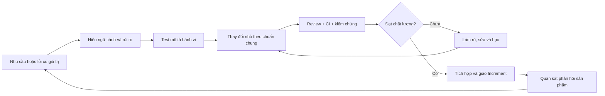

# Quyền sở hữu mã chung cùng quy ước mã nguồn thống nhất

Một Scrum Team phát triển nền tảng học tập có ba lập trình viên: An phụ trách đăng nhập, Bình phụ trách lưu tiến độ, Chi phụ trách thanh toán. Trong Sprint, người học báo lỗi: sau khi đổi tài khoản trên cùng thiết bị, màn hình “Tiếp tục học” đôi lúc hiển thị tiến độ của tài khoản trước. Chi thấy lỗi nằm gần chỗ kiểm tra phiên đăng nhập nhưng ngại sửa vì “đây là code của An”; An đang nghỉ phép. Bình biết phần dữ liệu tiến độ nhưng không muốn đụng tới lớp xác thực. Hạng mục bị chặn nhiều ngày, mặc dù cả đội có thể cùng nhau tìm và kiểm chứng nguyên nhân.

Tình huống này phơi bày một điểm yếu của mô hình **sở hữu mã theo cá nhân hoặc theo vùng chuyên môn quá cứng**: mỗi người có thể rất giỏi phần mình, nhưng khả năng sửa phần mềm đầu-cuối lại phụ thuộc vào vài người. Một thay đổi nhỏ đi qua nhiều hàng chờ, kiến thức bị giữ cục bộ và đội khó giao sản phẩm tăng dần.

**Extreme Programming (XP)** đề xuất kết hợp hai thực hành có liên hệ chặt chẽ:

- **Quyền sở hữu mã chung (*collective code ownership*, thường được gọi là *shared code* trong các mô tả XP về sau):** các thành viên có trách nhiệm phát triển được phép cải thiện những phần mã cần thiết để tạo giá trị, không bị cấm chỉ vì mã từng do người khác viết.
- **Quy ước mã nguồn thống nhất (*coding standards/conventions*):** đội đồng thuận về các quy tắc đủ rõ để mã dễ đọc, dễ sửa, dễ kiểm chứng và tạo cảm giác đây là **một hệ thống chung**, không phải tập hợp những phong cách cá nhân rời rạc.

Hai thực hành này **không trao quyền sửa mã vô điều kiện**. Chúng chỉ phát huy khi đi cùng kiểm thử, tích hợp liên tục, thay đổi nhỏ, trao đổi sớm, phản hồi kỹ thuật và trách nhiệm nghề nghiệp. Sở hữu chung giúp **giảm chờ đợi**, còn quy ước chung giúp **giảm rủi ro khi nhiều người cùng thay đổi**.

Bài học thuộc chương **Extreme Programming** của mô-đun **AGILE_DEVELOPMENT**. Nội dung liên hệ cách phối hợp với user story, Product Backlog, Scrum, Kanban và các thước đo dòng công việc để nhóm có thể giao phần mềm hoạt động, nhận phản hồi sớm, thích ứng và cải tiến liên tục.

## 1. Mục tiêu học tập

Sau bài học, bạn có thể:

- Giải thích **collective code ownership** và **coding standards** trong XP, phân biệt với “không ai chịu trách nhiệm” hoặc “ai thích sửa gì cũng được”.
- So sánh **sở hữu mã độc quyền, sở hữu yếu và sở hữu chung** theo độ phụ thuộc, tốc độ thay đổi và yêu cầu kiểm soát.
- Nêu lý do hai thực hành phải đi cùng **test tự động, Continuous Integration (CI), refactoring, pair programming** và giao thay đổi nhỏ.
- Xây dựng một bộ **quy ước mã nguồn tối thiểu nhưng hữu ích** cho tên gọi, cấu trúc, xử lý lỗi, kiểm tra bảo mật, kiểm thử và review.
- Áp dụng quy trình sửa mã chưa quen thuộc: **hiểu ngữ cảnh → xác nhận hành vi → thay đổi nhỏ → chạy kiểm chứng → review và tích hợp**.
- Phân biệt **quyền được sửa mã** với **quyền truy cập production, quyền duyệt thay đổi hoặc trách nhiệm ra quyết định kiến trúc**.
- Thiết kế biện pháp giảm “nút cổ chai chuyên gia”, tránh xung đột khi nhiều người cùng sửa một module và duy trì chất lượng của Increment.
- Đánh giá hiệu quả bằng các tín hiệu về thời gian chờ, khả năng xử lý sự cố, chất lượng, phân tán tri thức và kết quả người dùng thay vì chỉ đếm commit.

## 2. Bối cảnh: XP muốn giải quyết điều gì?

### 2.1. Thay đổi là điều bình thường trong phát triển phần mềm

Một sản phẩm thay đổi khi nhóm học thêm từ người sử dụng:

- Học viên muốn tiếp tục đúng bài đang dở, nhưng cần xử lý trường hợp chuyển tài khoản.
- Product Owner phát hiện thông tin phí vận chuyển cần được tính lại khi đổi địa chỉ.
- Người kiểm thử nêu trường hợp dữ liệu cũ có cấu trúc khác dữ liệu mới.
- Hệ thống cần vá lỗi bảo mật và cập nhật phụ thuộc.
- API đối tác thay đổi, buộc đội sửa luồng trải nghiệm và tích hợp.

Trong môi trường ấy, nếu mỗi thay đổi phải “xin phép đúng tác giả” rồi chờ người đó rảnh, thời gian tạo phản hồi nhanh bị kéo dài. **Giá trị người dùng có thể bị chậm dù mọi thành viên đều bận rộn**.

XP nhấn mạnh một tập hợp thực hành kỹ thuật và cộng tác giúp đội thay đổi phần mềm thường xuyên mà vẫn có cơ sở tin vào chất lượng: **kiểm thử liên tục, refactoring, thiết kế đơn giản, tích hợp thường xuyên, pairing, phát hành nhỏ và cùng chịu trách nhiệm về mã**.

### 2.2. Các giá trị XP hỗ trợ sở hữu chung

XP thường được trình bày qua năm giá trị: **communication, simplicity, feedback, courage, respect** — giao tiếp, đơn giản, phản hồi, can đảm và tôn trọng.

| Giá trị | Biểu hiện khi sở hữu mã chung |
| --- | --- |
| **Giao tiếp** | Hỏi người hiểu miền nghiệp vụ, trao đổi ý định thay đổi, giải thích quyết định qua review hoặc pairing. |
| **Đơn giản** | Chọn thay đổi nhỏ dễ hiểu; không nhân đôi quy tắc để tránh sửa module của người khác. |
| **Phản hồi** | Dùng unit/integration test, CI, phản hồi reviewer và kết quả sản phẩm để biết thay đổi có an toàn và có ích. |
| **Can đảm** | Dám cải thiện mã khó hiểu, dám báo lỗi và dám yêu cầu hỗ trợ ở khu vực mình chưa thành thạo. |
| **Tôn trọng** | Không coi mã của người khác là “mã tệ”, không âm thầm phá hợp đồng hoặc bỏ qua hiểu biết của chuyên gia. |

**Sở hữu chung không có nghĩa phủ nhận chuyên môn.** Nó biến chuyên môn thành năng lực được chia sẻ, thay vì một chiếc khóa ngăn người khác sửa phần mềm.

## 3. Quyền sở hữu mã chung nghĩa là gì?

### 3.1. Từ “đây là mã của tôi” sang “đây là sản phẩm của chúng ta”

Trong cách làm sở hữu chung, một Developer được phép sửa bất kỳ phần mã nào **mà việc tạo một thay đổi cần thiết và an toàn đòi hỏi**, trong những giới hạn về quyền truy cập, chính sách kỹ thuật và bảo mật mà đội/tổ chức đã công bố.

Ví dụ, khi sửa lỗi “Tiếp tục học”, một thành viên chuyên frontend có thể:

1. Đọc và xác định lớp backend trả tiến độ.
2. Cùng Developer hiểu xác thực xem quy tắc chọn tài khoản đang sai ở đâu.
3. Viết hoặc sửa kiểm thử thể hiện trường hợp tài khoản A/B.
4. Thực hiện thay đổi nhỏ trong backend nếu đủ năng lực, hoặc pairing để làm việc đó.
5. Chạy kiểm thử và gửi thay đổi qua quy trình review/CI.
6. Chia sẻ điều vừa học để lần sau đội xử lý nhanh hơn.

Điểm thay đổi là **không có rào cản “chỉ tác giả gốc mới được sửa”**. Tuy nhiên, việc một người *có thể tham gia* không đồng nghĩa người đó *đã hiểu đủ để tự sửa mọi vùng mã có rủi ro cao mà không cần hỗ trợ*.

### 3.2. So sánh ba mô hình thực hành

| Tiêu chí | Sở hữu mạnh theo cá nhân/nhóm (*strong ownership*) | Sở hữu tương đối linh hoạt (*weak ownership*) | Sở hữu chung (*collective ownership*) |
| --- | --- | --- | --- |
| **Ai thường sửa module?** | Chủ sở hữu được chỉ định | Người khác có thể sửa, thường trao đổi với chủ sở hữu | Thành viên đủ năng lực được sửa nơi cần thiết theo quy ước của đội |
| **Khi tác giả vắng mặt** | Dễ phải chờ | Có thể xử lý nếu tìm được hỗ trợ | Đội có động lực xây khả năng xử lý chung |
| **Chia sẻ tri thức** | Có nguy cơ tập trung | Thay đổi tùy nhóm | Phải trở thành hoạt động chủ động |
| **Nhất quán thiết kế** | Dễ nhất quán cục bộ nhưng có thể lệch giữa module | Cần cơ chế trao đổi | Phụ thuộc vào chuẩn chung, kiểm thử, review và CI |
| **Tốc độ phản hồi** | Có thể chậm vì hàng chờ chuyên gia | Trung gian, tùy phụ thuộc | Có thể giảm chờ khi năng lực và quy trình phù hợp |
| **Rủi ro đặc trưng** | Bus factor thấp, handoff | Mơ hồ quyền quyết định | Sửa bừa, kiến trúc phân mảnh nếu thiếu rào chắn |

Đây là các **kiểu tổ chức trách nhiệm**, không phải bảng xếp hạng tuyệt đối. Với hệ thống bị ràng buộc bởi an toàn, tuân thủ hoặc kiến trúc phức tạp, đội vẫn cần những người có quyền phê duyệt phù hợp. Mục tiêu XP là **xóa rào cản không cần thiết đối với việc tạo giá trị**, không xóa kiểm soát chính đáng.

### 3.3. “Collective” là trách nhiệm chung, không phải không có người chịu trách nhiệm

Khi lỗi phát sinh từ một thay đổi:

- **Người thực hiện** vẫn phải chuẩn bị thay đổi cẩn thận, chạy kiểm chứng và giải thích lý do.
- **Người review** vẫn phải đánh giá những rủi ro theo chính sách, không chỉ bấm nút chấp thuận.
- **Đội phát triển** vẫn phải cải thiện thiết kế, test và quy trình nếu lỗi có thể tái diễn.
- **Người chịu trách nhiệm sản phẩm** vẫn cần biết tác động đến người dùng và thứ tự backlog.
- **Người được phân quyền vận hành** vẫn phải quyết định những thao tác production nhạy cảm.

Không nên lấy chữ “chung” để né câu hỏi “ai sẽ sửa lỗi và theo dõi đến khi giải quyết?”. Có thể phân công **người điều phối một việc cụ thể** mà không biến họ thành chủ sở hữu độc quyền của module mã.

## 4. Vì sao quyền sở hữu chung giúp nhóm Agile?

### 4.1. Giảm thời gian chờ theo ranh giới chuyên môn

Một hạng mục có thể bị trì hoãn vì phải lần lượt chờ frontend, backend, dữ liệu, kiểm thử và vận hành. Trong khi đó, tổng thời gian **thực sự thay đổi mã** nhỏ hơn nhiều thời gian chờ.

Ví dụ giả định:

| Hoạt động | Thời gian thực hiện | Thời gian chờ |
| --- | ---: | ---: |
| Làm rõ quy tắc tiến độ | 2 giờ | 1 ngày chờ người phụ trách |
| Thêm kiểm tra phân quyền | 3 giờ | 2 ngày chờ chủ sở hữu module |
| Viết và chạy test | 2 giờ | 1 ngày chờ môi trường |
| Review và tích hợp | 1 giờ | 2 ngày chờ reviewer duy nhất |

Các con số chỉ minh họa. **Một ngày công không đồng nghĩa một ngày lịch**. Khi nhiều người có thể phối hợp ở những khu vực liên quan, đội có thể giảm hàng chờ; việc giảm chờ thường quan trọng hơn cố tối ưu vài phút gõ mã.

### 4.2. Giảm phụ thuộc vào một người

**Bus factor** là cách nói về số người có kiến thức then chốt mà nếu vắng mặt thì khả năng phát triển/bảo trì bị ảnh hưởng nghiêm trọng. Nếu chỉ một người hiểu cơ chế phân quyền, đội có rủi ro cao khi người đó nghỉ, chuyển việc hoặc đang xử lý sự cố khác.

Sở hữu chung khuyến khích:

- Pairing giữa người quen và chưa quen module.
- Review qua các phần mã khác nhau.
- Tài liệu tối thiểu về quyết định thiết kế và cách kiểm chứng.
- Tự động hóa việc kiểm tra quy tắc đã biết.
- Duy trì khả năng chạy test trên môi trường phát triển của nhiều thành viên.

Điều này không yêu cầu “mỗi người biết tất cả như nhau”. **Tăng khả năng hỗ trợ chéo** là hướng thực tế hơn.

### 4.3. Cải thiện sự nhất quán của sản phẩm

Nếu từng tác giả có thể tự tạo quy tắc lỗi, tên lớp và cấu trúc thư mục riêng, cùng một hành trình người dùng có thể biểu hiện không nhất quán. Chuẩn chung giúp mọi thay đổi đi qua một **ngôn ngữ thiết kế nhất quán**, dù tác giả khác nhau.

Ví dụ:

- Các API đều kiểm tra quyền truy cập theo một hợp đồng rõ.
- Các thông báo lỗi cùng cách mã hóa và cấu trúc.
- Các thử nghiệm đều được đặt tên mô tả hành vi.
- Các phương thức đọc/ghi dữ liệu đều tuân thủ quy ước về transaction.
- Những phần mã nhạy cảm luôn có kiểm thử ranh giới phù hợp.

Lợi ích không chỉ là “code đẹp”. Nó là **giảm sai sót và giảm thời gian hiểu để sửa khi người dùng cần**.

### 4.4. Tăng khả năng refactor xuyên module

Một cải tiến thiết kế như đổi cách biểu diễn mã khóa học có thể chạm tới API, nghiệp vụ, dữ liệu và kiểm thử. Với ownership độc quyền, Developer phải tạo nhiều ticket và chờ nhiều chủ sở hữu. Với ownership chung có kiểm soát, đội có thể thực hiện **refactor nhỏ trên toàn bộ đường đi**, kiểm chứng và tích hợp thay đổi theo phạm vi đã chọn.

Không vì thế mà khuyến khích refactor toàn hệ thống trong cùng một PR. **Phạm vi càng lớn, cần rủi ro càng rõ và bước kiểm chứng càng chặt**.

## 5. Sở hữu chung không phải quyền truy cập không giới hạn

### 5.1. Phân biệt bốn loại quyền

| Loại quyền | Câu hỏi | Cơ chế phù hợp |
| --- | --- | --- |
| **Quyền tham gia thay đổi mã** | Ai có thể đề xuất và thực hiện sửa đổi ở module này? | Cơ chế cộng tác, hướng dẫn, pairing và branch/PR theo chính sách |
| **Quyền phê duyệt thay đổi** | Thay đổi nào cần review, người có năng lực chuyên môn nào cần tham gia? | Rule review theo rủi ro, đặc biệt ở an toàn và dữ liệu |
| **Quyền triển khai/đụng production** | Ai được phép chạy migration, xem dữ liệu thật hoặc bật tính năng? | Phân quyền tối thiểu, kiểm soát truy cập, nhật ký và phê duyệt cần thiết |
| **Quyền quyết định sản phẩm/kiến trúc** | Ai chịu trách nhiệm về mục tiêu, ưu tiên, giao ước lớn hoặc chính sách? | Product Owner, Developers, kiến trúc sư/chuyên gia theo cơ chế đã rõ |

**Collective code ownership chủ yếu giải quyết sự phối hợp thay đổi mã trong đội**. Nó không thay thế kiểm soát an toàn thông tin, nguyên tắc phân quyền tối thiểu hoặc trách nhiệm pháp lý.

### 5.2. Khu vực mã nhạy cảm cần rào chắn tương xứng

Ví dụ:

- Xác thực, phân quyền và xử lý dữ liệu cá nhân.
- Tính tiền, đối soát, hoàn tiền hoặc thanh toán.
- Migration dữ liệu khó đảo ngược.
- Mã điều khiển hệ thống có ảnh hưởng an toàn vật lý.
- Cấu hình production và secret.

Ở những khu vực này, một Developer có thể tham gia sửa mã theo tinh thần sở hữu chung, nhưng phải **kiểm tra hợp đồng, test phù hợp, review chuyên môn và quyền vận hành** theo yêu cầu. Không có rào chắn nào trong các yêu cầu ấy mâu thuẫn với XP nếu chúng giúp tạo thay đổi **an toàn và duy trì được**.

### 5.3. Chuyên gia là người hỗ trợ, không phải điểm nghẽn bắt buộc

Một chuyên gia bảo mật có thể:

- Làm rõ threat model của module.
- Viết ví dụ kiểm thử quan trọng cùng nhóm.
- Pairing cho một thay đổi khó.
- Cải thiện hướng dẫn để người khác có thể sửa an toàn.
- Review những trường hợp rủi ro cao thật sự.

Nếu mọi thay đổi, kể cả sửa tên biến không ảnh hưởng hành vi, đều phải chờ chuyên gia duyệt nhiều ngày, đội nên kiểm tra **có thể phân loại rủi ro và tự động hóa phần kiểm tra nào**. Nhưng với thay đổi tác động dữ liệu nhạy cảm, ưu tiên bảo vệ người dùng hơn tốc độ gộp mã.

## 6. Quy ước mã nguồn thống nhất là gì?

### 6.1. Mã nguồn là phương tiện giao tiếp giữa nhiều người

Một đoạn mã thường được **đọc và sửa bởi nhiều người hơn số người viết ban đầu**. Khi ownership chung, người chưa từng viết module sẽ phải tìm đúng chỗ và hiểu ý định. Quy ước chung giúp giảm công sức đoán:

- Tên lớp, phương thức, biến và gói nói được ý nghĩa.
- Cấu trúc lớp/hàm nhất quán với miền nghiệp vụ.
- Cách xử lý lỗi và log có dự đoán được.
- Mã kiểm thử nói được hành vi và giới hạn.
- Các thay đổi dễ đọc trong diff vì định dạng được tự động hóa.
- Quy tắc mới được công bố, có ví dụ và được áp dụng nhất quán.

**Coding standards không chỉ là thụt lề 2 hay 4 dấu cách.** Các quy định về định dạng có thể tự động hóa; phần quan trọng hơn là thói quen xây hệ thống dễ hiểu, dễ thay đổi và có thể kiểm chứng.

### 6.2. Quy ước nên phục vụ mục tiêu nào?

Một quy tắc đáng giữ nếu nó hỗ trợ ít nhất một mục tiêu:

1. **Dễ đọc và diễn giải ý định.**
2. **Hạn chế lỗi hoặc hành vi không an toàn.**
3. **Giảm tranh luận lặp lại trong code review.**
4. **Giúp thành viên mới tham gia sửa mã nhanh hơn.**
5. **Tạo tính nhất quán cho API và dữ liệu.**
6. **Hỗ trợ refactor và test tự động.**
7. **Giảm chi phí thay đổi trong tương lai.**

Nếu một quy tắc đòi nhiều thao tác nhưng không có lợi ích rõ, nhóm nên xem lại thay vì coi nó bất biến chỉ vì “đã viết trong wiki”.

### 6.3. Phân loại quy ước theo mức bắt buộc

Một cách phân loại thực dụng:

| Mức | Ý nghĩa | Ví dụ |
| --- | --- | --- |
| **Bắt buộc vì an toàn/tính đúng** | Vi phạm có thể gây hại hoặc phá tiêu chuẩn sản phẩm | Không log secret; phải kiểm tra phân quyền tại ranh giới tin cậy; kiểm tra lỗi dữ liệu |
| **Bắt buộc để tích hợp ổn định** | Giữ hợp đồng và khả năng build/test chung | Formatter, quy tắc import, API tương thích, pipeline test |
| **Quy ước cộng tác** | Tạo mã dễ đọc và giảm tranh luận | Naming, cấu trúc gói, cách đặt tên test, độ phức tạp hàm |
| **Hướng dẫn có thể linh hoạt** | Mặc định tốt nhưng có ngoại lệ hợp lý | Một số lựa chọn đặt tên hoặc tách lớp tùy bối cảnh |

Chính sách cần giải thích **ai có thể quyết định ngoại lệ, cách ghi lý do và cách xem lại**. Không nên dùng một con số độ dài hàm hoặc số dòng PR như luật tuyệt đối trong mọi trường hợp.

## 7. Những nhóm quy ước mã nguồn nên thống nhất

### 7.1. Tên gọi và ngôn ngữ miền nghiệp vụ

Một hệ thống quản lý tiến độ học nên dùng thuật ngữ rõ ràng:

| Kém rõ | Rõ nghĩa hơn | Vì sao |
| --- | --- | --- |
| `data`, `obj`, `info` | `lessonProgress`, `enrollment` | Giúp người đọc hiểu loại dữ liệu và ý định |
| `doProcess()` | `resumeLastAccessibleLesson()` | Nêu hành vi thay vì từ chung chung |
| `flag`, `status2` | `isCourseAccessActive` | Giảm suy đoán về điều kiện |
| `x1`, `tmp2` | `learnerId`, `lessonId` | Phân biệt những định danh cùng kiểu |
| `check()` | `canAccessLesson()` | Làm rõ câu hỏi boolean, giúp test diễn đạt hành vi |

Tên trong bảng là **gợi ý có ngữ cảnh**, không phải quy tắc chỉ có một cách đúng. Nhóm cần chọn ngôn ngữ miền thống nhất với Product Owner và những người hiểu nghiệp vụ. Không nên để một nơi dùng “student”, nơi khác “learner”, nơi khác “user” nếu thực chất đang chỉ cùng một khái niệm mà chưa có chủ đích.

### 7.2. Định dạng, import và cấu trúc mã

Các lựa chọn như số khoảng trắng, xuống dòng, sắp xếp import, độ dài dòng và vị trí dấu ngoặc nên **được tự động hóa bằng formatter/linter** ở môi trường phát triển và CI.

Lợi ích:

- Diff chứa thay đổi hành vi thay vì hàng trăm dòng chỉnh khoảng trắng.
- Người review tập trung vào tính đúng, bảo mật và thiết kế.
- Thành viên mới không phải đoán “phong cách của chủ module”.
- Chất lượng định dạng ổn định dù người sửa khác nhau.

Có thể áp dụng một style guide hiện có, chẳng hạn **Google Java Style Guide**, hoặc thiết kế quy ước của đội. Không cần tranh luận mọi lựa chọn từ đầu nếu một bộ chuẩn đủ phù hợp đã tồn tại.

### 7.3. Cấu trúc và ranh giới module

Quy ước thiết kế có thể gồm:

- Một chức năng nghiệp vụ có vị trí và tên gói dễ tìm.
- Controller không chứa toàn bộ logic nghiệp vụ.
- Phân quyền được thực thi ở ranh giới phù hợp; không chỉ ẩn nút giao diện.
- Giao dịch dữ liệu (*transaction*) có ranh giới rõ.
- Tránh truy cập trực tiếp bảng nội bộ của module khác nếu có hợp đồng truy cập được công bố.
- Những API công khai có cách xử lý lỗi và phiên bản nhất quán.
- Không dùng biến toàn cục hoặc trạng thái dùng chung không kiểm soát.
- Phụ thuộc giữa các module có chiều rõ để tránh vòng lặp.

**Không phải mọi dự án đều cần kiến trúc nhiều lớp hoặc microservices.** Mục tiêu là tính rõ ràng của trách nhiệm và khả năng kiểm chứng thay đổi, không phải số lớp trừu tượng.

### 7.4. Lỗi, log và dữ liệu nhạy cảm

Nên thống nhất:

- Lỗi nào trả về thông điệp cho người dùng, lỗi nào chỉ ghi trong log kỹ thuật.
- Cách sử dụng mã lỗi và correlation ID khi cần.
- Không ghi mật khẩu, token, dữ liệu riêng tư vượt mục đích xử lý.
- Phân biệt lỗi kỳ vọng theo nghiệp vụ và lỗi hệ thống.
- Không “nuốt” exception khiến thành công giả.
- Khi retry, cần xét idempotency, giới hạn và tác động phụ.
- Dữ liệu ranh giới cần được xác thực theo chính sách nhất quán.

Quy ước này quan trọng khi nhiều người sửa cùng luồng, vì một điểm log hoặc xử lý lỗi sai có thể làm hệ thống khó chẩn đoán hoặc gây lộ dữ liệu.

### 7.5. Quy ước kiểm thử

Đội nên có cách gọi tên và tổ chức test cho dễ tìm:

- Test mô tả **hành vi và kết quả mong đợi**, không chỉ tên method.
- Trường hợp phổ biến và ranh giới quan trọng được thể hiện rõ.
- Dữ liệu kiểm thử độc lập, không dựa vào thứ tự chạy nếu không cần.
- Không gọi mạng hoặc dịch vụ thực ngoài ý muốn trong unit test.
- Integration test kiểm tra hợp đồng giữa thành phần quan trọng.
- Khi sửa lỗi, bổ sung bằng chứng giúp **lỗi tương tự khó tái xuất hiện**.
- Test không ổn định phải được phân loại và xử lý, không chỉ chạy lại cho đến xanh.

Nhờ quy ước chung, một người mới sửa module vẫn nhận ra test nào đang bảo vệ hành vi của người sử dụng.

### 7.6. Quy ước review và tài liệu quyết định

Một thay đổi đáng review nên giải thích:

- Vấn đề/giá trị mà thay đổi giải quyết.
- Ranh giới phạm vi và điều chưa làm.
- Những test đã chạy và rủi ro còn lại.
- Các hợp đồng/API/dữ liệu bị ảnh hưởng.
- Cách triển khai và quay lại nếu cần.
- Lý do của quyết định thiết kế không hiển nhiên.

Với quyết định kiến trúc tác động lâu dài, một **Architecture Decision Record (ADR)** ngắn có thể hữu ích. Với đổi tên nhỏ, mô tả PR ngắn có thể đủ. **Tài liệu phải tương xứng rủi ro và giúp người sau tiếp tục công việc**, không tạo thủ tục cho có.

## 8. Ví dụ Java: cùng sửa một quy tắc quan trọng

Giả sử chức năng “Tiếp tục học” lấy tiến độ gần nhất theo `learnerId` và `courseId`. Một lỗi bảo mật xuất hiện khi thành viên dùng một mã tiến độ không thuộc tài khoản đang đăng nhập.

### 8.1. Đoạn mã khó kiểm soát

Đoạn minh họa:

```java
public Progress get(String id, String user) {
    Progress p = repository.findById(id);
    if (p == null) {
        return null;
    }
    return p;
}
```

Vấn đề có thể thấy:

- Tên `get`, `id`, `user` không biểu đạt ý nghĩa.
- Tham số `user` không được dùng trong kiểm tra.
- Trả về `null` khiến nơi gọi phải suy đoán.
- Không rõ lớp này được phép truy xuất tiến độ cho ai.
- Không có dấu hiệu bảo vệ quyền truy cập hay hành vi cần kiểm chứng.

**Không thể kết luận chỉ từ đoạn mã rằng toàn bộ hệ thống đã có lỗ hổng**, vì kiểm tra có thể tồn tại ở tầng khác. Tuy nhiên, nó là dấu hiệu cần xem hợp đồng bảo mật đầu-cuối và viết test phù hợp thay vì “vá” tùy hứng.

### 8.2. Một cách cải thiện rõ ràng hơn

Ví dụ mã Java sau chỉ minh họa ý định thiết kế; các kiểu `ProgressRepository`, `Progress` và `AccessDeniedException` phải được định nghĩa phù hợp trong hệ thống thực:

```java
public final class LearningProgressService {
    private final ProgressRepository progressRepository;

    public LearningProgressService(ProgressRepository progressRepository) {
        this.progressRepository = progressRepository;
    }

    public Progress getProgressForLearner(
            String progressId,
            String authenticatedLearnerId) {

        Objects.requireNonNull(progressId, "progressId");
        Objects.requireNonNull(authenticatedLearnerId, "authenticatedLearnerId");

        Progress progress = progressRepository.findById(progressId)
                .orElseThrow(() -> new ProgressNotFoundException(progressId));

        if (!progress.getLearnerId().equals(authenticatedLearnerId)) {
            throw new AccessDeniedException("Not allowed to access progress");
        }

        return progress;
    }
}
```

Các điểm đội cần trao đổi:

1. **Tên gọi diễn đạt ý định:** phương thức chỉ trả tiến độ phù hợp người học đã xác thực.
2. **Nguồn nhận danh tính:** `authenticatedLearnerId` phải lấy từ cơ chế xác thực đáng tin, **không tin vào một ID người dùng do client tùy ý gửi**.
3. **Kiểm tra quyền truy cập:** ví dụ minh họa kiểm tra chủ sở hữu tiến độ; hệ thống thật còn phải xem quyền với khóa, bài học và trạng thái đăng ký.
4. **Ngoại lệ có ý nghĩa:** phân biệt trường hợp không tồn tại và không được phép; ở API công khai cần cân nhắc tránh tiết lộ sự tồn tại tài nguyên qua thông báo lỗi.
5. **Kiểm thử ranh giới:** tài khoản A/B, tài khoản đã mất quyền, tiến độ cũ và dữ liệu không hợp lệ.
6. **Nhất quán với toàn hệ thống:** nếu đội đã có một policy hoặc middleware phân quyền phù hợp, nên tái sử dụng thay vì tự tạo cơ chế khác.

Đây không phải mẫu bắt buộc cho mọi sản phẩm; điều cần đạt là **một quy tắc dễ hiểu, kiểm chứng được, không phá các hợp đồng và rào chắn hiện có**.

### 8.3. Ví dụ xác nhận hành vi

```gherkin
Feature: Đọc tiến độ học đúng quyền

  Scenario: Người học đọc tiến độ của chính mình
    Given học viên A đã đăng nhập
    And tiến độ P thuộc học viên A
    And A còn quyền truy cập khóa liên quan
    When A yêu cầu đọc tiến độ P
    Then hệ thống trả đúng tiến độ P

  Scenario: Không thể đọc tiến độ của tài khoản khác
    Given học viên B đã đăng nhập
    And tiến độ P thuộc học viên A
    When B yêu cầu đọc tiến độ P
    Then hệ thống từ chối yêu cầu không được phép
    And không trả dữ liệu riêng của P

  Scenario: Không thể mở bài khi quyền với khóa đã hết
    Given học viên A đã đăng nhập
    And tiến độ P thuộc A
    And A không còn quyền truy cập khóa của P
    When A dùng P để mở bài cũ
    Then hệ thống không trả nội dung học bị hạn chế
```

Những kịch bản Gherkin là **đặc tả hành vi để trao đổi và kiểm chứng**, chưa phải test tự động chạy được nếu chưa có mã bước, fixture và môi trường. Quan trọng là kiểm tra hành vi ở **ranh giới hệ thống phù hợp**, không chỉ so sánh một chuỗi ID trong unit test.

### 8.4. Bài học về collective ownership từ ví dụ

Nếu chỉ người viết `LearningProgressService` được phép sửa, lỗi có thể chờ tác giả. Trong ownership chung, người phát hiện lỗi có thể chủ động cùng nhóm bổ sung ví dụ, test và thay đổi. Quy ước về tên, phân quyền, ngoại lệ và review giúp người khác hiểu được **điều gì phải giữ nguyên**.

**Đội tự chủ sửa mã vì có năng lực và cơ chế bảo vệ, không vì bỏ qua người có kiến thức hoặc bỏ qua kiểm thử.**

## 9. Quy trình thay đổi mã chung an toàn

Một luồng công việc minh họa khi Developer muốn sửa module chưa quen:

### Bước 1 — Hiểu nhu cầu và phạm vi

- Hạng mục đang giải quyết user story, lỗi hay rủi ro nào?
- Người sử dụng hoặc hệ thống đang gặp tác động gì?
- Quy tắc nào cần được giữ?
- Có thay đổi hợp đồng công khai, dữ liệu hay điều kiện bảo mật không?
- Phạm vi nhỏ nhất có thể tạo kết quả có thể kiểm chứng là gì?

Không nên bắt đầu bằng “tôi thấy code xấu nên viết lại toàn bộ” nếu chưa rõ lợi ích và rủi ro.

### Bước 2 — Đọc ngữ cảnh đủ sâu

- Tìm các call site quan trọng và test hiện có.
- Xem quy ước naming, cấu trúc và xử lý lỗi của module.
- Tìm tài liệu quyết định kỹ thuật nếu có.
- Trao đổi với người hiểu miền nghiệp vụ/hệ thống khi cần.
- Xác định phụ thuộc hoặc môi trường kiểm thử.

Cần phân biệt **hỏi để hiểu** với **xin phép vì mã là tài sản của một cá nhân**. XP khuyến khích hỏi và pairing để tăng tri thức chung.

### Bước 3 — Tạo rào chắn kiểm chứng

- Viết test tái hiện lỗi hoặc thể hiện hành vi cần có.
- Chọn tầng test phù hợp: unit, integration, contract, end-to-end.
- Kiểm tra các rủi ro liên quan đến dữ liệu và quyền truy cập.
- Xác định trường hợp cũ phải tiếp tục hoạt động.

Với thay đổi khó kiểm thử vì thiết kế hiện tại, có thể cần tách cấu trúc hoặc bổ sung kiểm tra ở ranh giới trước khi refactor. **Không có test tự động hoàn hảo**, nhưng phải có bằng chứng phù hợp với mức rủi ro.

### Bước 4 — Thực hiện thay đổi nhỏ, dễ đọc

- Sửa phạm vi tối thiểu để tạo hành vi mong muốn.
- Không trộn hàng nghìn dòng định dạng với một thay đổi nghiệp vụ nếu có thể tách.
- Tuân thủ naming và style chung; để formatter xử lý phần máy móc.
- Khi phát hiện vấn đề khác, ghi lại hoặc làm một thay đổi riêng nếu không phải điều kiện bắt buộc.
- Nếu tác động cấu trúc lớn, trao đổi sớm thay vì bất ngờ mở PR khổng lồ.

### Bước 5 — Kiểm chứng bằng CI và review

- Chạy những kiểm tra liên quan trước khi đề nghị review.
- Để CI chạy các kiểm tra chung mà đội thống nhất.
- Nhờ người phù hợp xem phần logic và rủi ro mới, có thể pairing trực tiếp.
- Ghi lại lý do, giả định và cách kiểm chứng.
- Giải quyết phản hồi theo mục tiêu thiết kế chung, tránh tranh luận phong cách đã có công cụ tự động.

### Bước 6 — Tích hợp và học hỏi

- Tích hợp thay đổi vào luồng chung theo chính sách.
- Theo dõi lỗi, cảnh báo và hành vi sau thay đổi khi phù hợp.
- Chia sẻ kiến thức mới về module; sửa tài liệu/hướng dẫn nếu có điểm đáng nhớ.
- Khi phát hiện sự cố, cùng xử lý và cải thiện test/quy ước, không quy trách nhiệm theo lịch sử tác giả.
- Kiểm tra phần sản phẩm **đạt Definition of Done** nếu đội áp dụng Scrum.



Đây là **luồng tư duy**, không phải quy trình cứng buộc mọi thay đổi nhỏ phải có đầy đủ các cuộc họp hoặc tài liệu. Mục tiêu là giữ phản hồi nhanh và chất lượng rõ.

## 10. Pair programming và review giúp chia sẻ quyền sở hữu

### 10.1. Pair programming: cùng làm để cùng hiểu

Trong *pair programming*, hai người cùng giải quyết một thay đổi và trao đổi thường xuyên về ý định, test, thiết kế và rủi ro. Cách gọi truyền thống gồm **driver** (điều khiển bàn phím) và **navigator** (nhìn tổng thể, xem xét lựa chọn), với khả năng đổi vai.

Ví dụ, Bình biết dữ liệu tiến độ và Chi có kinh nghiệm xác thực. Hai người cùng sửa luồng quyền truy cập:

1. Bình giải thích nơi lưu và đọc dữ liệu.
2. Chi nêu ví dụ tài khoản A/B và nơi danh tính phải được xác minh.
3. Họ viết một test đầu-cuối hoặc tích hợp có ý nghĩa.
4. Cùng sửa từng phần, chạy test và kiểm tra tác dụng phụ.
5. Chia sẻ lại cho An sau khi tích hợp.

**Pairing không phải hai người để tăng số lượng người viết trên một bàn phím**. Nó là cách tạo phản hồi thiết kế ngay lập tức và chuyển giao tri thức trong khi giải quyết công việc thật.

### 10.2. Code review: tập trung vào rủi ro và tính dễ thay đổi

Một review hữu ích hỏi:

- Hành vi có đúng với nhu cầu và acceptance criteria?
- Kiểm tra dữ liệu và quyền truy cập có ở ranh giới phù hợp?
- Có test đủ cho lỗi mới và hành vi cũ?
- Mã có theo quy ước về tên, cấu trúc, xử lý lỗi?
- Thay đổi này có tạo phụ thuộc hoặc duplication cần xử lý?
- Phần nào có thể làm rõ để Developer khác sửa được về sau?
- Việc phát hành hoặc migration có điểm rủi ro nào?

Những câu nhận xét nên nhắm vào **mã và lập luận**, không nhắm vào con người:

| Nhận xét khó hợp tác | Nhận xét rõ và có ích |
| --- | --- |
| “Bạn không hiểu module này.” | “Điều kiện này chưa kiểm tra quyền của tài khoản; ta thêm test A/B trước khi merge nhé?” |
| “Viết kiểu này rất dở.” | “Ở module này đội dùng `learnerId` thay vì `user`; đổi tên giúp nhất quán với API khác.” |
| “Chỗ của tôi không ai được sửa.” | “Đoạn này có quy tắc dữ liệu lịch sử khá nhạy cảm; mình pairing kiểm tra hợp đồng trước khi thay nhé.” |
| “Chỉ cần CI xanh là xong.” | “CI chưa bao gồm trường hợp tài khoản hết quyền. Ta cần kiểm chứng thêm ở tầng tích hợp.” |

### 10.3. Pairing có thay thế review không?

Không có câu trả lời chung cho mọi đội. Pairing tạo phản hồi ngay trong lúc làm; review độc lập có thể tăng góc nhìn cho những thay đổi rủi ro cao. Đội nên xác định chính sách theo **mức rủi ro, năng lực và tiêu chuẩn tổ chức**.

Không nên biến review thành một hàng chờ luôn phải đợi đúng tác giả gốc, nhưng cũng không tự tuyên bố “đã pair nên mọi thay đổi nhạy cảm không cần kiểm tra” nếu DoD/chính sách yêu cầu khác.

### 10.4. Swarming khi một hạng mục bị kẹt

Khi PBI quan trọng gần đạt DoD nhưng đang chờ test hoặc review, Developers có thể cùng tập trung hoàn tất thay vì mở thêm việc mới. *Swarming* phù hợp khi nhóm cần đa kỹ năng và giảm WIP.

**Không biến swarming thành ép tất cả người làm cùng một task** nếu không giúp giảm nút thắt. Một hoặc hai người hỗ trợ đúng chỗ có thể mang lại hiệu quả hơn.

## 11. Continuous Integration và kiểm thử là nền cho sở hữu chung

### 11.1. Vì sao CI quan trọng hơn khi nhiều người sửa cùng mã?

Khi người khác nhau có thể sửa cùng module, hệ thống cần nhận biết xung đột và lỗi sớm. **Continuous Integration** là thực hành tích hợp thay đổi thường xuyên vào dòng mã chung, chạy những kiểm tra tự động cần thiết và xử lý sự cố tích hợp nhanh.

Một thay đổi nhỏ được tích hợp sớm thường dễ hiểu và dễ hoàn tác hơn việc chờ nhiều tuần rồi ghép một nhánh lớn. Tuy nhiên, **CI xanh không tự chứng minh toàn bộ hệ thống an toàn**; chất lượng phụ thuộc những kiểm tra đã được thiết kế và vận hành.

### 11.2. Bộ rào chắn minh họa

| Thời điểm | Kiểm chứng gợi ý | Mục tiêu |
| --- | --- | --- |
| Trước khi sửa | Test hiện có/đặc tả hành vi | Biết điều gì không được phá |
| Trong lúc sửa | Unit test, static analysis, formatter | Phản hồi nhanh về lỗi logic và quy ước |
| Trước khi tích hợp | Code review/pairing, integration test | Xác định tác động giữa các thành phần |
| CI trên dòng mã chung | Build, lint, test bắt buộc và kiểm tra phụ thuộc khi áp dụng | Phát hiện lỗi tích hợp, bảo vệ tiêu chuẩn chung |
| Trước/sau phát hành | Kiểm tra cấu hình, migration, observability và phương án khôi phục theo rủi ro | Bảo vệ người dùng và hoạt động sản phẩm |

**Không nên gọi mọi test là “unit test” rồi tưởng đã bảo vệ đủ**. Một lỗi phân quyền có thể cần test ở API hoặc end-to-end vì lỗi xuất hiện ở cách kết hợp nhiều lớp.

### 11.3. Test thất bại cần được hiểu, không chỉ chạy lại

Một pipeline đỏ có thể do mã sai, test sai, môi trường lỗi hoặc test flaky. Đội phải phân loại và tìm nguyên nhân. Nếu mọi người cứ chạy lại đến khi thấy màu xanh, các kiểm tra sẽ mất độ tin cậy.

Sở hữu chung cũng có nghĩa thành viên khác có thể **giúp sửa test và hạ tầng kiểm chứng**, không nói “test này của QA” rồi tiếp tục phát triển chức năng mới.

### 11.4. Refactoring nhỏ và an toàn

**Refactoring** là thay đổi cấu trúc bên trong của mã mà vẫn giữ hành vi bên ngoài theo hợp đồng được xác định. Khi ownership chung:

1. Xác định hành vi phải giữ và test bảo vệ.
2. Chọn một bước cấu trúc nhỏ.
3. Chạy test, kiểm tra tác động.
4. Tích hợp thường xuyên.
5. Tiếp tục nếu vẫn có lợi ích rõ và rủi ro kiểm soát được.

Ví dụ đổi `get()` thành `getProgressForLearner()` và đưa kiểm tra truy cập vào chính sách chung là **cải tiến thiết kế có thay đổi hành vi bảo mật**, không được gọi toàn bộ công việc là “refactor thuần túy”. Cần tách rõ phần sửa lỗi/hành vi với phần đổi cấu trúc khi thích hợp.

## 12. Quy tắc coding standards: nên tự động hóa phần nào?

Một vấn đề thường gặp là code review bị lấn át bởi nhận xét “thiếu dấu cách”, “import sai thứ tự” hoặc “ngoặc nhọn ở dòng khác”. Những việc này có thể xử lý bằng công cụ, để con người tập trung vào quyết định khó hơn.

### 12.1. Ma trận quy tắc và cách kiểm tra

| Quy tắc | Cách hỗ trợ | Ai cần xem xét? |
| --- | --- | --- |
| Khoảng trắng, dấu ngoặc, sắp import | Formatter/IDE và bước CI | Thường không cần tranh luận thủ công |
| Quy tắc tên biến/lớp cơ bản | Linter, IDE, review ngắn | Reviewer xem tính diễn đạt miền nghiệp vụ |
| Test, build, phân tích tĩnh | CI và test suite | Developers xử lý cảnh báo có ý nghĩa |
| Không đưa secret vào mã | Secret scanning, kiểm soát commit | Nhóm bảo mật và Developers khi có cảnh báo |
| Quyền truy cập dữ liệu | Test tích hợp, threat modeling, review theo rủi ro | Người hiểu bảo mật và domain cần tham gia |
| Giới hạn phụ thuộc module | Architecture tests, build rules | Đội trao đổi khi có trường hợp ngoại lệ |
| Quy ước API/lỗi/log | Contract tests, review, tài liệu giao ước | Người dùng API và người vận hành liên quan |
| Độ dễ đọc, đơn giản thiết kế | Review/pairing, ví dụ trong style guide | Cần phán đoán nghề nghiệp, không máy móc |

### 12.2. “Không thể tự động hóa” không đồng nghĩa “muốn gì cũng được”

Một công cụ lint không thể xác định đầy đủ liệu một tên phương thức có diễn đạt đúng miền nghiệp vụ hoặc một thiết kế có đang tạo kiến trúc quá phức tạp hay không. Đội vẫn cần:

- Những ví dụ quy ước dễ hiểu.
- Cách ghi nhận quyết định quan trọng.
- Cuộc trao đổi review tập trung vào giá trị và rủi ro.
- Khả năng thay đổi quy ước khi có bằng chứng mới.
- Sự tôn trọng với phong cách khác nếu chưa có thỏa thuận chung.

### 12.3. Đừng biến mọi cảnh báo thành một cuộc khủng hoảng

Không phải mọi quy tắc có mức nghiêm trọng như nhau. Một dự án cũ có thể có nhiều cảnh báo chưa xử lý. Đội có thể công bố chính sách:

- Không đưa vào **lỗi bảo mật nghiêm trọng mới**.
- Yêu cầu các phần mã thay đổi đạt chuẩn phù hợp.
- Cải thiện nợ kỹ thuật từng khu vực theo ưu tiên/rủi ro.
- Không dùng “đã có cảnh báo từ trước” để bỏ qua lỗi mới.
- Có cách phân loại ngoại lệ và kế hoạch giảm nợ rõ.

**Cách triển khai phải khả thi**, nếu không đội có thể tắt toàn bộ quy tắc vì quá nhiều cảnh báo.

## 13. Làm việc trên repository chung mà không hỗn loạn

### 13.1. Repository chung không tự bảo đảm sở hữu chung

Một nhóm có thể dùng một monorepo nhưng thực tế mỗi thư mục chỉ một người được sửa. Ngược lại, nhiều repository vẫn có thể được một nhóm phối hợp với quyền sửa và trách nhiệm chia sẻ rõ ràng.

**Collective code ownership là cách phối hợp và phân bổ tri thức**, không phải quyết định “bắt buộc tất cả vào cùng một Git repo”.

### 13.2. Nhánh, PR và xung đột thay đổi

Khi nhiều người sửa cùng một khu vực, nên:

- Tích hợp thay đổi nhỏ, thường xuyên.
- Tránh nhánh kéo dài quá lâu khiến khó gộp.
- Trước khi làm thay đổi cấu trúc lớn, trao đổi với người đang làm cùng vùng.
- Nếu có thay đổi API/data contract, thông báo và kiểm tra khách hàng sử dụng API.
- Không “force push” hoặc rewrite lịch sử chung tùy tiện.
- Đảm bảo thay đổi qua kiểm chứng chung trước khi coi hoàn tất.

Sở hữu chung **không có nghĩa mọi người sửa cùng một file vào cùng thời điểm mà không phối hợp**. Tốc độ tích hợp là trách nhiệm của đội, không chỉ của người giải quyết conflict cuối cùng.

### 13.3. CODEOWNERS và chuyên gia: không nhất thiết xung đột XP

Một repository có thể dùng `CODEOWNERS` để chỉ định người/nhóm review theo khu vực. Nếu mục đích là **định tuyến kiến thức và kiểm tra rủi ro**, nó có thể hỗ trợ ownership chung. Nếu danh sách chỉ định khiến chỉ một người được phép sửa/duyệt mọi thay đổi dù rủi ro thấp, nó có thể tái tạo nút cổ chai.

Hãy hỏi:

- Cấu hình này **hỗ trợ tìm người hiểu mã** hay **chặn người khác học và sửa**?
- Có người thay thế khi reviewer vắng không?
- Những thay đổi nào thực sự cần review chuyên môn?
- Có thể viết test, hướng dẫn và quy tắc để giảm phụ thuộc?
- Thời gian chờ review có đang làm chậm giá trị người dùng không?

### 13.4. Không gán quyền sở hữu chung cho dữ liệu production

Mã nguồn có thể được chia sẻ cho đội với quyền phù hợp; **dữ liệu khách hàng, secret và quyền production** phải tuân thủ giới hạn an toàn riêng. Developer mới chưa chắc được truy cập thông tin nhạy cảm chỉ vì họ có quyền thay đổi một file mã.

## 14. Tình huống xuyên suốt: sửa lỗi tiến độ học của tài khoản khác

Một đội sản phẩm đang phát triển chức năng **tiếp tục bài học đang dở**. Scrum Team có Product Owner, Scrum Master và Developers với kỹ năng frontend, backend, kiểm thử. Đội đã áp dụng Sprint ngắn, nhưng mã nguồn bị chia sở hữu theo ba cá nhân.

### 14.1. Vấn đề được người dùng phản ánh

Một học viên dùng máy tính chung và đăng xuất tài khoản A, sau đó đăng nhập B. Ứng dụng đôi khi đề xuất “Tiếp tục” từ tiến độ của A. Phản hồi hỗ trợ cho thấy hiện tượng không thường xuyên nhưng liên quan dữ liệu riêng và quyền truy cập.

**Giá trị cần bảo vệ:** học viên B không nhìn thấy dữ liệu tiến độ của A; học viên A được trở lại đúng bài và tin tưởng dữ liệu của mình.

Đội không nên ưu tiên “tăng số story Done” hơn việc kiểm tra quyền truy cập.

### 14.2. Cách làm cũ: chờ “người sở hữu”

Trước đây:

1. Tester tạo ticket và gắn tên An vì An viết module xác thực.
2. An bận hỗ trợ một hệ thống khác và chưa thể xem ngay.
3. Bình chỉ xem dữ liệu tiến độ trong module của mình.
4. Chi thấy chỗ kiểm tra sai nhưng nói “chưa được phép sửa backend”.
5. Khi An quay lại, An phải tìm lại ngữ cảnh; ticket chờ nhiều ngày.

Vấn đề không chỉ là tốc độ của một người. **Hệ thống cộng tác đang biến một ranh giới nhân sự thành hàng chờ**.

### 14.3. Thử cách làm theo ownership chung

Đội thống nhất một chính sách cho mã ứng dụng:

- Developers có thể đề xuất/sửa bất kỳ module cần thiết khi đủ hiểu và tuân thủ quy ước chung.
- Thay đổi liên quan phân quyền cần test tại ranh giới API và review theo chính sách bảo mật.
- Khi chưa quen module, ưu tiên pairing với người hiểu ngữ cảnh.
- Mọi thay đổi phải qua CI và kiểm chứng phù hợp trước khi tính Done.
- Mô tả PR phải ghi mục tiêu, trường hợp thử và rủi ro cần theo dõi.
- Các tiêu chuẩn về dữ liệu, API và chất lượng là **trách nhiệm chung** của Developers.

Chi và Bình cùng mở một phiên pairing. Họ phát hiện backend lấy `progressId` mà chưa ràng buộc với tài khoản đang xác thực trong một đường xử lý cũ. Họ bổ sung test A/B, sửa kiểm tra quyền tại server và chạy integration test. An sau đó review phần thay đổi nhạy cảm khi đủ điều kiện, còn đội cập nhật hướng dẫn để người khác hiểu cơ chế xác thực.

### 14.4. Quy ước đã giúp gì?

| Vấn đề thực tế | Quy ước/thực hành hỗ trợ |
| --- | --- |
| Tên `id`, `user` gây hiểu sai | Naming rõ: `progressId`, `authenticatedLearnerId` |
| Mỗi module tự kiểm tra quyền một cách khác | Hợp đồng phân quyền thống nhất, kiểm tra tại ranh giới phù hợp |
| Lỗi chỉ tái hiện khi đổi tài khoản | Test end-to-end/integration cho A/B và đăng xuất/đăng nhập |
| Một người biết duy nhất module xác thực | Pairing và review giúp chia sẻ kiến thức |
| Mỗi lần merge gây xung đột lớn | Thay đổi nhỏ, tích hợp thường xuyên |
| Mọi người không biết khi nào Done | Definition of Done và kiểm chứng chung |
| Một reviewer duy nhất trở thành hàng chờ | Chính sách review theo rủi ro, chuẩn bị người thay thế có năng lực |

### 14.5. Cách đánh giá hiệu quả

Đội có thể quan sát trong vài Sprint tiếp theo:

- **Thời gian chờ người sở hữu module:** có giảm không?
- **Thời gian từ phát hiện lỗi đến bản sửa đã kiểm chứng:** có cải thiện không?
- **Work item age** của những hạng mục phụ thuộc nhiều module.
- **Tỷ lệ lỗi hồi quy và sự cố phân quyền:** có tăng hay giảm?
- **Số người có thể chạy test, chẩn đoán và sửa khu vực trọng yếu** mà không phải chờ một người.
- **Phản hồi người học:** tính năng có đáng tin và không lộ dữ liệu không?

Không nên kết luận thành công chỉ vì **nhiều người chạm vào cùng một file**. Kết quả quan trọng là **đội có thể thay đổi an toàn và người dùng nhận giá trị sớm hơn**.

### 14.6. Phản hồi từ Retrospective

Sau Sprint, đội có thể đặt câu hỏi:

- Chuyên gia có bị kéo vào quá nhiều review nhỏ không?
- Pairing giúp người mới hiểu hệ thống hay chỉ có một người nói/người kia gõ?
- Test phân quyền có kiểm tra đúng ranh giới không?
- Có cảnh báo nào do formatter/linter tự động mà reviewer vẫn mất thời gian góp ý?
- Có PBI nào bị chặn vì cần quyết định nghiệp vụ, không phải code?
- Những thay đổi trong coding standard có giúp đọc và review nhanh hơn không?

Từ đó, đội chọn **một hoặc hai cải tiến đo được**, không mở chương trình “đại tu toàn bộ mã” chỉ vì bắt đầu ownership chung.

## 15. Chuyển từ “mã của từng người” sang “mã của cả đội”

Thay đổi văn hóa và khả năng kỹ thuật cần thời gian. Chỉ công bố “từ nay ai cũng được sửa mọi file” thường chưa đủ; có thể tăng lỗi nếu chưa có cơ sở kiểm chứng và chia sẻ tri thức.

### 15.1. Giai đoạn 1 — Vẽ bản đồ phụ thuộc tri thức

Không nhất thiết đọc từng dòng mã. Hãy hỏi:

- Khu vực nào chỉ một người dám sửa?
- Những hạng mục nào thường chờ đúng một reviewer?
- Test nào mọi người không biết cách chạy?
- Hợp đồng API/dữ liệu nào chưa được ghi rõ?
- Ai có quyền production mà chưa có người dự phòng?
- Phần nào rủi ro cao cần review chuyên môn thực sự?

Đầu ra là **bản đồ điểm nghẽn và rủi ro**, không phải bảng “ai là người giỏi nhất”.

### 15.2. Giai đoạn 2 — Chọn một vùng rủi ro vừa phải

Bắt đầu với một module có giá trị cho user story sắp triển khai nhưng không phải thay đổi cực kỳ nhạy cảm. Chọn một hành vi nhỏ và:

1. Thống nhất cách chạy test.
2. Bổ sung ví dụ/test thiếu.
3. Pairing giữa người hiểu và người cần học.
4. Sửa theo một quy ước chung nhỏ.
5. Review và tích hợp.
6. Ghi lại kiến thức quan trọng.

Sau vài lần, nhóm có thể mở rộng phạm vi chia sẻ khi năng lực và sự tự tin được cải thiện.

### 15.3. Giai đoạn 3 — Tạo “đường đi an toàn” cho người mới

Một README ngắn hoặc hướng dẫn trong repository (nếu dự án cho phép) có thể nêu:

- Cách thiết lập môi trường phát triển.
- Cách chạy test/formatter/linter.
- Cấu trúc module và thuật ngữ miền.
- Cơ chế phân quyền, dữ liệu mẫu và secret.
- Cách mở PR và cần minh chứng gì.
- Ai có thể hỗ trợ theo loại vấn đề.
- Những phần cần review chuyên gia theo rủi ro.

Trong bài tập này, không cần tạo file mới; đây là **gợi ý thực hành cho đội trong dự án thật**.

### 15.4. Giai đoạn 4 — Mở rộng và xem lại chính sách

Sau một số Sprint, xem:

- Có giảm hàng chờ không?
- Chất lượng tăng hay giảm?
- Người mới có thể tự chẩn đoán những phần đã học không?
- Chuyên gia có thêm thời gian cho vấn đề khó thay vì mọi việc nhỏ?
- Quy ước nào tự động hóa tốt, quy ước nào gây tranh luận không cần thiết?
- Đội có đang ngại sửa khu vực chưa quen vì văn hóa đổ lỗi?

**Chuyển đổi thành công được đánh giá bằng hành vi và kết quả**, không bằng số lượng tệp mỗi người đã sửa.

## 16. Mối liên hệ với Scrum, Kanban và backlog

### 16.1. Scrum: tự quản và đa chức năng đi cùng ownership chung

Trong Scrum Guide 2020, **Scrum Team** là nhóm nhỏ, đa chức năng và tự quản; Developers chịu trách nhiệm tạo **Increment có thể sử dụng** và tuân thủ **Definition of Done**.

Collective code ownership là một **thực hành kỹ thuật/cộng tác có thể hỗ trợ Scrum**, nhưng **không phải sự kiện, artifact hay rule bắt buộc của Scrum**. Đội Scrum có thể dùng nó để giảm phụ thuộc chuyên môn và giúp nhiều người phối hợp hoàn tất một PBI theo lát cắt dọc.

Ví dụ Sprint Goal là “học viên tiếp tục bài đang dở an toàn”. Nếu API phân quyền bị chặn vì người viết gốc đang nghỉ, Developers có thể pairing để gỡ vấn đề thay vì đẩy sang Sprint sau. Nhưng nếu chưa vượt DoD, **không được gọi PBI là Done** chỉ để đạt kế hoạch.

### 16.2. Kanban: nhìn hàng chờ và giới hạn WIP

Dùng bảng Kanban hoặc Kanban Method, đội có thể thấy những phần việc bị chặn ở review hoặc chờ chuyên gia:

```text
Ready -> In Progress -> Review -> Verify -> Done
              WIP 3       WIP 2
```

Các trạng thái và WIP limit chỉ là **ví dụ**, không phải cấu trúc bắt buộc. Có thể theo dõi:

- **WIP:** lượng công việc đang xử lý.
- **Work item age:** thời gian hạng mục chưa hoàn tất đã ở trong luồng.
- **Cycle time:** thời gian từ mốc bắt đầu đến hoàn thành theo định nghĩa.
- **Throughput:** số hạng mục hoàn tất trong khoảng thời gian.
- **Blocked time:** thời gian chờ phụ thuộc nếu đội có cách ghi nhận nhất quán.

Nếu review đang nghẽn, **tăng số người có thể review hiểu biết** hoặc tự động hóa kiểm tra phong cách có thể hữu ích hơn liên tục mở thêm việc mới.

### 16.3. User story và backlog: sửa mã vì một nhu cầu

Sở hữu chung không phải giấy phép refactor tùy hứng không xem Product Goal. Mỗi thay đổi đáng kể nên có **lý do về giá trị hoặc rủi ro**:

- User story: người học quay lại đúng bài, không lộ tiến độ của người khác.
- PBI sửa lỗi: ngăn truy cập trái phép vào dữ liệu tiến độ.
- PBI kỹ thuật: giảm duplication quy tắc phân quyền đang tạo lỗi hồi quy.
- Spike: kiểm tra một phụ thuộc kiến trúc chưa rõ trước khi đổi giao ước lớn.

Product Owner chịu trách nhiệm tối đa hóa giá trị và thứ tự Product Backlog trong Scrum; Developers quyết định cách tạo Increment với chất lượng. **Mọi người đều có thể nêu rủi ro và đề xuất cải tiến**, nhưng không có nghĩa mọi ý tưởng làm lại kiến trúc được ưu tiên hơn nhu cầu đã thống nhất.

### 16.4. XP tăng khả năng thích ứng qua kỹ thuật

Scrum tạo nhịp kiểm tra và thích ứng; Kanban giúp nhìn dòng công việc; XP cung cấp nhiều thực hành kỹ thuật để **thay đổi mã an toàn với nhịp nhỏ**. Các phương pháp này có thể bổ trợ nhau, không bắt buộc đội chọn một và loại bỏ tất cả phần còn lại.

## 17. Những sai lầm và ngộ nhận thường gặp

| Ngộ nhận | Vì sao sai hoặc thiếu | Cách hiểu phù hợp |
| --- | --- | --- |
| “Sở hữu chung là ai cũng được merge mã tùy ý.” | Bỏ kiểm chứng và quyền phê duyệt có thể gây lỗi, lộ dữ liệu. | Được tham gia thay đổi theo chính sách và trách nhiệm chung. |
| “Không còn tác giả/chủ module thì không ai chịu lỗi.” | Xóa trách nhiệm giải trình làm chất lượng giảm. | Người làm, reviewer và cả đội đều có trách nhiệm phù hợp. |
| “Mọi người phải giỏi tất cả module như nhau.” | Khó khả thi và phủ nhận chuyên môn sâu. | Đội có năng lực chung, chia sẻ tri thức và hỗ trợ chéo. |
| “Không cần hỏi người hiểu hệ thống vì ownership đã chung.” | Dễ bỏ lỡ ngữ cảnh và rủi ro quan trọng. | Hỏi để học, pairing, review; không duy trì độc quyền vô lý. |
| “Chỉ cần formatter là đã có coding standards.” | Định dạng không bảo đảm tính đúng hoặc thiết kế. | Có quy ước về tên, cấu trúc, lỗi, kiểm thử, bảo mật và tài liệu. |
| “Coding standard phải dài hàng trăm trang.” | Chi phí đọc và tuân thủ có thể quá lớn. | Bắt đầu từ chuẩn nhỏ, có lý do và công cụ tự động. |
| “Mỗi module nên có style riêng để hợp sở thích tác giả.” | Gây khó khăn cho người khác khi sửa xuyên module. | Thống nhất phần chung, có ngoại lệ được giải thích rõ. |
| “Review là nơi chỉ ra người viết mã kém.” | Giảm an toàn tâm lý và khiến mọi người né sửa khu vực lạ. | Review dựa trên hành vi, rủi ro, bằng chứng và mục tiêu chung. |
| “Unit test đạt nghĩa là thay đổi chắc chắn an toàn.” | Lỗi tích hợp/phân quyền có thể nằm ngoài unit test. | Test ở ranh giới phù hợp, CI và kiểm chứng theo DoD. |
| “CI xanh nên không cần người xem thay đổi nhạy cảm.” | CI chỉ kiểm tra các điều đã được mã hóa. | Kết hợp kiểm tra tự động và review theo rủi ro. |
| “Monorepo bắt buộc nếu muốn collective ownership.” | Cấu trúc repo không quyết định văn hóa cộng tác. | Quan tâm quyền sửa, cách chia sẻ tri thức và chất lượng. |
| “CODEOWNERS luôn trái với XP.” | Có thể chỉ là cách định tuyến review theo chuyên môn. | Đánh giá nó giúp chất lượng hay tạo nút cổ chai. |
| “Refactor lớn ngay để ai cũng hiểu.” | Thay đổi lớn tăng rủi ro và khó kiểm chứng. | Refactor nhỏ, có test, tích hợp thường xuyên. |
| “Giảm WIP là mọi người luôn phải cùng sửa một file.” | Có thể tăng xung đột và không giúp hoàn tất. | Tập trung giải quyết nút thắt thực, phối hợp có chủ đích. |
| “Sửa được module chứng minh kỹ sư làm việc hiệu quả.” | Số file/commit không đo giá trị và chất lượng. | Quan sát kết quả người dùng, lỗi, thời gian chờ và khả năng hỗ trợ chéo. |
| “Chuyên gia bảo mật không còn cần thiết.” | Các vấn đề rủi ro cao vẫn cần kiến thức và quyền phù hợp. | Chuyên gia giúp xây cơ chế chia sẻ và kiểm tra an toàn. |
| “Có thể bỏ bảo mật để giao Increment sớm.” | Làm hại người dùng, tăng nợ và rủi ro. | Giảm phạm vi tính năng, không giảm tiêu chuẩn bắt buộc. |
| “Mọi bất đồng về style phải giải quyết ngay trong PR.” | Dễ kéo dài review và làm lệch trọng tâm. | Tự động hóa phần máy móc; cập nhật quy ước chung khi cần. |

## 18. Checklist thực hành trong một thay đổi mã chung

### Trước khi thay đổi

- [ ] Tôi hiểu **người sử dụng, nhu cầu hoặc rủi ro** mà thay đổi phục vụ.
- [ ] Tôi biết hành vi nào đang được bảo vệ và test hiện có ở đâu.
- [ ] Tôi đã đọc **quy ước mã nguồn** liên quan.
- [ ] Tôi đã nhận diện giao ước API, dữ liệu và quyền truy cập có thể bị ảnh hưởng.
- [ ] Nếu chưa hiểu hệ thống, tôi biết ai có thể pairing hoặc giải thích.
- [ ] Tôi có phạm vi thay đổi nhỏ và kế hoạch kiểm chứng phù hợp.

### Trong lúc thực hiện

- [ ] Tôi đặt tên và tổ chức mã theo ngôn ngữ miền thống nhất.
- [ ] Tôi không trộn thay đổi hành vi với format toàn bộ tệp nếu không cần.
- [ ] Tôi bổ sung test cho hành vi/lỗi phù hợp, gồm ranh giới quan trọng.
- [ ] Tôi không để lộ secret hoặc dữ liệu cá nhân trong mã, test và log.
- [ ] Tôi chủ động trao đổi khi phát hiện cần sửa hợp đồng lớn hơn dự kiến.
- [ ] Tôi tích hợp sớm, không để nhánh lớn kéo dài không cần thiết.

### Trước khi coi hoàn thành

- [ ] Formatter/linter và kiểm tra tự động bắt buộc đạt hoặc đã xử lý cảnh báo đúng quy trình.
- [ ] Có review hoặc pairing phù hợp với mức rủi ro của thay đổi.
- [ ] Các test tích hợp/bảo mật liên quan được kiểm tra, không chỉ unit test.
- [ ] Mã hoạt động cùng Increment trước và tuân thủ Definition of Done nếu đội dùng Scrum.
- [ ] Những giả định/rủi ro còn lại được ghi nhận và truyền đạt rõ.
- [ ] Kiến thức mới có thể được thành viên khác tiếp tục sử dụng.
- [ ] Sau phát hành, có cách quan sát tác dụng phụ khi thay đổi đáng chú ý.

Checklist này là **công cụ tự kiểm tra**, không phải tiêu chuẩn quy trình bắt buộc do XP hoặc Scrum quy định. Đội cần hiệu chỉnh theo sản phẩm, rủi ro và năng lực.

## 19. Bài tập thực hành

### Bài tập 1 — Sửa quy tắc “chỉ tác giả mới được sửa”

Một đội năm Developers quy định mỗi module có một chủ sở hữu, chỉ người đó được sửa. Trong ba Sprint, 7 trong 18 PBI phải chờ người sở hữu hơn một ngày. Hãy trả lời:

1. Tình trạng nào chứng minh có hàng chờ do mô hình sở hữu?
2. Đề xuất một thay đổi chính sách cho phép hỗ trợ chéo mà không bỏ review và test.
3. Hành động pairing/chia sẻ tri thức nào đáng thử trước?
4. Những chỉ số nào nên xem trong hai Sprint tiếp để đánh giá kết quả?

### Bài tập 2 — Viết quy ước mã nguồn tối thiểu

Với một đội Java xây API học trực tuyến, hãy đề xuất **tám quy ước**, bao gồm: tên gọi, định dạng, xử lý lỗi, phân quyền, test, cấu trúc gói, log và review. Với từng quy ước, ghi:

- Vì sao quy tắc tạo giá trị?
- Có thể kiểm tra tự động không?
- Khi nào cần ngoại lệ và ai cần được thông báo?

### Bài tập 3 — Code review có trách nhiệm

Một Developer mới sửa `ProgressService`. Reviewer viết: “Bạn không hiểu cái này, trả lại cho An”. Hãy viết lại phản hồi sao cho:

1. Chỉ rõ rủi ro cụ thể.
2. Gợi một phép kiểm chứng.
3. Mời trao đổi hoặc pairing.
4. Vẫn giữ trách nhiệm của người thực hiện với thay đổi.

### Bài tập 4 — Phân biệt refactor và sửa lỗi

Một phương thức `get()` chưa kiểm tra quyền sở hữu tiến độ. Nhóm đổi tên phương thức và thêm kiểm tra phân quyền. Hãy giải thích:

- Phần nào là cải thiện khả năng đọc/thiết kế?
- Phần nào **thay đổi hành vi** và cần test bảo mật?
- Vì sao không được gọi toàn bộ thay đổi là “refactor không ảnh hưởng hành vi”?
- Nên chia commit/PR thế nào để dễ kiểm tra khi có thể?

### Bài tập 5 — Tính chất lượng bằng chứng

Team có CI xanh nhưng không có test cho trường hợp tài khoản A đọc dữ liệu của B. Hãy đề xuất:

1. Test nào ở mức unit hoặc policy hữu ích?
2. Kiểm tra tích hợp/API nào còn cần?
3. Vai trò của code review và threat modeling trong thay đổi này?
4. Điều kiện nào cần đạt trước khi tuyên bố Done?

### Bài tập 6 — CODEOWNERS và review

Repository dùng `CODEOWNERS` để mọi thay đổi trong `/payments/` phải chờ một senior. Người này thường vắng hai ngày mỗi tuần.

Hãy phân biệt lý do hợp lệ của quy tắc với nút cổ chai không cần thiết. Đề xuất chính sách reviewer thay thế, phân loại rủi ro và cách chia sẻ hiểu biết mà **không giảm an toàn thanh toán**.

### Bài tập 7 — Cùng làm nhưng không cùng hiểu

Hai Developers pairing; một người điều khiển toàn bộ buổi và người kia chỉ xem. Kết thúc, người xem vẫn không thể giải thích vì sao cần kiểm tra quyền tại API.

Hãy đề xuất cách đổi vai, đặt câu hỏi, viết test chung và xác minh người học đã hiểu. **Đừng dùng số giờ pairing** làm bằng chứng duy nhất về chia sẻ tri thức.

### Bài tập 8 — Bảo vệ giá trị thay vì đếm commit

Sau khi áp dụng ownership chung, mỗi người sửa nhiều file hơn và số commit tăng, nhưng lỗi hồi quy cũng tăng. Những dữ liệu nào cần xem để biết liệu cách làm đã cải thiện thật? Nêu một thay đổi về test, review hoặc phạm vi PR và một guardrail về chất lượng.

### Bài tập 9 — Thiết kế chuyển đổi trong một tháng

Một nhóm gồm bốn Developers có hai module chỉ một người hiểu. Hãy xây kế hoạch bốn tuần để:

- Xác định điểm nghẽn.
- Tạo test bảo vệ và hướng dẫn chung.
- Pairing trên một lát cắt có giá trị.
- Mở rộng khả năng sửa của thành viên khác.
- Đo thời gian chờ, lỗi và khả năng hỗ trợ chéo.

Giải thích cách tránh “đại tu toàn bộ hệ thống” khi chưa có bằng chứng.

## 20. Kế hoạch áp dụng trong bốn tuần

Một mẫu thử nghiệm cho đội Agile mới tiếp cận XP:

| Tuần | Việc thực hành | Dấu hiệu học hỏi |
| --- | --- | --- |
| **1 — Nhìn rủi ro hiện tại** | Liệt kê module khó sửa, người có kiến thức, thời gian chờ review, test/CI còn yếu; thống nhất một mục tiêu nhỏ | Biết nút nghẽn quan trọng và vì sao nó ảnh hưởng giá trị |
| **2 — Thống nhất chuẩn cốt lõi** | Chọn quy ước naming, formatter, test, phân quyền, PR; tự động hóa những gì đơn giản; mô tả ngoại lệ | Reviewer ít tranh luận về format và hiểu cùng tiêu chuẩn Done |
| **3 — Thử sở hữu chung có kiểm soát** | Người chưa quen module pairing trên một PBI thật, viết test, sửa nhỏ và tích hợp qua CI | Thành viên thứ hai giải thích/sửa được phần liên quan; lỗi không tăng |
| **4 — Đo và thích ứng** | Xem work item age, blocker, thời gian chờ review, lỗi hồi quy, phản hồi thành viên; giữ hoặc chỉnh chính sách | Có quyết định dựa trên bằng chứng, không chỉ thông báo “đã chuyển đổi” |

Nếu đội có hệ thống liên quan tiền bạc, an toàn hay dữ liệu nhạy cảm, phạm vi thử đầu nên được chọn thận trọng hơn và có người kiểm tra phù hợp. **Không thay đổi quy trình cấp quyền production chỉ vì đang thực hành XP.**

## 21. Ghi nhớ

**Collective code ownership giúp một Scrum Team hoặc nhóm phát triển có thể thay đổi bất kỳ phần mã cần thiết nào để tạo giá trị mà không bị kẹt bởi quyền sở hữu cá nhân không cần thiết.** Nhưng điều đó đòi hỏi sự minh bạch, kỹ năng, trao đổi và trách nhiệm chung — không cho phép sửa thiếu hiểu biết hoặc bỏ qua rủi ro.

**Coding standards cung cấp ngôn ngữ chung** về tên, cấu trúc, xử lý lỗi, kiểm thử, bảo mật và cách review. Quy ước nên **đủ đơn giản, có lý do, được tự động hóa ở phần máy móc** và được đội cập nhật khi có bằng chứng. Chúng không phải công cụ cưỡng ép sở thích cá nhân hay tạo hàng chờ phê duyệt mới.

Hai thực hành mạnh nhất khi kết hợp với **pair programming, TDD/test-first, Continuous Integration, refactoring nhỏ, review theo rủi ro và giao thay đổi nhỏ**. Khi đó đội giảm phụ thuộc vào một người mà vẫn bảo vệ chất lượng Increment.

Trong bối cảnh **AGILE_DEVELOPMENT**, mục đích cuối cùng không phải ai cũng viết được nhiều mã hơn, mà là **người dùng nhận được sản phẩm hữu ích, an toàn sớm hơn**, còn đội có thể thích ứng với phản hồi, ưu tiên backlog và cải tiến dòng công việc một cách bền vững.

## Tài liệu tham khảo

1. Kent Beck & Cynthia Andres, *Extreme Programming Explained: Embrace Change*, ấn bản 2 (2004) — các giá trị XP và thực hành như Shared Code, Pair Programming, Continuous Integration, Incremental Design.
2. Kent Beck, *Extreme Programming Explained: Embrace Change*, ấn bản 1 (1999) — các thực hành nguyên bản của XP, bao gồm Collective Code Ownership và Coding Standards.
3. [Agile Alliance — Extreme Programming (XP)](https://agilealliance.org/glossary/xp/) — tổng quan XP và cách kết hợp thực hành kỹ thuật, cộng tác.
4. [Google Java Style Guide](https://google.github.io/styleguide/javaguide.html) — ví dụ một quy ước phong cách Java có thể áp dụng hoặc điều chỉnh theo đội.
5. [Google Engineering Practices — Code Review Developer Guide](https://google.github.io/eng-practices/review/) — tài liệu về review, khả năng đọc và phản hồi cải thiện mã.
6. Martin Fowler, [Continuous Integration](https://martinfowler.com/articles/continuousIntegration.html) — tích hợp thường xuyên và kiểm tra tự động giúp nhận phản hồi nhanh.
7. Martin Fowler, *Refactoring: Improving the Design of Existing Code*, ấn bản 2 (2018) — cải thiện cấu trúc mã từng bước và giữ hành vi có thể kiểm chứng.
8. [Manifesto for Agile Software Development](https://agilemanifesto.org/) và [Principles behind the Agile Manifesto](https://agilemanifesto.org/principles.html) — cộng tác, phần mềm hoạt động, chất lượng kỹ thuật và thích ứng.
9. [The Scrum Guide](https://scrumguides.org/scrum-guide.html), bản 2020 — Scrum Team đa chức năng/tự quản, Developers, Product Backlog, Increment và Definition of Done.
10. [Kanban University — The Official Guide to the Kanban Method](https://kanban.university/kanban-guide/) — quản lý dòng công việc, giới hạn WIP, phản hồi và cải tiến.
