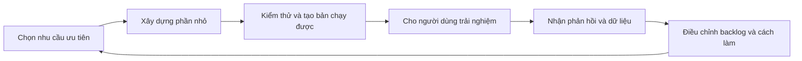

# Bối cảnh hình thành Tuyên ngôn Agile năm 2001

## Mục tiêu bài học

Sau bài học này, bạn có thể:

- Giải thích vì sao sự biến động của yêu cầu và phản hồi đến muộn khiến nhiều dự án phần mềm gặp khó khăn vào cuối thế kỷ XX.
- Mô tả sự xuất hiện của các phương pháp phát triển linh hoạt trước năm 2001 và sự kiện dẫn đến **Tuyên ngôn về phát triển phần mềm Agile** (Manifesto for Agile Software Development).
- Diễn giải bốn giá trị Agile như những lựa chọn ưu tiên có chủ đích, không phải lời kêu gọi loại bỏ quy trình, tài liệu, hợp đồng hay kế hoạch.
- Liên hệ bối cảnh lịch sử với cách làm hiện nay: giao sản phẩm tăng dần, nhận phản hồi sớm, phối hợp liên chức năng và cải tiến liên tục.

## 1. Vấn đề mà ngành phần mềm phải giải quyết

Phần mềm thường được xây dựng trong điều kiện chưa thể biết hết nhu cầu ngay từ đầu. Người dùng có thể chỉ nhận ra điều họ thực sự cần khi nhìn thấy một phiên bản chạy được. Công nghệ, thị trường, luật lệ và ưu tiên kinh doanh cũng có thể thay đổi trong lúc nhóm đang phát triển sản phẩm.

Tuy nhiên, nhiều tổ chức từng quản lý dự án phần mềm bằng cách **cố định phạm vi từ sớm, lập kế hoạch chi tiết cho cả chặng đường rồi triển khai theo các giai đoạn lớn**. Một dự án điển hình có thể trải qua khảo sát yêu cầu, phân tích, thiết kế, lập trình, kiểm thử và bàn giao. Cách tiếp cận thiên về kế hoạch này có ưu điểm: tạo mốc quản trị rõ ràng, hỗ trợ dự toán, lưu vết quyết định và phối hợp trong những môi trường có nhiều ràng buộc.

Vấn đề xuất hiện khi tổ chức coi các giả định ban đầu là chắc chắn, dù thực tế vẫn còn nhiều điều chưa biết. Khi đó, chi phí phát hiện sai lầm có xu hướng tăng theo thời gian:

1. **Yêu cầu được chốt quá sớm:** nhóm ghi nhận điều khách hàng *nghĩ* rằng họ cần, trước khi khách hàng trải nghiệm phần mềm.
2. **Phản hồi đến quá muộn:** khách hàng chỉ nhìn thấy hệ thống gần hoàn chỉnh, khi việc đổi hướng đã tốn kém.
3. **Kiểm thử và tích hợp dồn về cuối:** các vấn đề kỹ thuật, hiểu sai nghiệp vụ hoặc phụ thuộc giữa các thành phần có thể tích tụ.
4. **Đo tiến độ qua tài liệu và hạng mục hoàn thành:** báo cáo có thể cho thấy dự án “đúng kế hoạch” dù giá trị thực tế chưa được kiểm chứng.
5. **Thay đổi bị xem là ngoại lệ:** mọi điều chỉnh cần nhiều vòng phê duyệt hoặc đàm phán, khiến tổ chức phản ứng chậm với kiến thức mới.

Đây là **rủi ro của việc áp dụng cách quản lý quá cứng nhắc trong môi trường nhiều bất định**, không có nghĩa mọi quy trình theo giai đoạn đều thất bại. Dự án có yêu cầu ổn định, ràng buộc pháp lý nghiêm ngặt hoặc mốc bàn giao cố định vẫn cần lập kế hoạch và tài liệu thích hợp. Agile đặt câu hỏi: *Làm thế nào để giữ được kỷ luật phát triển mà vẫn học hỏi và điều chỉnh kịp thời?*

### Ví dụ: một hệ thống đào tạo được giao quá muộn

Giả sử một tổ chức đặt hàng nền tảng học trực tuyến. Nhóm dành nhiều tháng viết đặc tả cho toàn bộ hệ thống: danh mục khóa học, đăng ký, thanh toán, bài kiểm tra và báo cáo. Sau đó, họ phát triển các chức năng theo kế hoạch và chỉ mời giảng viên dùng thử gần ngày bàn giao.

Lúc ấy, giảng viên mới phát hiện quy trình tạo khóa học quá nhiều bước, còn học viên khó tìm nội dung phù hợp. Dù phần mềm có thể đáp ứng phần lớn đặc tả ban đầu, **giá trị sử dụng vẫn chưa đạt kỳ vọng**. Việc sửa luồng học tập khi nhiều thành phần đã phụ thuộc vào thiết kế cũ thường khó hơn nhiều so với sửa một bản thử nghiệm nhỏ.

Ngược lại, nếu nhóm đưa ra sớm một luồng tối thiểu “xem danh mục → chọn khóa học → ghi danh”, họ có thể quan sát thao tác thật, sửa thiết kế và dùng hiểu biết đó để quyết định phần việc tiếp theo. Tư duy này là một trong những động lực dẫn tới Agile.

## 2. Trước năm 2001: các cách làm linh hoạt đã tồn tại

**Agile không xuất hiện từ con số không vào năm 2001.** Trong thập niên 1990, nhiều nhóm và tác giả đã thử các cách phát triển phần mềm theo vòng lặp, tạo bản chạy được thường xuyên và đưa khách hàng đến gần quá trình xây dựng sản phẩm hơn.

| Phương pháp hoặc trường phái | Ý tưởng nổi bật trước khi có Tuyên ngôn Agile |
| --- | --- |
| **Scrum** | Tổ chức công việc trong các chu kỳ ngắn; nhóm phối hợp, xem xét kết quả và thích nghi thường xuyên. |
| **Extreme Programming (XP)** | Duy trì chất lượng kỹ thuật qua kiểm thử, tích hợp thường xuyên, thiết kế đơn giản và phản hồi nhanh. |
| **Crystal** | Điều chỉnh cách làm theo con người, mức độ quan trọng và bối cảnh của từng dự án. |
| **Dynamic Systems Development Method (DSDM)** | Phát triển lặp, có sự tham gia của người dùng và ưu tiên giá trị trong giới hạn thời gian, nguồn lực. |
| **Adaptive Software Development (ASD)** | Nhấn mạnh học hỏi, cộng tác và thích nghi trong điều kiện nhiều thay đổi. |
| **Feature-Driven Development (FDD)** | Tổ chức tiến độ quanh các tính năng nhỏ có giá trị và được hoàn thành liên tục. |

Các phương pháp trên không giống nhau về vai trò, nghi thức hoặc kỹ thuật. Điểm chung đáng chú ý là chúng **xem phát triển phần mềm như quá trình học hỏi**, thay vì chỉ thực thi tuần tự một bản thiết kế bất biến.

Vì vậy, có hai mốc cần phân biệt:

- **Trước 2001:** những thực hành phát triển lặp, tăng dần và lấy phản hồi làm trọng tâm đã hình thành, được sử dụng và cải tiến ở nhiều nơi.
- **Năm 2001:** các tác giả của nhiều trường phái gặp nhau và thống nhất một tuyên bố ngắn về **những giá trị chung**; họ không tạo ra toàn bộ thực hành từ đầu.

## 3. Tháng 2 năm 2001: cuộc gặp tại Snowbird

Tháng 2 năm 2001, **17 nhà thực hành và tác giả phương pháp phát triển phần mềm** gặp nhau tại khu nghỉ dưỡng Snowbird, bang Utah, Hoa Kỳ. Họ đến từ những nền tảng và quan điểm kỹ thuật khác nhau, trong đó có những người gắn với XP, Scrum, Crystal và các cách làm thích nghi khác.

Những người tham dự không định viết một quy trình duy nhất bắt mọi nhóm làm theo. Họ tìm một cách diễn đạt ngắn gọn cho điều mà các phương pháp đang chia sẻ: **đặt con người, sản phẩm chạy được, sự cộng tác và khả năng thích ứng vào trung tâm**. Kết quả là *Manifesto for Agile Software Development*, thường được gọi là **Tuyên ngôn Agile**.

Một số người ký tên gồm Kent Beck, Ward Cunningham, Martin Fowler, Jim Highsmith, Ken Schwaber và Jeff Sutherland. Điểm đáng nhớ không nằm ở việc ghi nhớ từng tên, mà ở tính chất **đồng thuận giữa nhiều phương pháp vốn độc lập**: từ các thực hành cụ thể, họ rút ra các ưu tiên có thể áp dụng trong nhiều hoàn cảnh.

| Giai đoạn | Ý nghĩa đối với sự hình thành Agile |
| --- | --- |
| Các thập niên trước 2001 | Dự án phần mềm bộc lộ giới hạn của việc dự đoán chính xác mọi yêu cầu từ đầu; nhiều nhóm thực nghiệm vòng lặp và phát hành tăng dần. |
| Thập niên 1990 | Scrum, XP, Crystal, DSDM và các hướng tiếp cận khác phát triển những cách thực hành có phản hồi sớm. |
| **Tháng 2/2001** | 17 người gặp tại Snowbird và thống nhất Tuyên ngôn Agile với bốn giá trị cốt lõi. |
| Sau 2001 | Tuyên ngôn trở thành điểm tham chiếu chung; các khung làm việc và kỹ thuật tiếp tục phát triển, được điều chỉnh theo từng tổ chức. |

### Tuyên ngôn là gì, và không phải là gì?

Tuyên ngôn là một **tập hợp giá trị định hướng các quyết định** khi xây dựng phần mềm. Bên cạnh bốn giá trị, những người ký tên còn công bố **12 nguyên tắc** diễn giải cách đưa các giá trị đó vào thực hành.

Tuyên ngôn **không phải** tài liệu đặc tả Scrum, một danh sách công cụ bắt buộc, một quy trình chứng nhận hay một cam kết rằng mọi dự án phải dùng cùng độ dài chu kỳ. Scrum, Kanban hoặc XP là những cách tổ chức và thực hành có thể hỗ trợ tư duy Agile ở những mức độ khác nhau; không cách nào đồng nghĩa với toàn bộ Agile.

## 4. Bốn giá trị ra đời để thay đổi điều được ưu tiên

Nguyên văn Tuyên ngôn nêu bốn cặp giá trị. Mỗi cặp thể hiện rằng **vế bên trái được coi trọng hơn vế bên phải**, đồng thời **vế bên phải vẫn có giá trị**. Đây là điểm then chốt để hiểu đúng Agile.

| Ưu tiên theo tinh thần Agile | Điều vẫn cần thiết | Vấn đề lịch sử mà lựa chọn ưu tiên muốn giải quyết |
| --- | --- | --- |
| **Con người và sự tương tác** | Quy trình và công cụ | Một quy trình hoàn chỉnh không tự bảo đảm người làm nghiệp vụ và người viết phần mềm hiểu nhau. |
| **Phần mềm hoạt động được** | Tài liệu đầy đủ | Tài liệu và báo cáo không thể thay thế việc kiểm chứng sản phẩm thực sự chạy và giải quyết nhu cầu. |
| **Cộng tác với khách hàng** | Đàm phán hợp đồng | Quan hệ chỉ dựa vào bàn giao theo điều khoản dễ làm chậm phản hồi và việc xác định lại ưu tiên. |
| **Phản ứng với thay đổi** | Tuân thủ kế hoạch | Kế hoạch được lập từ dữ liệu chưa đầy đủ cần được cập nhật khi nhóm có hiểu biết mới. |

### 4.1. Con người và sự tương tác hơn quy trình và công cụ

Quy trình và công cụ hỗ trợ phối hợp, đặc biệt khi đội ngũ lớn hoặc phân tán. Nhưng một bảng quản lý công việc được cập nhật đầy đủ không đảm bảo lập trình viên hiểu đúng một quy tắc nghiệp vụ. Một cuộc trao đổi trực tiếp giữa những người liên quan có thể phát hiện hiểu lầm sớm hơn nhiều vòng chuyển giao tài liệu.

**Hành vi phù hợp:** khi yêu cầu “học viên phải hoàn thành khóa học” chưa rõ, lập trình viên và người phụ trách đào tạo cùng làm rõ thế nào là “hoàn thành”, rồi mới chốt tiêu chí nghiệm thu. Quy trình ghi nhận kết quả vẫn hữu ích, nhưng không thay thế cuộc trao đổi.

### 4.2. Phần mềm hoạt động được hơn tài liệu toàn diện

Một thiết kế đẹp trên giấy chưa chứng minh được sản phẩm có thể dùng. Những phiên bản nhỏ, chạy được và được kiểm thử tạo bằng chứng thực tế về mức tiến bộ. Tuy vậy, Agile **không đồng nghĩa bỏ tài liệu**: hướng dẫn vận hành, quyết định kiến trúc, yêu cầu tuân thủ, API và thông tin bàn giao vẫn cần được duy trì tương xứng với rủi ro.

**Hành vi phù hợp:** thay vì báo “chức năng ghi danh hoàn thành 90%” dựa trên số tác vụ đã đóng, nhóm trình diễn luồng ghi danh thật trên bản chạy được và cùng khách hàng kiểm tra trường hợp lỗi.

### 4.3. Cộng tác với khách hàng hơn đàm phán hợp đồng

Hợp đồng làm rõ phạm vi trách nhiệm, chi phí và quyền lợi. Nhưng trong công việc nhiều bất định, chỉ đối chiếu với bản yêu cầu ký từ nhiều tháng trước có thể khiến cả hai phía bỏ lỡ giá trị mới. Agile đề cao việc khách hàng hoặc người đại diện nghiệp vụ **tham gia thường xuyên** để giải thích nhu cầu, kiểm tra sản phẩm và sắp xếp lại ưu tiên.

**Hành vi phù hợp:** sau khi xem bản thử nghiệm, bộ phận đào tạo phát hiện tìm kiếm khóa học quan trọng hơn một biểu đồ báo cáo phức tạp. Nhóm cùng họ đánh giá giá trị và quyết định thứ tự thực hiện, trong phạm vi cam kết đã được quản lý.

### 4.4. Phản ứng với thay đổi hơn bám cứng vào kế hoạch

Một kế hoạch là giả thuyết tốt nhất dựa trên thông tin hiện có. Khi thông tin thay đổi, tiếp tục thực hiện nguyên trạng chỉ để chứng tỏ “đúng kế hoạch” có thể làm giảm giá trị sản phẩm. Agile khuyến khích cập nhật ưu tiên bằng phản hồi và dữ liệu mới. Điều này **không có nghĩa đổi yêu cầu tùy tiện mỗi ngày**; thay đổi cần được đánh giá về lợi ích, chi phí, phụ thuộc và rủi ro.

**Hành vi phù hợp:** nhóm vẫn có mục tiêu phát hành, ngân sách và kế hoạch gần hạn; sau mỗi lần đánh giá phần mềm, họ điều chỉnh những hạng mục tương lai ít giá trị hơn.

## 5. Mười hai nguyên tắc giúp biến giá trị thành hành động

Bốn giá trị có tính định hướng cao. **12 nguyên tắc đi kèm** làm rõ các thói quen cần có. Có thể nhìn chúng qua những nhóm vấn đề mà Tuyên ngôn tìm cách giải quyết:

| Nguyên tắc | Nội dung diễn giải ngắn | Vấn đề được giải quyết |
| --- | --- | --- |
| **1** | Làm hài lòng khách hàng bằng việc giao phần mềm có giá trị sớm và liên tục. | Giá trị chỉ được thấy ở cuối dự án. |
| **2** | Chấp nhận thay đổi yêu cầu, kể cả giai đoạn muộn, khi chúng đem lại lợi ích. | Coi mọi thay đổi là thất bại của kế hoạch. |
| **3** | Giao phần mềm hoạt động được thường xuyên, ưu tiên khoảng thời gian ngắn. | Khoảng cách giữa hai lần kiểm chứng quá dài. |
| **4** | Người làm nghiệp vụ và người phát triển phối hợp hằng ngày. | Hiểu sai yêu cầu qua nhiều tầng chuyển giao. |
| **5** | Xây dựng công việc quanh người có động lực; cung cấp điều kiện, hỗ trợ và niềm tin. | Quản lý vi mô cản trở năng lực đội ngũ. |
| **6** | Ưu tiên trao đổi trực tiếp, giàu ngữ cảnh để truyền đạt thông tin hiệu quả. | Trễ và sai lệch thông tin qua giao tiếp gián tiếp. |
| **7** | Lấy phần mềm hoạt động được làm thước đo chính của tiến độ. | Đánh đồng giấy tờ hoặc tỷ lệ tác vụ với kết quả. |
| **8** | Duy trì nhịp phát triển bền vững cho các bên liên quan. | Làm việc quá sức để chạy theo mốc bàn giao. |
| **9** | Liên tục chú ý chất lượng kỹ thuật và thiết kế tốt. | Nợ kỹ thuật khiến mỗi lần thay đổi khó hơn. |
| **10** | Giữ sự đơn giản, tối đa hóa phần việc không cần làm. | Xây nhiều tính năng chưa tạo ra giá trị. |
| **11** | Để kiến trúc, yêu cầu và thiết kế tốt hình thành từ nhóm có khả năng tự tổ chức. | Quyết định xa người trực tiếp thực hiện. |
| **12** | Định kỳ nhìn lại cách làm và điều chỉnh để hiệu quả hơn. | Lặp lại cùng vấn đề mà không học hỏi. |

Các dòng trên là **bản diễn giải để học**, không phải bản dịch pháp lý hoặc trích nguyên văn toàn bộ 12 nguyên tắc. Khi cần đối chiếu từng câu, hãy xem nguồn gốc ở cuối bài.

Điểm liên kết giữa các nguyên tắc là một **vòng học hỏi liên tục**: giao một phần nhỏ có thể dùng, kiểm tra với người liên quan, điều chỉnh sản phẩm và cải thiện cách nhóm làm việc. Chất lượng kỹ thuật, giao tiếp và nhịp làm việc bền vững không tách rời khả năng thích ứng; chúng giúp nhóm *có thể* thay đổi mà không làm hệ thống mất ổn định.

## 6. Từ bối cảnh lịch sử đến cách làm thực tế

Hãy trở lại ví dụ nền tảng học trực tuyến. Thay vì thiết kế mọi tính năng đến mức chi tiết rồi mới cho người dùng xem, nhóm có thể dùng cách tiếp cận tăng dần.

**Mục tiêu kinh doanh:** giúp học viên tìm và ghi danh khóa học phù hợp nhanh hơn.

**Giả định cần kiểm chứng:** học viên hiểu danh mục khóa học, nhận biết các điều kiện tham gia và có thể tự ghi danh mà không cần nhân viên hỗ trợ.

Một *user story* ban đầu có thể là:

> Là một học viên, tôi muốn xem thông tin cơ bản và ghi danh một khóa học để bắt đầu học mà không phải gửi yêu cầu thủ công.

Nhóm chọn một phần phạm vi đủ nhỏ nhưng dùng được: hiển thị danh sách khóa học, chi tiết cần thiết, thao tác ghi danh và phản hồi khi ghi danh thành công hoặc thất bại. Sau khi hoàn thành, nhóm cho một số người dùng đại diện trải nghiệm, quan sát khó khăn và trao đổi với bộ phận đào tạo.

Giả sử phản hồi đầu tiên cho thấy học viên không biết khóa học có yêu cầu kiến thức đầu vào. Nhóm thêm thông tin tiên quyết vào ưu tiên tiếp theo. Sau lần đánh giá sau, nếu việc ghi danh thuận tiện nhưng người học khó tiếp tục bài đang học dở, nhóm có căn cứ để ưu tiên tính năng “tiếp tục học”. Kết quả là **quyết định xuất phát từ điều đã học**, không chỉ từ danh sách dự kiến ban đầu.

Những hoạt động trên có thể được hỗ trợ bởi các công cụ và phương pháp khác nhau:

- **Product backlog và user story:** làm rõ giá trị cần tạo, ưu tiên công việc và tiêu chí chấp nhận.
- **Scrum:** tạo nhịp làm việc và các thời điểm kiểm tra, thích nghi thông qua những sự kiện được định nghĩa rõ.
- **Kanban:** trực quan hóa luồng công việc, quản lý lượng việc đang làm và cải thiện khả năng hoàn thành.
- **XP:** tăng độ tin cậy khi thay đổi thông qua kiểm thử, tích hợp và các thực hành kỹ thuật có kỷ luật.

Các ví dụ này giúp thấy vì sao Tuyên ngôn Agile có ảnh hưởng lâu dài: **nó cho biết điều gì cần được ưu tiên**, còn đội ngũ phải chọn thực hành cụ thể phù hợp với sản phẩm, quy mô, năng lực và ràng buộc của mình.

### Phản hồi sớm khác gì thay đổi liên tục thiếu kiểm soát?

Thích nghi có trách nhiệm cần một nhịp quyết định rõ ràng. Với mỗi đề xuất thay đổi, nhóm nên làm rõ: ai gặp vấn đề; bằng chứng hoặc phản hồi nào cho thấy vấn đề đó tồn tại; giá trị kỳ vọng; mức độ cấp thiết; chi phí và rủi ro; những hạng mục nào sẽ được đẩy lùi nếu ưu tiên mới được đưa lên.

Nhóm vẫn phải kiểm thử, quản lý phiên bản, lưu vết những quyết định quan trọng và bảo đảm tiêu chí chất lượng. **Không có chất lượng nền tảng, việc giao sản phẩm liên tục chỉ làm lỗi đến với người dùng nhanh hơn.**

## 7. Những cách hiểu sai thường bắt nguồn từ việc quên bối cảnh

| Nhận định sai | Cách hiểu phù hợp với Tuyên ngôn |
| --- | --- |
| “Agile nghĩa là không lập kế hoạch.” | Nhóm vẫn lập kế hoạch, nhưng xem đó là thứ có thể điều chỉnh dựa trên phản hồi. |
| “Agile không cần tài liệu.” | Tài liệu có ích vẫn cần được tạo và cập nhật; sản phẩm chạy được là bằng chứng tiến độ quan trọng hơn số trang đã viết. |
| “Agile nghĩa là khách hàng muốn đổi gì cũng phải làm ngay.” | Cộng tác bao gồm cùng đánh giá giá trị, chi phí, phụ thuộc và thứ tự ưu tiên. |
| “Dùng Scrum là chắc chắn đã Agile.” | Làm đúng nghi thức chưa đủ nếu nhóm không giao được giá trị, không nhận phản hồi và không thích nghi. |
| “Agile chỉ phù hợp dự án nhỏ và không cần kiểm soát.” | Nguyên tắc Agile có thể được điều chỉnh cho nhiều bối cảnh; yêu cầu về an toàn, bảo mật, kiểm toán và phối hợp vẫn phải được đáp ứng. |
| “Cứ làm nhanh là Agile.” | Agile hướng tới học hỏi và tạo giá trị bền vững, có nền tảng chất lượng kỹ thuật và nhịp làm việc ổn định. |

Đặc biệt, không nên đánh đồng **phát triển tăng dần** với **khả năng thích ứng**. Nhóm có thể chia một kế hoạch cố định thành nhiều đợt giao hàng nhưng vẫn phớt lờ phản hồi. Khi đó, họ có các lần bàn giao nhỏ mà chưa thực sự thay đổi cách ra quyết định. Tinh thần Agile đòi hỏi thông tin mới **có khả năng ảnh hưởng đến ưu tiên và giải pháp**.

## 8. Khi nào bài học lịch sử này hữu ích?

Trước khi chọn Scrum, Kanban, XP hay một cách kết hợp, hãy nhận diện **vấn đề thật của nhóm**. Nếu người dùng chỉ thấy kết quả sau nhiều tháng, hãy tạo cơ hội giao và kiểm chứng phần nhỏ sớm hơn. Nếu yêu cầu bị hiểu sai, hãy tăng chất lượng trao đổi giữa nghiệp vụ và kỹ thuật. Nếu mỗi thay đổi gây lỗi dây chuyền, hãy đầu tư kiểm thử tự động, thiết kế tốt và tích hợp thường xuyên. Nếu công việc bị tắc ở nhiều bước chờ, hãy nhìn vào luồng công việc và giới hạn việc đang làm.

Trong sản phẩm có kiểm soát nghiêm ngặt, chẳng hạn hệ thống tài chính hoặc phần mềm có yêu cầu an toàn cao, nhóm vẫn có thể học hỏi qua bản mẫu, thử nghiệm có kiểm soát và đánh giá thường xuyên, đồng thời duy trì chứng cứ kiểm thử, phê duyệt và tài liệu bắt buộc. **Thích ứng và kiểm soát có thể cùng tồn tại** khi được thiết kế có chủ đích.

## 9. Ghi nhớ cốt lõi

Tuyên ngôn Agile năm 2001 ra đời trong bối cảnh ngành phần mềm cần cách ứng phó tốt hơn với yêu cầu biến động, phản hồi muộn và khoảng cách giữa kế hoạch với giá trị thực tế. Cuộc gặp của 17 người tại Snowbird đã kết nối các phương pháp linh hoạt có trước đó thành một **hệ giá trị chung**.

Bốn giá trị không phủ nhận quy trình, tài liệu, hợp đồng hay kế hoạch. Chúng nhắc nhóm ưu tiên **tương tác có chất lượng, phần mềm chạy được, cộng tác thực chất và khả năng phản ứng trước kiến thức mới**. Mười hai nguyên tắc đưa ưu tiên ấy vào việc giao sản phẩm, duy trì kỹ thuật tốt, phối hợp liên tục và cải tiến cách làm.

Khi học tiếp về backlog, user story, Scrum, Kanban, XP hay đo lường dòng công việc, hãy trở lại câu hỏi gốc của năm 2001: **Cách làm này có giúp nhóm tạo ra giá trị thật, học sớm và điều chỉnh tốt hơn hay không?**

## Nguồn tham khảo chính

- [Manifesto for Agile Software Development — Tuyên ngôn gốc (2001)](https://agilemanifesto.org/): bốn giá trị và danh sách những người ký tên.
- [Principles behind the Agile Manifesto](https://agilemanifesto.org/principles.html): nguyên bản 12 nguyên tắc.
- [History: The Agile Manifesto](https://agilemanifesto.org/history.html): bài viết của Jim Highsmith về cuộc gặp tại Snowbird và bối cảnh hình thành Tuyên ngôn.
