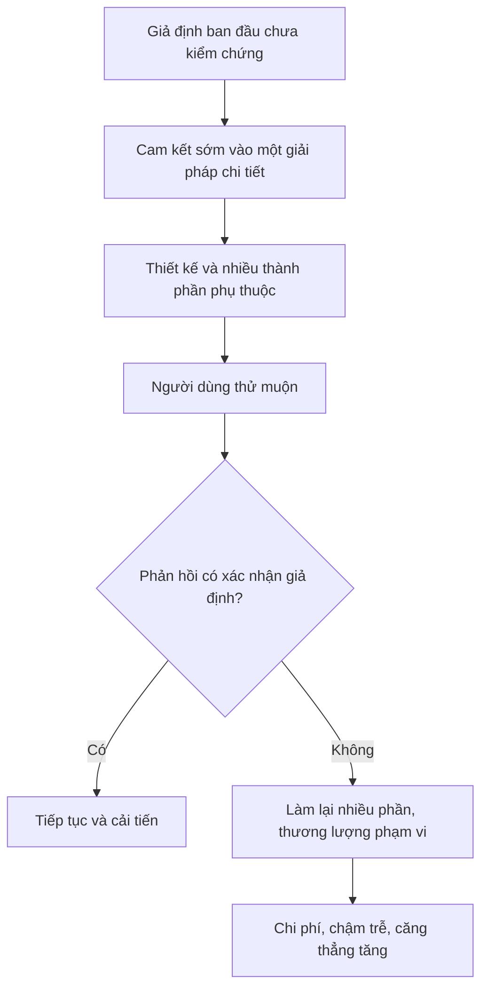
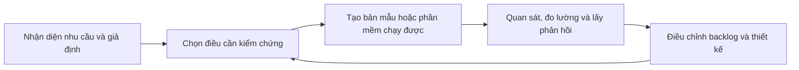

# Những khó khăn của việc cố định giải pháp khi hiểu biết còn thay đổi

Trong phát triển phần mềm, nhóm thường phải quyết định **sẽ xây gì** trước khi biết chắc **người dùng thực sự cần gì**, **giải pháp có vận hành được trong môi trường thật không** và **điều gì sẽ thay đổi trong quá trình thực hiện**. Khi một thiết kế, một danh sách tính năng hoặc một kế hoạch triển khai bị xem như không thể thay đổi quá sớm, kiến thức mới dễ bị coi là sự phiền toái thay vì cơ hội làm sản phẩm tốt hơn.

Đó là một lý do quan trọng khiến tư duy **Agile** xuất hiện: phát triển phần mềm theo những bước có thể kiểm chứng, giao giá trị tăng dần, nhận phản hồi sớm và điều chỉnh kế hoạch dựa trên điều đã học. Agile không yêu cầu nhóm thay đổi tùy hứng; Agile giúp nhóm **giữ vững mục tiêu và các ràng buộc cần thiết, đồng thời để ngỏ những quyết định còn thiếu bằng chứng**.

## 1. “Cố định giải pháp” nghĩa là gì?

Hãy tưởng tượng một nhóm xây tính năng đặt lịch mentoring cho nền tảng học tập. Yêu cầu ban đầu từ một bên liên quan là:

> “Hãy làm giao diện lịch tháng, cho học viên kéo thả một buổi mentoring vào khung giờ trống, rồi gửi email xác nhận.”

Mô tả này nghe rất cụ thể, nhưng nó đã trộn lẫn **vấn đề** với **cách giải quyết vấn đề**. Có thể mục đích thực sự của học viên chỉ là tìm được buổi mentoring phù hợp, biết chắc đã đặt thành công và không bỏ lỡ lịch. Một giao diện lịch tháng có kéo thả là *một* phương án, chưa chắc là phương án phù hợp nhất với người dùng chủ yếu thao tác trên điện thoại.

Có thể tách yêu cầu thành ba lớp:

| Lớp quyết định | Ví dụ trong tính năng đặt lịch | Nên đối xử thế nào? |
| --- | --- | --- |
| **Mục tiêu/kết quả mong muốn** (*outcome*) | Học viên đặt được buổi phù hợp, không bị trùng lịch và hiểu rõ trạng thái đặt chỗ | Làm rõ và đo lường; thay đổi khi mục tiêu kinh doanh thực sự đổi |
| **Ràng buộc cần tuân thủ** (*constraint*) | Chỉ hiển thị khung giờ mà mentor cho phép; bảo vệ thông tin cá nhân; xử lý múi giờ nhất quán | Xác nhận sớm, kiểm tra liên tục; không tùy tiện bỏ qua |
| **Giải pháp/thiết kế cụ thể** (*solution*) | Lịch tháng kéo thả, danh sách khung giờ, email, thông báo trong ứng dụng | Xem là các lựa chọn hoặc giả thuyết cần kiểm chứng trước khi cam kết sâu |

**Cố định giải pháp quá sớm** là chuyển một lựa chọn chưa được kiểm chứng thành một cam kết khó đảo ngược: phê duyệt toàn bộ màn hình, chi tiết hóa mọi luồng, ký chặt phạm vi theo từng tính năng, thiết kế kiến trúc phụ thuộc vào giả định đó rồi đo thành công bằng việc hoàn thành đúng bản thiết kế.

Không phải quyết định sớm nào cũng sai. Nhóm vẫn cần quyết định để bắt đầu làm việc. Vấn đề nằm ở **mức độ cam kết không tương xứng với mức độ hiểu biết**, đặc biệt khi quyết định có chi phí thay đổi lớn.

## 2. Vì sao hiểu biết vẫn thay đổi sau khi bắt đầu dự án?

Yêu cầu phần mềm không phải lúc nào cũng là một tập sự thật đã tồn tại đầy đủ để nhóm chỉ việc ghi chép. Nhiều nhu cầu chỉ lộ rõ khi người dùng nhìn thấy bản mẫu, thử một luồng thao tác hoặc sử dụng sản phẩm trong hoàn cảnh thật.

| Nguồn kiến thức mới | Điều có thể được phát hiện | Tác động lên giải pháp ban đầu |
| --- | --- | --- |
| **Người dùng và hành vi thực tế** | Học viên chủ yếu đặt lịch bằng điện thoại, ít dùng thao tác kéo thả | Chuyển sang danh sách khung giờ dễ bấm, dễ đọc |
| **Vấn đề nghiệp vụ** | “Đặt lịch nhanh” ít quan trọng hơn việc tránh hai người nhận cùng một khung giờ | Ưu tiên kiểm soát tính nhất quán dữ liệu và xác nhận chỗ |
| **Phản hồi từ bản mẫu hoặc bản phát hành sớm** | Người dùng không phân biệt được “đang yêu cầu” và “đã xác nhận” | Bổ sung trạng thái, thông điệp và quy tắc xử lý |
| **Tích hợp và giới hạn kỹ thuật** | Dịch vụ lịch bên ngoài trả về dữ liệu chậm hoặc tạm thời không khả dụng | Thiết kế xử lý lỗi, đồng bộ và thử lại |
| **Hoạt động vận hành** | Mentor thường xuyên đổi lịch sát giờ, bộ phận hỗ trợ phải can thiệp thủ công | Xem lại quy trình đổi/hủy lịch và nhật ký thay đổi |
| **Quy định hoặc chính sách** | Có yêu cầu mới về lưu trữ hoặc hiển thị dữ liệu | Điều chỉnh thiết kế trong phạm vi bắt buộc |

Một số thay đổi đến từ môi trường bên ngoài; một số đến từ việc nhóm **học được điều trước đó mình chưa biết**. Hai trường hợp này đều đòi hỏi xem lại các giả định. Chúng không nhất thiết chứng tỏ người đưa yêu cầu ban đầu thiếu năng lực: khi chưa có trải nghiệm thực tế, ngay cả người am hiểu nghiệp vụ cũng khó dự đoán mọi tình huống.

Cần phân biệt:

- **Mục tiêu thay đổi:** Ví dụ sản phẩm chuyển từ phục vụ học viên cá nhân sang phục vụ doanh nghiệp; nhóm phải đánh giá lại ưu tiên.
- **Cách hiểu vấn đề tốt lên:** Ví dụ mục tiêu vẫn là đặt lịch thuận tiện, nhưng biết thêm rằng học viên cần thao tác trên điện thoại và sợ trùng lịch; giải pháp nên được điều chỉnh dù mục tiêu không đổi.
- **Phạm vi bị mở rộng không kiểm soát:** Có người đề nghị thêm tính năng không gắn với mục tiêu hay bằng chứng; nhóm cần đánh giá, không mặc nhiên chấp nhận chỉ vì gọi đó là “Agile”.

## 3. Sáu khó khăn khi khóa chặt giải pháp quá sớm

### 3.1. Hoàn thành đúng chức năng nhưng giải quyết sai vấn đề

Nhóm có thể giao một giao diện lịch kéo thả đúng bản mô tả mà học viên vẫn thấy khó đặt lịch. Đây là khoảng cách giữa **đầu ra** (*output*: màn hình, API, số tính năng đã làm) và **kết quả** (*outcome*: người dùng hoàn thành được mục đích, lỗi ít hơn, thời gian thao tác giảm).

Khi “đúng đặc tả” trở thành tiêu chuẩn duy nhất, việc phát hiện một cách làm tốt hơn có thể bị bác bỏ vì “không nằm trong phạm vi”. Sản phẩm đạt yêu cầu bàn giao trên giấy nhưng chưa chắc tạo giá trị.

### 3.2. Thay đổi kéo theo làm lại ở nhiều tầng

Một lựa chọn ban đầu có thể lan từ bản phác thảo sang giao diện, API, mô hình dữ liệu, bộ kiểm thử, hướng dẫn sử dụng và hoạt động vận hành. Khi giả định gốc sai, các thành phần phụ thuộc vào nó cùng phải sửa.

Ví dụ, nếu toàn bộ mô hình đặt lịch được xây quanh thao tác kéo thả giữa các ô lịch, việc chuyển sang lựa chọn từng khung giờ có thể đòi hỏi sửa luồng xử lý, API và kiểm thử. **Chi phí thay đổi tăng theo mức phụ thuộc đã hình thành**, dù không có một hệ số tăng cố định đúng cho mọi dự án.

### 3.3. Phản hồi đến quá muộn

Nếu nhóm chỉ cho người dùng thử sau khi xây đủ mọi tính năng, các giả định cốt lõi tồn tại lâu mà không được kiểm chứng. Khi đó phản hồi không chỉ yêu cầu sửa một màn hình; nó có thể buộc nhóm xem lại nhiều quyết định liên quan.

Phản hồi muộn còn tạo tâm lý ngại báo tin xấu: nhóm đã đầu tư công sức, có mốc bàn giao và có thể cho rằng việc đổi hướng đồng nghĩa “làm lại từ đầu”.

### 3.4. Kế hoạch tạo cảm giác chắc chắn giả tạo

Một bảng kế hoạch chi tiết cho nhiều tháng có thể trông chính xác dù dựa trên nhiều giả định chưa thử. Ngày hoàn thành, ước lượng công việc và thứ tự tính năng dễ bị xem như cam kết chắc chắn. Khi thực tế khác đi, nhóm phải liên tục giải thích chênh lệch thay vì tập trung xử lý rủi ro.

Kế hoạch vẫn hữu ích để phối hợp ngân sách, nhân lực và phụ thuộc. Khó khăn xuất hiện khi **mức độ chi tiết của kế hoạch vượt quá khả năng dự đoán** và không được cập nhật theo bằng chứng mới.

### 3.5. Chất lượng và tính an toàn bị đặt trước lựa chọn khó khăn

Khi phát hiện giả định sai gần ngày phát hành, nhóm dễ rơi vào thế chọn giữa chậm tiến độ, cắt kiểm thử hoặc giữ lại trải nghiệm kém. Nếu cấu trúc phần mềm không cho phép thay đổi từng phần, ngay cả chỉnh sửa nhỏ cũng gây rủi ro hồi quy lớn.

Agile chỉ thích ứng tốt khi có năng lực kỹ thuật đi kèm: kiểm thử tự động phù hợp, tích hợp thường xuyên, thiết kế đủ đơn giản, khả năng quan sát lỗi và cải tiến mã. **Thay đổi nhanh không đồng nghĩa với giảm tiêu chuẩn chất lượng.**

### 3.6. Quyết định cũ gây xung đột và tâm lý tiếc công

Người đặt yêu cầu ban đầu có thể bảo vệ giải pháp cũ vì đã phê duyệt; nhóm phát triển có thể ngại thay đổi vì đã làm nhiều; người dùng lại thấy nhu cầu chưa được đáp ứng. Cuộc trao đổi dễ biến thành tranh luận ai đúng thay vì đánh giá bằng chứng.

Đây là biểu hiện của **bẫy chi phí chìm** (*sunk cost*): tiếp tục đầu tư vào phương án chưa phù hợp chỉ vì đã đầu tư trước đó. Chi phí đã bỏ ra cần được nhìn nhận, nhưng quyết định tiếp theo nên dựa trên **giá trị và chi phí còn lại trong tương lai**.

### Chuỗi tác động thường gặp



Sơ đồ mô tả **một rủi ro thường gặp**, không phải quy luật mọi dự án đều mắc phải. Một giải pháp được quyết định sớm nhưng dựa trên bằng chứng đáng tin và có cấu trúc dễ sửa vẫn có thể hiệu quả.

## 4. Tình huống xuyên suốt: Đặt lịch mentoring cho học viên

Giả sử một nhóm nhận mục tiêu: “Giúp học viên tự đặt lịch mentoring phù hợp mà không phải nhờ nhân viên điều phối.” Nhóm chưa biết người học muốn xem lịch kiểu nào và các sự cố thường gặp nhất là gì.

### Cách A: Khóa toàn bộ phương án ngay từ đầu

1. Bên liên quan mô tả giải pháp lịch tháng kéo thả, email xác nhận và nhiều bộ lọc.
2. Nhóm viết đặc tả cho tất cả màn hình và thiết kế hệ thống phụ thuộc chặt vào luồng này.
3. Nhóm triển khai đầy đủ rồi mới tổ chức thử nghiệm với học viên.
4. Học viên phản hồi rằng trên điện thoại rất khó kéo thả; nhiều người chỉ muốn biết ba khung giờ sắp tới và trạng thái đặt chỗ.
5. Nhóm phải chọn giữa giữ nguyên trải nghiệm khó dùng, sửa nhiều thành phần hoặc lùi lịch phát hành.

Vấn đề của cách A **không nằm ở việc có kế hoạch**, mà ở việc giải pháp chưa được xác nhận đã nhận quá nhiều cam kết trước khi có phản hồi.

### Cách B: Coi giải pháp là giả thuyết và giao từng phần có ích

1. Nhóm thống nhất kết quả mong muốn: học viên tìm khung giờ hợp lệ, gửi yêu cầu đặt chỗ và thấy rõ trạng thái.
2. Nhóm xác định giả định có rủi ro cao: lịch tháng có thật sự cần thiết? Người học dùng thiết bị gì? Khi hai người chọn cùng giờ, ai được xác nhận?
3. Trước khi xây toàn bộ hệ thống, nhóm cho người dùng thử bản mẫu giấy hoặc bản mẫu tương tác của **hai cách chọn giờ**: lịch tháng và danh sách khung giờ.
4. Nhóm xây một lát cắt chức năng hoàn chỉnh tối thiểu (*thin vertical slice*): hiển thị các khung còn chỗ, gửi yêu cầu, chống xác nhận trùng, hiển thị kết quả; có kiểm thử cho các quy tắc quan trọng.
5. Sau khi người dùng thật sử dụng, nhóm kiểm tra mức độ hoàn thành tác vụ và các lỗi. Họ điều chỉnh backlog: ưu tiên cách chọn giờ đơn giản và xử lý đổi lịch trước các bộ lọc nâng cao nếu bằng chứng cho thấy phù hợp.

Không phải lúc nào cách B cũng hoàn tất nhanh hơn trong mọi bước. Nó tạo cơ hội **phát hiện sai lệch sớm**, khi việc thay đổi còn tương đối nhỏ, và tập trung công sức vào phần đã thể hiện giá trị.

| Tiêu chí xem xét | Khóa giải pháp quá sớm | Phát triển thích ứng qua phản hồi |
| --- | --- | --- |
| Đơn vị được cam kết | Danh sách tính năng và thiết kế chi tiết | Mục tiêu, ràng buộc và kết quả kiểm chứng từng bước |
| Cách xử lý giả định | Ngầm xem là đúng | Ghi rõ, ưu tiên kiểm chứng giả định có rủi ro cao |
| Thời điểm thấy phần mềm hoạt động | Thường sau nhiều phần việc | Sớm, theo các lát cắt chức năng có thể dùng và đánh giá |
| Cách nhìn thay đổi | Sai lệch khỏi kế hoạch đã duyệt | Thông tin đầu vào để quyết định lại, có đánh giá tác động |
| Cách đánh giá tiến độ | Hoàn thành bao nhiêu hạng mục đã ghi | Vừa theo dõi công việc, vừa kiểm chứng giá trị và chất lượng |

Các đặc điểm ở cột trái mô tả **việc khóa phương án cứng nhắc**, không đồng nghĩa mọi dự án có kế hoạch theo giai đoạn đều như vậy. Agile cũng cần dự báo, quản trị rủi ro và thỏa thuận phạm vi ở mức phù hợp.

## 5. Agile giúp giảm rủi ro này như thế nào?

Một giá trị của [Tuyên ngôn Agile](https://agilemanifesto.org/iso/vi/manifesto.html) nhấn mạnh **thích ứng với thay đổi hơn là bám theo kế hoạch**. “Hơn là” có nghĩa vế sau vẫn có giá trị; khi thông tin mới xuất hiện, nhóm cân nhắc điều chỉnh kế hoạch để phục vụ mục tiêu tốt hơn.

Các nguyên tắc gần với tình huống này là giao phần mềm có giá trị thường xuyên, hợp tác liên tục với người làm nghiệp vụ, đón nhận yêu cầu thay đổi và thường xuyên xem lại cách làm. Chúng được cụ thể hóa qua các vòng học hỏi:



Không nhất thiết mỗi vòng đều phát hành công khai. Có vòng chỉ thử bản mẫu hoặc khảo sát quy trình; có vòng tạo phần mềm chạy được cho nhóm người dùng giới hạn. Điều quan trọng là **mỗi vòng làm giảm một sự không chắc chắn có ý nghĩa**.

### Liên hệ với các cách thực hành Agile

| Thực hành | Cách hỗ trợ khi hiểu biết thay đổi | Giới hạn cần nhớ |
| --- | --- | --- |
| **User story và tiêu chí chấp nhận** | Nêu ai cần gì và vì sao; đưa ví dụ quan sát được để kiểm tra hành vi | User story chỉ là lời nhắc cho trao đổi, không thay thế sự hiểu biết chung |
| **Product Backlog** | Sắp xếp lại công việc theo giá trị, rủi ro và kiến thức mới | Đổi ưu tiên cần có căn cứ và trao đổi với người liên quan |
| **Scrum** | Sprint tạo nhịp tập trung; Sprint Review giúp kiểm tra Increment và điều chỉnh Product Backlog | Sprint Goal cần được tôn trọng; có thể làm rõ hoặc thương lượng phạm vi công việc với Product Owner khi cần, không tùy tiện đổi mục tiêu Sprint |
| **Kanban** | Trực quan hóa công việc, giới hạn việc đang làm (*WIP*) và quan sát dòng công việc để thấy tắc nghẽn | Giới hạn WIP không tự bảo đảm nhóm xây đúng sản phẩm; vẫn cần phản hồi từ người dùng |
| **Extreme Programming (XP)** | Kiểm thử, refactoring, tích hợp liên tục và thiết kế đơn giản giúp thay đổi an toàn hơn | Cần duy trì kỷ luật kỹ thuật; không thể chỉ gọi tên XP mà có được khả năng thích ứng |

Agile hỗ trợ **thay đổi có kiểm soát**. Nhóm vẫn phải quản lý phụ thuộc, khả năng cung cấp, ngân sách, những nghĩa vụ đã cam kết và hậu quả của mỗi điều chỉnh.

## 6. Cách ra quyết định khi chưa biết đủ

### Bước 1. Viết rõ vấn đề và kết quả trước khi mô tả màn hình

Thay vì bắt đầu bằng “Xây lịch tháng kéo thả”, có thể bắt đầu với một user story:

> **Là** học viên muốn gặp mentor, **tôi muốn** biết các khung giờ có thể đặt và nhận được xác nhận rõ ràng, **để** chủ động sắp xếp lịch học của mình.

Sau đó ghi những kết quả có thể quan sát: học viên hoàn thành việc chọn giờ, không có hai lượt xác nhận cho một chỗ, người học biết rõ yêu cầu đã được chấp nhận hay chưa. Mục tiêu đo lường cụ thể phải được thống nhất với bối cảnh thực tế, không chọn con số chỉ để có vẻ chính xác.

### Bước 2. Phân biệt sự thật, giả định và ràng buộc

Một bảng giả định đơn giản giúp mọi người thấy được phần nào đã biết và phần nào cần học:

| Nhận định | Phân loại | Cách xử lý |
| --- | --- | --- |
| “Đa số học viên thích kéo thả trên lịch tháng” | Giả định về trải nghiệm | Thử bản mẫu với nhóm người dùng đại diện |
| “Một khung giờ chỉ được xác nhận cho tối đa số chỗ cho phép” | Quy tắc nghiệp vụ | Định nghĩa rõ, thực thi và kiểm thử ở hệ thống |
| “Dịch vụ email luôn phản hồi ngay” | Giả định về tích hợp | Kiểm tra hành vi lỗi, trễ, gửi lại; thiết kế trạng thái phù hợp |
| “Dữ liệu lịch phải được bảo vệ theo chính sách của tổ chức” | Ràng buộc | Làm rõ yêu cầu cụ thể với người có trách nhiệm và đưa vào kiểm tra |

### Bước 3. Ưu tiên học điều có nguy cơ gây tổn thất lớn

Không cần kiểm chứng mọi giả định cùng lúc. Ưu tiên những giả định vừa **chưa chắc đúng** vừa **gây hậu quả lớn nếu sai**, đặc biệt nếu quyết định liên quan khó đảo ngược.

Ví dụ, khả năng hai người đặt trùng một khung giờ cần được xử lý trước khi mở cho người dùng thật; còn màu sắc của nút lọc lịch thường có thể chờ phản hồi sau. Có thể dùng các câu hỏi: *Nếu nhận định này sai thì điều gì hỏng? Sửa về sau đắt tới đâu? Có cách kiểm tra nhỏ hơn không?*

### Bước 4. Thiết kế phép kiểm chứng nhỏ nhất đủ hữu ích

Mỗi phép kiểm chứng nên có giả thuyết, bằng chứng cần thu và quyết định tiếp theo. Ví dụ **minh họa**, không phải số liệu nghiên cứu:

| Giả thuyết | Thử nghiệm phù hợp | Quan sát cần ghi | Quyết định có thể đưa ra |
| --- | --- | --- | --- |
| Học viên dễ chọn giờ hơn với danh sách khung giờ | Cho nhóm học viên đại diện thực hiện cùng tác vụ trên hai bản mẫu | Tỷ lệ hoàn tất, thời gian, lỗi thao tác, lời giải thích của người thử | Chọn cách hiển thị thuận tiện hơn hoặc thử lại nếu kết quả chưa rõ |
| Người dùng hiểu đúng trạng thái yêu cầu đặt chỗ | Thử luồng có trạng thái “đang xử lý”, “đã xác nhận”, “không thành công” | Khả năng giải thích trạng thái và hành động tiếp theo | Sửa nhãn, thông báo hoặc luồng xử lý |
| Dịch vụ lịch có thể trả lỗi hoặc phản hồi chậm | Thử tích hợp bằng các kịch bản lỗi và độ trễ được kiểm soát | Khả năng giữ nhất quán dữ liệu, thông báo lỗi, thử lại | Bổ sung xử lý lỗi và kiểm thử trước khi mở rộng |

Phỏng vấn và thử bản mẫu giúp khám phá *vì sao* một tương tác khó dùng; dữ liệu sử dụng giúp xem *điều gì* xảy ra trong thực tế. Khi mẫu quan sát ít, không diễn giải vài lượt thử như kết luận chắc chắn cho toàn bộ người dùng.

### Bước 5. Giao lát cắt chức năng hoàn chỉnh và giữ chất lượng

Một lát cắt chức năng tốt đi qua các tầng cần thiết để người dùng hoàn thành một việc có ý nghĩa. Với đặt lịch, đó có thể là: **xem khung giờ hợp lệ → chọn giờ → hệ thống kiểm tra còn chỗ → nhận trạng thái xác nhận**. Nó nhỏ về phạm vi nhưng không bỏ qua bảo mật, tính đúng đắn và các kiểm thử cần thiết.

Đừng đồng nhất “giao tăng dần” với việc làm giao diện trước, để toàn bộ logic thật đến cuối dự án. Cần ưu tiên một dòng sử dụng *chạy được* để nhận phản hồi đáng tin.

Ví dụ tiêu chí chấp nhận có thể kiểm tra được:

```gherkin
Feature: Dat lich mentoring
  Scenario: Hai hoc vien chon khung gio chi con mot cho
    Given khung gio A chi con 1 cho trong
    When hai hoc vien yeu cau dat khung gio A gan nhu dong thoi
    Then he thong chi xac nhan toi da 1 luot dat cho
    And hoc vien con lai nhan trang thai khong thanh cong ro rang
```

Kịch bản trên thể hiện **hành vi nghiệp vụ mong muốn**; cách khóa dữ liệu hay xử lý cạnh tranh cụ thể là quyết định triển khai cần thiết kế và kiểm thử riêng. Ngôn ngữ trong mã ví dụ được viết không dấu để dễ dùng với nhiều công cụ BDD; nội dung nghiệp vụ vẫn phải được thống nhất bằng tiếng Việt rõ nghĩa.

### Bước 6. Dùng phản hồi để thay đổi backlog, không chỉ để ghi nhận ý kiến

Sau mỗi lần thử hoặc giao phần mềm, nhóm có thể tự hỏi:

1. Điều gì đã được xác nhận? Điều gì bị bác bỏ hoặc vẫn chưa đủ dữ liệu?
2. Mục tiêu của người dùng có được đáp ứng hơn trước không?
3. Công việc nào trong backlog bây giờ đáng làm nhất? Có hạng mục nào nên bỏ?
4. Đổi hướng ảnh hưởng gì đến chi phí, phụ thuộc, cam kết và chất lượng?

Kết luận có thể là **tiếp tục**, **điều chỉnh**, **thử thêm**, hoặc **dừng một phương án**. Cả việc dừng sớm một tính năng không tạo giá trị cũng là một kết quả học hỏi đáng giá.

### Bước 7. Ghi lại quyết định và thời điểm xem xét lại

Với quyết định có ảnh hưởng rộng, ghi ngắn gọn: bối cảnh, các phương án đã cân nhắc, bằng chứng hiện có, lý do chọn, hệ quả và dấu hiệu cần xem lại. Một *Architecture Decision Record (ADR)* có thể phù hợp cho quyết định kiến trúc; một dòng trong backlog hoặc nhật ký sản phẩm có thể đủ cho thử nghiệm nhỏ.

Việc ghi quyết định giúp người mới tham gia hiểu **vì sao hiện tại nhóm làm như vậy**, thay vì biến mọi quyết định cũ thành “quy tắc bất biến”.

## 7. Cần ổn định điều gì và để ngỏ điều gì?

Khả năng thích ứng không đồng nghĩa mọi thứ đều tạm bợ. Sản phẩm cần những cam kết ổn định để người dùng tin tưởng và các nhóm phối hợp được.

| Nên làm rõ và giữ nhất quán | Có thể quyết định dần hoặc thay đổi khi có bằng chứng |
| --- | --- |
| Giá trị và kết quả cần đạt cho người dùng | Cấu trúc màn hình, tương tác cụ thể |
| Chính sách bảo mật, quyền truy cập, nghĩa vụ pháp lý đã xác định | Cách trình bày dữ liệu, cách tổ chức mã đáp ứng chính sách |
| Các bất biến dữ liệu và quy tắc nghiệp vụ quan trọng | Chi tiết triển khai thuật toán hoặc kiến trúc khi còn nhiều lựa chọn |
| Giao diện tích hợp đã được bên ngoài sử dụng và có cam kết tương thích | Chi tiết nội bộ có thể cải tiến sau khi kiểm thử |
| Giới hạn ngân sách, thời hạn hoặc năng lực thực tế | Thứ tự các tính năng chưa bắt buộc, độ chi tiết của kế hoạch xa |

Với quyết định khó đảo ngược như lựa chọn nền tảng dữ liệu, hợp đồng tích hợp hoặc cấu trúc phân quyền, nhóm nên đầu tư nhiều hơn vào tìm hiểu rủi ro, bản thử kỹ thuật (*spike*), tài liệu quyết định và phương án chuyển đổi. Với quyết định dễ sửa như nhãn hiển thị hoặc thứ tự thành phần giao diện, thường có thể chọn đơn giản rồi cải thiện dựa trên phản hồi.

Một nguyên tắc thực dụng là **cam kết ở mức cần thiết, tại thời điểm có đủ thông tin, với khả năng sửa đổi phù hợp mức rủi ro**. Đôi khi hạn pháp lý hoặc lịch phát hành buộc phải chọn trước khi có đủ bằng chứng; khi ấy hãy ghi rõ giả định còn mở và quản trị rủi ro, thay vì tuyên bố lựa chọn đã chắc chắn đúng.

## 8. Những hiểu lầm cần tránh

- **“Agile là không lập kế hoạch.”** Agile vẫn có mục tiêu, dự báo và kế hoạch. Điểm khác là kế hoạch được cập nhật khi kiến thức thay đổi.
- **“Có thay đổi thì cứ thêm vào Sprint.”** Trong Scrum, Sprint Goal tạo sự tập trung. Phạm vi công việc có thể được làm rõ hoặc thương lượng với Product Owner khi học thêm, nhưng không nên thay đổi thiếu kiểm soát làm phá vỡ mục tiêu Sprint.
- **“Làm bản tối thiểu nghĩa là chấp nhận lỗi nghiêm trọng.”** Một phiên bản có phạm vi nhỏ vẫn phải đáp ứng những yêu cầu an toàn, nghiệp vụ và chất lượng cần thiết.
- **“Người dùng đề nghị gì thì làm ngay.”** Phản hồi là thông tin để tìm hiểu nhu cầu. Nhóm còn phải xác minh bối cảnh, đánh giá tác động và ưu tiên theo mục tiêu chung.
- **“Chỉ cần họp thường xuyên là thích ứng được.”** Nếu không có phần mềm hoặc bản mẫu để quan sát, dữ liệu sử dụng và quyền điều chỉnh quyết định, các cuộc họp khó tạo thành vòng học hỏi thật.
- **“Thiết kế linh hoạt tức là không cần kiến trúc.”** Kiến trúc tốt làm rõ các ranh giới, bất biến và điểm thay đổi dự kiến, nhờ đó nhóm có thể chỉnh sửa có kiểm soát.

## 9. Bài tập tư duy: chọn điều cần kiểm chứng trước

Một bên liên quan yêu cầu ứng dụng học tập phải có **bảng xếp hạng điểm hằng ngày**, vì tin rằng người học sẽ chăm học hơn. Nhóm có hai tuần để đề xuất hướng triển khai.

Hãy thử trả lời trước khi xem gợi ý:

1. **Mục tiêu** thực sự là gì? “Có bảng xếp hạng” là mục tiêu hay giải pháp?
2. Những **giả định** nào đang bị coi là sự thật?
3. Có thể làm **thử nghiệm nhỏ** nào để thu bằng chứng mà chưa cần xây toàn bộ hệ thống?
4. Những **ràng buộc** nào cần làm rõ ngay?
5. Sau thử nghiệm, tín hiệu nào khiến bạn **tiếp tục**, **điều chỉnh** hoặc **bỏ** bảng xếp hạng?

**Gợi ý phân tích:** Mục tiêu có thể là tăng mức độ học đều đặn hoặc khả năng hoàn thành bài học. Giả định là cạnh tranh bằng điểm có ích và không gây tác dụng ngược với từng nhóm học viên. Nhóm có thể khảo sát ngữ cảnh, thử bản mẫu với một nhóm nhỏ, so sánh với phương án phản hồi tiến độ cá nhân, rồi quan sát hành vi và cảm nhận. Cần xét quyền riêng tư khi công khai điểm, khả năng gian lận và tác động tới những người mới học. Nếu bảng xếp hạng làm người học mất động lực, nhóm nên thay đổi phương án dù đã có một thiết kế đẹp.

## 10. Ghi nhớ và tự kiểm tra

**Điểm cốt lõi:** Khi hiểu biết còn biến động, việc đóng băng một giải pháp chưa kiểm chứng dễ khiến nhóm làm đúng bản thiết kế nhưng sai nhu cầu, nhận phản hồi muộn và tốn kém khi điều chỉnh. Phát triển Agile giảm rủi ro bằng cách làm rõ kết quả mong muốn, kiểm chứng giả định, giao giá trị theo phần nhỏ, giữ chất lượng kỹ thuật và cập nhật lựa chọn theo bằng chứng.

Tự kiểm tra hiểu biết:

1. Vì sao một yêu cầu mô tả màn hình cụ thể chưa chắc phản ánh đúng nhu cầu gốc?
2. Hãy nêu một ví dụ về **mục tiêu ổn định** nhưng **giải pháp cần thay đổi**.
3. Một giả định không chắc chắn và có chi phí sửa lớn nên được xử lý như thế nào?
4. Tại sao phát hành thường xuyên nhưng thiếu kiểm thử, thiếu quan sát và thiếu khả năng sửa mã vẫn khó tạo ra sự thích ứng bền vững?
5. Khi nào nhóm nên quyết định sớm và ghi rõ cam kết, thay vì trì hoãn mọi quyết định?

Khi trả lời được các câu hỏi trên, bạn đã có nền tảng để tiếp tục học sâu hơn về giá trị và nguyên tắc Agile, user story, backlog, Scrum, Kanban, XP và cách đo lường dòng công việc: mỗi thực hành là một công cụ hỗ trợ **học nhanh hơn và đưa ra quyết định tốt hơn**, chứ không phải mục tiêu tự thân.
