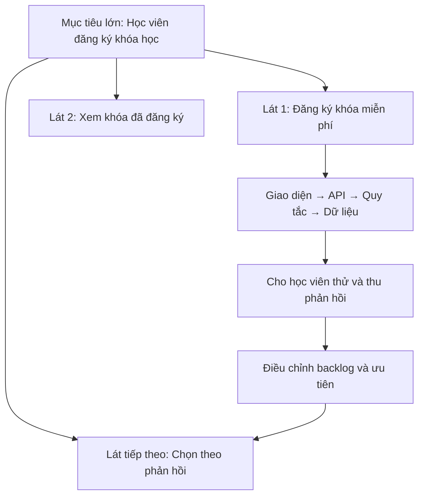
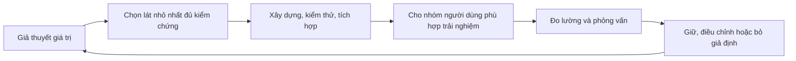

# Chia nhỏ việc bàn giao để sớm kiểm chứng giá trị

## 1. Vì sao Agile ưu tiên những phần bàn giao nhỏ?

Trong phát triển phần mềm, một yêu cầu lớn thường chứa nhiều giả định: người dùng thật sự cần chức năng nào, họ có hiểu cách sử dụng không, quy trình nghiệp vụ có phù hợp không, và giải pháp kỹ thuật có vận hành ổn định không. Nếu đợi hoàn tất toàn bộ hệ thống mới đưa cho người dùng trải nghiệm, nhóm chỉ phát hiện các giả định sai khi chi phí thay đổi đã lớn.

Một tư tưởng cốt lõi của **Agile** là cung cấp phần mềm có giá trị sớm và thường xuyên, quan sát phản hồi rồi điều chỉnh. Vì vậy, nhóm cần chia một mục tiêu lớn thành những **phần chức năng nhỏ, hoàn chỉnh từ góc nhìn người dùng hoặc bên nhận giá trị**, có thể kiểm chứng độc lập. Mỗi lần bàn giao vừa tạo ra lợi ích vừa giúp nhóm học thêm điều gì nên làm tiếp.

Ví dụ, một nền tảng học trực tuyến muốn xây dựng “hệ thống đăng ký khóa học”. Thay vì triển khai đồng thời tìm kiếm nâng cao, giỏ hàng, mã giảm giá, thanh toán nhiều phương thức, danh sách chờ và email marketing, nhóm có thể bắt đầu bằng khả năng **học viên đã đăng nhập đăng ký một khóa miễn phí từ trang chi tiết và truy cập được nội dung học**. Đây là một hành vi sử dụng thật, có thể cho một nhóm học viên thử và đo xem họ có hoàn tất đăng ký được không.

Lợi ích của cách làm này không chỉ là “ra nhanh hơn”:

- **Giảm rủi ro xây sai:** phát hiện sớm hành vi, nhu cầu hoặc quy tắc nghiệp vụ chưa được hiểu đúng.
- **Rút ngắn thời gian nhận phản hồi:** nhóm thấy kết quả của quyết định sản phẩm trong vài ngày hoặc một chu kỳ ngắn, thay vì sau nhiều tháng.
- **Dễ thay đổi thứ tự ưu tiên:** phản hồi từ phần đã chạy quyết định phần nào đáng đầu tư tiếp theo.
- **Giảm khối lượng công việc dở dang:** ít hạng mục lớn kéo dài và ít tích hợp dồn vào cuối.
- **Tăng khả năng dự báo:** phần việc nhỏ, được hoàn tất đều đặn, giúp nhóm quan sát luồng công việc rõ hơn.

> Nguyên tắc quan trọng: **chia nhỏ để bàn giao và học hỏi sớm**, không chỉ chia nhỏ để phân công lập trình.

### Phân biệt các khái niệm dễ nhầm

| Khái niệm | Ý nghĩa | Điểm cần nhớ |
| --- | --- | --- |
| **Epic** | Mục tiêu hoặc nhóm nhu cầu quá lớn để hoàn thành như một hạng mục nhỏ | Cần tách thành các lát giá trị có thể kiểm chứng |
| **User story** | Cách mô tả một nhu cầu và lợi ích mong muốn của người dùng | Chỉ có ích khi đi cùng trao đổi và tiêu chí chấp nhận cụ thể |
| **Task kỹ thuật** | Việc nhóm thực hiện để hoàn thành một story, như tạo bảng dữ liệu hay viết API | Task tự nó có thể chưa tạo ra giá trị sử dụng |
| **Increment** | Phần sản phẩm đã tích hợp, đạt mức chất lượng cần thiết, bổ sung vào sản phẩm hiện có | Có thể kiểm thử/đánh giá như một phần của sản phẩm thật |
| **Release** | Quyết định đưa khả năng đã sẵn sàng đến một nhóm người dùng | Không bắt buộc trùng với cuối Sprint; có thể phát hành từng phần |
| **MVP** | Phiên bản tối thiểu đủ để kiểm chứng một giả thuyết giá trị quan trọng | “Tối thiểu” không đồng nghĩa với thiếu an toàn hoặc không dùng được |
| **Prototype** | Mô hình để khám phá giao diện hay ý tưởng | Có thể hữu ích để học, nhưng không mặc nhiên là chức năng đã bàn giao |

**Increment** trả lời “sản phẩm đã có thêm khả năng hoạt động nào?”, còn **MVP** trả lời “cần phiên bản nhỏ nhất nào để kiểm tra một giả thuyết sản phẩm?”. Một MVP có thể gồm nhiều increment. Một bản triển khai cho môi trường nội bộ vẫn tạo ra khả năng kiểm chứng, nhưng phải phân biệt phản hồi nội bộ với bằng chứng từ người dùng thực tế.

## 2. Chia theo chiều dọc: một lát giá trị đi hết hành trình

Một sai lầm thường gặp là chia yêu cầu theo **tầng kỹ thuật**:

1. Hoàn thiện toàn bộ cơ sở dữ liệu.
2. Hoàn thiện toàn bộ API.
3. Hoàn thiện toàn bộ giao diện.
4. Cuối cùng mới tích hợp và mời người dùng thử.

Cách chia này có thể phù hợp để phân rã **task bên trong một story**, nhưng từng đầu ra riêng lẻ chưa cho thấy người dùng có nhận được lợi ích hay không. Phản hồi về hành vi thật đến muộn, còn các vấn đề tích hợp tích tụ đến cuối.

Thay vào đó, hãy chia theo **lát dọc (vertical slice)**: một hành trình sử dụng hẹp nhưng xuyên qua những thành phần cần thiết như giao diện, xử lý nghiệp vụ, lưu trữ, phân quyền và kiểm thử.



Để là một lát dọc thực sự, “Đăng ký khóa miễn phí” phải hoạt động từ thao tác nhấn nút đến việc ghi nhận đăng ký và cấp quyền truy cập. Một nút bấm hiển thị thông báo thành công trong khi hệ thống chưa lưu đăng ký chỉ là mô phỏng; nó chưa kiểm chứng được toàn bộ hành trình.

Một lát nhỏ **không cần chứa mọi lựa chọn**. Chẳng hạn, chỉ hỗ trợ khóa miễn phí là một giới hạn phạm vi hợp lý. Tuy vậy, phạm vi nhỏ vẫn phải đáp ứng các bảo đảm cốt lõi: xác thực đúng người, không tạo đăng ký trùng và không cấp quyền cho khóa không hợp lệ. Không được hoãn vấn đề bảo mật, toàn vẹn dữ liệu hoặc điều kiện an toàn chỉ để gọi phiên bản là MVP.

### Năm câu hỏi để nhận biết một lát giá trị

1. **Ai** nhận được lợi ích cụ thể từ lát này (học viên, quản trị viên, bộ phận vận hành hoặc khách hàng API)?
2. Người đó có thể **thực hiện được hành vi có ý nghĩa** khi lát này hoàn tất không?
3. Lát này có **kiểm thử và trình diễn độc lập** trên luồng thật không?
4. Nhóm có thể **quan sát tín hiệu phản hồi** để quyết định giữ, sửa hoặc bỏ giả định nào không?
5. Lát này đủ nhỏ để **hoàn tất và tích hợp trong thời gian ngắn** với năng lực hiện tại của nhóm không?

Nếu câu trả lời chủ yếu là “phải chờ các nhóm khác làm hết rồi mới biết”, phần việc có thể vẫn đang được chia theo cấu phần thay vì theo giá trị.

## 3. Từ nhu cầu lớn đến những user story có thể bàn giao

Một **user story** thường được viết theo mẫu:

> Là **[vai trò]**, tôi muốn **[khả năng]** để **[lợi ích/kết quả mong muốn]**.

Ví dụ:

> Là học viên đã đăng nhập, tôi muốn đăng ký một khóa học miễn phí đang mở từ trang chi tiết để có thể bắt đầu học ngay.

Mẫu câu giúp làm rõ đối tượng và lợi ích; nó không thay thế cuộc trao đổi về nghiệp vụ, các tình huống biên và cách xác nhận thành công. Có thể dùng mô hình **3C**: *Card* (mô tả ngắn), *Conversation* (trao đổi để hiểu đúng) và *Confirmation* (tiêu chí chấp nhận). Một story nên đủ nhỏ và rõ để nhóm có thể đưa vào thực hiện, nhưng cũng đủ giá trị để Product Owner và người dùng đánh giá.

### Những cách tách story thường hữu ích

| Cách tách | Ví dụ với nền tảng học | Khi nào hữu ích |
| --- | --- | --- |
| **Theo nhóm người dùng** | Học viên tự đăng ký trước; quản trị viên đăng ký hộ sau | Quyền hạn và hành vi các nhóm khác nhau |
| **Theo biến thể nghiệp vụ** | Đăng ký khóa miễn phí trước; khóa có phí sau | Một luồng cơ bản có thể dùng độc lập |
| **Theo quy tắc bổ sung** | Đăng ký khóa không giới hạn chỗ trước; bổ sung danh sách chờ khi có nhu cầu | Quy tắc phức tạp chưa cần cho nhóm thử nghiệm ban đầu |
| **Theo dữ liệu/tình huống** | Đăng ký một khóa; quản lý nhiều khóa hoặc nhiều chương trình sau | Có thể bắt đầu với dữ liệu phổ biến và hành vi hoàn chỉnh |
| **Theo thao tác có giá trị** | Đăng ký khóa; xem khóa đã đăng ký; hủy đăng ký | Mỗi thao tác đem lại lợi ích độc lập |
| **Theo mức độ tiện lợi** | Truy cập từ trang chi tiết; tìm kiếm và lọc nâng cao sau | Có luồng thủ công đơn giản nhưng thực sự dùng được |

Một kỹ thuật thực hành là **story mapping**: vẽ hành trình người dùng theo thứ tự họ thực hiện, đặt các biến thể dưới từng bước và tìm đường đi ngắn nhất cho một kết quả có ích. Sau đó phân tách thành từng đợt bàn giao dựa trên rủi ro, giá trị và điều đã học.

```text
Hành trình: Khám phá khóa → Xem chi tiết → Đăng ký → Bắt đầu học
Đợt đầu : Link trực tiếp → Chi tiết cơ bản → Miễn phí → Truy cập bài đầu
Các đợt sau (xếp lại theo bằng chứng):
           Tìm kiếm/lọc      → Thanh toán → Theo dõi tiến độ
```

Đợt đầu không bắt buộc phải làm chức năng tìm kiếm nếu học viên có thể nhận liên kết khóa từ email hoặc trang giới thiệu. Ngược lại, nếu phần lớn học viên không tìm được khóa phù hợp, dữ liệu có thể khiến nhóm ưu tiên tìm kiếm trước một chức năng khác.

**Tránh tách story thành những mẩu phụ thuộc không đem lại lợi ích riêng:** “tạo bảng `enrollments`”, “xây endpoint `/enroll`”, “vẽ nút Đăng ký”. Các mục này có thể là task kỹ thuật nằm **trong cùng một story**. Việc chia task vẫn hữu ích cho phối hợp, nhưng chỉ hoàn thành từng task chưa có nghĩa là story đã sẵn sàng bàn giao.

### Kiểm tra kích thước và tính độc lập

INVEST là một gợi ý để rà soát story: **Independent** (ít phụ thuộc), **Negotiable** (có thể trao đổi), **Valuable** (có giá trị), **Estimable** (đủ rõ để ước lượng), **Small** (đủ nhỏ), **Testable** (kiểm chứng được). Không cần ép mọi story hoàn toàn độc lập về kỹ thuật; mục tiêu là giảm phụ thuộc đủ để nhóm có thể hoàn thành, tích hợp và nhận phản hồi.

Nếu một story vẫn kéo dài qua nhiều chu kỳ, hãy tìm **biến thể người dùng, kịch bản, quy tắc hoặc phạm vi tích hợp** có thể lược bớt mà không phá vỡ kết quả cốt lõi. Những cuộc khảo sát kỹ thuật có thời hạn (*spike*) có thể làm rõ bất định, nhưng đầu ra của spike là kiến thức/quyết định kỹ thuật, không nên nhầm với giá trị sản phẩm đã phát hành.

## 4. Ví dụ xuyên suốt: triển khai đăng ký khóa học theo từng lát

Giả sử nền tảng đã có tài khoản, đăng nhập và trang chi tiết khóa học. Nhóm muốn kiểm chứng giả thuyết: **“Học viên quan tâm sẽ bắt đầu học khi việc đăng ký chỉ cần một thao tác rõ ràng.”** Đây là giả thuyết cần kiểm chứng, không phải kết luận có sẵn.

| Lát bàn giao | Khả năng hoạt động khi hoàn tất | Điều muốn học từ người dùng | Ghi chú phạm vi |
| --- | --- | --- | --- |
| **1. Đăng ký khóa miễn phí** | Học viên nhấn Đăng ký trên khóa đang mở, hệ thống lưu đúng một đăng ký và cho vào học | Người dùng có hiểu nút đăng ký và hoàn tất luồng không? | Chỉ khóa miễn phí; có phân quyền và chống đăng ký trùng |
| **2. Xem khóa của tôi** | Học viên thấy và mở lại các khóa đã đăng ký | Người dùng có quay lại học được dễ dàng không? | Bắt đầu với danh sách đơn giản |
| **3. Tìm kiếm/lọc khóa** | Học viên tự tìm khóa phù hợp trong danh mục | Người dùng có bị cản trở ở bước khám phá không? | Chọn từ khóa/bộ lọc theo nhu cầu quan sát được |
| **4. Đăng ký khóa trả phí** | Học viên thanh toán qua một phương thức được hỗ trợ và nhận quyền học khi giao dịch được xác nhận | Trở ngại là nhu cầu, mức giá hay trải nghiệm thanh toán? | Cần xử lý an toàn giao dịch, trạng thái bất đồng bộ và đối soát |

Đây là **các ứng viên để ưu tiên**, không phải cam kết phải làm theo thứ tự 1 → 4. Sau mỗi lần thử, nhóm xem lại giả thuyết và backlog. Chẳng hạn, nếu học viên đăng ký xong nhưng không tìm được khóa khi quay lại, lát 2 có thể cấp thiết hơn lát 3. Nếu nhiều người không hiểu giá trị khóa học trước khi đăng ký, nhóm có thể sửa trang giới thiệu hoặc nội dung mô tả trước khi mở rộng chức năng.

### Tiêu chí chấp nhận cho lát 1

Tiêu chí chấp nhận (*acceptance criteria*) mô tả hành vi quan sát được. Có thể biểu diễn bằng Gherkin để nhóm sản phẩm, kiểm thử và lập trình cùng thống nhất:

```gherkin
Feature: Đăng ký khóa học miễn phí

  Scenario: Học viên đăng ký thành công
    Given học viên đã đăng nhập
    And khóa học miễn phí đang cho phép đăng ký
    When học viên chọn "Đăng ký" tại trang chi tiết khóa học
    Then hệ thống ghi nhận đăng ký cho học viên đó
    And học viên có thể truy cập nội dung được phép học
    And giao diện xác nhận đăng ký thành công

  Scenario: Học viên nhấn đăng ký lặp lại
    Given học viên đã đăng ký khóa học đó
    When học viên gửi lại yêu cầu đăng ký
    Then hệ thống không tạo bản ghi đăng ký trùng
    And học viên vẫn có thể truy cập khóa học

  Scenario: Khóa học đã ngừng nhận đăng ký
    Given khóa học không còn cho phép đăng ký
    When học viên gửi yêu cầu đăng ký
    Then hệ thống từ chối yêu cầu với thông báo phù hợp
    And không cấp thêm quyền học
```

Các tiêu chí trên tập trung vào **kết quả**, không áp đặt phải dùng framework, tên hàm hay cách thiết kế bảng dữ liệu nào. Nhóm có thể bổ sung tiêu chí về phiên đăng nhập hết hạn, nhiều yêu cầu đồng thời, thông báo lỗi hoặc tính trợ năng theo mức rủi ro và tiêu chuẩn chất lượng hiện hành. Cơ chế chống trùng cần được bảo vệ ở phía máy chủ/dữ liệu, không chỉ vô hiệu hóa nút trên giao diện.

### Khi nào lát 1 được xem là xong?

“Code đã viết xong” chưa đủ. Nhóm nên thống nhất **Definition of Done (DoD)** áp dụng cho increment, chẳng hạn:

- Luồng đăng ký hoạt động trên phiên bản đã tích hợp, không phụ thuộc vào dữ liệu giả để báo thành công.
- Tiêu chí chấp nhận và các trường hợp rủi ro cốt lõi được kiểm thử; quyền truy cập và tính toàn vẹn dữ liệu được bảo đảm.
- Thay đổi đã được review, qua các kiểm tra tự động phù hợp và có thể triển khai theo quy trình của nhóm.
- Có cách quan sát lỗi, tình trạng đăng ký và tín hiệu sử dụng; thông tin cá nhân được thu thập ở mức cần thiết.
- Tài liệu/hướng dẫn vận hành liên quan được cập nhật; nếu thử nghiệm giới hạn, có cách bật/tắt hoặc hoàn tác phù hợp.

Các tiêu chí trên cần điều chỉnh theo mức độ quan trọng của hệ thống. Với thanh toán, danh tính hoặc dữ liệu nhạy cảm, không được bỏ bớt những kiểm tra bắt buộc vì muốn tăng tốc. **Hoàn thành increment**, **triển khai kỹ thuật** và **phát hành cho người dùng** là những quyết định liên quan nhưng không đồng nhất. Nhóm có thể tích hợp thường xuyên và chỉ bật một chức năng cho nhóm thử nghiệm khi đã sẵn sàng.

## 5. Vòng phản hồi biến từng lần bàn giao thành bài học

Nếu chỉ bàn giao liên tục mà không quan sát tác động, nhóm mới tối ưu tốc độ tạo chức năng, chưa chắc tạo được giá trị. Một vòng phản hồi Agile có thể thực hiện theo chuỗi:



Với lát đăng ký miễn phí, nhóm có thể chuẩn bị trước những câu hỏi và tín hiệu sau:

| Câu hỏi cần kiểm chứng | Tín hiệu có thể quan sát | Cách diễn giải thận trọng |
| --- | --- | --- |
| Học viên có hoàn tất đăng ký không? | Tỷ lệ hoàn tất = số học viên đăng ký thành công / số học viên bắt đầu luồng | Phải định nghĩa rõ người dùng duy nhất và khoảng thời gian đo |
| Có bước nào gây khó hiểu? | Quan sát phiên dùng thử, phản hồi hỗ trợ, lỗi theo từng bước | Số liệu chỉ ra vị trí cần tìm hiểu; phỏng vấn giúp hiểu nguyên nhân |
| Đăng ký có dẫn đến học thật không? | Tỷ lệ mở bài học đầu sau đăng ký; thời gian từ đăng ký đến bài đầu | Đăng ký thành công chưa đồng nghĩa người dùng nhận đủ giá trị |
| Lát bàn giao có đủ nhỏ để học nhanh không? | Lead time, cycle time, số hạng mục hoàn tất, WIP | Đo xu hướng để cải thiện luồng, không dùng một chỉ số đơn lẻ để đánh giá cá nhân |

**Ví dụ minh họa:** trong một đợt thử nghiệm, có 60 học viên bắt đầu đăng ký và 42 người hoàn tất. Tỷ lệ hoàn tất là `42 / 60 = 70%`. Điều này cho biết có 18 trường hợp chưa hoàn tất trong phạm vi đo, **chưa** cho biết lý do. Nhóm cần kiểm tra log lỗi, điều kiện mạng, trình duyệt, quan sát hành vi và trao đổi với người dùng. Cỡ mẫu, cách tuyển người thử và các yếu tố ngoại cảnh cũng quyết định mức độ tin cậy của kết luận.

Ngoài phản hồi sản phẩm, nhóm còn cần phản hồi **kỹ thuật** (lỗi khi tích hợp, hiệu năng, vận hành) và **quy trình** (bước chờ review, số lượng việc đang làm, trở ngại phối hợp). Trong Scrum, Sprint Review là một dịp kiểm tra increment và thích ứng Product Backlog; Retrospective giúp cải tiến cách làm. Với Kanban, nhóm có thể bàn giao và quan sát dòng công việc liên tục, không cần đợi ranh giới Sprint. Các thực hành XP như kiểm thử tự động, tích hợp liên tục và refactoring hỗ trợ duy trì tốc độ giao các lát nhỏ với chất lượng ổn định.

### Phản hồi sớm phải dẫn đến quyết định

Sau mỗi đợt thử nghiệm, hãy ghi ngắn gọn:

1. **Đã quan sát được gì?** Tín hiệu định lượng và nhận xét định tính, kèm phạm vi thử nghiệm.
2. **Giả thuyết nào được củng cố hoặc bị nghi ngờ?** Phân biệt dữ liệu thực tế với cách nhóm giải thích.
3. **Cần làm gì tiếp?** Mở rộng cho nhiều người, sửa lát vừa giao, thực hiện lát khác hoặc dừng ý tưởng.
4. **Khi nào kiểm tra lại?** Chọn mốc hoặc điều kiện đủ để có bằng chứng mới.

Không có quy định rằng lần bàn giao nào cũng phải bổ sung chức năng mới. Một lần sửa lỗi khó hiểu ở biểu mẫu, rút ngắn thời gian phản hồi hoặc cải thiện thông điệp có thể tạo ra tác động lớn hơn một tính năng mới.

## 6. Tổ chức công việc để thực sự bàn giao tăng dần

Chia story tốt vẫn chưa đủ nếu quy trình khiến mọi thứ bị dồn vào cuối. Để nhận phản hồi sớm, nhóm có thể áp dụng các thói quen sau:

**Ưu tiên theo giá trị và bất định.** Chọn những giả định quan trọng mà việc kiểm chứng sớm có thể thay đổi quyết định đầu tư. Một lát có nhiều rủi ro nhưng dễ thử nghiệm thường đáng làm trước một khả năng lớn chưa rõ ai sẽ dùng. Tuy nhiên, phải tính đến phụ thuộc bắt buộc và yêu cầu pháp lý/bảo mật.

**Giới hạn công việc đang thực hiện (WIP).** Hoàn tất vài lát nhỏ rồi lấy phản hồi thường tốt hơn mở nhiều story cùng lúc nhưng không story nào chạy hoàn chỉnh. Với bảng Kanban, hãy quan sát cột bị ùn tắc và giúp phần việc đi đến “Done”. Với Scrum, chọn lượng story có thể hoàn tất trong Sprint dựa trên năng lực thực tế, giữ Sprint Goal rõ ràng.

**Tích hợp và kiểm tra thường xuyên.** Dùng kiểm thử tự động ở các mức thích hợp, review code, kiểm tra hợp đồng API và pipeline CI. Những thay đổi cơ sở dữ liệu cần tương thích khi triển khai nhiều phiên bản (ví dụ, mở rộng schema trước rồi chuyển dữ liệu/loại bỏ cấu trúc cũ sau). Các thực hành này giúp một lát nhỏ thật sự vận hành được chứ không chỉ trông hoàn chỉnh trên một máy lập trình.

**Tách triển khai khỏi việc mở cho toàn bộ người dùng khi cần.** Feature flag, thử nghiệm với nhóm nhỏ và cơ chế quay lui giúp thu thập phản hồi có kiểm soát. Tuy nhiên, cờ tính năng không thay thế kiểm thử hoặc bảo vệ dữ liệu. Một tính năng liên quan thanh toán chỉ nên mở khi các tình huống thất bại, thanh toán lặp, thông báo bất đồng bộ và đối soát đã được xử lý phù hợp.

**Giữ sự hợp tác liên chức năng.** Phát triển, kiểm thử, thiết kế và người hiểu nghiệp vụ thống nhất tiêu chí từ đầu; cùng chịu trách nhiệm đưa story đến trạng thái có thể kiểm chứng. Việc chia task theo chuyên môn chỉ phục vụ thực hiện, không tạo ra các “story backend” và “story frontend” độc lập giả tạo.

## 7. Những cách chia nhỏ phản tác dụng

| Dấu hiệu | Vì sao có vấn đề | Cách điều chỉnh |
| --- | --- | --- |
| Chia theo database → API → UI rồi đợi tích hợp | Không thể đánh giá hành trình người dùng đến cuối | Chọn một luồng hẹp và hoàn thiện xuyên các tầng |
| Story chỉ là danh sách task kỹ thuật | Product Owner không thể xác nhận giá trị nhận được | Gắn story với đối tượng, kết quả và acceptance criteria |
| MVP chỉ là giao diện giả trong khi nghiệp vụ chưa chạy | Kết quả thử nghiệm có thể không đại diện cho trải nghiệm thật | Gọi đúng là prototype; xây lát hoạt động để kiểm chứng vận hành |
| Cắt bỏ xác thực, phân quyền hay tính toàn vẹn | “Nhanh” tạo ra rủi ro không chấp nhận được | Thu hẹp nhóm người dùng hoặc biến thể, giữ yêu cầu an toàn |
| Mỗi lát quá nhỏ, không ai dùng được | Tăng số ticket nhưng chưa tăng lần học hỏi | Ghép các task thành một kết quả có thể sử dụng và đo lường |
| Phát hành nhưng không thu thập phản hồi | Nhóm tiếp tục theo giả định ban đầu | Đặt câu hỏi, tín hiệu và cách thu thập trước khi triển khai |
| Cứ làm tiếp các lát đã lên kế hoạch dù dữ liệu đổi chiều | Mất khả năng thích ứng, lãng phí đầu tư | Sắp xếp lại Product Backlog dựa trên kết quả quan sát |

## 8. Bài thực hành: tách một yêu cầu lớn

**Đề bài.** Một nhóm được giao “xây dựng chức năng đánh giá khóa học” với điểm sao, nhận xét, ảnh minh họa, phản hồi của giảng viên, lọc theo điểm và báo cáo quản trị. Người quản lý muốn biết học viên có sẵn sàng cung cấp phản hồi hữu ích sau khi học không.

Hãy tự trả lời: (1) giả thuyết giá trị nào quan trọng nhất; (2) lát dọc nhỏ nhất đủ để kiểm chứng; (3) ba tiêu chí chấp nhận; (4) tín hiệu nào giúp quyết định bước tiếp theo.

**Một phương án tham khảo:**

- **Giả thuyết:** sau khi học một khóa, học viên sẵn lòng đánh giá và các đánh giá đó cung cấp thông tin hữu ích cho người cân nhắc học.
- **Lát đầu:** học viên đã hoàn thành khóa có thể gửi một đánh giá 1–5 sao và nhận xét văn bản; đánh giá được lưu và hiển thị phù hợp trên trang khóa học sau bước kiểm duyệt cơ bản theo chính sách sản phẩm.
- **Tiêu chí chấp nhận:** chỉ học viên đủ điều kiện được gửi; mỗi học viên có một đánh giá cho mỗi khóa theo quy tắc đã thống nhất; đánh giá được lưu và hiển thị với trạng thái kiểm duyệt đúng quy định.
- **Tín hiệu:** tỷ lệ học viên đủ điều kiện gửi đánh giá, tỷ lệ nhận xét có nội dung hữu ích qua quan sát/đánh giá định tính, và phản hồi của người xem trang khóa học. Nếu không ai gửi, cần tìm hiểu động lực và thời điểm nhắc; chưa nên tự động xây bộ lọc và báo cáo phức tạp.

Phương án này cần được điều chỉnh nếu mục tiêu thật sự là **giúp người chọn khóa ra quyết định**: khi đó phải quan sát người xem có đọc, hiểu và sử dụng đánh giá hay không. Việc có nhiều đánh giá tự nó chưa chứng minh mục tiêu kinh doanh đã đạt.

## 9. Checklist trước khi đưa một lát vào thực hiện

- [ ] Đã mô tả rõ **người hưởng lợi** và **kết quả mong muốn**.
- [ ] Đã chọn **hành trình sử dụng hẹp nhưng hoàn chỉnh**, tránh chỉ chia theo tầng kỹ thuật.
- [ ] Đã nêu rõ **phạm vi có** và **phạm vi để sau** cùng các phụ thuộc thực tế.
- [ ] Đã xác định **tiêu chí chấp nhận có thể kiểm thử** và các rủi ro không được cắt bỏ.
- [ ] Đã thống nhất **Definition of Done**, cách tích hợp và mức sẵn sàng phát hành.
- [ ] Đã chuẩn bị **cách thu thập phản hồi** và câu hỏi cần được kiểm chứng.
- [ ] Nhóm có khả năng **hoàn thành, trình diễn và quan sát kết quả trong thời gian ngắn**.
- [ ] Sau khi có bằng chứng, Product Backlog sẽ được **xem xét và sắp xếp lại**.

**Ghi nhớ:** Giá trị của việc chia nhỏ không nằm ở số lượng user story, số Sprint hay số lần triển khai. Giá trị nằm ở khả năng đưa một kết quả đủ tốt đến đúng người, học sớm từ thực tế và dùng điều đã học để quyết định bước tiếp theo. Đó là cách Agile nối việc **bàn giao tăng dần**, **phản hồi sớm** và **cải tiến liên tục** thành một phương thức phát triển thích ứng.
