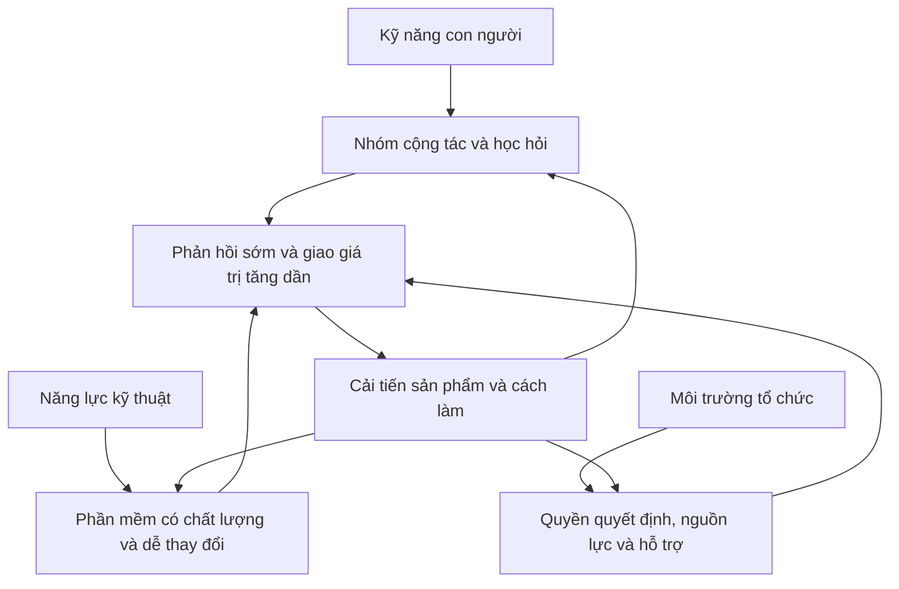

# Vai trò của kỹ năng con người, năng lực kỹ thuật và môi trường tổ chức

## 1. Agile là cách làm việc của cả một hệ thống

Một nhóm có thể tổ chức Sprint đều đặn, duy trì bảng Kanban và thường xuyên trình diễn phần mềm nhưng vẫn giao sản phẩm chậm, chất lượng thấp hoặc không giải quyết đúng nhu cầu người dùng. Nguyên nhân thường không nằm ở việc thiếu thêm một cuộc họp hay một mẫu biểu. Nhóm có thể thiếu kỹ năng trao đổi để làm rõ vấn đề, thiếu năng lực kỹ thuật để thay đổi phần mềm an toàn, hoặc làm việc trong một tổ chức có quá nhiều tầng phê duyệt và điểm bàn giao.

Phát triển Agile hướng đến phản hồi sớm, giao sản phẩm tăng dần và cải tiến liên tục. Muốn thực hiện được những điều đó, tổ chức cần phối hợp ba nhóm yếu tố:

- **Kỹ năng con người:** khả năng giao tiếp, cộng tác, lắng nghe, giải quyết bất đồng, học hỏi và cùng đưa ra quyết định.
- **Năng lực kỹ thuật:** khả năng phân tích, thiết kế, xây dựng, kiểm thử, tích hợp, triển khai và vận hành phần mềm có chất lượng.
- **Môi trường tổ chức:** mục tiêu, cơ cấu, quyền quyết định, nguồn lực, chính sách và văn hóa tạo điều kiện cho nhóm hoàn thành công việc.

Ba yếu tố này phụ thuộc lẫn nhau. Kỹ năng con người giúp nhóm hiểu đúng vấn đề và phối hợp. Năng lực kỹ thuật giúp nhóm biến hiểu biết đó thành phần mềm có thể kiểm chứng và thay đổi. Môi trường tổ chức quyết định nhóm có đủ quyền hạn, thông tin và điều kiện để làm việc hiệu quả hay không.

Agile vì vậy không phải nỗ lực của riêng lập trình viên, Scrum Master, Product Owner hay một nhóm dự án. Đây là năng lực phối hợp của nhóm sản phẩm và tổ chức xung quanh nhóm.

## 2. Kỹ năng con người giúp biến phản hồi thành hành động

Phần mềm được xây dựng để giải quyết vấn đề của con người trong một bối cảnh cụ thể. Yêu cầu thường không hoàn toàn rõ ngay từ đầu; các bên liên quan có thể có mục tiêu khác nhau; và giải pháp kỹ thuật cần được diễn giải bằng ngôn ngữ mà người dùng hiểu. Vì vậy, kỹ năng con người là điều kiện quan trọng để vòng phản hồi Agile hoạt động.

### 2.1. Giao tiếp rõ ràng và lắng nghe chủ động

Giao tiếp trong nhóm Agile không chỉ là truyền đạt trạng thái công việc. Nhóm cần trao đổi để hiểu vấn đề, kiểm tra giả định, chia sẻ thông tin và thống nhất cách xác nhận kết quả.

Lắng nghe chủ động bao gồm đặt câu hỏi mở, làm rõ thuật ngữ, nhắc lại điều đã hiểu và kiểm tra xem cách diễn giải có đúng với ý người nói hay không. Khi người dùng nói “tôi cần báo cáo nhanh hơn”, nhóm không nên lập tức coi đó là yêu cầu thêm nút xuất Excel. Cần tìm hiểu ai sử dụng báo cáo, họ đang chờ điều gì, quyết định nào bị chậm và thế nào là “nhanh hơn”.

Giao tiếp rõ ràng còn giúp nhóm trình bày giới hạn và rủi ro bằng ngôn ngữ dễ hiểu. Thay vì nói “API đang có vấn đề”, kỹ sư có thể giải thích rằng hệ thống đối tác phản hồi không ổn định, khiến một số lượt đặt lịch chưa được xác nhận ngay, và nêu các phương án xử lý cùng tác động của từng phương án.

### 2.2. Cộng tác đa chức năng

Một sản phẩm thường cần hiểu biết nghiệp vụ, thiết kế trải nghiệm, phát triển phần mềm, kiểm thử, bảo mật, dữ liệu và vận hành. Nếu những năng lực này chỉ làm việc nối tiếp qua các phòng ban riêng biệt, thông tin dễ bị mất và công việc phải chờ qua nhiều hàng đợi.

Nhóm đa chức năng tập hợp đủ kỹ năng cần thiết để cùng đưa một hạng mục từ nhu cầu đến kết quả có thể sử dụng hoặc đánh giá. Điều đó không có nghĩa mỗi thành viên phải biết làm mọi việc. Nhóm cần phối hợp năng lực chuyên môn, chia sẻ kiến thức và cùng chịu trách nhiệm về kết quả chung.

Ví dụ, khi xây dựng chức năng đặt lịch khám, người phụ trách nghiệp vụ giải thích quy tắc lịch hẹn; nhà thiết kế kiểm tra cách bệnh nhân chọn thời gian; lập trình viên đánh giá cách tích hợp lịch của bác sĩ; kiểm thử viên tìm các tình huống xung đột; người phụ trách vận hành xác định cách theo dõi lỗi. Trao đổi từ sớm giúp các ràng buộc được phát hiện trước khi chức năng hoàn thiện.

### 2.3. Đưa và nhận phản hồi mang tính xây dựng

Agile yêu cầu nhóm kiểm tra kết quả thường xuyên. Việc này chỉ có ích khi thành viên có thể nói về vấn đề cụ thể mà không biến phản hồi thành công kích cá nhân.

Phản hồi tốt tập trung vào hành vi hoặc kết quả quan sát được, tác động của nó và đề xuất cải thiện. Ví dụ: “Trong hai lần tích hợp gần đây, thay đổi được đưa lên nhánh chính khi bộ kiểm thử chưa chạy xong. Điều đó khiến nhóm phải tìm nguyên nhân lỗi muộn. Chúng ta có thể thiết lập điều kiện bắt buộc kiểm thử thành công trước khi hợp nhất không?” Cách trao đổi này cụ thể hơn nhận xét “nhóm lập trình thiếu cẩn thận”.

Người nhận phản hồi cũng cần biết đặt câu hỏi, kiểm tra dữ kiện và thống nhất hành động tiếp theo. Mục đích là cải thiện kết quả và cách làm việc, không phải tìm người để quy trách nhiệm cho mọi sai sót.

### 2.4. Giải quyết bất đồng và thương lượng

Các bên liên quan có thể ưu tiên những điều khác nhau: người dùng muốn nhiều chức năng, bộ phận vận hành cần độ ổn định, bộ phận bảo mật cần kiểm soát rủi ro và nhóm phát triển cần thời gian xử lý nợ kỹ thuật. Bất đồng là bình thường khi các góc nhìn khác nhau cùng tham gia vào một quyết định.

Nhóm cần phân biệt bất đồng về dữ kiện, mục tiêu và phương án. Có thể làm rõ tiêu chí quyết định, dùng dữ liệu hoặc thử nghiệm nhỏ, nêu tác động và tìm phương án đáp ứng mục tiêu quan trọng nhất. Khi chưa thể thống nhất, cần biết ai có quyền quyết định và cách ghi nhận rủi ro còn lại.

Thương lượng trong Agile cũng có nghĩa là điều chỉnh phạm vi, thứ tự và thời điểm bàn giao để bảo vệ mục tiêu. Nếu thời hạn không đổi, nhóm và bên liên quan có thể cùng xác định phần giá trị quan trọng nhất có thể hoàn thành với chất lượng chấp nhận được.

### 2.5. Tự quản lý, trách nhiệm và học hỏi

Nhóm Agile cần chủ động sắp xếp công việc, nhận diện trở ngại và tìm cách cải thiện. Tự quản lý không đồng nghĩa mỗi người tự làm theo ý mình. Nhóm cần mục tiêu chung, quy tắc phối hợp, thông tin minh bạch và trách nhiệm rõ ràng.

Khả năng học hỏi thể hiện qua việc sẵn sàng thừa nhận giả định sai, chia sẻ bài học, thử thay đổi nhỏ và xem xét kết quả. Một buổi retrospective chỉ có giá trị khi nhóm chọn được hành động cụ thể, có người theo dõi và quay lại đánh giá tác động ở lần tiếp theo.

### 2.6. Lãnh đạo và điều phối phục vụ nhóm

Lãnh đạo trong môi trường Agile không chỉ giao việc và kiểm soát tiến độ. Người lãnh đạo cần làm rõ mục tiêu, tạo điều kiện tiếp cận khách hàng, xử lý trở ngại vượt thẩm quyền của nhóm, hỗ trợ phát triển năng lực và bảo vệ thời gian cần thiết cho chất lượng.

Product Owner cần trao đổi với bên liên quan để làm rõ giá trị và thứ tự ưu tiên. Scrum Master hoặc người điều phối Agile giúp nhóm cải thiện cách cộng tác và nhận diện trở ngại của hệ thống. Các vai trò quản lý khác cần phối hợp để giảm xung đột ưu tiên và tạo điều kiện cho nhóm chịu trách nhiệm về kết quả.

## 3. Năng lực kỹ thuật giúp giao hàng nhanh mà vẫn giữ chất lượng

Phản hồi sớm chỉ có ích khi nhóm có thể biến phản hồi thành thay đổi đáng tin cậy. Nếu mỗi lần sửa phần mềm đều có nguy cơ làm hỏng chức năng cũ, nhóm sẽ ngại thay đổi, thời gian phát hành kéo dài và chi phí bảo trì tăng. Năng lực kỹ thuật giúp duy trì khả năng thích ứng của sản phẩm.

### 3.1. Hiểu miền nghiệp vụ và khám phá giải pháp

Nhóm cần hiểu quy trình, thuật ngữ, quy tắc và ngoại lệ của lĩnh vực đang xây dựng phần mềm. Kiến thức miền nghiệp vụ giúp nhóm nhận ra yêu cầu mâu thuẫn, đặt câu hỏi đúng và thiết kế giải pháp phù hợp.

Khả năng khám phá sản phẩm bổ sung cho kỹ năng kỹ thuật. Nhóm có thể phỏng vấn người dùng, quan sát cách họ làm việc, dựng nguyên mẫu, kiểm tra khả năng sử dụng và thử nghiệm giả định. Mục tiêu là giảm rủi ro xây dựng đúng một chức năng nhưng sai vấn đề.

Ví dụ, trước khi xây dựng hệ thống nhắc lịch phức tạp, nhóm có thể kiểm tra với nhân viên phòng khám xem người dùng thường bỏ lỡ lịch vì quên, vì khó đổi lịch hay vì thông tin xác nhận không rõ. Kết quả khám phá giúp chọn vấn đề cần giải quyết trước.

### 3.2. Phân tích, thiết kế và kiến trúc phù hợp

Nhóm cần khả năng chia nhỏ vấn đề, xác định ranh giới thành phần, mô hình hóa dữ liệu và lựa chọn kiến trúc phù hợp với yêu cầu hiện tại cùng hướng phát triển có thể dự đoán. Thiết kế tốt giúp thay đổi một chức năng ít gây ảnh hưởng ngoài dự kiến.

Không phải mọi hệ thống đều cần kiến trúc phức tạp hoặc công nghệ mới nhất. Nhóm nên chọn giải pháp đơn giản đáp ứng yêu cầu về khả năng mở rộng, bảo mật, hiệu năng, độ tin cậy và chi phí vận hành. Khi có thêm bằng chứng, kiến trúc có thể được điều chỉnh theo cách có kiểm soát.

### 3.3. Kiểm thử liên tục và tự động hóa

Kiểm thử là trách nhiệm xuyên suốt quá trình phát triển. Nhóm có thể kết hợp kiểm thử đơn vị, kiểm thử tích hợp, kiểm thử API, kiểm thử giao diện, kiểm thử chấp nhận và kiểm thử phi chức năng tùy rủi ro của sản phẩm.

Kiểm thử tự động giúp chạy lại các tình huống quan trọng mỗi khi mã thay đổi. Tuy nhiên, tự động hóa không thay thế hoàn toàn việc khám phá thủ công, đánh giá trải nghiệm hoặc kiểm tra những tình huống mới chưa có kịch bản. Bộ kiểm thử cần được duy trì để kết quả đáng tin cậy và phản hồi đủ nhanh.

### 3.4. Tích hợp liên tục và triển khai thường xuyên

Tích hợp liên tục (Continuous Integration - CI) là thực hành đưa thay đổi mã vào nhánh tích hợp thường xuyên và tự động kiểm tra chúng. CI giúp phát hiện xung đột và lỗi sớm khi phạm vi thay đổi còn nhỏ.

Triển khai liên tục hoặc phát hành thường xuyên (Continuous Delivery/Deployment) yêu cầu quy trình xây dựng, kiểm thử, đóng gói và triển khai có thể lặp lại. Continuous Delivery duy trì khả năng phát hành khi tổ chức quyết định; Continuous Deployment tự động đưa thay đổi đạt điều kiện vào môi trường sản xuất. Hai khái niệm có mức tự động hóa khác nhau và cần được phân biệt.

Nhóm không nhất thiết phải tự động hóa mọi bước ngay từ đầu. Có thể bắt đầu bằng việc tự động hóa kiểm tra có giá trị cao, làm cho bản dựng có thể tái tạo và giảm các thao tác triển khai thủ công dễ sai sót.

### 3.5. Tái cấu trúc và quản lý nợ kỹ thuật

Tái cấu trúc (refactoring) là cải thiện cấu trúc bên trong của mã mà không làm thay đổi hành vi bên ngoài mong muốn. Thực hành này giúp mã dễ hiểu, dễ kiểm thử và dễ mở rộng hơn.

Nợ kỹ thuật phát sinh khi nhóm chọn giải pháp tạm thời hoặc tích lũy cấu trúc khó bảo trì. Không phải mọi khoản nợ đều cần xử lý ngay, nhưng nhóm cần hiểu chi phí và rủi ro của chúng. Khi nợ kỹ thuật làm chậm phát triển, tăng lỗi hoặc cản trở thay đổi, cần đưa việc xử lý vào kế hoạch sản phẩm.

### 3.6. Bảo mật, độ tin cậy và khả năng vận hành

Chất lượng phần mềm không chỉ là chức năng chạy đúng trên máy của lập trình viên. Nhóm cần xem xét quyền truy cập, bảo vệ dữ liệu, quản lý bí mật, cập nhật thư viện, ghi log, giám sát, sao lưu, phục hồi và khả năng xử lý sự cố.

Các yêu cầu này nên được đưa vào thiết kế, tiêu chí chấp nhận và điều kiện hoàn thành. Nếu chỉ kiểm tra bảo mật hoặc khả năng vận hành ở cuối dự án, chi phí khắc phục có thể lớn và ảnh hưởng đến lịch phát hành.

### 3.7. Kỹ thuật là năng lực của cả nhóm

Chất lượng không thể phụ thuộc vào một vài chuyên gia luôn phải sửa lỗi cho những người khác. Nhóm cần chia sẻ kiến thức qua rà soát mã, lập trình cặp, tài liệu kỹ thuật vừa đủ, phiên chia sẻ và luân phiên xử lý những phần phù hợp. Chuyên gia vẫn có vai trò quan trọng, nhưng cần giúp nâng năng lực chung và giảm điểm phụ thuộc đơn lẻ.

## 4. Môi trường tổ chức tạo điều kiện hoặc cản trở Agile

Ngay cả nhóm có kỹ năng tốt cũng khó làm việc linh hoạt nếu mọi quyết định nhỏ đều phải xin nhiều cấp phê duyệt, ngân sách bị chia theo dự án ngắn hạn hoặc các bộ phận bị đánh giá bằng những mục tiêu xung đột. Môi trường tổ chức định hình cách nhóm sử dụng kỹ năng và năng lực kỹ thuật.

### 4.1. Mục tiêu sản phẩm rõ ràng và ưu tiên ổn định

Nhóm cần biết sản phẩm phục vụ ai, vấn đề nào cần giải quyết và kết quả nào được xem là thành công. Mục tiêu rõ ràng giúp nhóm tự quyết định cách làm và đánh giá đề xuất mới theo cùng một hướng.

Ưu tiên có thể thay đổi khi có bằng chứng mới, nhưng thay đổi liên tục mà không giải thích lý do sẽ làm nhóm mất tập trung. Lãnh đạo và Product Owner cần truyền đạt lý do thay đổi, điều chỉnh phạm vi và giúp các bên liên quan hiểu tác động đến kế hoạch.

### 4.2. Quyền tự chủ đi cùng ranh giới trách nhiệm

Nhóm cần quyền quyết định phù hợp về cách tổ chức công việc, thiết kế giải pháp và phối hợp chuyên môn. Quyền tự chủ giúp rút ngắn thời gian chờ và tăng trách nhiệm đối với kết quả.

Tự chủ cần có ranh giới rõ: mục tiêu sản phẩm, ngân sách, yêu cầu pháp lý, tiêu chuẩn bảo mật, nguyên tắc kiến trúc và các cam kết vận hành. Những ranh giới này giúp nhóm ra quyết định nhanh trong phạm vi được giao và biết khi nào cần xin ý kiến hoặc nâng cấp vấn đề.

### 4.3. Nhóm ổn định và đa chức năng

Nhóm ổn định có thời gian xây dựng hiểu biết chung, tin cậy và kiến thức về sản phẩm. Khi thành viên liên tục bị điều chuyển giữa nhiều dự án, nhóm phải tốn công tái lập bối cảnh và khó duy trì trách nhiệm xuyên suốt.

Tổ chức nên thiết kế nhóm quanh sản phẩm hoặc luồng giá trị khi có thể, với những năng lực cần thiết để hoàn thành phần việc. Các chuyên gia dùng chung vẫn có thể hỗ trợ nhiều nhóm, nhưng cần cơ chế ưu tiên và thời gian phản hồi rõ để tránh tạo hàng đợi vô hình.

### 4.4. Tiếp cận khách hàng và người ra quyết định

Nhóm cần được trao đổi trực tiếp hoặc có kênh phản hồi đáng tin cậy từ người dùng, khách hàng và chuyên gia nghiệp vụ. Nếu mọi thông tin đều đi qua nhiều tầng trung gian, nhóm khó xác minh giả định và phản hồi có thể đến muộn.

Tổ chức cần xác định ai có quyền làm rõ yêu cầu, ai quyết định ưu tiên và ai chấp nhận kết quả. Quyền quyết định rõ ràng giúp giảm vòng lặp chờ đợi và tránh tình trạng nhiều người đưa ra chỉ đạo trái ngược.

### 4.5. An toàn tâm lý và văn hóa minh bạch

An toàn tâm lý là điều kiện để thành viên có thể nêu vấn đề, đặt câu hỏi, thừa nhận sai sót và đề xuất ý tưởng mà không lo bị làm nhục hoặc trừng phạt tùy tiện. Điều đó không có nghĩa bỏ qua trách nhiệm hay hạ thấp tiêu chuẩn. Nhóm vẫn cần cam kết, tiêu chí chất lượng và hành động khắc phục rõ ràng.

Khi có sự cố, tổ chức nên tìm hiểu điều kiện hệ thống đã góp phần tạo ra sự cố, chẳng hạn quy trình kiểm tra thiếu bước, cảnh báo không đầy đủ hoặc quyền truy cập không rõ. Cách tiếp cận học hỏi giúp giảm nguy cơ lặp lại vấn đề và khuyến khích báo cáo sớm.

### 4.6. Giảm rào cản giữa các phòng ban

Các chỉ tiêu riêng lẻ có thể khiến từng bộ phận tối ưu phần việc của mình nhưng làm chậm kết quả chung. Ví dụ, nhóm phát triển được đánh giá theo số chức năng hoàn thành, kiểm thử theo số lỗi tìm thấy, vận hành theo số lần triển khai ít nhất. Những mục tiêu đó có thể tạo ra xung đột và hành vi chuyển trách nhiệm.

Tổ chức nên khuyến khích các bộ phận cùng chịu trách nhiệm về kết quả sản phẩm, chất lượng và trải nghiệm người dùng. Quy trình bảo mật, pháp lý, mua sắm và vận hành cần được thiết kế để tham gia sớm, có tiêu chí rõ và thời gian phản hồi dự đoán được.

### 4.7. Đầu tư vào học tập và cải tiến

Agile đòi hỏi nhóm học liên tục về sản phẩm, công nghệ và cách phối hợp. Tổ chức cần dành thời gian cho đào tạo, chia sẻ kiến thức, cải thiện công cụ, xử lý nợ kỹ thuật và xem xét quy trình.

Nếu mọi năng lực đều bị tiêu thụ bởi các cam kết giao hàng ngắn hạn, nhóm sẽ không có thời gian sửa nguyên nhân gốc. Năng lực dài hạn suy giảm, khiến mỗi thay đổi về sau ngày càng tốn kém.

## 5. Ba yếu tố bổ trợ nhau như thế nào?

Ba nhóm yếu tố có thể được xem xét qua các tình huống thường gặp:

| Tình huống | Thiếu hụt chính | Hệ quả | Hướng cải thiện |
|---|---|---|---|
| Nhóm làm đúng yêu cầu đã ghi nhưng người dùng không thấy hữu ích | Kỹ năng khám phá, lắng nghe và kiểm chứng nhu cầu | Xây dựng giải pháp cho giả định chưa được xác nhận | Trao đổi trực tiếp với người dùng, thử nguyên mẫu và đưa phản hồi vào ưu tiên |
| Nhóm hiểu đúng nhu cầu nhưng mỗi thay đổi gây lỗi hồi quy | Năng lực kiểm thử, thiết kế và tái cấu trúc | Nhóm ngại thay đổi, phát hành chậm | Xây dựng kiểm thử tự động, tích hợp liên tục và cải thiện cấu trúc mã |
| Nhóm có kỹ năng và công cụ tốt nhưng phải chờ nhiều cấp phê duyệt | Môi trường tổ chức và quyền quyết định | Thời gian chờ dài, cơ hội phản hồi bị bỏ lỡ | Làm rõ quyền hạn, ranh giới kiểm soát và luồng phê duyệt |
| Các phòng ban đều hoàn thành chỉ tiêu riêng nhưng sản phẩm thường trễ | Cộng tác và mục tiêu liên chức năng | Nhiều điểm bàn giao, tối ưu cục bộ | Nhóm ổn định quanh sản phẩm và đo kết quả chung |
| Nhóm phát hành nhanh nhưng sự cố sản xuất tăng | Kết hợp năng lực kỹ thuật và môi trường ưu tiên | Tốc độ ngắn hạn làm giảm độ tin cậy | Đưa vận hành, bảo mật và độ tin cậy vào tiêu chí hoàn thành |

Không nên quy mọi vấn đề cho thái độ của cá nhân. Một nhóm liên tục bỏ lỡ phản hồi có thể thiếu quyền tiếp cận khách hàng; nhóm thường xuyên phát hành lỗi có thể thiếu môi trường kiểm thử đáng tin cậy; nhóm không cải tiến có thể bị lấp đầy bởi công việc khẩn cấp và không có thời gian xử lý nguyên nhân gốc. Cần xem xét cả kỹ năng, công cụ, cơ cấu và chính sách liên quan.

## 6. Ví dụ thực tế: cải thiện quy trình đặt lịch khám

Giả sử một tổ chức muốn xây dựng chức năng đặt lịch khám trực tuyến. Ban đầu, yêu cầu được mô tả đơn giản là “cho phép bệnh nhân chọn bác sĩ và đặt lịch”. Nhóm Agile có thể phối hợp ba yếu tố như sau.

### Kỹ năng con người

- Người phụ trách sản phẩm trao đổi với bệnh nhân và nhân viên tiếp nhận để hiểu cách họ tìm giờ khám, đổi lịch và xử lý trường hợp bác sĩ bận đột xuất.
- Nhà thiết kế, lập trình viên và kiểm thử viên cùng phân tích các tình huống, làm rõ thuật ngữ và tiêu chí chấp nhận.
- Nhóm thảo luận bất đồng về thứ tự ưu tiên bằng dữ liệu và mục tiêu: giảm thời gian đặt lịch và giảm số cuộc gọi xác nhận.
- Sau khi thử nghiệm, nhóm tiếp nhận phản hồi mà không đổ lỗi cho người viết yêu cầu hoặc người triển khai.

### Năng lực kỹ thuật

- Nhóm thiết kế mô hình lịch hẹn có thể ngăn hai người đặt cùng một khung giờ.
- Các kiểm thử tự động xác nhận quy tắc giữ chỗ, hết hạn và xác nhận lịch.
- Tích hợp với hệ thống lịch của phòng khám được kiểm tra từ sớm bằng môi trường thử nghiệm.
- Log và giám sát giúp phát hiện lỗi đồng bộ; quy trình khôi phục giúp nhân viên xử lý khi dịch vụ đối tác gián đoạn.
- Nhóm phát hành từng phần nhỏ, chẳng hạn xem giờ trống trước, sau đó đặt lịch và cuối cùng thêm đổi lịch.

### Môi trường tổ chức

- Nhóm có quyền trao đổi với nhân viên tiếp nhận và một nhóm bệnh nhân đại diện.
- Product Owner có quyền sắp xếp ưu tiên và làm rõ quyết định nghiệp vụ.
- Đại diện vận hành, bảo mật và tích hợp tham gia từ đầu để xác định ràng buộc.
- Lãnh đạo thống nhất mục tiêu giảm thời gian đặt lịch, dành nguồn lực cho kiểm thử và xử lý các phụ thuộc liên phòng ban.
- Nhóm có thời gian xem xét dữ liệu sử dụng và cải tiến sau mỗi đợt phát hành.

Nếu thiếu một yếu tố, kết quả sẽ bị giới hạn. Có kỹ năng giao tiếp nhưng thiếu kiểm thử, nhóm có thể hiểu đúng nhu cầu nhưng không dám thay đổi phần mềm. Có kỹ thuật tốt nhưng không tiếp cận người dùng, nhóm có thể tạo ra luồng đặt lịch ổn định nhưng khó sử dụng. Có cả hai nhưng mọi quyết định đều phải chờ nhiều tuần, nhóm vẫn không thể phản hồi kịp thời.

## 7. Đánh giá năng lực và chọn điểm cải tiến

Đánh giá Agile nên tập trung vào khả năng tạo giá trị và học hỏi của hệ thống, không phải chấm điểm tính cách cá nhân hoặc đếm số nghi thức đã tổ chức.

### 7.1. Câu hỏi tự đánh giá

**Kỹ năng con người**

- Nhóm có thể giải thích nhu cầu người dùng bằng ví dụ cụ thể không?
- Thành viên có chia sẻ thông tin, nêu trở ngại và phản hồi một cách tôn trọng không?
- Khi bất đồng, nhóm có làm rõ dữ kiện, mục tiêu và người ra quyết định không?
- Các bên liên quan có tham gia đủ sớm để kiểm tra kết quả không?

**Năng lực kỹ thuật**

- Nhóm có thể hoàn thành, tích hợp và kiểm thử một phần chức năng trong thời gian ngắn không?
- Thay đổi có được kiểm tra tự động ở mức phù hợp không?
- Nhóm có thể triển khai và quan sát phần mềm một cách đáng tin cậy không?
- Nợ kỹ thuật, bảo mật và khả năng vận hành có được nhìn thấy và xử lý không?

**Môi trường tổ chức**

- Mục tiêu sản phẩm và quyền quyết định có rõ ràng không?
- Nhóm có tiếp cận người dùng, dữ liệu và chuyên gia cần thiết không?
- Các phòng ban có cùng chịu trách nhiệm về kết quả hay chỉ tối ưu chỉ tiêu riêng?
- Có thời gian và nguồn lực cho học tập, cải tiến và chất lượng dài hạn không?

### 7.2. Dùng bằng chứng thay cho cảm nhận đơn lẻ

Nhóm có thể kết hợp phản hồi định tính với các dữ liệu như:

- Thời gian từ khi yêu cầu được ghi nhận đến khi bàn giao (lead time) và thời gian xử lý sau khi bắt đầu (cycle time).
- Số hạng mục hoàn thành trong một khoảng thời gian (throughput), lượng công việc đang làm (WIP) và số hạng mục bị chặn.
- Tần suất phát hành, thời gian khôi phục sau sự cố và tỷ lệ thay đổi gây lỗi khi phù hợp với bối cảnh vận hành.
- Lỗi sau phát hành, yêu cầu hỗ trợ, tỷ lệ hoàn thành tác vụ hoặc phản hồi người dùng.
- Mức độ rõ ràng của mục tiêu, chất lượng phối hợp và các trở ngại được thành viên nêu trong retrospective.

Không có chỉ số nào tự nó chứng minh một nhóm “Agile hơn” nhóm khác. Chẳng hạn, tăng tần suất phát hành mà số sự cố và thời gian khôi phục cũng tăng có thể không phải cải thiện. Các chỉ số cần được đọc cùng nhau, theo xu hướng và bối cảnh. Không dùng velocity, số dòng mã hay số thẻ hoàn thành để xếp hạng cá nhân.

### 7.3. Cải tiến từng bước

Khi xác định được vấn đề, nhóm nên chọn một thay đổi nhỏ có thể kiểm chứng. Nếu công việc thường bị chờ kiểm thử, có thể cùng kiểm thử viên làm rõ tiêu chí sớm và tự động hóa một nhóm tình huống lặp lại. Nếu quyết định bị chậm, có thể làm rõ người có quyền quyết định và thống nhất thời gian phản hồi. Nếu thành viên ngại nêu rủi ro, người lãnh đạo có thể thay đổi cách tiếp nhận vấn đề và theo dõi xem việc báo cáo sớm có được khuyến khích hay không.

Một chu trình cải tiến hữu ích gồm:

1. Mô tả vấn đề bằng tình huống và dữ liệu quan sát được.
2. Tìm nguyên nhân có thể kiểm chứng, bao gồm yếu tố con người, kỹ thuật và tổ chức.
3. Chọn một hành động có phạm vi nhỏ, xác định người chịu trách nhiệm và kết quả mong đợi.
4. Thử trong một khoảng thời gian phù hợp, quan sát tác động và thu thập phản hồi.
5. Giữ lại, điều chỉnh hoặc dừng thay đổi dựa trên kết quả; chia sẻ bài học với những người liên quan.

## 8. Những cách áp dụng dễ gây hiểu sai

**Cho rằng Agile chỉ cần thái độ tích cực.** Tinh thần hợp tác rất cần thiết, nhưng không thể thay thế kiến thức nghiệp vụ, kỹ năng kỹ thuật, kiểm thử và năng lực vận hành.

**Cho rằng nhóm tự quản lý thì tổ chức không cần hỗ trợ.** Nhóm vẫn phụ thuộc vào mục tiêu, nguồn lực, chính sách, hạ tầng và các quyết định vượt thẩm quyền. Tổ chức cần xử lý những trở ngại ở cấp hệ thống.

**Cho rằng nhóm đa chức năng phải có mọi chuyên gia trong mọi thời điểm.** Điều cần thiết là nhóm có khả năng tiếp cận năng lực phù hợp và phối hợp đủ nhanh. Một số chuyên gia có thể phục vụ nhiều nhóm, miễn là cơ chế hỗ trợ và ưu tiên minh bạch.

**Cho rằng tự động hóa có thể giải quyết mọi vấn đề chất lượng.** Kiểm thử tự động giúp kiểm tra các hành vi đã biết; nhóm vẫn cần khám phá, đánh giá trải nghiệm, xem xét bảo mật và quan sát phần mềm trong vận hành.

**Cho rằng an toàn tâm lý nghĩa là không có tranh luận.** Nhóm cần tranh luận thẳng thắn về ý tưởng và dữ kiện, đồng thời tôn trọng con người. An toàn tâm lý hỗ trợ việc nói thật và nhận trách nhiệm.

**Cho rằng cải tiến là việc riêng của retrospective.** Cải tiến diễn ra trong mọi hoạt động: khi rà soát mã, xử lý sự cố, trao đổi với người dùng, xem xét dữ liệu và điều chỉnh quy trình.

## 9. Kết luận

Kỹ năng con người giúp nhóm hiểu nhu cầu, cộng tác và học từ phản hồi. Năng lực kỹ thuật giúp chuyển hiểu biết thành phần mềm có chất lượng, dễ kiểm thử, triển khai và thay đổi. Môi trường tổ chức cung cấp mục tiêu, quyền tự chủ, nguồn lực và cơ chế phối hợp để hai nhóm năng lực đó phát huy tác dụng.

Ba yếu tố cần được phát triển đồng thời. Khi nhóm gặp khó khăn, hãy xem xét cả cách giao tiếp, thực hành kỹ thuật và điều kiện tổ chức thay vì chỉ yêu cầu cá nhân cố gắng hơn hoặc bổ sung thêm nghi thức Agile. Một môi trường có mục tiêu rõ, nhóm có năng lực phù hợp và vòng phản hồi đáng tin cậy sẽ giúp tổ chức giao giá trị sớm, thích ứng với thay đổi và cải tiến liên tục.
