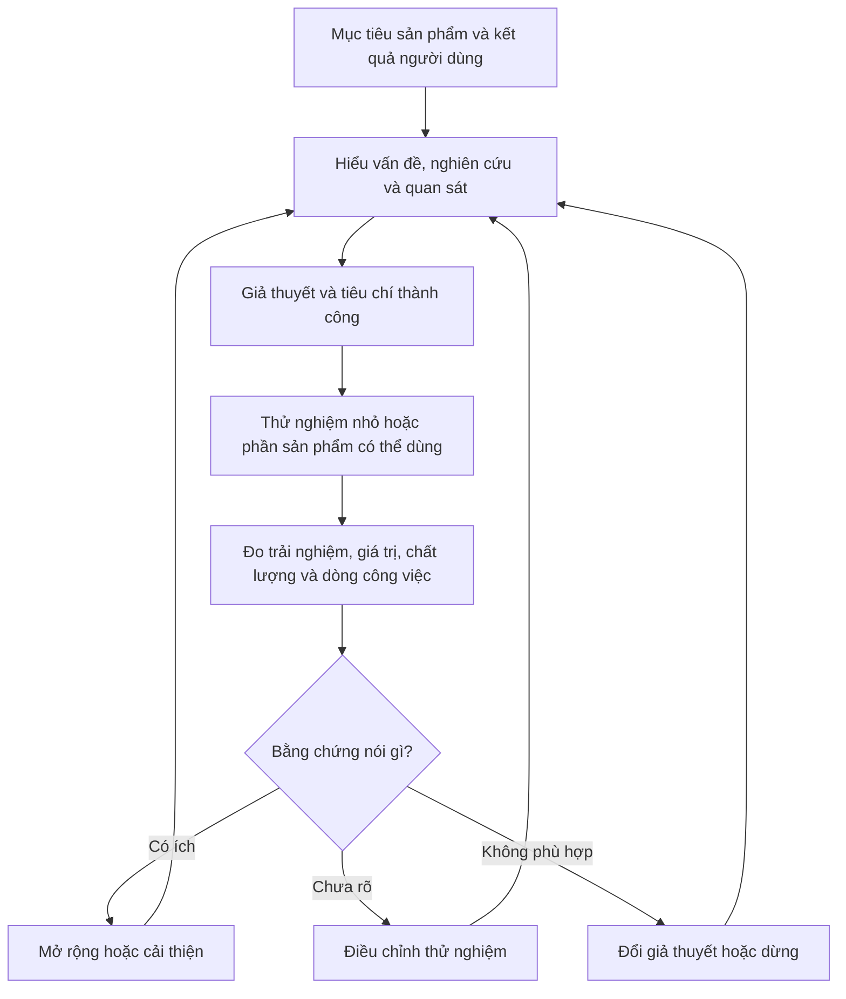

# Agile và mối liên hệ với tư duy tinh gọn cùng phát triển sản phẩm

Một đội phát triển có thể hoàn thành rất nhiều yêu cầu trong mỗi Sprint nhưng người dùng vẫn bỏ sản phẩm sau lần đăng nhập đầu tiên. Một đội khác có thể cải thiện thời gian xử lý ticket rất tốt nhưng lại đang tối ưu những chức năng không ai cần. Hai ví dụ này chỉ ra một vấn đề quan trọng: **giao công việc nhanh không tự động đồng nghĩa với tạo ra giá trị**.

Agile, tư duy tinh gọn (*Lean thinking*) và phát triển sản phẩm hiện đại có nhiều điểm giao nhau nhưng trả lời những câu hỏi khác nhau. Agile nhấn mạnh cộng tác, phần mềm hoạt động được, phản hồi và khả năng thích ứng. Lean giúp nhìn toàn bộ luồng tạo giá trị, phát hiện lãng phí và cải tiến hệ thống công việc. Phát triển sản phẩm giúp đội xác định **vấn đề nào đáng giải quyết, giải pháp nào tạo ra kết quả có ích và bằng chứng nào chứng minh điều đó**.

Bài học thuộc phần **Nền tảng Agile** của mô-đun **AGILE_DEVELOPMENT**. Mục tiêu là xây dựng một nền tảng tư duy để sử dụng user story, backlog, Scrum, Kanban, XP và các chỉ số dòng công việc theo cách phục vụ sản phẩm, thay vì biến chúng thành mục đích tự thân.

## 1. Mục tiêu học tập

Sau khi học, bạn có thể:

- Giải thích mối liên hệ và khác biệt về trọng tâm giữa Agile, Lean và phát triển sản phẩm dựa trên kết quả.
- Nhận diện giá trị, dòng giá trị (*value stream*), lãng phí, kích thước lô công việc, giới hạn công việc đang làm (*WIP*) và cơ chế kéo việc (*pull*).
- Phân biệt *output* (đầu ra đã giao) với *outcome* (thay đổi có ích) và *impact* (tác động dài hạn).
- Mô tả vòng học từ khám phá nhu cầu, xác định giả thuyết, giao một phần sản phẩm nhỏ, đo lường và điều chỉnh.
- Kết hợp Scrum, Kanban, XP, user story và backlog mà vẫn giữ trọng tâm vào phản hồi sớm, chất lượng và cải tiến liên tục.
- Đề xuất cách đo và cải thiện một tình huống phát triển sản phẩm cụ thể, tránh tối ưu chỉ số theo hình thức.

## 2. Ba góc nhìn bổ trợ cho nhau

| Góc nhìn | Câu hỏi trọng tâm | Điều hướng hành động | Rủi ro nếu hiểu sai |
| --- | --- | --- | --- |
| **Agile** | Làm thế nào để cộng tác, giao giá trị sớm và thích ứng khi điều kiện thay đổi? | Phản hồi thường xuyên, phát triển tăng dần, minh bạch, cải tiến | Làm đủ sự kiện Scrum rồi nghĩ rằng đã đáp ứng nhu cầu khách hàng |
| **Lean** | Làm thế nào để giá trị đi qua hệ thống với ít chờ đợi, lãng phí và lỗi hơn? | Nhìn toàn bộ dòng giá trị, giới hạn WIP, giảm lô công việc, cải tiến liên tục | Đẩy mọi người làm việc tối đa công suất, cắt bỏ cả hoạt động bảo đảm chất lượng |
| **Phát triển sản phẩm** | Khách hàng cần kết quả gì, nên giải quyết vấn đề nào và bằng chứng thành công là gì? | Khám phá nhu cầu, ưu tiên cơ hội, thử nghiệm giả thuyết, đo outcome | Giao đúng hạn một danh sách tính năng nhưng không giải quyết vấn đề thực tế |

Đây là **ba lăng kính**, không phải ba giai đoạn bắt buộc và cũng không phải ba mô hình thay thế lẫn nhau. Một đội có thể dùng tư duy Lean khi làm việc theo Scrum; một đội Kanban vẫn có thể nghiên cứu sản phẩm và chạy thử nghiệm; một đội thực hành XP vẫn phải xác định nhu cầu khách hàng.

Một cách nhớ hữu ích:

> **Phát triển sản phẩm** giúp chọn *đúng vấn đề cần giải quyết*. **Agile** giúp học và thích ứng trong quá trình giải quyết. **Lean** giúp đưa giá trị qua hệ thống hiệu quả và bền vững.

Ba câu này là cách diễn giải thực hành, không phải định nghĩa chính thức duy nhất của từng trường phái. Trong thực tế, Lean cũng nhấn mạnh học hỏi, Agile cũng quan tâm đến tối ưu luồng, còn phát triển sản phẩm cũng phải làm việc hiệu quả.

## 3. Nền tảng Agile: giá trị, nguyên tắc và khả năng thích ứng

Tuyên ngôn Agile năm 2001 ưu tiên:

1. **Cá nhân và sự tương tác** hơn quy trình và công cụ.
2. **Phần mềm hoạt động được** hơn tài liệu đầy đủ, chi tiết.
3. **Cộng tác với khách hàng** hơn thương lượng hợp đồng.
4. **Phản hồi với thay đổi** hơn bám sát kế hoạch ban đầu.

Vế bên phải vẫn có giá trị. Agile không yêu cầu bỏ tài liệu, kế hoạch hay các cam kết; đội cần chọn mức độ phù hợp để chúng hỗ trợ việc giao và kiểm chứng kết quả. Mười hai nguyên tắc đi kèm nhấn mạnh sự hài lòng của khách hàng qua giao phần mềm có giá trị sớm và liên tục, đón nhận thay đổi có ích, hợp tác thường xuyên, chất lượng kỹ thuật, tốc độ làm việc bền vững và tự nhìn lại để cải tiến.

**Phát triển tăng dần (*incremental*)** nghĩa là mỗi lần giao thêm một phần sản phẩm có thể sử dụng. **Phát triển lặp (*iterative*)** nghĩa là xem lại giả định hoặc giải pháp qua các vòng dựa trên thông tin mới. Một đội có thể vừa tăng dần vừa lặp: giao một quy trình đăng ký tối thiểu, quan sát người dùng và điều chỉnh trải nghiệm ở lần sau.

Điểm cốt lõi là **vòng phản hồi làm thay đổi quyết định**. Nếu đội luôn thực hiện backlog đã khóa từ đầu mà không xét bằng chứng mới, việc chia công việc thành các Sprint hai tuần không đủ để bảo đảm tính thích ứng.

Agile cũng không quy định rằng mọi đội phải dùng Scrum. Scrum là một framework hỗ trợ tạo giá trị trong công việc phức tạp; Kanban Method là một phương pháp cải tiến luồng công việc; XP là một phương pháp phát triển phần mềm coi trọng kỷ luật kỹ thuật. Những cách tiếp cận này có thể giúp hiện thực hóa các nguyên tắc Agile, với trọng tâm và cấu trúc khác nhau.

## 4. Tư duy Lean: nhìn toàn bộ dòng tạo giá trị

Lean có nguồn gốc quan trọng từ **Toyota Production System** và được phát triển thành tư duy quản lý dựa trên việc xác định giá trị từ góc nhìn khách hàng, cải thiện dòng công việc, loại bỏ lãng phí và trao quyền cho người tham gia cải tiến. Khi vận dụng sang phần mềm, không thể sao chép máy móc các bước sản xuất vật lý: phần mềm có tính bất định cao, nhiều việc là học hỏi, khám phá và giải quyết vấn đề mới.

### 4.1. Năm nguyên tắc Lean thường dùng để quan sát hệ thống

| Nguyên tắc | Ý nghĩa trong phát triển phần mềm | Câu hỏi gợi mở |
| --- | --- | --- |
| **Xác định giá trị** (*specify value*) | Bắt đầu từ nhu cầu, tác vụ hoặc kết quả mà người dùng thực sự coi trọng | Người dùng được lợi ích gì khi tính năng này hoạt động? |
| **Nhìn dòng giá trị** (*map the value stream*) | Quan sát từ lúc xuất hiện nhu cầu đến khi giá trị được kiểm chứng, kể cả các điểm chờ và bàn giao | Công việc nằm chờ ở đâu? Quyết định hay phê duyệt nào tạo độ trễ? |
| **Tạo dòng chảy** (*create flow*) | Giảm gián đoạn, chuyển ngữ cảnh, lô quá lớn và thời gian chờ | Điều gì làm một yêu cầu dừng giữa các bước? |
| **Thiết lập cơ chế kéo** (*establish pull*) | Bắt đầu việc mới khi hệ thống có năng lực xử lý theo chính sách rõ ràng | Đội đang kéo việc theo năng lực hay liên tục đẩy thêm việc vào? |
| **Liên tục hướng đến hoàn thiện** (*pursue perfection*) | Kiểm tra kết quả, sửa nguyên nhân hệ thống và thử cải tiến nhỏ | Thay đổi nào sẽ làm dòng giá trị tốt hơn mà không gây tác dụng phụ? |

Trong môi trường phần mềm, **giá trị** không chỉ là một màn hình mới. Nó có thể là người dùng hoàn tất tác vụ nhanh hơn, dịch vụ ít gián đoạn hơn, khách hàng tiết kiệm chi phí hoặc doanh nghiệp giảm rủi ro trong một quy trình quan trọng.

### 4.2. Những dạng lãng phí dễ gặp trong phát triển phần mềm

Các tác giả Mary và Tom Poppendieck diễn giải tư duy Lean cho phát triển phần mềm, trong đó chú trọng giảm lãng phí và khuếch đại học hỏi. Các dạng lãng phí điển hình gồm:

| Dạng lãng phí | Ví dụ | Hướng xem xét |
| --- | --- | --- |
| **Công việc dở dang** | 12 nhánh tính năng mở cùng lúc, chưa nhánh nào đủ điều kiện phát hành | Giảm WIP, hoàn tất việc có giá trị trước khi khởi động quá nhiều việc mới |
| **Tính năng thừa** | Xây bộ cấu hình phức tạp dù phần lớn người dùng chỉ cần một mặc định | Kiểm chứng nhu cầu; giảm phạm vi hoặc hoãn chức năng chưa có bằng chứng |
| **Chờ đợi** | Ticket chờ ba ngày để được xem xét thiết kế, rồi chờ kiểm thử | Tìm nút thắt, cải thiện chính sách bàn giao và khả năng phối hợp |
| **Chuyển ngữ cảnh** | Một kỹ sư đổi giữa năm yêu cầu khẩn trong một ngày | Giảm việc song song và thống nhất cách xử lý ưu tiên thật sự |
| **Bàn giao không cần thiết** | Mỗi thay đổi nhỏ đi qua nhiều nhóm chỉ để chuyển trạng thái | Làm rõ trách nhiệm, tăng hợp tác và tự động hóa phù hợp |
| **Quy trình thừa** | Nhập lại cùng một dữ liệu ở nhiều biểu mẫu không dùng đến | Đơn giản hóa bước không mang lại học hỏi, chất lượng hay truy vết cần thiết |
| **Lỗi và làm lại** | Lỗi hồi quy được phát hiện sau phát hành, mất nhiều ngày sửa | Kiểm thử sớm, CI, review phù hợp, xây chất lượng ngay từ đầu |

**Lãng phí phụ thuộc bối cảnh.** Viết tài liệu bàn giao cho dịch vụ cần vận hành lâu dài, thêm kiểm thử bảo mật hoặc giữ bằng chứng kiểm toán có thể là hoạt động thiết yếu. Cắt chúng đi chỉ để làm ngắn thời gian phát triển có thể khiến tổng chi phí và rủi ro tăng mạnh. Lean yêu cầu hiểu **mục đích và tác động của một hoạt động**, không đơn giản xóa mọi việc không trực tiếp tạo ra mã nguồn.

### 4.3. Giới hạn WIP, lô nhỏ và cơ chế kéo việc

*Work in Progress (WIP)* là lượng công việc đã bắt đầu nhưng chưa hoàn thành theo ranh giới mà đội xác định. Khi WIP quá lớn, công việc xếp hàng chờ nhau, con người đổi ngữ cảnh nhiều lần và lỗi phát hiện chậm. **Giới hạn WIP** giúp đội ưu tiên hoàn tất việc đang xử lý trước khi nhận thêm việc mới.

Ví dụ, cột `Review` đặt giới hạn WIP là `2`. Khi đã có hai hạng mục đang chờ hoặc được xem xét ở cột này, nhóm nên tập trung gỡ tắc nghẽn review thay vì tiếp tục đẩy nhiều hạng mục mới sang đó. Cơ chế kéo (*pull*) nghĩa là bước tiếp theo nhận việc khi có năng lực và thỏa chính sách; nó không có nghĩa phải đợi khách hàng gửi thêm yêu cầu mới mới được làm việc.

**Giảm kích thước lô công việc** có nghĩa chia một yêu cầu lớn thành những phần nhỏ vẫn có giá trị và kiểm chứng được. Thay vì làm toàn bộ "hệ thống phân quyền nâng cao" trước khi phát hành, đội có thể ưu tiên một tình huống phân quyền đơn giản, hoàn chỉnh từ giao diện đến dữ liệu và kiểm thử. Lô nhỏ giúp giảm số quyết định sai phải làm lại và làm cho phản hồi đến sớm hơn, nhưng vẫn cần bảo đảm tính nhất quán, bảo mật và tiêu chí hoàn thành.

### 4.4. Bản đồ dòng giá trị và hiệu quả dòng chảy

Giả sử một yêu cầu đi qua những bước sau. Các con số **chỉ để minh họa**, tất cả đều tính bằng ngày làm việc theo cùng một quy ước đo:

| Hoạt động | Thời gian | Loại thời gian |
| --- | ---: | --- |
| Chờ làm rõ yêu cầu | 3,0 ngày | Chờ |
| Làm rõ yêu cầu | 0,5 ngày | Đang xử lý |
| Chờ phát triển | 4,0 ngày | Chờ |
| Phát triển | 2,0 ngày | Đang xử lý |
| Chờ kiểm tra/review | 2,0 ngày | Chờ |
| Kiểm tra/review | 1,0 ngày | Đang xử lý |
| Chờ phát hành | 2,0 ngày | Chờ |
| Phát hành và xác minh | 0,5 ngày | Đang xử lý |
| **Tổng** | **15,0 ngày** | **11,0 ngày chờ; 4,0 ngày xử lý** |

Nếu đội dùng định nghĩa đơn giản *flow efficiency* = thời gian thực sự xử lý / tổng thời gian đi qua luồng, thì:

\[
\text{Flow efficiency} = \frac{4}{15} \times 100\% \approx 26{,}7\%.
\]

Tỷ lệ này **không có nghĩa nhân viên chỉ làm việc 26,7% thời gian**. Nó mô tả cách **một hạng mục** đi qua hệ thống, nơi hạng mục nằm chờ phần lớn thời gian. Muốn cải thiện, đội có thể ưu tiên giảm hàng chờ và số bàn giao, thay vì chỉ thúc kỹ sư viết mã nhanh hơn. Phân loại "đang xử lý" và "chờ" phải nhất quán; số đo dòng chảy không nên được dùng để quy trách nhiệm cho cá nhân.

## 5. Lean Software Development và điểm gặp với Agile

Trong cuốn *Lean Software Development: An Agile Toolkit*, Mary và Tom Poppendieck nêu bảy nguyên tắc thường được trích dẫn:

1. **Loại bỏ lãng phí** (*eliminate waste*).
2. **Khuếch đại học hỏi** (*amplify learning*).
3. **Quyết định vào thời điểm thích hợp** (*decide as late as possible*): giữ lựa chọn mở khi còn bất định, chứ không trì hoãn vô cớ.
4. **Giao hàng nhanh nhất có thể** (*deliver as fast as possible*): giảm vòng phản hồi mà vẫn duy trì chất lượng.
5. **Trao quyền cho đội** (*empower the team*).
6. **Xây chất lượng/tính toàn vẹn vào sản phẩm** (*build integrity in*).
7. **Nhìn toàn bộ hệ thống** (*see the whole*).

Các nguyên tắc này có giao điểm trực tiếp với Agile: coi trọng người trực tiếp làm việc, giao phần mềm hoạt động sớm, học từ phản hồi và duy trì chất lượng kỹ thuật. Nhưng hai góc nhìn không hoàn toàn trùng nhau:

- **Agile** thường được dùng để nhấn mạnh cách phản ứng trước bất định và thay đổi trong nhu cầu hoặc giải pháp.
- **Lean** thường giúp đặt câu hỏi vì sao một ý tưởng mất quá nhiều thời gian mới trở thành giá trị, và nút thắt thuộc về **toàn hệ thống** hay một bước riêng lẻ.

Ví dụ: đội nhận phản hồi rằng chức năng tìm kiếm chưa đủ tốt và quyết định sửa kế hoạch phát hành — đây là khả năng thích ứng theo Agile. Nếu đội nhận thấy mọi cải tiến tìm kiếm đều chờ kiểm thử tích hợp bốn ngày, họ dùng góc nhìn Lean để tìm nguyên nhân chờ, tự động hóa kiểm thử thích hợp và giảm WIP. Hai nỗ lực phối hợp: **chọn thay đổi có ích** và **đưa thay đổi ấy đến người dùng sớm hơn**.

**Tối ưu cục bộ** là một bẫy lớn. Chẳng hạn, tăng tốc độ viết mã của từng cá nhân có thể làm hàng chờ review tăng. Dòng công việc tổng thể sẽ chậm đi nếu lượng việc đến bước review vượt khả năng xử lý. Lean khuyến khích đo thời gian và chất lượng từ đầu đến cuối, tìm nút thắt thực sự rồi mới thay đổi.

## 6. Từ dự án giao tính năng đến phát triển sản phẩm

Một *project* thường có mục tiêu giao phạm vi công việc trong giới hạn thời gian và nguồn lực. Một *product* có vòng đời liên tục: đội phải hiểu nhu cầu, tạo khả năng cho người dùng, vận hành, học từ hành vi và phát triển sản phẩm theo thời gian. Quản lý dự án và tư duy sản phẩm có thể cùng tồn tại; điều cần tránh là coi "giao đủ danh sách tính năng" như bằng chứng duy nhất về thành công của sản phẩm.

### 6.1. Output, outcome và impact

| Khái niệm | Diễn giải | Ví dụ với sản phẩm quản lý công việc |
| --- | --- | --- |
| **Output — đầu ra** | Những thứ đội tạo ra hoặc đã thực hiện | Phát hành một mẫu dự án, hoàn thành 8 user story, triển khai 3 phiên bản |
| **Outcome — kết quả** | Thay đổi trong hành vi hay trải nghiệm của người dùng, hoặc kết quả vận hành gần với mục tiêu | Nhiều nhóm mới tạo được dự án và giao nhiệm vụ đầu tiên trong 7 ngày |
| **Impact — tác động** | Lợi ích dài hạn cho khách hàng, tổ chức hay cộng đồng | Khách hàng phối hợp hiệu quả hơn; doanh nghiệp duy trì khách hàng và tăng trưởng bền vững |

*Output* là một phần cần thiết của quá trình nhưng không tự chứng minh *outcome*. Cũng không thể mặc định một outcome sẽ dẫn đến impact: người dùng có thể tạo dự án đầu tiên nhưng không quay lại dùng sau một tháng. Vì vậy, đội nên đo cả kết quả gần và tín hiệu dài hạn khi có thể.

### 6.2. Phát triển sản phẩm gồm khám phá và giao sản phẩm

Hai nhóm hoạt động thường được mô tả là:

- **Product discovery — khám phá sản phẩm:** hiểu người dùng, bối cảnh và vấn đề; tìm cơ hội; xác định giả định rủi ro; thử ý tưởng qua phỏng vấn, quan sát, nguyên mẫu hoặc thí nghiệm.
- **Product delivery — xây dựng và giao sản phẩm:** thiết kế, lập trình, kiểm thử, bảo mật, vận hành và đưa một thay đổi đáng tin cậy đến người dùng.

Chúng nên **liên tục trao đổi thông tin**. Discovery không nhất thiết là một pha dài hoàn toàn xong trước khi delivery bắt đầu. Một nguyên mẫu có thể cho thấy ý tưởng không phù hợp; một bản phát hành thật có thể bộc lộ nhu cầu chưa được nêu ra. Mô hình *dual-track* đôi khi dùng để giúp hình dung hai luồng này, nhưng không phải cấu trúc bắt buộc của Agile hay Scrum.

Đội cần xem xét ít nhất bốn nhóm rủi ro trước khi đầu tư lớn:

| Nhóm rủi ro | Câu hỏi | Phép thử có thể dùng |
| --- | --- | --- |
| **Giá trị** (*value*) | Người dùng có muốn hoặc cần giải pháp này? | Phỏng vấn theo hành vi thực, thử nguyên mẫu, đo mức sử dụng |
| **Dễ sử dụng** (*usability*) | Người dùng có hiểu và hoàn thành tác vụ không? | Quan sát usability test với tình huống thực |
| **Khả thi kỹ thuật** (*feasibility*) | Đội có thể xây dựng, tích hợp và vận hành an toàn không? | Proof of concept, spike kỹ thuật có giới hạn thời gian |
| **Khả thi kinh doanh** (*viability*) | Giải pháp có phù hợp chi phí, pháp lý, vận hành và chiến lược không? | Phân tích chi phí, chính sách, ràng buộc vận hành và người chịu trách nhiệm |

Không phải mọi câu hỏi đều cần một A/B test hay dữ liệu định lượng quy mô lớn. Khi người dùng ít hoặc rủi ro cao, phỏng vấn, kiểm tra theo tình huống và bằng chứng kỹ thuật có thể phù hợp hơn. Quan trọng là **chọn phương pháp học tương xứng với giả định và mức độ rủi ro**.

## 7. Vòng học của sản phẩm: giả thuyết → thử nghiệm → bằng chứng → quyết định

Lean Startup phổ biến vòng *Build–Measure–Learn* (xây dựng – đo lường – học hỏi). Nó nhấn mạnh học hỏi đã được kiểm chứng (*validated learning*) trong điều kiện bất định: xây một thứ đủ để kiểm tra giả định, đo phản ứng liên quan và quyết định tiếp tục, thay đổi hướng hay dừng. Cách diễn giải hiệu quả là **bắt đầu bằng câu hỏi cần học**, rồi mới xác định cần xây điều gì và đo thế nào.

Một giả thuyết tốt nên có **đối tượng**, **vấn đề**, **thay đổi dự kiến**, **thước đo** và **điều kiện đánh giá**. Ví dụ:

> Với các tài khoản nhóm mới, nếu cung cấp một mẫu dự án có sẵn khi khởi tạo, tỷ lệ nhóm hoàn thành bước cộng tác đầu tiên trong bảy ngày sẽ tăng từ mức nền 22% lên ít nhất 27%, trong khi tỷ lệ lỗi và thời gian phản hồi không xấu đi đáng kể.

Con số trong ví dụ **giả định để minh họa**; dự án thực tế phải đo mức nền trước, bảo đảm cách ghi sự kiện đáng tin cậy và chọn ngưỡng kỳ vọng phù hợp. Nếu dùng A/B test, cần xem xét cỡ mẫu, sự khác biệt giữa nhóm và độ không chắc chắn của kết quả; không kết luận nhân quả chỉ vì một tỷ lệ tăng sau phát hành.

### 7.1. MVP, thử nghiệm và bản phát hành nhỏ khác nhau thế nào?

*Minimum Viable Product (MVP)* thường được hiểu là phiên bản hoặc phép thử tối thiểu đủ để học một điều quan trọng về giả thuyết sản phẩm trong điều kiện thực tế. Nó **không đồng nghĩa với sản phẩm làm ẩu** hay một danh sách tính năng "phiên bản 1" bất kỳ.

- Nếu chưa biết khách hàng có coi vấn đề là nghiêm trọng không, **phỏng vấn và quan sát** có thể tiết kiệm hơn xây hệ thống.
- Nếu chưa biết cách tương tác có hiểu được không, **nguyên mẫu có thể bấm thử** có thể đủ để học.
- Nếu cần biết hành vi khi sử dụng thực, **một phần sản phẩm nhỏ nhưng hoàn chỉnh và an toàn** có thể cung cấp bằng chứng tốt hơn.
- Nếu phải kiểm chứng tải, tích hợp hay bảo mật, **spike kỹ thuật hoặc thử nghiệm trong môi trường kiểm soát** có thể là bước phù hợp.

"Tối thiểu" nói về **chi phí và phạm vi cần thiết để giảm bất định**, chứ không cho phép bỏ qua độ tin cậy, quyền riêng tư hoặc yêu cầu tuân thủ vốn là điều kiện để sản phẩm sử dụng được.

### 7.2. Backlog là phương tiện quản lý lựa chọn

Backlog hữu ích khi nó phản ánh **mục tiêu, giả thuyết, thứ tự ưu tiên và điều mới học**, thay vì chỉ là kho tất cả ý tưởng từng xuất hiện. Trong Scrum, Product Backlog là hiện vật có thứ tự và phát triển dần, gắn với Product Goal; Product Owner chịu trách nhiệm về việc quản lý Product Backlog hiệu quả và tối đa hóa giá trị sản phẩm.

Một *user story* có thể giúp trình bày giá trị dưới góc nhìn người dùng:

> Là người quản lý nhóm mới, tôi muốn tạo dự án từ một mẫu đơn giản để có thể giao việc cho đồng đội ngay trong ngày đầu sử dụng.

Story này cần được làm rõ bằng trao đổi và tiêu chí chấp nhận, chẳng hạn: tạo dự án từ một mẫu cơ bản, chỉnh tên dự án, thêm nhiệm vụ đầu tiên, mời thành viên và hiển thị thông báo lỗi dễ hiểu nếu lời mời thất bại. Không cần xây ngay trình tạo mẫu phức tạp nếu mục tiêu trước mắt là kiểm chứng việc **mẫu mặc định** giúp nhóm bắt đầu cộng tác nhanh hơn hay không.

**Backlog không phải bằng chứng về giá trị.** Giá trị chỉ được làm rõ hơn khi phần mềm hoạt động, hành vi người dùng được quan sát và giả thuyết được cập nhật.

## 8. Tình huống tổng hợp: người dùng đăng ký nhưng chưa bắt đầu cộng tác

Giả sử một đội xây dựng ứng dụng quản lý dự án cho nhóm nhỏ. Sản phẩm có nhiều lượt đăng ký, nhưng phần lớn nhóm mới rời đi trước khi tạo được tác vụ chung đầu tiên.

### Bước 1 — Xác định outcome thay vì mặc định xây tính năng

Đội định nghĩa *activation* cho tài khoản nhóm mới là: **trong bảy ngày đầu, tài khoản tạo một dự án, tạo ít nhất một nhiệm vụ và mời thành công một thành viên khác**. Định nghĩa này gần với giá trị cộng tác hơn số lượt bấm vào nút "Tạo dự án".

Trong dữ liệu minh họa, 220 trong 1.000 tài khoản nhóm mới đáp ứng điều kiện, tức **22%**. Mục tiêu thử nghiệm là tăng lên **27%**, đồng thời không làm tăng lỗi tạo dự án và không làm giảm khả năng truy cập của người dùng dùng bàn phím. Đội thống nhất cách ghi sự kiện, khoảng thời gian đo và nhóm tài khoản được tính vào mẫu trước khi triển khai.

### Bước 2 — Khám phá trở ngại và chọn giả thuyết

Qua quan sát một số người dùng, đội phát hiện nhiều người không biết nên bắt đầu với cấu trúc dự án nào. Đây là **tín hiệu định tính**, chưa tự chứng minh nguyên nhân cho tất cả tài khoản mới. Đội đặt giả thuyết: cung cấp **một mẫu dự án khởi đầu dễ chỉnh sửa** sẽ giúp nhiều nhóm hoàn tất hoạt động cộng tác đầu tiên.

Đội tránh xây một thư viện hàng trăm mẫu hoặc hệ thống thiết kế mẫu tùy biến. Những ý tưởng đó chưa cần thiết để kiểm tra giả thuyết ban đầu.

### Bước 3 — Thiết kế một lát cắt sản phẩm có thể kiểm chứng

Đội chọn thay đổi nhỏ nhưng trọn vẹn:

1. Người mới có thể chọn **Dự án trống** hoặc **Mẫu dự án nhóm nhỏ**.
2. Sau khi chọn mẫu, hệ thống tạo cấu trúc nhiệm vụ khởi đầu có thể chỉnh sửa.
3. Người dùng có thể mời thành viên và giao nhiệm vụ trên dự án vừa tạo.
4. Các đường đi chính, quyền truy cập dữ liệu, thông báo lỗi và sự kiện đo lường được kiểm thử trước khi phát hành.

Đây là **lát cắt theo hành vi người dùng** (*vertical slice*): từ tương tác đến dữ liệu và kiểm chứng. Chia việc chỉ thành "xây giao diện", "tạo API", "thiết kế bảng" có thể cần trong phối hợp kỹ thuật, nhưng từng phần đó riêng lẻ chưa tạo trải nghiệm có thể đánh giá với người dùng.

### Bước 4 — Dùng Agile, Lean và thực hành kỹ thuật trong cùng một vòng

| Góc nhìn/thực hành | Cách đội áp dụng | Vì sao hữu ích |
| --- | --- | --- |
| **Agile** | Giao lát cắt nhỏ, xem phản hồi người dùng, sẵn sàng điều chỉnh thứ tự backlog | Kiểm tra giả thuyết sớm thay vì khóa phạm vi lớn |
| **Lean** | Quan sát từ lúc chọn việc đến lúc người dùng nhận giá trị; giới hạn việc đang làm và xử lý hàng chờ review | Giảm thời gian chờ giữa các bước và tránh khởi động quá nhiều việc |
| **Scrum nếu phù hợp** | Dùng Product Goal/Sprint Goal, review với bên liên quan và retrospective để thích ứng | Đồng bộ mục tiêu và tạo nhịp phản hồi trong môi trường phức tạp |
| **Kanban Method nếu phù hợp** | Làm rõ chính sách kéo việc, WIP limit, loại công việc khẩn và số liệu dòng chảy | Quản lý nhu cầu liên tục và cải tiến khả năng giao việc |
| **XP/thực hành kỹ thuật** | Kiểm thử tự động, CI, refactoring và review mã ở điểm có rủi ro | Giữ khả năng thay đổi mà không đánh đổi độ tin cậy |
| **Phát triển sản phẩm** | Đo activation và phản hồi, xét giả thuyết thay vì đếm tính năng | Kết nối đầu ra kỹ thuật với kết quả cho người dùng |

Đội không cần áp dụng đầy đủ cả Scrum và Kanban Method chỉ để thực hiện thử nghiệm này. Họ chọn chính sách và nhịp phối hợp phù hợp với năng lực, trách nhiệm và kiểu công việc đang có.

### Bước 5 — Đọc bằng chứng và quyết định

Sau khi phát hành có kiểm soát, đội so sánh nhóm được trải nghiệm mẫu mới với mốc thích hợp. Một vài kết quả giả định minh họa các hướng quyết định:

| Quan sát | Diễn giải thận trọng | Hành động khả dĩ |
| --- | --- | --- |
| Activation tăng, lỗi ổn định; dữ liệu đủ tin cậy | Có tín hiệu giải pháp hữu ích cho nhóm quan sát | Mở rộng dần, tiếp tục theo dõi giữ chân và chất lượng |
| Nhiều người chọn mẫu nhưng không mời thành viên | Mẫu có thể giảm một trở ngại, nhưng chưa tạo đủ giá trị cộng tác | Quan sát bước mời, làm rõ vấn đề và thử thay đổi nhỏ tiếp theo |
| Số người tạo dự án tăng nhưng lỗi phân quyền cũng tăng | Outcome tốt hơn ở một chỉ số nhưng rủi ro chất lượng xấu đi | Khắc phục lỗi và đánh giá lại trước khi mở rộng |
| Số liệu thay đổi ít hoặc không chắc chắn | Bằng chứng chưa đủ để kết luận giả thuyết đúng | Kiểm tra phép đo, cỡ mẫu, mức phơi nhiễm và lựa chọn học tiếp hay dừng |

Điểm cần nhớ: **đội không đo lường để chứng minh ý tưởng ban đầu luôn đúng**, mà để quyết định có trách nhiệm. Một thử nghiệm bác bỏ giả thuyết vẫn tạo giá trị học hỏi nếu nó giúp tránh xây sai một hệ thống lớn.

## 9. Đo lường cả giá trị sản phẩm, dòng chảy và chất lượng

Để tránh tối ưu một chỉ số rồi làm hại hệ thống, hãy dùng nhóm chỉ số cân bằng.

### 9.1. Nhóm chỉ số phát triển sản phẩm

| Chỉ số | Mục đích | Cách dùng thận trọng |
| --- | --- | --- |
| **Activation** | Phần người dùng mới đạt hành vi đầu tiên thể hiện giá trị | Xác định rõ mẫu số, mốc thời gian và hành vi có ý nghĩa |
| **Retention** | Người dùng có tiếp tục nhận giá trị sau thời gian đầu không? | So sánh theo nhóm thời điểm gia nhập (*cohort*), không lẫn người dùng cũ với mới |
| **Task success / time to value** | Người dùng hoàn thành tác vụ chính và nhận lợi ích nhanh đến đâu? | Đo trong bối cảnh thực, kết hợp quan sát định tính |
| **Chất lượng trải nghiệm** | Phản ánh khó khăn và mức hài lòng của người dùng | Kết hợp nhiều tín hiệu; tránh chỉ tin một khảo sát |
| **Kết quả kinh doanh** | Giá trị sản phẩm có đóng góp vào mục tiêu tổ chức? | Xem yếu tố ngoại cảnh và độ trễ giữa outcome với impact |

### 9.2. Nhóm chỉ số dòng công việc Lean/Kanban

- **WIP:** số hạng mục đang làm trong ranh giới được định nghĩa.
- **Throughput:** số hạng mục hoàn tất trong một khoảng thời gian. Cần lưu ý các hạng mục có thể rất khác nhau về độ lớn và rủi ro.
- **Cycle time:** thời gian một hạng mục đi từ **điểm bắt đầu xử lý được chọn** đến điểm hoàn thành được chọn.
- **Lead time:** thời gian từ **điểm yêu cầu/điểm cam kết được chọn** đến khi đáp ứng xong. Thuật ngữ và ranh giới có thể khác theo hệ thống đo; phải công bố rõ.
- **Tuổi công việc đang làm** (*work item age*): thời gian một hạng mục đang mở đã ở trong luồng, giúp nhận diện việc mắc kẹt trước khi hoàn tất.
- **Phân bố thời gian hoàn thành:** hữu ích hơn chỉ nhìn số trung bình; có thể xem các phân vị để nhận biết sự biến động và dự báo thận trọng.

Theo dõi WIP, throughput và thời gian hoàn tất giúp đánh giá dòng chảy, nhưng **không dùng velocity, story point hoặc throughput để so năng suất cá nhân hay xếp hạng các đội không tương đồng**. Khi đội thay đổi cách chia hạng mục, chỉ số throughput có thể tăng mà tổng giá trị không thay đổi.

### 9.3. Nhóm chỉ số chất lượng và vận hành

Cần quan sát các tín hiệu như lỗi lọt sản xuất, hồi quy, thời gian khôi phục dịch vụ, độ ổn định khi phát hành và trải nghiệm người dùng ở điều kiện bất lợi. Thực hành như kiểm thử tự động, tích hợp liên tục, refactoring, code review có mục đích và giám sát vận hành giúp đội **giao nhanh nhiều lần** mà không tăng đáng kể chi phí sửa chữa về sau.

Một sản phẩm đạt chỉ tiêu activation nhưng làm lộ dữ liệu người dùng là thất bại về chất lượng và niềm tin. Vì vậy, nên đặt **guardrail metrics** (chỉ số bảo vệ) trước thử nghiệm: mức lỗi chấp nhận được, yêu cầu quyền riêng tư, giới hạn hiệu năng hoặc các điều kiện dừng triển khai khi xảy ra sự cố.

## 10. Những ngộ nhận cần tránh

| Ngộ nhận | Cách hiểu phù hợp |
| --- | --- |
| "Agile và Lean là hai lựa chọn đối lập" | Chúng bổ trợ nhau: một bên nhấn mạnh thích ứng và cộng tác, bên kia thêm góc nhìn về giá trị, dòng chảy và lãng phí. |
| "Lean nghĩa là cắt người và cắt mọi chi phí" | Lean hướng đến giá trị và cải tiến hệ thống, bao gồm chất lượng và việc trao quyền cho người làm việc. Cắt hoạt động thiết yếu có thể tăng tổng lãng phí. |
| "Càng nhiều story hoàn tất thì càng nhiều giá trị" | Số hạng mục hoàn tất đo đầu ra; cần kiểm tra thay đổi hành vi và tác động thực tế. |
| "Làm nhanh tức là tất cả thành viên luôn bận 100%" | Tối đa hóa công suất từng người thường làm tăng hàng chờ và chuyển ngữ cảnh; cần tối ưu luồng từ đầu đến cuối. |
| "Giới hạn WIP sẽ làm đội chậm lại" | WIP limit có thể làm số việc bắt đầu ít hơn nhưng giúp việc hoàn thành sớm và dễ dự báo hơn; phải kiểm tra bằng dữ liệu thực tế. |
| "MVP là sản phẩm rẻ nhất có thể và được phép thiếu chất lượng" | MVP là phương tiện học nhanh với mức đầu tư phù hợp; an toàn, tính đúng và độ tin cậy cần thiết vẫn là điều kiện bắt buộc. |
| "Phỏng vấn người dùng xong là đã chứng minh nhu cầu" | Phỏng vấn là một nguồn bằng chứng; nên đối chiếu với hành vi, bối cảnh và các phép thử phù hợp. |
| "Discovery phải hoàn thành trước delivery" | Hai hoạt động thường cung cấp thông tin cho nhau liên tục trong vòng đời sản phẩm. |
| "Scrum yêu cầu mọi backlog item viết theo mẫu user story" | Scrum Guide không bắt buộc định dạng user story; cách mô tả cần giúp đội hiểu và quản lý công việc. |
| "Có bảng Kanban là dòng chảy tự cải thiện" | Bảng chỉ giúp trực quan hóa; còn cần chính sách rõ, quản lý WIP, phản hồi và điều chỉnh hệ thống. |
| "A/B test tăng chỉ số là đủ để phát hành toàn bộ" | Cần xét độ tin cậy thống kê, chất lượng dữ liệu, rủi ro và chỉ số bảo vệ, cùng khả năng kết quả tồn tại lâu dài. |

## 11. Cách phối hợp Agile, Lean và phát triển sản phẩm trong thực tế

Một đội muốn bắt đầu có thể dùng trình tự sau, rồi điều chỉnh theo bối cảnh:

1. **Nói rõ kết quả cần tạo ra.** Chọn một vấn đề người dùng và một outcome cụ thể, ví dụ giảm thời gian cần để hoàn tất một tác vụ quan trọng; tránh dùng "giao 20 tính năng" làm mục tiêu duy nhất.
2. **Quan sát hiện trạng.** Nghiên cứu hành vi, phỏng vấn, đo mức nền và vẽ dòng công việc từ lúc có yêu cầu đến lúc giá trị đến tay người dùng. Tách điều đã biết với điều chỉ đang giả định.
3. **Chọn giả thuyết rủi ro nhất.** Xác định người dùng nào, thay đổi nào, tín hiệu nào sẽ chứng minh hoặc bác bỏ giả thuyết. Xem xét đồng thời giá trị, khả năng sử dụng, kỹ thuật và kinh doanh.
4. **Chọn phép thử nhỏ và đáng tin cậy.** Có thể là quan sát nguyên mẫu, một thay đổi dọc hoàn chỉnh hoặc thử nghiệm kỹ thuật. Thiết lập tiêu chí chấp nhận, an toàn và chất lượng trước khi giao.
5. **Tổ chức luồng công việc theo nhu cầu.** Sử dụng Scrum khi cấu trúc thực nghiệm theo Sprint và mục tiêu chung hữu ích; xem xét Kanban khi cần quan sát công việc đến liên tục, giới hạn WIP và cải tiến thời gian hoàn tất. Áp dụng thực hành XP/CI/kiểm thử để giữ khả năng đổi mã an toàn.
6. **Giao, đo và đối chiếu.** Quan sát outcome, dòng chảy và chất lượng; so sánh đúng nhóm và khoảng thời gian; lắng nghe phản hồi trực tiếp.
7. **Ra quyết định và cải tiến hệ thống.** Tiếp tục, mở rộng, điều chỉnh hoặc dừng thử nghiệm. Cập nhật backlog theo điều đã học; cải thiện điểm chờ, chính sách hay kỹ thuật làm chậm phản hồi.

### Câu hỏi tự đánh giá

1. Đội của bạn giao nhiều tính năng hơn nhưng tỷ lệ giữ chân người dùng giảm. Đây là dấu hiệu cần xem lại **output**, **outcome** hay cả hai? Bạn cần thu thập bằng chứng gì trước khi quyết định?
2. Một yêu cầu chỉ cần hai ngày lập trình nhưng mất ba tuần mới đến người dùng. Hãy nêu ba điểm trên **dòng giá trị** cần kiểm tra trước khi yêu cầu lập trình viên làm nhanh hơn.
3. Có hai giả thuyết chưa rõ: người dùng **không cần** chức năng và người dùng **cần nhưng không hiểu cách dùng**. Bạn sẽ dùng những phép thử khác nhau nào để giảm từng loại bất định?
4. Nếu tăng tỷ lệ hoàn tất đăng ký nhưng sự cố xác thực cũng tăng, đội cần cân nhắc **chỉ số bảo vệ** và quyết định phát hành ra sao?

### Tóm tắt kiến thức cốt lõi

**Agile** thúc đẩy việc giao sản phẩm tăng dần, nhận phản hồi sớm và điều chỉnh có chủ đích. **Lean** giúp đội hiểu thế nào là giá trị, nhìn toàn bộ dòng công việc, giảm chờ đợi và lãng phí, giới hạn WIP và cải tiến bền vững. **Phát triển sản phẩm** kết nối hoạt động xây dựng với vấn đề của người dùng, mục tiêu kinh doanh và bằng chứng về kết quả.

User story và backlog giúp diễn đạt, sắp xếp công việc; Scrum và Kanban giúp tổ chức phối hợp và luồng; XP cùng các thực hành kỹ thuật giúp tạo phần mềm có chất lượng. Các yếu tố chỉ phát huy giá trị khi được đặt vào **một vòng học liên tục: hiểu vấn đề → thử giải pháp phù hợp → giao an toàn → đo kết quả → điều chỉnh**.

## Tài liệu tham khảo

1. [Manifesto for Agile Software Development](https://agilemanifesto.org/) và [Principles behind the Agile Manifesto](https://agilemanifesto.org/principles.html) — bốn giá trị và mười hai nguyên tắc Agile.
2. James P. Womack và Daniel T. Jones, *Lean Thinking: Banish Waste and Create Wealth in Your Corporation* — tư duy về giá trị, dòng giá trị, flow, pull và cải tiến liên tục.
3. Mary Poppendieck và Tom Poppendieck, *Lean Software Development: An Agile Toolkit* (2003) — bảy nguyên tắc áp dụng Lean vào phát triển phần mềm.
4. Eric Ries, *The Lean Startup* (2011) — kiểm chứng giả thuyết, MVP và vòng Build–Measure–Learn trong môi trường bất định.
5. [The Scrum Guide](https://scrumguides.org/scrum-guide.html) — định nghĩa Scrum, Product Goal, Product Backlog, Increment và các cơ chế kiểm tra/thích ứng.
6. [Kanban University — The Official Guide to the Kanban Method](https://kanban.university/kanban-guide/) — trực quan hóa, WIP, quản lý dòng công việc, chính sách và cải tiến theo phản hồi.
