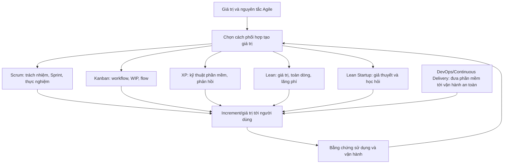
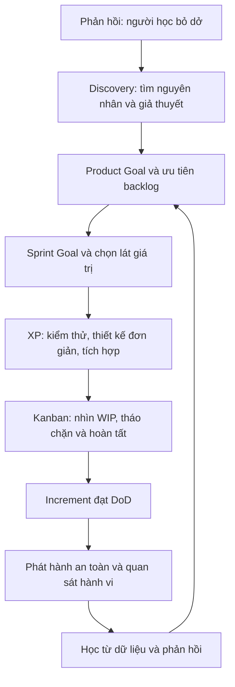

# So sánh trọng tâm của Scrum, Kanban, XP, Lean và các cách tiếp cận liên quan

## Mục tiêu học tập

Sau bài học này, bạn có thể:

- Phân biệt **Agile là hệ giá trị và nguyên tắc**, trong khi Scrum, Kanban, Extreme Programming (XP), Lean cùng các cách tiếp cận liên quan có **trọng tâm và phạm vi áp dụng khác nhau**.
- Giải thích Scrum tập trung vào **tạo giá trị bằng thực nghiệm trong một khung làm việc**, Kanban tập trung vào **quản lý dòng công việc**, XP tập trung vào **kỹ thuật và phản hồi để thay đổi phần mềm an toàn**, còn Lean tập trung vào **giá trị và loại bỏ lãng phí ở cấp hệ thống**.
- So sánh một cách có căn cứ về **nhịp công việc, trách nhiệm, quy tắc, quản lý thay đổi, kỹ thuật chất lượng, thước đo và tình huống phù hợp**.
- Nhận diện vai trò bổ trợ của **Lean Startup, DevOps/Continuous Delivery, Scrumban, Crystal, Feature-Driven Development (FDD), DSDM** và các hoạt động khám phá nhu cầu.
- Chọn một cách phối hợp phù hợp cho **đội phát triển nền tảng học trực tuyến** hoặc đội vận hành/bảo trì, không tuyên bố một cách làm tốt nhất cho mọi bối cảnh.
- Đề xuất một thử nghiệm cải tiến nhỏ có **mục tiêu, giả thuyết, tín hiệu dòng công việc, chỉ số chất lượng và điều kiện xem lại**.

## 1. Vì sao cần so sánh trước khi chọn cách làm?

Trong một nhóm phát triển sản phẩm học Java, các bên đưa ra những đề xuất khác nhau:

- Product Owner: “Nên có Sprint hai tuần để cùng tập trung vào mục tiêu hoàn thành một hành trình người học.”
- Người phụ trách hỗ trợ: “Yêu cầu lỗi đến mỗi ngày, khó đợi Sprint tiếp theo; hãy kéo việc theo mức khẩn cấp và năng lực xử lý.”
- Developer: “Chúng ta có thể họp rất tốt nhưng vẫn giao lỗi. Cần kiểm thử tự động, lập trình cặp và tích hợp liên tục.”
- Người quản lý vận hành: “Mọi người đang bận mà yêu cầu vẫn chờ qua nhiều bộ phận. Cần nhìn toàn bộ dòng giá trị và loại bỏ điểm chờ vô ích.”
- Người phụ trách sản phẩm: “Có lẽ chúng ta còn chưa biết học viên có cần tính năng đó. Nên thử giả thuyết trước khi xây lớn.”

Những ý kiến này **không nhất thiết mâu thuẫn**. Chúng đang nhìn **những vấn đề khác nhau**:

| Vấn đề thực tế | Góc tiếp cận có thể giúp |
| --- | --- |
| Thiếu mục tiêu chung, khó kiểm tra kết quả và thích nghi theo nhịp. | **Scrum** giúp định nghĩa trách nhiệm giải trình, sự kiện, hiện vật và cam kết. |
| Công việc chờ lâu, nhiều hạng mục dở dang, không biết khi nào hoàn thành. | **Kanban** giúp định nghĩa và quản lý workflow, WIP, kéo việc, đo dòng chảy. |
| Thay đổi phần mềm tốn kém, lỗi hồi quy và tích hợp muộn. | **XP** cung cấp các thực hành kỹ thuật tăng khả năng thay đổi an toàn. |
| Có quá nhiều bước bàn giao, tính năng ít giá trị, tối ưu cục bộ. | **Lean** hướng tới tối ưu toàn dòng giá trị, giảm lãng phí và cải tiến liên tục. |
| Chưa rõ vấn đề có đáng xây thành sản phẩm không. | **Lean Startup** hỗ trợ giả thuyết, thí nghiệm và học hỏi có kiểm chứng. |
| Phần mềm hoàn thành ở máy phát triển nhưng lâu tới người dùng, vận hành rủi ro. | **DevOps và Continuous Delivery** giúp tăng phối hợp phát triển–vận hành, tự động hóa và phản hồi từ sản xuất. |

Chọn một nhãn như “Scrum”, “Kanban” hay “Lean” chưa giải quyết được vấn đề. Nhóm cần hỏi: **chúng ta đang muốn cải thiện điều gì, có những ràng buộc nào, và bằng chứng nào cho thấy cách làm mới hữu ích?**

## 2. Bản đồ khái niệm: giá trị, khung, phương pháp và thực hành

### 2.1. Agile không phải một lịch họp cố định

Tuyên ngôn Agile (2001) nêu bốn giá trị:

1. **Cá nhân và tương tác** hơn quy trình và công cụ.
2. **Phần mềm chạy được** hơn tài liệu đầy đủ.
3. **Cộng tác với khách hàng** hơn đàm phán hợp đồng.
4. **Phản hồi với thay đổi** hơn bám sát kế hoạch.

Vế bên phải vẫn có giá trị; tuyên ngôn nhấn mạnh vế bên trái hơn. Các nguyên tắc Agile còn đề cao giao phần mềm sớm và thường xuyên, trao đổi, chất lượng kỹ thuật, nhịp bền vững và cải tiến.

Agile **không đòi hỏi mọi đội dùng Sprint, story points, bảng Kanban hoặc TDD**. Đó là những lựa chọn cụ thể có thể hỗ trợ giá trị Agile theo các cách khác nhau.

### 2.2. Phân loại phạm vi, không phân cấp “cao thấp”

| Cách tiếp cận | Nhìn nhận chủ yếu | Không nên hiểu nhầm |
| --- | --- | --- |
| **Agile** | Giá trị và nguyên tắc về cách cộng tác, giao phần mềm, phản hồi và thích nghi. | Một quy trình chứng nhận hay bộ công cụ duy nhất. |
| **Scrum** | Khung nhẹ để giải quyết vấn đề phức tạp bằng thực nghiệm và tạo giá trị tăng dần. | Danh sách cuộc họp hoặc cách giao task cho từng người. |
| **Kanban** | Chiến lược quản lý và tối ưu dòng công việc qua một workflow có chính sách, WIP và phép đo. | Chỉ là ba cột To do / Doing / Done. |
| **XP** | Phương pháp phát triển phần mềm nhấn mạnh thực hành kỹ thuật, cộng tác và phản hồi nhanh. | Chỉ là pair programming hoặc chỉ là TDD. |
| **Lean** | Hệ tư duy quản lý tập trung vào giá trị, dòng giá trị, giảm lãng phí và cải tiến. | Cắt nhân sự hoặc làm ít kiểm thử để nhanh hơn. |
| **Lean Startup** | Thử giả thuyết về khách hàng/sản phẩm bằng chu kỳ học hỏi có kiểm chứng. | “Xây MVP thật cẩu thả” hoặc phải khởi nghiệp mới dùng được. |
| **DevOps/Continuous Delivery** | Văn hóa và năng lực kỹ thuật để phát triển, triển khai, vận hành và học từ hệ thống. | Một nhóm công cụ CI/CD hoặc tên một chức danh. |

Cùng một đội có thể vận dụng **nhiều lớp**. Ví dụ Scrum tạo nhịp cùng kiểm tra sản phẩm, Kanban giúp kiểm soát dòng công việc trong Sprint, XP hỗ trợ chất lượng mã, Lean giúp cải tiến toàn dòng, còn DevOps rút ngắn đường từ mã đã kiểm chứng đến người dùng.

### 2.3. Một sơ đồ về quan hệ bổ trợ



Sơ đồ **không có nghĩa một phương pháp là thành phần chính thức của phương pháp khác**. Nó chỉ minh họa các góc nhìn có thể phối hợp để phục vụ cùng mục tiêu sản phẩm.

## 3. Scrum: trọng tâm là thực nghiệm, mục tiêu và Increment hữu dụng

### 3.1. Scrum giải quyết vấn đề gì?

Scrum phù hợp khi nhóm cần **cùng hướng về mục tiêu sản phẩm trong môi trường phức tạp**, thường xuyên kiểm tra kết quả thực và điều chỉnh hướng đi. Scrum đưa ra một cấu trúc rõ để tránh việc mỗi vai trò chạy theo danh sách việc riêng mà không biết sản phẩm có tạo giá trị hay không.

Theo *Scrum Guide 2020*, Scrum có:

- **Ba trách nhiệm giải trình:** Product Owner, Scrum Master và Developers.
- **Năm sự kiện:** Sprint, Sprint Planning, Daily Scrum, Sprint Review và Sprint Retrospective.
- **Ba hiện vật:** Product Backlog, Sprint Backlog và Increment.
- **Ba cam kết:** Product Goal, Sprint Goal và Definition of Done, gắn lần lượt với ba hiện vật.

**Product Owner** chịu trách nhiệm tối đa hóa giá trị và quản lý hiệu quả Product Backlog. **Developers** tạo các khía cạnh của Increment hữu dụng mỗi Sprint. **Scrum Master** giúp Scrum được hiểu và áp dụng đúng, hỗ trợ hiệu quả Scrum Team.

### 3.2. Nhịp Scrum hoạt động thế nào?

Một **Sprint có độ dài cố định, một tháng hoặc ngắn hơn**. Sprint tiếp theo bắt đầu ngay khi Sprint trước kết thúc.

- **Sprint Planning:** làm rõ vì sao Sprint có giá trị, chọn công việc và lập kế hoạch tạo Increment.
- **Daily Scrum:** Developers kiểm tra tiến độ tới Sprint Goal và điều chỉnh Sprint Backlog.
- **Sprint Review:** cùng stakeholders kiểm tra kết quả, tình hình thay đổi và các bước tiếp theo.
- **Sprint Retrospective:** Scrum Team tìm cách tăng chất lượng và hiệu quả.

Các sự kiện là **cơ hội thanh tra và thích nghi**, không phải nơi duy nhất được phép nói chuyện hoặc đổi kế hoạch.

### 3.3. Scrum quy định gì, và không quy định gì?

| Thuộc Scrum Guide | Không phải quy định bắt buộc của Scrum Guide |
| --- | --- |
| Sprint Goal, Product Goal, DoD, Increment. | Story points, Planning Poker, velocity. |
| Scrum Team với ba trách nhiệm giải trình. | Phải có chức danh “Business Analyst”, “QA Lead” hoặc Project Manager trong Scrum Team. |
| Năm sự kiện với mục đích và timebox tương ứng. | Daily Scrum bắt buộc trả lời ba câu hỏi theo người. |
| Product Backlog có thứ tự, Sprint Backlog do Developers lập. | Phải dùng Jira, Azure DevOps hoặc burndown chart. |
| Increment phải đạt DoD, có thể có nhiều Increment trong Sprint. | Chỉ được phát hành sau Sprint Review hoặc cuối Sprint. |

**Điểm mạnh:** mục tiêu và trách nhiệm minh bạch, nhịp kiểm tra có kỷ luật, thích hợp với đội sản phẩm cần phản hồi thường xuyên.

**Thách thức:** nếu sự kiện bị biến thành báo cáo, Product Owner thiếu quyền quyết định, Sprint Goal chỉ là tập task hoặc Increment không đạt DoD, nhóm sẽ “họp Scrum” nhưng thiếu cơ chế tạo giá trị thực nghiệm.

### 3.4. Ví dụ Scrum trên nền tảng học trực tuyến

Product Goal: **giúp học viên mới bắt đầu học Java mà không cần hỗ trợ thủ công**.

Sprint Goal ví dụ:

> “Học viên đã ghi danh khóa miễn phí có thể mở bài học đầu tiên với quyền truy cập chính xác.”

Developers chọn và tổ chức công việc ghi danh, cấp quyền, mở bài và kiểm thử xuyên suốt. Sprint Review dùng phần mềm chạy được để nhận phản hồi về hành trình học viên. Sprint Retrospective xem điều gì đã làm nhóm kiểm thử tích hợp quá muộn.

**Scrum không chỉ định phải viết kiểm thử bằng công cụ nào**. Đó là chỗ các thực hành kỹ thuật như XP có thể bổ sung.

## 4. Kanban: trọng tâm là dòng công việc, giới hạn WIP và khả năng dự báo

### 4.1. Kanban nhìn sản phẩm qua luồng giá trị

Kanban hữu ích khi nhóm muốn hiểu **công việc đi từ bắt đầu tới hoàn thành như thế nào**, phần nào bị chặn và năng lực giao hàng có thể cải thiện ở đâu.

*The Kanban Guide* mô tả Kanban như một chiến lược tối ưu hóa dòng giá trị qua một quy trình. Trọng tâm gồm:

1. **Định nghĩa và trực quan hóa workflow**.
2. **Chủ động quản lý công việc đang làm (WIP)**.
3. **Cải thiện workflow** dựa trên quan sát.

**Definition of Workflow (DoW)** xác định đơn vị công việc, ranh giới Started/Finished, các trạng thái, cách kiểm soát WIP, chính sách và **Service Level Expectation (SLE)**.

### 4.2. Ví dụ một workflow

```text
Yêu cầu chưa kéo   |  Ready  |  Developing  |  Testing  |  Done
                                        WIP của toàn flow ≤ 4

Quy tắc minh họa:
- Chỉ kéo việc vào workflow khi có năng lực và điều kiện bắt đầu phù hợp.
- Thẻ bị chặn vẫn được thể hiện rõ, không che giấu WIP.
- Ưu tiên hoàn thành việc đang dở trước khi mở thêm việc.
- Done phải đáp ứng chính sách chất lượng của sản phẩm.
```

**Giới hạn 4 chỉ là con số thử nghiệm trong ví dụ**. Đội phải chọn chính sách phù hợp, chứ Kanban không cung cấp một số WIP đúng cho mọi nơi.

**Pull** nghĩa là công đoạn tiếp nhận công việc khi có năng lực và theo chính sách, thay vì liên tục đẩy thêm việc vào hàng đợi dù phía sau đang quá tải.

### 4.3. Bốn thước đo dòng công việc

| Thước đo | Câu hỏi nó trả lời | Điều dễ nhầm |
| --- | --- | --- |
| **WIP** | Có bao nhiêu hạng mục đã bắt đầu nhưng chưa hoàn thành? | Không phải số người đang bận. |
| **Throughput** | Trong một khoảng thời gian, có bao nhiêu hạng mục hoàn thành? | Không tự đồng nghĩa giá trị người dùng. |
| **Work item age** | Một hạng mục đang làm đã ở trong workflow bao lâu? | Không phải thời gian còn lại. |
| **Cycle time** | Một hạng mục đã hoàn thành mất bao lâu từ Start đến Finish? | Không phải tổng giờ công của người thực hiện. |

Ví dụ đội đã hoàn thành các hạng mục với cycle time **3, 5, 8 và 12 ngày lịch**. Chỉ số trung bình của mẫu này bằng **7 ngày lịch**. Nó không chứng minh hạng mục kế tiếp sẽ xong sau bảy ngày; cần nhìn phân bố, loại công việc và phụ thuộc.

Một hạng mục **đang dở 14 ngày** chưa nằm trong tập cycle time của các hạng mục đã Done, nhưng **work item age bằng 14 ngày** là tín hiệu cần kiểm tra ngay.

### 4.4. Khác Scrum ở đâu?

Kanban **không đòi hỏi một Sprint**, không tự chỉ định Product Owner/Scrum Master/Developers và không có bộ năm sự kiện Scrum bắt buộc. Nhóm có thể tiếp nhận yêu cầu liên tục với các chính sách kéo việc, ưu tiên và xử lý khẩn cấp.

Nhưng **không có Sprint không có nghĩa không lập kế hoạch**. Đội vẫn cần quyết định giá trị, ưu tiên, năng lực và ràng buộc. Cũng không có nghĩa mọi việc mới được phép chen ngay vào workflow.

**Điểm mạnh:** hữu ích cho luồng công việc có yêu cầu đến liên tục, nhiều điểm chờ/phụ thuộc, cần tăng minh bạch và khả năng dự báo.

**Thách thức:** bảng đẹp mà không có chính sách WIP, đo lường hoặc hành động cải tiến thì chưa giải quyết dòng chảy. Tối ưu số lượng thẻ Done mà bỏ qua chất lượng hoặc giá trị cũng là sai mục tiêu.

## 5. Extreme Programming (XP): trọng tâm là kỹ thuật để thay đổi phần mềm an toàn

### 5.1. XP trả lời câu hỏi gì?

Một nhóm có thể lập kế hoạch tốt nhưng **mỗi thay đổi nhỏ đều làm hỏng nhiều chức năng khác**. Khi đó, vấn đề chính không nằm ở lịch họp mà ở khả năng làm phần mềm đúng và sửa nó an toàn.

XP nhấn mạnh các giá trị như **giao tiếp, đơn giản, phản hồi, can đảm và tôn trọng**, cùng các thực hành giúp người phát triển nhanh nhận ra sai sót, cải tiến thiết kế và duy trì khả năng thay đổi.

Các thực hành thường gắn với XP:

| Thực hành | Mục đích | Ví dụ trong nền tảng học |
| --- | --- | --- |
| **Test-Driven Development (TDD)** | Dùng vòng kiểm thử–mã–refactor để hỗ trợ thiết kế và phát hiện sai. | Viết kiểm thử quy tắc ghi danh trước khi triển khai xử lý. |
| **Pair programming** | Hai người cộng tác tại cùng công việc để chia sẻ hiểu biết và kiểm soát sai sót. | Backend và người hiểu quy tắc dữ liệu cùng làm điều kiện truy cập. |
| **Continuous Integration (CI)** | Tích hợp thường xuyên và kiểm chứng tự động. | Mỗi thay đổi quyền truy cập chạy kiểm thử liên quan. |
| **Refactoring** | Cải thiện cấu trúc mã mà không cố ý đổi hành vi quan sát được. | Tách quy tắc quyền khỏi lớp giao diện quá lớn. |
| **Simple design** | Thiết kế đủ đáp ứng nhu cầu hiện tại, tránh phức tạp giả định. | Chỉ làm lát “mở lại bài dở” rõ ràng trước khi mở rộng. |
| **Collective code ownership** | Cả đội chịu trách nhiệm và có thể cải thiện mã, không tạo “vùng cấm” theo cá nhân. | Một Developer có thể sửa kiểm thử tiến độ khi phát hiện lỗi. |
| **Coding standards** | Tạo tính nhất quán và dễ cộng tác. | Tên và cách xử lý lỗi API nhất quán. |
| **Small releases / frequent feedback** | Đưa phần mềm hữu dụng ra sớm để học. | Giao lát ghi danh rồi kiểm tra hành vi người học. |
| **Sustainable pace** | Duy trì nhịp phát triển bền vững, tránh phụ thuộc vào làm thêm liên tục. | Không lấy tăng giờ làm làm kế hoạch phòng lỗi mặc định. |
| **System Metaphor / shared language** | Dùng câu chuyện và thuật ngữ chung để hiểu thiết kế. | Phân biệt ghi danh, quyền truy cập và tiến độ học tập. |

Không phải mọi tài liệu hoặc giai đoạn lịch sử XP đều nhóm và gọi tên thực hành theo một danh sách hoàn toàn giống nhau. Điểm cốt lõi là **các thực hành hỗ trợ nhau tạo phản hồi và chất lượng**.

### 5.2. Ví dụ TDD theo nghiệp vụ

User story:

> “Là học viên đã ghi danh, tôi muốn mở bài đầu tiên; tài khoản chưa ghi danh không được xem nội dung riêng.”

Tiêu chí hành vi có thể diễn đạt:

```gherkin
Feature: Quyền mở bài học riêng

  Scenario: Học viên đã ghi danh hợp lệ
    Given Lan có ghi danh ACTIVE cho khóa "Java căn bản"
    When Lan yêu cầu mở bài riêng của khóa
    Then Lan được phép xem bài

  Scenario: Tài khoản khác chưa ghi danh
    Given Nam chưa ghi danh khóa "Java căn bản"
    When Nam yêu cầu mở bài riêng của khóa
    Then hệ thống từ chối truy cập nội dung riêng
```

Developers có thể viết kiểm thử ở mức thích hợp, triển khai quy tắc tối thiểu, chạy kiểm thử, refactor thiết kế rồi tích hợp. Việc có Gherkin **không tự đồng nghĩa đang TDD**, và Gherkin bằng văn bản chưa tự chạy thành kiểm thử; nó hỗ trợ **thống nhất hành vi**.

**Điểm mạnh của XP:** giảm chi phí thay đổi, tăng chất lượng, chia sẻ kiến thức và rút ngắn vòng phản hồi kỹ thuật.

**Thách thức:** đòi đầu tư thực tế vào kỹ năng, kỷ luật kiểm thử, giao tiếp và khả năng tích hợp. Chỉ gọi một hoạt động “XP” nhưng vẫn tích hợp mã muộn, không có kiểm thử phù hợp sẽ khó đạt lợi ích.

### 5.3. XP và Scrum không phải lựa chọn loại trừ

Scrum định nghĩa **cơ chế kiểm tra và thích nghi ở cấp nhóm sản phẩm**; XP đóng góp **cách xây Increment chất lượng**. Scrum Guide không bắt buộc phải dùng TDD, pair programming hay CI, nhưng Developers vẫn chịu trách nhiệm tạo Increment đáp ứng **Definition of Done**.

Do đó, một Scrum Team có thể giữ nguyên các thành phần Scrum và **chọn XP để bảo đảm chất lượng**. Tương tự, một đội vận hành Kanban có thể dùng TDD/CI khi phát triển phần mềm.

## 6. Lean: trọng tâm là giá trị và tối ưu toàn hệ thống

### 6.1. Tư duy Lean bắt đầu từ đâu?

Lean xuất phát từ tư duy sản xuất tinh gọn và được ứng dụng sang phát triển sản phẩm/phần mềm. Mục tiêu không phải “làm mọi người bận hơn” mà là **tạo giá trị với ít lãng phí hơn, chất lượng tốt hơn và khả năng học hỏi liên tục**.

Năm ý tưởng thường dùng trong *Lean Thinking*:

1. **Xác định giá trị** từ góc nhìn người sử dụng hoặc khách hàng.
2. **Nhận diện dòng giá trị** tạo ra kết quả đó.
3. **Tạo flow** để giá trị đi qua hệ thống với ít cản trở không cần thiết.
4. **Dùng pull** theo nhu cầu và năng lực thực tế.
5. **Theo đuổi cải tiến liên tục**, thường được diễn đạt là hướng tới sự hoàn thiện.

Trong phát triển phần mềm, các nguyên tắc Lean được chuyển hóa theo điều kiện công việc tri thức, không sao chép nguyên máy móc sản xuất vào lập trình.

### 6.2. Ví dụ về lãng phí trong phát triển phần mềm

| Hiện tượng | Vì sao có thể là lãng phí? | Cần phân biệt với điều gì hữu ích? |
| --- | --- | --- |
| Xây tính năng ít ai sử dụng | Tiêu tốn công sức mà không tạo kết quả người dùng đáng kể. | Thử nghiệm nhỏ để học điều mới có thể vẫn rất có giá trị. |
| Hàng đợi giữa lập trình và kiểm thử | Làm tăng thời gian từ bắt đầu đến hoàn thành. | Kiểm thử bắt buộc là bảo vệ chất lượng; cần giảm chờ, không xóa kiểm thử. |
| Chuyển giao qua quá nhiều cấp | Gây thất lạc thông tin và làm lại. | Rà soát an toàn hoặc nghĩa vụ pháp lý có lý do xác đáng. |
| Thay đổi ưu tiên liên tục không có căn cứ | Tăng đổi ngữ cảnh, việc dở dang và chi phí cơ hội. | Thích nghi khi có bằng chứng mới là cần thiết. |
| Lỗi được phát hiện rất muộn | Gây sửa lại nhiều thành phần và chậm giao giá trị. | Đầu tư kiểm thử tự động và chất lượng từ sớm có thể giảm lãng phí. |
| Tài liệu quá chi tiết nhưng lỗi thời | Tốn chi phí bảo trì, ít giúp người dùng hoặc nhóm. | Tài liệu vận hành, an toàn, quy tắc nghiệp vụ cần thiết vẫn quan trọng. |

**Lean không đồng nghĩa cắt giảm mọi hoạt động không trực tiếp tạo ra tính năng.** Kiểm thử, học hỏi, đào tạo, bảo mật và khả năng vận hành có thể là những hoạt động thiết yếu để tạo giá trị an toàn và bền vững.

### 6.3. Nhìn dòng giá trị từ yêu cầu đến tác động

Với một tính năng ghi danh khóa học:

```text
Phát hiện nhu cầu → Chọn cơ hội → Làm rõ → Xây và kiểm chứng
                  → Tích hợp → Phát hành → Quan sát người dùng
```

Nếu đội tối ưu thời gian lập trình nhưng phải **chờ hai tuần để được triển khai**, khả năng nhận phản hồi vẫn chậm. Nếu triển khai rất nhanh nhưng xây sai nhu cầu, tối ưu pipeline cũng chưa tạo giá trị.

Lean yêu cầu nhìn **toàn dòng giá trị**, cả thời gian chờ, chất lượng, kết quả sử dụng và công việc làm lại.

### 6.4. Lean và Kanban khác nhau thế nào?

Cả hai cùng quan tâm **flow, pull, giảm WIP/lãng phí và cải tiến** nhưng trọng tâm khác nhau:

- **Lean** là lăng kính rộng về giá trị và quản lý toàn hệ thống.
- **Kanban** cung cấp các thực hành rõ để **định nghĩa, kiểm soát và cải thiện dòng công việc** bằng workflow, chính sách, WIP, SLE và flow metrics.

Đội có thể sử dụng Kanban như một phần của tư duy Lean, nhưng **Lean không chỉ là một bảng Kanban**, và Kanban không yêu cầu một tổ chức phải tuyên bố áp dụng toàn bộ Lean.

## 7. Lean Startup: trọng tâm là bất định về nhu cầu và học hỏi sản phẩm

Khi một nhóm chưa biết **có nên xây tính năng mới hay không**, bài toán trước mắt không chỉ là triển khai nhanh. Cần kiểm chứng giả thuyết về khách hàng, hành vi và giá trị.

**Lean Startup** nhấn mạnh chu kỳ **Build – Measure – Learn**:

1. **Build:** tạo cách kiểm tra giả thuyết nhỏ nhất có đủ tín hiệu, có thể là thử nghiệm sản phẩm, nguyên mẫu hoặc hoạt động nghiên cứu phù hợp.
2. **Measure:** quan sát tín hiệu được định nghĩa trước để biết điều gì xảy ra.
3. **Learn:** đánh giá giả thuyết, quyết định **tiếp tục, điều chỉnh hoặc chuyển hướng**.

**Minimum Viable Product (MVP)** trong tư duy này là cách tối thiểu để **học được điều cần thiết** về một giả thuyết, không phải một bản sản phẩm lớn bị bỏ hết tiêu chuẩn chất lượng.

### 7.1. Ví dụ giả thuyết trên nền tảng học trực tuyến

Nhóm nghĩ học viên bỏ dở khóa vì không có **huy hiệu thành tích**.

Thay vì ngay lập tức xây hệ thống huy hiệu với nhiều mức, bảng xếp hạng và phần thưởng, nhóm đặt giả thuyết:

> “Nếu có thông tin khuyến khích đúng thời điểm, học viên đã bắt đầu khóa có khả năng quay lại và hoàn thành bài tiếp theo thường xuyên hơn.”

Một thí nghiệm phù hợp có thể là thử một thông báo tiến độ đơn giản trên nhóm người dùng được lựa chọn, theo dõi hành vi quay lại và chỉ số bảo vệ như mức phiền nhiễu. Kết quả có thể **ủng hộ, bác bỏ hoặc chưa đủ rõ**.

Nếu phát hiện vấn đề thực tế là học viên **không tìm thấy bài đang dở**, backlog nên đổi ưu tiên sang giúp họ tiếp tục học. Học được rằng giả thuyết huy hiệu sai **không phải thất bại về học hỏi**; xây toàn bộ hệ thống trước khi kiểm chứng mới có thể là lãng phí.

### 7.2. Lean Startup bổ sung điều gì cho Scrum, Kanban và XP?

| Câu hỏi | Góc tiếp cận |
| --- | --- |
| “Có nên đầu tư vào nhu cầu này?” | Lean Startup: giả thuyết, thí nghiệm, học hỏi. |
| “Làm thế nào cả đội tạo Increment và cùng thích nghi?” | Scrum: mục tiêu, sự kiện, hiện vật, trách nhiệm. |
| “Làm thế nào hạn chế việc chờ và công việc dở dang?” | Kanban: quản lý flow. |
| “Làm thế nào sửa sản phẩm nhanh mà vẫn an toàn?” | XP: kỹ thuật và phản hồi. |
| “Tại sao toàn dòng giá trị chậm hoặc ít hiệu quả?” | Lean: tối ưu hệ thống và giảm lãng phí. |

Một đội có thể sử dụng cùng lúc các góc nhìn này. Tuy nhiên, không được biến giả thuyết thành sự thật chỉ vì một nguyên mẫu được người dùng khen; cần xem **phương pháp thu thập bằng chứng và giới hạn của dữ liệu**.

## 8. DevOps và Continuous Delivery: trọng tâm là đường từ mã tới người dùng

Một hạng mục có thể đã được Developers xác minh nhưng vẫn nằm trong hàng chờ triển khai dài ngày. Khi đó, vòng phản hồi sản phẩm chưa hoàn tất.

**DevOps** chú trọng cộng tác xuyên giữa phát triển, kiểm thử, bảo mật và vận hành, cùng các thực hành để giao phần mềm **nhanh, an toàn, đáng tin cậy**. **Continuous Delivery** hướng tới khả năng giữ phần mềm ở trạng thái có thể phát hành thường xuyên; quyết định có phát hành ngay hay không tùy nhu cầu và kiểm soát của tổ chức.

Các thực hành có thể gồm:

- CI, kiểm thử tự động và đánh giá thay đổi phù hợp rủi ro.
- Pipeline build, đóng gói, triển khai có thể lặp lại.
- Cấu hình và hạ tầng được quản lý có kiểm soát.
- Quan sát hệ thống: log, metrics, tracing và cảnh báo theo nhu cầu.
- Phương án triển khai an toàn, rollback/khôi phục và xử lý sự cố.
- Phản hồi từ production cho sản phẩm và thiết kế.

Không nên định nghĩa DevOps bằng công cụ duy nhất hay coi “DevOps engineer” là bộ phận phải chịu mọi vấn đề triển khai thay cho nhóm phát triển.

### 8.1. Chỉ số giao phần mềm và giới hạn sử dụng

Các nghiên cứu và thực hành DORA thường phân tích các thước đo về **khả năng giao thay đổi và độ ổn định**, ví dụ tần suất triển khai, lead time của thay đổi, tỷ lệ thay đổi gây lỗi và thời gian khôi phục/giải quyết sau sự cố theo định nghĩa đang sử dụng.

Những chỉ số này **không giống story points hay throughput của một bảng Kanban**. Cần xác định mốc đo, bối cảnh và phiên bản hướng dẫn tham khảo; không dùng để chấm điểm cá nhân hoặc khuyến khích phát hành thiếu an toàn.

**Ví dụ:** nhóm có thể tăng tần suất phát hành bằng những lát nhỏ hơn và kiểm thử tự động, nhưng nếu lỗi quyền truy cập tăng, đó **không phải một cải tiến toàn diện**.

### 8.2. Quan hệ với Scrum và Kanban

Scrum giúp biết **điều gì tạo giá trị và cách kiểm tra Increment**; Kanban giúp thấy **công việc đang kẹt ở khâu nào**; DevOps/Continuous Delivery giúp cải thiện đường từ thay đổi đã được kiểm chứng tới **phần mềm chạy an toàn ngoài thực tế**.

Không có xung đột tất yếu giữa **Sprint** và **khả năng triển khai nhiều lần trong Sprint**. Scrum Guide không bắt buộc đợi cuối Sprint mới phát hành Increment. Đồng thời, một chính sách phát hành bắt buộc vì an toàn vẫn phải được tuân thủ.

## 9. Các cách tiếp cận liên quan: Scrumban, Crystal, FDD, DSDM

Những tên gọi dưới đây có ích khi đọc tài liệu hoặc đánh giá mô hình tổ chức, nhưng cần phân biệt **cách tiếp cận, biến thể triển khai và bộ quy định thực tế**.

### 9.1. Scrumban — kết hợp có chủ đích, không phải chuẩn Scrum thứ hai

**Scrumban** là tên thường dùng cho cách kết hợp một số yếu tố Scrum với kỹ thuật Kanban, chẳng hạn:

- Có nhịp xem xét mục tiêu hoặc ưu tiên nhưng dùng **pull và WIP limit** để nhận việc.
- Nhìn cycle time và tuổi hạng mục, thay vì chỉ kiểm tra khối lượng được lên kế hoạch.
- Tổ chức điểm phản hồi và bổ sung công việc theo năng lực thực tế.

**Scrumban không có một bộ quy tắc chính thức duy nhất thay thế Scrum Guide và The Kanban Guide**. Đội phải viết rõ mình giữ các thành phần Scrum nào, dùng chính sách Kanban nào, quyền quyết định của ai và cách đánh giá hiệu quả.

Nếu tự bỏ Sprint Goal, Scrum events hoặc các trách nhiệm Scrum rồi vẫn nói “đang làm đúng Scrum” chỉ vì có bảng thẻ, đó là cách gọi không chính xác. Nhóm vẫn có thể đang dùng một mô hình hợp lý khác; **hãy gọi đúng và làm rõ quy tắc**.

### 9.2. Crystal — trọng tâm con người, trao đổi và điều chỉnh theo bối cảnh

**Crystal**, gắn với Alistair Cockburn, là họ phương pháp Agile nhấn mạnh **con người, giao tiếp, việc giao phần mềm và khả năng điều chỉnh phương pháp theo quy mô, mức độ quan trọng/rủi ro của dự án**.

Một nhóm nhỏ làm sản phẩm ít rủi ro có thể dùng cơ chế phối hợp nhẹ hơn một hệ thống liên quan đến an toàn hoặc nghĩa vụ pháp lý. Điểm đáng học là **không bê nguyên một quy trình nặng cho mọi đội**; cần giữ mức kiểm soát phù hợp bối cảnh.

Crystal không phải “Scrum nhưng không có Daily Scrum”. Các họ phương pháp này có lịch sử, cấu trúc và cách nhấn mạnh khác nhau.

### 9.3. Feature-Driven Development (FDD) — phát triển theo đặc trưng có giá trị

**FDD** gắn với mô hình miền và quy trình thiết kế/xây dựng **theo tính năng (feature)**, hướng tới các phần chức năng nhỏ, có thể thấy tiến độ và đóng góp vào giá trị nghiệp vụ.

Điểm hữu ích là **làm rõ miền, chia thành feature và phát triển tăng dần**. Nhưng không nên đồng nhất “một feature” với bất kỳ task kỹ thuật nào hoặc khẳng định FDD dùng cùng các sự kiện với Scrum.

FDD có thể phù hợp khi nhóm cần phối hợp thiết kế theo miền và triển khai từng feature, đặc biệt ở những tổ chức đã có nhu cầu quản lý cấu trúc tính năng rõ.

### 9.4. DSDM — quản lý giao hàng Agile có cấu trúc và timeboxing

**Dynamic Systems Development Method (DSDM)**, hiện thường được giới thiệu trong hệ tài liệu Agile Business Consortium, là cách tiếp cận Agile có cấu trúc quản trị và giao hàng, chú trọng hợp tác tích cực, thời hạn, chất lượng và ưu tiên phạm vi.

**MoSCoW** là kỹ thuật ưu tiên gắn phổ biến với DSDM: *Must have, Should have, Could have, Won't have this time*. Đây là kỹ thuật có thể dùng ngoài DSDM, nhưng **Scrum Guide không bắt buộc MoSCoW**.

Một đội có thời hạn pháp lý hoặc hợp đồng rõ có thể dùng các nguyên tắc ưu tiên phạm vi và timeboxing, miễn không lấy nhãn “Must” để bỏ qua việc kiểm chứng mức cần thiết thực sự.

### 9.5. Bảng đối chiếu ngắn

| Cách tiếp cận | Trọng tâm nổi bật | Câu hỏi nhóm nên hỏi |
| --- | --- | --- |
| **Scrumban** | Phối hợp nhịp và mục tiêu với quản lý flow. | Những thành phần nào đang được giữ? Chính sách kéo việc rõ chưa? |
| **Crystal** | Cộng tác và điều chỉnh mức độ phương pháp theo con người, quy mô, rủi ro. | Quy trình hiện tại có tương xứng mức nguy hiểm của sản phẩm không? |
| **FDD** | Mô hình miền, quản lý và triển khai theo feature có giá trị. | Feature có rõ nghĩa nghiệp vụ và đủ nhỏ để giao tăng dần không? |
| **DSDM** | Giao hàng có cấu trúc, timeboxing và ưu tiên phạm vi. | Làm sao giữ mục tiêu/chuẩn chất lượng trong điều kiện hạn chót? |
| **Design Thinking / Product Discovery** | Hiểu người dùng, định nghĩa vấn đề, tạo và thử phương án. | Chúng ta đã hiểu đúng vấn đề trước khi xây chưa? |

**Design Thinking** và **Product Discovery** là các lăng kính khám phá có thể bổ sung cho những cách làm giao sản phẩm; không nên coi chúng là bộ quy định thay thế mọi thực hành phát triển và vận hành phần mềm.

## 10. Bảng so sánh sâu: mỗi cách tiếp cận tối ưu điều gì?

Bảng là **mô hình diễn giải để học**, không phải bảng xếp hạng hay mô tả đầy đủ mọi biến thể.

| Tiêu chí | Scrum | Kanban | XP | Lean |
| --- | --- | --- | --- | --- |
| **Trọng tâm** | Khung làm việc để tạo giá trị bằng thực nghiệm. | Định nghĩa, quản lý và tối ưu flow. | Kỹ thuật và cộng tác để đổi phần mềm an toàn. | Giá trị và tối ưu toàn dòng, giảm lãng phí. |
| **Đơn vị chú ý** | Product Goal, Sprint Goal, Increment. | Work item trong workflow đã định nghĩa. | Thay đổi nhỏ, kiểm thử, thiết kế và phần mềm chạy được. | Giá trị đến người dùng qua cả hệ thống. |
| **Nhịp chính** | Sprint cố định, tối đa một tháng; sự kiện có mục đích. | Flow/pull liên tục; nhịp xem xét do đội chọn. | Vòng phản hồi kỹ thuật ngắn, tích hợp/phát hành nhỏ. | Cải tiến liên tục và quản lý dòng giá trị. |
| **Vai trò/quy định** | Ba accountabilities, năm events, ba artifacts + commitments. | Không áp đặt cấu trúc Scrum; cần DoW và chính sách rõ. | Nhấn mạnh cộng tác giữa người làm sản phẩm và kỹ thuật, các thực hành XP. | Không có một bộ vai trò phần mềm cố định áp dụng mọi nơi. |
| **Điều chỉnh ưu tiên** | Product Owner quản lý thứ tự Product Backlog; giữ Sprint Goal trong Sprint. | Theo chính sách nhận/kéo việc, năng lực, rủi ro và độ cấp thiết. | Nhận thay đổi nhờ mã dễ sửa và kiểm thử nhanh. | Xét giá trị, chi phí cơ hội và lãng phí toàn hệ thống. |
| **Chất lượng** | Increment phải đáp ứng Definition of Done. | Chính sách chất lượng phải rõ trong workflow; không tự đưa DoD Scrum thành quy định Kanban. | Kiểm thử, TDD, refactoring, CI, thiết kế đơn giản. | Chất lượng từ sớm, tránh sai và làm lại, không tối ưu bằng cách cắt kiểm tra cần thiết. |
| **Đo lường thường hữu ích** | Tiến độ tới mục tiêu, Increment và outcome; thước đo đội lựa chọn. | WIP, throughput, work item age, cycle time, SLE. | Kiểm thử, lỗi hồi quy, thời gian phản hồi và khả năng đổi mã. | Lead time toàn dòng, chờ đợi, làm lại, giá trị/kết quả. |
| **Rủi ro triển khai sai** | Họp theo nghi thức, thiếu mục tiêu/chất lượng. | Bảng nhiều thẻ, WIP không được quản lý. | Coi một kỹ thuật đơn lẻ là đủ, thiếu kỷ luật phối hợp. | Cắt chi phí cục bộ, bỏ qua chất lượng và người dùng. |

### 10.1. Tránh so sánh “cái nào nhanh nhất?”

Các cách làm khác **đối tượng đo**. Một đội Scrum có Sprint hai tuần không có nghĩa mọi hạng mục mất hai tuần; đội Kanban có cycle time trung vị bốn ngày cũng không bảo đảm dự án bất kỳ giao sớm hơn.

Nếu muốn so sánh, cần thống nhất:

- Kết quả sản phẩm cần giao và mức chất lượng.
- Kích thước, loại công việc và độ bất định.
- Ranh giới thời gian được đo.
- Năng lực đội, phụ thuộc và môi trường.
- Tác động thực tế tới người dùng.

Đừng dùng **số cuộc họp, story points hoặc số ticket Done** làm thước đo duy nhất của chất lượng phương pháp.

### 10.2. Cũng không phải cuộc thi “phương pháp nào ít quy định hơn?”

Scrum có cấu trúc khung rõ; Kanban đòi workflow và chính sách rõ; XP đề cao kỷ luật kỹ thuật; Lean đòi tư duy hệ thống. Một phương pháp **nhẹ về biểu mẫu** vẫn có thể đòi **trách nhiệm và năng lực thực thi cao**.

Không nên lấy nhãn Agile để bỏ điều kiện bảo mật, dữ liệu, tuân thủ hoặc kiểm thử đã được xác nhận là cần thiết.

## 11. Chọn cách tiếp cận theo vấn đề, không theo xu hướng

Thay vì chọn bằng câu “đội khác đang dùng gì?”, nhóm nên chẩn đoán ít nhất sáu khía cạnh.

### 11.1. Sáu câu hỏi chẩn đoán

1. **Loại nhu cầu:** công việc sản phẩm cần khám phá, hay yêu cầu hỗ trợ/sự cố đến liên tục?
2. **Mức bất định về giá trị:** đã biết người dùng cần gì hay mới có giả thuyết?
3. **Mức rủi ro kỹ thuật:** hệ thống dễ thay đổi, hay sửa một nơi thường làm hỏng nơi khác?
4. **Dòng công việc hiện tại:** chờ ở đâu, WIP bao nhiêu, điểm bàn giao nào gây lãng phí?
5. **Khả năng phối hợp và quyền quyết định:** có Product Owner thực sự, đội đa chức năng và người liên quan sẵn sàng phản hồi không?
6. **Chất lượng, vận hành và tuân thủ:** có ràng buộc bảo mật, pháp lý, phát hành, lịch chuyên gia hoặc đối tác không?

### 11.2. Ma trận chọn hướng ưu tiên cải tiến

| Tình huống quan sát | Hướng nên xem xét trước | Vì sao? | Cần kiểm tra thêm |
| --- | --- | --- | --- |
| Đội sản phẩm có mục tiêu thay đổi, cần nhịp cùng kiểm tra Increment. | **Scrum**, kết hợp thực hành chất lượng phù hợp. | Mục tiêu và nhịp thực nghiệm giúp phối hợp. | Product Owner có quyền thật? Có thể tạo Increment đạt DoD? |
| Đội sửa lỗi/hỗ trợ nhận việc không đều mỗi ngày. | **Kanban** trên workflow hiện hữu. | Quản lý flow và chính sách nhận việc có thể linh hoạt hơn việc cam kết danh sách cố định. | Có quy tắc ưu tiên sự cố và kiểm soát WIP? |
| Mã thay đổi thường hỏng, tích hợp muộn, kiểm thử ít. | **XP** và năng lực CI/kiểm thử, dù đội đang dùng khung nào. | Khả năng đổi mã an toàn là nút thắt cốt lõi. | Có công cụ, kỹ năng, thời gian đầu tư kỹ thuật? |
| Nhiều phê duyệt và bàn giao, giá trị tới người dùng rất chậm. | **Lean + Kanban** để nhìn toàn dòng. | Cần giảm lãng phí và thời gian chờ ở cấp hệ thống. | Bước nào là kiểm soát bắt buộc không thể bỏ? |
| Chưa rõ người dùng có muốn tính năng. | **Lean Startup / Product Discovery**. | Học trước khi đầu tư lớn. | Giả thuyết nào cần thử? Tín hiệu nào đáng tin? |
| Phần mềm đã Done nhưng triển khai mất nhiều ngày, lỗi production cao. | **DevOps/Continuous Delivery**. | Cần cải thiện dòng từ mã đến vận hành và phản hồi. | Năng lực kiểm thử, quan sát, rollback và quyền triển khai? |
| Đội cần ưu tiên theo thời hạn, có quản trị và phạm vi linh hoạt. | Xem **DSDM/MoSCoW** hoặc kỹ thuật timeboxing phù hợp. | Giúp thảo luận Must/Should/Could có căn cứ. | Có phân biệt điều thật sự bắt buộc với sở thích? |

Đây là **gợi ý theo tín hiệu**, không phải bộ luật chọn phương pháp. Nhiều đội cần **kết hợp**. Ví dụ áp dụng Kanban để minh bạch backlog hỗ trợ, XP để giảm lỗi, Lean để giảm bàn giao và DevOps để triển khai an toàn.

## 12. Tình huống A: xây tính năng mới cho nền tảng học trực tuyến

### 12.1. Bối cảnh

Đội phát triển sản phẩm Java Learning nhận phản hồi: nhiều học viên bỏ dở khóa. Các bên đưa ra các phương án như chứng chỉ mới, huy hiệu, nhắc học hoặc nút “Tiếp tục học”.

Product Goal giả định:

> **Tăng khả năng người học đang theo học quay lại và hoàn thành khóa Java nhập môn.**

Điều chưa biết:

- Người học bỏ dở vì **khó tìm bài**, nội dung **quá khó**, thiếu động lực hay nhiều nguyên nhân cùng lúc?
- Đội có thể thay đổi luồng hiện tại mà không làm mất tiến độ học tập không?
- Có thể giao một lát nhỏ và đo tác động thay vì xây một hệ thống tính năng lớn không?

### 12.2. Dùng từng cách tiếp cận cho một bài toán riêng

| Góc nhìn | Quyết định hoặc thực hành | Giá trị kỳ vọng |
| --- | --- | --- |
| **Lean Startup** | Quan sát hành vi, phỏng vấn người học, thử giả thuyết “khó tìm bài dở” bằng thay đổi nhỏ. | Giảm nguy cơ đầu tư nhầm tính năng. |
| **Scrum** | Định hướng bằng Product Goal, đặt Sprint Goal cho lát “Tiếp tục học” và tạo Increment đạt DoD. | Cả đội tập trung vào kết quả chung và có nhịp kiểm tra. |
| **Kanban** | Theo dõi story đang dở, quản lý WIP, tháo chặn kiểm thử tích hợp sớm. | Giảm thời gian chờ và công việc làm dở. |
| **XP** | Viết kiểm thử hành vi quyền/tiến độ, ghép cặp, refactor và tích hợp thường xuyên. | Tăng khả năng thay đổi an toàn. |
| **Lean** | Bỏ việc tạo nhiều tài liệu bàn giao không có ích, giảm hàng đợi phê duyệt không cần thiết. | Rút ngắn toàn dòng giá trị, bảo vệ chất lượng. |
| **DevOps** | Phát hành lát nhỏ có quan sát và khả năng khôi phục khi lỗi. | Lấy phản hồi sớm, giảm rủi ro khi triển khai. |

Một **user story**:

> “Là học viên đang theo học, tôi muốn mở lại bài chưa hoàn thành gần nhất để tiếp tục mà không phải tìm từ đầu.”

Một số trường hợp chấp nhận:

```gherkin
Feature: Tiếp tục học

  Scenario: Có bài đang dở và còn quyền truy cập
    Given Lan đã đăng nhập và còn quyền xem khóa Java
    And Lan có bài học đang dở theo quy tắc đã thống nhất
    When Lan mở trang khóa học
    Then Lan thấy lựa chọn "Tiếp tục học"
    And lựa chọn dẫn đến đúng bài đang dở

  Scenario: Hết quyền truy cập
    Given Lan đã đăng nhập nhưng không còn quyền xem nội dung riêng của khóa
    When Lan yêu cầu mở bài đã học dở bằng liên kết cũ
    Then hệ thống từ chối truy cập nội dung riêng
```

Nhóm còn phải làm rõ trường hợp nhiều bài dở, nhiều thiết bị, dữ liệu tiến độ không nhất quán và khi chưa bắt đầu bài nào. **Gherkin là cách trình bày ví dụ**, không thay kiểm thử thực thi và không tự định nghĩa DoD.

### 12.3. Quy trình phối hợp minh họa



Đây là **luồng khái niệm**. Trong thực tế, discovery có thể tiếp tục trong quá trình phát triển, XP có mặt xuyên suốt, Kanban quản lý các trạng thái cùng lúc; không cần đợi một hoạt động kết thúc hoàn toàn mới bắt đầu hoạt động kế tiếp.

### 12.4. Định nghĩa “thành công” trước khi đo

| Loại tín hiệu | Ví dụ | Cảnh báo |
| --- | --- | --- |
| **Outcome người học** | Tỷ lệ học viên quay lại bài dở trong kỳ quan sát phù hợp. | Không khẳng định nguyên nhân chỉ từ biến động trước/sau. |
| **Trải nghiệm** | Thời gian tìm lại bài dở giảm. | Phân biệt nhóm học viên và bối cảnh sử dụng. |
| **Flow** | Hạng mục ít chờ kiểm thử hơn, cycle time ổn định hơn. | Cycle time không chứng minh tính năng tạo giá trị. |
| **Chất lượng** | Số lỗi lưu sai tiến độ và truy cập trái phép. | Không hạ chất lượng để đạt tốc độ. |
| **Triển khai** | Thời gian từ Increment đã kiểm chứng tới khả dụng, sự cố sau triển khai. | Phát hành nhanh nhưng lỗi tăng không phải cải tiến. |

Nếu nút “Tiếp tục học” giúp tìm bài dễ hơn nhưng tỷ lệ hoàn thành không đổi, đội phải xem xét **những nguyên nhân bỏ dở khác** thay vì đầu tư tiếp theo quán tính.

## 13. Tình huống B: đội bảo trì và hỗ trợ nhiều yêu cầu bất ngờ

### 13.1. Công việc không giống đội sản phẩm

Một đội khác phụ trách:

- Lỗi đăng nhập của người học.
- Vấn đề quyền truy cập sau ghi danh.
- Sự cố hệ thống lúc nhiều người thi trực tuyến.
- Yêu cầu hỗ trợ giảng viên.
- Những thay đổi nhỏ về cấu hình và nội dung.

Yêu cầu đến hằng ngày, mức khẩn khác nhau. Việc cố lên kế hoạch chính xác toàn bộ hai tuần mà không có khả năng xử lý sự cố có thể làm dự báo thiếu thực tế.

**Kanban** có thể là lựa chọn tự nhiên để quản lý workflow liên tục và chính sách nhận việc. Nhưng đội vẫn cần **mục tiêu dịch vụ, năng lực kỹ thuật, chất lượng và quyết định ưu tiên**.

### 13.2. DoW minh họa cho bảo trì

```text
Tiếp nhận → Phân loại → Ready → Đang xử lý → Kiểm chứng → Done
                              WIP được quản lý rõ

Chính sách:
- Sự cố nghiêm trọng theo quy trình ứng phó sự cố đã xác nhận.
- Yêu cầu thông thường được kéo vào làm theo mức ưu tiên và năng lực.
- Việc bị chặn được hiển thị, người phụ trách tháo chặn được xác định.
- Done chỉ khi xử lý đạt tiêu chuẩn chất lượng và thông báo phù hợp.
```

Đội có thể theo dõi **work item age** để phát hiện yêu cầu cũ, **cycle time** để cải thiện dự báo và **lỗi tái phát** để đánh giá chất lượng. XP/CI hỗ trợ giảm lỗi sửa gấp; DevOps hỗ trợ triển khai và theo dõi hậu quả.

### 13.3. Tại sao không đơn giản “dùng Kanban thay Scrum”?

Nếu nhóm bảo trì đồng thời chịu trách nhiệm **phát triển một Product Goal dài hạn**, họ có thể tổ chức các luồng riêng hoặc kết hợp Scrum với chính sách xử lý công việc khẩn. Vấn đề không phải tên gọi, mà là:

- Ai chịu trách nhiệm với mục tiêu sản phẩm?
- Công việc đột xuất có chính sách ưu tiên nào?
- Có đủ năng lực dự phòng hợp lý?
- Cách giao tiếp về ảnh hưởng tới cam kết và rủi ro?
- Nhóm đo cả việc xử lý sự cố lẫn giá trị cải tiến như thế nào?

Một hệ thống vận hành có thể dùng nhiều thực hành, miễn các **quy tắc đang áp dụng rõ ràng, không mâu thuẫn với cam kết đã đưa ra**.

## 14. So sánh qua các quyết định thường gặp

### 14.1. Yêu cầu mới xuất hiện giữa công việc

- **Scrum:** Product Owner xem lại Product Backlog. Trong Sprint, giữ Sprint Goal; Developers có thể thương lượng phạm vi và thích nghi kế hoạch, không giảm chất lượng. Chỉ Product Owner có thể hủy Sprint nếu Sprint Goal trở nên lỗi thời.
- **Kanban:** áp dụng chính sách nhận/kéo việc, WIP và phân loại mức cấp thiết; công việc mới không tự động được chen qua mọi hàng đợi.
- **XP:** xây thay đổi nhỏ với kiểm thử và thiết kế có thể sửa để giảm chi phí phản ứng.
- **Lean:** xem chi phí cơ hội của thay đổi và tác động trên toàn dòng giá trị.
- **Lean Startup:** nếu yêu cầu vẫn dựa trên giả thuyết yếu, thử nghiệm trước khi cam kết lớn.

### 14.2. Công việc bị chặn ở kiểm thử

- **Kanban** giúp nhìn rõ thẻ chờ và tuổi công việc, giới hạn WIP để tránh mở thêm việc vô ích.
- **Lean** hỏi tại sao có bàn giao và thời gian chờ, điểm nào cần cải tiến ở cấp hệ thống.
- **XP** cung cấp ghép cặp, kiểm thử sớm, CI, TDD hoặc tự động hóa hợp lý để giảm tái phát.
- **Scrum** giúp Developers điều chỉnh kế hoạch hướng tới Sprint Goal; Retrospective hỗ trợ cải tiến.

**Không nên** giải quyết bằng cách xóa kiểm thử cần thiết khỏi DoD hoặc coi “code xong” là “Done”.

### 14.3. Nhiều việc hoàn thành nhưng người dùng không hài lòng

- **Lean** hỏi phần việc hoàn thành có phải là giá trị người dùng cần không.
- **Lean Startup** xem lại giả thuyết và cách thu thập bằng chứng.
- **Scrum Review** là cơ hội cùng stakeholders kiểm tra kết quả và điều chỉnh Product Backlog.
- **Kanban** kiểm tra liệu đang tối ưu số thẻ chứ không phải thời gian tới giá trị.
- **XP** giúp đổi hướng kỹ thuật với rủi ro thấp hơn.

Cần ưu tiên **outcome** hơn chỉ số đầu ra: số thẻ, số point, số bản phát hành không tự chứng minh giá trị.

### 14.4. Thời hạn cố định và phạm vi quá lớn

Có thể kết hợp **timeboxing, ưu tiên phạm vi, chia lát giá trị và dự báo**; DSDM/MoSCoW là một nguồn ý tưởng, Scrum cung cấp Sprint và mục tiêu, Kanban hỗ trợ dữ liệu flow.

Tuy nhiên, **không được tự cắt điều kiện bảo mật, dữ liệu hoặc tuân thủ** để giữ hạn. Nếu không đủ điều kiện đạt toàn bộ phạm vi, phải minh bạch đánh đổi và thương lượng một phạm vi hữu dụng đạt chuẩn.

## 15. Đo lường: tránh mỗi phương pháp thành một bảng điểm

Để đánh giá cách làm, cần tách **giá trị**, **dòng công việc**, **chất lượng**, **học hỏi** và **khả năng vận hành**.

| Nhóm thước đo | Câu hỏi | Ví dụ |
| --- | --- | --- |
| **Outcome sản phẩm** | Người dùng có nhận giá trị không? | Tỷ lệ hoàn thành khóa, thời gian tìm bài, tỷ lệ ghi danh thành công. |
| **Flow và dự báo** | Công việc chảy qua hệ thống thế nào? | WIP, throughput, work item age, cycle time, thời gian chờ. |
| **Chất lượng** | Phần mềm có đáp ứng yêu cầu không? | Lỗi nghiêm trọng, lỗi quyền truy cập, kiểm thử hồi quy, công việc làm lại. |
| **Học hỏi** | Đội có kiểm chứng giả thuyết và điều chỉnh không? | Thí nghiệm có tiêu chí, kết quả bác bỏ/ủng hộ giả thuyết, quyết định tiếp theo. |
| **Khả năng giao và vận hành** | Thay đổi tới người dùng có nhanh và an toàn không? | Tần suất triển khai phù hợp, lead time thay đổi, sự cố triển khai, khôi phục. |
| **Bền vững** | Đội có thể duy trì tốc độ và hợp tác không? | Mức gián đoạn, tải hỗ trợ, chất lượng phối hợp, dấu hiệu làm thêm kéo dài. |

### 15.1. Cách đọc số liệu có trách nhiệm

Giả sử đội hoàn thành **12 hạng mục trong ba tuần**. Có thể nói throughput trung bình trong kỳ là **4 hạng mục/tuần** theo định nghĩa Done đã dùng. Nhưng chưa được kết luận:

- Sẽ hoàn thành chắc chắn 20 hạng mục mới trong năm tuần.
- Nhóm A có năng suất gấp đôi nhóm B vì nhóm B chỉ đóng bốn story.
- Nên chia mọi feature thành nhiều thẻ nhỏ để tăng throughput.
- Bỏ kiểm thử sẽ giúp tổ chức tạo giá trị nhanh hơn.

Cần xem độ lớn hạng mục, biến thiên hằng tuần, chính sách chất lượng, công việc khẩn và kết quả sản phẩm. Nếu dự báo xác suất bằng SLE hoặc mô phỏng, phải có **dữ liệu lịch sử phù hợp và giả định rõ**.

### 15.2. Nhóm có thể dùng số liệu nào khi kết hợp?

Một **Scrum Team có thực hành Kanban và XP** có thể:

- Dùng **Sprint Goal** làm trọng tâm quyết định.
- Nhìn **work item age** để biết hạng mục nào cần hỗ trợ trước.
- Giữ **Definition of Done** và kiểm thử tự động để bảo đảm chất lượng.
- Theo dõi **cycle time** để xem cơ hội giảm chờ đợi.
- Dùng phản hồi từ **Sprint Review và dữ liệu người dùng** để quyết định điều gì cần làm tiếp.

Điều quan trọng không phải có đủ mọi biểu đồ, mà là **dữ liệu khiến nhóm đưa ra quyết định tốt hơn**, không che giấu rủi ro hoặc thay thế trách nhiệm sản phẩm.

## 16. Lộ trình thử nghiệm kết hợp các thực hành trong một đội

Một cách thay đổi có kiểm soát không nhất thiết bắt đầu bằng tuyên bố “từ tháng sau toàn công ty theo một framework”. Hãy dùng vòng cải tiến nhỏ.

### Bước 1. Chẩn đoán vấn đề hiện tại

Ghi câu cụ thể:

> “Các story thường được lập trình xong nhưng phải chờ kiểm thử tích hợp nhiều ngày; nhiều lỗi quyền truy cập phát hiện muộn, làm chậm việc giao tính năng học tập.”

Đừng nêu chung chung “Scrum của chúng ta kém” hoặc “cần làm Kanban”.

### Bước 2. Xác định điều phải giữ

- Mục tiêu và quyền quyết định sản phẩm.
- Chuẩn chất lượng, quyền truy cập và ràng buộc tuân thủ.
- Những thành phần Scrum phải có nếu đội đang tuyên bố dùng Scrum.
- Các khả năng vận hành đang cần bảo vệ.
- Nguồn dữ liệu đo dòng công việc và phát hành.

### Bước 3. Chọn ít thực hành có khả năng giải quyết nguyên nhân

Ví dụ:

- Kanban: làm rõ **Chờ kiểm thử**, giới hạn WIP của công việc đang làm.
- XP: bổ sung **kiểm thử API sớm**, ghép cặp giữa lập trình và kiểm thử.
- Lean: giảm bước bàn giao giữa hai người mà không có thông tin mới.
- Scrum: dùng **Daily Scrum để điều chỉnh kế hoạch theo Sprint Goal**, Retrospective để kiểm tra tác động.

Tránh thay cùng lúc mười thứ khiến không biết điều gì giúp hoặc gây vấn đề.

### Bước 4. Ghi chính sách và giả thuyết

```text
Vấn đề:
  Story chờ kiểm thử lâu; lỗi tích hợp được phát hiện muộn.

Giả thuyết:
  Giảm WIP và kiểm chứng API sớm sẽ giảm chờ mà không tăng lỗi.

Thử nghiệm:
  Dùng giới hạn WIP phù hợp do đội thống nhất, khuyến khích hỗ trợ
  hoàn tất story đang dở; tự động hóa các kiểm thử API quan trọng.

Điều giữ nguyên:
  Sprint Goal, DoD, quy tắc bảo mật và trách nhiệm Scrum hiện tại.

Tín hiệu theo dõi:
  Tuổi story bị chặn, cycle time, lỗi nghiêm trọng, khả năng đạt
  Increment và kết quả người học.

Điểm xem lại:
  Sau một số vòng công việc đủ để có bằng chứng sơ bộ, phân biệt
  biến thiên ngắn hạn với thay đổi đáng tin.
```

Đây là **mẫu minh họa**, không phải thủ tục bắt buộc của Scrum, Kanban hay XP.

### Bước 5. Quan sát tác động và phản hồi

Nếu cycle time cải thiện nhưng lỗi truy cập tăng, phải **xem lại chất lượng**. Nếu WIP thấp nhưng throughput giảm nghiêm trọng vì thiếu người kiểm thử, cần tìm nút thắt năng lực và phối hợp thay vì buộc mọi người đứng chờ.

Nếu không thấy cải thiện, đội có thể thay giả thuyết. Một thực hành bổ sung **không trở thành bất biến** chỉ vì đã viết vào wiki.

### Bước 6. Cập nhật cách phối hợp lâu dài

Nhóm ghi rõ:

- **Điều gì là quy định của Scrum** (nếu áp dụng).
- **Điều gì là chính sách workflow Kanban**.
- **Điều gì là thực hành kỹ thuật XP**.
- **Điều gì là ràng buộc sản phẩm/tổ chức**.
- **Điều gì là thí nghiệm đang thử**, với điều kiện đánh giá lại.

Cách phân loại này giúp người mới hiểu hệ thống làm việc mà không gán mọi quy tắc cho một phương pháp.

## 17. Các ngộ nhận phổ biến khi so sánh phương pháp

### “Scrum tốt hơn Kanban vì có Sprint và vai trò rõ”

Không có kết luận chung như vậy. Scrum tạo cấu trúc thực nghiệm, còn Kanban giúp quản lý flow. Đội sản phẩm cần mục tiêu chung có thể thích hợp với Scrum; đội hỗ trợ liên tục có thể hưởng lợi mạnh từ Kanban. **Bối cảnh và năng lực thực thi** quan trọng hơn danh xưng.

### “Kanban là Scrum không có họp”

Không đúng. Kanban có trọng tâm riêng về workflow, pull, WIP, chính sách, thước đo và cải tiến. Bỏ Scrum events không tự tạo ra Kanban.

### “XP chỉ cần viết unit test”

Không đúng. XP gồm **nhiều thực hành bổ trợ**, từ giao tiếp và thiết kế đơn giản tới kiểm thử, CI, refactoring, pair programming và phát hành nhỏ. Một số unit test chưa chắc bảo vệ đầy đủ hành vi và chất lượng.

### “Lean nghĩa là giảm nhân sự và cắt mọi bước”

Không đúng. Lãng phí là điều **không tạo giá trị hoặc gây trì hoãn không cần thiết** xét trong cả hệ thống. Các bước kiểm thử, bảo mật hoặc học hỏi cần thiết có thể làm tăng giá trị và giảm rủi ro dài hạn.

### “Làm MVP thì có thể giao bản lỗi”

MVP trong Lean Startup nhằm **học có kiểm chứng với mức đầu tư phù hợp**, không hợp thức hóa lỗi dữ liệu, vi phạm quyền truy cập hoặc sản phẩm nguy hiểm.

### “Scrum phải dùng story points, Kanban không được ước lượng”

Cả hai đều sai. Scrum Guide không bắt buộc story points; Kanban cũng không cấm ước lượng. Đội chọn cách dự báo phù hợp với dữ liệu và quyết định cần đưa ra.

### “Kanban luôn ưu tiên công việc mới có độ khẩn cao nhất”

Kanban cần **chính sách lựa chọn và nhận việc**. Nếu mọi yêu cầu đều chen ngang bất chấp WIP và chi phí cơ hội, dòng công việc có thể mất ổn định.

### “DevOps có nghĩa mọi người phải triển khai liên tục”

DevOps/Continuous Delivery tăng khả năng giao thay đổi an toàn và học từ vận hành; **quyết định phát hành** còn tùy sản phẩm, rủi ro và chính sách. Continuous Delivery không đồng nhất với bắt buộc Continuous Deployment.

### “Càng nhiều thực hành, đội càng Agile”

Một đội có thể dùng Scrum, Kanban, XP, OKR, Lean Startup, DORA và rất nhiều biểu đồ nhưng **không có phần mềm hữu dụng hoặc phản hồi khách hàng**. Cần chọn thực hành **đủ để giải quyết vấn đề**, không tích lũy nghi thức.

### “Lỗi chất lượng có thể đổi lấy tốc độ”

Tăng tốc bằng cách bỏ kiểm thử cần thiết hoặc hạ DoD có thể làm tăng công việc làm lại, sự cố và mất niềm tin. Một cải tiến tốt cần xem **flow, chất lượng và outcome cùng nhau**.

## 18. Bài tập vận dụng

### Bài tập A — Ghép vấn đề với lăng kính phù hợp

Một tổ chức có các quan sát:

1. Đội không biết Product Goal và ai sắp xếp thứ tự backlog.
2. Ticket hỗ trợ mất nhiều ngày chỉ để chờ người kiểm thử.
3. Sửa một API làm hỏng chức năng không liên quan.
4. Người dùng không sử dụng tính năng mới dù đội đã hoàn thành đúng kế hoạch.
5. Sản phẩm đã được kiểm chứng nhưng chờ triển khai gần hai tuần.
6. Các nhóm tối ưu KPI riêng, gây nhiều bàn giao và làm lại.

Hãy chọn **hướng tiếp cận cần khảo sát đầu tiên** cho từng quan sát, giải thích vì sao và nêu một thực hành cụ thể:

| Quan sát | Gợi ý hướng chính | Một hành động |
| --- | --- | --- |
| 1 | Scrum hoặc làm rõ trách nhiệm sản phẩm. | Xác định Product Goal, quyền ưu tiên và trách nhiệm giải trình phù hợp. |
| 2 | Kanban/Lean. | Trực quan hóa hàng đợi kiểm thử, đo tuổi công việc và giới hạn WIP. |
| 3 | XP. | Kiểm thử hồi quy, CI, refactoring và tăng cộng tác kỹ thuật. |
| 4 | Lean Startup/Discovery. | Xác minh lại vấn đề và giả thuyết giá trị bằng thí nghiệm. |
| 5 | DevOps/Continuous Delivery. | Xem pipeline, chính sách phát hành, kiểm thử và khôi phục. |
| 6 | Lean. | Bản đồ dòng giá trị, giảm bàn giao không có ích và đo outcome. |

Đây chỉ là **gợi ý chẩn đoán**. Nguyên nhân thật có thể đòi kết hợp nhiều hướng tiếp cận.

### Bài tập B — So sánh theo sáu tiêu chí

Với **Scrum, Kanban, XP và Lean**, tự điền bảng:

| Tiêu chí | Scrum | Kanban | XP | Lean |
| --- | --- | --- | --- | --- |
| Vấn đề chính giải quyết | ... | ... | ... | ... |
| Nhịp công việc | ... | ... | ... | ... |
| Quy định hoặc thực hành nổi bật | ... | ... | ... | ... |
| Đảm bảo chất lượng | ... | ... | ... | ... |
| Thước đo phù hợp | ... | ... | ... | ... |
| Sai lầm thường gặp | ... | ... | ... | ... |

**Yêu cầu:** không viết “Scrum bắt buộc story points”, “Kanban chỉ có bảng” hay “Lean là cắt chi phí”. Mỗi câu trả lời phải gắn với **mục tiêu, quy tắc thật và bằng chứng thực tế**.

### Bài tập C — Thiết kế cách phối hợp cho đội làm sản phẩm

Một Scrum Team phát triển nền tảng học trực tuyến có:

- Sprint Goal tương đối rõ.
- Tỷ lệ hoàn thành luồng người dùng thấp vì kiểm thử tích hợp muộn.
- Nhiều thay đổi mã gây lỗi hồi quy.
- Người học chưa được hỏi ý kiến về tính năng mới.

Hãy đề xuất một kế hoạch cho **vài vòng công việc**:

1. Thành phần nào của **Scrum phải giữ**?
2. Hai thực hành **Kanban** nào giúp nhìn và giảm tắc?
3. Hai thực hành **XP** nào hỗ trợ chất lượng?
4. Một thí nghiệm **Lean Startup/Discovery** nào giúp xác minh nhu cầu người học?
5. Chỉ số **outcome, flow, quality** nào sẽ được dùng để đánh giá?
6. Điều gì có thể khiến đội **dừng hoặc sửa** thử nghiệm?

### Bài tập D — Lựa chọn cho đội hỗ trợ và bảo trì

Một đội bảo trì nhận lỗi và yêu cầu hằng ngày, thường có sự cố khẩn. Họ không có Product Goal theo sản phẩm riêng nhưng có cam kết dịch vụ.

Hãy trả lời:

- Vì sao một workflow Kanban có chính sách kéo việc có thể hữu ích?
- SLE khác với SLA hợp đồng như thế nào?
- Làm thế nào xử lý yêu cầu khẩn mà không biến mọi việc thành “expedite”?
- XP hoặc DevOps có thể giúp giảm lỗi tái phát và thời gian khôi phục ra sao?
- Khi nào đội cần bổ sung nhịp xem mục tiêu hoặc ưu tiên sản phẩm?
- Vì sao **không nên ép đội phải dùng Sprint chỉ để chứng minh “Agile”**?

### Bài tập E — Kiểm chứng một lựa chọn bằng dữ liệu

Giả sử nhóm thử giới hạn WIP và tự động hóa kiểm thử API. Sau một thời gian, họ thấy:

- Cycle time trung vị giảm.
- Throughput không tăng đáng kể.
- Một loại lỗi quyền truy cập vẫn tái phát.
- Học viên được nhận thay đổi sớm hơn nhưng tỷ lệ hoàn thành khóa chưa thay đổi rõ.

Hãy đưa ra một phân tích **không vội khẳng định nguyên nhân**:

1. Điều gì có thể đã cải thiện ở cấp flow?
2. Điều gì **chưa được chứng minh** về chất lượng và outcome?
3. Cần thêm bằng chứng nào?
4. Thử nghiệm tiếp theo có thể là gì?
5. Làm sao truyền đạt kết quả công bằng với các bên liên quan?

**Định hướng:** thay đổi flow có thể có ích dù throughput không tăng; nhưng còn lỗi và chưa rõ tác động người dùng. Cần xem dữ liệu theo ngữ cảnh, kích thước hạng mục, thay đổi nhân sự, loại việc và phương pháp đo; không gán công lao chắc chắn cho một công cụ chỉ vì số liệu trước–sau khác nhau.

### Bài tập F — Phân biệt quy định và lựa chọn

Đánh dấu mỗi câu là **đúng về nguồn**, **đúng nếu coi là lựa chọn**, hoặc **sai/hiểu nhầm**:

1. Scrum Guide bắt buộc có Sprint Goal và Definition of Done.
2. Mọi Scrum Team bắt buộc dùng Planning Poker và Fibonacci.
3. Kanban có thể được bổ sung vào quy trình hiện có.
4. Một đội dùng Kanban không bao giờ cần ước lượng hoặc lập kế hoạch.
5. XP có các kỹ thuật như TDD, pair programming, refactoring, CI.
6. Lean nhấn mạnh giá trị và loại bỏ lãng phí, không phải giảm chất lượng.
7. Lean Startup chỉ áp dụng cho doanh nghiệp khởi nghiệp.
8. DSDM gắn với MoSCoW; nhưng Scrum Guide không bắt buộc dùng MoSCoW.
9. Một Sprint Review là cổng phát hành duy nhất trong Scrum.
10. DevOps chỉ là sử dụng một công cụ pipeline CI/CD.

**Định hướng:** 1, 3, 5, 6, 8 là phát biểu đúng trong phạm vi tương ứng; 2, 4, 7, 9, 10 là ngộ nhận. Cần giải thích **vì sao** thay vì học thuộc đáp án.

### Bảng tự đánh giá

| Câu hỏi | Dấu hiệu hiểu đúng |
| --- | --- |
| Có phân biệt Agile với phương pháp cụ thể? | Biết Agile là giá trị/nguyên tắc, không gán một nghi thức bắt buộc cho mọi đội. |
| Có giải thích đúng Scrum? | Nêu mục tiêu, trách nhiệm giải trình, sự kiện, hiện vật và cam kết. |
| Có giải thích đúng Kanban? | Nêu DoW, WIP/pull, flow metrics, cải tiến và chính sách. |
| Có giải thích đúng XP? | Nêu kỹ thuật chất lượng và phản hồi, không chỉ một loại test. |
| Có giải thích đúng Lean? | Nêu giá trị và toàn dòng, không coi Lean là cắt giảm mọi bước. |
| Có hiểu cách tiếp cận liên quan? | Phân biệt discovery, delivery, flow và vận hành. |
| Có chọn theo bối cảnh? | Nêu vấn đề, giả thuyết, ràng buộc, thước đo và cách kiểm chứng. |
| Có bảo vệ chất lượng? | Không dùng phương pháp để hợp thức hóa lỗi, hạ DoD hoặc bỏ tuân thủ. |

## 19. Ghi nhớ cốt lõi

1. **Agile là nền tảng giá trị và nguyên tắc**, không phải một bộ họp, công cụ hay biểu đồ bắt buộc.
2. **Scrum** tập trung vào một khung thực nghiệm để tạo giá trị thông qua Product Goal, Sprint Goal và Increment đáp ứng DoD; có trách nhiệm, sự kiện và hiện vật được xác định.
3. **Kanban** tập trung vào dòng công việc: định nghĩa workflow, chính sách, WIP, pull, work item age, throughput, cycle time và cải tiến.
4. **XP** tập trung vào năng lực phát triển phần mềm có chất lượng và dễ thay đổi: TDD, pair programming, CI, refactoring, simple design và phản hồi nhanh.
5. **Lean** hỏi điều gì là giá trị và toàn dòng đang lãng phí ở đâu; không đồng nghĩa bỏ kiểm thử hoặc cắt nhân lực.
6. **Lean Startup** giúp kiểm chứng **điều gì đáng xây**, còn **DevOps/Continuous Delivery** giúp thay đổi đã kiểm chứng đến người dùng an toàn và có phản hồi.
7. **Scrumban, Crystal, FDD, DSDM và Product Discovery** mang đến những góc nhìn bổ sung; không nên nhầm quy ước nhóm hoặc tên gọi lai với quy định chính thức của Scrum Guide.
8. **Không có một cách tiếp cận tốt nhất cho mọi đội**. Chọn theo vấn đề, mức bất định, loại công việc, năng lực, chính sách chất lượng, phụ thuộc và mục tiêu người dùng.
9. **Kết hợp cần có chủ đích**: giữ các cam kết thật của phương pháp đang áp dụng; bổ sung thực hành giải quyết nút thắt rồi đo kết quả.
10. **Giá trị, chất lượng và khả năng học hỏi** là mục đích; số cuộc họp, story points, throughput hoặc số bản phát hành chỉ là tín hiệu hỗ trợ, không phải đích cuối.

Khi đứng trước lựa chọn “Scrum hay Kanban hay XP hay Lean?”, hãy đổi câu hỏi thành:

> **“Chúng ta đang gặp vấn đề nào trong việc hiểu nhu cầu, quyết định giá trị, tạo phần mềm, đưa nó tới người dùng hoặc học từ phản hồi — và thực hành nhỏ nhất nào giúp cải thiện vấn đề đó với bằng chứng rõ ràng?”**

## Nguồn tham khảo

- [Manifesto for Agile Software Development](https://agilemanifesto.org/) và [Principles behind the Agile Manifesto](https://agilemanifesto.org/principles.html) — các giá trị và nguyên tắc Agile.
- [The Scrum Guide (2020)](https://scrumguides.org/scrum-guide.html) — định nghĩa chính thức về Scrum Team, Sprint, sự kiện, hiện vật và cam kết.
- [The Kanban Guide](https://kanbanguides.org/the-kanban-guide/) — chiến lược Kanban, Definition of Workflow, WIP, SLE và các flow metrics.
- [Kanban University](https://kanban.university/) — tài liệu về Kanban Method, bắt đầu từ quy trình hiện tại và thay đổi tiến hóa.
- Kent Beck, *Extreme Programming Explained: Embrace Change* (1999), Addison-Wesley; Kent Beck và Cynthia Andres, ấn bản thứ hai (2004) — giá trị, nguyên tắc và thực hành XP.
- [Agile Alliance — Extreme Programming](https://agilealliance.org/glossary/xp/) — tham khảo nền tảng về XP.
- James P. Womack và Daniel T. Jones, *Lean Thinking* (1996) — giá trị, dòng giá trị, flow, pull và cải tiến.
- Mary và Tom Poppendieck, *Lean Software Development: An Agile Toolkit* (2003) — diễn giải các nguyên tắc Lean cho phát triển phần mềm.
- Eric Ries, *The Lean Startup* (2011) — Build–Measure–Learn, thử giả thuyết và validated learning.
- [DORA / Google Cloud — DevOps Research and Assessment](https://dora.dev/) — nghiên cứu về năng lực giao phần mềm và vận hành.
- Jez Humble và David Farley, *Continuous Delivery* (2010) — khả năng phát hành thay đổi phần mềm thường xuyên và an toàn.
- Alistair Cockburn, *Crystal Clear: A Human-Powered Methodology for Small Teams* (2004) — hệ tư duy Crystal, cộng tác và phương pháp theo bối cảnh.
- Stephen R. Palmer và John M. Felsing, *A Practical Guide to Feature-Driven Development* (2002) — mô hình miền và phát triển theo feature.
- [Agile Business Consortium — DSDM](https://www.agilebusiness.org/) — tài liệu nền về DSDM và cách ưu tiên MoSCoW.
- [Cucumber — Gherkin Reference](https://cucumber.io/docs/gherkin/reference/) — biểu diễn ví dụ nghiệp vụ bằng Given–When–Then.
