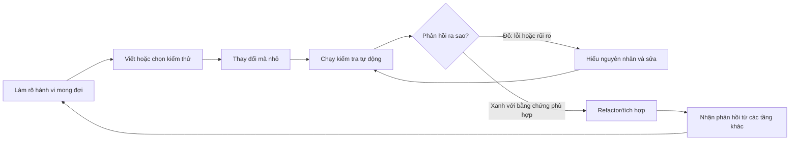
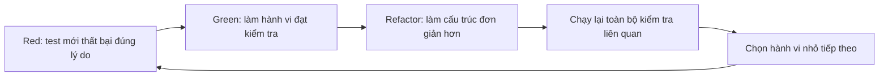
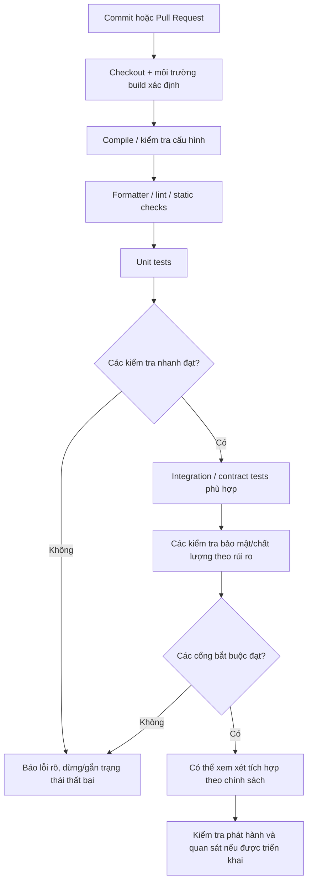

# Kiểm thử đơn vị và nền tảng phản hồi tự động

Một nhóm phát triển nền tảng học lập trình được giao chức năng **“Tiếp tục bài học đang dở”**. Lập trình viên sửa quy tắc chọn bài tiếp theo, tự thử trên giao diện và thấy mọi thứ hoạt động. Hai ngày sau, người dùng báo lỗi: nếu đã hoàn thành tất cả bài trong khóa, hệ thống mở lại một bài cũ; nếu tài khoản không còn quyền truy cập, đường dẫn trực tiếp vẫn có thể mở nội dung.

Vấn đề không chỉ là thiếu một lần kiểm tra thủ công. Đội đang thiếu một hệ thống có thể **phản hồi nhanh, lặp lại được và đáng tin cậy** khi mã thay đổi. Khi mọi thay đổi phải chờ đến cuối Sprint mới được kiểm chứng, chi phí tìm nguyên nhân và sửa lỗi thường tăng, còn việc phát hành Increment an toàn trở nên khó dự báo.

**Kiểm thử đơn vị (*unit testing*)** giúp kiểm tra hành vi của những đơn vị mã đủ nhỏ và có ranh giới rõ. Khi những kiểm thử này được tự động chạy thường xuyên, kết hợp với build, kiểm tra quy ước mã, kiểm thử tích hợp và các rào chắn chất lượng phù hợp, đội tạo ra một **nền tảng phản hồi tự động (*automated feedback foundation*)**. Nền tảng ấy không chứng minh phần mềm “không bao giờ có lỗi”, nhưng giúp phát hiện nhiều vấn đề sớm hơn, thay đổi thiết kế tự tin hơn và dành thời gian con người cho những câu hỏi khó mà máy không tự trả lời.

Bài học thuộc chương **Thực hành kỹ thuật** của mô-đun **AGILE_DEVELOPMENT**. Nó liên hệ trực tiếp với giá trị Agile: **giao phần mềm hoạt động thường xuyên, phản hồi sớm, cộng tác xuyên chức năng và cải tiến liên tục**. Unit test, TDD, CI và các tín hiệu dòng công việc hỗ trợ đội thực hiện user story, quản lý backlog và tạo Increment theo Scrum hoặc vận hành dòng việc với Kanban một cách bền vững.

## 1. Mục tiêu học tập

Sau khi học, bạn có thể:

- Giải thích **kiểm thử đơn vị là gì, điều gì được xem là một “unit”** và vì sao chỉ đếm test chưa đủ đánh giá chất lượng.
- Phân biệt **unit, component, integration, contract, end-to-end và kiểm thử khám phá** theo mục tiêu, ranh giới và tốc độ phản hồi.
- Viết unit test theo cấu trúc **Arrange–Act–Assert** hoặc **Given–When–Then**, đặt tên nêu hành vi và kiểm tra cả tình huống thông thường lẫn biên.
- Sử dụng ví dụ **Java và JUnit Jupiter** để kiểm tra quy tắc chọn bài học; biết giới hạn của ví dụ so với hệ thống thực.
- Nhận diện khi nào nên dùng **stub, fake, mock** và khi nào không nên giả lập một phụ thuộc.
- Hiểu vòng **Red–Green–Refactor** của Test-Driven Development (TDD) và những trường hợp TDD đem lại lợi ích.
- Mô tả các mức phản hồi từ **IDE/local → pull request → CI → môi trường tích hợp → quan sát sau phát hành**.
- Thiết kế một **pipeline kiểm chứng tự động** minh bạch với các bước build, format/lint, unit test và những kiểm tra bổ sung dựa trên rủi ro.
- Xử lý test không ổn định (*flaky test*), kiểm thử chậm, dữ liệu phụ thuộc, báo lỗi CI và nguy cơ “build xanh giả”.
- Đánh giá cải tiến bằng **thời gian phản hồi, độ tin cậy test, lỗi hồi quy, khả năng đáp ứng Definition of Done** và kết quả người sử dụng.

## 2. Kiểm thử đơn vị là gì?

### 2.1. Một “đơn vị” là ranh giới hành vi có thể kiểm tra

**Unit test** là một phép kiểm chứng có thể lặp lại đối với hành vi của một đơn vị phần mềm **trong phạm vi được xác định rõ**. Đơn vị có thể là hàm, lớp, module nhỏ hoặc nhóm đối tượng cộng tác chặt chẽ; không có quy tắc phổ quát rằng một unit bắt buộc phải đúng một method.

Ví dụ trong nền tảng học:

- Quy tắc chọn **bài kế tiếp** từ số bài hoàn thành.
- Quy tắc phân loại trạng thái **đang học / đã hoàn tất**.
- Quy tắc tính điểm bài trắc nghiệm theo đáp án.
- Quy tắc chuẩn hóa thông tin đầu vào.
- Quy tắc nhận biết hạn quyền truy cập đã hết dựa trên dữ liệu được cung cấp.

Những ví dụ này có thể kiểm tra nhanh bằng dữ liệu nhỏ và kết quả mong đợi rõ ràng. Unit test không phải một trình duyệt giả chạy toàn bộ hành trình người dùng.

### 2.2. Unit test kiểm tra hợp đồng hành vi

Giả sử quy tắc của một khóa học đơn giản là:

> Nếu học viên đã hoàn thành **k** bài đầu tiên trong khóa có **n** bài, bài tiếp theo là bài ở chỉ số **k** (đếm từ 0). Nếu đã hoàn thành đủ **n** bài, không còn bài tiếp theo.

Unit test nên xác nhận:

- Khi `k = 0`, chọn bài đầu.
- Khi `0 < k < n`, chọn bài ở chỉ số `k`.
- Khi `k = n`, trả về “không còn bài tiếp”.
- Khi dữ liệu không hợp lệ, báo lỗi có thể hiểu được.

Nó **không** cần quan tâm giao diện có màu xanh hay nút bấm nằm bên phải; những điều đó thuộc ranh giới kiểm chứng khác.

### 2.3. Test là phép thử một kỳ vọng, không phải bản sao mã triển khai

Một test không có ích nếu nó chỉ viết lại đúng thuật toán của production rồi so kết quả với nhau. Nếu thuật toán hiểu sai quy tắc, cả hai có thể cùng sai.

**Kỳ vọng test nên dựa vào ví dụ nghiệp vụ, đặc tả hoặc hợp đồng độc lập tương đối với chi tiết triển khai**. Ví dụ “đã học hết thì không còn bài tiếp” là một quy tắc có thể trao đổi với Product Owner; việc code dùng `if`, vòng lặp hay stream không phải trọng tâm test.

## 3. Vì sao unit test là nền tảng phản hồi nhanh?

### 3.1. Cửa sổ phản hồi nhỏ giúp sửa dễ hơn

Khi một Developer thay đổi 15 dòng rồi chạy test trong vài giây, lỗi mới thường có phạm vi tìm kiếm hẹp. Nếu một tuần sau kiểm thử tích hợp phát hiện lỗi giữa nhiều hạng mục, đội phải xem nhiều commit, nhiều phụ thuộc và nhiều giả định đã thay đổi.

Có thể hình dung một vòng phát triển:



Màu xanh là **tín hiệu rằng các điều đã được kiểm tra đang đạt**, không phải chứng chỉ phần mềm hoàn hảo.

### 3.2. Giúp thay đổi thiết kế mà không sợ phá hành vi cũ

Khi kiểm thử hành vi tồn tại, đội có thể refactor cấu trúc mã và kiểm tra nhanh liệu các hợp đồng hiện có vẫn đúng. Điều này đặc biệt hữu ích trong XP, nơi **thiết kế đơn giản, refactoring và tích hợp thường xuyên** giúp đội điều chỉnh giải pháp theo hiểu biết mới.

Một test suite đáng tin giúp giảm tâm lý “đừng sửa khu vực này vì không ai biết nó sẽ vỡ gì”. Nhưng nếu test chỉ kiểm tra chi tiết triển khai, việc refactor có thể làm rất nhiều test đỏ dù hành vi đúng. Vì vậy **chọn đúng ranh giới test** quan trọng không kém số lượng test.

### 3.3. Hỗ trợ quyền sở hữu mã chung

Trong *collective code ownership*, nhiều Developers có thể cải thiện mã ở khu vực cần thiết. Unit test cùng quy ước mã và CI tạo một **lớp phản hồi chung** giúp người chưa viết mã ban đầu vẫn tự kiểm tra hành vi.

Tuy nhiên, test không thay thế việc đọc ngữ cảnh, trao đổi với người hiểu miền nghiệp vụ hoặc review rủi ro cao. Nền tảng phản hồi tự động hỗ trợ cộng tác, **không hợp thức hóa sửa mã thiếu hiểu biết**.

### 3.4. Giảm việc kiểm thử lặp tay, không loại bỏ kiểm thử con người

Unit test có thể tự động kiểm tra hàng trăm tổ hợp dữ liệu nhỏ. Nhờ vậy người kiểm thử có thời gian hơn cho:

- Khám phá hành vi bất ngờ.
- Tìm lỗ hổng trong cách đội hiểu nhu cầu.
- Kiểm tra trải nghiệm người dùng và khả năng tiếp cận.
- Tìm rủi ro ở sự kết hợp nhiều dịch vụ.
- Đánh giá dữ liệu thật và hoàn cảnh sử dụng phức tạp.

**Tự động hóa việc lặp lại được; dùng con người để đặt câu hỏi mà kiểm thử hiện tại chưa biết phải hỏi.**

## 4. Phân biệt các tầng kiểm chứng

Các thuật ngữ có thể khác đôi chút giữa đội hoặc tài liệu. Quan trọng là **nêu rõ mục đích, ranh giới và phụ thuộc** của từng nhóm test.

| Tầng/loại kiểm chứng | Điều muốn biết | Phụ thuộc thường gặp | Tốc độ tương đối |
| --- | --- | --- | --- |
| **Unit test** | Quy tắc/hành vi nhỏ có đúng với đầu vào được kiểm soát không? | Chủ yếu chạy trong tiến trình; có thể dùng test double | Thường nhanh |
| **Component test** | Một thành phần tương đối độc lập có giữ hợp đồng của nó không? | Có thể dùng bộ nhớ thật và phụ thuộc thay thế | Nhanh đến vừa |
| **Integration test** | Các thành phần thật phối hợp đúng không? | Database, API, message broker hoặc cấu hình có kiểm soát | Vừa đến chậm |
| **Contract test** | Bên cung cấp và bên sử dụng API có hiểu hợp đồng tương thích không? | Hợp đồng, schema và bộ kiểm tra hai phía | Tùy phạm vi |
| **End-to-end (E2E)** | Một hành trình từ điểm đầu tới cuối có vận hành đúng không? | Giao diện, nhiều dịch vụ, môi trường và dữ liệu | Thường chậm và nhạy cảm hơn |
| **Exploratory testing** | Có vấn đề quan trọng nào chưa được mô tả thành test không? | Sự hiểu biết, quan sát và phán đoán của con người | Không có thời lượng cố định |
| **Kiểm thử phi chức năng** | Hệ thống có đáp ứng các ràng buộc hiệu năng, bảo mật, tiếp cận hoặc tin cậy? | Công cụ/môi trường chuyên biệt | Thay đổi mạnh |

**Unit test nhanh không có nghĩa nên dùng unit test cho mọi rủi ro.** Lỗi truy cập trái phép có thể chỉ xuất hiện khi nhiều tầng xác thực, API và database kết hợp. Hành vi UI có thể đúng ở service nhưng nút bấm không hoạt động. Đội cần đặt kiểm chứng ở **tầng thấp nhất còn đủ khả năng phát hiện vấn đề đang quan tâm**, kết hợp kiểm chứng đầu-cuối ở những đường đi quan trọng.

### 4.1. “Test pyramid” là mô hình định hướng, không phải định mức cứng

Một cách minh họa phổ biến là **nhiều kiểm thử nhỏ nhanh**, **ít hơn những kiểm thử tích hợp**, và **một số kiểm thử đầu-cuối quan trọng**. Mục đích là có phản hồi đủ nhanh mà vẫn bảo vệ những giao diện giữa thành phần.

Không có tỷ lệ bắt buộc như “70% unit, 20% integration, 10% E2E” áp dụng cho mọi hệ thống. Đội xử lý logic nghiệp vụ phức tạp cần nhiều unit test hữu ích; đội tích hợp nhiều hệ thống có thể cần chú trọng contract và integration test hơn. Hãy xem **rủi ro, kiến trúc, độ tin cậy và chi phí duy trì**.

### 4.2. Một số lỗi chỉ tầng cao mới phát hiện

| Ví dụ lỗi | Vì sao unit test chưa đủ? | Kiểm chứng bổ sung |
| --- | --- | --- |
| Tham số API không được ánh xạ đúng | Hàm nghiệp vụ có thể đúng nhưng controller sai | Integration/HTTP contract test |
| Tài khoản B đọc tiến độ của A | Kiểm tra danh tính đáng tin có thể nằm ngoài hàm được test | Kiểm tra truy cập qua API với xác thực thực |
| Database đổi kiểu cột và mất dữ liệu | Unit test dùng object trong bộ nhớ không kiểm tra migration | Migration/integration test với schema phù hợp |
| Nút “Tiếp tục” không xuất hiện trên điện thoại | Logic service đúng nhưng giao diện hoặc breakpoint sai | E2E/kiểm tra trải nghiệm |
| Pipeline build xanh nhưng không thể deploy | Build/test không kiểm tra toàn bộ điều kiện vận hành | Kiểm tra đóng gói, triển khai và quan sát |

## 5. Một unit test tốt có những đặc điểm nào?

### 5.1. Nhanh, độc lập, lặp lại được và tự đánh giá

Các tính chất thường được khuyến khích:

- **Fast — nhanh:** đủ nhanh để Developers chạy thường xuyên khi đang viết mã.
- **Independent — độc lập:** kết quả không phụ thuộc vào thứ tự chạy test khác.
- **Repeatable — lặp lại được:** cùng phiên bản mã và điều kiện đầu vào cho cùng kết quả, tránh phụ thuộc thời gian thực hoặc dữ liệu trôi.
- **Self-validating — tự xác định đạt/trượt:** công cụ tự báo kết quả dựa trên assertion rõ.
- **Timely — đúng thời điểm:** kiểm thử được viết khi hành vi còn rõ, lý tưởng trước hoặc cùng lúc mã thay đổi.

Đây là một **bộ đặc tính gợi nhớ thường gặp**, không phải chuẩn pháp lý hay kiểm định bắt buộc cho mọi test.

### 5.2. Một test nên có lý do thất bại dễ hiểu

Ví dụ:

> “Khi tất cả bài đã hoàn tất, không được trả về chỉ số bài tiếp theo.”

Nếu test đỏ, người đọc biết hành vi nào bị vi phạm. Ngược lại, test tên `testMethod1` với 15 assertion không liên quan sẽ khó chẩn đoán và dễ trở thành một bài kiểm tra gắn chặt cấu trúc hiện tại.

**Một test có thể có nhiều assertion** nếu cùng kiểm tra một hành vi có liên quan. Không nhất thiết máy móc “mỗi test đúng một assert”, nhưng nên giữ **một lý do thất bại chính** để dễ hiểu.

### 5.3. Sắp xếp Arrange – Act – Assert

Một cấu trúc dễ đọc:

1. **Arrange:** chuẩn bị dữ liệu, phụ thuộc và trạng thái đã kiểm soát.
2. **Act:** gọi hành vi cần kiểm tra.
3. **Assert:** xác nhận đầu ra hoặc tác động có thể quan sát.

Cũng có thể dùng **Given–When–Then** khi trao đổi tiêu chí chấp nhận. Cả hai đều giúp tách **bối cảnh → hành động → kết quả**.

### 5.4. Kiểm tra hành vi hơn chi tiết triển khai

Ưu tiên test các câu hỏi:

- Với dữ liệu này, kết quả nào đúng?
- Khi đầu vào không hợp lệ, phản ứng gì?
- Khi không có quyền, điều gì phải bị từ chối?
- Sau thay đổi, hợp đồng công khai nào phải giữ?
- Trường hợp ranh giới nào có nguy cơ?

Không nên mặc định test phải xác nhận tên của mọi phương thức private, số lần gọi mọi getter hoặc cách vòng lặp chạy. Test quá gắn với triển khai sẽ đỏ khi refactor dù hành vi vẫn đúng, làm giảm giá trị phản hồi.

## 6. Ví dụ Java: kiểm tra quy tắc chọn bài tiếp theo

Giả sử Product Owner và Developers thống nhất phạm vi đơn giản:

- Một khóa có các bài được sắp xếp theo thứ tự.
- `completedPrefixCount` là số bài đầu tiên đã hoàn tất liên tiếp.
- Chỉ số bài đếm từ **0**.
- Nếu đã hoàn tất toàn bộ khóa, hệ thống trả về **không còn bài cần tiếp tục**.
- Dữ liệu âm hoặc số bài hoàn tất vượt tổng số bài là không hợp lệ.

Đây là **giả định của ví dụ**, không áp dụng tự động cho hệ thống có bài học tự chọn, nhảy bài hoặc điều kiện mở khóa khác.

### 6.1. Mã sản xuất đơn giản, dễ kiểm tra

Ví dụ dùng **Java 17+** và thư viện chuẩn:

```java
import java.util.OptionalInt;

public final class ResumeLessonPolicy {

    public OptionalInt nextLessonIndex(
            int completedPrefixCount,
            int totalLessons) {

        if (totalLessons < 0) {
            throw new IllegalArgumentException("totalLessons must not be negative");
        }

        if (completedPrefixCount < 0
                || completedPrefixCount > totalLessons) {
            throw new IllegalArgumentException("Invalid completedPrefixCount");
        }

        if (completedPrefixCount == totalLessons) {
            return OptionalInt.empty();
        }

        return OptionalInt.of(completedPrefixCount);
    }
}
```

Hàm **thuần** ở mức ví dụ: nhận hai số, không gọi database, mạng, đồng hồ hệ thống và không thay đổi trạng thái ngoài. Điều này giúp kiểm tra nhiều trường hợp nhanh và tương đối ổn định.

### 6.2. Unit test với JUnit Jupiter

Ví dụ JUnit Jupiter (thường gọi là JUnit 5):

```java
import static org.junit.jupiter.api.Assertions.assertEquals;
import static org.junit.jupiter.api.Assertions.assertThrows;
import static org.junit.jupiter.api.Assertions.assertTrue;

import java.util.OptionalInt;

import org.junit.jupiter.api.Test;
import org.junit.jupiter.params.ParameterizedTest;
import org.junit.jupiter.params.provider.CsvSource;

class ResumeLessonPolicyTest {

    private final ResumeLessonPolicy policy = new ResumeLessonPolicy();

    @ParameterizedTest
    @CsvSource({
        "0, 5, 0",
        "2, 5, 2",
        "4, 5, 4"
    })
    void returnsNextLessonForIncompleteCourse(
            int completed,
            int total,
            int expectedIndex) {

        // Arrange: input đã được xác định trong từng dòng CsvSource
        // Act
        OptionalInt actual = policy.nextLessonIndex(completed, total);

        // Assert
        assertEquals(OptionalInt.of(expectedIndex), actual);
    }

    @Test
    void returnsNoNextLessonWhenAllLessonsAreComplete() {
        OptionalInt actual = policy.nextLessonIndex(5, 5);

        assertTrue(actual.isEmpty());
    }

    @Test
    void returnsNoNextLessonForEmptyCourse() {
        assertTrue(policy.nextLessonIndex(0, 0).isEmpty());
    }

    @Test
    void rejectsCompletedCountGreaterThanTotal() {
        assertThrows(
                IllegalArgumentException.class,
                () -> policy.nextLessonIndex(6, 5)
        );
    }

    @Test
    void rejectsNegativeCompletedCount() {
        assertThrows(
                IllegalArgumentException.class,
                () -> policy.nextLessonIndex(-1, 5)
        );
    }

    @Test
    void rejectsNegativeTotalLessons() {
        assertThrows(
                IllegalArgumentException.class,
                () -> policy.nextLessonIndex(0, -1)
        );
    }
}
```

Các ví dụ phản ánh **hành vi nghiệp vụ đã nêu**, không phụ thuộc giao diện. `@ParameterizedTest` và `@CsvSource` giúp kiểm tra cùng một quy tắc trên nhiều dữ liệu mà không sao chép phương thức test. Để chạy thật, dự án phải cấu hình đúng JUnit Jupiter và trình chạy kiểm thử tương ứng.

### 6.3. Vì sao kiểm thử này có ích?

- Test đọc như **tài liệu hành vi sống**: người khác biết quy tắc của hệ thống.
- Khi sửa thuật toán, phản hồi xuất hiện nhanh.
- Khi một trường hợp biên bị phá, tên test cho biết điều cần kiểm tra.
- Dữ liệu kiểm tra nhỏ, độc lập với database hay UI.
- Developer khác có thể refactor mà biết những trường hợp tối thiểu phải tiếp tục đúng.

Nhưng cần nêu rõ **những gì test chưa chứng minh**:

- Người học có còn quyền truy cập khóa không?
- Tiến độ được lưu và đọc đúng tài khoản không?
- API có nhận danh tính từ nguồn đáng tin không?
- Khóa học có thứ tự bài linh hoạt hay nội dung bị ẩn không?
- UI có đưa người học đến đúng URL không?
- Môi trường thật có xử lý mạng chậm, sự cố hoặc chuyển thiết bị an toàn không?

**Unit test là một lớp trong hệ thống bằng chứng, không phải toàn bộ bằng chứng**.

## 7. Biên và trường hợp sai: nguồn giá trị lớn của unit test

### 7.1. Đừng chỉ test “đường hạnh phúc”

Với quy tắc số bài đã hoàn thành, những tổ hợp đáng quan tâm:

| Nhóm | Đầu vào | Kỳ vọng |
| --- | --- | --- |
| **Đầu khóa** | `completed=0, total=5` | Chọn chỉ số `0` |
| **Giữa khóa** | `completed=2, total=5` | Chọn chỉ số `2` |
| **Sát cuối** | `completed=4, total=5` | Chọn chỉ số `4` |
| **Hoàn tất khóa** | `completed=5, total=5` | Không còn bài tiếp |
| **Khóa rỗng** | `completed=0, total=0` | Không còn bài tiếp |
| **Vượt số bài** | `completed=6, total=5` | Từ chối dữ liệu không hợp lệ |
| **Số âm** | `completed=-1, total=5` | Từ chối dữ liệu không hợp lệ |
| **Số tổng âm** | `completed=0, total=-1` | Từ chối dữ liệu không hợp lệ |

Các test đầu/cuối thường rẻ nhưng phát hiện lỗi **off-by-one**. Tuy nhiên, không cần tạo hàng nghìn test trùng ý nghĩa nếu một nhóm ví dụ đã bao phủ những quy tắc và ranh giới chính.

### 7.2. Kiểm thử điều kiện bất biến (*invariant*)

Một bất biến có ích cho ví dụ này:

> Nếu có chỉ số bài tiếp theo, nó phải **không âm và nhỏ hơn tổng số bài**.

Có thể bổ sung kiểm tra dựa trên các cặp số hợp lệ:

```java
import static org.junit.jupiter.api.Assertions.assertTrue;
import org.junit.jupiter.api.Test;

class ResumeLessonInvariantTest {

    @Test
    void nextLessonIndexIsAlwaysInsideCourseBounds() {
        ResumeLessonPolicy policy = new ResumeLessonPolicy();

        for (int total = 0; total <= 20; total++) {
            for (int completed = 0; completed <= total; completed++) {
                var next = policy.nextLessonIndex(completed, total);

                if (next.isPresent()) {
                    assertTrue(next.getAsInt() >= 0);
                    assertTrue(next.getAsInt() < total);
                }
            }
        }
    }
}
```

Đây là một **test duyệt một tập dữ liệu hữu hạn**, không phải kiểm thử hình thức hay bằng chứng cho mọi giá trị số nguyên. Nó minh họa tư duy kiểm tra **thuộc tính quan trọng** ngoài từng ví dụ cụ thể. Với thư viện property-based testing, đội có thể sinh nhiều đầu vào hơn, nhưng vẫn phải xác định đúng thuộc tính.

### 7.3. Kiểm thử đầu vào xấu có mục đích

Không nên thử mọi tổ hợp vô nghĩa chỉ để tăng số test. Hãy ưu tiên:

- Những ranh giới nghiệp vụ thực.
- Dữ liệu có thể bị lỗi khi di chuyển hoặc đồng bộ.
- Những tình huống từng gây sự cố.
- Đầu vào không đáng tin từ API.
- Trạng thái vắng dữ liệu, trùng lặp hoặc mất quyền.

**Một unit test tốt phải trả lời “rủi ro hoặc quy tắc nào nó bảo vệ?”**.

## 8. Khi code có phụ thuộc: test double và thiết kế dễ kiểm chứng

Không phải mã nghiệp vụ nào cũng thuần. Một service có thể cần lấy dữ liệu, gọi hệ thống ngoài, dùng đồng hồ hoặc gửi thông báo. Test double giúp thay thế một số phụ thuộc **tại ranh giới rõ** trong unit test.

### 8.1. Stub, fake, mock và spy khác nhau ra sao?

| Khái niệm | Vai trò thường gặp | Ví dụ |
| --- | --- | --- |
| **Stub** | Cung cấp dữ liệu hoặc phản hồi được định trước | API giả luôn trả khóa học còn quyền truy cập |
| **Fake** | Bản thực hiện đơn giản có hành vi hợp lệ cho test | Repository giữ tiến độ trong bộ nhớ thay database |
| **Mock** | Kiểm tra tương tác/kỳ vọng gọi giữa các thành phần | Xác nhận một sự kiện được gửi một lần khi hoàn tất giao dịch |
| **Spy** | Ghi lại tương tác để kiểm tra, có thể bọc một thực hiện thật hoặc double | Ghi lại nội dung notification đã được yêu cầu gửi |

Thuật ngữ có thể khác giữa thư viện. **Không nên chọn mock chỉ vì nó được hỗ trợ sẵn**. Hãy hỏi test cần kiểm tra **kết quả quan sát được** hay một **tương tác thực sự là một phần hợp đồng**.

### 8.2. Ví dụ thay phụ thuộc bằng một stub nhỏ

Hệ thống cần quyết định học viên có đủ quyền tiếp tục khóa. Ta có thể đưa việc tra cứu quyền truy cập qua một interface:

```java
@FunctionalInterface
interface CourseAccess {
    boolean canAccess(String learnerId, String courseId);
}

final class ResumeAccessPolicy {
    private final CourseAccess courseAccess;

    ResumeAccessPolicy(CourseAccess courseAccess) {
        this.courseAccess = courseAccess;
    }

    boolean canResume(String authenticatedLearnerId, String courseId) {
        return courseAccess.canAccess(authenticatedLearnerId, courseId);
    }
}
```

Trong test, thay `CourseAccess` bằng lambda trả về giá trị mong muốn:

```java
import static org.junit.jupiter.api.Assertions.assertFalse;
import static org.junit.jupiter.api.Assertions.assertTrue;
import org.junit.jupiter.api.Test;

class ResumeAccessPolicyTest {

    @Test
    void permitsResumeWhenAccessServiceAllowsIt() {
        CourseAccess allowed = (learnerId, courseId) -> true;
        var policy = new ResumeAccessPolicy(allowed);

        assertTrue(policy.canResume("learner-A", "course-K"));
    }

    @Test
    void rejectsResumeWhenAccessServiceDeniesIt() {
        CourseAccess denied = (learnerId, courseId) -> false;
        var policy = new ResumeAccessPolicy(denied);

        assertFalse(policy.canResume("learner-A", "course-K"));
    }
}
```

**Giới hạn rất quan trọng:** hai test chỉ chứng minh service **chuyển tiếp quyết định** từ phụ thuộc `CourseAccess`. Chúng **không chứng minh hệ thống thật xác thực danh tính đúng** hoặc dịch vụ quyền truy cập hoạt động chính xác. Nếu đây là logic quá mỏng, test có giá trị hạn chế; không nên xây lớp trung gian chỉ để có thêm test.

Đội cần kiểm thử bổ sung nơi **`authenticatedLearnerId` thực sự lấy từ session/token đáng tin**, nơi quyền đối với khóa được xác minh và nơi API trả dữ liệu. Đây là ví dụ cho thấy **mock/stub có thể tạo cảm giác an toàn giả nếu thay thế chính thứ cần kiểm chứng**.

### 8.3. Những phụ thuộc nên được kiểm soát

- **Đồng hồ hệ thống:** đưa `Clock` hoặc hàm cung cấp thời gian vào thay vì gọi thời gian hiện tại ở nhiều nơi.
- **Random/UUID:** sử dụng nguồn có thể dự đoán trong test khi cần kiểm tra kết quả chính xác.
- **Database:** dùng fake cho quy tắc không phụ thuộc DB; dùng integration test với DB phù hợp để kiểm tra transaction, query và schema.
- **HTTP/API ngoài:** dùng stub/contract test cho trường hợp lỗi và timeout; có bài kiểm tra hợp đồng thực khi cần.
- **File system:** dùng thư mục tạm cô lập hoặc tầng trừu tượng phù hợp.
- **Message queue:** test logic phát sự kiện ở unit level, nhưng kiểm tra thực tế serialization và delivery ở tầng integration/contract.

### 8.4. Tránh mock quá mức

Một test mong đợi 12 lần gọi các method nội bộ có thể thất bại khi refactor dù kết quả người dùng không đổi. Khi đó test đang bảo vệ **cấu trúc hiện tại** thay vì **hành vi có giá trị**.

Ưu tiên **state-based testing** (kiểm tra đầu ra/trạng thái quan sát được) khi phù hợp. Dùng **interaction-based testing** khi tương tác là hợp đồng quan trọng, ví dụ “không gửi thanh toán lần thứ hai” hoặc “phải phát sự kiện sau khi transaction thành công”.

## 9. Thiết kế dễ kiểm thử (*testability*) không phải thiết kế chỉ để test

### 9.1. Những thiết kế thường gây test khó

- Hàm dài vừa tính toán, gọi DB, gửi email và ghi log.
- Trạng thái dùng chung có thể bị sửa từ nhiều nơi.
- Phụ thuộc vào đồng hồ và môi trường mà test không kiểm soát.
- Cấu hình/secret bị đọc trực tiếp trong business logic.
- Khởi tạo dịch vụ ngoài ngay trong constructor.
- Logic nghiệp vụ gắn cứng với framework giao diện.
- Method thay đổi nhiều trạng thái mà không công khai hợp đồng rõ.

Những dấu hiệu này còn làm **mã khó hiểu và khó sửa trong production**, không chỉ khó unit test.

### 9.2. Tách logic nghiệp vụ khỏi kết nối hạ tầng

Ví dụ:

```text
HTTP Controller
    |
    v
Application Service ----> Permission Gateway
    |
    +----> ResumeLessonPolicy (quy tắc thuần, unit test nhanh)
    |
    +----> Progress Repository (database, integration test)
```

Sơ đồ là một **lựa chọn kiến trúc minh họa**. Không phải dự án nào cũng cần bốn lớp hay nhiều interface. Tách ranh giới nên phục vụ **khả năng hiểu, khả năng thay đổi và kiểm chứng**.

### 9.3. Khi nào nên refactor để kiểm thử?

Nếu mỗi lần kiểm tra một phép tính nhỏ phải bật toàn bộ ứng dụng và database, có thể cân nhắc tách phép tính khỏi hạ tầng. Nhưng **không nên thêm vô số interface, factory, adapter chỉ để dễ mock** nếu chúng làm hệ thống phức tạp hơn lợi ích nhận được.

Một cách làm thận trọng:

1. Ghi hành vi đang có bằng test ở ranh giới phù hợp.
2. Chọn một thay đổi cấu trúc nhỏ.
3. Chạy kiểm chứng.
4. Lặp lại khi có lợi ích rõ.
5. Nếu có sửa hành vi, phân biệt với refactor thuần túy để review dễ hơn.

## 10. Test-Driven Development: Red – Green – Refactor

**TDD** là một thực hành XP trong đó vòng phản hồi của unit test được đưa **vào chính quá trình thiết kế và lập trình**.

### 10.1. Ba bước cơ bản

1. **Red:** viết một test diễn đạt hành vi chưa có; chạy và thấy nó thất bại vì lý do mong đợi.
2. **Green:** viết phần mã đơn giản nhất đủ làm test mới đạt mà không phá test cũ.
3. **Refactor:** cải thiện cấu trúc mã/test, giữ hành vi đã xác nhận, chạy lại kiểm thử.



Một vòng có thể rất ngắn nếu hạng mục nhỏ. Không nên hiểu TDD là “đầu Sprint viết toàn bộ test, cuối Sprint mới viết code”.

### 10.2. Ví dụ tiến hóa của quy tắc bài học

**Vòng 1:** khi chưa hoàn tất bài nào trong khóa có năm bài, chỉ số tiếp theo là 0.

**Vòng 2:** khi đã hoàn tất hai trong năm bài, chỉ số tiếp theo là 2.

**Vòng 3:** khi đã hoàn tất cả năm bài, không còn bài tiếp theo.

**Vòng 4:** đầu vào `completed > total` bị từ chối.

Qua từng vòng, test buộc đội làm rõ hành vi. Ở bước refactor, đội có thể gom kiểm tra dữ liệu vào một đoạn dễ đọc hơn, đặt tên rõ hơn và chạy lại bộ kiểm tra.

### 10.3. TDD không có nghĩa test đơn vị đủ cho mọi thứ

Trong hệ thống thật, quy tắc “tiếp tục bài” vẫn cần kiểm chứng ở API, database, quyền truy cập và giao diện. TDD giúp **thiết kế và xác minh hành vi nhỏ**, không thay thế kiểm thử tích hợp, khám phá hoặc quan sát sản phẩm.

TDD cũng không phải yêu cầu bắt buộc của Scrum. Một đội Agile có thể áp dụng TDD cho những phần nghiệp vụ phù hợp, đồng thời dùng các chiến lược khác cho giao diện, hệ thống cũ hoặc công việc khám phá nhiều bất định.

## 11. Nền tảng phản hồi tự động gồm những lớp nào?

Unit test chỉ là một phần. Một nền tảng thực hành tốt giúp phản hồi xuất hiện **gần nơi quyết định được đưa ra nhất**, rồi mở rộng phạm vi kiểm tra theo rủi ro.

### 11.1. Các vòng phản hồi từ gần đến xa

| Vòng phản hồi | Khi nào | Loại thông tin nhận được |
| --- | --- | --- |
| **Trong IDE/local** | Ngay khi viết hoặc sửa mã | Compile, format, lint, unit test trọng tâm, phản hồi vài giây đến phút |
| **Trước khi gửi PR** | Trước khi chia sẻ thay đổi | Unit suite liên quan, kiểm tra cấu trúc, một số integration test phù hợp |
| **CI trên commit/PR** | Khi thay đổi được đẩy lên dòng mã chung hoặc đề nghị tích hợp | Build sạch, lint/format, test tự động, kiểm tra hợp đồng và chính sách |
| **Môi trường tích hợp/staging** | Khi cần kiểm tra các thành phần thật | DB migration, hợp đồng API, hành vi end-to-end, kiểm tra cấu hình |
| **Sau phát hành** | Khi phần mềm được sử dụng | Lỗi thực, hiệu năng, tính đúng dữ liệu, outcome người dùng, cảnh báo vận hành |

**Phản hồi càng gần người thực hiện thay đổi càng thuận tiện để sửa**, nhưng chỉ kiểm tra gần không đủ. Đội cần thêm phản hồi ở những ranh giới mà unit test không thể xác nhận.

### 11.2. Cấu trúc pipeline minh họa



Pipeline trên là **sơ đồ khái niệm**, không phải cấu hình sẵn chạy được. Tổ chức có thể chạy các bước song song, sử dụng cache, phân tầng kiểm thử hoặc nhiều hệ điều hành để tối ưu thời gian phản hồi. Mục tiêu là **kết quả rõ, tái hiện được, liên hệ với đúng revision và có hành động khi đỏ**.

### 11.3. Ví dụ chính sách kiểm chứng ngắn

```text
Khi Developer tạo Pull Request:
  1. Kiểm tra dự án có thể build sạch.
  2. Kiểm tra style/format và quy tắc tĩnh bắt buộc.
  3. Chạy unit tests liên quan và bộ kiểm tra nhanh chung.
  4. Chạy integration/contract tests theo thay đổi và chính sách.
  5. Hiển thị rõ lỗi và log an toàn nếu một bước thất bại.
  6. Chỉ hợp nhất khi đủ điều kiện CI/review đã thống nhất.

Sau khi hợp nhất:
  - Chạy các kiểm tra phù hợp trên dòng mã chung.
  - Xử lý nhanh nếu nhánh chính bị hỏng.
  - Đánh giá thêm điều kiện release/DoD trước khi công bố sản phẩm.
```

Chính sách này có thể thực hiện bằng nhiều hệ thống CI/CD khác nhau. **Không có một công cụ hoặc thứ tự bước cụ thể bắt buộc trong Agile, Scrum hay XP.**

## 12. Nền tảng CI tốt cần minh bạch và tin cậy

### 12.1. Mỗi kết quả test phải gắn với đúng mã và điều kiện

Một thông báo “All tests passed” thiếu các dữ kiện quan trọng nếu không biết:

- Revision/commit nào được kiểm tra?
- Dùng phiên bản Java và dependency nào?
- Bộ test nào thật sự chạy, có bị skip hoặc lọc không?
- Môi trường và dữ liệu thử ra sao?
- Có test không ổn định hay cảnh báo bị bỏ qua không?
- Log thất bại có đủ để tìm nguyên nhân nhưng không lộ secret không?

**Kết quả CI là bằng chứng có phạm vi**, không phải nhãn an toàn tuyệt đối.

### 12.2. Build có thể lặp lại

Những yếu tố nên được kiểm soát khi phù hợp:

- Phiên bản compiler/runtime.
- Phiên bản thư viện và plugin.
- Cấu hình test, môi trường và biến cần thiết.
- Dữ liệu và seed trong test.
- Truy cập mạng hoặc dịch vụ ngoài.
- Cache và file sinh ra từ lần chạy trước.

Một test đạt trên máy A nhưng liên tục sai trên máy B có thể phản ánh phụ thuộc môi trường. Mục tiêu là **cùng một mã, cùng điều kiện được mô tả → kết quả đủ nhất quán để tin**.

### 12.3. Phản hồi nhanh nhưng không cắt điều thiết yếu

Đội có thể chia kiểm chứng theo tốc độ:

| Nhóm kiểm tra | Cách chạy khả dĩ | Lợi ích |
| --- | --- | --- |
| **Rất nhanh** | Trong IDE hoặc trước commit | Phát hiện lỗi cú pháp/logic cơ bản |
| **Nhanh và bắt buộc** | Mỗi PR/commit | Chặn hồi quy phổ biến và lỗi định dạng |
| **Sâu hơn** | Theo loại thay đổi, trên nhánh chính hoặc thời điểm phù hợp | Kiểm tra DB, API, security, E2E và cấu hình |
| **Chuyên biệt/rủi ro cao** | Trước phát hành hoặc theo lịch cùng điều kiện thích hợp | Hiệu năng, kiểm tra bảo mật chuyên sâu, migration quy mô lớn |

Không nên bỏ một kiểm tra bảo mật bắt buộc chỉ vì nó chạy chậm. Thay vào đó, cải thiện khả năng tự động hóa, môi trường hoặc cách phân loại rủi ro. **Tối ưu thời gian feedback phải đi cùng kiểm soát chất lượng**.

### 12.4. “Build xanh” không có nghĩa “release sẵn sàng”

CI có thể xác nhận mã build và test đã khai báo đạt. Nhưng phát hành còn phụ thuộc:

- Đáp ứng Definition of Done của Increment.
- Ràng buộc bảo mật, quyền riêng tư, dữ liệu và vận hành.
- Quyết định bật/tắt feature theo mục tiêu sản phẩm.
- Khả năng theo dõi và khôi phục nếu gặp lỗi.
- Tài liệu hoặc phối hợp cần thiết theo chính sách.

Trong Scrum, **Definition of Done** là cam kết gắn với Increment; một PBI chưa đáp ứng DoD không thuộc Increment Done, dù một vài bước CI đã xanh.

## 13. Xử lý pipeline đỏ và flaky tests

### 13.1. Phân loại thất bại trước khi sửa

| Loại thất bại | Ví dụ | Hướng xử lý |
| --- | --- | --- |
| **Lỗi mã/hành vi** | Assertion sai sau khi đổi quy tắc chọn bài | Tái hiện, hiểu yêu cầu, sửa mã hoặc test kỳ vọng nếu yêu cầu đã đổi có chủ đích |
| **Test không đúng** | Test chờ hành vi cũ dù nghiệp vụ đã thay đổi | Xác nhận với người hiểu yêu cầu, cập nhật hợp đồng và test có bằng chứng |
| **Test không ổn định** | Đôi khi thất bại do chạy song song, timing hoặc thứ tự test | Tìm nguồn không xác định, cô lập dữ liệu/đồng hồ, xử lý đồng bộ đúng |
| **Môi trường/infra** | Không khởi tạo DB, hết dung lượng, runner lỗi | Điều tra và khôi phục môi trường; đảm bảo kết quả kiểm tra thật |
| **Hợp đồng tích hợp sai** | Mock luôn trả OK nhưng service thật trả khác schema | Cập nhật hợp đồng, bổ sung contract/integration test |
| **Lỗi cấu hình/phiên bản** | Runtime hoặc dependency khác với môi trường dự kiến | Cố định và công bố cấu hình phù hợp |

Một pipeline đỏ **không có nghĩa chắc chắn Developer vừa viết mã sai**. Nhưng cũng không nên vì nghi ngờ hạ tầng mà tự ý bỏ qua kiểm chứng để merge.

### 13.2. Flaky test làm mất niềm tin vào phản hồi

*Flaky test* là test có thể đạt hoặc trượt không nhất quán ngay cả khi mã/điều kiện chủ chốt không đổi theo cách mong đợi. Một số nguồn:

- Phụ thuộc thời gian thực hoặc múi giờ.
- Dùng dữ liệu chung, test này ảnh hưởng test khác.
- Chạy đồng thời nhưng dùng tài nguyên không cô lập.
- Dùng thứ tự không xác định của collection.
- Chờ bằng `sleep` theo thời gian cố định thay vì điều kiện.
- Gọi dịch vụ mạng thật không kiểm soát.
- Có race condition hoặc sự kiện bất đồng bộ chưa được đợi đúng.
- Dọn dẹp dữ liệu sau test không hoàn chỉnh.

Khi test không ổn định, đội có thể bị lôi vào thói quen “rerun cho xanh”, làm giảm khả năng phát hiện lỗi thật.

### 13.3. Thay đồng hồ thật bằng đồng hồ có thể điều khiển

Ví dụ một quy tắc hết hạn quyền truy cập:

```java
import java.time.Clock;
import java.time.Instant;

public final class AccessExpiryPolicy {
    private final Clock clock;

    public AccessExpiryPolicy(Clock clock) {
        this.clock = clock;
    }

    public boolean isExpired(Instant expiresAt) {
        return !Instant.now(clock).isBefore(expiresAt);
    }
}
```

Test không cần đợi thời gian thực trôi qua:

```java
import static org.junit.jupiter.api.Assertions.assertFalse;
import static org.junit.jupiter.api.Assertions.assertTrue;

import java.time.Clock;
import java.time.Instant;
import java.time.ZoneOffset;

import org.junit.jupiter.api.Test;

class AccessExpiryPolicyTest {

    private final Clock fixedClock = Clock.fixed(
            Instant.parse("2026-01-01T10:00:00Z"),
            ZoneOffset.UTC
    );

    private final AccessExpiryPolicy policy =
            new AccessExpiryPolicy(fixedClock);

    @Test
    void isActiveBeforeExpiry() {
        assertFalse(policy.isExpired(
                Instant.parse("2026-01-01T10:00:01Z")));
    }

    @Test
    void isExpiredAtTheExactExpiryInstant() {
        assertTrue(policy.isExpired(
                Instant.parse("2026-01-01T10:00:00Z")));
    }
}
```

Với đầu vào và clock cố định, test chạy ổn định mà không phải `Thread.sleep()`. Đội vẫn phải làm rõ **quy tắc nghiệp vụ tại đúng thời điểm hết hạn**, múi giờ và ranh giới dữ liệu; test không tự quyết định thay Product Owner.

### 13.4. Có được tạm cách ly một flaky test?

Một test không ổn định nghiêm trọng có thể làm cả pipeline mất ý nghĩa. Một chính sách có trách nhiệm có thể cho phép **quarantine có kiểm soát**, nhưng cần:

- Ghi rõ rủi ro mà test bảo vệ và lý do cách ly.
- Có người theo dõi và hạn xử lý phù hợp.
- Dùng một kiểm tra thay thế nếu rủi ro quan trọng.
- Không gọi bộ test “đầy đủ” khi có kiểm tra bắt buộc bị bỏ.
- Hiển thị rõ số test bị cách ly và xu hướng.
- Khôi phục test khi đã giải quyết nguyên nhân.

**Không cách ly test bảo mật trọng yếu để tạo build xanh giả**. Việc tạm loại một test phải dựa trên rủi ro và quy trình tổ chức, không phải giải pháp mặc định.

## 14. Chất lượng test: độ phủ không đồng nghĩa khả năng phát hiện lỗi

### 14.1. Code coverage nói gì?

**Code coverage** mô tả mức độ mã được thực thi khi chạy bộ test theo một cách đo cụ thể. Một số thước đo:

- **Line coverage:** tỷ lệ dòng được thực thi.
- **Branch coverage:** tỷ lệ nhánh điều kiện được thực thi.
- **Method coverage:** tỷ lệ phương thức được gọi qua test.
- **Condition coverage:** tùy công cụ, xem điều kiện logic ở mức chi tiết hơn.

Một bộ test có 100% line coverage **vẫn có thể thiếu assertion quan trọng** hoặc kiểm tra sai kỳ vọng. Ví dụ, test gọi hàm chọn bài nhưng không kiểm tra chỉ số trả về cũng có thể làm nhiều dòng được tính “đã chạy”.

### 14.2. Sử dụng coverage để tìm lỗ hổng, không làm KPI duy nhất

Hữu ích khi:

- Tìm nhánh rủi ro chưa được thực thi.
- Phát hiện phương thức cũ không có test bảo vệ.
- So sánh thay đổi phạm vi coverage của phần mã sửa.
- Hỗ trợ đánh giá nơi cần unit/integration test.

Rủi ro khi lạm dụng:

- Viết test không có assertion để tăng tỷ lệ.
- Test chi tiết private method nhưng không kiểm tra hợp đồng.
- Bỏ qua E2E hoặc contract test vì “coverage đã cao”.
- Coi tăng phần trăm là tăng giá trị người dùng.
- Ép mục tiêu thống nhất cho code sinh tự động, cấu hình và logic nghiệp vụ dù tính chất khác nhau.

### 14.3. Mutation testing: kiểm tra khả năng test phát hiện sai

**Mutation testing** tạo những biến đổi nhỏ vào mã (ví dụ đổi `<` thành `<=`) rồi xem test có phát hiện bất thường không. Nó có thể chỉ ra test đang chạy mã nhưng không bảo vệ đúng hành vi.

Ví dụ nếu thay điều kiện:

```java
if (completedPrefixCount == totalLessons) {
    return OptionalInt.empty();
}
```

thành một điều kiện sai, test “đã hoàn tất toàn bộ khóa” nên phát hiện. Tuy nhiên, công cụ mutation có thể tốn thời gian và tạo biến đổi không có ý nghĩa; cần chọn phạm vi và diễn giải phù hợp. Nó **không thay thế kiểm chứng hành vi ngoài production**, chỉ bổ sung một góc nhìn về chất lượng test.

## 15. Nền tảng phản hồi tự động và Definition of Done

Trong Scrum, **Definition of Done (DoD)** mô tả trạng thái Increment đáp ứng tiêu chuẩn chất lượng của sản phẩm. Đây là **cam kết gắn với Increment**; một PBI chưa đáp ứng DoD không được coi là phần Increment hoàn thành.

### 15.1. Ví dụ DoD có yếu tố kiểm chứng tự động

Một Scrum Team có thể thống nhất (chỉ là ví dụ):

- Mã được tích hợp vào dòng mã chung theo chính sách.
- Build và kiểm tra tĩnh bắt buộc đạt.
- Unit test cho quy tắc nghiệp vụ quan trọng đạt.
- Integration/contract test phù hợp thay đổi đạt.
- Các trường hợp phân quyền và dữ liệu nhạy cảm được kiểm tra theo rủi ro.
- Không còn lỗi nghiêm trọng chưa xử lý ảnh hưởng phạm vi Increment.
- Tài liệu cần thiết hoặc hợp đồng API được cập nhật.
- Increment có thể sử dụng trong bối cảnh đã xác định.

**Scrum Guide không quy định một danh sách công cụ test cụ thể cho DoD**. Nếu tổ chức có tiêu chuẩn DoD, đội phải tuân thủ tối thiểu chuẩn ấy; nếu không, Scrum Team xác định DoD phù hợp. Nhiều Scrum Team cùng sản phẩm cần một DoD chung.

### 15.2. Quy tắc không được đánh tráo

- **Unit tests xanh:** một lớp bằng chứng.
- **CI xanh:** các bước đã cấu hình đạt.
- **PBI Done:** toàn bộ điều kiện DoD của Increment đã đạt.
- **Increment có thể sử dụng:** phần sản phẩm đã xác minh và tích hợp phù hợp.
- **Released:** đã đưa đến nhóm người dùng theo quyết định phát hành.
- **Outcome:** người dùng thực sự hoàn thành mục tiêu tốt hơn.

Những trạng thái trên **khác nhau**, dù có liên hệ. Một PBI có thể chưa được phát hành rộng nhưng đã đạt DoD; ngược lại một pipeline xanh không tự làm một tính năng chưa kiểm tra phân quyền trở thành Done.

### 15.3. Chất lượng là công việc của cả đội

Theo Scrum Guide, **Developers chịu trách nhiệm về chất lượng bằng việc tuân thủ DoD**. Điều này không có nghĩa tất cả Developers phải tự viết mọi loại test; người có chuyên môn kiểm thử, UX, vận hành và kỹ thuật có thể hợp tác để tạo Increment.

**Không đẩy “kiểm thử” thành cổng cuối Sprint của một cá nhân**, khiến nhiều việc được gọi “code complete” nhưng không bao giờ đến Done đúng hạn.

## 16. Tình huống xuyên suốt: từ yêu cầu đến phản hồi tự động

Một Scrum Team phát triển nền tảng học trực tuyến nhận yêu cầu:

> “Là học viên, tôi muốn tiếp tục bài đang học dở để không mất thời gian tìm lại nội dung khi quay lại khóa.”

Product Owner và Developers làm rõ phạm vi ban đầu: **trên cùng một thiết bị, học viên đã đăng nhập, khóa còn quyền truy cập**. Đồng bộ ngoại tuyến và nhiều thiết bị là những lựa chọn có thể xem xét sau.

### 16.1. Bước 1 — Tách giả thuyết giá trị và hành vi cần đúng

**Giả thuyết giá trị:** người học quay lại có thể bắt đầu buổi học nhanh hơn và ít bỏ cuộc vì phải tìm bài.

**Hành vi bắt buộc:**

1. Lấy đúng tiến độ gắn với người học đang xác thực.
2. Xác định bài tiếp theo theo quy tắc đã thống nhất.
3. Không mở nội dung đã mất quyền truy cập.
4. Khi không có tiến độ, có cách bắt đầu hợp lệ.
5. Khi dữ liệu tiến độ cũ không hợp lệ, xử lý rõ và an toàn.

**Outcome** sẽ được quan sát qua trải nghiệm người học; **unit tests** chủ yếu xác nhận các quy tắc có thể kiểm chứng độc lập.

### 16.2. Bước 2 — Phân loại kiểm chứng theo rủi ro

| Rủi ro/hành vi | Unit test | Kiểm tra khác cần xét |
| --- | --- | --- |
| Chọn chỉ số bài tiếp theo đúng | Test `ResumeLessonPolicy` với dữ liệu ranh giới | Test tích hợp với danh sách bài thực |
| Khóa đã hoàn tất | Test trả về “không còn bài” | UI hiển thị trạng thái hoàn tất đúng |
| Tiến độ tài khoản A không thuộc B | Test quy tắc ownership nếu có | API integration/security test dùng phiên đăng nhập A/B |
| Dữ liệu cũ thiếu trường | Test xử lý input không hợp lệ | Migration/integration test với mẫu dữ liệu hợp lệ |
| Không được mở khóa đã hết quyền | Test quy tắc hết hạn hoặc điều kiện quyền | API/E2E xác minh quyền thực tế |
| Nút “Tiếp tục” dễ nhận biết | Không phù hợp chỉ bằng unit test nghiệp vụ | Quan sát người dùng, UX/khả năng tiếp cận |
| Tiến độ lưu bền vững | Test logic lưu theo interface | Integration test với DB và transaction |

Đội không cố **giả lập toàn bộ thế giới trong unit test**. Họ chọn các tầng hỗ trợ lẫn nhau.

### 16.3. Bước 3 — Làm việc bằng vòng nhỏ

Developer nhận PBI chọn bài tiếp theo:

- Trao đổi ví dụ với Product Owner và người hiểu nghiệp vụ.
- Viết test cho “đầu khóa”, “giữa khóa”, “hoàn tất khóa”.
- Làm mã đạt test.
- Refactor tên và loại dữ liệu trả về nếu cần.
- Chạy bộ test nhanh.
- Tích hợp thay đổi nhỏ qua CI.
- Phối hợp với người kiểm thử tạo test API xác nhận đúng tài khoản.

Công việc **đi qua test, integration và kiểm chứng trong lúc phát triển**, không bị dồn tới ngày cuối.

### 16.4. Bước 4 — Pipeline phát hiện một lỗi

Trong một Pull Request, test:

```text
returnsNoNextLessonWhenAllLessonsAreComplete()
```

thất bại vì phiên bản mới trả về chỉ số của bài cuối. Đội xem diff và nhận ra Developer dùng `completedPrefixCount - 1` khi khóa đã hoàn tất — một suy luận không phù hợp hợp đồng.

Họ sửa quy tắc, chạy lại test và kiểm tra các đường đi có liên quan. Đây là ví dụ về **phản hồi sớm có giá trị**: lỗi được nhận diện trước khi chức năng được hợp nhất và gửi người dùng.

### 16.5. Bước 5 — Một lỗ hổng không bị unit test phát hiện

Unit tests của `ResumeLessonPolicy` đều xanh. Tuy nhiên, integration test với API cho thấy một request dùng tiến độ của tài khoản khác vẫn nhận dữ liệu khi endpoint chỉ tin `learnerId` từ request body.

Đây không phải lý do bỏ unit tests. Nó minh họa **giới hạn của ranh giới kiểm chứng**. Đội phải:

1. Xác nhận nguồn danh tính đáng tin từ session/token.
2. Kiểm tra quyền tại ranh giới API và quy tắc dữ liệu.
3. Bổ sung kiểm thử cho trường hợp A/B.
4. Sửa production code và chạy lại các tầng kiểm chứng.
5. Xem liệu DoD có cần làm rõ về quyền truy cập không.
6. Nếu hệ thống đã có người dùng và dữ liệu bị ảnh hưởng, xử lý theo chính sách an toàn và sự cố.

**Build xanh ở một tầng không được dùng để bỏ qua bằng chứng lỗi ở tầng khác**.

### 16.6. Bước 6 — Sprint Review và phản hồi người dùng

Khi Increment đáp ứng DoD, đội có thể trình bày hành vi đã hoàn thành và nhận phản hồi. Nếu người học vẫn không tìm ra nút “Tiếp tục”, vấn đề có thể nằm ở trải nghiệm, không phải logic chọn bài.

Product Owner cập nhật backlog theo điều học được: có thể ưu tiên cách hiển thị rõ hơn thay vì xây ngay dashboard tiến độ phức tạp. **Automated feedback xác nhận phần mềm không làm sai những hành vi đã biết; product feedback giúp kiểm tra đội có giải quyết đúng vấn đề không**.

### 16.7. Bước 7 — Sprint Retrospective

Scrum Team có thể xem:

- Test nào phát hiện lỗi sớm?
- Test nào không phát hiện và vì sao?
- CI phản hồi có đủ nhanh để Developers chạy thường xuyên không?
- Có test flaky khiến mọi người xem nhẹ kết quả không?
- Những hạng mục nào chờ kiểm thử/tích hợp quá lâu?
- Có ranh giới quyền truy cập nào chưa được mô tả thành kiểm chứng?
- Một cải tiến nhỏ nào có thể thử trong Sprint tới?

Một hành động minh họa:

> “Trong Sprint tiếp, mọi PBI liên quan dữ liệu học viên phải cùng thảo luận ví dụ tài khoản A/B ở refinement. Developers đưa kiểm chứng quyền truy cập ở tầng API phù hợp và theo dõi lỗi hồi quy. Chúng ta xem thời gian phản hồi CI, số test flaky và việc đáp ứng DoD tại retrospective sau.”

## 17. Lập chiến lược kiểm thử dựa trên rủi ro và chi phí phản hồi

### 17.1. Không phải mọi dòng mã đều có cùng rủi ro

| Loại thay đổi | Rủi ro nổi bật | Kiểm chứng ưu tiên |
| --- | --- | --- |
| Đổi tên trường nội bộ không ảnh hưởng hợp đồng | Lỗi build hoặc tham chiếu còn sót | Compiler, unit tests liên quan, lint |
| Quy tắc tính tiền/phí | Sai tiền, dữ liệu biên và làm tròn | Unit tests bảng trường hợp, integration test, review nghiệp vụ |
| Xử lý quyền truy cập | Truy cập trái phép dữ liệu | Unit policy test, API security/integration test, review chuyên môn |
| Database migration | Mất dữ liệu, lỗi tương thích | Migration rehearsal, integration tests, phương án rollback phù hợp |
| Thay đổi UI chính | Không hoàn tất hành trình, khả năng tiếp cận | Component/E2E tests, quan sát người dùng |
| Đồng bộ bất đồng bộ | Race condition, trùng sự kiện, sai thứ tự | Unit tests cho quy tắc, integration/contract tests, kiểm chứng retry và idempotency |
| Sửa một test flaky | Mất khả năng phát hiện lỗi nếu sửa sai test | Tái hiện nguyên nhân, kiểm tra rằng test vẫn đỏ khi hành vi bị phá |

### 17.2. Không coi kiểm thử là một giai đoạn cuối

Nếu tất cả mã chỉ được đưa sang “QA” khi Sprint gần kết thúc, unit tests có thể không cứu được thời gian tích hợp. Đội nên chia PBI thành **lát cắt dọc** có thể kiểm chứng, phối hợp sớm giữa người hiểu nghiệp vụ, Developers và kiểm thử.

Một lát cắt đúng không phải “xây database trước, API sau, UI sau nữa” rồi đánh dấu từng phần là sản phẩm Done. Nó là **hành vi có giá trị từ đầu đến cuối**, kèm test và chất lượng phù hợp.

### 17.3. Chọn thứ tự đầu tư vào test

Khi một hệ thống cũ thiếu kiểm thử, không nhất thiết viết test cho toàn bộ repository trước khi sửa bất kỳ thứ gì. Có thể ưu tiên:

1. Khu vực đang được sửa và có rủi ro cao.
2. Quy tắc thường xuyên gây lỗi hồi quy.
3. Những phần có thể test nhanh và độc lập.
4. Hợp đồng dữ liệu/API khó phát hiện sai bằng quan sát thường.
5. Điểm tích hợp thường chờ lâu hoặc làm giảm niềm tin của đội.

Đối với mã khó test, có thể bắt đầu bằng **characterization test**: ghi nhận hành vi hiện tại để hiểu trước khi thay đổi. Nhưng phải tách **hành vi hiện có** khỏi **hành vi đúng mong muốn**, đặc biệt khi đang sửa một lỗi nghiệp vụ.

## 18. Đo hiệu quả của nền tảng phản hồi tự động

### 18.1. Không dùng số test làm KPI duy nhất

Một đội có thể tăng từ 500 lên 1.500 tests nhưng pipeline chậm gấp ba lần, nhiều test flaky và lỗi vẫn lọt production. Số lượng test không chứng minh chất lượng.

Các câu hỏi có ích:

- **Mất bao lâu** từ thay đổi mã tới khi Developer nhận được phản hồi?
- **Tần suất kết quả sai lệch/flaky** như thế nào?
- **Lỗi hồi quy** nào được bắt trước khi hợp nhất, lỗi nào lọt ra người dùng?
- **Tỷ lệ những PBI đã chọn đạt DoD** thay đổi ra sao?
- **Thời gian chờ review/integration** có giảm?
- Test có đủ rõ để người khác sửa một module chưa quen không?
- Đội có tự tin thay đổi mã mà không phải tạo nhánh dài hoặc đợi chuyên gia không?

### 18.2. Một bảng theo dõi minh họa

| Tín hiệu | Cách hiểu | Cẩn trọng |
| --- | --- | --- |
| **Thời gian suite unit test** | Chi phí của vòng feedback gần | Test quá nhanh nhưng thiếu giá trị cũng không tốt |
| **Thời gian CI bắt buộc trên PR** | Độ trễ trước khi thay đổi có thể được tích hợp | Phân biệt chờ runner với thời gian chạy |
| **Tỷ lệ flaky/rerun** | Mức tin cậy của kết quả | Rerun nhiều để xanh không nên xem là thành công |
| **Tỷ lệ build hỏng và thời gian khôi phục** | Khả năng giữ nhánh chính sử dụng được | Cần phân loại lỗi mã với lỗi hạ tầng |
| **Lỗi hồi quy thoát ra môi trường dùng thật** | Những khoảng trống kiểm chứng quan trọng | Số lượng chịu tác động từ lưu lượng và cách báo lỗi |
| **Thời gian từ mở PBI tới Done** | Tác động tổng thể đến dòng công việc | Chịu ảnh hưởng kích thước/loại PBI, WIP và phụ thuộc |
| **Khả năng sửa module bởi nhiều người** | Chia sẻ tri thức và giảm bus factor | Không dùng số file/commit làm thước đo cá nhân |
| **Outcome người dùng và chất lượng** | Sản phẩm có thực sự hữu ích, an toàn không? | Không đồng nhất build xanh với giá trị |

### 18.3. Ví dụ đọc dữ liệu đúng cách

Giả sử trong bài tập, một đội có các số liệu trước–sau sau khi cải thiện test:

| Chỉ số minh họa | Trước | Sau |
| --- | ---: | ---: |
| Thời gian bộ unit tests | 3 phút | 2 phút |
| Thời gian chờ CI trên PR | 25 phút | 12 phút |
| Test flaky được ghi nhận/tháng | 12 | 4 |
| Lỗi hồi quy sau phát hành/tháng | 6 | 3 |
| PBI đạt DoD mỗi Sprint | 7 | 8 |

Các số **chỉ để luyện phân tích**, không phải dữ liệu thực hoặc bằng chứng nhân quả. Có thể nói tín hiệu đang tích cực, nhưng trước khi kết luận cần hỏi:

- Quy mô và độ phức tạp thay đổi có giống nhau không?
- Có cải thiện nào khác diễn ra cùng lúc?
- Lỗi được ghi nhận có đầy đủ, lượng người dùng có đổi?
- Chất lượng kiểm tra có bị hạ để tăng tốc không?
- Sự giảm lỗi có bền qua nhiều Sprint không?

**Mục tiêu đo lường là hỗ trợ quyết định cải tiến**, không dùng để trừng phạt người làm một test thất bại.

## 19. Kết hợp với Scrum, Kanban, XP và backlog

### 19.1. Trong Scrum

- **Product Owner** giúp đội hiểu mục tiêu và các ví dụ nghiệp vụ của PBI.
- **Developers** chịu trách nhiệm tạo Increment và tuân thủ DoD; việc xây test là một phần tạo chất lượng, không chỉ “công việc của QA”.
- **Scrum Master** hỗ trợ hiệu quả Scrum Team, tháo gỡ trở ngại hệ thống như CI thường xuyên lỗi hoặc quá nhiều hàng chờ kiểm thử.
- **Sprint Planning** chọn công việc với năng lực thực, bao gồm công sức kiểm chứng.
- **Daily Scrum** giúp Developers điều chỉnh để hoàn tất PBI đến DoD.
- **Sprint Review** tập trung Increment và giá trị; một bộ test xanh không thay thế phản hồi từ người dùng.
- **Sprint Retrospective** lựa chọn cải tiến kỹ thuật như test sớm, giảm flaky hoặc tăng tính tin cậy CI.

Scrum Guide **không bắt buộc dùng JUnit, TDD, một mô hình test pyramid hoặc pipeline CI cụ thể**. Đó là những thực hành kỹ thuật có thể giúp đội thực hiện các cam kết Scrum.

### 19.2. Trong Kanban

Một hệ thống Kanban có thể trực quan hóa việc qua các bước:

```text
Ready -> In Progress -> Review -> Verification -> Done
              WIP 2       WIP 2          WIP 2
```

Đây là **bảng minh họa**, không phải cấu trúc bắt buộc. Tự động hóa unit/integration tests có thể giảm chờ kiểm chứng; nhưng nếu cột Review bị nghẽn do thiếu người có quyền duyệt, chỉ thêm test chưa chắc giải quyết toàn bộ vấn đề.

Các tín hiệu như **WIP, work item age, cycle time, throughput** giúp thấy luồng đang bị ảnh hưởng thế nào. Số liệu dòng không thay thế các tín hiệu chất lượng và outcome.

### 19.3. Trong XP

XP đề cao **TDD, Continuous Integration, Refactoring, Pair Programming, Collective Code Ownership và Small Releases**. Các thực hành bổ trợ nhau:

- Test rõ làm thay đổi an toàn hơn.
- Pairing giúp hiểu đúng hành vi và chia sẻ cách viết test.
- CI nhận ra lỗi tích hợp sớm.
- Refactoring giúp mã đủ đơn giản để tiếp tục test và thay đổi.
- Sở hữu mã chung giúp người khác có thể bổ sung test/sửa lỗi ở bất kỳ vùng cần thiết theo quy định.
- Giao phần mềm nhỏ giúp phản hồi từ người dùng đến sớm hơn.

Không nên áp dụng từng thực hành thành nghi thức độc lập rồi bỏ mục đích **tạo phần mềm có giá trị, dễ thay đổi**.

### 19.4. User story, backlog và đo giá trị

Một user story có thể nêu:

> “Là học viên đang học dở, tôi muốn mở lại đúng bài gần nhất để có thể bắt đầu học nhanh hơn.”

**Acceptance criteria** giúp đội thảo luận hành vi; unit và integration tests chuyển một phần các kỳ vọng ấy thành phép kiểm chứng. Nhưng story chỉ được chọn đúng khi **giá trị người học** được hiểu, và Increment chỉ Done khi đáp ứng chất lượng.

Sau khi giao, Product Owner cần xem phản hồi: người học có thực sự bắt đầu nhanh hơn không? **Test bảo vệ tính đúng; dữ liệu sản phẩm giúp đánh giá tính hữu ích**.

## 20. Những sai lầm phổ biến

| Sai lầm | Hệ quả | Cách điều chỉnh |
| --- | --- | --- |
| “Có nhiều unit test là hệ thống an toàn.” | Bỏ qua API, dữ liệu, quyền truy cập và hành trình người dùng. | Kiểm thử theo rủi ro ở nhiều tầng. |
| “Unit test phải test mọi method private.” | Test giòn, vỡ khi refactor dù hành vi không đổi. | Ưu tiên hợp đồng và kết quả quan sát được. |
| “Mock tất cả dependency là kiểm thử đầy đủ.” | Test có thể chứng minh mock hoạt động, không phải tích hợp thật. | Giữ ranh giới rõ và có integration/contract tests cần thiết. |
| “Chỉ test đường hạnh phúc.” | Lỗi ranh giới hoặc dữ liệu xấu lọt. | Kiểm tra đầu/cuối, trường hợp không hợp lệ, rủi ro cao. |
| “Coverage 100% chứng minh không còn bug.” | Coverage không chứng minh assertion hay hành vi đủ. | Xem chất lượng test và các rủi ro chưa bao phủ. |
| “TDD nghĩa là viết toàn bộ test trước khi thiết kế.” | Mất vòng phản hồi nhỏ và khả năng học. | Red–Green–Refactor theo hành vi nhỏ. |
| “Chỉ QA mới viết test.” | Test đến cuối Sprint; Developers thiếu phản hồi gần. | Chất lượng là trách nhiệm của toàn đội, chuyên môn bổ trợ nhau. |
| “Build xanh là đủ Done.” | DoD, bảo mật, khả năng sử dụng hoặc release readiness có thể chưa đạt. | Phân biệt CI với Increment, DoD và phát hành. |
| “Pipeline đỏ thì rerun đến xanh.” | Che flaky hoặc lỗi thật, giảm niềm tin. | Tìm nguyên nhân, kiểm soát nguồn không xác định. |
| “Test chậm thì bỏ hết test tích hợp.” | Rủi ro nằm ở giao diện giữa dịch vụ có thể bị bỏ qua. | Phân tầng, tối ưu môi trường và chọn kiểm chứng theo rủi ro. |
| “Test phụ thuộc dữ liệu production cho thực tế.” | Dễ lộ dữ liệu, không lặp lại và ảnh hưởng người dùng. | Dùng dữ liệu thử phù hợp và môi trường an toàn. |
| “Không cần review nếu đã có unit test.” | Test không tự xem được mọi quyết định thiết kế và rủi ro. | Dùng review/pairing theo mức rủi ro. |
| “Test đỏ chứng minh Developer mới không giỏi.” | Mọi người ngại báo lỗi, chất lượng giảm. | Xem test đỏ là tín hiệu hệ thống cần tìm hiểu. |
| “Thêm test cho mọi lỗi mà không phân loại nguyên nhân.” | Suite phình nhưng không giải quyết nút thắt. | Hỏi vì sao lỗi lọt, chọn đúng tầng kiểm chứng. |
| “Mọi test phải chạy trên từng phím gõ.” | Feedback quá chậm, ngắt tập trung. | Chọn vòng nhanh tại local và vòng sâu hơn tại CI. |
| “Test chỉ có giá trị khi thấy nhiều bug.” | Không thấy lợi ích phòng ngừa và an toàn refactor. | Đánh giá cả khả năng phản hồi, chia sẻ hiểu biết và đổi mã. |
| “Chạy nhanh hơn luôn có giá trị hơn.” | Có thể giảm chất lượng hoặc tăng lỗi production. | Cân bằng tốc độ, tin cậy, outcome và tác dụng phụ. |
| “Bảng Kanban nhiều ticket Done nghĩa là tốt.” | Có thể tối ưu output thay vì giá trị. | Kết hợp dòng công việc, DoD và phản hồi người dùng. |

## 21. Kế hoạch xây nền tảng phản hồi trong bốn tuần

Đây là **gợi ý triển khai theo từng bước** cho một nhóm Agile đang thiếu kiểm thử tự động, không phải quy trình bắt buộc.

| Tuần | Mục tiêu | Hoạt động | Bằng chứng cần xem |
| --- | --- | --- | --- |
| **1 — Đánh giá hiện trạng** | Biết rủi ro và độ trễ phản hồi | Chọn 1–2 hành vi hay lỗi; ghi thời gian build, test, CI, chỗ test flaky và nơi thiếu kiểm chứng | Danh sách rủi ro có ví dụ, số liệu baseline |
| **2 — Vòng unit test nhanh** | Bảo vệ quy tắc nghiệp vụ quan trọng | Viết test cho đường thường/biên; tách logic khỏi phụ thuộc khi có lợi; đặt tên rõ và chạy local dễ | Suite chạy lặp lại, Developer khác hiểu test |
| **3 — Phản hồi chung qua CI** | Mọi thay đổi đi qua kiểm tra tin cậy | Tự động build, format/lint, unit tests và integration/contract tests cần thiết; công khai kết quả | PR có kết quả minh bạch, runner ổn định, lỗi dễ chẩn đoán |
| **4 — Học và cải tiến** | Đo tác động lên dòng công việc và chất lượng | Xem flaky, thời gian CI, lỗi hồi quy, phần chưa Done; chọn cải tiến nhỏ tiếp theo | Quyết định điều chỉnh dựa trên dữ liệu, không chỉ số test |

Nếu dự án có ràng buộc an toàn cao hoặc dữ liệu nhạy cảm, cần mức kiểm chứng và kiểm soát phù hợp ngay từ đầu; **không lấy lộ trình bốn tuần làm lý do hoãn rào chắn bắt buộc**.

### 21.1. Phân công cộng tác có ích

- **Developers:** cùng thiết kế và duy trì test, code và pipeline cần thiết để tạo Increment.
- **Người có chuyên môn kiểm thử:** giúp nhìn các trường hợp không rõ, thiết kế dữ liệu thử và chiến lược kiểm chứng.
- **Product Owner:** làm rõ mục tiêu, ví dụ hành vi và ưu tiên dựa trên giá trị.
- **Scrum Master:** hỗ trợ tháo gỡ trở ngại hệ thống làm giảm hiệu quả của Scrum Team.
- **Vận hành/bảo mật/DBA khi cần:** hỗ trợ môi trường, quyền truy cập, giám sát và rào chắn rủi ro.

Trách nhiệm cụ thể phụ thuộc cấu trúc tổ chức; mục tiêu là **cộng tác xuyên chức năng**, không chuyển tất cả việc kiểm thử sang một người hoặc một bộ phận riêng.

## 22. Checklist cho Developer và Scrum Team

### 22.1. Trước khi viết test

- [ ] Biết **hành vi người dùng hoặc quy tắc nghiệp vụ** cần bảo vệ.
- [ ] Phân biệt **giá trị mong đợi** với chi tiết triển khai hiện tại.
- [ ] Có ví dụ về đầu vào, kết quả thông thường và ranh giới.
- [ ] Biết rủi ro nào cần unit, integration, contract hoặc E2E.
- [ ] Tìm được nguồn kỳ vọng: acceptance criteria, trao đổi với PO, hợp đồng hoặc tài liệu thích hợp.
- [ ] Chọn ranh giới test nhỏ nhưng đủ ý nghĩa.

### 22.2. Khi viết và chạy unit test

- [ ] Tên test mô tả điều kiện và hành vi cần đúng.
- [ ] Có phần chuẩn bị, hành động và xác nhận rõ.
- [ ] Test chạy nhanh, độc lập, có thể lặp lại.
- [ ] Không phụ thuộc thời gian/mạng/dữ liệu chung không kiểm soát.
- [ ] Không mock chính hành vi cần kiểm chứng.
- [ ] Có test ranh giới quan trọng và đầu vào không hợp lệ.
- [ ] Assertion thực sự kiểm tra kết quả, không chỉ gọi code để tăng coverage.
- [ ] Khi test đỏ, thông tin đủ để hiểu điều gì vừa bị phá.

### 22.3. Khi tích hợp và giao Increment

- [ ] Build, formatter/linter và unit suite bắt buộc đạt.
- [ ] Integration/contract/E2E hoặc kiểm tra bảo mật phù hợp được thực hiện.
- [ ] Log, dữ liệu kiểm thử và báo cáo CI không làm lộ secret.
- [ ] Pipeline chỉ báo xanh khi đã chạy những bước đã công bố.
- [ ] Flaky tests không bị bỏ qua mà không có chính sách và theo dõi.
- [ ] Review/pairing được thực hiện theo rủi ro.
- [ ] Definition of Done được đáp ứng, không gọi “code complete” là “Done”.
- [ ] Có cách theo dõi lỗi và phản hồi người dùng sau khi phát hành phù hợp.

### 22.4. Khi cải tiến cách làm

- [ ] Xem thời gian feedback và mức độ tin cậy, không chỉ số lượng test.
- [ ] Xem lỗi hồi quy và nguyên nhân khiến chúng lọt.
- [ ] Ưu tiên cải thiện phần mã đang thay đổi và rủi ro cao.
- [ ] Tránh tạo quá nhiều test giòn phụ thuộc vào triển khai.
- [ ] Đánh giá tác động tới cycle time, WIP và khả năng hoàn tất đến DoD.
- [ ] Kết hợp chất lượng với outcome người dùng.
- [ ] Thống nhất một thử nghiệm cải tiến có mốc xem lại.

## 23. Bài tập thực hành

### Bài tập 1 — Xác định đúng cấp kiểm chứng

Với chức năng “Tiếp tục bài học”, hãy xếp mỗi yêu cầu vào **unit, integration, contract, E2E hoặc kiểm tra trải nghiệm** (có thể chọn nhiều tầng), rồi giải thích:

1. Chọn bài tiếp theo từ số bài đã hoàn thành.
2. API trả tiến độ của đúng tài khoản đã xác thực.
3. Database lưu bền vững khi ứng dụng khởi động lại.
4. Nút “Tiếp tục” hiển thị dễ tìm trên điện thoại.
5. API nội bộ và client cùng hiểu trường `nextLessonId`.

### Bài tập 2 — Viết thêm test biên

Với `ResumeLessonPolicy.nextLessonIndex` ở phần 6, hãy đề xuất ít nhất năm test, gồm:

- Khóa rỗng.
- Học viên đã hoàn thành toàn bộ.
- Số bài đã hoàn thành vượt tổng.
- Giá trị âm.
- Khóa chỉ có một bài.

Giải thích **quy tắc nào được bảo vệ**, không chỉ liệt kê đầu vào.

### Bài tập 3 — Unit test xanh nhưng API vẫn lộ dữ liệu

Một service có unit tests đầy đủ cho quy tắc bài tiếp theo. Tuy nhiên, endpoint lấy `learnerId` từ request và không kiểm tra nó khớp với phiên đăng nhập.

Hãy nêu:

1. Unit test đã chứng minh được gì?
2. Tại sao lỗi phân quyền không bị phát hiện?
3. Cần test ở đâu với tài khoản A/B?
4. Điều gì phải được xử lý trước khi công nhận PBI Done?

### Bài tập 4 — Phân biệt stub và integration test

Một module thanh toán dùng mock cổng thanh toán luôn trả về “success”. Unit tests xanh nhưng production có trường hợp timeout và retry dẫn đến gửi giao dịch trùng.

Hãy nêu:

- Hợp đồng nào nên kiểm tra ở unit level?
- Khi nào cần mock để kiểm tra **không gọi lần thứ hai**?
- Contract/integration tests nào còn cần?
- Rủi ro idempotency và dữ liệu thanh toán được bảo vệ ra sao?

### Bài tập 5 — Red–Green–Refactor

Hãy mô tả ba vòng TDD cho quy tắc:

> “Nếu học viên còn quyền và chưa hoàn thành khóa, hệ thống chọn bài tiếp theo; nếu đã hoàn tất thì không còn bài cần học.”

Trong mỗi vòng, ghi test đỏ mong đợi, mã tối thiểu làm xanh và bước refactor có thể thực hiện.

### Bài tập 6 — Xử lý flaky test

Một test hết hạn quyền truy cập dùng `Instant.now()` và `Thread.sleep(1000)`. Nó thỉnh thoảng đỏ trên CI nhưng thường xanh ở laptop.

Hãy giải thích:

1. Những nguồn không xác định nào có thể tồn tại?
2. Cách đưa `Clock.fixed` vào giúp gì?
3. Vì sao “rerun đến xanh” là dấu hiệu nguy hiểm?
4. Nếu cần cách ly test, chính sách và rào chắn gì phải có?

### Bài tập 7 — Đọc coverage đúng

Một đội đạt **98% line coverage** nhưng test không có assertion cho trường hợp học viên đã hoàn tất khóa. Sau khi sửa logic, sản phẩm mở lại bài cuối một cách sai.

Hãy phân tích vì sao coverage cao chưa đủ, viết một test bù và đề xuất khi nào mutation testing hữu ích.

### Bài tập 8 — Thiết kế pipeline ngắn

Thiết kế một CI pipeline cho đội Java có quy mô vừa. Cần mô tả:

- Những kiểm tra rất nhanh ở local.
- Những bước bắt buộc cho PR.
- Kiểm tra tích hợp và rủi ro bảo mật cần chạy khi nào.
- Cách hiển thị nguyên nhân khi test đỏ.
- Cách xử lý nếu nhánh chính bị hỏng.
- Vì sao một pipeline xanh chưa tự động đồng nghĩa Increment đã được phát hành.

### Bài tập 9 — Phân tích số liệu trước–sau

Dùng bảng minh họa ở phần 18.3 (unit tests 3→2 phút, CI 25→12 phút, flaky 12→4, lỗi hồi quy 6→3, PBI Done 7→8). Hãy:

1. Nêu ba tín hiệu tích cực.
2. Liệt kê ít nhất bốn yếu tố gây nhiễu.
3. Đề xuất một chỉ số bảo vệ chất lượng.
4. Viết một kết luận thận trọng, **không tuyên bố quan hệ nhân quả chưa được chứng minh**.

### Bài tập 10 — Retrospective về phản hồi tự động

Trong Sprint vừa rồi, ba PBI chỉ được tích hợp vào hai ngày cuối. CI mất 40 phút; đội thường bỏ qua kết quả đỏ vì nghĩ test flaky.

Hãy chọn **một hoặc hai thử nghiệm cải tiến** cho Sprint tiếp theo, ví dụ giảm WIP, xử lý test flaky quan trọng, chia lát cắt nhỏ hoặc cải thiện thời gian unit suite. Ghi **người theo dõi, mốc đánh giá, tín hiệu đo và rào chắn DoD**.

## 24. Ghi nhớ cốt lõi

**Unit testing kiểm tra hành vi ở ranh giới nhỏ, xác định và có thể lặp lại.** Nó giúp Developers nhận phản hồi nhanh, bảo vệ quy tắc nghiệp vụ và refactor an toàn hơn. Test nên diễn đạt **hành vi**, có kỳ vọng rõ, kiểm tra trường hợp biên và không phụ thuộc vô ích vào thời gian hay dữ liệu ngoài.

**Nền tảng phản hồi tự động** kết hợp unit test với build, formatter/linter, CI, kiểm thử tích hợp/hợp đồng và các lớp kiểm chứng cần thiết theo rủi ro. **CI xanh không chứng minh toàn bộ sản phẩm đúng**; build, DoD, phát hành và outcome người dùng là những khái niệm khác nhau.

**TDD, pair programming, refactoring và Continuous Integration** hỗ trợ XP tạo thay đổi nhỏ, dễ kiểm chứng. Trong Scrum, những thực hành đó giúp Developers tạo Increment đáp ứng Definition of Done; trong Kanban, chúng có thể giảm thời gian chờ và biến động dòng công việc. Tuy nhiên, **số test, coverage hay velocity không tự đo giá trị**.

Một đội Agile học hiệu quả khi duy trì vòng: **làm rõ hành vi → viết kiểm chứng phù hợp → thay đổi nhỏ → nhận phản hồi tự động → tích hợp và giao an toàn → quan sát người dùng → cải tiến**. Mục tiêu không phải có thật nhiều test, mà là **phần mềm có giá trị có thể thay đổi thường xuyên với sự tin cậy hợp lý**.

## Tài liệu tham khảo

1. Kent Beck, *Test Driven Development: By Example* (2002) — vòng Red–Green–Refactor và thiết kế qua kiểm thử.
2. Kent Beck & Cynthia Andres, *Extreme Programming Explained: Embrace Change*, ấn bản 2 (2004) — kiểm thử, tích hợp liên tục, refactoring, pairing và các giá trị XP.
3. [JUnit 5 User Guide](https://junit.org/junit5/docs/current/user-guide/) — JUnit Jupiter, `@Test`, `@ParameterizedTest`, `@CsvSource` và assertions cho Java.
4. Martin Fowler, [UnitTest](https://martinfowler.com/bliki/UnitTest.html) — cách hiểu unit testing, ranh giới và giá trị phản hồi.
5. Martin Fowler, [TestPyramid](https://martinfowler.com/bliki/TestPyramid.html) — chiến lược kết hợp các tầng kiểm tra theo chi phí và độ tin cậy.
6. Martin Fowler, [Continuous Integration](https://martinfowler.com/articles/continuousIntegration.html) — tích hợp thường xuyên, build tự động và phản hồi khi mã thay đổi.
7. Martin Fowler, *Refactoring: Improving the Design of Existing Code*, ấn bản 2 (2018) — thay đổi cấu trúc từng bước mà vẫn bảo vệ hành vi.
8. [Agile Alliance — Extreme Programming (XP)](https://agilealliance.org/glossary/xp/) — các thực hành kỹ thuật và cộng tác bổ trợ phản hồi nhanh.
9. [The Scrum Guide](https://scrumguides.org/scrum-guide.html), bản tháng 11/2020 — Scrum Team, Developers, Increment, Definition of Done và các sự kiện kiểm tra thích ứng.
10. [Manifesto for Agile Software Development](https://agilemanifesto.org/) và [Principles behind the Agile Manifesto](https://agilemanifesto.org/principles.html) — giao phần mềm hoạt động, chú trọng kỹ thuật, phản hồi sớm và cải tiến liên tục.
11. [Kanban Guide](https://kanbanguides.org/english/) — quản lý và quan sát dòng công việc, WIP, work item age, throughput, cycle time.
