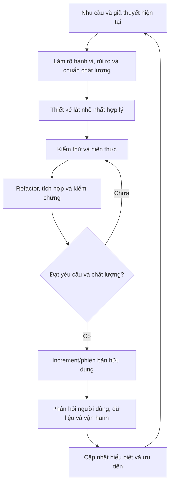
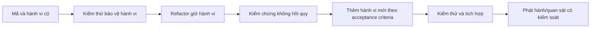

# Thiết kế tiến hóa và khả năng thay đổi theo hiểu biết mới

## Mục tiêu học tập

Sau bài học này, bạn có thể:

- Giải thích **thiết kế tiến hóa (evolutionary design)** là cách để thiết kế phần mềm được hình thành, kiểm chứng và điều chỉnh qua các vòng học hỏi, thay vì coi bản thiết kế đầu tiên là chân lý bất biến.
- Phân biệt thiết kế tiến hóa với **thiết kế lớn toàn bộ từ đầu (big design up front)**, **lập trình tùy hứng không kiểm soát** và **việc chỉ vá lỗi mà không refactor**.
- Sử dụng **phản hồi người dùng, acceptance criteria, kiểm thử tự động, refactoring, tích hợp liên tục và triển khai nhỏ** để thay đổi thiết kế có căn cứ.
- Nhận diện **quyết định dễ đảo ngược** và **quyết định khó đảo ngược**, biết khi nào nên trì hoãn một trừu tượng và khi nào cần thiết kế trước cho rủi ro bảo mật, dữ liệu hoặc tương thích.
- Thực hành qua ví dụ Java của nền tảng học trực tuyến: từ ghi danh khóa miễn phí sang các kiểu quyền truy cập có điều kiện, mà không đánh đồng thay đổi nghiệp vụ với thay đổi cấu trúc mã.
- Trình bày cách tiến hóa **API, cơ sở dữ liệu và kiến trúc** khi hệ thống đã có người dùng, cần chuyển đổi an toàn và quan sát được.
- Kết nối thiết kế tiến hóa với **Agile, XP, Scrum, Kanban, Lean** và nêu các thước đo giúp kiểm tra khả năng thay đổi thực tế thay vì chỉ đếm số lần refactor.

## 1. Vì sao một thiết kế “đúng hôm nay” có thể cần đổi ngày mai?

Một nhóm phát triển nền tảng học trực tuyến xây tính năng ghi danh. Ở phiên bản đầu, mọi khóa học đều miễn phí, và học viên được phép mở bài sau khi ghi danh hợp lệ.

Nhóm có thể đưa ra thiết kế đơn giản:

> “Nếu có ghi danh đang hoạt động cho đúng khóa học thì cho phép xem bài riêng.”

Sau khi đưa sản phẩm tới người học, nhóm nhận được bằng chứng mới:

- Một số khóa học chỉ mở **bài giới thiệu** cho người chưa ghi danh.
- Khóa học có thu phí chỉ cấp quyền sau khi **xác nhận giao dịch hợp lệ**.
- Giảng viên có thể cấp quyền học thử trong một khoảng thời gian được cho phép.
- Người học bị hủy ghi danh cần được xử lý theo **quy tắc bảo lưu quyền** đã thống nhất.
- Việc đồng bộ tiến độ trên nhiều thiết bị làm xuất hiện rủi ro dữ liệu mà bản đầu chưa bộc lộ.

Nếu mọi hành vi truy cập đều được viết rải rác trong controller, frontend, batch và báo cáo, mỗi quy tắc mới có thể kéo theo nhiều chỗ sửa, dễ tạo sai lệch. Ngược lại, nếu ngay từ đầu nhóm xây một “nền tảng phân quyền tổng quát cho mọi loại khóa” khi chưa có yêu cầu, họ có thể tốn hàng tuần để bảo trì abstractions chưa được sử dụng.

**Thiết kế tiến hóa** tìm một con đường ở giữa:

1. Thiết kế **đủ tốt và an toàn cho nhu cầu đã biết**.
2. Giao một lát phần mềm **hữu dụng, đạt chuẩn chất lượng**.
3. Thu thập **bằng chứng mới** về người dùng, nghiệp vụ và kỹ thuật.
4. Thay đổi hành vi khi cần, đồng thời **cải thiện cấu trúc mã** để sự thay đổi tiếp theo vẫn dễ thực hiện.
5. Lặp lại; không cố đoán hết mọi nhu cầu từ ngày đầu.

Điểm mấu chốt không phải “thiết kế ít hơn”, mà là **đặt đúng mức đầu tư thiết kế ở đúng thời điểm dựa trên hiểu biết và rủi ro**.

## 2. Thiết kế tiến hóa là gì và không phải là gì?

**Evolutionary design** là cách tiếp cận trong đó cấu trúc phần mềm **được phát triển và điều chỉnh liên tục** khi đội học thêm từ phản hồi, kiểm thử, tích hợp, vận hành và thay đổi nhu cầu. Mỗi quyết định được xem là **một giả thuyết thiết kế có phạm vi và điều kiện áp dụng**, không phải thứ phải bảo vệ bằng mọi giá.

Trong phát triển phần mềm Agile, ý tưởng này gắn chặt với **giao giá trị tăng dần, kỹ thuật tốt, thiết kế đơn giản, phản hồi sớm và cải tiến liên tục**. XP đặc biệt nhấn mạnh kết hợp kiểm thử, refactoring, tích hợp thường xuyên và sự cộng tác để giảm chi phí thay đổi.

| Cách tiếp cận | Trọng tâm | Rủi ro nếu áp dụng cực đoan |
| --- | --- | --- |
| **Thiết kế toàn bộ từ đầu (Big Design Up Front)** | Cố hoàn thiện nhiều quyết định kiến trúc/thiết kế trước khi phần mềm được sử dụng. | Dựa nhiều vào giả định, đầu tư lớn cho khả năng chưa cần, khó sửa lựa chọn sớm. |
| **Thiết kế tiến hóa** | Thiết kế đủ cho hiện tại, giao nhỏ, kiểm chứng, chủ động cải thiện cấu trúc khi hiểu biết tăng. | Nếu thiếu kiểm thử và kỷ luật refactor, dễ biến thành vá chắp nối. |
| **Lập trình tùy hứng** | Cứ nhận yêu cầu mới rồi sửa nhanh mà không bảo vệ cấu trúc hoặc chất lượng. | Tích lũy phụ thuộc, lặp logic, lỗi hồi quy và chi phí đổi mã tăng nhanh. |
| **Chỉ refactor nội bộ** | Cải thiện cấu trúc mã nhưng không nhất thiết học từ sản phẩm. | Mã có thể sạch hơn nhưng sản phẩm vẫn giải quyết sai vấn đề người dùng. |
| **Thiết kế trước theo rủi ro** | Phân tích sớm những quyết định khó đảo ngược hoặc có hậu quả lớn. | Hữu ích nếu giới hạn vào rủi ro thật; dễ quá đà nếu coi mọi giả định là bắt buộc. |

Một thiết kế tiến hóa tốt **không phủ nhận kiến trúc**. Nó dành công sức có chủ đích cho những thuộc tính quan trọng như bảo mật, tính toàn vẹn dữ liệu, khả năng khôi phục và ranh giới tích hợp, nhưng tránh đóng đinh quá sớm vào những dự đoán không chắc.

### 2.1. Chất lượng không phải thứ để lại “cuối dự án”

Một khẩu hiệu dễ bị hiểu sai là “cứ làm chạy được, sau đó sửa”. Trong Agile, phần mềm **chạy được nhưng vi phạm quyền truy cập, mất dữ liệu hoặc không đạt Definition of Done (DoD)** không phải ví dụ tốt của giao hàng tăng dần.

**Thiết kế đơn giản** không có nghĩa **thiết kế sơ sài**. Đơn giản đúng nghĩa là đáp ứng yêu cầu và ràng buộc thực, dễ hiểu, được kiểm chứng, ít thành phần không cần thiết và có thể tiến hóa mà không phá vỡ sản phẩm.

### 2.2. Không phải mọi thay đổi đều chứng minh thiết kế cũ sai

Một bản đầu hỗ trợ đúng khóa miễn phí, với giả định và chất lượng được xác nhận, có thể là lựa chọn tốt dù sau đó sản phẩm thêm khóa có phí. Thiết kế cần đổi vì **bối cảnh và mục tiêu thay đổi**, không nhất thiết vì nhóm trước thiếu năng lực.

Ngược lại, một lỗi do bỏ qua điều kiện đã biết, như kiểm tra quyền của người chưa ghi danh, **không phải “bằng chứng mới” để biện minh cho việc thiếu kiểm thử**. Cần phân biệt **học từ điều chưa biết** với **sửa sai do bỏ qua yêu cầu đã rõ**.

## 3. Điều gì làm hiểu biết mới xuất hiện?

Thiết kế phần mềm thay đổi vì có những thông tin ban đầu đội **chưa có, chưa hiểu đầy đủ hoặc dự đoán sai**.

| Nguồn hiểu biết | Bằng chứng có thể thu được | Hệ quả thiết kế có thể xem xét |
| --- | --- | --- |
| **Phỏng vấn/quan sát người dùng** | Học viên muốn quay lại bài dở thay vì tìm trong danh sách. | Tạo khái niệm tiến độ phù hợp và luồng truy cập rõ. |
| **Phân tích hành vi** | Phần lớn người dùng rời trang trước khi hoàn tất ghi danh. | Đơn giản hóa hành trình, cân nhắc lại thứ tự backlog. |
| **Acceptance criteria được làm rõ** | “Hoàn thành bài” bao gồm đạt bài kiểm tra ở một số bài, không chỉ xem video. | Tách trạng thái đã xem và trạng thái hoàn thành theo quy tắc. |
| **Kiểm thử và lỗi hồi quy** | Cập nhật quyền truy cập ảnh hưởng luồng bài học khác. | Đưa quy tắc quyền về một nơi chịu trách nhiệm rõ, tăng kiểm thử. |
| **Tích hợp thực tế** | API đối tác có trường hợp phản hồi trễ và gửi lặp. | Thêm xử lý idempotency, retry và trạng thái nhất quán khi cần. |
| **Vận hành/sự cố** | Giao dịch đồng thời có thể ghi đè tiến độ học. | Xem xét điều kiện cạnh tranh, phiên bản dữ liệu, chiến lược hợp nhất. |
| **Bối cảnh tổ chức/pháp lý** | Quy tắc lưu trữ dữ liệu hoặc quyền truy cập thay đổi. | Điều chỉnh chính sách, lưu vết và kiểm soát tương thích. |

Không phải bằng chứng nào cũng đủ đáng tin để thay đổi kiến trúc. Một phản ánh đơn lẻ có thể quan trọng nếu là **sự cố nghiêm trọng**, nhưng không phải mọi sở thích cá nhân đều nên trở thành abstraction chung. Đội cần cân nhắc **mức tác động, chất lượng bằng chứng và chi phí của quyết định**.

### 3.1. Bốn câu hỏi trước khi thay đổi thiết kế

1. **Đã biết chắc điều gì?** Quy tắc nghiệp vụ được xác nhận, log thực tế, kiểm thử tái hiện hay chỉ là lời dự đoán?
2. **Điều gì vẫn chưa rõ?** Dữ liệu còn thiếu, trường hợp biên, hành vi người dùng, năng lực vận hành?
3. **Thay đổi nhỏ nhất tạo ra bằng chứng hữu ích là gì?** Một spike, test, nguyên mẫu hoặc lát sản phẩm?
4. **Lựa chọn nào khó đảo ngược nhất?** Dữ liệu công khai, API đối tác, quyền truy cập, di trú trạng thái hay chỉ một tên lớp nội bộ?

Những câu hỏi này giúp nhóm không nhầm **thích nghi với mọi ý tưởng mới**. Thiết kế tiến hóa là **học có kỷ luật**, không phải đổi hướng theo cảm hứng mỗi ngày.

## 4. Vòng lặp thiết kế tiến hóa

Một vòng phát triển có thể được mô tả:



Sơ đồ mô tả **vòng phản hồi khái niệm**, không phải thủ tục bắt buộc mọi đội phải thực hiện đúng thứ tự. Làm rõ, kiểm thử và refactor thường **xen kẽ** trong một ngày phát triển; việc khám phá nhu cầu cũng có thể diễn ra trong lúc nhóm đang triển khai một lát khác.

### 4.1. Thiết kế không chỉ diễn ra trước khi viết mã

Thiết kế xuất hiện mỗi khi nhóm quyết định:

- Quy tắc nằm trong lớp nào?
- Dữ liệu nào là **nguồn sự thật**?
- Trường hợp ngoại lệ nào cần xử lý?
- Giao diện công khai ra sao, điều gì cần giữ tương thích?
- Có nên tách một module vì có trách nhiệm và tốc độ thay đổi khác?
- Có thể kiểm chứng lựa chọn mà không triển khai toàn bộ hệ thống không?

Một số quyết định cần được thảo luận trước; nhiều quyết định được cải thiện **ngay trong khi viết kiểm thử và mã**. Việc khám phá và triển khai có thể cung cấp thông tin qua lại.

### 4.2. Ví dụ về một vòng học hỏi nhỏ

**Giả thuyết:** người dùng muốn nút “Tiếp tục học” trên trang khóa.

- Đội làm rõ khi nào hiện nút, cách chọn bài dở và quyền truy cập.
- Giao một lát nhỏ sử dụng dữ liệu tiến độ hiện có.
- Kiểm thử các trường hợp có bài dở, không có bài dở và mất quyền.
- Quan sát số lần dùng nút và lỗi điều hướng.
- Phản hồi cho thấy học viên học trên hai thiết bị, tiến độ có thể khác nhau.
- Nhóm xem lại **quy tắc lưu tiến độ và đồng bộ**, thay vì tự động mở rộng mọi màn hình của sản phẩm.

Đó là thay đổi thiết kế **theo thông tin mới**, không phải kế hoạch cố định bị “phá vỡ”.

## 5. Những nguyên tắc giúp thiết kế có thể tiến hóa

### 5.1. YAGNI — đừng xây chức năng giả định chưa cần

**YAGNI (You Aren't Gonna Need It)**, một nguyên tắc gắn với XP, khuyến khích không hiện thực hóa khả năng chỉ vì “có thể ngày nào đó cần”.

Ví dụ, bản đầu chỉ có khóa miễn phí. Nếu chưa có kế hoạch hay bằng chứng về nhiều loại thuê bao, đội không cần tạo **hệ thống biểu thức cấp quyền đầy đủ** chỉ để “phòng trước”.

Nhưng YAGNI **không có nghĩa bỏ bảo mật, kiểm thử, khả năng phục hồi hoặc việc bảo toàn dữ liệu** đang cần ngay hôm nay. Những thứ đó là yêu cầu hiện tại, không phải tính năng giả định.

### 5.2. Simple design — cấu trúc đủ đơn giản để đọc và đổi

Một thiết kế đơn giản có thể có:

- Tên lớp và hàm phản ánh **ngôn ngữ miền**.
- Hành vi quan trọng ở một nơi rõ trách nhiệm.
- Ít phụ thuộc không cần thiết.
- Không có lớp trừu tượng “dự phòng” không có người dùng thật.
- Kiểm thử và cách chạy/integrate đủ dễ để phản hồi nhanh.

Đơn giản không nhất thiết ít dòng mã nhất. Một số đoạn kiểm soát lỗi và quyền rõ ràng có thể dài hơn một dòng rút gọn nhưng **dễ hiểu, an toàn và dễ thay đổi hơn**.

### 5.3. Tách trách nhiệm theo lý do thay đổi thực tế

Nếu quy tắc ghi danh và quy tắc hiển thị giao diện đổi theo hai nguồn quyết định khác nhau, nên cân nhắc **tách nơi chứa hành vi** để tránh sửa nhiều chỗ.

Nguyên tắc này gần với **Separation of Concerns** và **Single Responsibility Principle**, nhưng không phải cứ có hai danh từ trong câu chuyện là phải có hai service. Chỉ tách khi ranh giới **có ý nghĩa đối với yêu cầu, kiểm thử và khả năng bảo trì**.

### 5.4. Trì hoãn trừu tượng khi chưa biết đúng điểm biến thiên

Hai đoạn mã trông giống nhau chưa chắc là một quy tắc cần chia sẻ. Ví dụ **điều kiện cấp quyền cho giảng viên** và **điều kiện cấp quyền cho học viên** hiện có thể cùng trả về true ở một tình huống, nhưng có thể tiến hóa khác nhau.

Đội có thể chấp nhận **một mức trùng lặp nhỏ tạm thời** nếu gộp lại sẽ tạo khái niệm sai. Khi có bằng chứng hai nơi thật sự cùng một quy tắc, hãy trích xuất abstraction rõ nghĩa.

> **DRY không phải mục tiêu “không có hai dòng giống nhau”, mà là tránh nhiều nguồn sự thật cho cùng một tri thức đã được xác định.**

### 5.5. Thay đổi theo lát nhỏ và tích hợp thường xuyên

Thay một quy tắc có thể kiểm chứng trong vài commit nhỏ thường dễ review, kiểm thử và khôi phục hơn một lần viết lại toàn bộ module. Điều này yêu cầu đội giữ pipeline, kiểm thử và cách làm việc đủ kỷ luật.

Một chuỗi thay đổi nhỏ **không mặc nhiên an toàn**; mỗi bước vẫn phải bảo vệ yêu cầu hiện tại, dữ liệu và tương thích. Giá trị của lát nhỏ là **giảm phạm vi sai sót và rút ngắn phản hồi**.

## 6. Quyết định dễ đảo ngược và quyết định khó đảo ngược

Không phải quyết định thiết kế nào cũng nên được trì hoãn. Khả năng đảo ngược và tác động nếu sai là hai yếu tố cần xem.

| Quyết định | Thường dễ hay khó đổi? | Cách tiếp cận hợp lý |
| --- | --- | --- |
| Tên hàm nội bộ chưa xuất hiện ở API công khai. | **Tương đối dễ**, nếu có kiểm thử và công cụ refactor. | Đặt tên tốt cho hiện tại, đổi khi hiểu rõ hơn. |
| Cách tổ chức một module nội bộ nhỏ. | **Có thể đảo ngược**, tùy phụ thuộc. | Bắt đầu đơn giản, quan sát điểm cần tách. |
| Hợp đồng API công khai đã có nhiều đối tác. | **Khó hơn** vì tương thích và phối hợp ngoài đội. | Cần versioning/migration và chính sách thay đổi rõ. |
| Cấu trúc dữ liệu được dùng bởi nhiều dịch vụ. | **Khó hơn** do di trú, tính nhất quán và thời gian đồng tồn tại. | Thiết kế đường chuyển đổi, kiểm tra dữ liệu và phương án khôi phục. |
| Quy tắc phân quyền và xử lý tiền. | **Tác động cao** kể cả khi mã ngắn. | Đánh giá rủi ro, xác nhận nghiệp vụ, kiểm thử và bảo mật sớm. |
| Tách hệ thống thành nhiều dịch vụ với cam kết vận hành riêng. | **Chi phí đảo ngược cao**. | Cân nhắc nhu cầu vận hành, ranh giới, năng lực đội và lựa chọn thay thế. |
| Lựa chọn một thư viện UI cho một màn hình nhỏ. | **Tùy mức sử dụng**; có thể dễ đổi ban đầu. | Thử giới hạn, đo khả năng tích hợp và bảo trì. |

### 6.1. Ma trận học hỏi và rủi ro

```text
                   Mức tác động/chi phí đảo ngược
                    Thấp                     Cao
Bằng chứng cao     Triển khai nhỏ,           Chốt theo rủi ro,
                   kiểm thử rồi học          ghi quyết định, kiểm soát

Bằng chứng thấp    Thử nghiệm hoặc           Giảm bất định trước,
                   giữ giải pháp đơn giản    spike/prototype, trì hoãn
                                            cam kết khó đảo ngược
```

Ma trận là **công cụ thảo luận**, không phải công thức quyết định tự động. Một việc tác động cao nhưng **bắt buộc phải giải quyết ngay** vẫn phải được xử lý với kiểm soát phù hợp; không thể trì hoãn vô hạn.

### 6.2. Quy tắc thực dụng

- **Đảo ngược rẻ + thông tin chưa đủ:** chọn hướng đơn giản, kiểm chứng nhanh.
- **Đảo ngược đắt + thông tin chưa đủ:** làm spike, phân tích rủi ro, giữ lựa chọn mở khi có thể.
- **Rủi ro an toàn/dữ liệu đã biết:** thiết kế và kiểm soát sớm, không viện YAGNI để bỏ.
- **Có bằng chứng mạnh + nhu cầu rõ:** đầu tư một giải pháp bền vững tương xứng, tránh vòng vèo không cần thiết.

## 7. Kiểm thử, refactoring và CI làm giảm chi phí thay đổi như thế nào?

Thiết kế tiến hóa không thành công chỉ vì nhóm **muốn đổi thiết kế**. Nó cần **cơ chế phát hiện sai và giữ hành vi** trong mỗi thay đổi.

### 7.1. Refactoring khác thêm tính năng hoặc sửa lỗi

**Refactoring** là thay đổi **cấu trúc bên trong mã** mà không chủ ý thay đổi **hành vi quan sát được** của phần mềm.

Ví dụ:

- Đổi tên `isAllowed` thành `canAccessLesson` để rõ nghĩa: có thể là refactoring.
- Trích xuất kiểm tra quyền từ controller sang `LessonAccessPolicy` mà hành vi giữ nguyên: là refactoring.
- Thêm cho phép học viên có vé dùng thử mở bài: là **thay đổi nghiệp vụ**, không thể chỉ gọi là refactoring.
- Sửa lỗi người chưa ghi danh vẫn vào bài riêng: là **sửa hành vi sai**, có thể được hỗ trợ bởi refactoring.

Khi một thay đổi gồm cả sửa cấu trúc và thêm hành vi, nên cố gắng **tách bước kiểm chứng** để biết lỗi đến từ đâu.

### 7.2. Vòng bảo vệ bằng kiểm thử

Các tầng kiểm chứng có thể dùng tùy hệ thống:

| Tầng | Kiểm tra điều gì? | Ví dụ |
| --- | --- | --- |
| **Unit test** | Quy tắc nhỏ, độc lập và trường hợp biên. | Ghi danh bị hủy không đủ quyền mở bài. |
| **Integration test** | Tương tác giữa các thành phần và dữ liệu. | Sau ghi danh, API trả quyền chính xác từ cơ sở dữ liệu. |
| **Contract test** | Các bên tích hợp hiểu giao diện dữ liệu nhất quán. | API trả trường trạng thái với giá trị đã thỏa thuận. |
| **End-to-end/acceptance test** | Hành trình người dùng quan trọng hoạt động xuyên suốt. | Người học ghi danh rồi mở được bài đầu. |
| **Security/performance/reliability checks** | Rủi ro phi chức năng phù hợp. | Không truy cập trái phép; xử lý đồng thời không làm sai dữ liệu. |

Không nhất thiết phải tự động hóa **mọi thứ**. Cần chọn kiểm thử tương xứng rủi ro và chi phí bảo trì; không nên xây một bộ E2E quá mong manh khiến không ai tin kết quả.

### 7.3. Vòng nhỏ kiểu XP

Một cách triển khai thường dùng:

1. **Red:** viết một kiểm thử mô tả hành vi cần có và quan sát nó thất bại vì lý do phù hợp.
2. **Green:** viết lượng mã vừa đủ để kiểm thử qua.
3. **Refactor:** cải thiện cấu trúc trong khi giữ kiểm thử qua và bảo đảm không đổi hành vi ngoài phạm vi dự định.
4. **Integrate:** tích hợp thường xuyên, chạy kiểm tra liên quan và xử lý lỗi sớm.

Vòng Red–Green–Refactor thuộc **TDD**, một thực hành phổ biến của XP. Thiết kế tiến hóa **không đồng nhất với việc mọi đội phải theo TDD ở mọi dòng mã**; nhưng cần một cơ chế phản hồi đáng tin để thay đổi thiết kế an toàn.

### 7.4. Vì sao CI quan trọng?

Nếu cả đội refactor trong nhiều tuần nhưng chỉ ghép mã vào cuối Sprint, mỗi thay đổi có thể hoạt động riêng mà **không hoạt động cùng nhau**. CI giúp phát hiện mâu thuẫn sớm qua tích hợp thường xuyên và các kiểm tra tự động cần thiết.

Một pipeline xanh **không tự chứng minh phần mềm đúng toàn bộ**. Nó chỉ chứng minh các kiểm tra đã chạy và qua trong điều kiện đó. Khi xuất hiện lỗi lọt ra, cần đánh giá **độ bao phủ rủi ro và chất lượng test**, không chỉ tăng số test vô nghĩa.

## 8. Ví dụ Java — thiết kế từ quy tắc hiện tại đến khả năng mở rộng có căn cứ

Ta xét một lát sản phẩm: **học viên ghi danh khóa miễn phí và xem bài học riêng**.

### 8.1. Phiên bản đầu: quy tắc nghiệp vụ rõ và nhỏ

Các giả định đã được xác nhận:

- Mọi khóa trong lát đầu đều miễn phí.
- Học viên phải đăng nhập, có ghi danh `ACTIVE` cho đúng khóa.
- Bài học trong ví dụ là **nội dung riêng**, không có quyền truy cập công khai.
- Học viên không được dùng ghi danh của người khác.
- Cách xác thực người dùng nằm ở ranh giới ứng dụng đáng tin; ví dụ không mô tả đầy đủ cơ chế bảo mật.

Có thể bắt đầu bằng đoạn Java 17 đơn giản:

```java
import java.util.Objects;

enum EnrollmentStatus {
    ACTIVE, CANCELLED
}

record Enrollment(
        String learnerId,
        String courseId,
        EnrollmentStatus status) {
}

record Lesson(String id, String courseId) {
}

final class LessonAccessPolicy {

    boolean canOpenPrivateLesson(
            String authenticatedLearnerId,
            Lesson lesson,
            Enrollment enrollment) {

        Objects.requireNonNull(authenticatedLearnerId);
        Objects.requireNonNull(lesson);

        return enrollment != null
                && enrollment.status() == EnrollmentStatus.ACTIVE
                && authenticatedLearnerId.equals(enrollment.learnerId())
                && lesson.courseId().equals(enrollment.courseId());
    }
}
```

Đây là **một ví dụ có phạm vi rõ**, không phải thư viện phân quyền sử dụng trực tiếp ở production. Nó chưa xử lý đa loại khóa, phiên bản khóa, lịch sử thu hồi quyền, phân quyền giảng viên và các rủi ro vận hành. Trong phạm vi đã chốt, hành vi kiểm tra là dễ hiểu và có thể được kiểm thử.

### 8.2. Kiểm thử hành vi của lát đầu

```gherkin
Feature: Quyền mở bài riêng trong khóa miễn phí

  Scenario: Ghi danh đang hoạt động đúng tài khoản và khóa
    Given Lan đã đăng nhập
    And Lan có ghi danh ACTIVE cho khóa "Java nhập môn"
    When Lan mở bài riêng thuộc khóa đó
    Then Lan được phép xem bài

  Scenario: Dùng ghi danh của người khác
    Given Lan có ghi danh ACTIVE cho khóa "Java nhập môn"
    And Nam đã đăng nhập vào tài khoản của Nam
    When Nam yêu cầu mở bài riêng bằng thông tin ghi danh của Lan
    Then hệ thống từ chối truy cập nội dung riêng

  Scenario: Ghi danh đã hủy
    Given Lan có ghi danh CANCELLED cho khóa "Java nhập môn"
    When Lan yêu cầu mở bài riêng của khóa
    Then hệ thống từ chối truy cập theo quy tắc đã thống nhất
```

Các kịch bản Gherkin là **ví dụ mô tả hành vi**, không tự chạy được nếu chưa có bước kết nối kiểm thử, dữ liệu và môi trường. Chúng cũng cần người hiểu nghiệp vụ xác nhận, đặc biệt quy tắc khi hủy ghi danh.

### 8.3. Hiểu biết mới: khóa học có trả phí

Sau một thời gian, Product Owner đưa ra nhu cầu **khóa có thu phí**. Nhóm thống nhất:

- Ghi danh khóa miễn phí vẫn hoạt động như trước.
- Khóa trả phí chỉ được mở bài riêng khi người học có ghi danh hợp lệ **và** trạng thái thanh toán đã được xác nhận **từ nguồn đáng tin**.
- Chưa giải quyết các loại học thử hoặc cấp quyền doanh nghiệp trong lát này.

Đây là **thay đổi hành vi nghiệp vụ có chủ đích**. Không nên chỉ thêm một điều kiện ở giao diện và bỏ kiểm soát phía máy chủ. Cũng không cần xây ngay một “policy engine đa năng” nếu hiện chỉ có hai loại quyền đơn giản.

### 8.4. Tiến hóa mô hình đúng điểm biến thiên

Có thể thêm một khái niệm miền rõ ràng cho **hình thức truy cập của khóa**:

```java
import java.util.Objects;

enum AccessMode {
    FREE_ENROLLMENT,
    PAID_ENROLLMENT
}

record Course(String id, AccessMode accessMode) {
}

record AccessFacts(
        String authenticatedLearnerId,
        Course course,
        Enrollment enrollment,
        boolean confirmedPaymentFromTrustedSource) {
}

final class EvolvingLessonAccessPolicy {

    boolean canOpenPrivateLesson(AccessFacts facts) {
        Objects.requireNonNull(facts);
        Objects.requireNonNull(facts.authenticatedLearnerId());
        Objects.requireNonNull(facts.course());

        Enrollment enrollment = facts.enrollment();
        boolean enrolled = enrollment != null
                && enrollment.status() == EnrollmentStatus.ACTIVE
                && facts.authenticatedLearnerId().equals(enrollment.learnerId())
                && facts.course().id().equals(enrollment.courseId());

        if (!enrolled) {
            return false;
        }

        return switch (facts.course().accessMode()) {
            case FREE_ENROLLMENT -> true;
            case PAID_ENROLLMENT -> facts.confirmedPaymentFromTrustedSource();
        };
    }
}
```

**Lưu ý để không áp dụng sai ví dụ:**

- Mã thứ hai **dùng lại** `Enrollment` và `EnrollmentStatus` từ ví dụ trước; nếu tách ra file khác để chạy độc lập, cần cung cấp các kiểu đó và kiểm tra môi trường Java tương ứng.
- `AccessFacts` phải được xây từ **thông tin xác thực và nguồn thanh toán đáng tin** ở tầng ứng dụng. Không được tin cờ `confirmedPaymentFromTrustedSource` do người dùng tự gửi.
- Một hệ thống thanh toán thật cần xử lý **đối soát, hoàn tiền, giao dịch đến muộn, idempotency và thất bại tích hợp** theo chính sách; ví dụ chưa mô tả chúng.
- Trước khi đưa vào sản phẩm cần kiểm chứng **truy cập không hợp lệ, toàn vẹn dữ liệu, nhật ký cần thiết và chính sách chất lượng**.
- Chưa có yêu cầu nhiều hình thức quyền phức tạp nên `switch` là một lựa chọn dễ đọc. Chỉ cân nhắc **Strategy/Policy Objects** khi biến thể và lý do thay đổi thực tế khiến cấu trúc này khó bảo trì.

**Điều đã tiến hóa:** từ một quy tắc ghi danh đơn giản sang mô hình có **hai hình thức truy cập được xác nhận**. Những hành vi cũ cần vẫn đúng; hành vi mới được thêm bằng kiểm thử và thiết kế theo thông tin đã có.

### 8.5. Tránh “nếu có thể xảy ra” khiến mã phình to

Một phản ứng quá mức có thể là tạo:

```text
UniversalAccessPolicyEngine
  ├── GenericRuleLanguage
  ├── UnlimitedAccessGrantKinds
  ├── DynamicRuntimePluginRegistry
  ├── ExternalPolicyCompiler
  └── FutureCourseMonetizationAdapter
```

Nếu chưa có người dùng, quy tắc hay ràng buộc thật cho những khả năng đó, cấu trúc này **làm tăng chi phí hiểu, kiểm thử và vận hành**. Không phải cứ hỗ trợ nhiều kiểu trong tương lai là một thiết kế tốt hơn.

Nhưng cũng không nên viết điều kiện về thanh toán ở năm controller khác nhau. Hướng tiến hóa hợp lý là **đặt logic của cùng một quy tắc ở nơi được hiểu và kiểm soát rõ**, giữ ranh giới có thể thay đổi khi có nhu cầu thật.

## 9. Refactor từng bước trước khi mở rộng hành vi

Nếu thiết kế ban đầu có kiểm tra quyền rải rác ở nhiều nơi, việc thêm khóa có phí dễ làm phát sinh lỗi không nhất quán. Có thể chia thay đổi thành các bước nhỏ:

1. **Chụp lại hành vi hiện tại bằng kiểm thử** ở các ranh giới quan trọng, nhất là truy cập hợp lệ và không hợp lệ.
2. **Xác định nơi đang chứa quyết định về quyền**; nếu có nhiều bản sao, so sánh chúng và xác nhận đâu là quy tắc thật.
3. **Trích xuất một hàm/chính sách có tên rõ** cho quy tắc đang chạy, chưa thêm hình thức quyền mới.
4. **Chạy lại kiểm thử và tích hợp**, bảo đảm hành vi cũ không đổi.
5. **Làm rõ tiêu chí chấp nhận mới** cho khóa có phí và nguồn xác nhận thanh toán.
6. **Thêm hành vi mới qua một thay đổi nhỏ** có kiểm thử.
7. **Quan sát trên môi trường phù hợp** và đánh giá rủi ro khi triển khai.



### 9.1. Refactoring không được dựa trên kiểm thử giả định thiếu

Nếu logic quyền đã có lỗi từ trước nhưng nhóm chỉ viết test theo hành vi hiện tại, refactor có thể **giữ nguyên lỗi**. Khi phát hiện mâu thuẫn với quy tắc nghiệp vụ, cần **sửa kiểm thử và hành vi có chủ đích** theo quyết định được xác nhận.

Vì vậy, kết hợp cả:

- **Characterization tests** để hiểu và bảo vệ hành vi cũ trong lúc thay cấu trúc.
- **Acceptance tests** để xác minh hành vi đúng mà sản phẩm cần.
- **Security/integration tests** theo rủi ro để kiểm tra sự tương tác thực tế.

### 9.2. Refactor nhỏ dễ xem xét hơn viết lại toàn bộ

Một lần “rewrite tất cả” có thể làm mất tri thức ẩn trong hệ thống cũ, phá tương thích và dồn rủi ro vào một thời điểm. Thay thế từng phần thường dễ kiểm chứng hơn, miễn ranh giới chuyển đổi không trở nên phức tạp quá mức.

Điều này không có nghĩa **không bao giờ được viết lại**. Khi kiến trúc hiện tại không đáp ứng một ràng buộc đã rõ và thay từng bước không còn hiệu quả, cần quyết định có căn cứ, kế hoạch di trú và cách bảo vệ người dùng.

## 10. Thiết kế tiến hóa ở cấp kiến trúc: giữ điểm thay đổi hợp lý

**Evolutionary architecture** mở rộng ý tưởng tiến hóa sang các quyết định kiến trúc: hệ thống có thể phát triển theo nhu cầu và giữ những **đặc tính quan trọng** bằng cách kiểm tra chúng liên tục.

Một số ví dụ về **architectural fitness functions** hoặc kiểm tra tương đương:

- Dịch vụ không cho phép truy cập bài riêng khi chưa đủ quyền.
- Mức độ phụ thuộc giữa module không vượt quy tắc tổ chức đã chốt.
- Mã phải đáp ứng các kiểm tra chất lượng, bảo mật và tương thích API bắt buộc.
- Thay đổi dữ liệu không làm mất bản ghi tiến độ hợp lệ.
- Các thao tác quan trọng đáp ứng ngưỡng hiệu năng đã đo và thỏa thuận.

Không cần gọi mọi test là “fitness function”. Điểm hữu ích của khái niệm là **biến điều kiện quan trọng của kiến trúc thành kiểm tra có thể đánh giá lặp lại**, thay vì chỉ ghi trong tài liệu rồi để lỗi thời.

### 10.1. Thiết kế theo ranh giới có ý nghĩa

Với nền tảng học, một số miền trách nhiệm có thể xuất hiện:

| Nhóm trách nhiệm | Dấu hiệu cần phân biệt | Câu hỏi thiết kế |
| --- | --- | --- |
| **Catalog/Course** | Quản lý khóa, chương, bài, phiên bản nội dung. | Khóa và bài có thể thay cấu trúc mà không làm hỏng tiến độ cũ? |
| **Enrollment** | Ghi danh và trạng thái tham gia. | Ghi danh có độc lập với thanh toán và quyền truy cập không? |
| **Access** | Kiểm tra ai được xem nội dung ở thời điểm yêu cầu. | Quy tắc có cần tách khỏi giao diện và dữ liệu thanh toán? |
| **Learning Progress** | Ghi dấu bài bắt đầu, hoàn thành, tiếp tục học. | Có rủi ro đồng thời và cập nhật nhiều thiết bị? |
| **Assessment** | Chấm điểm và điều kiện đạt. | “Đã xem” khác “đã đạt” hay “đã hoàn thành” không? |

**Bảng không có nghĩa cần ngay năm microservices.** Một ứng dụng đơn khối có **module và ranh giới rõ** có thể là thiết kế tốt khi quy mô, đội và yêu cầu vận hành chưa cần phân tách triển khai độc lập.

### 10.2. Tránh nhầm “tiến hóa” với “cứ tách microservice”

Microservices có thể mang lại lợi ích cho những nhóm cần triển khai độc lập và chịu trách nhiệm miền rõ, nhưng cũng tăng chi phí mạng, dữ liệu phân tán, theo dõi sự cố và vận hành.

Trước khi tách, hãy hỏi:

1. Hai phần có **nhu cầu thay đổi và chu kỳ triển khai thật sự khác** không?
2. Có đủ khả năng quan sát, kiểm thử hợp đồng, xử lý lỗi mạng và vận hành không?
3. Dữ liệu có thể được chia ranh giới mà không làm mất tính nhất quán quan trọng không?
4. Một **modular monolith** có đáp ứng nhu cầu hiện tại với chi phí thấp hơn không?

Một thiết kế tiến hóa tốt không cố “tương lai hóa” kiến trúc bằng công nghệ đang phổ biến nếu chưa có bằng chứng cần thiết.

## 11. Thay đổi dữ liệu và API một cách tiến hóa

Khi phần mềm đã có người dùng, thiết kế không chỉ nằm trong mã. **Dữ liệu, API, sự kiện và hợp đồng ngoài hệ thống** thường khó thay đổi hơn tên lớp nội bộ.

### 11.1. Thêm dữ liệu tiến độ mà không phá phiên bản đang chạy

Giả sử bản đầu lưu `completed` dạng boolean. Bản mới muốn phân biệt:

- `NOT_STARTED`: chưa bắt đầu.
- `IN_PROGRESS`: đang học dở.
- `COMPLETED`: đạt điều kiện hoàn thành.

Một cách di trú có kiểm soát là **expand → migrate → contract**:

1. **Expand:** bổ sung cấu trúc/trường mới sao cho phiên bản cũ vẫn hoạt động, kiểm tra tương thích giữa mã và schema.
2. **Migrate:** xác định cách chuyển dữ liệu cũ thành trạng thái mới, có cơ chế đối soát và xử lý bản ghi không rõ nghĩa.
3. **Dual-read/dual-write khi thật cần:** dùng chuyển tiếp có giới hạn, nhất quán và có kế hoạch dừng; không coi hai nguồn dữ liệu mâu thuẫn là bình thường.
4. **Switch:** chuyển người đọc/ghi sang quy tắc mới có kiểm chứng, theo dõi lỗi và dữ liệu.
5. **Contract:** bỏ trường/cách xử lý cũ khi đã chắc chắn không còn consumer phụ thuộc và có phương án khôi phục hợp lý.

```text
Phiên bản cũ             Giai đoạn tương thích             Phiên bản mới
  completed:boolean  →  completed + progress_status  →  progress_status
                               ↑
                     di trú, đối soát, theo dõi
```

**Cảnh báo dữ liệu:** từ `completed=false` **không thể tự suy ra** người dùng chưa bắt đầu hay đang học dở. Khi dữ liệu cũ không chứa đủ thông tin, phải **chấp nhận trạng thái chưa xác định, tìm nguồn bổ sung hoặc thiết kế quy tắc chuyển đổi được phê duyệt**, không tự bịa lịch sử tiến độ.

### 11.2. API cần tương thích có chủ đích

Nếu client cũ đang đọc `completed` mà server đổi sang `progressStatus`, thay ngay và xóa trường cũ có thể làm ứng dụng đang triển khai bị lỗi.

Các cách xử lý phù hợp tùy bối cảnh:

- Thêm trường mới theo hướng **tương thích ngược** nếu hợp đồng cho phép.
- Cung cấp phiên bản API hoặc lớp chuyển đổi tạm thời cho client cũ.
- Thông báo thời gian ngừng hỗ trợ theo chính sách, theo dõi consumer còn sử dụng.
- Dùng **contract tests** và kiểm thử tích hợp để phát hiện sai sớm.
- Chỉ xóa hợp đồng cũ khi có bằng chứng việc di trú đã hoàn tất.

Thiết kế tiến hóa **không phải đổi hợp đồng công khai tùy hứng mỗi Sprint**. Đảo ngược một quyết định ảnh hưởng bên ngoài cần phối hợp và kiểm soát hơn thay đổi bên trong module.

### 11.3. Phương án khôi phục cũng là một quyết định thiết kế

Với dữ liệu và quyền truy cập, rollback ứng dụng **không tự đồng nghĩa rollback dữ liệu an toàn**. Nếu phiên bản mới đã ghi trạng thái mà phiên bản cũ không hiểu, việc quay về mã cũ có thể gây lỗi hoặc làm mất thông tin.

Do đó, cần thiết kế **tính tương thích khi đồng tồn tại phiên bản, backup/restore, phương án roll-forward, kiểm tra hậu triển khai** theo mức rủi ro. Không có một cách rollback áp dụng cho mọi dạng thay đổi schema.

## 12. Feature flags, strangler và spike: dùng đúng mục đích

### 12.1. Feature flag giúp tách triển khai khỏi mở tính năng

Feature flag có thể cho phép đưa một phần mã mới lên môi trường sớm mà chỉ bật cho nhóm người dùng hoặc tình huống được lựa chọn. Điều này hữu ích để giảm rủi ro và thu phản hồi.

Nhưng cần nhớ:

- **Flag không thay kiểm tra quyền ở server** và không cho phép công khai nội dung nhạy cảm.
- Khi có nhiều flag, số tổ hợp hành vi tăng; cần kiểm thử những tổ hợp quan trọng.
- Flag phải có **người chịu trách nhiệm, điều kiện gỡ bỏ và quan sát**.
- Không nên giữ cờ cũ mãi nếu đã hết giá trị vì nó làm tăng phức tạp.

### 12.2. Strangler Fig Pattern trong thay thế hệ thống cũ

Khi một module lớn khó thay đổi, nhóm có thể chuyển dần những luồng có ranh giới rõ sang phần mới, giữ phần còn lại hoạt động. Cách này thường được gọi là **Strangler Fig Pattern**.

Ví dụ: chuyển **kiểm tra quyền mở bài** từ nhiều controller cũ sang một thành phần có hợp đồng rõ, lần lượt cho từng luồng đã có kiểm thử, thay vì viết lại toàn bộ nền tảng học.

Cần đặc biệt chú ý:

- Không tạo hai nơi quyết định quyền **mâu thuẫn**.
- Cần ranh giới định tuyến và dữ liệu rõ.
- Đo hành vi cũ/mới, có kế hoạch tắt đường cũ.
- Một lớp chuyển tiếp quá lâu có thể trở thành **di sản mới**.

### 12.3. Spike giảm bất định, không phải thiết kế sản phẩm hoàn chỉnh

**Spike** là một hoạt động khám phá được giới hạn để trả lời câu hỏi kỹ thuật/nghiệp vụ chưa rõ, chẳng hạn:

> “Cơ sở dữ liệu hiện tại có thể cập nhật tiến độ an toàn khi hai thiết bị ghi gần đồng thời không?”

Một spike tốt có:

- **Câu hỏi rõ** cần trả lời.
- Phạm vi, dữ liệu và thời lượng công việc được thỏa thuận.
- Kết quả quan sát: những gì đã chứng minh/chưa chứng minh.
- Hướng quyết định tiếp theo.

Prototype của spike **không mặc nhiên đủ an toàn và chất lượng để phát hành**. Nếu định tái sử dụng mã spike, phải đưa nó qua chuẩn kiểm chứng và chất lượng áp dụng cho sản phẩm.

## 13. Thiết kế tiến hóa đi cùng Product Discovery và backlog

Đổi cấu trúc mã không phải mục tiêu cuối. Phần mềm phải thay đổi theo **nhu cầu tạo giá trị đã được kiểm chứng**.

### 13.1. Một ví dụ về thay đổi thứ tự ưu tiên

Ban đầu nhóm muốn làm **huy hiệu học tập** vì tin rằng người dùng thiếu động lực. Sau phỏng vấn và phân tích hành vi, họ thấy nhiều học viên bỏ dở đơn giản vì **không tìm lại được bài đang học**.

Product Owner có thể ưu tiên lát **“Tiếp tục học”** trước huy hiệu. Developers điều chỉnh thiết kế tiến độ cho lát giá trị này. Một thiết kế tốt cho hệ thống huy hiệu giả định không còn là ưu tiên, dù nhóm đã đầu tư thời gian thảo luận.

Đây là **thiết kế tiến hóa theo định hướng sản phẩm**: thay cái cần xây, rồi thay cấu trúc để phục vụ cái cần xây, không chỉ chăm chút một kiến trúc định sẵn.

### 13.2. Vertical slicing giữ phản hồi thực tế

So sánh hai kiểu chia:

| Cách chia | Rủi ro | Cách tốt hơn khi phù hợp |
| --- | --- | --- |
| Sprint A chỉ thiết kế schema, Sprint B chỉ làm API, Sprint C chỉ dựng UI, Sprint D mới kiểm thử. | Tới cuối mới biết người dùng có thực hiện được hành trình hay không. | Giao một **lát dọc** từ hành vi, API, dữ liệu tới UI và kiểm chứng. |
| Lát 1 cho phép một nhóm học viên ghi danh và mở bài đầu, Lát 2 tiếp tục bài dở, Lát 3 thêm điều kiện đánh giá. | Mỗi lát có giá trị riêng và rủi ro được quan sát sớm hơn. | Giữ cùng tiêu chuẩn hoàn thành, ưu tiên theo bằng chứng. |

Việc tách theo lớp đôi khi cần cho **công việc nền tảng hoặc giảm rủi ro**, nhưng nó không nên trở thành cách duy nhất làm nhóm trì hoãn mọi phản hồi người dùng.

### 13.3. Tính năng mới không tự hợp thức hóa mọi thay đổi cấu trúc

Nếu một PBI chỉ sửa nhãn nút, nhóm không cần viết lại toàn bộ mô hình dữ liệu. Nếu một quy tắc mới chạm nhiều nơi và cho thấy ranh giới trách nhiệm sai, refactoring có căn cứ sẽ giúp giảm chi phí tiếp theo.

Hãy đặt câu hỏi: **“Có thiết kế nhỏ hơn, an toàn hơn mà vẫn làm đúng hành vi và giữ lựa chọn mở không?”**

## 14. Thiết kế tiến hóa trong Scrum, Kanban, XP và Lean

Thiết kế tiến hóa là một lăng kính về **cách thay đổi hệ thống phần mềm**. Nó không phải một sự kiện Scrum hay một chỉ số Kanban mới.

| Cách tiếp cận | Nó hỗ trợ thiết kế tiến hóa bằng gì? | Điều cần phân biệt |
| --- | --- | --- |
| **Agile** | Cộng tác, phản hồi sớm, giao phần mềm thường xuyên, thích nghi và chú trọng chất lượng kỹ thuật. | Không bắt buộc một bộ công cụ thiết kế duy nhất. |
| **XP** | Simple design, TDD, pair programming, refactoring, CI, small releases. | Thực hành kỹ thuật cần phối hợp; không chỉ “sửa cấu trúc tùy ý”. |
| **Scrum** | Product Goal/Sprint Goal, Sprint Review, Increment đạt DoD và Sprint Retrospective tạo nhịp học hỏi. | Scrum Guide không bắt buộc một mẫu kiến trúc, TDD hay một design review riêng. |
| **Kanban** | Trực quan hóa workflow, kiểm soát WIP, theo dõi age/cycle time và loại bỏ chờ đợi. | Flow metrics không tự chứng minh thiết kế mã tốt. |
| **Lean** | Xét giá trị, chi phí cơ hội và lãng phí toàn dòng; khuyến khích cải tiến có căn cứ. | Tránh tối ưu cục bộ bằng cách bỏ kiểm thử và chất lượng. |

### 14.1. Với Scrum: giữ mục tiêu và chất lượng

Ví dụ Sprint Goal là **“học viên quay lại đúng bài đang dở”**. Developers có thể điều chỉnh thiết kế tiến độ và kế hoạch trong Sprint khi khám phá dữ liệu mới, miễn không làm nguy hại Sprint Goal và không giảm chất lượng.

Nếu phạm vi nghiệp vụ phải thương lượng, nhóm trao đổi với Product Owner. Một Increment chỉ được coi là hoàn thành khi đạt **Definition of Done**. Không thể dùng chữ “tiến hóa” để gọi chức năng chưa kiểm chứng là Done.

### 14.2. Với Kanban: thiết kế và dòng công việc tác động qua lại

Nhóm có thể thấy nhiều story bị chặn khi thay đổi một module phân quyền. Khi phân tích, nguyên nhân là **logic quyền rải rác và phải sửa đồng thời nhiều nơi**. Refactoring về một nơi đúng trách nhiệm có thể giảm thời gian chờ tích hợp.

Tuy nhiên, một cải tiến flow có thể đến từ chính sách phối hợp hoặc tự động hóa kiểm thử, không nhất thiết từ tái cấu trúc kiến trúc. **Quan sát nguyên nhân trước khi chọn giải pháp**.

### 14.3. Với XP: thay đổi được nhờ kỷ luật kỹ thuật

Khi kiểm thử tốt, mã rõ nghĩa và tích hợp thường xuyên, nhóm có thể sửa thiết kế khi biết thêm. Thiếu những điều này, việc “để mai refactor” dễ biến thành **chi phí thay đổi tích lũy**.

Nhưng **TDD không loại bỏ nhu cầu phân tích nghiệp vụ**. Một test chính xác về mặt kỹ thuật vẫn có thể kiểm chứng **quy tắc sản phẩm sai** nếu đội hiểu sai điều người dùng cần.

## 15. Đo khả năng tiến hóa: quan sát kết quả, không đếm abstraction

Một đội có thể tuyên bố “mã được refactor 30 lần”, nhưng điều đó chưa chứng minh họ giao sản phẩm tốt hơn.

Những chỉ số và bằng chứng hữu ích:

| Nhóm tín hiệu | Câu hỏi cần trả lời | Cảnh báo khi dùng |
| --- | --- | --- |
| **Thời gian giao thay đổi** | Một thay đổi nghiệp vụ tương tự mất bao lâu từ được bắt đầu tới có phần mềm hữu dụng? | Phân biệt công sức với thời gian chờ, loại công việc và năng lực. |
| **Lỗi hồi quy và sự cố** | Sau thay đổi, có tăng lỗi quyền/dữ liệu hoặc sự cố vận hành không? | Không lấy “không có lỗi báo cáo” làm bằng chứng nếu thiếu quan sát. |
| **Khả năng kiểm thử** | Có thể tái hiện và kiểm tra quy tắc quan trọng dễ dàng không? | Code coverage cao không bảo đảm kiểm thử đúng rủi ro. |
| **Mức ảnh hưởng của thay đổi** | Cùng một quy tắc phải sửa bao nhiêu chỗ, thuộc bao nhiêu module? | Ít file thay đổi không luôn tốt nếu che giấu ghép cứng ở chỗ khác. |
| **Tắc nghẽn và việc làm lại** | Hạng mục có phải quay lại vì hiểu sai quy tắc hoặc tích hợp không? | Cần phân biệt học hỏi có giá trị với lỗi do bỏ qua điều đã biết. |
| **Khả năng triển khai/khôi phục** | Có thể phát hành lát nhỏ, quan sát và sửa lỗi an toàn không? | Không dùng tốc độ triển khai thay thế chất lượng. |
| **Outcome người dùng** | Thiết kế có giúp đội giải quyết đúng nhu cầu và điều chỉnh khi có phản hồi không? | Outcome có thể bị nhiều yếu tố ngoài thay đổi mã tác động. |

### 15.1. Một phép so sánh minh họa

Đội đo hai giai đoạn phát triển các hạng mục tương đối giống nhau:

| Tín hiệu minh họa | Trước khi cải thiện | Sau thử nghiệm |
| --- | ---: | ---: |
| Cycle time trung vị của các PBI tương tự | 12 ngày lịch | 8 ngày lịch |
| Số lỗi quyền truy cập nghiêm trọng phát hiện sau phát hành trong kỳ | 3 | 1 |
| Số lần phải sửa logic quyền ở hơn ba module | 4 | 1 |
| Tỷ lệ người học quay lại được đúng bài dở | Chưa đo đủ | Đã có đo với phân đoạn người dùng |

Các con số **giả định** này là tín hiệu để điều tra, **không tự chứng minh refactoring là nguyên nhân**. Có thể độ khó hạng mục hoặc năng lực đội đã khác. Cần so sánh ranh giới đo và dữ liệu phù hợp, đồng thời theo dõi outcome thật.

### 15.2. Kỹ thuật tốt không được đánh giá bằng số dòng mã

Một đoạn mã ngắn hơn có thể khó đọc và nguy hiểm hơn. Một kiến trúc nhiều lớp có thể cần thiết cho rủi ro thật, nhưng cũng có thể tạo quá nhiều trừu tượng chưa dùng.

Hãy đánh giá bằng **mức độ hiểu được, khả năng kiểm chứng, chi phí thay đổi, tính an toàn và giá trị tạo ra**.

## 16. Những sai lầm thường gặp

### 16.1. “Thiết kế tiến hóa nghĩa là không cần thiết kế trước”

Sai. Cần thiết kế đủ cho hiện tại và **đánh giá sớm rủi ro khó đảo ngược**. Không thể đợi có sự cố lộ dữ liệu rồi mới nghĩ tới phân quyền hoặc sao lưu.

**Khắc phục:** tách quyết định dễ đảo ngược khỏi các ràng buộc an toàn/dữ liệu/đối tác, đầu tư tương xứng.

### 16.2. “YAGNI nên không cần kiểm thử”

Sai. Kiểm thử chất lượng cần thiết là **công cụ cho khả năng tiến hóa**. YAGNI chống xây chức năng chưa có nhu cầu, không chống bảo vệ hành vi đã yêu cầu.

**Khắc phục:** viết kiểm thử phản ánh rủi ro thực, tránh các test mong manh không cần thiết.

### 16.3. “Cứ có hai đoạn mã giống nhau phải lập tức trích xuất”

Sai. Trùng cú pháp không luôn nghĩa trùng **quy tắc nghiệp vụ**. Gộp sớm dễ tạo abstraction với nhiều nhánh điều kiện và trách nhiệm mơ hồ.

**Khắc phục:** xác định liệu hai nơi thật sự thay đổi vì cùng một lý do trước khi hợp nhất.

### 16.4. “Refactor là thay đổi hành vi để thuận tiện hơn”

Sai về thuật ngữ. Refactor giữ hành vi quan sát được. Nếu quy tắc mới được thêm, đó là **thay đổi chức năng** và cần acceptance criteria, kiểm thử tương ứng.

**Khắc phục:** tách bước sửa cấu trúc và thêm hành vi khi khả thi.

### 16.5. “Viết lại mọi thứ sẽ sạch hơn”

Một bản viết lại có thể tái tạo cùng lỗi hoặc làm mất tri thức ẩn. Còn có nguy cơ chuyển đổi dữ liệu và hợp đồng bên ngoài.

**Khắc phục:** ưu tiên thay đổi từng phần khi có thể, có kiểm thử, phương án di trú và giới hạn rủi ro; chỉ viết lại với lý do và kế hoạch rõ.

### 16.6. “Có CI xanh thì chắc chắn có thể phát hành”

CI chỉ xác nhận các điều kiện đã được kiểm tra. Nếu chưa có kiểm thử quyền truy cập quan trọng, pipeline xanh vẫn có thể đi kèm lỗi bảo mật.

**Khắc phục:** chọn kiểm thử theo rủi ro, tích hợp, quan sát, DoD và chính sách phát hành phù hợp.

### 16.7. “Microservices luôn tiến hóa dễ hơn monolith”

Không đúng. Phân tán tăng chi phí hợp đồng, dữ liệu, lỗi mạng và vận hành. Một **modular monolith** có thể dễ thay đổi hơn khi đội nhỏ và ranh giới chưa ổn định.

**Khắc phục:** phân tích nhu cầu triển khai độc lập, năng lực vận hành và dữ liệu trước khi tách.

### 16.8. “Sau khi giao lát đầu không cần nghĩ về dữ liệu cũ”

Sai. Khi có người dùng thật, dữ liệu và client cũ trở thành một phần của hệ thống. Thay schema hoặc API không có kế hoạch tương thích có thể làm hỏng sản phẩm.

**Khắc phục:** dùng chuyển đổi có kiểm chứng, cơ chế quan sát, cách khôi phục hoặc tiến tiếp và quản lý vòng đời hợp đồng.

### 16.9. “Mọi phản hồi mới phải đổi thiết kế ngay”

Không phải phản hồi nào cũng đủ căn cứ hoặc giá trị. Một yêu cầu mới có thể xung đột Product Goal, chính sách bảo mật hoặc nhu cầu của nhóm người dùng khác.

**Khắc phục:** hỏi nguồn bằng chứng, tác động, ưu tiên và khả năng kiểm chứng; phối hợp với người có trách nhiệm sản phẩm.

### 16.10. “Chất lượng có thể trả nợ ở Sprint sau”

Việc hoãn một cải tiến nội bộ có thể là một đánh đổi được ghi nhận, nhưng **cố ý hạ chuẩn DoD hoặc phát hành phần mềm sai quyền/dữ liệu** không được hợp thức hóa chỉ vì dự kiến sẽ sửa sau.

**Khắc phục:** phân biệt nợ kỹ thuật có quản lý với điều kiện chất lượng bắt buộc; làm minh bạch rủi ro và giữ Increment hữu dụng.

## 17. Bài tập thực hành

### Bài tập A — Phân loại quyết định

Một đội phát triển nền tảng học Java có các đề xuất:

1. Đổi tên một phương thức nội bộ cho rõ nghiệp vụ.
2. Thay hợp đồng API đã có năm đối tác sử dụng.
3. Tạo engine khuyến mãi tổng quát dù sản phẩm mới chỉ có khóa miễn phí.
4. Thêm kiểm thử quyền truy cập cho trường hợp người chưa ghi danh.
5. Chia ngay hệ thống thành bảy microservices vì “sau này sẽ lớn”.
6. Làm spike kiểm tra cập nhật tiến độ đồng thời từ hai thiết bị.
7. Di trú dữ liệu trạng thái hoàn thành học tập đang dùng ở production.

**Yêu cầu:** với từng đề xuất, chỉ ra:

- Đây là quyết định **dễ hay khó đảo ngược**, và vì sao?
- Có bằng chứng đủ rõ hay chỉ dự đoán?
- Nên **thực hiện, thử nghiệm, trì hoãn hay thiết kế chuyển đổi**?
- Kiểm tra nào cần có để không làm hỏng hành vi hiện tại?

**Định hướng:** (1) thường dễ đổi; (2) và (7) cần tương thích/di trú; (3) và (5) có nguy cơ overengineering; (4) là kiểm soát cần thiết theo rủi ro; (6) giúp giảm bất định trước quyết định khó.

### Bài tập B — Phân biệt thêm hành vi và refactoring

Đội có phương thức trong controller trực tiếp kiểm tra `EnrollmentStatus.ACTIVE`. Hãy phân loại:

| Thay đổi | Refactoring hay thay đổi hành vi? | Vì sao? |
| --- | --- | --- |
| Trích logic kiểm tra quyền thành `LessonAccessPolicy`, giữ kết quả cũ. | ... | ... |
| Cho người học thử mở bài giới thiệu mà không cần ghi danh. | ... | ... |
| Đổi tên biến `x` thành `enrollment`, không đổi logic. | ... | ... |
| Từ chối quyền khi ghi danh đã hủy do lỗi cũ cho phép truy cập. | ... | ... |
| Tách lớp lớn thành hai lớp có trách nhiệm rõ, với kiểm thử cũ vẫn qua. | ... | ... |

**Gợi ý:** 1, 3, 5 thường là refactoring nếu giữ hành vi; 2 là chức năng mới; 4 là **sửa hành vi sai**. Một thay đổi có thể chứa nhiều loại công việc, nên kiểm chứng từng bước.

### Bài tập C — Thiết kế lát đầu và mở rộng theo bằng chứng

Product Goal: **“Học viên có thể ghi danh và bắt đầu học an toàn.”**

**Bước một:** chỉ có khóa miễn phí, ghi danh `ACTIVE` cho đúng tài khoản và khóa. Hãy vẽ mô hình tối thiểu và xác định ít nhất **bốn kiểm thử** liên quan quyền truy cập.

**Bước hai:** có bằng chứng sản phẩm cần khóa có phí. Hãy:

1. Viết tiêu chí chấp nhận cho khóa miễn phí và khóa có phí.
2. Chỉ ra nơi đặt quy tắc quyền hợp lý trong Java.
3. Phân biệt dữ liệu xác thực và xác nhận thanh toán đáng tin với tham số do người dùng tự gửi.
4. Đề xuất thay đổi nhỏ nhất, tránh xây engine quyền quá tổng quát.
5. Nêu cách kiểm tra **hành vi cũ không bị hồi quy**.

**Bước ba:** thêm học thử theo thời gian. Bạn sẽ cân nhắc một abstraction mới khi nào, và làm sao biết sự phân nhánh hiện tại đã thật sự khó bảo trì?

### Bài tập D — Di trú dữ liệu tiến độ

Hệ thống cũ có `completed: boolean`; bản mới cần `NOT_STARTED`, `IN_PROGRESS`, `COMPLETED`.

Hãy giải thích:

1. Vì sao `completed=false` không đủ để suy ra trạng thái mới?
2. Cần thêm dữ liệu hoặc chính sách gì để chuyển đổi?
3. Mô tả từng bước **expand–migrate–contract**.
4. Làm sao hỗ trợ client cũ đang đọc trường `completed`?
5. Kiểm thử nào cần có về tính đúng đắn, tương thích và khôi phục?
6. Khi nào đủ căn cứ để bỏ trường cũ?

**Định hướng:** không được tự tạo lịch sử người học không tồn tại. Cần quy tắc chuyển đổi được xác nhận, giai đoạn tương thích, đối soát và quan sát người dùng thực tế.

### Bài tập E — Chọn giữa refactor và viết lại

Một module tiến độ học có 3.000 dòng, nhiều logic trùng lặp và phụ thuộc vào API ngoài. Đội đề xuất viết lại toàn bộ trong một Sprint.

Hãy thảo luận:

- Điều gì khiến module thật sự khó đổi: kích thước, độ ghép cứng, dữ liệu, kiểm thử hay quyền quyết định?
- Có thể tạo **characterization tests** nào trước?
- Ranh giới nào cho phép tách từng phần?
- Trường hợp nào viết lại toàn bộ có thể hợp lý hơn thay từng bước?
- Cần theo dõi lỗi, thời gian chuyển đổi và phương án khôi phục ra sao?

**Định hướng:** tránh kết luận chỉ từ số dòng mã. Cần nhìn rủi ro, yêu cầu mới, năng lực đội và chi phí của các phương án.

### Bài tập F — Dùng kết quả để đánh giá cải tiến

Nhóm thử trích quy tắc quyền về một module và tăng kiểm thử tự động. Sau vài Sprint:

- Cycle time của các hạng mục tương tự giảm từ 12 xuống 8 ngày lịch.
- Số lần sửa cùng một quy tắc ở nhiều nơi giảm.
- Một lỗi quyền nghiêm trọng vẫn lọt ra.
- Product Owner cho biết tỷ lệ học viên quay lại bài dở chưa tăng rõ.

Hãy trả lời:

1. Tín hiệu nào cho thấy **khả năng thay đổi** có thể đã cải thiện?
2. Có đủ căn cứ kết luận refactoring **gây ra** thay đổi cycle time không?
3. Lỗi quyền cho thấy lỗ hổng nào trong kiểm chứng, DoD hoặc vận hành?
4. Outcome chưa đổi có thể gợi điều gì về **giả thuyết giá trị sản phẩm**?
5. Đội nên thử bước tiếp theo nào và cần dữ liệu gì để kiểm chứng?

**Định hướng:** đánh giá nhiều góc nhìn; không lấy một chỉ số tốt làm bằng chứng đầy đủ về chất lượng và giá trị.

### Checklist tự đánh giá

| Câu hỏi | Dấu hiệu hiểu đúng |
| --- | --- |
| Thiết kế tiến hóa có phải không cần thiết kế trước? | Trả lời không; vẫn thiết kế theo rủi ro, chỉ tránh suy đoán quá mức. |
| Có phân biệt refactor và thêm chức năng? | Refactor giữ hành vi quan sát được; tính năng mới/sửa lỗi thay đổi hành vi có chủ đích. |
| Có biết khi nào trừu tượng hóa? | Dựa vào điểm biến thiên có bằng chứng, không chỉ vì hai đoạn mã giống nhau. |
| Có bảo vệ kiểm thử và chất lượng? | Chọn kiểm tra phù hợp rủi ro; không hy sinh DoD và tính toàn vẹn dữ liệu. |
| Có đánh giá mức đảo ngược quyết định? | Phân biệt tên lớp nội bộ với API/dữ liệu công khai và kiểm soát bảo mật. |
| Có biết tiến hóa API/schema không? | Mô tả tương thích, di trú, đối soát và giai đoạn ngừng hỗ trợ. |
| Có gắn với Agile không? | Thiết kế thay đổi theo kiến thức người dùng và kỹ thuật, tạo Increment hữu dụng. |
| Có dùng dữ liệu để đánh giá? | Xem flow, lỗi, chi phí đổi mã và outcome, không chỉ số lần refactor. |

## 18. Tổng kết

- **Thiết kế tiến hóa** là thiết kế và cải thiện cấu trúc phần mềm **cùng với sự gia tăng hiểu biết**, bằng những thay đổi nhỏ có phản hồi đáng tin.
- **Thiết kế đủ tốt hôm nay** có thể là nền tảng hợp lý cho ngày mai; tránh cả hai cực đoan: xây mọi khả năng chưa được xác nhận và vá lỗi không kiểm soát.
- **YAGNI, simple design và refactoring** có ý nghĩa khi gắn với yêu cầu và rủi ro thực, không phải khẩu hiệu để bỏ kiểm thử hoặc ngăn chuẩn bị cho các quyết định khó đảo ngược.
- **Kiểm thử, CI, phối hợp và phát hành an toàn** giúp giảm chi phí thay đổi; pipeline xanh chỉ chứng minh điều đã được kiểm tra, không chứng minh mọi rủi ro đều được xử lý.
- **Refactor giữ hành vi**, còn thêm tính năng hoặc sửa lỗi là thay đổi hành vi có chủ đích cần được làm rõ và kiểm chứng.
- **API, dữ liệu và các hợp đồng bên ngoài** cần đường tiến hóa có tương thích và đối soát; không thể sửa tự do như tên biến nội bộ.
- **Lát giá trị dọc, Product Discovery, Sprint Review và dữ liệu vận hành** giúp chọn đúng điều đáng thay đổi, thay vì chỉ làm kiến trúc ngày càng cầu kỳ.
- **Scrum, Kanban, XP và Lean** có thể cùng hỗ trợ quá trình này theo các góc nhìn khác nhau: mục tiêu và thực nghiệm, dòng công việc, kỷ luật kỹ thuật và giá trị toàn hệ thống.
- **Kết quả cần đo** là khả năng giao thay đổi có giá trị **an toàn hơn, dễ hơn và có phản hồi sớm hơn** — không phải số lớp, số microservice hoặc số lần đổi tên mã.

Một câu hỏi hữu ích khi xem thiết kế là:

> **“Với bằng chứng đang có, đây có phải cấu trúc đơn giản nhất đủ an toàn để đáp ứng nhu cầu, đồng thời cho phép học và đổi hướng với chi phí chấp nhận được hay không?”**

## Nguồn tham khảo

- [Manifesto for Agile Software Development](https://agilemanifesto.org/) và [Principles behind the Agile Manifesto](https://agilemanifesto.org/principles.html) — giá trị Agile, giao phần mềm thường xuyên, chất lượng kỹ thuật và thích nghi.
- Kent Beck, *Extreme Programming Explained: Embrace Change* (1999), Addison-Wesley; Kent Beck và Cynthia Andres, ấn bản thứ hai (2004) — XP, simple design, phản hồi và kỹ thuật để thay đổi an toàn.
- Martin Fowler, [Refactoring](https://refactoring.com/) — nguyên tắc và kỹ thuật cải thiện thiết kế bên trong mà không thay đổi hành vi quan sát được.
- Martin Fowler, [Evolutionary Database Design](https://martinfowler.com/articles/evodb.html) — tiến hóa schema cùng kiểm thử, tích hợp và chuyển đổi có kiểm soát.
- Neal Ford, Rebecca Parsons và Patrick Kua, *Building Evolutionary Architectures* (2017), O'Reilly — tư duy kiến trúc tiến hóa và architectural fitness functions.
- Martin Fowler, [Strangler Fig Application](https://martinfowler.com/bliki/StranglerFigApplication.html) — chiến lược thay dần phần của hệ thống cũ thay vì viết lại toàn bộ ngay lập tức.
- [The Scrum Guide (2020)](https://scrumguides.org/scrum-guide.html) — Product Goal, Sprint Goal, Increment và Definition of Done.
- [The Kanban Guide](https://kanbanguides.org/the-kanban-guide/) — quản lý workflow, WIP, cycle time và cải tiến.
- [Cucumber — Gherkin Reference](https://cucumber.io/docs/gherkin/reference/) — mô tả các ví dụ hành vi bằng Given–When–Then.
