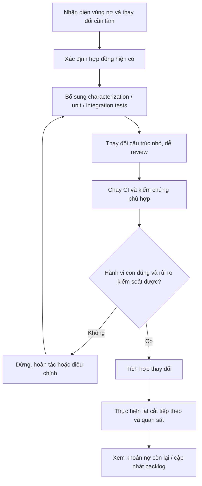
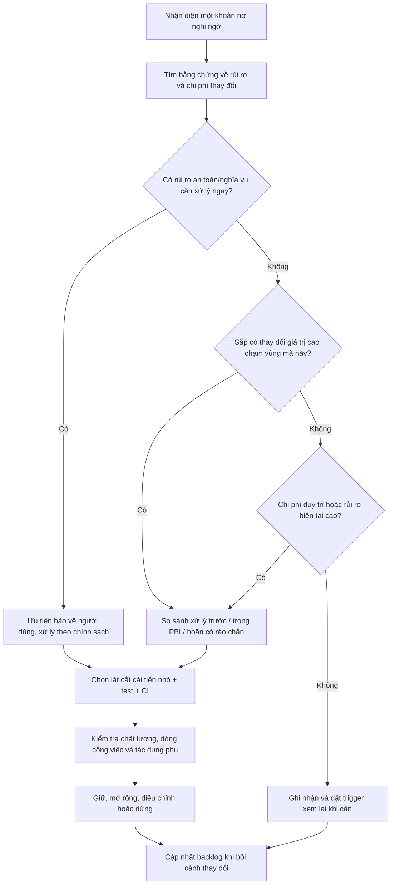

# Quản lý nợ kỹ thuật và chi phí thay đổi tích lũy

Một nhóm phát triển nền tảng học trực tuyến có chức năng **“Tiếp tục bài học đang dở”**. Khi mới ra mắt, nhóm lưu tiến độ bằng một bảng đơn giản và viết điều kiện kiểm tra quyền truy cập ngay trong từng API. Cách này giúp giao một lát cắt giá trị nhanh. Sáu tháng sau, sản phẩm hỗ trợ nhiều khóa học, gói đăng ký khác nhau và đồng bộ nhiều thiết bị. Mỗi lần bổ sung một quy tắc mới, Developers phải tìm và sửa cùng một điều kiện ở ba dịch vụ. Một lỗi nhỏ có thể chỉ xuất hiện khi học viên đổi tài khoản hoặc hết quyền truy cập. Kiểm thử tích hợp khó chạy, còn việc triển khai phải chờ một người hiểu dữ liệu cũ.

Từ góc nhìn backlog, nhóm vẫn có nhiều tính năng cần phát triển. Từ góc nhìn kỹ thuật, **chi phí để thay đổi một tính năng đang tăng lên**. Đây là vấn đề cốt lõi của **nợ kỹ thuật (*technical debt*)** và **chi phí thay đổi tích lũy (*accumulated cost of change*)**.

Tư duy **thiết kế tiến hóa (*evolutionary design*)** không yêu cầu thiết kế toàn bộ tương lai ngay từ đầu. Nó khuyến khích tạo giải pháp đủ tốt cho nhu cầu hiện tại, **giữ khả năng thay đổi**, thu nhận phản hồi sớm và cải thiện cấu trúc khi hiểu biết tăng lên. Vì vậy, việc để lại một đánh đổi kỹ thuật đôi khi hợp lý; điều quan trọng là **biết mình đang đánh đổi gì, rủi ro nào đang lớn dần, khi nào cần xử lý và cách xử lý với những bước an toàn**.

Bài học thuộc chương **Thiết kế tiến hóa** của mô-đun **AGILE_DEVELOPMENT**. Nó liên hệ cách quản lý nợ kỹ thuật với user story, Product Backlog, Scrum, Kanban, các thực hành XP như TDD, refactoring, Continuous Integration và khả năng đo dòng công việc để giao phần mềm tăng dần, thích ứng qua phản hồi và cải tiến liên tục.

## 1. Mục tiêu học tập

Sau bài này, bạn có thể:

- Giải thích **nợ kỹ thuật** như một phép ẩn dụ về đánh đổi thiết kế và chi phí tương lai, phân biệt nó với bug, tính năng chưa làm, công việc vận hành và sở thích cá nhân.
- Nhận diện **chi phí gốc (*principal*)**, **chi phí phát sinh (*interest*)**, rủi ro và **thời điểm trả nợ** mà không coi chúng là khoản tiền có công thức tài chính chính xác.
- Phân biệt nợ kỹ thuật **có chủ đích/không chủ đích** và **thận trọng/thiếu thận trọng** qua mô hình *Technical Debt Quadrant*.
- Phân tích những cơ chế khiến chi phí thay đổi tăng: **coupling, duplication, thiếu test, kiến trúc khó mở rộng, phụ thuộc một chuyên gia, chờ tích hợp và dữ liệu cũ**.
- Xây dựng **debt register** đủ minh bạch để ra quyết định, gắn khoản nợ với phạm vi ảnh hưởng và công việc sắp tới.
- Đánh giá **khi nào nên xử lý ngay, khi nào xử lý từng phần, khi nào chấp nhận trì hoãn và khi nào không cần đầu tư**.
- Chọn cách trả nợ bằng **refactoring từng bước, characterization tests, seams, CI, chuyển đổi tương thích và chia lát cắt dọc**, tránh “big-bang rewrite” không cần thiết.
- Đưa nợ kỹ thuật vào trao đổi **Product Backlog, Sprint Planning, Retrospective và quản lý dòng Kanban** mà không đánh đồng mọi việc kỹ thuật với user story.
- Theo dõi cải tiến bằng **thời gian chờ, cycle time, work item age, lỗi hồi quy, thay đổi thất bại, độ tin cậy CI và outcome người dùng**.
- Trình bày một quyết định đầu tư kỹ thuật cho Product Owner và stakeholder bằng ngôn ngữ **rủi ro, khả năng giao giá trị, chi phí trì hoãn và bằng chứng**.

## 2. Thiết kế tiến hóa không đồng nghĩa “thiết kế sơ sài”

### 2.1. Thiết kế vừa đủ cho điều đã biết

Trong phát triển phần mềm phức tạp, nhiều điều chỉ rõ khi sản phẩm đã được người dùng sử dụng: hành vi thật, ngoại lệ, khối lượng truy cập, cách các bộ phận phối hợp và rủi ro phát sinh.

Hai lựa chọn cực đoan thường gây vấn đề:

1. **Thiết kế quá sớm cho mọi tương lai có thể tưởng tượng.** Nhóm xây nền tảng mở rộng nhiều tầng, nhiều dịch vụ và nhiều điểm cấu hình trước khi có bằng chứng rằng sản phẩm cần chúng.
2. **Không đầu tư cho khả năng thay đổi.** Nhóm liên tục thêm điều kiện tạm, bỏ kiểm thử và sao chép logic; mỗi yêu cầu mới làm hệ thống khó sửa hơn.

**Thiết kế tiến hóa** tìm một con đường ở giữa: xây phần đơn giản đáp ứng nhu cầu hiện tại, giữ ranh giới quan trọng rõ ràng, liên tục kiểm chứng và refactor khi có đủ bằng chứng về hướng thay đổi.

Điều đó không phải “code trước, nghĩ sau”. Đội vẫn cần cân nhắc **chất lượng, bảo mật, dữ liệu, khả năng kiểm chứng và rủi ro không thể đảo ngược** ngay từ đầu.

### 2.2. Phân biệt “chưa xây tương lai” với “đã vay nợ kỹ thuật”

Ví dụ:

- Chưa xây **đồng bộ đa thiết bị** vì người dùng hiện chỉ cần học tiếp trên một thiết bị: có thể là **quyết định giới hạn phạm vi đúng đắn**, không phải nợ.
- Chưa xây một framework cấu hình cho 20 loại khóa học khi mới chỉ có hai loại: có thể là **thực hiện YAGNI (*You Aren't Gonna Need It*)**.
- Sao chép quy tắc phân quyền vào bốn endpoint dù biết nó sẽ thường thay đổi, không có test bảo vệ: có thể tạo **nợ kỹ thuật đáng theo dõi**.
- Tạm sử dụng một cấu trúc dữ liệu đơn giản để kiểm chứng giá trị rồi ghi rõ rủi ro migration khi tăng quy mô: có thể là **đánh đổi có chủ đích**, cần điều kiện xem lại.

**Không có trừu tượng hóa chưa cần thiết không tự động là nợ.** Nợ xuất hiện khi một lựa chọn hiện tại **dự kiến làm những thay đổi hợp lý trong tương lai tốn thêm công sức, chậm hơn hoặc rủi ro hơn** so với một lựa chọn thiết kế thích hợp.

### 2.3. Mục tiêu là chi phí thay đổi bền vững

Một nhóm khỏe không nhất thiết có **mã hoàn hảo**. Họ có khả năng:

- Giao Increment nhỏ, dùng được và đáp ứng chất lượng.
- Hiểu được tác động của một thay đổi.
- Viết kiểm chứng trước hoặc cùng khi sửa hành vi.
- Tích hợp và phát hành với rủi ro trong khả năng kiểm soát.
- Phản ứng với phản hồi người dùng mà không phải sửa nhiều khu vực không liên quan.
- Nhìn thấy phần việc chưa chắc chắn và quyết định xử lý theo giá trị.

**Tốc độ ở Sprint đầu không đủ đánh giá chất lượng thiết kế.** Cần quan sát xem nhóm còn thay đổi được với chi phí hợp lý sau nhiều vòng phản hồi hay không.

## 3. Nợ kỹ thuật là gì?

### 3.1. Phép ẩn dụ của Ward Cunningham

Ward Cunningham giới thiệu phép ẩn dụ **technical debt** để diễn đạt việc một lựa chọn triển khai chưa phản ánh đầy đủ hiểu biết hoặc thiết kế mong muốn có thể giúp tiến nhanh lúc đầu, nhưng sau đó tạo chi phí khi tiếp tục phát triển.

Trong phép ẩn dụ:

- **Principal — phần nợ gốc:** công sức cần để cải thiện lựa chọn thiết kế đang gây cản trở đến mức phù hợp, ví dụ hợp nhất quy tắc trùng lặp hoặc tạo bộ kiểm thử tin cậy.
- **Interest — “lãi” của nợ:** công sức/rủi ro tăng thêm mỗi khi nhóm phải làm việc trên hoặc xung quanh lựa chọn ấy, ví dụ tìm nhiều vị trí sửa, kiểm thử thủ công nhiều lần hoặc xử lý lỗi hồi quy.
- **Repayment — trả nợ:** thay đổi mã, kiểm thử, cấu trúc, phụ thuộc hoặc cách làm để giảm chi phí và rủi ro trong tương lai.
- **Debt horizon — khoảng thời gian liên quan:** nếu mã sẽ bị thay thế rất sớm hoặc ít thay đổi, giá trị trả nợ có thể khác mã cốt lõi sắp được mở rộng liên tục.

Đây là **phép ẩn dụ ra quyết định**, không phải một khoản vay thật có lãi suất tự nhiên, số dư chính xác hoặc nghĩa vụ phải trả bằng mọi giá.

### 3.2. Ví dụ về gốc và lãi

Đội có ba bản sao của cùng một quy tắc kiểm tra quyền truy cập khóa học.

- **Nợ gốc minh họa:** cần làm rõ hợp đồng quyền truy cập, tạo kiểm thử API, đưa quy tắc về một chính sách rõ ràng và đổi ba nơi gọi.
- **Lãi minh họa:** mỗi thay đổi gói đăng ký buộc sửa ba chỗ; Developer dễ bỏ sót một chỗ, PR khó review và kiểm thử tích hợp kéo dài.
- **Rủi ro:** một bản sao có thể cho người học truy cập bài không còn quyền sử dụng.
- **Thời điểm cần xử lý:** trước khi bổ sung nhiều loại gói mới hoặc mở đường truy cập nhạy cảm, có thể đáng ưu tiên hơn chờ đến cuối quý.

Lãi **không nhất thiết phát sinh đều mỗi ngày**. Một đoạn mã ít thay đổi có thể hầu như không tạo chi phí trong nhiều tháng; khi sản phẩm mở rộng sang một luồng mới, chi phí có thể tăng đột ngột.

### 3.3. Nợ kỹ thuật cần được mô tả như một tác động có thể lý giải

Nói “module này rất xấu” chưa đủ để kết luận nợ. Cách nói hữu ích hơn:

> “Quy tắc quyền truy cập khóa được sao chép ở bốn endpoint. Hai lần bổ sung loại thuê bao gần nhất phải sửa cả bốn chỗ và một lần bỏ sót kiểm tra. Sprint tới có ba PBI liên quan quyền truy cập; nếu chưa thống nhất quy tắc và kiểm thử, thời gian tích hợp và nguy cơ hồi quy sẽ tăng.”

Mô tả này có **cơ chế gây chi phí, bằng chứng và bối cảnh quyết định**, thay vì đánh giá thẩm mỹ.

## 4. Phân biệt nợ kỹ thuật với các loại công việc khác

Không phải tất cả những việc đội muốn sửa đều thuộc nợ kỹ thuật.

| Hiện tượng | Có tự động là nợ kỹ thuật? | Cách xem đúng hơn |
| --- | --- | --- |
| **Bug làm sai hành vi người dùng** | **Không tự động** | Lỗi cần xử lý theo mức tác động; thiếu test/cấu trúc khiến bug tái phát có thể là nợ liên quan. |
| **Tính năng chưa được phát triển** | **Không** | Phạm vi sản phẩm hoặc cơ hội trong backlog, chưa chắc là khoản nợ thiết kế. |
| **Chưa có hạ tầng cho tải gấp 100 lần** | **Không tự động** | Nếu chưa có nhu cầu, có thể là không xây trước; cần đánh giá rủi ro dự báo. |
| **Quy tắc nghiệp vụ bị sao chép nhiều nơi** | **Thường có thể** | Mỗi lần thay đổi phải sửa nhiều nơi, tăng nguy cơ lệch hành vi. |
| **Test CI thường xuyên thất bại ngẫu nhiên** | **Có thể** | Tạo thêm thời gian chờ và khiến đội không tin vào tín hiệu chất lượng. |
| **Không có tài liệu cho mọi method** | **Không tự động** | Nợ nếu sự thiếu hụt làm quyết định, sửa mã hoặc vận hành thường xuyên bị cản trở. |
| **Thư viện hết vòng hỗ trợ, có lỗ hổng** | **Có thể kèm nợ, nhưng trước hết là rủi ro an toàn** | Cần xử lý theo mức độ nghiêm trọng và nghĩa vụ bảo mật, không chờ một “quỹ nợ” tùy ý. |
| **Thiết kế có nhiều lớp hơn mức cần thiết** | **Có thể** | Overengineering cũng làm chi phí thay đổi tăng. |
| **Một quyết định kiến trúc có đánh đổi rõ** | **Không tự động** | Đánh đổi hợp lý nếu phù hợp mục tiêu hiện tại và có cách xem lại. |
| **Chỉ một người hiểu khâu triển khai** | **Có thể là nợ tri thức/quy trình** | Rủi ro phụ thuộc chuyên gia và thời gian khôi phục khi sự cố. |
| **Báo cáo kế hoạch lạc hậu** | **Không nhất thiết là nợ mã** | Có thể là vấn đề quản trị hoặc minh bạch cần xử lý riêng. |

**Không dùng nhãn “nợ kỹ thuật” để giảm nhẹ một lỗ hổng bảo mật đang gây hại**. Rủi ro khẩn cấp phải được xử lý theo cơ chế bảo vệ người dùng và nghĩa vụ tổ chức, bất kể nó có nguồn gốc từ thiết kế cũ hay không.

### 4.1. Nợ kỹ thuật không đồng nghĩa nợ công việc (*work backlog*)

Một PBI sửa lỗi, một nhiệm vụ nâng cấp phiên bản hoặc một đề xuất refactor có thể nằm trong backlog. Nhưng **backlog là nơi quản lý lựa chọn công việc**, còn nợ kỹ thuật là **một loại đánh đổi và chi phí tương lai**. Không nên đưa mọi nhiệm vụ kỹ thuật vào một danh sách dài rồi gọi toàn bộ là nợ.

### 4.2. Code smell là tín hiệu, không phải bản án

Tên khó hiểu, hàm dài, vòng phụ thuộc, nhiều tham số, duplicate code hoặc class nhiều trách nhiệm có thể là **code smell**. Chúng báo hiệu cần xem xét, nhưng **không tự chứng minh mức chi phí hoặc thứ tự ưu tiên trả nợ**.

Một hàm dài nhưng ổn định, ít thay đổi và được kiểm chứng có thể ít cấp thiết hơn một kiểm tra quyền truy cập bị nhân đôi ở nhiều API đang sửa hàng tuần.

## 5. Nợ có chủ đích, không chủ đích, thận trọng và thiếu thận trọng

Martin Fowler trình bày một cách nhìn thường được gọi **Technical Debt Quadrant**, kết hợp hai chiều:

- **Deliberate / Inadvertent:** nợ được chấp nhận có ý thức hay chỉ được phát hiện về sau.
- **Prudent / Reckless:** quyết định có cân nhắc chuyên môn và rủi ro hay thiếu thận trọng.

| Phân loại | Tình huống minh họa | Điều cần làm |
| --- | --- | --- |
| **Thận trọng, có chủ đích** (*prudent/deliberate*) | Để một cơ chế lưu tạm có ranh giới rõ nhằm kiểm chứng nhu cầu sớm, biết giới hạn và có điểm xem lại | Ghi giả định, rủi ro, trigger và chi phí thay thế dự kiến. |
| **Thiếu thận trọng, có chủ đích** (*reckless/deliberate*) | Biết đang bỏ kiểm tra bắt buộc chỉ để kịp “đóng ticket” | Không coi đây là đánh đổi Agile hợp lý; cần sửa và xử lý trách nhiệm, chất lượng. |
| **Thận trọng, không chủ đích** (*prudent/inadvertent*) | Sau khi người dùng thực sự dùng, đội mới hiểu cấu trúc đơn giản ban đầu không phù hợp biến thể mới | Cập nhật hiểu biết và tiến hóa thiết kế; không quy kết lựa chọn cũ là sai chỉ vì học được điều mới. |
| **Thiếu thận trọng, không chủ đích** (*reckless/inadvertent*) | Nhóm thiếu kiến thức về transaction hoặc dữ liệu nên tạo coupling nghiêm trọng mà không nhận ra | Bổ sung năng lực, review, kiểm chứng và cải thiện cấu trúc phù hợp. |

**Không nên dùng góc phần tư để dán nhãn đạo đức cho một cá nhân**. Phân loại giúp hiểu cơ chế ra quyết định và cách cải thiện điều kiện nhóm.

### 5.1. Ví dụ một đánh đổi có thể hợp lý

Đội cần thử tính năng “Tiếp tục bài đang dở” trên một thiết bị, chưa có yêu cầu đồng bộ đa thiết bị. Họ lưu vị trí học trong một cấu trúc đơn giản, nhưng:

- Ghi rõ giả định “một thiết bị, một dòng tiến độ hợp lệ”.
- Đặt quy tắc chọn bài ở một nơi đủ rõ.
- Kiểm tra quyền truy cập tại server và có test.
- Tránh lộ dữ liệu riêng qua API.
- Có một phương án migration nếu phát sinh dữ liệu nhiều thiết bị.
- Xem lại khi Product Backlog ưu tiên đồng bộ.

Đây là **thiết kế vừa đủ và có khả năng mở rộng có chủ đích**, không mặc nhiên là nợ xấu.

### 5.2. Khi “tạm thời” trở thành mặc định

Một giải pháp tạm dễ thành nợ khó xử lý nếu:

1. Không ghi vì sao đã chọn và giới hạn áp dụng.
2. Không có trigger xem lại.
3. Không có test để thay thế an toàn.
4. Nhiều tính năng mới bắt đầu phụ thuộc vào chi tiết tạm.
5. Nhóm vẫn mở rộng nó dù giả định ban đầu đã không còn đúng.

**Nợ không đáng sợ vì nó được tạo có chủ đích; nợ nguy hiểm khi chi phí và điều kiện trả bị mất khỏi tầm nhìn.**

## 6. Chi phí thay đổi tích lũy hình thành thế nào?

Một chức năng không tồn tại độc lập. Thay đổi có thể lan qua module, dữ liệu, test, hạ tầng và quy trình cộng tác.

### 6.1. Coupling khiến một thay đổi chạm nhiều nơi

**Coupling** là mức độ phụ thuộc giữa các phần của hệ thống. Nếu một quy tắc “khóa đã hết quyền” xuất hiện trong frontend, API, scheduler và báo cáo, đổi quy tắc có thể đòi sửa cả bốn nơi.

Hệ quả:

- Tăng số phần phải hiểu.
- Tăng số biến thể cần kiểm chứng.
- Tăng nguy cơ bỏ sót.
- Tăng thời gian review và tích hợp.
- Tăng phụ thuộc giữa các thành viên/nhóm.

Tách module không phải lúc nào cũng giảm coupling; đôi khi chia thành nhiều dịch vụ riêng tạo thêm hợp đồng mạng, deployment và giám sát phức tạp. **Cần đo sự phụ thuộc ở hành vi thực, không chỉ đếm số lớp hoặc số repository**.

### 6.2. Duplication làm quy tắc lệch dần

Hai đoạn code nhìn giống nhau có thể là hai trường hợp nghiệp vụ khác nhau; không phải mọi duplication đều nên hợp nhất. Nhưng nếu **một quy tắc chung** được sao chép nhiều nơi, các bản sao có thể được sửa không đồng bộ.

Ví dụ:

- API A cho truy cập nếu trạng thái là `ACTIVE`.
- API B cho truy cập nếu `ACTIVE` hoặc `TRIAL`.
- Scheduler C dùng cả điều kiện thời gian hết hạn.
- Ứng dụng mobile D dùng dữ liệu cache chưa được cập nhật.

Khi Product Owner đổi chính sách thuê bao, nhóm phải tìm nơi nào đang phản ánh **cùng một quyết định nghiệp vụ** rồi thay đổi thống nhất.

### 6.3. Thiếu test làm mỗi thay đổi cần kiểm tra lại thủ công

Khi một vùng mã không có kiểm chứng đáng tin, Developer không chỉ viết thay đổi. Họ còn phải:

- Dựng lại dữ liệu thử.
- Nhờ một người biết quy trình chạy thủ công.
- Kiểm tra tác động tới chức năng liên quan.
- Chờ môi trường tích hợp hoặc release.
- Sửa lỗi chỉ phát hiện muộn.

Đây là **chi phí lặp lại** mà đầu tư vào test đúng rủi ro có thể giảm.

### 6.4. Hạ tầng phản hồi không tin cậy tạo chi phí chờ

Nếu pipeline CI chạy 40 phút nhưng thường đỏ do test flaky, mọi PR có thể phải chạy lại và đợi. Nhóm mất niềm tin vào kết quả, rồi bắt đầu bỏ qua cảnh báo. Chi phí kỹ thuật lúc này gồm cả **thời gian chờ, chuyển ngữ cảnh và nguy cơ đưa lỗi vào dòng mã chung**.

### 6.5. Dữ liệu và hợp đồng cũ tạo chi phí khó đảo ngược

Một quyết định định danh người học bằng một mã giả định không đổi có thể trở thành nợ khi sản phẩm hỗ trợ gộp tài khoản, xóa dữ liệu hoặc đồng bộ. Thay đổi dữ liệu thật thường cần kế hoạch migration, tương thích giữa phiên bản, khôi phục và kiểm tra quyền truy cập.

**Không thể cứ refactor database production như đổi tên biến.** Những quyết định khó đảo ngược cần được xem xét sớm hơn, ngay cả khi nhu cầu sản phẩm còn xa.

### 6.6. Nợ tri thức và phụ thuộc tổ chức

Chỉ một Developer biết cách triển khai có thể khiến một thay đổi kỹ thuật nhỏ chờ nhiều ngày. Quy trình phê duyệt lặp lại hoặc trách nhiệm mơ hồ cũng tạo chi phí.

Các yếu tố này có thể được gọi là **nợ tri thức, nợ quy trình hoặc nợ kiến trúc** trong thực hành, nhưng không có một hệ phân loại chính thức duy nhất. Điều quan trọng là tìm **cơ chế ảnh hưởng đến khả năng thay đổi**.

## 7. Lãi của nợ không tăng theo một công thức cố định

### 7.1. Một phép tính minh họa có điều kiện

Giả sử một module có quy tắc bị lặp lại. Mỗi thay đổi thuộc cùng loại hiện tốn thêm trung bình khoảng **2 giờ** để tìm bản sao, sửa và kiểm chứng so với khi quy tắc được tổ chức tốt.

Nhóm dự kiến có **12 thay đổi tương tự** trong vài tháng tới. Công sức refactor và thêm kiểm chứng ước tính **16 giờ**.

```text
Chi phí tăng thêm dự kiến (kịch bản đơn giản):
12 lần thay đổi × 2 giờ/lần = 24 giờ

Chi phí cải thiện một lần: khoảng 16 giờ

Chênh lệch công sức theo giả định:
24 giờ - 16 giờ = 8 giờ có thể tránh
```

Đây là **bài toán tư duy**, không phải cam kết tiết kiệm chắc chắn. Kết quả có thể khác vì kích thước công việc, chi phí review, rủi ro migration, lỗi phát sinh, thay đổi nhu cầu hoặc việc ước lượng ban đầu sai.

Điều quan trọng là **xem xét tần suất chạm vào vùng nợ và chi phí tăng thêm khi chạm**, không chỉ xếp hạng mã theo độ xấu.

### 7.2. Cùng khoản nợ, quyết định khác theo thời hạn

Nếu module sắp bị thay thế sau **hai thay đổi nhỏ**, đầu tư 16 giờ chỉ để tiết kiệm 4 giờ có thể không hợp lý — trừ khi nợ còn kéo theo rủi ro bảo mật hoặc sự cố lớn.

Nếu module là phần lõi dự kiến được sửa **hàng tuần**, trả nợ sớm có thể có giá trị cao hơn và giúp nhiều PBI sau đó hoàn tất nhanh.

Một vùng ít thay đổi nhưng có **mức độ nguy hại cao** vẫn có thể cần xử lý ngay. **Tần suất thay đổi không được dùng để bỏ qua rủi ro nghiêm trọng**.

### 7.3. Tránh tuyên bố chi phí luôn tăng theo cấp số nhân

Chi phí thay đổi có thể tăng tuyến tính, tăng theo từng ngưỡng, có lúc ổn định hoặc thậm chí giảm sau một cải tiến khác. Không có quy luật chung rằng mọi hệ thống có nợ kỹ thuật sẽ “tăng lãi kép theo tháng”.

Một mô hình thực tế hơn:

> **Chi phí thay đổi chịu tác động của cấu trúc hiện tại, loại yêu cầu, tần suất thay đổi, chất lượng kiểm chứng, khả năng phối hợp và rủi ro dữ liệu.**

Hãy theo dõi **những lần thay đổi có thể so sánh được**, thay vì suy ra quan hệ nhân quả chỉ từ một Sprint chậm.

## 8. Nhận diện nợ kỹ thuật bằng các tín hiệu có thể kiểm tra

### 8.1. Tín hiệu trong mã và kiến trúc

- Một quy tắc nghiệp vụ được sửa ở nhiều module mỗi khi thay đổi.
- Phần mã thường xuyên bị sửa cùng nhau dù chức năng không liên quan trực tiếp.
- Vòng phụ thuộc khiến không thể kiểm thử hoặc phát hành độc lập.
- Thay đổi nhỏ kéo theo PR rất lớn.
- Một module có nhiều điều kiện ngoại lệ và hành vi không được mô tả rõ.
- Migration hoặc API mới bắt buộc phải giữ nhiều nhánh tương thích quá lâu.
- Khu vực cũ không ai tự tin sửa vì chưa có test bảo vệ.
- Có nhiều “cổng” phê duyệt kỹ thuật cho thay đổi đơn giản.

Các tín hiệu này **mời đội điều tra**, không phải bằng chứng đủ để kết luận ngay phải viết lại module.

### 8.2. Tín hiệu trong luồng công việc

- PBI có tuổi công việc cao khi chạm một khu vực mã cụ thể.
- Nhiều PR chờ một reviewer hoặc người vận hành duy nhất.
- Build/test thường đỏ và phải chạy lại nhiều lần.
- Nhiều PBI chưa đạt Definition of Done vào cuối Sprint vì tích hợp muộn.
- Cùng loại lỗi hồi quy xuất hiện sau mỗi lần thay đổi chính sách.
- Nhiều việc “mới làm được một phần” mở song song, gây chuyển ngữ cảnh.
- Việc vận hành/sửa lỗi khẩn liên tục chiếm năng lực của nhóm.

Tín hiệu dòng chảy chịu ảnh hưởng của nhiều yếu tố. Ví dụ PBI chậm có thể do **yêu cầu chưa rõ hoặc phụ thuộc pháp lý**, không nhất thiết do code.

### 8.3. Quan sát “hotspot” thay vì đọc ngẫu nhiên mọi file

Một **hotspot** có thể được hình dung là vùng mã vừa:

1. **Thay đổi thường xuyên**, hoặc nằm trên đường của nhiều PBI.
2. **Khó hiểu, dễ lỗi, phụ thuộc cao hoặc mất nhiều công sức sửa**.

Khi hai đặc điểm cùng xuất hiện, nhóm có thể tìm cơ hội cải tiến mang lại lợi ích lặp lại. Một file rất phức tạp nhưng nhiều năm không đổi có thể ít cấp thiết hơn file vừa phức tạp vừa bị sửa mỗi Sprint.

Phân tích lịch sử commit, lỗi và luồng công việc có thể hỗ trợ, nhưng cần xem **bối cảnh sản phẩm và độ tin cậy của dữ liệu**. Không đánh giá một người kém chỉ vì tên họ xuất hiện trong nhiều commit sửa lỗi.

## 9. Xây “sổ nợ kỹ thuật” đủ dùng

**Debt register** là cách ghi lại những khoản nợ đáng quan tâm. Nó có thể nằm trong backlog, hệ thống issue hoặc một bảng nhỏ; Scrum không bắt buộc tạo artifact tên này.

### 9.1. Mỗi khoản nợ nên trả lời bảy câu hỏi

1. **Vùng nào đang gây trở ngại?** Module, luồng nghiệp vụ, dữ liệu hoặc quy trình.
2. **Tình trạng thực tế là gì?** Điều kiện thiết kế nào đang tồn tại.
3. **Ảnh hưởng cụ thể?** Tăng thời gian sửa, lỗi, chờ review hay rủi ro chất lượng nào.
4. **Bằng chứng?** Hai PR vừa qua, sự cố, thời gian chờ, ví dụ cần sửa nhiều nơi.
5. **Nếu không xử lý?** Những thay đổi sắp tới chịu tác động ra sao và đến mức nào.
6. **Có những phương án nào?** Trả ngay, trả từng phần, kiểm soát rủi ro tạm thời hoặc giữ nguyên.
7. **Khi nào xem lại?** Khi có PBI liên quan, khi thay đổi quy mô, khi sắp release hoặc theo ngày đánh giá phù hợp.

### 9.2. Ví dụ debt register

| Mã | Khoản nợ/cơ chế | Bằng chứng và tác động | Hướng xử lý | Khi nào đánh giá lại |
| --- | --- | --- | --- | --- |
| **TD-01** | Quy tắc quyền truy cập khóa bị sao chép ở bốn API | Một lần thêm gói học bỏ sót một endpoint; tăng rủi ro dữ liệu | Viết kiểm thử API, tạo chính sách quyền thống nhất, di chuyển từng endpoint | Trước PBI thêm loại thuê bao |
| **TD-02** | Test CI cho tiến độ học không ổn định | Nhiều PR phải chạy lại; chờ review tăng | Cố định clock/dữ liệu, điều tra race condition, đo tỷ lệ flaky | Trong Sprint kế tiếp |
| **TD-03** | Chỉ một người biết migration dữ liệu tiến độ | Release phụ thuộc lịch một thành viên | Pairing, runbook, rehearsal với dữ liệu thử, phân quyền dự phòng | Trước thay đổi schema |
| **TD-04** | Giao diện có logic chọn bài trùng với backend | Trường hợp hoàn tất khóa cho kết quả khác nhau | Di chuyển quyết định nghiệp vụ về hợp đồng phù hợp, test tích hợp | Khi làm PBI cải thiện tiếp tục học |

Những mã và sự kiện trên **hoàn toàn minh họa**. Đội không cần ghi hàng trăm hạng mục cho từng cảnh báo lint. Chọn những khoản nợ có tác động đủ rõ để ra quyết định.

### 9.3. Ai “sở hữu” khoản nợ?

Có thể chỉ định một người **theo dõi thông tin và nhắc xem lại**, nhưng việc xử lý là trách nhiệm cộng tác:

- **Developers** có chuyên môn để phân tích cấu trúc, rủi ro và phương án.
- **Product Owner** trong Scrum chịu trách nhiệm tối đa hóa giá trị sản phẩm và thứ tự Product Backlog.
- **Scrum Master** hỗ trợ hiệu quả của Scrum Team, giúp tháo gỡ trở ngại do hệ thống làm việc tạo ra.
- **Người có chuyên môn vận hành, bảo mật, dữ liệu** tham gia khi rủi ro cần.
- **Stakeholder** cần thông tin về tác động và lựa chọn, không nhất thiết được yêu cầu đọc mọi chi tiết mã.

**Không nên gán khoản nợ cho “người viết đoạn mã cũ” như một hình thức đổ lỗi.** Quyết định cũ có thể hợp lý với thông tin cũ.

## 10. Ưu tiên khoản nợ nào?

### 10.1. Đặt nợ cạnh giá trị và rủi ro sản phẩm

Một khoản nợ nên được ưu tiên nếu nó:

- **Chặn hoặc làm chậm nhiều PBI giá trị cao** sắp đến.
- **Tăng khả năng lỗi nghiêm trọng** về tiền, dữ liệu, quyền truy cập hoặc an toàn.
- **Tạo hàng chờ lặp lại** do chỉ một người hoặc một công cụ có thể xử lý.
- **Làm thay đổi ngày càng khó dự báo** khiến đội không thể giao Increment nhỏ.
- **Gây sự cố vận hành lặp lại** hoặc làm phục hồi chậm.
- **Khiến kiểm chứng rủi ro không đáng tin**, ví dụ suite bắt buộc thường flaky.
- Có **chi phí xử lý tương đối nhỏ** so với chi phí lặp lại dự kiến.

Ngược lại, một tên lớp chưa thật đẹp trong module ít thay đổi, dễ hiểu, không gây lỗi và không nằm trên đường phát triển gần hạn có thể được **hoãn hoặc xử lý khi chạm tới**.

### 10.2. Ma trận quyết định thực hành

| Tác động/khả năng phát sinh | Thấp | Cao |
| --- | --- | --- |
| **Rủi ro thấp** | Theo dõi hoặc xử lý khi chạm | Cải tiến từng phần để giảm chờ và lặp lại |
| **Rủi ro cao** | Giảm thiểu bằng kiểm soát, xét yêu cầu bắt buộc | Ưu tiên xử lý, làm rõ phương án an toàn trước khi mở rộng |

Ma trận chỉ giúp mở cuộc trao đổi. **Rủi ro bảo mật nghiêm trọng có thể cần xử lý ngay ngay cả khi chưa biết xác suất**, vì hậu quả hoặc nghĩa vụ tuân thủ không cho phép đợi một phép chấm điểm cơ học.

### 10.3. Câu hỏi về thời điểm trả nợ

- Có PBI nào trong **Now/Next** sắp chạm vùng mã này?
- Nếu trả nợ sau PBI ấy, có phải làm lại phần vừa xây?
- Trả trước có giúp nhiều hạng mục cùng hưởng lợi?
- Có thể xây một kiểm tra an toàn nhỏ trước rồi trả dần?
- Hệ thống có chuẩn bị thay thế/đóng bỏ không?
- Có deadline pháp lý, bảo mật hoặc tích hợp đối tác?
- Việc trả nợ có thể tạo rủi ro migration hoặc ngắt dịch vụ lớn không?
- Có phương án thay đổi nhỏ rẻ và an toàn hơn một lần viết lại toàn bộ không?

### 10.4. Không bắt buộc “mỗi Sprint phải dành X% cho nợ”

Một số đội thử dành một phần năng lực đều đặn cho cải tiến kỹ thuật; đây là **chính sách thử nghiệm của đội**, không phải tỷ lệ bắt buộc trong Scrum, XP hay Lean.

Một Sprint cần xử lý lỗ hổng nghiêm trọng có thể phải ưu tiên phần lớn năng lực vào chất lượng. Sprint khác có thể hầu như không có việc trả nợ riêng vì các cải tiến được thực hiện ngay trong PBI.

Điều quan trọng là **nợ có cơ chế được nhìn thấy và quyết định**, không tự động bị đẩy xuống cuối bởi KPI số tính năng.

## 11. Ba chiến lược: trả ngay, trả khi chạm, chấp nhận có kiểm soát

### 11.1. Trả ngay khi rủi ro hoặc chi phí sắp rất lớn

Phù hợp khi:

- Có rủi ro nghiêm trọng đối với người dùng.
- Một khoản nợ chặn nhiều hạng mục sắp triển khai.
- Việc tiếp tục xây trên cấu trúc hiện tại sẽ khiến migration khó hơn đáng kể.
- Chỉ một lần cải tiến nhỏ đã giảm lỗi hoặc chờ đáng kể.

**Trả ngay không có nghĩa bỏ qua quyết định phát hành hay phê duyệt cần thiết**. Phải thiết kế phương án an toàn và có khả năng khôi phục.

### 11.2. Trả khi chạm (*opportunistic refactoring*)

Khi một PBI mới cần sửa vùng mã có nợ:

1. Làm rõ yêu cầu mới và hợp đồng hiện có.
2. Bổ sung kiểm chứng đủ tin cậy cho hành vi cần giữ.
3. Refactor một bước nhỏ giúp thay đổi dễ hơn.
4. Thực hiện hành vi mới.
5. Chạy test và tích hợp sớm.
6. Ghi lại phần nợ còn lại nếu cần.

Điều này tránh mở một “dự án dọn dẹp” không có điểm kết thúc. Nhưng cũng cần tránh **phình phạm vi**: không tiện tay sửa toàn bộ codebase khi một PBI nhỏ đang cần giao.

### 11.3. Chấp nhận có kiểm soát

Đôi khi việc hoãn hợp lý:

- Vùng mã ổn định, hiếm thay đổi.
- Sản phẩm sắp rút bỏ phần tương ứng.
- Chi phí migration cao hơn chi phí rủi ro trong thời hạn liên quan.
- Có biện pháp giảm thiểu đủ tin cậy và rõ người theo dõi.

Khi đó, hãy ghi **lý do, rủi ro chấp nhận, điều kiện khiến phải xem lại và giới hạn thời gian phù hợp**. Đừng dùng “chấp nhận nợ” để che một vi phạm bảo mật đang cần xử lý.

### 11.4. Cách quyết định không phải chọn một lần mãi mãi

Một khoản nợ ít ưu tiên hôm nay có thể trở nên quan trọng khi backlog thay đổi, nhóm người dùng tăng hoặc có một sự cố mới. Quyết định phải **được kiểm tra và thích ứng** cùng sản phẩm, đúng tinh thần Agile.

## 12. Refactoring: trả nợ mà không thay đổi hành vi ngoài ý muốn

### 12.1. Refactoring là gì?

Theo cách hiểu được phổ biến trong sách *Refactoring* của Martin Fowler, **refactoring** là thay đổi cấu trúc bên trong mã mà **không thay đổi hành vi bên ngoài đã xác định**.

Ví dụ:

- Đổi tên method để diễn đạt ý định.
- Tách một quy tắc lặp lại thành hàm/chính sách chung.
- Giảm phụ thuộc giữa module thông qua một interface có ý nghĩa.
- Di chuyển logic khỏi lớp giao diện về ranh giới nghiệp vụ phù hợp.
- Loại bỏ trạng thái dùng chung không cần thiết.

**Thêm một quy tắc bảo mật mới** là thay đổi hành vi, không phải refactoring thuần túy. Có thể làm cùng đợt nhưng nên phân biệt để review và kiểm thử đúng.

### 12.2. Đường đi an toàn



Sơ đồ là **một luồng tư duy**, không phải quy trình cố định với các cuộc họp mới. Nhóm có thể gộp hoặc tách bước tùy rủi ro và công cụ.

### 12.3. Characterization test với mã cũ

Khi kế thừa module không có tài liệu đầy đủ, **characterization test** ghi lại cách mã đang hoạt động để giúp hiểu và giữ hành vi trong lúc thay đổi cấu trúc.

Tuy nhiên:

- Test có thể ghi nhận cả **hành vi đang sai**.
- Phải phân biệt những hành vi cần giữ với lỗi cần sửa.
- Những rủi ro như phân quyền cần có **yêu cầu đúng mong muốn** từ nguồn đáng tin.
- Không để test mô tả hành vi cũ ngăn sửa một lỗi đã được xác nhận.

**Characterization test là bản đồ của hiện trạng, không tự động là nguồn sự thật nghiệp vụ.**

## 13. Ví dụ Java: hợp nhất quy tắc quyền truy cập bị trùng

Giả sử ứng dụng hiện có hai API cùng viết điều kiện:

```java
// API xem bài học
if (enrollment != null && "ACTIVE".equals(enrollment.status())) {
    return lessonService.loadLesson(lessonId);
}

// API tiếp tục bài học
if (enrollment != null && "ACTIVE".equals(enrollment.status())) {
    return progressService.resume(courseId);
}
```

Hai đoạn trên **chỉ là ví dụ rút gọn**. Chúng chưa cho biết cách xác thực danh tính hay các điều kiện bảo mật khác, nên không được sao chép vào production như mã phân quyền hoàn chỉnh. Nhưng có thể thấy **một quy tắc trạng thái thuê bao đang lặp lại**. Khi sản phẩm thêm trạng thái `TRIAL` hoặc giới hạn theo ngày, hai đoạn dễ lệch nhau.

### 13.1. Tách chính sách thuần, mô tả giả định

Giả sử quy tắc nghiệp vụ đã được làm rõ:

- Chỉ người học có enrollment đang hoạt động mới có quyền sử dụng nội dung tương ứng.
- `accessEndsAt == null` nghĩa là enrollment hiện không có mốc hết hạn.
- Nếu có mốc hết hạn, quyền dừng **tại** mốc đó.
- Kiểm tra **enrollment thực sự thuộc tài khoản và khóa yêu cầu** phải được thực hiện ở ranh giới phù hợp ngoài ví dụ này.

Một chính sách nhỏ dùng Java 17+:

```java
import java.time.Instant;
import java.util.Objects;

record CourseEnrollment(boolean active, Instant accessEndsAt) {}

public final class CourseAccessPolicy {

    public boolean isUsable(CourseEnrollment enrollment, Instant now) {
        Objects.requireNonNull(now, "now");

        if (enrollment == null || !enrollment.active()) {
            return false;
        }

        Instant endsAt = enrollment.accessEndsAt();
        return endsAt == null || now.isBefore(endsAt);
    }
}
```

Đội có thể cho hai API gọi cùng một chính sách sau khi **xác minh cách lấy enrollment đáng tin**. Tách quy tắc không tự động làm hệ thống an toàn nếu client vẫn có thể gửi enrollment của tài khoản khác.

### 13.2. Unit test làm rõ ranh giới

Ví dụ dùng **JUnit Jupiter**:

```java
import static org.junit.jupiter.api.Assertions.assertFalse;
import static org.junit.jupiter.api.Assertions.assertTrue;

import java.time.Instant;
import org.junit.jupiter.api.Test;

class CourseAccessPolicyTest {
    private final CourseAccessPolicy policy = new CourseAccessPolicy();
    private final Instant now = Instant.parse("2026-01-01T12:00:00Z");

    @Test
    void activeEnrollmentWithoutExpiryIsUsable() {
        assertTrue(policy.isUsable(new CourseEnrollment(true, null), now));
    }

    @Test
    void expiredEnrollmentIsNotUsableAtBoundary() {
        assertFalse(policy.isUsable(
                new CourseEnrollment(true, now), now));
    }

    @Test
    void inactiveEnrollmentIsNotUsable() {
        assertFalse(policy.isUsable(
                new CourseEnrollment(false, now.plusSeconds(3600)), now));
    }

    @Test
    void missingEnrollmentIsNotUsable() {
        assertFalse(policy.isUsable(null, now));
    }
}
```

Các test kiểm chứng **quy tắc thuần** trong ví dụ. Đội vẫn cần:

- Test API rằng tài khoản B **không truy cập dữ liệu của A**.
- Test rằng enrollment thuộc đúng khóa cần mở.
- Kiểm tra cùng kết quả ở các đường truy cập khác nhau.
- Kiểm tra dữ liệu lịch sử và migration nếu có.
- Tuân thủ Definition of Done và chính sách bảo mật phù hợp.

### 13.3. Vì sao đây là trả nợ hữu ích?

Trước khi hợp nhất, đổi quy tắc có thể cần sửa nhiều nơi. Sau khi thống nhất **một chính sách chung có test**, thay đổi quy tắc được cô lập hơn và có phản hồi nhanh. Nhưng cải tiến chỉ thực sự tạo lợi ích khi **hai API đã dùng chính sách ấy, các trường hợp cũ được giữ, và không phát sinh một cơ chế truy cập khác ngoài tầm kiểm soát**.

Không nên tạo một framework phân quyền mới với hàng chục lớp khi nhu cầu hiện tại chỉ cần một chính sách nhỏ và hợp đồng rõ.

## 14. Những kỹ thuật giảm chi phí thay đổi ở cấp kiến trúc

### 14.1. Tạo ranh giới thay đổi ổn định

Một ranh giới tốt giúp đổi một quyết định mà ít phần khác cần biết. Ví dụ:

- API chỉ công bố hợp đồng cần thiết cho người gọi.
- Quy tắc nghiệp vụ quan trọng có vị trí rõ để kiểm chứng.
- Logic đọc/ghi dữ liệu không bị lặp ngoài các module không liên quan.
- Thay đổi biểu diễn dữ liệu nội bộ không buộc tất cả client đổi ngay.
- Những điểm tích hợp bên ngoài có cách kiểm thử hợp đồng.
- Cấu trúc module phản ánh **lý do thay đổi** thay vì chỉ chia theo công nghệ.

Đừng biến mục tiêu này thành “càng nhiều abstraction càng tốt”. **Abstraction không có nhu cầu rõ cũng tạo chi phí học và sửa**.

### 14.2. Seam: điểm có thể thay đổi một phần mà không làm hỏng toàn hệ thống

Một *seam* là vị trí có thể thay thế hoặc thay đổi hành vi mà không phải sửa nhiều phần khác đồng thời. Ví dụ:

- Interface truy cập dữ liệu cho phép kiểm tra quy tắc với dữ liệu giả rồi đổi triển khai.
- Adapter API đối tác cô lập format/timeout của hệ thống ngoài.
- Feature flag có kiểm soát cho phép bật một lát cắt đã kiểm chứng với nhóm phù hợp.
- Một lớp chuyển đổi tương thích giúp API cũ/mới cùng hoạt động trong giai đoạn migration.

Không nên tạo seam chỉ để “dự phòng tương lai” không có bằng chứng. Đặt seam vào **ranh giới nhiều khả năng thay đổi hoặc có rủi ro đáng kể**.

### 14.3. Thay thế tăng dần thay vì viết lại toàn bộ

Khi một phần hệ thống thật sự cần thay, đội có thể dùng cách **thay thế tăng dần (*strangler-style migration*)**:

1. Xác định hành vi/luồng người dùng nhỏ cần di chuyển.
2. Đặt điểm định tuyến hoặc adapter rõ và có kiểm chứng.
3. Chạy song song phần cũ/phần mới trong giới hạn an toàn khi cần.
4. Di chuyển một lát cắt đã kiểm chứng.
5. Quan sát lỗi, dữ liệu, hiệu năng và kết quả thực.
6. Loại phần cũ khi không còn phụ thuộc.

**Không có nghĩa phải triển khai hai hệ thống song song vô thời hạn.** Thời gian duy trì hai đường có thể tự tạo nợ mới; cần kế hoạch loại bỏ và tiêu chí hoàn tất.

### 14.4. Migration dữ liệu thường cần cách xử lý riêng

Với dữ liệu tiến độ học:

- Xác định nguồn dữ liệu đúng và phiên bản schema.
- Đánh giá dữ liệu cũ có thiếu trường hoặc sai quy tắc.
- Lập kế hoạch đọc/ghi tương thích trong thời gian chuyển đổi.
- Dùng bản sao dữ liệu thử phù hợp, tránh lộ dữ liệu thật.
- Kiểm tra số bản ghi, tính nhất quán, quyền truy cập và trường hợp lỗi.
- Chuẩn bị rollback hoặc phương án khôi phục theo tính khả thi.
- Đánh giá thời điểm tắt code tương thích cũ.

**Không lấy “refactor từng bước” làm lý do bỏ qua rủi ro không thể đảo ngược**. Migration nhiều dữ liệu hoặc tiền bạc có thể cần review chuyên sâu và diễn tập trước khi chạy thật.

## 15. Kiểm thử, CI và công cụ phản hồi ảnh hưởng đến “lãi” của nợ

### 15.1. Thiếu kiểm thử biến mỗi thay đổi thành lần dò xét mới

Nếu một API chưa có kiểm thử phân quyền, mỗi PBI liên quan tới tài khoản có thể cần chạy thủ công cả luồng đăng nhập A/B, gói hết hạn và dữ liệu cũ. Điều này vừa tốn thời gian vừa dễ bỏ sót.

Một bộ kiểm tra phù hợp:

- **Unit test** cho quy tắc thuần.
- **Integration/API test** cho xác thực và truy cập dữ liệu.
- **Contract test** cho giao diện giữa các thành phần.
- **E2E test chọn lọc** cho hành trình quan trọng.
- **Quan sát sau phát hành** để phát hiện tác dụng phụ.

Không nên chỉ tăng line coverage. **Test chỉ có ích nếu nó bảo vệ hành vi hoặc rủi ro đúng**.

### 15.2. CI giảm lãi khi phản hồi đáng tin

Một pipeline tốt giúp biết nhanh liệu thay đổi đã phá hợp đồng nào. Khi các bước tự động hóa chạy ổn định, đội không cần tái tạo kiểm chứng thủ công cho mọi PR.

Nhưng CI chậm, thường flaky hoặc bị bỏ qua có thể chính nó trở thành nguồn nợ:

- PR chờ kết quả quá lâu.
- Developers chạy lại nhiều lần để “xanh”.
- Người review mất niềm tin và dùng cảm giác thay bằng chứng.
- Nhánh kéo dài tăng xung đột tích hợp.

Nên theo dõi **thời gian chạy, thời gian chờ, tỷ lệ kết quả không ổn định và nguyên nhân build hỏng**, không chỉ tỷ lệ xanh.

### 15.3. Refactoring và TDD bổ trợ nhau

Trong XP, vòng **Red–Green–Refactor** giúp:

1. Biến một hành vi thành phép kiểm tra.
2. Thực hiện thay đổi tối thiểu để đạt yêu cầu.
3. Cải thiện cấu trúc khi test bảo vệ đủ ranh giới.
4. Tích hợp và nhận phản hồi tiếp.

Có thể áp dụng **TDD** cho các quy tắc nghiệp vụ phù hợp, nhưng không phải mọi loại nợ đều giải quyết được chỉ với unit test. Một nợ liên quan dữ liệu hoặc quyền truy cập cần kiểm tra ở tầng cao hơn.

### 15.4. Đừng biến test thành nợ khác

Một test suite có thể gây chi phí khi:

- Gắn chặt vào chi tiết triển khai, dễ vỡ khi refactor.
- Phụ thuộc thời gian thực, mạng, thứ tự chạy.
- Có nhiều test trùng nhau mà không tăng khả năng phát hiện lỗi.
- Dùng mock thay cho chính điều phải kiểm tra.
- Thiếu dữ liệu và tên rõ, người khác không thể hiểu.
- Tốn nhiều giờ chạy nhưng ít phát hiện rủi ro cần thiết.

**Bảo trì chất lượng bộ kiểm tra cũng là quản lý khả năng thay đổi.**

## 16. Đưa nợ kỹ thuật vào Scrum, Kanban và backlog

### 16.1. Trong Scrum: nợ là thông tin ảnh hưởng giá trị

Theo *Scrum Guide 2020*:

- **Product Backlog** là danh sách có thứ tự, phát triển dần về những gì cần để cải thiện sản phẩm.
- **Product Owner** chịu trách nhiệm tối đa hóa giá trị và quản lý Product Backlog hiệu quả.
- **Developers** chịu trách nhiệm tạo Increment và chất lượng bằng cách tuân thủ **Definition of Done**.
- **Scrum Master** chịu trách nhiệm thiết lập Scrum và hiệu quả Scrum Team, hỗ trợ tự quản và tháo gỡ trở ngại.
- **Sprint Backlog** là kế hoạch của Developers được điều chỉnh khi hiểu biết thay đổi.

Một PBI liên quan nợ kỹ thuật có thể được diễn đạt như:

> “Giảm nguy cơ truy cập sai quyền và giảm chỗ phải sửa khi thay đổi gói học bằng cách thống nhất quy tắc quyền truy cập, có kiểm chứng API và di chuyển các đường gọi hiện có.”

Không bắt buộc bịa một user story theo công thức “Là một người dùng, tôi muốn refactor…”. Mục đích là **giao tiếp rõ ảnh hưởng, lợi ích và rủi ro**.

### 16.2. Không được sửa DoD để che nợ

Nếu DoD yêu cầu kiểm chứng bảo mật hoặc tích hợp, một PBI không đạt điều kiện ấy **chưa thuộc Increment Done**. Việc mã cũ khó test có thể giải thích trở ngại nhưng không làm điều kiện chất lượng biến mất.

Đội có thể:

- Thương lượng **phạm vi** với PO khi có thêm thông tin.
- Tách một lát cắt nhỏ hơn nhưng thật sự đáp ứng DoD.
- Đầu tư thêm vào test và cấu trúc để hoàn tất an toàn.
- Đưa phần chưa Done trở lại Product Backlog theo Scrum Guide.

**Nợ kỹ thuật không phải lý do hợp thức hóa chất lượng chưa đạt.**

### 16.3. Sprint Planning và năng lực thật

Khi một PBI sắp chạm vùng có nợ, Developers nên nói rõ:

- Có kiểm chứng nào chưa sẵn sàng?
- Có cần một bước refactor trước khi mở rộng?
- Có phụ thuộc chuyên gia hoặc môi trường?
- Có migration hoặc nguy cơ đổi hợp đồng?
- Khả năng giao lát cắt Done trong Sprint ra sao?

Product Owner có thể cân nhắc thứ tự dựa trên giá trị và rủi ro. **Không nên giấu chi phí kiểm chứng bằng cách chỉ ước lượng thời gian gõ mã**.

### 16.4. Sprint Retrospective: cải thiện cơ chế gây nợ

Retrospective phù hợp để xem:

- Vì sao review liên tục dồn cuối Sprint?
- Những quy tắc nào cứ bị sao chép khi gấp?
- Test nào thường flaky khiến đội bỏ qua pipeline?
- Vì sao một module chỉ một người dám sửa?
- Những thói quen nào trong phân chia PBI làm phát sinh code cục bộ khó tích hợp?

Kết quả tốt là **một hoặc hai thử nghiệm có thể kiểm chứng**, không chỉ tuyên bố “từ nay phải viết code sạch hơn”.

### 16.5. Trong Kanban: quản lý nợ như công việc ảnh hưởng luồng

Một đội dùng Kanban có thể:

- Công khai debt item quan trọng cùng những loại công việc khác.
- Giới hạn WIP để tránh mở thêm PBI trong lúc review/test đang nghẽn.
- Dùng chính sách rõ để quyết định hạng mục cần xử lý gấp.
- Xem work item age, cycle time và blocked time để tìm điểm nghẽn.
- Theo dõi liệu cải thiện kỹ thuật có giúp nhiều hạng mục sau đó hoàn thành nhanh hơn không.

Kanban **không tự quyết định đâu là giá trị cao**. Đội vẫn cần đánh giá tác động sản phẩm, rủi ro và nhu cầu người sử dụng.

## 17. Kết hợp ưu tiên sản phẩm và sức khỏe hệ thống

### 17.1. “Feature hay refactor?” là một câu hỏi chưa đủ tốt

Nếu refactor giúp đội giao ba tính năng giá trị cao an toàn hơn, công việc kỹ thuật **không cạnh tranh với giá trị** theo nghĩa đơn giản. Nó là đầu tư để tạo và bảo vệ giá trị.

Một cuộc trao đổi hữu ích:

> “Ba PBI sắp tới đều thay đổi quyền truy cập khóa. Nếu giữ cấu trúc hiện tại, mỗi PBI phải sửa bốn API và kiểm thử thủ công. Chúng ta đề xuất một bước hợp nhất quy tắc và bổ sung kiểm chứng trước khi triển khai PBI đầu. Phương án này tốn thêm công sức ngắn hạn nhưng giảm rủi ro bỏ sót ở cả ba PBI.”

Không nên nói:

> “Developers cần hai Sprint để làm sạch code; Product Owner không cần biết vì đây là việc kỹ thuật.”

**Ngôn ngữ ra quyết định nên nói về lựa chọn, tác động, thời hạn, rủi ro và bằng chứng.**

### 17.2. Các phương án cần so sánh

| Phương án | Lợi ích trước mắt | Rủi ro/chi phí tương lai |
| --- | --- | --- |
| **Làm PBI mới ngay trên cấu trúc cũ** | Có thể giao sớm nếu thay đổi nhỏ | Có thể tăng duplication và lỗi hồi quy |
| **Refactor một bước trước PBI** | Giảm rủi ro thay đổi sắp tới | Tốn công kiểm chứng trước khi tạo hành vi mới |
| **Xây PBI và refactor ngay phần chạm tới** | Có thể cân bằng giá trị và cải tiến | Dễ phình phạm vi nếu không giới hạn |
| **Lùi PBI, làm thay đổi kiến trúc lớn** | Có thể giải quyết nguyên nhân cấu trúc sâu | Rủi ro trì hoãn giá trị, migration và viết lại |
| **Hoãn xử lý nợ với rào chắn** | Giữ năng lực cho vấn đề cấp bách hơn | Cần theo dõi trigger; không phù hợp rủi ro không thể chấp nhận |

**Không có lựa chọn đúng chung**. Đội cần chọn dựa trên mức ảnh hưởng và khả năng kiểm chứng.

### 17.3. Quyết định càng khó đảo ngược càng cần bằng chứng

Một lần đổi tên method có thể rất dễ hoàn tác; thay đổi khóa chính của dữ liệu thật hoặc tách database giữa các dịch vụ khó hơn nhiều. Với quyết định khó đảo ngược, cần cân nhắc sớm:

- Dữ liệu hiện có và tính toàn vẹn.
- Tính tương thích giữa các phiên bản.
- Khả năng khôi phục và quan sát.
- Ràng buộc pháp lý, bảo mật và vận hành.
- Sự lệ thuộc của những nhóm hoặc đối tác khác.
- Kế hoạch cắt bỏ đường cũ.

Tư duy tiến hóa **không đồng nghĩa mọi quyết định đều có thể sửa dễ về sau**.

## 18. Tình huống xuyên suốt: từ tiến độ một thiết bị tới đồng bộ nhiều thiết bị

Toàn bộ số liệu dưới đây là **tình huống giả định cho việc học**, không phải dữ liệu sản phẩm thực tế.

### 18.1. Giai đoạn đầu: thiết kế vừa đủ

Nền tảng học chỉ hỗ trợ tiếp tục bài trên một thiết bị. Product Goal hướng tới giúp học viên quay lại học dễ dàng hơn. Nhóm xây:

- Một bảng tiến độ theo tài khoản và khóa.
- Một API trả bài học đang dở.
- Kiểm tra quyền truy cập cơ bản tại server.
- Test cho quy tắc chọn bài và các trường hợp quyền truy cập quan trọng.
- Một nút “Tiếp tục” rõ ràng trên giao diện.

**Đây chưa tự động là nợ.** Đội chưa xây đồng bộ đa thiết bị vì chưa có bằng chứng về nhu cầu, nhưng vẫn cần kiểm tra tính đúng và quyền truy cập.

### 18.2. Giai đoạn tăng trưởng: xuất hiện dấu hiệu

Sau nhiều Sprint, nhóm thêm:

- Gói học theo tổ chức có thời hạn.
- Bài học có thể bị ẩn theo vai trò.
- Tự động đánh dấu hoàn tất và gợi ý bài tiếp.
- Phiên bản mobile mới.
- Tính năng dùng chung thiết bị giữa nhiều tài khoản.

Vì các PBI trước bị thực hiện vội, mỗi thành phần phát triển một điều kiện riêng để kiểm tra quyền sử dụng nội dung. CI thiếu test tài khoản A/B; vài PR phải chờ người hiểu dữ liệu tiến độ.

Nhóm ghi nhận:

| Quan sát giả định | Cơ chế có thể gây nợ | Điều cần xác minh |
| --- | --- | --- |
| Một thay đổi gói học phải sửa bốn endpoint | Quy tắc nghiệp vụ bị sao chép | Bốn nơi có thật sự cùng một quy tắc không? |
| Hai lần PR chờ chuyên gia dữ liệu nhiều ngày | Nợ tri thức và quy trình | Chờ vì thiếu quyền, thiếu test hay thiếu người dự phòng? |
| Lỗi quyền truy cập phát hiện ở kiểm thử cuối Sprint | Kiểm chứng ranh giới chưa đủ | Có test API A/B và dữ liệu cũ không? |
| CI phải chạy lại nhiều lần | Test flaky hoặc môi trường thiếu ổn định | Test nào gây lỗi, tần suất và nguyên nhân nào? |
| Đội muốn viết lại toàn bộ dịch vụ tiến độ | Giải pháp có thể quá rộng | Có thể tách seam và chuyển từng hành vi không? |

### 18.3. Ghi nhận khoản nợ quan trọng

Đội tạo TD-01:

> **Cơ chế:** Quy tắc quyền truy cập khóa bị sao chép tại bốn đường API và có biến thể không tương thích.
>
> **Ảnh hưởng:** tăng công sức sửa, nguy cơ endpoint bỏ sót thay đổi, khó kiểm chứng quyền truy cập ở các gói học.
>
> **Bằng chứng:** một lỗi đã phát hiện khi thêm gói theo tổ chức; các PBI sắp tới tiếp tục chạm quy tắc này.
>
> **Phương án:** xác định hợp đồng quyền tại server, thêm kiểm thử API và chuyển từng endpoint dùng chung chính sách.
>
> **Rào chắn:** không giảm kiểm tra bảo mật hoặc thay DoD để báo hoàn thành.
>
> **Điểm xem lại:** sau PBI đầu tiên được chuyển đổi và trong retrospective.

### 18.4. Quyết định không viết lại toàn bộ ngay

Developers phân tích thấy cơ chế lưu tiến độ còn dùng được cho phần lớn hành vi. Vấn đề chính là **quy tắc quyền nằm rải rác** và test API chưa đầy đủ.

Nhóm cân nhắc ba lựa chọn:

| Lựa chọn | Nhận định |
| --- | --- |
| Tiếp tục sửa từng endpoint riêng | Nhanh trước mắt nhưng lặp rủi ro cho những PBI tiếp theo |
| Viết lại toàn bộ hệ thống tiến độ | Phạm vi lớn, thay đổi dữ liệu và triển khai phức tạp; chưa có bằng chứng cần làm ngay |
| Thống nhất chính sách quyền và di chuyển từng endpoint | Tập trung nguyên nhân, có thể kiểm chứng từng lát cắt, giữ Increment nhỏ |

Nhóm chọn **phương án thứ ba**, đồng thời giữ kế hoạch xem lại cấu trúc dữ liệu khi tính năng đồng bộ nhiều thiết bị trở thành ưu tiên thực.

### 18.5. Sprint 1 — tạo rào chắn và di chuyển đường quan trọng

Sprint Goal minh họa:

> “Học viên tiếp tục bài đang dở theo đúng quyền truy cập với một luồng đã kiểm chứng từ đầu đến cuối.”

Developers:

1. Trao đổi với PO về trường hợp gói hết hạn, bài ẩn và tài khoản A/B.
2. Bổ sung API integration tests cho quyền truy cập.
3. Trích xuất chính sách dùng chung ở quy mô nhỏ.
4. Chuyển endpoint “Tiếp tục” đầu tiên sử dụng chính sách.
5. Đảm bảo hành vi và test được tích hợp đúng Definition of Done.
6. Quan sát lỗi khi đưa Increment đến môi trường phù hợp.

Các endpoint khác **chưa được tuyên bố đã chuyển đổi**. Phạm vi Done được mô tả đúng.

### 18.6. Sprint 2 — mở rộng và giảm chi phí lặp lại

Các PBI mới cần thay đổi chính sách gói học. Nhóm:

- Dùng chính sách chung cho các endpoint tiếp theo.
- Đo số điểm cần sửa khi thay quy tắc.
- Review sự nhất quán của thông báo lỗi.
- Chia sẻ kiến thức qua pairing cho người chưa quen module.
- Giảm hàng chờ CI bằng cách xử lý test flaky gây ảnh hưởng lớn.

Nếu phát hiện hai endpoint **không thực sự có cùng quy tắc**, nhóm không ép hợp nhất sai chỉ để giảm số bản sao. Họ ghi rõ phần khác biệt trong thiết kế.

### 18.7. Sprint 3 — nhu cầu đồng bộ xuất hiện

Dữ liệu sử dụng cho thấy một nhóm học viên thường đổi điện thoại và máy tính. Product Owner ưu tiên đồng bộ. Đội nhận ra vấn đề mới:

- Hai thiết bị có thể ghi tiến độ đồng thời.
- Dữ liệu cũ chỉ có “vị trí hiện tại”, chưa lưu lịch sử cần thiết để giải quyết xung đột.
- Cần quyết định khi nào lấy bản mới, khi nào yêu cầu người dùng chọn.
- Migration ảnh hưởng dữ liệu thật.

**Đây là thông tin mới**. Không nên tự động gọi việc chưa xây đồng bộ từ ngày đầu là nợ do quyết định sai. Đội cần đánh giá **chi phí thay đổi hiện tại**, rủi ro dữ liệu và các lựa chọn tiến hóa.

### 18.8. Tín hiệu nên xem sau cải tiến

| Chiều | Tín hiệu |
| --- | --- |
| **Chi phí sửa quy tắc** | Số nơi cần thay đổi cho một chính sách, thời gian hoàn tất PR tương tự |
| **Chất lượng** | Lỗi phân quyền và hồi quy, mức kiểm chứng API đạt yêu cầu |
| **Độ tin cậy phản hồi** | Thời gian CI, số lần rerun, flaky tests |
| **Dòng công việc** | Work item age ở Review, cycle time của PBI cùng loại, blocker liên quan chuyên gia |
| **Khả năng học hỏi** | Có thêm người hiểu và sửa được module, quyết định được ghi rõ |
| **Giá trị sản phẩm** | Học viên tiếp tục đúng bài nhanh và an toàn hơn, ít mất tiến độ |

Không được kết luận thành công chỉ vì **đã giảm số class hoặc tăng số commit**. Điều quan trọng là **giảm chi phí thay đổi mà vẫn tạo giá trị và bảo vệ chất lượng**.

## 19. Đo chi phí thay đổi mà không biến số liệu thành mục tiêu sai

### 19.1. Các tín hiệu có thể sử dụng

| Tín hiệu | Gợi ý đọc | Giới hạn |
| --- | --- | --- |
| **Cycle time** | Thời gian từ bắt đầu tới Done của hạng mục theo định nghĩa | Bị ảnh hưởng kích thước PBI, thay đổi nhu cầu và WIP |
| **Work item age** | Hạng mục chưa Done đang nằm trong luồng bao lâu | Không xác định nguyên nhân nếu thiếu bối cảnh |
| **Throughput** | Số hạng mục Done trong một khoảng thời gian | Nhiều ticket nhỏ chưa chắc tạo nhiều giá trị |
| **WIP** | Số việc đang làm song song | Giảm WIP không tự sửa kiến trúc nếu gốc nghẽn ở nơi khác |
| **Thời gian PR/review chờ** | Hàng chờ khi cần tích hợp thay đổi | Phải phân biệt review thực với đợi người duyệt |
| **Thời gian CI và tỷ lệ flaky** | Độ trễ/độ tin cậy của vòng phản hồi | Pipeline nhanh nhưng bỏ test quan trọng là tín hiệu xấu |
| **Lỗi hồi quy** | Chất lượng sau thay đổi | Số lượng chịu ảnh hưởng lưu lượng và mức độ báo cáo |
| **Phạm vi ảnh hưởng của thay đổi** | Số module/hợp đồng phải xem lại | Đếm file đơn lẻ không thể hiện độ khó |
| **Tính ổn định phát hành/khôi phục** | Rủi ro khi đưa thay đổi đến người dùng | Cần định nghĩa sự cố và phân loại theo ngữ cảnh |
| **Outcome người dùng** | Sản phẩm còn tạo giá trị sau cải tiến không? | Không thể suy ra chỉ từ các chỉ số kỹ thuật |

Một số tổ chức dùng những chỉ số gắn với **DORA** như thời gian đưa thay đổi vào môi trường dùng thật, tần suất phát hành, tỷ lệ thay đổi gây lỗi và khả năng khôi phục. Chúng có thể cung cấp **tín hiệu ở cấp hệ thống giao phần mềm**, nhưng không đo trực tiếp một khoản nợ cụ thể và không nên dùng để xếp hạng cá nhân. Tên và cách định nghĩa chỉ số cần nhất quán với tài liệu đang được tổ chức áp dụng.

### 19.2. Đo trước–sau cần so sánh điều tương tự

Giả sử sau một đợt refactor, cycle time trung bình giảm từ 9 ngày xuống 6 ngày. Điều này **chưa chứng minh** refactor là nguyên nhân duy nhất. Cần hỏi:

- PBI trước–sau có cùng loại và mức phức tạp tương đối không?
- Có ít sự cố hoặc nghỉ phép hơn không?
- Product Owner có làm rõ yêu cầu sớm hơn không?
- Đội có giảm WIP cùng lúc không?
- DoD có giữ nguyên tiêu chuẩn chất lượng không?
- Có lỗi hồi quy mới chưa được phát hiện không?
- Xu hướng có tiếp tục qua nhiều nhịp không?

**Một thử nghiệm cải tiến nên nêu giả thuyết, tiêu chí quan sát và điều kiện gây nhiễu**, không chỉ chọn chỉ số nào tăng đẹp.

### 19.3. Đánh giá giá trị của việc phòng ngừa lỗi

Khi refactor và thêm test giúp **không xảy ra sự cố**, rất khó tính chính xác “đã tiết kiệm bao nhiêu tiền” nếu không biết sự cố sẽ xảy ra hay không. Có thể:

- Ghi nhận **loại rủi ro** đã được kiểm soát.
- Xem test trước đây không có nay phát hiện được lỗi giả lập/hồi quy.
- Theo dõi các sự cố tương tự trong thời gian phù hợp.
- Đánh giá tác động tiềm ẩn có thể xảy ra với người dùng.
- Tránh công bố khoản tiết kiệm tài chính cụ thể không có căn cứ.

Giữ tính khiêm tốn trước bất định không làm đầu tư kỹ thuật mất giá trị; nó giúp quyết định đáng tin.

## 20. Giao tiếp khoản nợ với Product Owner và stakeholder

### 20.1. Tránh chỉ nói bằng thuật ngữ mã nguồn

Những câu như “cần refactor domain service do abstraction leak” có thể đúng về kỹ thuật nhưng chưa giải thích vì sao nên ưu tiên.

Hãy chuyển thành:

> “Chính sách quyền truy cập hiện được xử lý ở bốn nơi. Khi bổ sung gói học mới, chúng ta có nguy cơ cập nhật không đồng đều và làm lộ nội dung. Ba hạng mục sắp tới đều liên quan khu vực này. Chúng tôi đề xuất chuyển quy tắc về một chính sách có kiểm thử, làm từng endpoint để giảm rủi ro và giúp các thay đổi sau dễ hoàn tất hơn.”

Điều cần nêu:

- **Rủi ro đối với người dùng hoặc khả năng giao giá trị**.
- **Bằng chứng** đã quan sát.
- **Các phương án** và đánh đổi.
- **Phạm vi đầu tư**, mức bất định và thời điểm xem lại.
- **Điều kiện chất lượng** không thể bỏ qua.
- **Tác động lên backlog** và kế hoạch sắp tới.

### 20.2. Không dùng nợ làm “lá chắn” tránh giao sản phẩm

Developers không nên biến mọi bất đồng về phong cách thành việc gấp. Product Owner cũng không nên buộc bỏ mọi cải tiến vì “khách hàng không thấy mã”.

Hai phía cần cùng hỏi:

> “Nếu không giải quyết, những giá trị hoặc rủi ro cụ thể nào sẽ bị ảnh hưởng, trong thời hạn nào? Nếu giải quyết, chúng ta có thể tạo một phần cải tiến đủ nhỏ và kiểm chứng được không?”

Đây là bài toán **quyết định sản phẩm và khả năng giao thay đổi**, không phải cuộc tranh luận “tính năng quan trọng hơn kỹ thuật” theo hai phe.

### 20.3. Công khai bất định thay vì hứa chắc ROI

Nếu chỉ có một số PR làm bằng chứng, có thể nói:

> “Chúng tôi ước lượng việc sửa cấu trúc sẽ giúp giảm đáng kể công sức lặp lại ở những PBI sắp tới, nhưng mức tiết kiệm còn bất định. Đề xuất thử trên một endpoint trước, xem thời gian review, test và tác dụng phụ, rồi quyết định có mở rộng không.”

Một thử nghiệm nhỏ, có ranh giới và cách dừng rõ, thường dễ đưa ra quyết định hơn yêu cầu “viết lại toàn bộ vì kiến trúc hiện tại không tốt”.

## 21. Các ngộ nhận và cách xử lý

| Ngộ nhận | Vì sao chưa đúng | Hướng nhìn phù hợp |
| --- | --- | --- |
| “Mọi code xấu đều là nợ gấp.” | Sở thích khác nhau; tác động phụ thuộc mức sử dụng/thay đổi. | Mô tả cơ chế gây chi phí và rủi ro bằng ví dụ. |
| “Tính năng chưa làm là nợ kỹ thuật.” | Chưa phát triển phạm vi tương lai có thể là lựa chọn hợp lý. | Phân biệt phạm vi sản phẩm với chi phí từ thiết kế hiện tại. |
| “Đã có nợ thì phải trả hết ngay.” | Chi phí trả có thể cao hơn lợi ích ở thời hạn liên quan. | Ưu tiên theo rủi ro, tần suất chạm và giá trị. |
| “Nợ luôn sinh lãi mỗi ngày với một tỷ lệ cố định.” | Chi phí phụ thuộc thay đổi thực và bối cảnh. | Tính kịch bản có giả định, xem trigger. |
| “Agile nghĩa là code nhanh, sửa sau.” | Chất lượng kỹ thuật hỗ trợ sự thích ứng lâu dài. | Giao lát cắt nhỏ, test và refactor liên tục. |
| “Thiết kế tiến hóa nghĩa là không cần nghĩ kiến trúc.” | Quyết định khó đảo ngược cần được xem trước. | Thiết kế vừa đủ nhưng rõ ranh giới và rủi ro. |
| “Microservices tự động làm hết nợ.” | Hệ thống phân tán mang thêm hợp đồng, hạ tầng và phối hợp. | Chọn kiến trúc theo nhu cầu và chi phí thay đổi thực. |
| “Viết lại toàn bộ luôn tốt hơn cải tiến mã cũ.” | Big-bang rewrite có thể trì hoãn giá trị và tái tạo lỗi cũ. | Thử chuyển đổi tăng dần khi khả thi. |
| “Coverage cao là không có nợ.” | Test có thể thiếu assertion, có coupling hoặc CI yếu. | Kiểm chứng chất lượng test và khả năng thay đổi. |
| “Có CI xanh là đủ để Done.” | Pipeline chỉ kiểm tra những bước đã cấu hình. | Tuân thủ DoD và rủi ro cần kiểm chứng khác. |
| “Nợ kỹ thuật là lỗi của người viết mã ban đầu.” | Quyết định cũ có thể hợp lý với thông tin lúc đó. | Cải tiến hệ thống, chia sẻ trách nhiệm và tri thức. |
| “Chỉ Developers mới được quyết định khi nào trả nợ.” | Thứ tự backlog liên quan giá trị sản phẩm. | Developers cung cấp bằng chứng và phương án, PO quyết định thứ tự trong Scrum. |
| “PO yêu cầu giao nhanh nên có thể bỏ kiểm tra bảo mật.” | Nghĩa vụ chất lượng không biến mất vì deadline. | Giảm phạm vi hoặc thay cách làm, không bỏ rào chắn bắt buộc. |
| “Cứ dành đúng 20% mỗi Sprint là đủ.” | Mức cần đầu tư phụ thuộc rủi ro và bối cảnh. | Dùng chính sách linh hoạt, minh bạch và đánh giá lại. |
| “Đếm số smell là có thứ tự ưu tiên.” | Mức độ ảnh hưởng không đồng đều. | Kết hợp thay đổi thực, hotspot, sự cố và phụ thuộc. |
| “Refactor là sửa mọi thứ chưa đẹp khi tiện tay.” | Dễ phình phạm vi và tăng rủi ro. | Refactor nhỏ, có mục tiêu và test. |
| “Lỗi mới sau refactor chứng minh không nên refactor.” | Có thể do thiếu rào chắn hoặc phạm vi quá lớn. | Phân tích nguyên nhân, cải thiện quy trình và kiểm chứng. |
| “Throughput tăng là nợ đã giảm.” | Có thể thay đổi kích thước hạng mục hoặc hạ chất lượng. | Xem dòng công việc cùng lỗi, DoD và outcome. |

## 22. Quy trình quyết định nhanh cho một khoản nợ

### 22.1. Sáu câu hỏi trước khi hành động

1. **Điều gì thực sự đang cản trở?** Một hành vi, cấu trúc, test, phụ thuộc hay quyết định?
2. **Ai bị ảnh hưởng?** Người dùng, nhóm phát triển, bên vận hành hay nhiều nhóm?
3. **Có bằng chứng gì?** Sự cố, PR, thời gian chờ, thay đổi lặp lại hay dữ liệu sản phẩm?
4. **Điều gì sẽ xảy ra nếu không xử lý?** Rủi ro và chi phí trong thời hạn quan trọng?
5. **Cách xử lý nhỏ nhất có thể kiểm chứng là gì?** Test, refactor, giảm coupling, pairing hay migration tăng dần?
6. **Xem kết quả khi nào?** Tín hiệu chất lượng, dòng công việc và outcome nào cần theo dõi?

### 22.2. Sơ đồ lựa chọn



Đây là một **heuristic**, không thay thế đánh giá chuyên môn, quy trình sự cố hoặc quyết định sản phẩm. Đặc biệt với an toàn, dữ liệu nhạy cảm và tài chính, cần cơ chế kiểm soát phù hợp.

## 23. Checklist thực hành

### 23.1. Khi phát hiện nợ kỹ thuật

- [ ] Nêu rõ vùng mã/quy trình và **cơ chế gây chi phí**.
- [ ] Phân biệt bug, yêu cầu chưa xây, smell và nợ thực sự.
- [ ] Có một hoặc hai ví dụ thay đổi hay sự cố liên quan.
- [ ] Xác định **rủi ro với người dùng và tiêu chuẩn bắt buộc**.
- [ ] Xem có PBI gần hạn dự kiến chạm vùng này không.
- [ ] Ghi lại giả định và những điều chưa biết.

### 23.2. Khi quyết định ưu tiên

- [ ] Cân nhắc khả năng lỗi và mức tác động, không chỉ số lần thay đổi.
- [ ] So sánh chi phí trả nợ, chi phí trì hoãn và thời hạn liên quan.
- [ ] Xem lựa chọn làm nhỏ, xử lý khi chạm và không làm.
- [ ] Trao đổi rõ ảnh hưởng đối với Product Goal/Sprint Goal nếu dùng Scrum.
- [ ] Không áp dụng một tỷ lệ năng lực cứng cho mọi Sprint.
- [ ] Không hạ tiêu chuẩn DoD để “tạo thời gian” cho tính năng.
- [ ] Đặt trigger xem lại với khoản nợ được hoãn.

### 23.3. Khi thực hiện trả nợ

- [ ] Hiểu hợp đồng hiện có, ràng buộc dữ liệu và an toàn.
- [ ] Có test hoặc cách kiểm chứng phù hợp trước khi thay đổi nguy hiểm.
- [ ] Chia phạm vi thành bước nhỏ có thể tích hợp.
- [ ] Phân biệt refactor giữ hành vi với sửa lỗi/thay đổi nghiệp vụ.
- [ ] Review theo rủi ro, có người hiểu chuyên môn liên quan.
- [ ] CI phản hồi đủ tin cậy; không chạy lại test đỏ để che vấn đề.
- [ ] Migration có kế hoạch tương thích và phục hồi nếu cần.
- [ ] Không tuyên bố một endpoint đã chuyển đổi nghĩa là cả hệ thống đã hết nợ.
- [ ] Chia sẻ kiến thức, không tạo chuyên gia độc quyền mới.

### 23.4. Sau cải tiến

- [ ] Xem chi phí thay đổi tiếp theo thực sự có giảm không.
- [ ] Xem lỗi hồi quy, rủi ro bảo mật và khả năng vận hành.
- [ ] Đọc số liệu dòng công việc trong đúng bối cảnh.
- [ ] Kiểm tra Increment đạt DoD và outcome người dùng không bị ảnh hưởng xấu.
- [ ] Cập nhật debt register và Product Backlog nếu có thay đổi thứ tự.
- [ ] Giữ, mở rộng hoặc dừng phương án theo bằng chứng.

Checklist này là **công cụ thảo luận**, không phải một cổng phê duyệt mới bắt buộc mọi thay đổi mã trải qua đầy đủ hình thức.

## 24. Bài tập ứng dụng

### Bài tập 1 — Nợ kỹ thuật hay không?

Phân loại các tình huống sau thành **nợ kỹ thuật tiềm năng, bug/rủi ro cần xử lý, phạm vi chưa làm hoặc quyết định thiết kế vừa đủ**; giải thích vì sao:

1. Nền tảng chưa có đồng bộ đa thiết bị vì chưa có nhu cầu được xác minh.
2. Quy tắc phân quyền bị copy ở năm API thường thay đổi.
3. Có lỗi một tài khoản đọc được tiến độ người khác.
4. Một module có tên lớp không đúng sở thích của reviewer nhưng ít thay đổi và có test.
5. Pipeline CI có ba test flaky khiến phải rerun liên tục.
6. Chỉ một người được phép chạy migration production theo quy định bảo mật, nhưng chưa có người dự phòng.
7. Nhóm chưa xây hệ thống mở rộng cho một triệu người dùng khi hiện tại đang kiểm chứng với một nhóm nhỏ.

### Bài tập 2 — Phép ẩn dụ principal/interest

Một khoản nợ ước tính cần **24 giờ** để xử lý. Mỗi thay đổi tương tự bị tăng thêm khoảng **3 giờ**; nhóm dự kiến **10 thay đổi** trong thời hạn liên quan.

Hãy tính chi phí tăng thêm theo giả định, so sánh với chi phí xử lý và nêu ít nhất **năm điều khiến phép tính không chắc chắn**. Nếu chỉ có hai thay đổi trước khi module bị bỏ, quyết định có thay đổi không? Điều gì xảy ra nếu module có rủi ro dữ liệu nghiêm trọng?

### Bài tập 3 — Nợ có chủ đích và không chủ đích

Một đội cố ý dùng cấu trúc đơn giản để giao MVP có kiểm chứng và đặt lịch xem lại khi có nhu cầu nhiều thiết bị. Đội khác bỏ mọi test để kịp deadline mà không xem rủi ro.

Hãy phân tích hai trường hợp bằng **Technical Debt Quadrant**, chỉ ra giả định cần ghi lại và lý do không nên coi mọi sự trì hoãn kỹ thuật là “nợ hợp lý”.

### Bài tập 4 — Thiết kế debt register

Chọn một hệ thống giả định có:

- CI flaky.
- Quy tắc tính tiền bị lặp ở ba module.
- Một nhóm duy nhất biết cách phát hành.
- Một hàm dài trong vùng mã hiếm thay đổi.

Lập bảng gồm **cơ chế gây chi phí, bằng chứng cần thu thập, rủi ro, phương án xử lý, trigger xem lại và ưu tiên sơ bộ**. Giải thích vì sao không thể chỉ dựa vào số dòng mã.

### Bài tập 5 — Refactoring có bảo vệ

Từ ví dụ `CourseAccessPolicy`, hãy nêu:

1. Những test nghiệp vụ nào cần có trước khi hợp nhất các endpoint?
2. Kiểm thử nào phải chạy ở tầng API với tài khoản A/B?
3. Vì sao chỉ trích xuất một hàm dùng chung chưa bảo đảm an toàn?
4. Nên chia việc di chuyển bốn endpoint thành các lát cắt thế nào?
5. Cần theo dõi gì sau khi tích hợp mỗi lát cắt?

### Bài tập 6 — Quyết định đầu tư kỹ thuật

Product Owner muốn bổ sung hai loại gói học trong Sprint tới. Developers ước lượng việc tiếp tục sao chép logic nhanh hơn trong một ngày, nhưng có nguy cơ bỏ sót quyền truy cập. Phương án khác là thêm một bước kiểm chứng/hợp nhất quy tắc trước.

Hãy viết một đề xuất ngắn **không dùng lập luận “code xấu”**, nêu giá trị, rủi ro, hai phương án, thời điểm đánh giá và tiêu chuẩn không được đánh đổi.

### Bài tập 7 — Tránh big-bang rewrite

Một đội đề xuất ngừng phát triển tính năng ba tháng để viết lại toàn bộ dịch vụ tiến độ học. Chưa có baseline về lỗi, thời gian chờ hoặc những điểm khó thay đổi.

Hãy đề xuất các bước **khám phá hotspot, thêm characterization tests, chọn seam và di chuyển từng lát cắt**, cùng những điều kiện mà một đợt thay thế lớn mới đáng cân nhắc.

### Bài tập 8 — Đọc flow metrics thận trọng

Sau khi refactor, một đội báo:

| Chỉ số | Trước | Sau |
| --- | ---: | ---: |
| Cycle time trung bình | 10 ngày | 7 ngày |
| PR chờ review trung bình | 3 ngày | 1 ngày |
| PBI đạt DoD mỗi Sprint | 6 | 8 |
| Lỗi hồi quy sau phát hành | 1 | 5 |

Hãy phân tích tín hiệu tích cực và tiêu cực, các yếu tố gây nhiễu và bước kiểm chứng tiếp theo. Vì sao không thể kết luận ngay “đã trả nợ thành công” chỉ từ cycle time?

### Bài tập 9 — Nợ dữ liệu khó đảo ngược

Sản phẩm muốn đổi khóa định danh tiến độ từ một trường `courseId` đơn giản sang khóa theo `learnerId`, `courseId` và thiết bị. Có nhiều bản ghi cũ và nhiều client đang dùng API hiện tại.

Hãy nêu kế hoạch an toàn gồm **schema/migration, tương thích, kiểm thử dữ liệu, quyền truy cập, rollback/khôi phục và điều kiện loại bỏ code cũ**. Vì sao đây không giống một lần refactor tên biến?

### Bài tập 10 — Retrospective về chi phí thay đổi

Trong ba Sprint gần nhất, nhiều PBI bị dồn vào Review cuối Sprint và Developers thường xuyên sửa cùng quy tắc ở ba nơi. Hãy đề xuất **một hoặc hai thử nghiệm** cho Sprint tới, gồm:

- Giả thuyết giảm chi phí thay đổi.
- Hành động nhỏ có thể làm.
- Người theo dõi và những người phối hợp.
- Tín hiệu đo trước–sau.
- Rào chắn chất lượng/DoD.
- Thời điểm xem lại và điều kiện dừng.

## 25. Tóm tắt kiến thức cốt lõi

**Nợ kỹ thuật là phép ẩn dụ về lựa chọn thiết kế hoặc cách làm khiến thay đổi tương lai tốn công hoặc rủi ro hơn.** Phần “gốc” là công sức cần cải thiện lựa chọn ấy; phần “lãi” là công sức/rủi ro tăng thêm khi tiếp tục phát triển trên nó. Các yếu tố này **không tăng theo một công thức chung** và không nên được gán số tiền chính xác thiếu bằng chứng.

**Thiết kế tiến hóa** không cố đoán mọi yêu cầu tương lai, cũng không bỏ mặc kiến trúc. Nó tạo giải pháp vừa đủ, giữ khả năng kiểm chứng, phát hiện chi phí thay đổi đang tăng và **cải thiện từng bước khi có nhu cầu cùng dữ liệu**. Nợ có thể được tạo có chủ đích và chấp nhận hợp lý, nhưng phải có rủi ro, điều kiện xem lại và cách xử lý minh bạch.

Để quản lý nợ, hãy **phân biệt vấn đề kỹ thuật với bug và phạm vi chưa làm; mô tả cơ chế gây chi phí; ưu tiên theo rủi ro, tần suất thay đổi và mục tiêu sản phẩm; chọn lát cắt trả nợ nhỏ; bổ sung test, CI và refactoring an toàn; theo dõi tác động thực tế**. Những quyết định khó đảo ngược như migration dữ liệu và bảo mật phải được đánh giá thận trọng hơn.

Trong **AGILE_DEVELOPMENT**, nợ kỹ thuật không đối lập với việc tạo giá trị. Quản lý nợ tốt giúp Scrum Team hoặc nhóm dùng Kanban/XP **giữ chi phí thay đổi đủ thấp để phản hồi người dùng sớm, giao Increment chất lượng và cải tiến liên tục**. Mục tiêu không phải có một codebase “không tì vết”, mà là **khả năng thay đổi phần mềm một cách an toàn, có lý do và bền vững**.

## Tài liệu tham khảo

1. [Ward Cunningham — Technical Debt (C2 Wiki)](https://wiki.c2.com/?TechnicalDebt) — nguồn gốc phép ẩn dụ nợ kỹ thuật trong phát triển phần mềm.
2. [Martin Fowler — TechnicalDebt](https://martinfowler.com/bliki/TechnicalDebt.html) — cách hiểu phép ẩn dụ về nợ và chi phí phát sinh khi tiếp tục thay đổi.
3. [Martin Fowler — TechnicalDebtQuadrant](https://martinfowler.com/bliki/TechnicalDebtQuadrant.html) — phân loại prudent/reckless và deliberate/inadvertent.
4. [Martin Fowler — DesignStaminaHypothesis](https://martinfowler.com/bliki/DesignStaminaHypothesis.html) — chi phí đầu tư thiết kế và khả năng duy trì tốc độ thay đổi.
5. Martin Fowler, *Refactoring: Improving the Design of Existing Code*, ấn bản 2 (2018) — kỹ thuật thay đổi cấu trúc nhỏ với kiểm chứng hành vi.
6. Philippe Kruchten, Robert L. Nord & Ipek Ozkaya, *Managing Technical Debt: Reducing Friction in Software Development* (2019) — nhận diện, đánh giá và quản lý nợ kỹ thuật ở cấp tổ chức.
7. Adam Tornhill, *Software Design X-Rays: Fix Technical Debt with Behavioral Code Analysis* (2018) — dùng lịch sử thay đổi và hotspot để tìm những vùng đáng ưu tiên.
8. Kent Beck & Cynthia Andres, *Extreme Programming Explained: Embrace Change*, ấn bản 2 (2004) — thiết kế tăng dần, refactoring, TDD, CI và cộng tác.
9. Mary & Tom Poppendieck, *Lean Software Development: An Agile Toolkit* (2003) — loại bỏ lãng phí, giao giá trị và giữ khả năng thích ứng.
10. [The Scrum Guide](https://scrumguides.org/scrum-guide.html), bản tháng 11/2020 — Product Backlog, Sprint Backlog, Developers, Increment và Definition of Done.
11. [Manifesto for Agile Software Development](https://agilemanifesto.org/) và [Principles behind the Agile Manifesto](https://agilemanifesto.org/principles.html) — giao phần mềm thường xuyên, chú trọng thiết kế tốt và điều chỉnh theo thay đổi.
12. [Kanban Guide](https://kanbanguides.org/english/) — WIP, work item age, cycle time, throughput và cải thiện dòng công việc.
13. [DORA — DevOps Research and Assessment](https://dora.dev/) — nghiên cứu và hướng dẫn về hiệu quả giao phần mềm, các chỉ số và khả năng cải tiến hệ thống.
