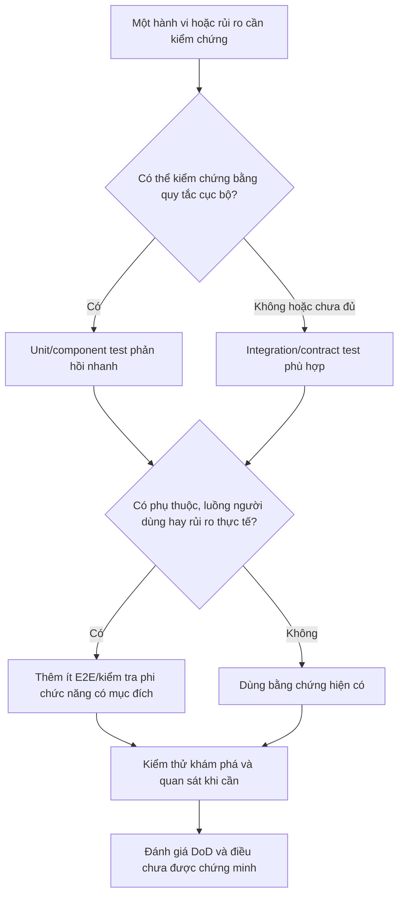
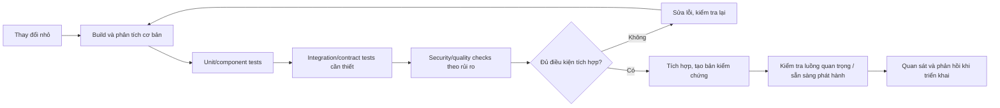

# Đưa kiểm thử vào từng phần tăng trưởng

## Mục tiêu học tập

Sau bài học này, bạn có thể:

- Giải thích vì sao **mỗi phần tăng trưởng của sản phẩm** phải được kiểm chứng về hành vi, tích hợp và chất lượng, thay vì đợi tới một “giai đoạn kiểm thử cuối dự án”.
- Phân biệt **Increment trong Scrum**, **lát giá trị dọc (vertical slice)**, **Product Backlog Item (PBI)**, **tiêu chí chấp nhận (acceptance criteria)** và **Definition of Done (DoD)**.
- Tổ chức kiểm thử xuyên suốt từ **làm rõ nhu cầu → thiết kế ví dụ → viết mã → tích hợp → giao phần mềm → nhận phản hồi**.
- Chọn kiểm tra phù hợp ở các tầng **unit, component, API/integration, contract, end-to-end** cùng kiểm thử khám phá và phi chức năng, không chạy theo tỷ lệ test cố định một cách máy móc.
- Thực hành **TDD, ví dụ Given–When–Then và cộng tác ba góc nhìn** để làm rõ hành vi sớm và giảm lỗi hồi quy.
- Xây dựng một đường phản hồi **CI** có kiểm thử tự động, dữ liệu và môi trường kiểm thử tin cậy; giải thích vai trò của **regression testing, feature flags và quan sát sau phát hành**.
- Áp dụng vào nền tảng học trực tuyến: giao dần luồng **xem khóa → ghi danh → mở bài → tiếp tục học**, mỗi phần đều có kiểm chứng và đủ chất lượng.
- Nhận diện các dấu hiệu chất lượng bị đẩy về cuối và đề xuất một cải tiến nhỏ có thể đánh giá bằng bằng chứng.

## 1. Giao tăng dần không có nghĩa kiểm thử tăng dần về sau

Giả sử đội phát triển nền tảng học trực tuyến định giao ba lát công việc:

1. Xem thông tin khóa học Java.
2. Ghi danh khóa miễn phí.
3. Mở bài học đầu tiên với quyền truy cập hợp lệ.

Một kế hoạch kém an toàn thường là: Sprint đầu làm giao diện, Sprint sau làm API, Sprint tiếp theo tích hợp, rồi cuối tháng mới “đưa qua QA”. Trong thời gian đó, đội có thể báo **80% code xong**, nhưng học viên vẫn chưa thực hiện được một hành trình hữu dụng nào.

Cách làm tăng dần có chất lượng đặt câu hỏi khác:

> **Sau mỗi lát tăng trưởng, phần nào của sản phẩm đã thực sự hoạt động, được kiểm chứng và có thể kết hợp an toàn với những phần trước đó?**

Ví dụ:

- Sau lát 1, học viên xem danh sách và thông tin khóa; luồng này đã được tích hợp, kiểm chứng hiển thị, quyền và dữ liệu phù hợp.
- Sau lát 2, học viên có thể ghi danh khóa miễn phí theo các quy tắc đã chốt; các kiểm thử của lát 1 **vẫn phải qua**.
- Sau lát 3, học viên đã ghi danh mở được bài riêng; người chưa ghi danh **không được truy cập trái phép**. Không chỉ kiểm thử chức năng mới mà còn kiểm chứng hành trình xuyên suốt từ bước đầu.

Điều này yêu cầu **kiểm thử đi cùng từng lát tăng trưởng**, không phải một lô công việc độc lập xuất hiện khi các lập trình viên đã “xong phần mình”.

### 1.1. Vì sao phát hiện lỗi sớm có lợi?

Nếu quy tắc ghi danh sai được phát hiện lúc Product Owner và Developers đang trao đổi ví dụ, chi phí sửa có thể chỉ là làm rõ một câu. Nếu phát hiện sau khi API, giao diện, dữ liệu và các dịch vụ phụ thuộc đã triển khai, nhóm có thể phải sửa nhiều thành phần, di trú trạng thái và kiểm tra lại các luồng cũ.

Không có công thức cố định rằng **lỗi phát hiện muộn luôn tốn gấp N lần**. Chi phí thực tế phụ thuộc loại lỗi, độ ghép cứng và khả năng kiểm thử. Nhưng **rút ngắn vòng phản hồi** giảm thời gian phần hiểu sai lan sang các quyết định tiếp theo.

### 1.2. Minh bạch về việc “đã xong”

Các trạng thái sau **không đồng nghĩa**:

| Phát biểu | Điều nó có thể chứng minh | Điều chưa chắc chứng minh |
| --- | --- | --- |
| “Đã viết xong mã.” | Có phần hiện thực ở một nhánh hoặc môi trường. | Đã tích hợp, không có lỗi hoặc có giá trị cho người dùng. |
| “Unit tests đã qua.” | Những kiểm tra đơn vị đã chạy thành công. | API, dữ liệu và hành trình người dùng đều đúng. |
| “QA đã xem giao diện.” | Một số trường hợp đã được con người kiểm tra. | Mọi điều kiện chấp nhận và DoD đã đạt. |
| “Pipeline xanh.” | Các bước trong pipeline đã chạy và đạt. | Tất cả rủi ro chưa được kiểm tra đều đã biến mất. |
| “Increment đạt DoD.” | Phần tăng trưởng đáp ứng chuẩn hoàn thành và chất lượng đã xác định. | Phần này nhất thiết đã được mở cho mọi người dùng. |
| “Đã phát hành.” | Thay đổi đã được đưa tới môi trường hoặc nhóm người dùng được chọn. | Tác động người dùng đúng như giả thuyết ban đầu. |

Một đội Agile có chất lượng liên tục cần **nói đúng trạng thái thực**, nhất là khi áp lực thời hạn khiến việc đánh dấu Done trở thành mục tiêu thay cho giá trị.

## 2. Increment, PBI, lát dọc và Definition of Done

### 2.1. Increment theo Scrum Guide

Theo **Scrum Guide 2020**, **Increment** là bước tiến cụ thể hướng tới Product Goal; nó cộng thêm vào những Increment trước, được kiểm chứng để các phần hoạt động cùng nhau và phải **hữu dụng**. Một Sprint có thể tạo ra nhiều Increment.

**Definition of Done (DoD)** là cam kết gắn với Increment: mô tả chính thức trạng thái của Increment khi đạt những thước đo chất lượng cần thiết cho sản phẩm. Một PBI chỉ đóng góp vào Increment khi đáp ứng DoD. Nếu chưa đạt, phần đó **không được coi là Increment Done** và cần quay lại Product Backlog để cân nhắc.

**Sprint Review không phải cổng phát hành bắt buộc**. Một Increment có thể được đưa tới người dùng trước Sprint Review khi đã đạt DoD và các yêu cầu phát hành áp dụng.

### 2.2. PBI không nhất thiết là một Increment độc lập về mọi mặt

**Product Backlog Item** là một hạng mục trong Product Backlog, có thể là khả năng sản phẩm, sửa lỗi, cải tiến hoặc công việc cần thiết khác. Một PBI có thể đóng góp một bước tăng trưởng; không nên mặc định một thẻ trên bảng đã chuyển cột thì sản phẩm có thêm một Increment đủ chất lượng.

**Lát giá trị dọc (vertical slice)** là một cách chia công việc đi qua các thành phần cần thiết như giao diện, logic, dữ liệu, bảo mật và kiểm thử để giao một kết quả có thể sử dụng/kiểm chứng. Đội có thể dùng cách chia này để có phản hồi sớm thay vì chia chỉ theo lớp kỹ thuật.

Ví dụ:

| Chia theo chuyên môn, chỉ hoàn tất một mảnh | Chia thành lát giá trị dọc |
| --- | --- |
| “Tạo tất cả bảng dữ liệu ghi danh.” | “Học viên đã đăng nhập ghi danh được **một khóa miễn phí còn chỗ**.” |
| “Làm mọi API quyền truy cập.” | “Học viên đã ghi danh **mở được bài đầu**, người chưa ghi danh bị từ chối.” |
| “Viết toàn bộ giao diện tiến độ.” | “Học viên **tiếp tục đúng bài dở** trên một thiết bị theo quy tắc đã chốt.” |

Lát dọc **không cho phép cắt bỏ chất lượng bắt buộc**. Một lát nhỏ vẫn cần quyền truy cập, xử lý dữ liệu và kiểm thử tương xứng rủi ro.

### 2.3. Acceptance criteria và DoD bổ sung cho nhau

- **Acceptance criteria:** quy tắc và kết quả **cụ thể của một PBI**, ví dụ “ghi danh trùng không tạo thêm bản ghi”.
- **DoD:** chuẩn chất lượng **chung cho Increment**, ví dụ “mã đã tích hợp, kiểm tra cần thiết đạt, quyền và dữ liệu được kiểm chứng theo rủi ro”.
- **Kiểm thử chấp nhận:** cách chứng minh các điều kiện nghiệp vụ đó bằng tình huống, dữ liệu và quan sát.

Có thể có **giao nhau**. Nếu một PBI về quyền truy cập có acceptance criteria “người chưa ghi danh không được mở bài”, trong khi DoD chung yêu cầu kiểm tra các ràng buộc bảo mật liên quan, một bộ kiểm thử có thể cung cấp bằng chứng cho **cả hai góc nhìn**.

> **Không được gọi một hạng mục là Done chỉ vì acceptance criteria chính đã qua trong môi trường riêng nhưng kiểm thử tích hợp hoặc yêu cầu DoD vẫn còn thiếu.**

## 3. Kiểm thử nên bắt đầu trước khi lập trình

Một đội có thể giảm nhiều lỗi bằng cách thảo luận **“đúng là gì?”** trước khi viết mã. Điều này phù hợp với Agile và các thực hành như **Acceptance Test-Driven Development (ATDD), Example Mapping và Behavior-Driven Development (BDD)** khi áp dụng đúng mục đích.

### 3.1. Cộng tác ba góc nhìn

Một buổi trao đổi ngắn có thể gồm:

1. **Góc nhìn sản phẩm:** người dùng cần kết quả gì; quy tắc nào có giá trị?
2. **Góc nhìn phát triển:** dữ liệu, trạng thái, ranh giới, phụ thuộc và lỗi kỹ thuật có thể xảy ra?
3. **Góc nhìn kiểm thử/chất lượng:** trường hợp thông thường, bất thường, biên và rủi ro nào cần chứng minh?

Ví dụ PBI:

> “Là học viên đã đăng nhập, tôi muốn ghi danh khóa Java miễn phí còn mở để bắt đầu học.”

Các câu hỏi giúp hiểu đúng:

- Ghi danh có cho phép **cùng người bấm hai lần**?
- Có giới hạn sức chứa không? Ai giành **chỗ cuối** khi hai yêu cầu đến đồng thời?
- Người chưa đăng nhập có được ghi danh không?
- “Ghi danh thành công” có đồng nghĩa **được mở bài ngay**?
- Nếu lưu ghi danh thành công nhưng cấp quyền thất bại thì xử lý nhất quán thế nào?
- Một học viên có thể đã ghi danh nhưng trạng thái bị hủy không?

Những câu hỏi này giúp người có thẩm quyền nghiệp vụ chốt điều cần biết, đồng thời chỉ ra rủi ro kỹ thuật cần có kiểm thử sớm.

### 3.2. Dùng ví dụ để khép khoảng cách hiểu biết

Một bảng ví dụ ngắn:

| Trường hợp | Trạng thái ban đầu | Hành động | Kết quả mong đợi |
| --- | --- | --- | --- |
| **Thành công** | Học viên hợp lệ, chưa ghi danh, khóa mở và còn chỗ. | Xác nhận ghi danh. | Có đúng một ghi danh hợp lệ và phản hồi thành công. |
| **Gửi lại** | Học viên đã ghi danh. | Gửi lại yêu cầu. | Không tạo bản ghi trùng; trả trạng thái phù hợp. |
| **Khóa đã đủ chỗ** | Khóa hết chỗ theo quy tắc đã chốt. | Yêu cầu ghi danh mới. | Không ghi danh vượt sức chứa; giải thích rõ. |
| **Chưa xác thực** | Chưa có danh tính người học đáng tin. | Gửi yêu cầu. | Không ghi danh trái phép; yêu cầu xác thực thích hợp. |
| **Chỗ cuối đồng thời** | Còn đúng một chỗ, hai yêu cầu hợp lệ. | Gửi gần đồng thời. | Không vượt sức chứa; kết quả nhất quán. |
| **Trạng thái không nhất quán** | Ghi danh lưu được, quyền xem bài chưa cấp đúng. | Thử mở bài. | Phát hiện sai lệch, xử lý theo cơ chế đã thiết kế; không báo thành công giả. |

Bảng là **bộ ví dụ giảng dạy**, chưa thay thế quyết định sản phẩm. Phải xác nhận quy tắc về sức chứa, cấp quyền và tính nhất quán trước khi biến thành test có thể chạy.

### 3.3. Viết ví dụ theo Given–When–Then

```gherkin
Feature: Ghi danh khóa miễn phí

  Scenario: Học viên ghi danh thành công
    Given Lan đã đăng nhập và chưa ghi danh khóa "Java nhập môn"
    And khóa đang mở ghi danh và còn chỗ
    When Lan xác nhận ghi danh
    Then hệ thống ghi nhận đúng một lượt ghi danh hợp lệ
    And Lan nhận được phản hồi thành công

  Scenario: Yêu cầu ghi danh được gửi lại
    Given Lan đã có ghi danh hợp lệ cho khóa "Java nhập môn"
    When Lan gửi lại yêu cầu ghi danh
    Then hệ thống không tạo thêm lượt ghi danh
    And Lan thấy trạng thái đã ghi danh

  Scenario: Học viên không được ghi danh khi khóa đã đủ chỗ
    Given Nam đã đăng nhập và chưa ghi danh khóa "Java nhập môn"
    And khóa đã đủ chỗ theo quy tắc nghiệp vụ
    When Nam xác nhận ghi danh
    Then hệ thống không ghi danh mới cho Nam
    And Nam được thông báo khóa đã hết chỗ
```

**Gherkin là ngôn ngữ để mô tả ví dụ**, không tự tạo kiểm thử có thể chạy nếu thiếu các bước ánh xạ, dữ liệu, môi trường và kiểm chứng. BDD cũng **không đồng nghĩa chỉ viết Given–When–Then**; giá trị cốt lõi là **cùng khám phá và hiểu hành vi**.

## 4. Đưa kiểm thử vào vòng đời của từng PBI

Một chiến lược có thể bắt đầu từ **thời điểm làm rõ yêu cầu** và tiếp tục tới khi nhận phản hồi sau triển khai.

| Thời điểm | Hoạt động kiểm chứng | Kết quả hữu ích |
| --- | --- | --- |
| **Refinement/khám phá** | Hỏi quy tắc, tạo ví dụ đúng/sai, nhận diện rủi ro và phụ thuộc. | Acceptance criteria đủ rõ, giả định được gắn nhãn. |
| **Lập kế hoạch lát tăng trưởng** | Xác định đường đi chính, ngoại lệ, tầng test, dữ liệu và môi trường. | Kế hoạch có khả năng tạo Increment đạt DoD. |
| **Thiết kế và viết mã** | Unit/component tests, TDD khi phù hợp, review logic và bảo mật. | Phản hồi kỹ thuật nhanh, hạn chế lỗi cục bộ. |
| **Tích hợp sớm** | API/integration/contract tests, kiểm chứng schema và tương tác thật. | Không để mã riêng lẻ “xanh” nhưng toàn hệ thống lỗi. |
| **Hoàn tất lát** | Acceptance/end-to-end tests chọn lọc, exploratory testing, phi chức năng theo rủi ro. | Hành trình người dùng hoạt động, điều kiện DoD đạt. |
| **Trước phát hành** | Kiểm tra chính sách chất lượng, cấu hình, dữ liệu, rollback/roll-forward, khả năng quan sát. | Có cơ sở đưa thay đổi tới người dùng an toàn. |
| **Sau phát hành** | Theo dõi lỗi, hành vi thực, hiệu năng, cảnh báo và phản hồi. | Biết giả thuyết giá trị đúng đến đâu và có vấn đề mới không. |

**Không phải mọi hạng mục đều phải chạy mọi loại test với cùng một mức độ.** Điều quan trọng là **căn cứ rủi ro**, tính đồng bộ với DoD và cách phát hiện lỗi đủ sớm.

### 4.1. Chất lượng được đưa vào kế hoạch như công việc thật

Khi Developers chọn PBI, công việc cần tính tới:

- Làm rõ ví dụ và dữ liệu nghiệp vụ.
- Viết/sửa kiểm thử.
- Tạo hoặc điều chỉnh mã.
- Tích hợp và xử lý ràng buộc.
- Kiểm tra quyền và dữ liệu liên quan.
- Hoàn tất tài liệu, quan sát và khả năng vận hành nếu DoD yêu cầu.

Nếu lập kế hoạch chỉ theo thời gian **gõ mã**, rồi giả định kiểm thử sẽ do “đội QA khác” thực hiện sau, kế hoạch có nguy cơ tạo hàng đợi, Increment chưa hoàn thành và báo cáo tiến độ sai.

### 4.2. Không đợi đủ toàn bộ hệ thống mới kiểm tra

Một điểm mạnh của lát dọc là **mỗi phần tự chứng minh một hành vi hữu dụng**. Nhưng tích hợp tăng dần cũng yêu cầu mỗi lần thêm hành vi mới **không phá hành vi đã giao**.

Ví dụ sau khi thêm “Ghi danh”, nhóm phải tiếp tục kiểm tra “Xem khóa”. Sau khi thêm “Mở bài”, nhóm vẫn kiểm tra cả “Xem khóa” và “Ghi danh” — bằng các kiểm thử hồi quy ở tầng phù hợp, không nhất thiết bằng cách chạy toàn bộ hành trình UI thủ công cho mỗi commit.

## 5. Chiến lược nhiều tầng kiểm thử: phản hồi nhanh và đủ thực tế

Không có một tỷ lệ “70% unit, 20% integration, 10% UI” bắt buộc cho mọi sản phẩm. **Testing pyramid** thường gợi ý có nhiều kiểm thử nhỏ, nhanh và ít kiểm thử xuyên hệ thống nhưng có giá trị cao. Những cấu trúc khác, như **testing trophy** hoặc **testing honeycomb**, có thể hữu ích tùy kiến trúc và rủi ro.

Hãy chọn **độ tin cậy cần đạt với chi phí và thời gian phản hồi hợp lý**.

### 5.1. Các tầng và mục đích khác nhau

| Tầng/loại kiểm thử | Câu hỏi chính | Ví dụ | Rủi ro nếu dùng sai |
| --- | --- | --- | --- |
| **Unit** | Một quy tắc nhỏ hoạt động đúng các trường hợp? | Không cho ghi danh khi khóa đã đóng. | Mock quá nhiều, test phụ thuộc chi tiết triển khai. |
| **Component/module** | Một phần chức năng với vài phụ thuộc hoạt động đúng? | Service ghi danh xử lý trạng thái và lưu dữ liệu. | Dùng giả lập sai với cơ sở dữ liệu thật. |
| **API/integration** | Các thành phần, DB, queue hoặc dịch vụ phối hợp đúng? | Không tạo ghi danh trùng khi hai yêu cầu API đến cùng lúc. | Chỉ thử happy path, bỏ trường hợp retry và đồng thời. |
| **Contract** | Hai bên tích hợp hiểu cùng schema và ý nghĩa trường? | API quyền trả trạng thái đúng định nghĩa. | Contract đúng cú pháp nhưng nghiệp vụ vẫn sai. |
| **End-to-end (E2E)** | Một hành trình quan trọng hoạt động qua ranh giới thật? | Người học ghi danh rồi mở bài riêng. | Quá nhiều test dài, chậm, dễ flaky. |
| **Exploratory** | Có lỗi bất ngờ hoặc rủi ro chưa được mô hình hóa không? | Người dùng đổi tài khoản/đổi mạng khi mở bài. | Chỉ “bấm thử” mà không ghi mục tiêu và điều quan sát. |
| **Security/accessibility/performance** | Chất lượng phi chức năng đủ cho rủi ro hiện tại? | Không xem dữ liệu người khác, thao tác bằng bàn phím, tải phù hợp. | Chạy thủ tục tượng trưng mà bỏ rủi ro chính. |

**Một lỗi không nhất thiết cần được kiểm tra bằng mọi tầng.** Chọn tầng thấp nhất có thể chứng minh quy tắc, thêm tầng tích hợp/E2E khi cần chứng minh tương tác thực.

### 5.2. Sơ đồ lựa chọn kiểm thử



Sơ đồ là **cách đặt câu hỏi**, không phải thuật toán cứng. Một rủi ro về **tính nhất quán giao dịch đồng thời** có thể cần integration test sớm dù logic đơn vị trông rất đơn giản.

### 5.3. Tốc độ phản hồi cũng là thuộc tính của bộ test

Một bộ test chạy hàng giờ có thể khiến Developers ngại tích hợp thường xuyên. Nhưng bỏ hết test chậm để “pipeline xanh nhanh” sẽ làm giảm chất lượng.

Giải pháp có thể là:

- Chạy bộ kiểm thử nhỏ, đáng tin **ngay khi thay đổi**.
- Chạy integration/contract tests liên quan trên pull request hoặc khi tích hợp.
- Chạy bộ hồi quy lớn hơn theo chiến lược phù hợp, không trì hoãn phản hồi lỗi nghiêm trọng tới sau phát hành.
- Tối ưu test chậm, dữ liệu, môi trường và cách chạy song song khi có căn cứ.
- Phân loại rõ **quy tắc nào là quality gate bắt buộc** và quy tắc nào là phép đo/thăm dò bổ sung.

## 6. TDD giúp xây lát nhỏ có phản hồi nhanh

**Test-Driven Development (TDD)** là một thực hành XP nổi bật, thường được mô tả bằng vòng **Red → Green → Refactor**:

1. **Red:** viết test mô tả một hành vi nhỏ cần có, xem nó thất bại đúng lý do.
2. **Green:** viết lượng mã đủ để test qua, không xây tính năng tương lai chưa cần.
3. **Refactor:** cải thiện thiết kế bên trong mà không cố ý đổi hành vi đã được kiểm chứng.
4. Lặp lại, tích hợp sớm và cập nhật kiểm thử khi nghiệp vụ thay đổi có chủ đích.

TDD không tự thay acceptance criteria, exploratory testing hoặc kiểm tra tích hợp. Nó là **cơ chế phản hồi thiết kế và hành vi ở tầng thích hợp**.

### 6.1. Ví dụ Java 17 — quy tắc có được ghi danh không?

Giả sử nghiệp vụ đã chốt:

- Chỉ người đã xác thực mới ghi danh.
- Người đã ghi danh được trả trạng thái **ALREADY_ENROLLED**, không tạo thêm lượt.
- Khóa đóng từ chối lượt ghi danh mới.
- Khóa hết chỗ từ chối lượt mới.
- Không dùng số lượng âm hoặc sức chứa âm.

Ta bắt đầu với một **quyết định thuần túy**, chưa trực tiếp ghi DB:

```java
enum EnrollmentDecision {
    CAN_ENROLL,
    ALREADY_ENROLLED,
    UNAUTHENTICATED,
    CLOSED,
    FULL
}

final class EnrollmentPolicy {

    EnrollmentDecision evaluate(
            boolean authenticated,
            boolean alreadyEnrolled,
            boolean courseOpen,
            int capacity,
            int enrolledCount) {

        if (capacity < 0 || enrolledCount < 0) {
            throw new IllegalArgumentException("Invalid capacity or count");
        }
        if (!authenticated) {
            return EnrollmentDecision.UNAUTHENTICATED;
        }
        if (alreadyEnrolled) {
            return EnrollmentDecision.ALREADY_ENROLLED;
        }
        if (!courseOpen) {
            return EnrollmentDecision.CLOSED;
        }
        if (enrolledCount >= capacity) {
            return EnrollmentDecision.FULL;
        }
        return EnrollmentDecision.CAN_ENROLL;
    }
}
```

Một số ví dụ kiểm thử bằng **JUnit 5** (cần khai báo thư viện JUnit trong dự án):

```java
import static org.junit.jupiter.api.Assertions.assertEquals;
import static org.junit.jupiter.api.Assertions.assertThrows;
import org.junit.jupiter.api.Test;

class EnrollmentPolicyTest {
    private final EnrollmentPolicy policy = new EnrollmentPolicy();

    @Test
    void learnerCanEnrollWhenCourseIsOpenAndHasSpace() {
        assertEquals(
            EnrollmentDecision.CAN_ENROLL,
            policy.evaluate(true, false, true, 30, 29));
    }

    @Test
    void repeatRequestDoesNotCreateNewEnrollment() {
        assertEquals(
            EnrollmentDecision.ALREADY_ENROLLED,
            policy.evaluate(true, true, true, 30, 30));
    }

    @Test
    void courseAtCapacityRejectsNewEnrollment() {
        assertEquals(
            EnrollmentDecision.FULL,
            policy.evaluate(true, false, true, 30, 30));
    }

    @Test
    void unauthenticatedLearnerCannotEnroll() {
        assertEquals(
            EnrollmentDecision.UNAUTHENTICATED,
            policy.evaluate(false, false, true, 30, 1));
    }

    @Test
    void negativeCountsAreInvalid() {
        assertThrows(IllegalArgumentException.class,
            () -> policy.evaluate(true, false, true, 30, -1));
    }
}
```

Trong một phiên TDD thực tế, **test được viết và chạy trước khi hiện thực tương ứng**, rồi mã tăng từng bước. Tài liệu trình bày phiên bản đã hoàn chỉnh để người học dễ thấy quy tắc; đừng hiểu đây là thứ tự phải gõ toàn bộ production code rồi mới viết test.

### 6.2. Điều gì các unit test trên chưa chứng minh?

Hàm này **không lưu ghi danh** và không có tính nguyên tử với DB. Ngay cả khi test `enrolledCount == capacity - 1` qua, **hai yêu cầu song song** vẫn có thể cùng đọc trạng thái “còn một chỗ” rồi cùng ghi, vượt sức chứa.

Do đó cần thêm **integration test** cho thao tác thực sự ghi nhận lượt ghi danh với DB/transaction hoặc cơ chế kiểm soát đồng thời phù hợp. Cũng phải kiểm tra:

- Một học viên gửi hai yêu cầu đồng thời → không sinh hai bản ghi.
- Hai học viên tranh chỗ cuối → không vượt sức chứa.
- Request retry sau timeout → hệ thống xử lý idempotency theo chính sách.
- Quyền xem bài chỉ được cấp khi trạng thái ghi danh đã hợp lệ.
- Trường hợp DB không khả dụng → không báo thành công sai hoặc để dữ liệu trái quy tắc.

Đây là lý do **kiểm thử đơn vị tốt là cần thiết nhưng chưa đủ** để gọi cả Increment là Done.

## 7. Kiểm thử tích hợp và hợp đồng API theo từng phần tăng trưởng

Ở mức sản phẩm, lỗi thường xuất hiện **giữa các thành phần**:

- Frontend hiểu sai trạng thái `ALREADY_ENROLLED`.
- API ghi danh trả thành công nhưng DB chưa lưu đúng.
- Dịch vụ quyền mở bài đọc trạng thái ghi danh theo một nguồn dữ liệu chậm cập nhật.
- Người dùng chuyển tài khoản nhưng client vẫn giữ thông tin khóa học từ tài khoản cũ.
- Sự kiện cấp quyền được gửi lại hai lần và tạo trạng thái không nhất quán.

### 7.1. Kiểm thử ranh giới quan trọng

| Ranh giới | Ví dụ kiểm tra |
| --- | --- |
| **UI → API** | Trường lỗi, thông báo và trạng thái quyền được hiểu đúng. |
| **Service → DB** | Ghi danh không trùng, số chỗ không âm/vượt mức, transaction phù hợp. |
| **Service → hàng đợi/sự kiện** | Thông điệp lặp/chậm/không theo thứ tự được xử lý theo chiến lược đã xác định. |
| **Service → Service** | Hợp đồng dữ liệu và phiên bản API tương thích, lỗi ngoài được xử lý. |
| **Trạng thái → quyền truy cập** | Chỉ người có quyền hợp lệ ở thời điểm yêu cầu mới được mở nội dung riêng. |
| **Triển khai → schema** | Các phiên bản ứng dụng đang cùng chạy không làm hỏng dữ liệu. |

**Contract testing** giúp phát hiện hai phía hiểu khác nhau về giao diện, nhưng một hợp đồng đúng cú pháp **không thay việc kiểm chứng quy tắc nghiệp vụ thật**.

### 7.2. Không giả lập đến mức che mất rủi ro

Mock có giá trị trong unit test để kiểm soát phụ thuộc và chạy nhanh. Nhưng nếu mọi test đều mock DB, queue và dịch vụ quyền theo những phản hồi “lý tưởng”, đội có thể bỏ qua vấn đề **transaction, serialization, thời gian thực thi và đồng bộ dữ liệu**.

Một chiến lược cân bằng:

- Unit tests cho logic cục bộ.
- Integration tests với thành phần thật hoặc môi trường đủ tương đương cho **rủi ro có tương tác**.
- Contract tests cho giao diện có consumer riêng.
- Một số E2E/acceptance tests cho hành trình giá trị quan trọng.

Chọn mức độ gần production tương xứng với chi phí và rủi ro; không cần tái tạo toàn bộ môi trường sản xuất cho mỗi lần chạy unit test.

## 8. Kiểm thử hồi quy: phần tăng trưởng mới không được phá giá trị cũ

**Regression testing** tìm các sai lệch không mong muốn trong hành vi đã hoạt động trước đó sau khi thay đổi mã, cấu hình, dữ liệu hoặc tích hợp.

Ví dụ, khi thêm “khóa có phí”, một sửa đổi ở `LessonAccessPolicy` có thể vô tình chặn **khóa miễn phí** vốn đã chạy được. Kiểm thử hồi quy có thể bảo vệ hành vi cũ:

- Học viên đã ghi danh khóa miễn phí vẫn xem được bài riêng.
- Người chưa ghi danh vẫn bị từ chối.
- Gửi lại yêu cầu ghi danh không tạo bản ghi trùng.
- Trạng thái hoàn thành bài học đã có không bị mất.
- API cũ vẫn có dạng dữ liệu được hứa với client đang sử dụng.

### 8.1. Bản đồ phạm vi kiểm thử hồi quy

Một cách tổ chức theo thay đổi:

| Lát tăng trưởng | Kiểm thử tính năng mới | Phần hồi quy cần giữ |
| --- | --- | --- |
| **I1 — Xem khóa** | Khóa xuất hiện với thông tin và trạng thái đúng. | Các luồng xác thực/nền tảng có liên quan. |
| **I2 — Ghi danh** | Thành công, gửi lại, hết chỗ, chưa xác thực, đồng thời. | I1 và tích hợp xác thực. |
| **I3 — Mở bài** | Truy cập hợp lệ, từ chối trái quyền, xử lý lỗi. | I1, I2 và việc đổi tài khoản. |
| **I4 — Tiếp tục học** | Bài dở, chưa bắt đầu, mất quyền, dữ liệu không nhất quán. | I1–I3 và chức năng mở bài thông thường. |
| **I5 — Khóa có phí** | Xác nhận thanh toán, quyền theo chính sách mới, retry. | Ghi danh miễn phí, quyền mở bài và tiến độ cũ. |

Không nhất thiết chạy mọi trường hợp bằng UI. Một bộ hồi quy tốt kết hợp **test nhỏ nhanh** với **test tích hợp có trọng tâm**.

### 8.2. Thử nghiệm trên nhánh dài có thể làm phản hồi muộn

Nếu một tính năng lớn nằm trong nhánh riêng nhiều tuần, các thay đổi khác trong codebase khiến lúc hợp nhất phát sinh nhiều xung đột và lỗi. **Tích hợp thường xuyên**, thay đổi nhỏ, feature flag (khi phù hợp) và kiểm thử hồi quy liên tục có thể giảm rủi ro.

Feature flag **không thay bảo mật**, không cho phép để trạng thái dữ liệu sai hoặc bỏ qua DoD. Một tính năng đang tắt với người dùng chung vẫn cần được kiểm chứng theo chính sách để có thể tích hợp an toàn.

## 9. CI và Continuous Testing: tạo phản hồi tự động đáng tin

**Continuous Integration (CI)** giúp Developers tích hợp thay đổi thường xuyên và nhận phản hồi từ các kiểm tra tự động. **Continuous Testing** có thể hiểu là thiết kế hoạt động kiểm chứng chạy thường xuyên, xuyên suốt vòng đời và theo các sự kiện phù hợp, thay vì dồn thành một “đợt kiểm thử cuối”.

Cả hai không đồng nghĩa **tự động hóa mọi thứ**. Kiểm thử con người, quan sát sản phẩm, đánh giá bảo mật và đối thoại nghiệp vụ vẫn cần khi rủi ro đòi hỏi.

### 9.1. Pipeline CI minh họa



Đây là **ví dụ kiến trúc pipeline**, không phải thứ tự công cụ bắt buộc. Một số kiểm tra có thể chạy song song, một số chạy trước khi hợp nhất hoặc sau khi dựng môi trường. Bước nào là gate cần căn cứ vào **DoD, loại rủi ro và chính sách tổ chức**.

### 9.2. Khi pipeline đỏ, phải phản ứng thế nào?

Đội nên có chính sách rõ:

- **Không coi build lỗi là trạng thái bình thường kéo dài**.
- Xác định nguyên nhân lỗi thật hay kiểm thử flaky, ghi nhận và xử lý.
- Ưu tiên khôi phục khả năng tích hợp để các thay đổi sau có phản hồi đáng tin.
- Nếu một quality gate bắt buộc chưa đạt, **không đánh dấu Increment là Done** chỉ vì muốn chạy kịp.
- Không vô hiệu hóa test chỉ để làm xanh biểu đồ mà không có đánh giá rủi ro và quyết định được phép.

Trong một số trường hợp, hệ thống có thể phân biệt lỗi blocking và non-blocking theo chính sách đã được thống nhất; nhưng **non-blocking không có nghĩa vô hại** và cần được xem xét.

### 9.3. Continuous Delivery và Continuous Deployment khác nhau

- **Continuous Delivery:** giữ phần mềm ở trạng thái có thể phát hành thường xuyên, có các kiểm soát cần thiết.
- **Continuous Deployment:** tự động đưa những thay đổi đủ điều kiện tới production theo quy trình đã định.

Một Scrum Team có thể tạo **nhiều Increment trong Sprint** và phát hành khi phù hợp; không cần chờ Sprint Review. Nhưng “liên tục” không phải lý do bỏ quy trình phê duyệt bắt buộc hoặc triển khai khi chưa đủ an toàn.

## 10. Kiểm thử phi chức năng phải được tính từ lát nhỏ đầu tiên

Chất lượng không chỉ là **hành vi chức năng**. Một phần tăng trưởng có thể qua mọi happy path nhưng vẫn gây mất dữ liệu, lộ thông tin hoặc không sử dụng được với nhóm người dùng cần hỗ trợ truy cập.

### 10.1. Rủi ro bảo mật và riêng tư

Đối với nền tảng học:

- **Phân quyền:** người chưa ghi danh không được xem nội dung riêng bằng cách đoán URL.
- **Cách ly dữ liệu:** người dùng A không đọc/sửa tiến độ của người dùng B.
- **Xác thực:** không tin danh tính người dùng chỉ vì client tự gửi `learnerId`.
- **Xử lý dữ liệu:** hạn chế log thông tin nhạy cảm, bảo vệ token và trạng thái ghi danh theo chính sách.
- **Giao dịch:** không cấp quyền sai khi thanh toán chưa được xác nhận đáng tin.
- **Đầu vào:** kiểm tra các tham số và ranh giới dữ liệu ảnh hưởng hành vi.

Những kiểm tra này có thể cần **unit + integration + security tests** tùy tình huống. Nếu quyền truy cập thuộc rủi ro chính của sản phẩm, không thể “để Sprint sau kiểm thử bảo mật” rồi gọi lát hiện tại là Increment hữu dụng.

### 10.2. Accessibility và khả năng sử dụng

Một giao diện “Bắt đầu học” có thể chỉ thử bằng chuột trên màn hình lớn và bỏ qua:

- Điều hướng bàn phím.
- Tên/nhãn nút có thể được công cụ hỗ trợ truy cập hiểu.
- Trạng thái lỗi được thông báo rõ.
- Khả năng hiển thị và thao tác trên thiết bị nhỏ.
- Thông tin không chỉ được truyền đạt bằng màu sắc.

Nhóm cần chọn yêu cầu khả năng tiếp cận theo sản phẩm và tiêu chuẩn áp dụng (ví dụ **WCAG** nếu có yêu cầu), kiểm tra sớm với những thành phần UI mới thay vì đợi hoàn thành toàn bộ ứng dụng.

### 10.3. Hiệu năng và độ tin cậy

Nếu một thao tác ghi danh tạo truy vấn chậm, việc thêm nhiều khóa hoặc người dùng có thể khiến trải nghiệm xuống cấp. Kiểm chứng hiệu năng có thể gồm:

- Đo thời gian phản hồi trong điều kiện tải **được xác định rõ**, thay vì nói “nhanh”.
- Thử sức chứa và số lượng truy cập tương xứng với dự báo sản phẩm.
- Kiểm tra hành vi khi dịch vụ phụ thuộc phản hồi chậm hoặc không khả dụng.
- Đánh giá retry và idempotency khi yêu cầu có thể gửi lặp.
- Theo dõi lỗi và thời gian đáp ứng sau triển khai.

Không được tự đặt **một ngưỡng ms mang tính phổ quát** cho mọi dự án; các mục tiêu phải xuất phát từ nhu cầu thực, năng lực hệ thống và thỏa thuận chất lượng.

## 11. Kiểm thử khám phá vẫn có vai trò dù tự động hóa tốt

**Exploratory testing** kết hợp học về sản phẩm, thiết kế thử nghiệm và quan sát kết quả ngay trong lúc kiểm thử. Nó giúp tìm các lỗi mà bộ test đã mã hóa trước có thể bỏ qua.

### 11.1. Một phiên kiểm thử khám phá có mục tiêu

Ví dụ charter:

> **Trong phiên kiểm tra luồng “Tiếp tục học”, tìm lỗi khi người học đổi tài khoản, mất kết nối, mở hai tab hoặc đổi thiết bị, nhất là các trường hợp có thể làm lộ bài riêng hay ghi đè tiến độ.**

Người kiểm thử có thể:

1. Tạo dữ liệu cho hai tài khoản có quyền khác nhau.
2. Mở cùng khóa ở hai tab hoặc hai thiết bị.
3. Thay đổi thứ tự thao tác: mở bài, đánh dấu hoàn thành, quay về, đăng xuất.
4. Tạm ngắt mạng khi lưu tiến độ.
5. Ghi **điều quan sát được**, dữ liệu và bước tái hiện.
6. Chuyển lỗi quan trọng thành test tự động phù hợp khi có ích.

Một phiên khám phá tốt có **mục đích và ghi nhận rủi ro**, không phải “ngồi bấm ngẫu nhiên” rồi kết luận hệ thống ổn.

### 11.2. Khi nào nên tự động hóa lỗi vừa phát hiện?

Nếu một lỗi có nguy cơ tái phát và có thể tái hiện ổn định, nhóm thường nên tạo **regression test** ở tầng thích hợp. Không phải mọi phát hiện cần một E2E test dài; có thể một integration test nhỏ là đủ để bảo vệ quy tắc.

Nếu nguyên nhân liên quan **thiết kế khó kiểm thử**, đó cũng là tín hiệu cần xem lại kiến trúc hoặc ranh giới, không chỉ thêm testcase.

## 12. Dữ liệu và môi trường kiểm thử quyết định độ tin cậy

Một bài test có thể chạy xanh hoặc đỏ vì **dữ liệu thử không nhất quán**, môi trường bị dùng chung hoặc phụ thuộc bên ngoài thay đổi bất ngờ. Điều này làm giảm niềm tin của Developers vào hệ thống kiểm thử.

### 12.1. Nguồn gây test flaky

- Test phụ thuộc **thứ tự chạy**, tài khoản hoặc bản ghi từ test trước.
- Hai test cùng sửa một dữ liệu chung.
- Dùng **sleep cố định** thay vì chờ một điều kiện có giới hạn.
- Phụ thuộc thời gian thực, timezone hoặc bộ sinh dữ liệu không ổn định.
- Thao tác mạng ngoài bị chậm hoặc mất kết nối.
- Chạy song song nhưng không cách ly tài nguyên hoặc không giải phóng trạng thái.
- UI test dùng selector mong manh, thay đổi theo CSS mà không liên quan hành vi.

### 12.2. Cách cải thiện

| Vấn đề | Biện pháp khả thi |
| --- | --- |
| Dữ liệu bị dính giữa các test | Fixture độc lập, rollback giao dịch khi phù hợp, dọn dữ liệu được kiểm soát. |
| Test phụ thuộc đồng hồ | Dùng clock có thể điều khiển; xác định ranh giới thời gian. |
| API ngoài không ổn định | Unit/contract tests với giả lập thích hợp, thêm integration test có kiểm soát. |
| Chạy song song đụng tài nguyên | Không gian tên hoặc tài nguyên riêng, khóa hợp lý nếu cần. |
| E2E chậm và flaky | Giảm số E2E trùng lặp, sửa selector/chờ điều kiện, chuyển kiểm tra về tầng thấp khi hợp lý. |
| Dữ liệu nhạy cảm trong môi trường thử | Tạo dữ liệu tổng hợp, ẩn danh/masking theo chính sách, hạn chế quyền và log. |

Không sao chép dữ liệu thật của học viên vào môi trường kiểm thử mà **không có cơ sở và kiểm soát phù hợp**. Chất lượng không thể đánh đổi bằng việc vi phạm riêng tư.

### 12.3. Không “chữa” flaky test bằng cách bỏ qua vĩnh viễn

Nếu một test quan trọng liên tục không ổn định, đội cần:

1. Tái hiện, phân biệt lỗi ứng dụng và lỗi test.
2. Xác định nguyên nhân, sửa nguồn gây bất định.
3. Ghi và quản lý rủi ro nếu phải tạm cách ly test.
4. Có điều kiện và người chịu trách nhiệm **đưa kiểm chứng trở lại**.

Bỏ qua test mà không theo dõi làm **đứt vòng phản hồi**; tăng độ xanh giả tạo nhưng giảm tin cậy.

## 13. Kiểm thử cho từng Increment và việc phát hành

Có Increment **đạt DoD** chưa tự đồng nghĩa tính năng đã được mở cho toàn bộ người dùng. Tùy chính sách, nhóm có thể dùng phát hành từng phần, feature flags, canary hoặc triển khai nhiều đợt để **giảm tác động rủi ro**.

### 13.1. Một chiến lược theo lớp

1. **Trước tích hợp:** mã và kiểm thử thay đổi đáp ứng các điều kiện cần thiết.
2. **Khi tích hợp:** unit/integration/contract tests và các cổng chất lượng phù hợp.
3. **Trước mở tính năng:** các kiểm tra E2E, quyền, dữ liệu, cấu hình và phương án khôi phục cần thiết.
4. **Trong rollout có kiểm soát:** quan sát lỗi, thời gian phản hồi và hành vi theo nhóm người dùng.
5. **Sau rollout:** xem dữ liệu, phản hồi, sự cố và điều cần cải thiện cho Increment tiếp.

Nếu feature flag dùng để **ẩn tính năng chưa sẵn sàng** trong một bản triển khai nội bộ, nhóm phải phân biệt rõ **mã đã tích hợp an toàn** với **tính năng đã đáp ứng DoD của Increment muốn tuyên bố hoàn thành**. Flag không tự giải quyết test thiếu và không thay kiểm soát quyền ở backend.

### 13.2. Ví dụ lỗi sau khi phát hành

Nhóm mở “Tiếp tục học” cho một nhóm học viên và phát hiện:

- Người dùng đổi thiết bị đôi khi mở sai bài.
- API trả sai tiến độ khi hai lần lưu diễn ra gần nhau.
- Sau khi đăng xuất, trình duyệt vẫn hiển thị tiêu đề bài riêng trong bộ nhớ đệm.

Đội cần phản ứng theo mức rủi ro: hạn chế tác động, khắc phục lỗi, đánh giá dữ liệu và quyền, thêm kiểm thử tái hiện phù hợp, học từ sự cố. **Phản hồi sau phát hành bổ sung cho kiểm thử trước phát hành**, không hợp thức hóa việc bỏ qua kiểm soát bắt buộc từ đầu.

## 14. Trách nhiệm chất lượng trong Scrum Team và cách phối hợp

### 14.1. Developers cùng chịu trách nhiệm tạo Increment hữu dụng

Trong **Scrum Guide 2020**, Developers là những người chịu trách nhiệm tạo các khía cạnh của Increment hữu dụng mỗi Sprint, bao gồm giữ chất lượng bằng cách **tuân thủ Definition of Done**.

Từ “Developers” trong Scrum **không chỉ là người viết mã**. Người làm kiểm thử, UX, phân tích, dữ liệu hoặc vận hành có thể thuộc Developers nếu trực tiếp tham gia tạo Increment.

Điều này không có nghĩa mọi người phải có **cùng mức chuyên môn kiểm thử**. Nó nghĩa chất lượng **không phải công đoạn bàn giao mà Developers khác có thể bỏ mặc**.

### 14.2. Product Owner và Scrum Master đóng góp thế nào?

| Trách nhiệm | Đóng góp vào chất lượng từng Increment | Không nên hiểu thành |
| --- | --- | --- |
| **Product Owner** | Làm rõ giá trị, thứ tự Product Backlog, quy tắc nghiệp vụ và các đánh đổi phạm vi theo mục tiêu. | Có quyền tự hạ DoD để “chấp nhận tạm” phần mềm chưa đủ chất lượng. |
| **Developers** | Thiết kế, triển khai, tích hợp, kiểm thử và tạo Increment đáp ứng DoD; tự quản cách phối hợp. | Chỉ viết mã rồi chờ một người QA “làm chất lượng”. |
| **Scrum Master** | Hỗ trợ đội hiểu Scrum, cải thiện hiệu quả, tháo trở ngại tổ chức ảnh hưởng việc tạo Increment. | Người phân task hoặc người duy nhất chịu trách nhiệm sửa mọi lỗi. |
| **Stakeholders / người dùng** | Đưa phản hồi và xác nhận kết quả sử dụng, giới hạn và rủi ro nghiệp vụ. | Thay thế toàn bộ trách nhiệm kiểm chứng kỹ thuật và chất lượng. |

Nếu tổ chức có **DoD tối thiểu**, Scrum Team phải tuân thủ. Khi nhiều Scrum Team cùng làm một sản phẩm, họ phải **cùng xác định và tuân thủ DoD chung**. Acceptance criteria có thể khác từng PBI, nhưng **nghĩa của Done cho một sản phẩm phải minh bạch**.

### 14.3. Không tạo “mini-waterfall” trong Sprint

Một anti-pattern:

```text
Ngày 1–5: Business Analyst làm rõ toàn bộ
Ngày 6–9: Developers viết mã
Ngày 10: QA kiểm thử toàn bộ
Ngày 11: sửa lỗi dồn lại
Ngày 12: tích hợp
Ngày 13: Sprint Review
```

Nếu sai lệch chỉ lộ vào những ngày cuối, rủi ro Sprint Goal và DoD tăng. Một hướng cộng tác phù hợp hơn:

- Người hiểu sản phẩm, kỹ thuật và kiểm thử cùng làm rõ hạng mục sớm.
- Developers làm **lát nhỏ xuyên suốt**, tích hợp và kiểm chứng trong ngày khi phù hợp.
- Khi xuất hiện lỗi, phối hợp sửa ngay thay vì chuyển thẻ qua lại giữa nhiều hàng đợi.
- Daily Scrum kiểm tra tiến độ tới Sprint Goal và điều chỉnh Sprint Backlog.
- Sprint Review nhận phản hồi trên **Increment thực**, không trên bản trình diễn tạm che lỗi.

## 15. Tình huống xuyên suốt: bốn phần tăng trưởng của nền tảng học trực tuyến

Giả sử Product Goal là:

> **Học viên có thể tự tìm một khóa Java, ghi danh và tiếp tục học với quyền truy cập, dữ liệu tiến độ đáng tin cậy.**

Nhóm chọn cách giao các **lát giá trị dọc**. Các mốc I1–I4 dưới đây minh họa **thứ tự học và triển khai**, không phải quy tắc bắt buộc phải bằng một Sprint hoặc một release cho mỗi lát.

### 15.1. Bản đồ các lát và kiểm thử

| Increment minh họa | Giá trị cho người học | Kiểm thử chức năng và tích hợp | Chất lượng cần bảo vệ |
| --- | --- | --- | --- |
| **I1 — Xem khóa** | Xem thông tin khóa Java và trạng thái mở ghi danh. | Danh sách, chi tiết khóa, dữ liệu rỗng, xử lý khóa không tồn tại. | Không lộ nội dung riêng, hiển thị phù hợp, hành vi lỗi rõ. |
| **I2 — Ghi danh miễn phí** | Ghi danh hợp lệ và nhận phản hồi đúng. | Đã ghi danh, hết chỗ, chưa đăng nhập, đồng thời, lưu dữ liệu. | Không ghi trùng/vượt chỗ, quyền và dữ liệu nhất quán. |
| **I3 — Mở bài đầu** | Người đã ghi danh mở được nội dung riêng. | E2E ghi danh → mở bài; test quyền hợp lệ/không hợp lệ. | Không truy cập trái phép, hồi quy I1–I2 qua. |
| **I4 — Tiếp tục học** | Quay lại đúng bài dở sau khi rời khóa. | Có bài dở, chưa có bài dở, nhiều tab, quyền hết hạn. | Không ghi đè tiến độ, không lộ dữ liệu, hồi quy I1–I3 qua. |

Ở mỗi lát, nhóm cần cân nhắc **một DoD chung đủ rõ**. Các kiểm tra cụ thể khác nhau theo rủi ro, nhưng không được gọi I2 đã Done nếu lưu dữ liệu sai, hoặc gọi I3 đã Done nếu người chưa ghi danh vẫn mở được bài riêng.

### 15.2. Kịch bản xuyên suốt quan trọng

Một kiểm thử cấp hành trình có thể diễn đạt:

```gherkin
Feature: Hành trình học viên mới bắt đầu học

  Scenario: Ghi danh rồi mở được bài đầu
    Given Lan đã đăng nhập và chưa ghi danh khóa "Java nhập môn"
    And khóa đang mở và còn chỗ
    When Lan ghi danh thành công vào khóa
    And Lan chọn mở bài học đầu tiên
    Then Lan xem được nội dung bài riêng theo đúng quyền

  Scenario: Tài khoản khác không sử dụng quyền của Lan
    Given Lan đã ghi danh hợp lệ vào khóa "Java nhập môn"
    And Nam đã đăng nhập nhưng chưa ghi danh khóa đó
    When Nam yêu cầu mở bài riêng qua đường dẫn cũ của Lan
    Then hệ thống từ chối hiển thị nội dung riêng cho Nam
```

Đây là **những kịch bản tiêu biểu**, không phải toàn bộ bộ test. Nhiều điều kiện như sức chứa, kết nối mạng, quyền sau hủy ghi danh hoặc tính đồng thời nên được kiểm chứng ở tầng thấp/tích hợp nếu hiệu quả hơn.

### 15.3. Khi nào một lát đủ nhỏ?

Một lát tốt thường:

- Có **giá trị hoặc giả thuyết học hỏi rõ**.
- Có phạm vi và acceptance criteria có thể kiểm chứng.
- Đi qua các thành phần cần thiết để tạo kết quả thực.
- Không cần **giấu việc kiểm thử bắt buộc** sang lát khác.
- Có rủi ro và phụ thuộc đủ rõ để đưa vào kế hoạch.
- Được kết hợp với phần sản phẩm trước đó và có thể đáp ứng DoD.

Nếu “làm toàn bộ hệ thống tiến độ” quá lớn, đội có thể giao **“lưu và mở lại một bài đang học dở trên cùng thiết bị”** trước, miễn quy tắc lựa chọn không làm mất dữ liệu hoặc tạo quyền sai và phù hợp mục tiêu sản phẩm.

### 15.4. Nếu không hoàn tất lát trong một Sprint?

Không sửa nhãn trạng thái để báo Done. Trong Scrum, một PBI chưa đáp ứng DoD **không đóng góp vào Increment hoàn thành**. Scrum Team minh bạch phần đã làm, nguyên nhân chưa đạt, tác động tới Sprint Goal và kế hoạch tiếp theo. Product Owner xem xét thứ tự Product Backlog; Developers cải tiến cách chia lát và kiểm thử.

**Mục tiêu không phải hoàn tất mọi thẻ theo dự kiến ban đầu, mà là giao giá trị thật và học kịp thời mà vẫn giữ chất lượng.**

## 16. Đo lường chất lượng liên tục mà không chạy theo “số test”

Đo lường hỗ trợ đội phát hiện vấn đề hệ thống và kiểm tra hiệu quả cải tiến, không dùng để xếp hạng cá nhân.

| Nhóm tín hiệu | Câu hỏi thực tế | Ví dụ |
| --- | --- | --- |
| **Bằng chứng Done** | Các PBI/Increment có thật sự đạt DoD không? | Số phần còn thiếu kiểm chứng bắt buộc ở cuối Sprint. |
| **Thời gian phản hồi** | Developer biết lỗi sau thay đổi nhanh đến đâu? | Thời gian pipeline trả kết quả hữu ích. |
| **Độ tin cậy kiểm thử** | Có tin kết quả xanh/đỏ không? | Tỷ lệ flaky test, số lần phải chạy lại không có sửa mã. |
| **Lỗi lọt ra** | Có lỗi nghiêm trọng phát hiện sau khi đã giao không? | Lỗi truy cập, mất dữ liệu, sự cố hồi quy. |
| **Công việc làm lại** | Có phải sửa nhiều vì hiểu sai yêu cầu hoặc tích hợp muộn? | Số hạng mục quay lại vì lỗi phát hiện cuối luồng. |
| **Flow** | Việc đang làm có bị chặn ở kiểm thử hoặc tích hợp không? | Work item age, cycle time, WIP. |
| **Outcome người học** | Phần mềm đúng kỹ thuật có giúp người dùng không? | Tỷ lệ ghi danh thành công, quay lại bài dở, hoàn thành khóa. |

### 16.1. Không diễn giải chỉ số tùy tiện

Ví dụ trong hai giai đoạn thử nghiệm tương đối giống nhau:

| Tín hiệu giả định | Trước cải tiến | Sau cải tiến |
| --- | ---: | ---: |
| Thời gian phản hồi pipeline ở nhánh chính | 45 phút | 12 phút |
| Số PBI bị chặn tại kiểm thử quá 3 ngày trong kỳ | 7 | 3 |
| Số lỗi phân quyền nghiêm trọng lọt production trong kỳ | 2 | 1 |
| Cycle time trung vị của các PBI tương tự | 10 ngày lịch | 7 ngày lịch |

Những con số này **chỉ minh họa**. Không đủ để kết luận việc giảm thời gian pipeline **là nguyên nhân duy nhất** khiến cycle time giảm hoặc lỗi ít hơn. Cần kiểm tra loại PBI, kích thước mẫu, năng lực đội, định nghĩa chỉ số và các thay đổi khác.

Tương tự:

- **Code coverage cao** không bảo đảm bộ test kiểm tra đúng hành vi hay rủi ro.
- **Nhiều test** không đồng nghĩa phát hiện lỗi tốt hơn.
- **Không có bug báo cáo** có thể là do chưa có người dùng đủ nhiều hoặc thiếu khả năng quan sát.
- **Throughput tăng** không có nghĩa chất lượng và giá trị cũng tăng.

### 16.2. Theo dõi rủi ro còn lại

Một cách ghi ngắn gọn trước khi xem xét DoD:

```text
Increment/PBI: Ghi danh khóa miễn phí

Đã kiểm chứng:
- Quy tắc ghi danh thông thường và gửi lại yêu cầu.
- API + DB tích hợp theo môi trường kiểm chứng.
- Người chưa ghi danh không được mở bài riêng.
- Các kiểm tra hồi quy liên quan đều đạt.

Chưa kiểm chứng hoặc rủi ro:
- Tranh chấp chỗ cuối khi hai request đồng thời.
- Retry sau timeout trong tình huống DB lỗi.

Quyết định:
- Nếu các kiểm tra này là điều kiện DoD/rủi ro bắt buộc,
  chưa gọi PBI là Done; bổ sung kiểm tra và xử lý.
- Nếu có một giả định chưa rõ, làm rõ với người có thẩm quyền,
  điều chỉnh kế hoạch và phạm vi minh bạch.
```

Đây là **mẫu thảo luận**, không phải DoD mặc định cho mọi dự án. Đừng lấy việc ghi “đã biết rủi ro” làm lý do bỏ qua điều kiện chất lượng bắt buộc.

## 17. Sai lầm thường gặp khi kiểm thử các phần tăng trưởng

### Sai lầm 1 — “Bản đầu chỉ là MVP, chưa cần kiểm thử kỹ”

Một MVP có thể nhỏ để học nhanh, nhưng không được vi phạm quyền truy cập, mất dữ liệu hoặc gây tác động không an toàn. **Phạm vi chức năng có thể nhỏ; chuẩn chất lượng cần thiết vẫn phải đạt.**

**Khắc phục:** chọn lát nhỏ có giá trị và kiểm chứng theo rủi ro ngay từ đầu.

### Sai lầm 2 — Chia Sprint theo phòng ban: backend trước, QA sau

Các phần không được tích hợp, phản hồi lỗi dồn vào cuối. Cả đội báo bận nhưng chưa có Increment hữu dụng.

**Khắc phục:** tổ chức theo lát giá trị, phối hợp kiểm thử cùng Developers, hoàn thành từng luồng nhỏ.

### Sai lầm 3 — Acceptance criteria được viết sau khi đã code xong

Lúc này tiêu chí dễ trở thành bản mô tả hành vi **đã hiện thực**, không phải hành vi **người dùng thực sự cần**.

**Khắc phục:** thảo luận ví dụ sớm, làm rõ phản ví dụ và cập nhật khi có bằng chứng mới.

### Sai lầm 4 — Unit tests xanh nên bỏ qua integration tests

Lỗi phân quyền, giao dịch đồng thời và trạng thái DB thường nằm ở **ranh giới**. Test pure function không chứng minh cơ sở dữ liệu xử lý giao dịch đúng.

**Khắc phục:** thêm integration/contract tests có trọng tâm vào rủi ro tương tác.

### Sai lầm 5 — Viết quá nhiều E2E tests

Bộ UI tests dài, dễ flaky và chạy chậm khiến vòng phản hồi suy giảm.

**Khắc phục:** giữ một số E2E cho hành trình trọng yếu, kiểm chứng nhiều quy tắc ở unit/component/API khi phù hợp.

### Sai lầm 6 — QA là “người gác cổng” duy nhất

Developers đẩy trách nhiệm chất lượng cho một người kiểm thử, tiếp tục mở việc mới dù hàng đợi kiểm thử tăng.

**Khắc phục:** Developers cùng chịu trách nhiệm Increment; người có chuyên môn kiểm thử giúp đội thiết kế chiến lược, dữ liệu và khám phá rủi ro, không gánh hết chất lượng một mình.

### Sai lầm 7 — Bỏ qua test flaky để pipeline xanh

Số liệu CI trông đẹp nhưng Developers mất thông tin đáng tin về lỗi.

**Khắc phục:** sửa nguyên nhân bất định, giới hạn và quản lý việc cách ly test nếu thật sự cần.

### Sai lầm 8 — Chỉ kiểm tra hành vi thông thường

Luồng ghi danh thành công chạy được, nhưng gửi lặp, tranh chỗ cuối hoặc người dùng khác truy cập URL cũ gây lỗi nghiêm trọng.

**Khắc phục:** làm rõ trường hợp biên và rủi ro ngay trong refinement; chọn tầng test đúng.

### Sai lầm 9 — Tính mọi việc “code complete” là Increment Done

Nếu DoD còn thiếu kiểm tra bắt buộc, hạng mục chưa hoàn thành theo Scrum, dù lập trình viên hoặc Product Owner muốn báo tiến độ đẹp.

**Khắc phục:** giữ ngôn ngữ trạng thái minh bạch, kế hoạch hoàn tất chất lượng, không hạ DoD trong Sprint để né lỗi.

### Sai lầm 10 — Chỉ đo số test và code coverage

Một đội có thể đạt coverage cao nhưng không có test quyền truy cập hoặc dữ liệu đồng thời.

**Khắc phục:** kết hợp bằng chứng về hành vi, chất lượng, lỗi lọt, flow và outcome; dùng coverage như công cụ phát hiện chỗ thiếu, không phải đích cuối.

### Sai lầm 11 — Mỗi Increment kiểm thử riêng nhưng không kiểm thử chung

I2 qua test riêng, I3 cũng qua test riêng, nhưng hệ thống sau khi ghép lại không hoạt động.

**Khắc phục:** mỗi Increment phải được xác minh **hoạt động cùng những Increment trước**; duy trì kiểm thử tích hợp và hồi quy liên quan.

### Sai lầm 12 — Chỉ xem lỗi ở Sprint Review hoặc sau production

Nhóm chờ một buổi trình diễn mới thấy vấn đề tích hợp, thiếu dữ liệu và sai quy tắc.

**Khắc phục:** kiểm tra nhiều lần trong ngày/các vòng phát triển ngắn; Sprint Review để xem sản phẩm và bối cảnh, **không phải điểm kiểm thử đầu tiên**.

## 18. Bài tập thực hành

### Bài tập A — Thiết kế bộ kiểm thử cho một lát tăng trưởng

PBI:

> “Là học viên đã đăng nhập, tôi muốn ghi danh khóa Java miễn phí còn mở để học ngay.”

Hãy tạo:

1. **Sáu acceptance criteria** có kết quả quan sát được: trường hợp thường, gửi lại, hết chỗ, chưa đăng nhập, tranh chỗ cuối và một lỗi dữ liệu.
2. **Bốn unit test** cho các quy tắc cục bộ.
3. **Hai integration tests** liên quan DB hoặc giao dịch đồng thời.
4. **Một E2E test** cho hành trình ghi danh → mở bài.
5. **Hai kiểm tra phi chức năng** liên quan quyền và dữ liệu.
6. Một bảng mô tả **điều gì thuộc DoD chung**, điều gì thuộc tiêu chí riêng của PBI.

**Gợi ý:** tránh đẩy mọi trường hợp vào E2E. Nếu sức chứa hoặc idempotency còn mơ hồ, cần đánh dấu là giả định và nhờ xác nhận trước khi khóa kết quả test.

### Bài tập B — Phân biệt test của từng Increment và hồi quy

Đội đã giao:

- **I1:** xem khóa.
- **I2:** ghi danh miễn phí.
- **I3:** mở bài riêng.

Đội sắp thêm **I4: tiếp tục bài đang học dở**.

Hãy trả lời:

1. Hành vi mới nào của I4 cần kiểm chứng?
2. Những trường hợp nào của I1–I3 phải tiếp tục hoạt động?
3. Có thể để test nào ở tầng unit, tầng API/integration và tầng E2E?
4. Nếu bài dở được lưu trên hai thiết bị, rủi ro mới nào xuất hiện?
5. Nếu DoD chưa đạt vì test quyền thất bại, trạng thái I4 phải được báo thế nào?

**Định hướng:** kiểm thử mới và hồi quy phải bổ sung nhau; chỉ gọi Increment Done khi đạt các điều kiện chất lượng áp dụng.

### Bài tập C — Đọc một pipeline CI

Pipeline có:

```text
Build: PASS
Unit tests: PASS
Integration tests: FAIL (duplicate enrollment)
UI smoke test: PASS
Security permission check: NOT RUN
```

Trả lời:

1. Có thể kết luận Increment ghi danh đã Done không? Vì sao?
2. Vì sao UI smoke test xanh không phủ định lỗi integration?
3. Nhóm nên kiểm tra nguyên nhân duplicate enrollment ở đâu?
4. Bước nào cần được chạy lại sau khi sửa?
5. Điều gì cần được thay đổi trong pipeline hoặc DoD nếu kiểm tra quyền là điều kiện bắt buộc nhưng không được thực thi?

**Gợi ý:** một kiểm tra bắt buộc thất bại hoặc chưa chạy không thể bị che bằng các kiểm tra khác xanh. Phải đánh giá trạng thái thật và xử lý trước khi báo Done.

### Bài tập D — Thiết kế một phiên kiểm thử khám phá

Tình huống: học viên có thể **tiếp tục bài đang dở** trên nhiều thiết bị.

Hãy viết một **test charter** gồm:

- Mục tiêu khám phá.
- Bối cảnh/dữ liệu đầu vào.
- Tối thiểu năm biến thể thao tác (đổi tài khoản, mất mạng, hai tab, hai thiết bị, quyền hết hạn).
- Cách ghi lỗi tái hiện.
- Rủi ro bảo mật hoặc dữ liệu cần theo dõi.
- Một kiểm thử hồi quy tự động bạn sẽ bổ sung nếu phát hiện lỗi thật.

Đừng chỉ ghi “kiểm thử tất cả trường hợp”; hãy nêu **tại sao các tình huống đã chọn có nguy cơ**.

### Bài tập E — Cải thiện một đội bị tắc ở khâu kiểm thử

Một Scrum Team có Sprint hai tuần. Cuối Sprint, Developers báo xong 12 PBI về mặt mã, nhưng chỉ ba PBI đạt DoD vì phần lớn chưa kiểm thử tích hợp.

Hãy đề xuất kế hoạch thử trong vài Sprint:

1. Vấn đề và nguyên nhân cần xác minh.
2. Cách chia **lát dọc** và giảm công việc đang làm (WIP).
3. Cách tổ chức cộng tác giữa người hiểu sản phẩm, Developers và người kiểm thử.
4. Những test nên chạy sớm hơn và cách cải thiện CI.
5. Cách bảo vệ Sprint Goal và DoD.
6. Thước đo **flow, chất lượng và outcome** để đánh giá.
7. Điều kiện để giữ, chỉnh hoặc dừng thử nghiệm.

**Định hướng:** giảm WIP và kiểm thử sớm có thể giúp hoàn tất nhiều phần chất lượng hơn, nhưng phải kiểm chứng bằng dữ liệu; không đánh giá thành công chỉ bằng số thẻ chuyển trạng thái.

### Bài tập F — Đánh giá dữ liệu chất lượng không vội kết luận

Trong một kỳ thử nghiệm, nhóm báo:

- Pipeline trả kết quả nhanh hơn.
- Cycle time trung vị giảm.
- Số test tự động tăng gần gấp đôi.
- Một lỗi phân quyền nghiêm trọng vẫn lọt production.
- Tỷ lệ học viên hoàn thành khóa không thay đổi rõ.

Hãy phân tích:

1. Điều gì **có dấu hiệu cải thiện**?
2. Điều gì **chưa được chứng minh** về chất lượng và giá trị?
3. Lỗi phân quyền gợi thiếu kiểm chứng ở tầng nào hoặc trong quy tắc nào?
4. Vì sao số test gấp đôi không đủ để nói chất lượng gấp đôi?
5. Cần thêm dữ liệu và thí nghiệm tiếp theo nào?

### Bảng tự kiểm tra

| Câu hỏi | Biểu hiện hiểu đúng |
| --- | --- |
| Kiểm thử đi cùng từng phần tăng trưởng là gì? | Mỗi lát có bằng chứng hành vi, tích hợp, chất lượng và hồi quy liên quan. |
| Increment khác code hoàn thành thế nào? | Phải hữu dụng, hoạt động với phần trước, đáp ứng DoD. |
| Acceptance criteria khác DoD ra sao? | Một cái theo hạng mục, một cái là cam kết chất lượng gắn với Increment. |
| Unit test có thay integration test không? | Không; các ranh giới DB/API/quyền cần kiểm chứng tương xứng rủi ro. |
| CI xanh bảo đảm hết lỗi không? | Không; chỉ các điều đã được kiểm tra và qua. |
| Có cần exploratory testing không? | Có thể rất cần để tìm rủi ro chưa được mô tả trong test tự động. |
| Kiểm thử phi chức năng bắt đầu khi nào? | Từ lúc nhận diện rủi ro ở lát đầu, không mặc định để cuối dự án. |
| Ai chịu trách nhiệm chất lượng trong Scrum? | Developers cùng chịu trách nhiệm tạo Increment đáp ứng DoD. |
| Đo cải tiến bằng gì? | Bằng chứng Done, thời gian phản hồi, lỗi lọt, flow và outcome; không chỉ số test. |

## 19. Ghi nhớ cốt lõi

1. **Kiểm thử là một phần của mỗi Increment**, không phải giai đoạn tách khỏi phát triển. Lát nhỏ cần **đúng hành vi, đủ chất lượng, tích hợp được và không phá phần trước**.
2. **Acceptance criteria** giúp hiểu điều PBI phải làm; **Definition of Done** giúp mọi người hiểu mức chất lượng mà Increment phải đạt. Chúng bổ sung nhau và có thể dùng chung bằng chứng kiểm chứng.
3. **Làm rõ ví dụ sớm** với các góc nhìn sản phẩm, phát triển và kiểm thử giúp giảm hiểu sai trước khi mã xuất hiện.
4. **Unit, component, integration, contract, E2E, exploratory và các kiểm tra phi chức năng** phục vụ rủi ro khác nhau; chọn tầng phù hợp, không chạy theo công thức tỷ lệ test cố định.
5. **TDD và CI** rút ngắn vòng phản hồi kỹ thuật, nhưng không thay kiểm tra hành trình người dùng, quyền, dữ liệu hoặc phát hiện rủi ro mới.
6. **Regression testing** bảo vệ giá trị đã có khi mỗi lát mới được tích hợp. Sự tăng trưởng của hệ thống không được làm những Increment trước ngừng hoạt động.
7. **Dữ liệu và môi trường kiểm thử tin cậy** quan trọng không kém việc có nhiều test. Test flaky không được bị bỏ qua vô thời hạn để làm đẹp pipeline.
8. **Developers cùng chịu trách nhiệm chất lượng**; Product Owner góp phần làm rõ giá trị và quy tắc, Scrum Master giúp đội dùng Scrum hiệu quả, stakeholders cung cấp phản hồi.
9. **Phát hành và quan sát** bổ sung cho kiểm thử trước phát hành; không dùng production làm nơi duy nhất phát hiện các lỗi quyền/dữ liệu đã biết.
10. **Đo giá trị, chất lượng và flow cùng nhau** để thấy một cải tiến có thực sự hiệu quả hay chỉ làm tăng số lượng kiểm thử hoặc số thẻ Done.

Khi bắt đầu một lát tăng trưởng, hãy hỏi:

> **“Chúng ta sẽ dùng bằng chứng nào để chứng minh hành vi mới đúng, phần sản phẩm vẫn an toàn và các hành vi cũ tiếp tục hoạt động?”**

## Nguồn tham khảo

- [The Scrum Guide (2020)](https://scrumguides.org/scrum-guide.html) — Increment, Definition of Done, trách nhiệm Developers, sự kiện và cơ chế kiểm tra–thích nghi.
- [Manifesto for Agile Software Development](https://agilemanifesto.org/) và [Principles behind the Agile Manifesto](https://agilemanifesto.org/principles.html) — phần mềm hoạt động được, giao sớm và thường xuyên, chất lượng kỹ thuật và phản hồi.
- Kent Beck, *Test-Driven Development: By Example* (2002), Addison-Wesley — vòng Red–Green–Refactor và thiết kế có kiểm thử dẫn dắt.
- Kent Beck và Cynthia Andres, *Extreme Programming Explained: Embrace Change*, ấn bản thứ hai (2004), Addison-Wesley — TDD, CI, refactoring và các thực hành phát triển linh hoạt.
- Martin Fowler, [The Practical Test Pyramid](https://martinfowler.com/articles/practical-test-pyramid.html) — phân tầng kiểm thử và các đánh đổi trong tự động hóa.
- Martin Fowler, [Continuous Integration](https://martinfowler.com/articles/continuousIntegration.html) — tích hợp thường xuyên và kiểm tra tự động.
- [Cucumber — Gherkin Reference](https://cucumber.io/docs/gherkin/reference/) — mô tả ví dụ nghiệp vụ bằng Given–When–Then.
- [The Kanban Guide](https://kanbanguides.org/the-kanban-guide/) — WIP, cycle time, work item age và quản lý luồng công việc.
- [OWASP Web Security Testing Guide](https://owasp.org/www-project-web-security-testing-guide/) — tham khảo kiểm thử bảo mật ứng dụng web theo rủi ro.
- [W3C — Web Content Accessibility Guidelines (WCAG)](https://www.w3.org/WAI/standards-guidelines/wcag/) — tham khảo yêu cầu và kỹ thuật kiểm tra khả năng tiếp cận.
