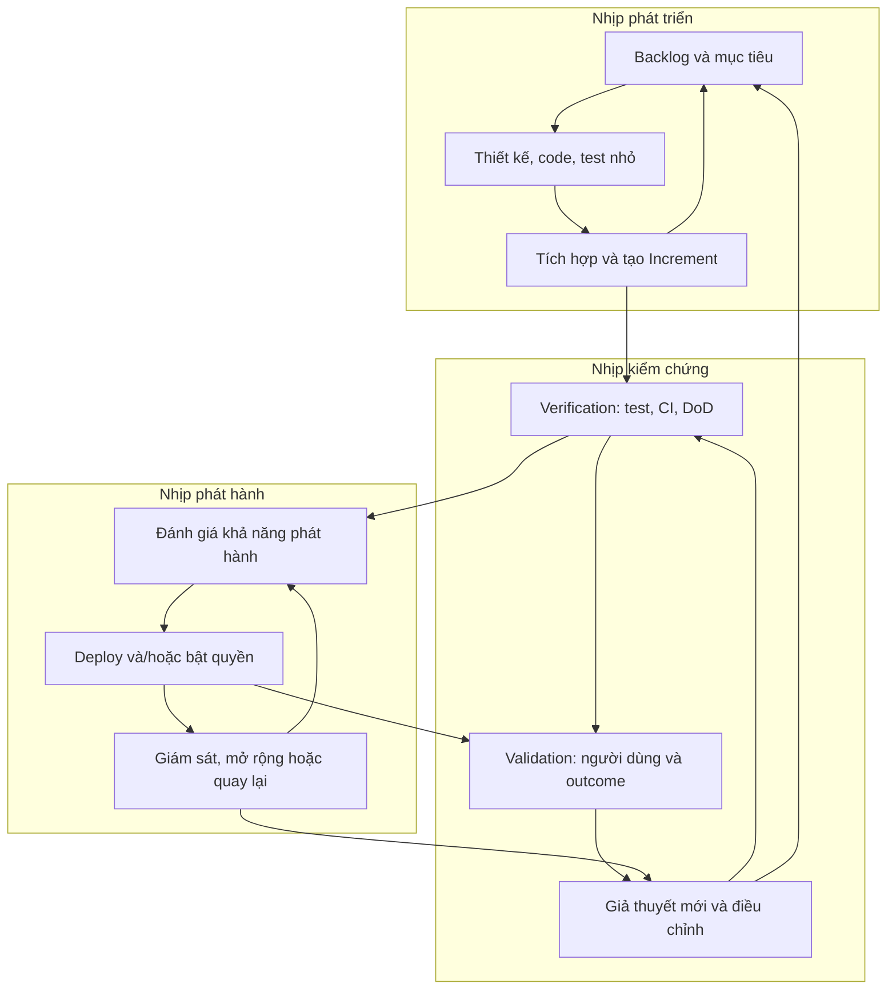
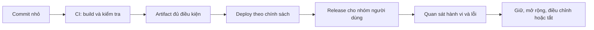
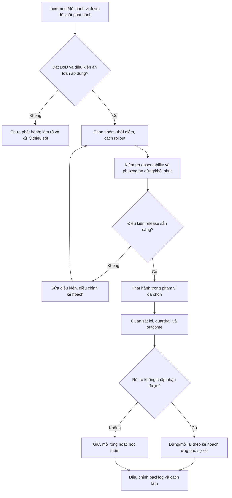

# Phân biệt nhịp phát triển, nhịp kiểm chứng và nhịp phát hành

Một Scrum Team làm nền tảng học trực tuyến có Sprint dài hai tuần. Đến Sprint Review, đội trình bày một tính năng **“Tiếp tục bài học đang dở”** đã đáp ứng Definition of Done. Nhưng doanh nghiệp muốn chỉ phát hành tính năng cho một nhóm học viên nhỏ vào tuần sau để theo dõi lỗi dữ liệu, và cần thêm một khoảng thời gian để quan sát liệu người dùng có học tiếp nhanh hơn hay không.

Có người nói: “Sprint kết thúc rồi thì phải phát hành ngay”. Người khác nói: “Chưa đủ dữ liệu người dùng thì chưa thể gọi công việc là Done”. Một người khác đề nghị chờ tới cuối quý để gom tất cả thay đổi, kể cả sửa lỗi nhỏ. Ba quan điểm ấy đang trộn lẫn **những hoạt động có mục tiêu và tần suất khác nhau**.

Trong Agile, cần phân biệt:

- **Nhịp phát triển (*development cadence*):** tần suất đội làm rõ công việc, thiết kế, viết mã, tích hợp và tạo phần sản phẩm mới.
- **Nhịp kiểm chứng (*verification/validation cadence*):** tần suất đội thu thập bằng chứng rằng phần mềm **đúng và đủ an toàn** (*verification*) và rằng giải pháp **thật sự giải quyết nhu cầu** (*validation*).
- **Nhịp phát hành (*release cadence*):** tần suất chức năng hoặc thay đổi được **cho phép tới tay một nhóm người sử dụng** theo điều kiện kinh doanh và an toàn.

Ba nhịp có liên hệ nhưng **không phải một chiếc đồng hồ duy nhất**. Đội có thể tích hợp mã nhiều lần mỗi ngày, kiểm thử tự động ngay khi có thay đổi, lấy phản hồi stakeholder mỗi hai tuần và phát hành có kiểm soát vài lần trong một tuần hoặc theo một lịch ít thường xuyên hơn. **Tần suất nào phù hợp phải dựa trên giá trị, rủi ro, năng lực kiểm chứng và giới hạn vận hành**, chứ không dựa trên một khẩu hiệu “càng nhanh càng Agile”.

Bài học thuộc chương **Phản hồi và phát hành** của mô-đun **AGILE_DEVELOPMENT**. Nó kết nối giá trị, nguyên tắc Agile với user story, Product Backlog, Scrum, Kanban, XP và đo lường dòng công việc: giao Increment nhỏ, kiểm tra và thích ứng qua bằng chứng, phát hành an toàn và học từ người sử dụng.

## 1. Mục tiêu học tập

Sau bài này, bạn có thể:

- Giải thích ba khái niệm **nhịp phát triển, nhịp kiểm chứng và nhịp phát hành** và vì sao chúng có thể vận hành độc lập tương đối.
- Phân biệt **verification** (“xây đúng theo điều kiện?”) và **validation** (“đang giải quyết đúng nhu cầu?”), không biến hai câu hỏi thành hai giai đoạn cứng.
- Phân biệt **code complete, integrated, tested, Done, Increment, deployed, released và outcome**.
- Mô tả mối quan hệ giữa **Sprint, Sprint Review, Sprint Goal, Increment, Definition of Done** và thời điểm phát hành theo *Scrum Guide 2020*.
- So sánh **Continuous Integration, Continuous Delivery và Continuous Deployment** ở mức khái niệm.
- Chọn nhịp kiểm tra tự động, phản hồi người dùng và phát hành theo **chi phí chậm trễ, rủi ro và mức độ bất định**.
- Thiết kế một lịch phối hợp nhiều tuần có **phát triển thường xuyên, kiểm chứng nhiều tầng và phát hành có điều kiện**.
- Lựa chọn cách phát hành theo giai đoạn như **feature flag, canary, rolling deployment hoặc blue–green** khi phù hợp và hiểu giới hạn của chúng.
- Theo dõi **WIP, cycle time, throughput, lead time for changes, lỗi hồi quy, khả năng phục hồi và outcome** mà không dùng số liệu để xếp hạng cá nhân.
- Nhận diện các anti-pattern như “Sprint Review là cổng cho phép phát hành”, “CI xanh đồng nghĩa Done”, “triển khai code nghĩa là tất cả người dùng đã thấy” hoặc “phải phát hành mọi PBI vào cuối Sprint”.
- Xây dựng phương án thực hành để vừa **nhận phản hồi sớm**, vừa giữ chất lượng và bảo vệ người dùng.

## 2. Trước hết: ba câu hỏi khác nhau

### 2.1. Nhịp phát triển hỏi “chúng ta tạo thay đổi mới khi nào?”

Các hoạt động có thể gồm:

1. Làm rõ vấn đề và lựa chọn từ backlog.
2. Trao đổi ví dụ nghiệp vụ với Product Owner hoặc người sử dụng.
3. Viết mã, kiểm thử, review, refactor.
4. Tích hợp thường xuyên vào dòng mã chung.
5. Hoàn tất lát cắt phần mềm đủ chất lượng để sử dụng.

Đội dùng Scrum có thể tổ chức công việc thành **Sprint không quá một tháng**. Đội theo Kanban có thể kéo việc liên tục dựa trên năng lực, chính sách và giới hạn WIP. Cả hai vẫn có thể viết và tích hợp mã nhiều lần mỗi ngày.

**Sprint là một nhịp lập kế hoạch và kiểm tra thích ứng, không phải đơn vị bắt buộc để đo số lần deploy.**

### 2.2. Nhịp kiểm chứng hỏi “chúng ta học được điều gì và nhanh tới đâu?”

Cần tách hai lớp:

- **Verification — kiểm tra tính đúng và sự phù hợp tiêu chuẩn:** phần mềm có đáp ứng hợp đồng, acceptance criteria, test, khả năng sử dụng và Definition of Done hay không?
- **Validation — kiểm chứng giả thuyết giá trị:** sau khi có giải pháp phù hợp để thử, người dùng có hoàn thành tác vụ tốt hơn? Kết quả có đáng đầu tư tiếp? Có tác dụng phụ không?

Một test chạy trong vài giây có thể trả lời câu hỏi về hàm xử lý dữ liệu. Một quan sát thực tế có thể diễn ra vài ngày sau khi một nhóm người dùng được tiếp cận tính năng. Hai loại bằng chứng có thể xuất hiện **ở nhiều điểm trong vòng phát triển**, không nhất thiết nối thành hai giai đoạn “test xong mới nói với người dùng”.

### 2.3. Nhịp phát hành hỏi “khi nào thay đổi được đưa đến người dùng?”

Phát hành là quyết định để một khả năng hoặc thay đổi được sử dụng bởi **nhóm đối tượng xác định**. Đội cần xét:

- Phần mềm đã đủ chất lượng và đủ an toàn trong phạm vi nào?
- Những người dùng nào có quyền nhìn thấy tính năng?
- Có yêu cầu phối hợp, thời điểm kinh doanh hoặc nghĩa vụ tuân thủ?
- Đã có theo dõi lỗi, giới hạn tác động và cách khôi phục phù hợp chưa?
- Có sẵn cách thu thập phản hồi sau phát hành không?

**Phát hành có thể thường xuyên hoặc theo lịch rõ ràng**. Điều cần tránh là chờ đợi không tạo giá trị hoặc phát hành quá nhanh khi không kiểm soát được rủi ro.

## 3. Bản đồ thuật ngữ: tránh gọi mọi thứ là “đã xong”

| Khái niệm | Bằng chứng/ý nghĩa | Không đồng nghĩa với |
| --- | --- | --- |
| **Code complete** | Một phần mã dự kiến đã được viết | Đã kiểm tra đầy đủ hoặc đã Done |
| **Integrated** | Thay đổi đã được tích hợp với dòng mã/hệ thống liên quan | Đã đáp ứng mọi tiêu chuẩn chất lượng |
| **Verified** | Một tập yêu cầu và kiểm tra xác định đã được xác nhận | Đã tạo giá trị thật cho người sử dụng |
| **Done theo Definition of Done** | Increment đáp ứng tiêu chuẩn chất lượng chính thức của sản phẩm | Đã phát hành cho tất cả người dùng |
| **Increment** | Bước tiến cụ thể đến Product Goal, sử dụng được, cộng dồn và đã kiểm chứng để hoạt động với các Increment trước | “Số ticket đã đóng” |
| **Build artifact** | Gói phần mềm/sản phẩm được hệ thống build tạo ra | Đã an toàn cho mọi điều kiện production |
| **Deployed** | Mã/gói được triển khai vào môi trường xác định | Chức năng đã được mở cho mọi người dùng |
| **Released** | Một thay đổi/khả năng được làm sẵn cho nhóm người dùng theo chính sách | Người dùng chắc chắn đã nhận được giá trị |
| **Validated** | Có bằng chứng về giả thuyết giải pháp/giá trị trong một phạm vi người dùng và bối cảnh | Đã chứng minh mọi tác động dài hạn |
| **Outcome** | Sự thay đổi quan sát được trong hành vi hoặc kết quả người dùng | Chỉ số output như số tính năng hoặc số PR |

Các từ **delivery, deployment, release** đôi khi được dùng khác nhau giữa các tổ chức. Để phối hợp, đội cần **định nghĩa rõ sự kiện, đối tượng và điều kiện** thay vì chỉ dựa vào nhãn trên công cụ.

### 3.1. Ví dụ về một Increment Done nhưng chưa released

Nhóm đã hoàn thành lát cắt “người học đăng nhập và tiếp tục bài trên cùng thiết bị”:

- Kiểm tra chức năng chính và các trường hợp biên đạt.
- Kiểm tra quyền truy cập với tài khoản A/B đạt.
- Mã tích hợp, Increment có thể sử dụng.
- DoD của sản phẩm đã được đáp ứng.

Tổ chức quyết định **chưa bật tính năng cho tất cả học viên**, vì muốn làm một đợt thử giới hạn trước. Việc chưa bật rộng rãi **không tự động phủ nhận trạng thái Done** của Increment. Quyết định phát hành và kiểm chứng outcome tiếp tục diễn ra sau đó.

### 3.2. Ví dụ về code đã deploy nhưng chưa phải tính năng released

Một ứng dụng có mã cho tính năng mới trong production nhưng feature flag đang tắt cho mọi người dùng. **Deployment đã xảy ra**; việc phát hành tính năng mới cho người dùng **chưa xảy ra**.

Tuy nhiên, chỉ có flag **không tự động chứng minh mã an toàn hoặc đạt DoD**. Mã vẫn có thể gây migration dữ liệu, tải nền, thay đổi cấu hình hoặc lỗi ngay cả khi giao diện bị ẩn. Cần kiểm tra những rủi ro thật.

## 4. Nhịp phát triển: thường xuyên tạo lát cắt có thể kiểm chứng

### 4.1. Trong Scrum, Sprint là khung chứa công việc

*Scrum Guide 2020* mô tả Sprint là sự kiện chứa các sự kiện khác, có độ dài cố định **một tháng hoặc ngắn hơn**. Trong Sprint:

- **Sprint Planning** làm rõ vì sao Sprint có giá trị, việc nào có thể hoàn tất và cách tiếp cận.
- **Daily Scrum** giúp Developers kiểm tra tiến độ hướng Sprint Goal và thích ứng kế hoạch.
- Developers cùng những người cần thiết làm rõ, thiết kế, triển khai, test và tích hợp.
- Có thể tạo **nhiều Increment**; Increment có thể được chuyển giao trước khi Sprint kết thúc.
- **Sprint Review** kiểm tra kết quả và khả năng thích ứng tiếp theo.
- **Sprint Retrospective** xem cách nâng cao chất lượng và hiệu quả.

Không có quy tắc “mỗi Sprint phải đúng một Increment” hoặc “chỉ được merge mã khi Sprint kết thúc”.

### 4.2. Trong Kanban, công việc có thể được kéo liên tục

Một nhóm không dùng Sprint vẫn có thể:

- Có một tập lựa chọn công việc được sắp thứ tự.
- Trực quan hóa từ “Ready” tới “Done”.
- Giới hạn WIP để khuyến khích hoàn tất trước khi mở thêm.
- Đo work item age, cycle time, throughput.
- Tổ chức các vòng phản hồi và review chính sách theo nhịp thích hợp.

**Nhịp phát triển liên tục không có nghĩa không có lịch họp hoặc không có mục tiêu.** Nó nghĩa là công việc được kéo theo năng lực và chính sách, không đợi cuối một timebox mới chuyển trạng thái.

### 4.3. Hạn chế lô công việc quá lớn

Nếu mỗi lần chỉ tích hợp một thay đổi lớn sau nhiều tuần, chi phí kiểm chứng và khắc phục có thể cao hơn:

- Khó xác định commit nào gây lỗi.
- Nhiều người đổi cùng một hợp đồng trong thời gian dài.
- Tính năng bị phụ thuộc vào nhau.
- Phản hồi người dùng tới muộn.
- Công việc dở dang tăng.

Có thể tạo lát cắt dọc nhỏ: “tiếp tục bài học trên cùng thiết bị” trước, rồi mới xem “đồng bộ hai thiết bị”, nếu mỗi lát cắt đủ giá trị và đáp ứng DoD. **Không tách thành “frontend Done” và “backend Done” để làm đẹp số ticket khi chưa có Increment sử dụng được**.

## 5. Nhịp kiểm chứng kỹ thuật: phản hồi sát lúc thay đổi

### 5.1. Các tầng phản hồi có tốc độ khác nhau

| Vòng | Thời điểm ví dụ | Câu hỏi kiểm tra | Bằng chứng |
| --- | --- | --- | --- |
| **Trong IDE/local** | Khi Developer sửa mã | Quy tắc nhỏ có đúng không? | Compile, unit test, formatter, static checks |
| **Trên PR/commit** | Mỗi khi gửi thay đổi | Các phần đã biết còn hoạt động chung không? | CI, kiểm thử tích hợp chọn lọc, code review |
| **Môi trường tích hợp** | Khi cần kiểm tra hệ thống thật | API, database, giao diện và cấu hình có tương thích? | Contract, integration và E2E tests |
| **Trước phát hành** | Theo rủi ro của release | Có đủ kiểm soát an toàn, dữ liệu và khả năng khôi phục? | Kiểm tra release readiness, quan sát, kế hoạch vận hành |
| **Sau phát hành** | Khi có người dùng thật | Có lỗi/độ trễ/tác dụng phụ mới không? | Log phù hợp, metrics, incident signals |

Không bắt buộc mọi thay đổi phải chạy toàn bộ E2E vài trăm phút tại local. Đội nên có **vòng nhanh cho lỗi phổ biến** và **vòng sâu hơn cho rủi ro cần kiểm chứng**, theo chính sách rõ.

### 5.2. Chạy test nhiều lần không đủ nếu test không đáng tin

Một test có thể xanh vì:

- Chỉ kiểm tra “happy path”.
- Dùng mock che chính phần tích hợp cần kiểm tra.
- Bỏ qua test phân quyền.
- Không chạy một số bộ test do cấu hình.
- Kết quả không gắn với đúng revision.
- Flaky test được rerun đến khi xanh.

**Nhịp kiểm chứng kỹ thuật phải đo cả độ tin cậy và phạm vi của bằng chứng**, không chỉ số lần chạy pipeline.

### 5.3. Bằng chứng chất lượng được thu thập dần

Không nhất thiết có một cổng “đến QA” duy nhất vào ngày cuối Sprint. Developers, người có chuyên môn kiểm thử, bảo mật và vận hành có thể cùng thiết kế điều kiện xác nhận ngay từ lúc refinement:

- Những hành vi nào người dùng cần?
- Trường hợp biên và thất bại nào quan trọng?
- Điều gì thuộc DoD?
- Test nào ở unit, API hoặc E2E phù hợp?
- Phần nào cần quan sát khi chạy thật?

**Kiểm chứng sớm là cách giảm rủi ro giao muộn**, không phải làm thủ tục test sớm hơn vài ngày mà vẫn dồn tích hợp cuối Sprint.

## 6. Nhịp kiểm chứng giá trị: học xem giải pháp có đúng nhu cầu

### 6.1. Verification khác Validation

Một cách ghi nhớ:

- **Verification:** “Chúng ta có xây phần mềm đúng với hành vi, tiêu chuẩn và ràng buộc đã biết không?”
- **Validation:** “Hành vi đó có thật sự giúp nhóm người dùng mục tiêu giải quyết vấn đề đáng quan tâm không?”

Ví dụ:

**Verification:** với tài khoản còn quyền, nhấp “Tiếp tục” mở đúng bài; tài khoản hết quyền không mở được bài; tiến độ không bị trộn giữa người học A/B.

**Validation:** những người thường quay lại khóa sau gián đoạn có **tìm được điểm học nhanh hơn**, bớt bỏ dở ở bước tìm bài và cảm thấy tiến độ đáng tin hơn không?

Một sản phẩm có thể **verified nhưng chưa validated** về giả thuyết giá trị. Hoặc có tín hiệu giá trị tích cực nhưng còn lỗi an toàn không chấp nhận được; khi đó không được lấy outcome để biện minh cho việc bỏ chuẩn chất lượng.

### 6.2. Validation diễn ra trước và sau khi có phần mềm

Đội có thể học trước khi xây lớn bằng:

- Phỏng vấn tình huống thật.
- Quan sát hành trình hiện tại.
- Prototype hoặc thử tác vụ với bản mẫu.
- Phân tích yêu cầu hỗ trợ, dữ liệu hành vi hợp lệ.
- Giới thiệu lát cắt nhỏ cho nhóm người dùng phù hợp.

Sau khi có Increment đạt DoD, đội có thể kiểm tra tiếp:

- Người dùng có nhận ra tính năng?
- Tác vụ có thành công?
- Thời gian thực hiện có giảm?
- Có tác dụng phụ về lỗi, độ tin cậy hoặc khả năng tiếp cận?
- Thay đổi có mang lại outcome đủ quan trọng để tiếp tục đầu tư?

**Validation không phải một buổi họp duy nhất và cũng không nhất thiết chờ đến lúc release rộng rãi**. Những phép thử khác nhau tạo bằng chứng ở những mức tin cậy khác nhau.

### 6.3. Nhịp học phụ thuộc độ trễ của outcome

Một thay đổi về tốc độ tìm bài có thể quan sát trong một phiên thử tác vụ. Một thay đổi về **tỷ lệ hoàn thành khóa học** có thể cần nhiều tuần hoặc tháng. Một tính năng kế toán theo quý có thể chỉ được sử dụng đúng một vài thời điểm trong năm.

Không nên kết luận “không có giá trị” chỉ vì sau một ngày chưa thấy outcome dài hạn. Ngược lại, không nên dùng câu “cần nhiều thời gian hơn” để kéo dài mãi một giả thuyết mà bằng chứng liên tục không ủng hộ.

**Chọn thời gian quan sát dựa trên cơ chế tạo giá trị và tần suất sử dụng thực tế.**

## 7. Nhịp phát hành: tách triển khai phần mềm khỏi mở khả năng cho người dùng

### 7.1. Deployment và Release không đồng nghĩa

- **Deployment:** chuyển một bản build/cấu hình vào một môi trường cụ thể, ví dụ production.
- **Release:** cho phép một nhóm người dùng hoặc khách hàng tiếp cận một khả năng/phiên bản theo quyết định của sản phẩm và vận hành.

Một số hệ thống **deployment đồng thời là release**, chẳng hạn website đơn giản mà mọi thay đổi tới production đều hiện với tất cả người dùng. Nhưng nhiều hệ thống có thể **tách hai sự kiện** nhờ cấu hình, feature flag, entitlement hoặc rollout theo nhóm.

### 7.2. Ví dụ ba trường hợp

| Trường hợp | Đã deploy? | Đã release tính năng mới? |
| --- | --- | --- |
| Đưa mã mới tới staging để chạy integration test | Có, ở staging | Chưa cho người dùng production |
| Đưa mã tới production nhưng flag tắt | Có | Chưa, nếu chức năng vẫn không khả dụng với người dùng |
| Bật flag cho nhóm 5% học viên đủ điều kiện | Có thể không có deployment mới ở thời điểm bật | Có, với nhóm 5% |
| Chỉ đổi nội dung cấu hình đang phục vụ người dùng | Có thể không deploy gói mã mới | Có thể là một release thay đổi hành vi |
| Gỡ một tính năng lỗi bằng kill switch | Có thể không deploy mã mới | Có thay đổi khả năng cung cấp tính năng |

Những trường hợp là **mô hình khái niệm**. Thực tế một flag tắt vẫn có thể ảnh hưởng thực thi, cơ sở dữ liệu hoặc chi phí; vì vậy phải kiểm tra cả **trạng thái khi bật lẫn khi tắt** ở mức phù hợp.

### 7.3. Nhịp phát hành tùy môi trường

Một website dịch vụ có thể phát hành thay đổi nhỏ nhiều lần mỗi ngày nếu kiểm chứng, giám sát và khả năng phục hồi tốt. Một ứng dụng di động có thể chịu lịch phê duyệt cửa hàng ứng dụng, độ trễ nâng phiên bản và nhu cầu tương thích giữa client/server. Hệ thống xử lý dữ liệu tài chính có thể cần khung giờ và trách nhiệm kiểm soát chặt hơn.

**Không có tần suất phát hành duy nhất “đúng chuẩn Agile” cho mọi sản phẩm.** Nguyên tắc cốt lõi là làm giảm thời gian từ học được nhu cầu đến tạo giá trị thực, trong khi rủi ro được kiểm soát.

## 8. Sơ đồ ba nhịp vận hành song song



Sơ đồ thể hiện **những vòng phản hồi tương tác**, không quy định mọi công việc phải đi qua đúng thứ tự. Validation có thể có **trước khi code**, verification có thể tiếp diễn sau triển khai, và một Increment Done có thể chưa được release.

### 8.1. So sánh trực tiếp

| Chiều | Phát triển | Kiểm chứng | Phát hành |
| --- | --- | --- | --- |
| **Mục đích** | Tạo thay đổi giá trị có thể dùng | Biết phần mềm có đúng/an toàn và giải pháp có ích | Đưa khả năng vào sử dụng trong điều kiện quản lý được |
| **Đơn vị thảo luận** | PBI, thay đổi mã, lát cắt, Increment | Assertion, hợp đồng, giả thuyết, bằng chứng, chỉ số | Phiên bản, nhóm người dùng, đợt rollout, release decision |
| **Nhịp minh họa** | Nhiều commit/ngày; Sprint hai tuần | Unit test/phút, CI/PR; nghiên cứu mỗi vài ngày; outcome theo hành vi | Theo nhu cầu và mức kiểm soát: hằng ngày, hằng tuần, định kỳ |
| **Ai cộng tác** | Developers, PO, chuyên gia liên quan | Developers, người kiểm thử, PO, UX, vận hành, người dùng | Người chịu trách nhiệm phát hành, vận hành, PO, bảo mật/tuân thủ khi cần |
| **Tín hiệu** | WIP, cycle time, Increment Done | Test result, lỗi, trải nghiệm, outcome | Sự cố, tác động rollout, khả năng khôi phục, mức sử dụng |
| **Rủi ro nếu gộp nhịp** | Chờ nhiều việc rồi mới tích hợp | Test muộn hoặc đánh đồng UI demo với giá trị | Phát hành dồn lô lớn hoặc mở tính năng chưa an toàn |

Tần suất trong bảng là **ví dụ**, không phải lịch bắt buộc theo Scrum, Kanban hoặc XP.

## 9. Scrum: Sprint Review không phải cổng phê duyệt release

### 9.1. Increment và Definition of Done

Theo *Scrum Guide 2020*, **Increment** là bước tiến cụ thể hướng Product Goal. Increment cộng dồn với các Increment trước, được kiểm chứng để bảo đảm chúng hoạt động cùng nhau và phải **có thể sử dụng**.

**Definition of Done** mô tả trạng thái Increment đáp ứng tiêu chuẩn chất lượng cần thiết. Khi một Product Backlog Item đáp ứng DoD, một Increment hình thành. **Một PBI chưa đáp ứng DoD không được tính vào Increment**; không được phát hành hoặc trình bày ở Sprint Review như phần đã hoàn thành, và phải trở lại Product Backlog để cân nhắc trong tương lai.

Điều này giữ ranh giới **chất lượng** rõ ràng ngay cả khi lịch phát hành thay đổi.

### 9.2. Nhiều Increment và giao trước cuối Sprint

Scrum Guide nêu:

- Nhiều Increment **có thể được tạo trong một Sprint**.
- Một Increment **có thể được chuyển giao cho stakeholder trước khi Sprint kết thúc**.
- **Sprint Review không nên bị xem là cổng cho phép phát hành giá trị**.

Vì vậy:

> **Sprint hai tuần không đồng nghĩa release hai tuần một lần.**

Đội có thể kết thúc một PBI đạt DoD vào ngày thứ tư, chuyển giao theo chính sách thích hợp và tiếp tục công việc khác. Họ không cần chờ Sprint Review mới được phép giao phần mềm đã hoàn tất. Đồng thời, một Increment Done có thể được giữ chưa mở cho người dùng vì quyết định rollout có cơ sở.

### 9.3. Sprint Review kiểm tra gì nếu đã release trước?

Sprint Review vẫn có giá trị:

- Xem Increment và tiến triển tới Product Goal.
- Thảo luận điều thay đổi ở môi trường sản phẩm.
- Kiểm tra phản hồi mới từ người sử dụng và stakeholder.
- Cùng xác định lựa chọn và điều chỉnh Product Backlog.
- Xem điều đã học từ các release trong Sprint.

**Release trước Sprint Review không làm Sprint Review vô dụng.** Nó còn giúp cuộc trao đổi dựa trên bằng chứng sử dụng thực, thay vì chỉ một bản demo trong môi trường trình diễn.

### 9.4. Sprint Retrospective làm gì với các nhịp?

Retrospective kiểm tra cách Scrum Team làm việc và lập kế hoạch nâng cao chất lượng, hiệu quả. Ví dụ:

- Vì sao tích hợp dồn cuối Sprint?
- Tại sao CI thường đỏ làm release chậm?
- Vì sao không có dữ liệu người dùng sau khi bật tính năng?
- Quy trình phê duyệt nào tạo hàng chờ không cần thiết?
- Điều gì làm rollback khó hoặc dữ liệu có nguy cơ?

Retrospective **không phải nơi PO chấp nhận hạ DoD để khớp lịch phát hành**. Đội tìm cải tiến ở cách chia lát cắt, kỹ thuật, phối hợp và kiểm soát rủi ro.

## 10. Scrum, Kanban và XP cho những nhịp khác nhau

### 10.1. Scrum tạo nhịp kiểm tra và thích ứng có timebox

Scrum hữu ích khi đội muốn có **Sprint Goal, kế hoạch tập trung, Product Goal và nhịp sự kiện chính thức**. Mỗi Sprint không phải gói phát hành bắt buộc. Tại bất kỳ thời điểm nào trong Sprint, Developers vẫn cần kiểm chứng phần mềm và có thể tạo Increment.

### 10.2. Kanban giúp quản lý luồng không phụ thuộc mốc release

Kanban có thể trực quan hóa:

```text
Options -> Ready -> In Progress -> Review -> Verification -> Done
                         WIP 2       WIP 2         WIP 2
```

Các cột và WIP limit là **ví dụ minh họa**, không phải sơ đồ bắt buộc.

Đội có thể kéo việc theo năng lực và đo:

- **WIP:** công việc đang xử lý song song.
- **Work item age:** thời gian một hạng mục chưa hoàn tất đã nằm trong luồng.
- **Cycle time:** thời gian từ mốc bắt đầu đến hoàn thành theo chính sách đo.
- **Throughput:** số hạng mục hoàn tất trong một khoảng thời gian.

Các tín hiệu này trả lời **dòng công việc đang trôi thế nào**, không tự nói phát hành có an toàn hoặc giải pháp có giá trị không. Một bảng Done đầy ticket chưa chắc người dùng đã nhận Increment.

### 10.3. XP cung cấp vòng phản hồi kỹ thuật nhỏ

Các thực hành **Extreme Programming** như TDD, Pair Programming, Continuous Integration, Refactoring, Collective Code Ownership và Small Releases giúp:

- Phản hồi về lỗi sớm khi thay đổi nhỏ.
- Chia sẻ hiểu biết và tránh phụ thuộc một tác giả.
- Giữ mã có khả năng thay đổi.
- Tích hợp thường xuyên, giảm lô thay đổi lớn.
- Hỗ trợ việc release thường xuyên khi đáp ứng điều kiện sản phẩm.

Không được đánh đồng **small releases** với “bật feature chưa kiểm chứng cho mọi người”. Nhỏ giúp giảm phạm vi rủi ro, nhưng chỉ có lợi khi chất lượng và khả năng theo dõi phù hợp.

## 11. Continuous Integration, Continuous Delivery và Continuous Deployment

Ba thuật ngữ này thường bị trộn lẫn khi bàn về “nhịp phát hành”.

| Thực hành | Trọng tâm | Tác động tới nhịp |
| --- | --- | --- |
| **Continuous Integration (CI)** | Tích hợp thay đổi thường xuyên, build/test tự động và xử lý lỗi tích hợp sớm | Rút ngắn vòng phát triển và verification |
| **Continuous Delivery** | Duy trì trạng thái phần mềm **có thể phát hành theo yêu cầu** nhờ quy trình kiểm chứng và triển khai đáng tin | Giảm chi phí và chờ giữa Done/ready và release; thời điểm phát hành có thể do con người quyết định |
| **Continuous Deployment** | Những thay đổi vượt qua pipeline và chính sách được **tự động đưa đến production** không cần phê duyệt thủ công từng lần | Deployment có thể theo nhịp thay đổi; release cho người dùng vẫn có thể được kiểm soát bằng flag |

**Continuous Delivery không bắt buộc tự động phát hành mọi thay đổi.** **Continuous Deployment** nói về tự động triển khai; tính năng có thực sự được bật cho người dùng hay không còn phụ thuộc cấu hình và cách hệ thống tách release khỏi deployment.

### 11.1. Chuỗi có thể xảy ra



Sơ đồ **không có nghĩa mọi chính sách đều kết thúc ở release tự động**. Giữa C, D và E có thể có các quyết định do con người, yêu cầu kiểm soát hoặc khung thời gian kinh doanh.

### 11.2. Bảo vệ dòng mã chung

Khi nhóm muốn tăng nhịp CI:

- Tích hợp thay đổi nhỏ thay vì giữ nhánh nhiều tuần.
- Có test nhanh tại local và CI.
- Phân biệt lỗi mã, lỗi môi trường và test flaky.
- Xử lý nhánh chính hỏng nhanh thay vì tiếp tục xây trên kết quả đỏ.
- Giữ cấu hình môi trường và dependency có thể tái hiện.
- Có review theo rủi ro mà không tạo hàng chờ không cần thiết.

**CI xanh chỉ xác nhận những kiểm tra được cấu hình đã đạt**. Nó không thay thế DoD, kiểm thử rủi ro ngoài pipeline, quyết định release hoặc validation của người dùng.

## 12. Phát hành an toàn bằng nhiều mức tiếp cận

### 12.1. Big bang và phát hành từng phần

Một **big-bang release** cho tất cả người dùng cùng lúc có thể đơn giản về mặt thông báo nhưng tăng **phạm vi ảnh hưởng** nếu lỗi xuất hiện. Phát hành từng phần cho phép:

- Quan sát nhóm nhỏ trước.
- Giới hạn số người bị tác động bởi lỗi.
- Điều chỉnh trước khi mở rộng.
- Thử giả thuyết giá trị trong điều kiện phù hợp.

Nhưng phát hành từng phần cũng tăng **độ phức tạp cấu hình, phân nhóm, hỗ trợ và kiểm chứng**. Không phải sản phẩm nào cũng cần mọi kỹ thuật rollout.

### 12.2. Một số kỹ thuật thường dùng

| Kỹ thuật | Ý tưởng chính | Cẩn trọng |
| --- | --- | --- |
| **Feature flag** | Bật/tắt khả năng theo cấu hình hoặc đối tượng | Mã tắt vẫn có thể ảnh hưởng hệ thống; flag cũ tạo nợ cấu hình |
| **Canary release** | Đưa thay đổi cho một nhóm nhỏ, quan sát trước khi mở rộng | Mẫu nhỏ có thể không đại diện; cần điều kiện dừng |
| **Rolling deployment** | Thay dần các instance chạy phần mềm | Các phiên bản cũ/mới cần tương thích trong khoảng giao nhau |
| **Blue–green deployment** | Duy trì hai môi trường/nhóm triển khai và chuyển lưu lượng | Dữ liệu chung, migration và chi phí môi trường có thể gây khó rollback |
| **Phased rollout** | Mở rộng nhóm người dùng theo các đợt | Cần công bằng, support và điều kiện tiến từng nấc |
| **Kill switch** | Tắt nhanh một hành vi gây rủi ro | Không thay thế khôi phục dữ liệu đã hỏng hoặc xử lý sự cố |

Không nên dùng rollout từng phần để **thử một tính năng vốn đã vi phạm điều kiện chất lượng tối thiểu**. Phát hành hạn chế không phải miễn trừ bảo mật hoặc quyền riêng tư.

### 12.3. Điều kiện nâng từ 5% lên 100%

Một phương án rollout minh họa có thể là:

1. Release cho 5% học viên đủ điều kiện và đã được chuẩn bị hỗ trợ phù hợp.
2. Quan sát tính đúng của tiến độ, lỗi phân quyền, độ trễ API và phản hồi sử dụng.
3. Kiểm tra ngưỡng cảnh báo do đội thống nhất trên baseline thực tế.
4. Nếu tín hiệu chấp nhận được, mở lên 25%, theo dõi tiếp.
5. Tiếp tục mở rộng hoặc dừng/điều chỉnh nếu có rủi ro.

**5% và 25% chỉ là ví dụ**, không phải ngưỡng tối ưu mặc định. Chọn kích thước nhóm theo số người đủ điều kiện, độ nhạy của tính năng, khả năng phát hiện lỗi và mức tác động nếu thất bại.

## 13. Feature flag: tách release khỏi deployment mà không bỏ chất lượng

### 13.1. Minh họa về hành vi

Một đoạn mã giả, **không phải mã triển khai có thể dùng ngay**:

```text
function resumeLesson(request):
    learner = authentication.verifiedIdentity(request)
    requirePermission(learner, request.courseId)

    if featureFlags.enabled("resume-v2", learner):
        return resumeV2(learner, request.courseId)

    return resumeV1(learner, request.courseId)
```

Điều quan trọng:

- **Danh tính phải đến từ cơ chế xác thực đáng tin**, không lấy một ID do client gửi rồi coi là đã kiểm chứng.
- Hai nhánh cũ/mới vẫn phải đáp ứng chất lượng và quyền truy cập áp dụng.
- Flag phải có định nghĩa đối tượng, chủ trách nhiệm và cách khôi phục.
- Kiểm thử cần bao gồm **flag bật và tắt** khi cả hai đường còn hoạt động.
- Nếu flag thay đổi dữ liệu hoặc schema, tắt flag có thể **không khôi phục trạng thái cũ**.

### 13.2. Đừng để flag tồn tại vô thời hạn

Feature flags cần vòng đời:

1. Tạo với mục đích và thời điểm xem lại.
2. Đặt mặc định an toàn.
3. Đo trạng thái thực và người dùng được áp dụng.
4. Bỏ nhánh cũ khi rollout hoàn tất và rủi ro đã được xử lý.
5. Xóa flag, test và cấu hình không còn dùng.

Nếu mỗi release bổ sung hai nhánh mà không loại nhánh cũ, tổ hợp trạng thái tăng lên và kiểm chứng trở nên tốn kém — chính nó là một dạng **nợ kỹ thuật trong cấu hình phát hành**.

### 13.3. Flag và dữ liệu cần kế hoạch riêng

Ví dụ version mới lưu tiến độ theo nhiều thiết bị vào bảng mới. Đội có thể tắt giao diện v2 nhưng không thể tự động “đảo ngược” những bản ghi đã được ghi theo schema mới.

Với thay đổi dữ liệu, cần kiểm tra **khả năng tương thích khi chạy song song, thứ tự migration, cách khôi phục, dữ liệu còn thiếu và quyền truy cập**. Khả năng tắt giao diện không đồng nghĩa khả năng rollback dữ liệu.

## 14. Điều kiện chất lượng trước release

Đội nên thống nhất các lớp điều kiện tương xứng rủi ro. Một bảng minh họa:

| Nhóm điều kiện | Câu hỏi | Ví dụ bằng chứng |
| --- | --- | --- |
| **DoD/Increment** | Phần sản phẩm đã đạt tiêu chuẩn chất lượng chính thức? | Test, review, tích hợp và điều kiện áp dụng đều đạt |
| **Bảo mật/dữ liệu** | Có nguy cơ truy cập sai, rò rỉ dữ liệu hoặc migration không thể phục hồi? | Kiểm tra phân quyền, dữ liệu thử, kế hoạch migration |
| **Tương thích** | Client cũ và phiên bản API mới có hoạt động trong khoảng chuyển đổi? | Contract/integration tests |
| **Khả năng quan sát** | Có nhận biết lỗi và tác động tới người dùng? | Metrics, log an toàn, alert, dashboard vận hành |
| **Khôi phục** | Có thể dừng rollout, tắt chức năng, rollback/fix forward theo tình huống? | Runbook/diễn tập phù hợp, người trực phụ trách |
| **Sẵn sàng hỗ trợ** | Người dùng và bộ phận hỗ trợ có hiểu thay đổi cần biết? | Thông báo, hướng dẫn, điều kiện bật theo nhóm |
| **Tuân thủ/quy định** | Có nghĩa vụ bắt buộc với loại sản phẩm/dữ liệu? | Phê duyệt và hồ sơ cần thiết theo tổ chức |
| **Kiểm chứng giá trị** | Có kế hoạch đo outcome sau khi người dùng tiếp cận? | Giả thuyết, baseline, guardrails và mốc đánh giá |

Bảng là **khung suy nghĩ**, không phải nói mọi sửa lỗi đều phải có tám cuộc họp phê duyệt. Độ sâu kiểm tra phải dựa trên rủi ro. Với phần mềm liên quan tiền, sức khỏe, an toàn hoặc dữ liệu nhạy cảm, các điều kiện bắt buộc không được bỏ qua để tăng tần suất release.

### 14.1. Không biến kiểm soát thành hàng chờ vô hạn

Nếu một release đơn giản luôn phải chờ nhiều bộ phận ký giấy dù kiểm chứng đủ rõ, đội nên xem:

- Phần phê duyệt nào là yêu cầu pháp lý/bảo mật?
- Phần nào có thể được chuẩn hóa thành chính sách và bằng chứng tự động?
- Ai thực sự có thẩm quyền quyết định?
- Có thể phân loại thay đổi theo rủi ro?
- Có thể chuyển những điều kiện kiểm tra sớm hơn trong vòng phát triển?

**Tăng năng lực phát hành không đồng nghĩa gỡ bỏ quản trị**, mà là làm quản trị chính xác, minh bạch và ít lãng phí hơn.

## 15. Tình huống xuyên suốt: ba nhịp cho chức năng “Tiếp tục bài học”

Tất cả các mốc và con số sau là **tình huống giả định** phục vụ học tập. Scrum Team có Sprint hai tuần, nhưng không quy định chỉ được triển khai hoặc kiểm chứng vào ngày kết thúc Sprint.

### 15.1. Vấn đề sản phẩm và giả thuyết

Học viên thường quay lại khóa học sau một thời gian gián đoạn, phải mất thời gian tìm lại bài đang dở.

**Giả thuyết giá trị:**

> “Nếu học viên nhìn thấy một hành động ‘Tiếp tục’ mở đúng bài gần nhất, họ sẽ bắt đầu học nhanh hơn và ít bỏ cuộc tại bước tìm bài, miễn tính năng không làm mất tiến độ hoặc truy cập sai quyền.”

**Guardrails:**

- Không tăng lỗi mở nhầm bài/tài khoản.
- Không cho truy cập nội dung khóa đã hết quyền.
- Không làm tăng sự cố mất tiến độ.
- Không làm hành trình dùng bàn phím/công nghệ hỗ trợ bị hỏng.
- Không thu thập dữ liệu cá nhân ngoài nhu cầu đo hợp lệ.

### 15.2. Lịch sáu tuần minh họa

| Tuần | Nhịp phát triển | Nhịp kiểm chứng | Nhịp phát hành |
| --- | --- | --- | --- |
| **1** | Refinement, chọn lát cắt đầu, code/test từng phần | Quan sát người học tìm bài; unit test, API test và CI thường xuyên | Chưa mở tính năng mới |
| **2** | Hoàn tất Increment đầu đáp ứng DoD; Sprint Review/Retrospective | Kiểm chứng phân quyền A/B, test tích hợp; stakeholder thử Increment | Có thể deploy mã sau flag tắt, chưa release tính năng |
| **3** | Sprint mới, sửa phản hồi và chuẩn bị lát cắt tiếp | Thử tác vụ với học viên đủ điều kiện, kiểm tra hỗ trợ và log | Bật tính năng cho nhóm nhỏ theo chính sách |
| **4** | Tiếp tục phát triển cải tiến không phụ thuộc release | Quan sát thời gian bắt đầu đúng bài, lỗi và phản hồi; Sprint Review | Quyết định mở rộng rollout nếu guardrails đạt |
| **5** | Bổ sung lát cắt giá trị tiếp theo nếu có bằng chứng | Kiểm tra dữ liệu đa thiết bị và giả thuyết mới; CI/DoD tiếp diễn | Có thể phát hành sửa lỗi nhỏ độc lập theo mức rủi ro |
| **6** | Sprint Review và chọn backlog theo kết quả | Tổng hợp dữ liệu sử dụng và câu hỏi còn chưa biết | Giữ, điều chỉnh, mở rộng hoặc dừng tính năng theo bằng chứng |

**Một tuần không nhất thiết tương ứng một Sprint hoặc một đợt phát hành.** Bảng thể hiện các vòng diễn ra song song và được quyết định bởi điều kiện, không phải bởi “ngày thứ 10 phải bật tính năng”.

### 15.3. Sơ đồ thời gian ba làn

```text
                         Tuần 1    Tuần 2    Tuần 3    Tuần 4    Tuần 5    Tuần 6
Phát triển              [Lát cắt đầu + CI] [Cải tiến + CI] [Lát cắt kế tiếp + CI]
Scrum                    |---Sprint 1---|    |---Sprint 2---|    |---Sprint 3---|
Kiểm chứng kỹ thuật      test liên tục trên PR/commit, tích hợp và kiểm tra theo rủi ro
Kiểm chứng giá trị       quan sát sớm    thử tác vụ    dữ liệu sử dụng   tổng hợp/học
Phát hành                                 nhóm nhỏ      mở rộng tùy tín hiệu   quyết định mới
```

Sơ đồ **không biểu diễn chính xác từng ngày** và chỉ minh họa việc các làn có nhịp khác nhau.

### 15.4. Kết thúc Sprint đầu, chưa có release rộng

Developers hoàn thành lát cắt đã chọn và có bằng chứng DoD. Đội vẫn có thể quyết định:

- Tiếp tục quan sát một nhóm nhỏ trước khi mở rộng.
- Không phát hành một phần chưa đạt tiêu chuẩn dữ liệu.
- Giữ mốc kinh doanh đã thống nhất cho nhóm khách hàng doanh nghiệp.
- Phát hành bản sửa lỗi nhỏ độc lập khi phù hợp.

**Không release rộng không có nghĩa đội không tạo Increment.** Ngược lại, một release rộng xảy ra không chứng minh đã giải quyết đúng nhu cầu người dùng.

### 15.5. Sprint Review học được gì?

Giả sử tại Sprint Review:

- Increment mở đúng bài theo tài khoản và quyền truy cập.
- Stakeholder cho rằng nhãn “Tiếp tục” còn khó hiểu với người học mới.
- Nhóm hỗ trợ nhận thấy người dùng thường quay lại từ trang danh sách khóa, không từ trang chi tiết.

Product Owner cập nhật Product Backlog để cân nhắc cách hiển thị hành động. Đây là **phản hồi về sản phẩm**, không phải chỉ tiêu buộc Developer mở thêm số lượng PBI.

### 15.6. Sau release nhóm nhỏ: kiểm chứng outcome

Khi nhóm nhỏ đã được tiếp cận:

- Quan sát tỷ lệ người học hoàn thành tác vụ tìm đúng bài.
- Đo thời gian tới khi thực sự bắt đầu học.
- Xem lỗi tiến độ và phân quyền.
- Phỏng vấn một số trường hợp thành công và thất bại.
- Xem các khác biệt thiết bị, nhóm người dùng, tần suất quay lại.

Nếu nút được bấm nhiều nhưng người dùng vẫn chọn sai bài, **lượt bấm cao không phải bằng chứng thành công**. Đội cần tìm nguyên nhân và cập nhật giả thuyết.

## 16. Ví dụ số liệu: output, verification và outcome khác nhau

Giả sử một nhóm thử tác vụ có 20 người ở mỗi điều kiện:

| Tín hiệu giả định | Trước thay đổi | Sau thay đổi |
| --- | ---: | ---: |
| Số người vào đúng bài mà không cần hỗ trợ | 12/20 | 17/20 |
| Tỷ lệ hoàn tất tác vụ | 60% | 85% |
| Thời gian trung vị tới khi bắt đầu đúng bài | 90 giây | 42 giây |
| Lỗi phân quyền trong kịch bản kiểm thử bắt buộc | 0 | 0 |
| Số người báo nhầm vị trí tiến độ | 3 | 1 |

**Đây là dữ liệu minh họa, không phải kết quả nghiên cứu thực tế.**

Chênh lệch tỷ lệ hoàn tất được quan sát là **25 điểm phần trăm**. Tuy nhiên, không thể khẳng định tất cả người học sẽ tăng đúng 25 điểm phần trăm, bởi:

- Mẫu nhỏ hoặc không đại diện.
- Hai nhóm có thể khác kinh nghiệm, thiết bị và nội dung học.
- Một số người có thể được hướng dẫn khác nhau.
- Hiệu ứng học lại tác vụ có thể làm kết quả tốt hơn.
- Khoảng thời gian chưa đủ đánh giá tác dụng lâu dài.
- Chỉ số kiểm thử phân quyền bằng 0 trong mẫu không có nghĩa mọi rủi ro an toàn đã biến mất.

Cần **kết hợp định lượng, định tính và kiểm chứng chất lượng**. Khi kết quả chưa rõ, đội có thể kiểm tra tiếp thay vì tự tuyên bố thắng/thua.

### 16.1. Output không phải outcome

- **Output:** đã xây nút Tiếp tục, số PBI Done, số commit.
- **Verification:** đúng bài, đúng quyền, kiểm tra tích hợp đạt.
- **Outcome:** người dùng bắt đầu đúng bài nhanh hơn, ít bị kẹt.
- **Impact dài hạn:** có thể là tỷ lệ duy trì học tập hoặc hoàn thành khóa cải thiện, nhưng cần thời gian và phương pháp đo phù hợp.

Không nên lấy **số release** hoặc **velocity** thay thế kết quả người dùng.

## 17. Điều chỉnh nhịp theo mức bất định và rủi ro

### 17.1. Bài toán ít bất định, rủi ro thấp

Ví dụ sửa lỗi chính tả trên trang trợ giúp công khai. Nếu có kiểm tra và chính sách cho phép, đội có thể phát triển, kiểm chứng và phát hành nhanh, gần nhau. Không cần một chiến dịch nghiên cứu outcome dài nếu tác động đã rõ và chi phí đo quá lớn so với giá trị.

### 17.2. Bài toán bất định về giá trị

Ví dụ đề xuất “thêm 12 biểu đồ học tập”. Cần quan sát người dùng và thử prototype **trước khi phát triển lớn**; release theo nhóm chỉ sau khi có lát cắt đủ chất lượng. Nhịp validation có thể cần nhiều vòng trước khi backlog được mở rộng.

### 17.3. Bài toán rủi ro kỹ thuật cao

Ví dụ thay đổi quyền truy cập, dữ liệu thanh toán hoặc migration tiến độ trên nhiều thiết bị. Đội có thể vẫn làm các commit nhỏ và tích hợp liên tục, nhưng **nhịp release rộng** phụ thuộc kiểm chứng chuyên sâu, khả năng khôi phục và các điều kiện bắt buộc.

### 17.4. Bài toán có deadline hoặc mùa vụ

Một hệ thống đăng ký lớp học có đợt cao điểm theo học kỳ. Đội có thể:

- Phát triển và kiểm chứng trong nhiều tuần.
- Tập dượt tải và migration trước thời điểm đông người dùng.
- Đặt cửa sổ rollout phù hợp và hạn chế thay đổi rủi ro cao khi đang cao điểm.
- Giữ đường sửa lỗi khẩn khi cần.

**Không có mâu thuẫn bắt buộc giữa Agile và một số cửa sổ phát hành có lịch**, miễn đội vẫn học và điều chỉnh thường xuyên, không để một đợt release lớn trở thành lý do ngừng phản hồi.

## 18. Khi một nhịp chạy chậm hơn nhịp khác

### 18.1. Phát triển nhanh, kiểm chứng chậm

Dấu hiệu:

- Nhiều PBI “code complete” chờ kiểm thử.
- Test tích hợp chỉ chạy cuối Sprint.
- Thay đổi tích tụ trong nhánh dài.
- Người kiểm thử nhận một lô lớn vào một thời điểm.

Hệ quả: WIP tăng, lỗi phát hiện muộn, khó tìm nguồn và khó dự báo Done.

Hướng cải thiện: chia lát cắt nhỏ, cùng viết ví dụ nghiệm thu sớm, tự động hóa kiểm tra lặp lại, giới hạn WIP và cùng xử lý hàng chờ Verification.

### 18.2. Kiểm chứng kỹ thuật nhanh, phát hành chậm

Dấu hiệu:

- CI xanh và Increment đạt DoD nhưng đợi nhiều tuần cho một đợt release.
- Nhiều thay đổi xếp hàng trong release branch.
- Việc kiểm tra phát hành bị lặp lại nhiều lần do lô quá lớn.

Cần phân biệt **chờ có lý do** (tuân thủ, thiết bị, đối tác, người dùng) với **chờ không tạo giá trị**. Có thể cải thiện pipeline, thu nhỏ gói release, phân loại rủi ro hoặc tách deployment khỏi release; không tự ý bỏ phê duyệt bắt buộc.

### 18.3. Phát hành nhanh, validation chậm

Dấu hiệu:

- Đội bật nhiều chức năng nhưng không biết người dùng có sử dụng đúng mục đích.
- Dashboard chỉ có số lượt nhấp.
- Product Owner ưu tiên ý tưởng mới dựa trên cảm giác.
- Không có baseline hoặc guardrails.

Hướng cải thiện: trước release, viết giả thuyết và cách đo; sau release, xem chỉ số cùng phỏng vấn/quan sát; đặt mốc đánh giá và cơ chế dừng đầu tư khi chưa có bằng chứng.

### 18.4. Validation nhanh, phát triển không theo kịp

Người dùng đã xác nhận nhu cầu nhưng đội bị nghẽn ở môi trường, review, coupling hoặc phụ thuộc một chuyên gia. Khi đó vấn đề không phải tăng số cuộc phỏng vấn; cần cải thiện **năng lực giao thay đổi** bằng WIP, test, CI, chia sẻ tri thức và thiết kế tiến hóa.

### 18.5. Ba nhịp đều “nhanh” nhưng vẫn sai hướng

Tối ưu throughput, tốc độ CI và deployment frequency có thể khiến đội **làm nhanh một sản phẩm ít giá trị**. Ngay cả khi không có sự cố, vẫn cần hỏi: người dùng có đạt kết quả mong muốn không? Có nhóm người nào bị bỏ sót? Chi phí vận hành và độ tin cậy có bền vững?

## 19. Dùng flow metrics và release metrics đúng mục đích

### 19.1. Các tín hiệu theo từng vòng

| Vòng | Tín hiệu có thể dùng | Điều cần hiểu đúng |
| --- | --- | --- |
| **Phát triển/dòng công việc** | WIP, work item age, cycle time, throughput, blocked time | Nói về luồng việc, không tự đo giá trị |
| **Kiểm chứng kỹ thuật** | Thời gian CI, test flaky, lỗi hồi quy, thất bại build, độ phủ kiểm tra rủi ro | Build xanh chỉ phản ánh những kiểm tra có trong pipeline |
| **Triển khai/phát hành** | Lead time for changes, deployment frequency, tỷ lệ thay đổi gây sự cố, thời gian khôi phục | Cần định nghĩa ranh giới và phân loại release/deploy nhất quán |
| **Validation và giá trị** | Thành công tác vụ, thời gian đạt mục tiêu, phản hồi người dùng, lỗi gây bỏ cuộc, guardrails | Outcome phụ thuộc nhiều yếu tố và thường có độ trễ |

Những chỉ số nghiên cứu/áp dụng theo DORA có thể giúp nhìn **khả năng giao phần mềm của hệ thống**, nhưng nên dùng theo định nghĩa hiện hành mà tổ chức thống nhất, không trộn cách đo cũ/mới và không xếp hạng cá nhân.

### 19.2. Đặt thời điểm bắt đầu và kết thúc nhất quán

Ví dụ:

- **Cycle time** của một PBI: từ khi đội bắt đầu thực hiện tới lúc đáp ứng chính sách Done đã định, nếu đội dùng ranh giới ấy.
- **Lead time for changes:** thường liên hệ thời gian từ thay đổi mã được ghi nhận tới khi chạy trong production, theo định nghĩa đo được chọn.
- **Deployment frequency:** số lần triển khai trong kỳ theo phạm vi hệ thống đã chọn.
- **Release frequency:** số lần mở thay đổi cho nhóm người dùng theo định nghĩa tổ chức.

**Deployment frequency và release frequency không phải cùng chỉ số** nếu dùng feature flag hoặc rollout theo nhóm.

### 19.3. Không tối ưu một số rồi phá số khác

Giả sử team tăng deployment từ một lần/tuần lên năm lần/tuần nhưng lỗi dữ liệu tăng và mất nhiều thời gian khôi phục. Không thể gọi đó là cải tiến toàn diện.

Ngược lại, team giảm tần suất phát hành trong một giai đoạn migration nhạy cảm nhưng vẫn giữ CI nhanh, kiểm chứng tốt và kế hoạch rollout minh bạch; điều này không tự động nghĩa họ “kém Agile”.

### 19.4. Đo giá trị sau release

Một dashboard phù hợp có thể kết hợp:

- **Outcome chính:** tỷ lệ học viên quay lại đúng bài và thời gian bắt đầu buổi học.
- **Guardrail chất lượng:** lỗi phân quyền, mất tiến độ, tỷ lệ yêu cầu hỗ trợ.
- **Tín hiệu sản phẩm:** tỷ lệ người dùng đủ điều kiện nhìn thấy/bật tính năng.
- **Tín hiệu phát hành:** tỷ lệ rollout, lỗi theo nhóm phiên bản, thời gian khôi phục.
- **Tín hiệu phát triển:** cycle time của lát cắt tiếp theo và thời gian chờ CI.

Khi xem dữ liệu, cần phân biệt **mẫu người dùng, phạm vi phát hành, thay đổi mùa vụ và các hoạt động khác** trước khi suy luận nguyên nhân.

## 20. Phối hợp vai trò mà không tạo thêm quá nhiều cổng

### 20.1. Product Owner và giá trị

Trong Scrum, Product Owner chịu trách nhiệm tối đa hóa giá trị và quản lý Product Backlog hiệu quả. PO cần làm rõ:

- Người dùng nào cần khả năng mới?
- Giả thuyết outcome là gì?
- Khi nào dữ liệu đủ hữu ích để quyết định mở rộng?
- Ưu tiên tiếp theo thay đổi thế nào?
- Có ràng buộc kinh doanh nào cần tính vào lịch release?

PO **không thể một mình tuyên bố PBI chưa đạt DoD là Done** để kịp ngày ra mắt.

### 20.2. Developers và chất lượng Increment

Developers chịu trách nhiệm về việc tạo Increment đáp ứng chất lượng. Họ cần:

- Chia lát cắt đủ nhỏ để tích hợp và kiểm chứng.
- Làm rõ acceptance criteria và test phù hợp.
- Giữ nhịp CI đáng tin.
- Nêu sớm rủi ro release/rollback.
- Phối hợp với chuyên gia phù hợp về vận hành, dữ liệu, an toàn.
- Không che công việc chưa Done bằng trạng thái “code complete”.

### 20.3. Scrum Master và hiệu quả Scrum Team

Scrum Master hỗ trợ hiệu quả của Scrum Team, có thể giúp đội thấy trở ngại như:

- Sprint Review bị biến thành cuộc phê duyệt release bắt buộc.
- Công việc kiểm thử tách riêng, dồn cuối Sprint.
- CI chậm, thiếu người duy trì.
- Review một chữ ký mất nhiều ngày.
- Không có vòng phản hồi từ người dùng sau release.

**Scrum Master không tự động là người duyệt mọi đợt phát hành hoặc chủ sở hữu pipeline.** Cơ chế release cần phân định trách nhiệm thực tế theo tổ chức và hệ thống.

### 20.4. Vận hành, bảo mật, UX và hỗ trợ

Tùy sản phẩm, release cần người có thẩm quyền và tri thức:

- **Vận hành:** môi trường, quan sát, cảnh báo, khả năng khôi phục.
- **Bảo mật/tuân thủ:** rủi ro dữ liệu, kiểm tra nghĩa vụ bắt buộc.
- **UX/nghiên cứu:** phương pháp quan sát và đánh giá outcome.
- **Chăm sóc khách hàng:** vấn đề thường gặp và điều người dùng khó hiểu.
- **Người dùng/stakeholder:** phản hồi và điều chỉnh nhu cầu.

Sự cộng tác nên xuất hiện **từ sớm khi có rủi ro**, không phải chỉ gọi mọi nhóm đến để ký vào ngày release.

## 21. Quy trình quyết định nhịp phát hành

Một khung ra quyết định gọn:

### Bước 1 — Xác định thay đổi và người được lợi

“Chúng ta đang phát hành cái gì? Nhóm học viên nào nhận được thay đổi? Outcome nào cần quan sát?”

### Bước 2 — Xác nhận chất lượng và phạm vi

“Increment nào thực sự đạt DoD? Có dữ liệu hoặc phần tích hợp chưa được kiểm chứng? Có điều kiện pháp lý/vận hành nào cần đáp ứng?”

### Bước 3 — Chọn mức phạm vi ảnh hưởng

“Có thể đưa cho một nhóm nhỏ theo cách công bằng, an toàn và có đại diện không? Có khả năng tắt/khôi phục thích hợp? Có rủi ro ngay cả khi flag tắt không?”

### Bước 4 — Xác định bằng chứng để đi tiếp hoặc dừng

“Nếu lỗi vượt ngưỡng, ai có quyền dừng? Nếu outcome chưa rõ, quan sát thêm bao lâu? Dữ liệu gì phải sẵn sàng?”

### Bước 5 — Theo dõi, thích ứng và cập nhật backlog

“Phát hành có hoạt động ổn không? Người dùng có làm được việc tốt hơn? Có cần sửa, mở rộng, thu hẹp hoặc ngừng đầu tư?”



Đây là **sơ đồ tư duy**, không tự tạo quy trình phê duyệt mới. Nếu có rủi ro an toàn nghiêm trọng, cần thực hiện quy trình xử lý sự cố ngay, không chờ đến buổi review định kỳ.

## 22. Những ngộ nhận và anti-pattern thường gặp

| Ngộ nhận | Vì sao thiếu hoặc sai | Cách hiểu phù hợp |
| --- | --- | --- |
| “Sprint hai tuần thì release đúng hai tuần/lần.” | Sprint là timebox, không buộc một lịch release duy nhất. | Tạo Increment trong Sprint; phát hành theo điều kiện và khả năng. |
| “Sprint Review là cổng cho phép release.” | Scrum Guide không coi Review là cổng phát hành. | Review kiểm tra Increment, hướng đi và phản hồi stakeholder. |
| “Một Sprint chỉ có một Increment.” | Nhiều Increment có thể hình thành trong Sprint. | Hoàn tất lát cắt theo DoD ngay khi đủ điều kiện. |
| “Chưa release thì PBI chưa Done.” | Done thuộc tiêu chuẩn chất lượng, release là quyết định đưa đến người dùng. | Phân biệt Increment có thể dùng và lịch mở khả năng. |
| “Đã code xong thì được phát hành.” | Code complete chưa bảo đảm tích hợp, bảo mật và DoD. | Kiểm tra đầy đủ chất lượng và release readiness. |
| “CI xanh nghĩa là đã validated.” | CI kiểm tra những điều đã mã hóa, không đo nhu cầu người dùng đầy đủ. | Kiểm chứng kỹ thuật và kiểm chứng giá trị bổ trợ nhau. |
| “Deployed nghĩa là tất cả học viên đã thấy tính năng.” | Feature flag hoặc entitlement có thể tách hai sự kiện. | Theo dõi nhóm nào thực sự được tiếp cận. |
| “Feature flag bảo đảm không có rủi ro.” | Mã tắt vẫn có thể ảnh hưởng schema, tải và dữ liệu. | Test cả hai trạng thái và những tác động nền. |
| “Canary không cần test vì chỉ có 5% người dùng.” | Rủi ro dữ liệu hoặc an toàn có thể không chấp nhận được cho bất kỳ nhóm nào. | Đạt chất lượng bắt buộc rồi mới rollout có kiểm soát. |
| “Continuous Delivery = tự phát hành mọi commit.” | Khả năng luôn sẵn sàng release khác tự động đưa tới production. | Phân biệt CI, Delivery và Deployment. |
| “Càng nhiều lần deploy càng tạo nhiều giá trị.” | Đếm hoạt động không đo outcome; có thể tăng sự cố. | Kết hợp hiệu quả giao phần mềm với chất lượng và người dùng. |
| “Mỗi release phải mang thật nhiều tính năng.” | Lô lớn thường khó chẩn đoán và rollback hơn. | Ưu tiên lát cắt nhỏ, theo rủi ro và chi phí điều phối. |
| “Verification và validation phải diễn ra theo hai giai đoạn cứng.” | Có thể và nên nhận phản hồi ở nhiều thời điểm. | Kiểm chứng giá trị sớm; kiểm tra kỹ thuật liên tục. |
| “Demo đẹp chứng minh người dùng sẽ thích.” | Demo cho stakeholder không thay quan sát sử dụng thật. | Đo tác vụ và outcome trong nhóm phù hợp. |
| “Không có uplift sau một ngày thì thất bại.” | Outcome có độ trễ và mẫu sử dụng khác nhau. | Chọn thời hạn đo theo cơ chế sản phẩm. |
| “Rollback nút bấm sẽ khôi phục toàn bộ dữ liệu.” | Migration và dữ liệu mới có thể không đảo ngược. | Có kế hoạch dữ liệu và phục hồi riêng. |
| “Test bị chậm thì cứ bỏ để release nhanh.” | Làm giảm năng lực phát hiện rủi ro. | Cải thiện pipeline và chọn kiểm tra theo mức rủi ro. |
| “Product Owner tự mình chấp nhận bỏ DoD.” | DoD là cam kết chất lượng của Increment. | Giảm phạm vi hoặc điều chỉnh kế hoạch, không hợp thức hóa phần chưa Done. |
| “Kanban không có Sprint thì không cần review.” | Luồng liên tục vẫn cần các vòng phản hồi và cải tiến. | Chọn cadence kiểm tra phù hợp theo nhu cầu. |
| “Người dùng thử được tính năng mới thì chắc nó có giá trị.” | Sử dụng chưa chứng minh công việc được hoàn tất tốt hơn. | Kiểm chứng outcome và tác dụng phụ. |

## 23. Checklist phối hợp ba nhịp

### 23.1. Khi lập kế hoạch phát triển

- [ ] Biết **người dùng, nhu cầu, Product Goal hoặc outcome** cần đạt.
- [ ] Có lát cắt nhỏ tạo hành vi có thể sử dụng.
- [ ] Phân biệt story/PBI với task kỹ thuật.
- [ ] Có acceptance criteria và các rủi ro quan trọng.
- [ ] Developers dự kiến cả thời gian kiểm chứng và tích hợp, không chỉ code.
- [ ] Có chính sách WIP và cách xử lý blocker phù hợp.
- [ ] Không ép lịch merge hoặc Done theo ngày demo nếu chất lượng chưa đạt.

### 23.2. Khi thiết kế nhịp kiểm chứng

- [ ] Phân biệt **verification** và **validation** bằng câu hỏi rõ.
- [ ] Có unit/integration/API/E2E tests theo rủi ro.
- [ ] Có cơ chế nhận biết kết quả CI gắn với đúng revision.
- [ ] Không bỏ qua flaky test quan trọng bằng cách rerun tới khi xanh.
- [ ] Có kế hoạch quan sát người dùng hoặc dữ liệu outcome khi phù hợp.
- [ ] Định nghĩa baseline, nhóm đủ điều kiện và guardrails.
- [ ] Xem xét quyền riêng tư, khả năng tiếp cận và dữ liệu nhạy cảm.
- [ ] Phân biệt bằng chứng giai đoạn đầu với kết luận chắc chắn.

### 23.3. Khi chuẩn bị release

- [ ] Increment đã đạt DoD và điều kiện an toàn bắt buộc.
- [ ] Biết rõ thay đổi đã deploy ở môi trường nào.
- [ ] Biết **ai sẽ thực sự được tiếp cận** tính năng sau release.
- [ ] Nếu dùng feature flag, đã xét trạng thái bật/tắt và cách dọn flag.
- [ ] Nếu rollout từng phần, đã có điều kiện đi tiếp/dừng.
- [ ] Có observability, cảnh báo và kế hoạch khôi phục tương xứng rủi ro.
- [ ] Dữ liệu/migration có kế hoạch tương thích và phục hồi riêng khi cần.
- [ ] Người vận hành/hỗ trợ liên quan biết điều cần biết.
- [ ] Không coi release là bằng chứng đủ về giá trị.

### 23.4. Sau release và trong Retrospective

- [ ] Xem lỗi, hiệu năng, khiếu nại và rủi ro theo nhóm được release.
- [ ] Đo outcome chính và các guardrail theo thời gian thích hợp.
- [ ] Tách yếu tố mùa vụ, khác biệt nhóm và thay đổi khác khi diễn giải.
- [ ] Cập nhật backlog từ phản hồi mới.
- [ ] Xem WIP, cycle time, thời gian CI, lead time và khả năng khôi phục.
- [ ] Chọn một hoặc hai cải tiến cụ thể cho vòng sau.
- [ ] Xóa feature flag hoặc đường chuyển tiếp không còn cần khi an toàn.

Checklist là **công cụ trao đổi**, không phải chuẩn bắt buộc với cùng mức chi tiết cho mọi thay đổi.

## 24. Bài tập ứng dụng

### Bài tập 1 — Phân loại ba nhịp

Một đội có các sự kiện:

1. Developers hợp nhất mã ba lần trong ngày.
2. CI chạy unit và API tests cho từng PR.
3. PO quan sát học viên thử một prototype vào thứ Ba.
4. Production được triển khai bản mới nhưng flag đang tắt.
5. Thứ Sáu, tính năng bật cho 10% học viên.
6. Tuần kế tiếp, đội đo tỷ lệ bắt đầu học đúng bài.
7. Cuối Sprint, đội tổ chức Sprint Review.

Hãy phân loại từng hoạt động thuộc **phát triển, verification, validation, deployment hoặc release**. Giải thích những hoạt động có thể thuộc nhiều vòng phản hồi.

### Bài tập 2 — Sprint không bằng release

Một Scrum Team dùng Sprint hai tuần. Increment A đạt DoD vào ngày thứ tư. Increment B chưa đáp ứng kiểm tra quyền truy cập ở cuối Sprint. Bộ phận kinh doanh muốn phát hành cả A và B đúng ngày Sprint Review.

Hãy trả lời:

- A có thể được chuyển giao trước Sprint Review không?
- B có thể được trình bày như phần hoàn thành không?
- B được xử lý thế nào trong Product Backlog?
- Nếu muốn đúng mốc kinh doanh, có thể điều chỉnh phạm vi thay vì chất lượng ra sao?

### Bài tập 3 — Phân biệt Continuous Integration/Delivery/Deployment

Một công ty tự động build và chạy tests cho mỗi PR, sau đó tạo bản có thể triển khai. Nhân viên vận hành bấm nút triển khai khi đủ điều kiện. Feature flag cho phép mở tính năng sau đó.

Hãy xác định bước nào thuộc CI, khả năng Continuous Delivery và phần nào có thể tự động hóa thành Continuous Deployment. Vì sao **deploy** không luôn trùng **release**?

### Bài tập 4 — Thiết kế validation

Tính năng “Tiếp tục bài học” đã đạt unit, API và E2E tests. Hãy viết:

1. Một giả thuyết giá trị cho nhóm học viên quay lại.
2. Một outcome chính và hai chỉ số guardrail.
3. Cách xác định người dùng đủ điều kiện trong mẫu.
4. Một cách quan sát trước và một cách quan sát sau release.
5. Lý do không thể dùng số lượt bấm duy nhất để kết luận.

### Bài tập 5 — Canary và rủi ro dữ liệu

Đội muốn chuyển lưu tiến độ sang schema mới, bật phiên bản mới cho 5% người dùng và dựa vào kill switch để rollback khi lỗi. Phân tích:

- Vì sao flag tắt có thể không phục hồi được dữ liệu?
- Những kiểm tra tương thích client/schema nào cần?
- Điều kiện dừng rollout nào phải có?
- Khi nào cần fix forward, khôi phục dữ liệu hoặc quy trình sự cố thay vì chỉ tắt UI?

### Bài tập 6 — Chọn nhịp khác nhau

So sánh hai sản phẩm:

- A: website tin tức với thay đổi câu chữ thường xuyên và khả năng sửa nhanh.
- B: hệ thống thanh toán với dữ liệu nhạy cảm và thay đổi API đối tác.

Hãy đề xuất **nhịp phát triển, kiểm chứng kỹ thuật, validation và release** thích hợp cho từng bên; nêu những điều kiện khiến phải đổi nhịp. Không dùng một con số chung cho cả hai.

### Bài tập 7 — Đọc số liệu mà không tối ưu sai

Nhóm A deploy năm lần/ngày, CI mất 8 phút, có nhiều sự cố phải rollback. Nhóm B deploy một lần/tuần, CI mất 12 phút, ít sự cố nhưng phải gom 20 tính năng mỗi release và người dùng nhận phản hồi muộn.

Hãy xác định **điểm mạnh, rủi ro và dữ liệu còn thiếu** của mỗi nhóm. Đề xuất một cải tiến nhỏ cho từng nhóm, không kết luận chỉ dựa trên số lần deploy.

### Bài tập 8 — Dựng lịch sáu tuần

Với tính năng “Tiếp tục bài học”, hãy tự lập ba làn thời gian gồm:

- Các lát cắt phát triển và Sprint/flow của đội.
- Unit/integration tests, quan sát người dùng và mốc đánh giá outcome.
- Các đợt release theo nhóm, điều kiện mở rộng/dừng và người chịu trách nhiệm.

Yêu cầu: **không ép tất cả nhịp trùng ngày cuối Sprint**, và phải nêu rõ khi nào một Increment đạt DoD nhưng chưa release.

### Bài tập 9 — Xử lý lệch nhịp

Trong ba Sprint, đội hoàn tất mã nhanh nhưng phải đợi QA tích hợp vào hai ngày cuối. CI không ổn định; sau release không ai xem dữ liệu outcome. Hãy đề xuất:

1. Một thử nghiệm giảm WIP hoặc chia PBI nhỏ hơn.
2. Một cải tiến chất lượng CI và kiểm chứng sớm.
3. Một cơ chế lấy phản hồi người dùng sau release.
4. Cách đo hiệu quả và rào chắn chất lượng.
5. Mốc xem lại trong Retrospective.

### Bài tập 10 — Tranh luận với stakeholder

Stakeholder nói: “Sprint Review là ngày cho phép phát hành. Nếu chức năng chưa release thì Sprint không có giá trị.” Hãy viết một đoạn giải thích ngắn cho họ, phân biệt **Increment đạt DoD, Sprint Review, release theo chính sách và validation outcome**. Đề xuất cách dùng Sprint Review để ra quyết định tốt hơn, không trở thành cổng duyệt mang tính hình thức.

## 25. Tóm tắt kiến thức cốt lõi

**Nhịp phát triển** mô tả tần suất đội làm việc và tạo những thay đổi có thể tích hợp; **nhịp kiểm chứng** mô tả tần suất đội kiểm tra tính đúng/an toàn và kiểm tra giả thuyết giá trị; **nhịp phát hành** mô tả khi nào thay đổi được đưa tới nhóm người dùng theo điều kiện đã chọn. **Ba nhịp có thể khác nhau, tương tác và được điều chỉnh theo rủi ro, độ bất định và mục tiêu sản phẩm**.

Trong Scrum, **Sprint là timebox kiểm tra và thích ứng, không phải ngày release bắt buộc**. Một Sprint có thể tạo nhiều Increment, và một Increment đáp ứng Definition of Done có thể được chuyển giao trước Sprint Review. **Sprint Review không phải cổng cho phép release**. Ngược lại, PBI chưa đạt DoD không được công nhận thành Increment chỉ vì đã đến lịch phát hành.

**Continuous Integration, Continuous Delivery và Continuous Deployment** khác nhau về mục tiêu: tích hợp thường xuyên, duy trì khả năng phát hành theo yêu cầu, và triển khai tự động khi điều kiện đạt. Deployment vào production cũng không nhất thiết là release cho mọi người dùng; feature flag hoặc rollout từng phần có thể tách hai sự kiện, nhưng không được bỏ kiểm tra chất lượng.

Đội Agile hiệu quả không chỉ tối đa hóa số commit, số test xanh hay số lần deploy. Đội cần **giao lát cắt nhỏ có chất lượng, nhận phản hồi kỹ thuật sớm, thu thập bằng chứng về giá trị thực, phát hành an toàn và điều chỉnh backlog liên tục**. Đây là cách ba nhịp cùng phục vụ **khả năng thích ứng và giá trị cho người sử dụng**, thay vì biến thành ba bộ lịch tách rời.

## Tài liệu tham khảo

1. [Ken Schwaber & Jeff Sutherland — The Scrum Guide](https://scrumguides.org/scrum-guide.html), phiên bản tháng 11/2020 — Sprint, Increment, Definition of Done, Sprint Review và khả năng chuyển giao Increment trước khi Sprint kết thúc.
2. [Manifesto for Agile Software Development](https://agilemanifesto.org/) và [12 Principles](https://agilemanifesto.org/principles.html) — phản hồi sớm, giao phần mềm hoạt động thường xuyên, cộng tác và thích ứng.
3. [Martin Fowler — Continuous Integration](https://martinfowler.com/articles/continuousIntegration.html) — tích hợp thường xuyên và phản hồi tự động.
4. [Martin Fowler — Feature Toggles](https://martinfowler.com/articles/feature-toggles.html) — tách triển khai và công bố chức năng, phân loại và quản lý vòng đời flag.
5. Jez Humble & David Farley, *Continuous Delivery: Reliable Software Releases through Build, Test, and Deployment Automation* (2010) — khả năng phát hành theo yêu cầu với pipeline và kiểm soát đáng tin.
6. [DORA — DevOps Research and Assessment](https://dora.dev/) — nghiên cứu và hướng dẫn về hiệu quả giao phần mềm, các nhóm chỉ số và cải tiến hệ thống.
7. [Kanban Guide](https://kanbanguides.org/english/) — WIP, work item age, cycle time, throughput và quản lý dòng công việc.
8. Kent Beck & Cynthia Andres, *Extreme Programming Explained: Embrace Change*, ấn bản 2 (2004) — các giá trị XP, tích hợp liên tục, kiểm thử và small releases.
9. Jeff Patton & Peter Economy, *User Story Mapping: Discover the Whole Story, Build the Right Product* (2014) — giao lát cắt giá trị, học về hành trình người dùng và phản hồi để quyết định ưu tiên.
10. Eric Ries, *The Lean Startup* (2011) — vòng Build–Measure–Learn, giả thuyết và kiểm chứng giá trị bằng thử nghiệm nhỏ.
11. [Agile Alliance — Continuous Delivery](https://agilealliance.org/glossary/continuous-delivery/) — mô tả khái niệm và mục tiêu phát hành phần mềm đáng tin.
