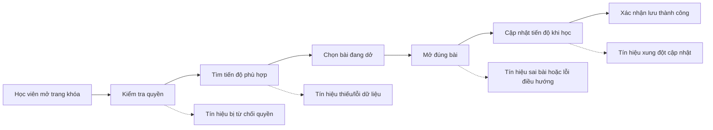
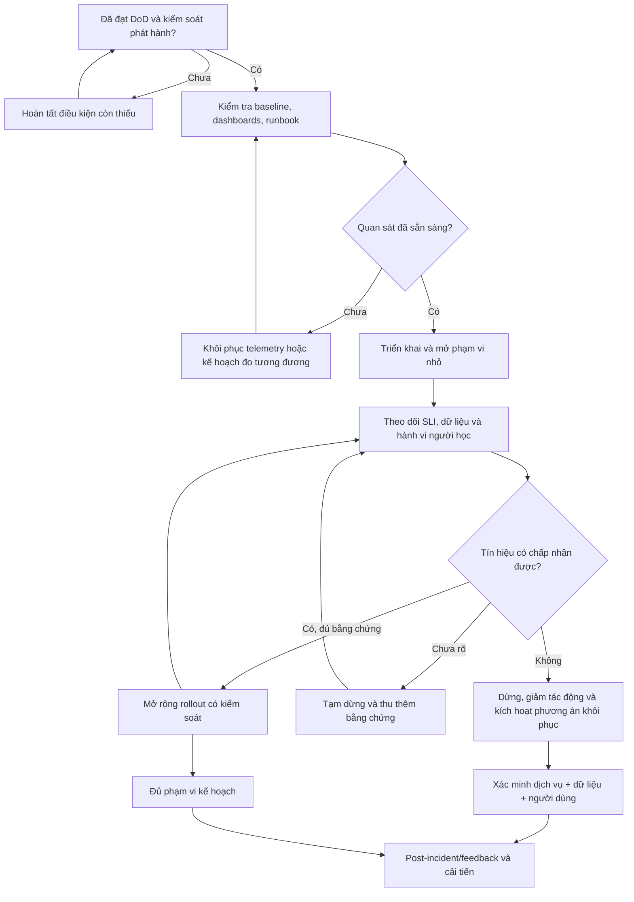
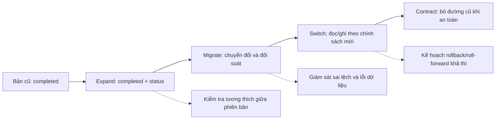

# Đưa quan sát hệ thống cùng khả năng khôi phục vào kế hoạch phát hành

## Mục tiêu học tập

Sau bài học này, bạn có thể:

- Giải thích vì sao **phát hành phần mềm** không chỉ là triển khai một phiên bản mới, mà còn bao gồm **phát hiện vấn đề, đánh giá tác động, phản hồi và khôi phục dịch vụ**.
- Phân biệt **monitoring** với **observability (khả năng quan sát hệ thống)**; sử dụng đúng vai trò của **metrics, logs, traces, sự kiện nghiệp vụ, synthetic checks** và tín hiệu từ người dùng.
- Xác định **SLI, SLO**, chỉ số cảnh báo và **ngưỡng quyết định phát hành** gắn với hành trình người dùng, thay vì chỉ theo dõi CPU hoặc trạng thái máy chủ.
- Thiết kế một kế hoạch phát hành có đủ **điều kiện trước khi triển khai, giai đoạn triển khai, tín hiệu theo dõi, người ra quyết định, cơ chế dừng và phương án khôi phục**.
- Phân biệt **rollback, roll-forward, tắt feature flag, giảm cấp dịch vụ, khôi phục dữ liệu từ bản sao lưu**; nhận diện giới hạn của từng cách.
- Giải thích **RTO, RPO**, tính tương thích của thay đổi cơ sở dữ liệu/API, quy trình xử lý sự cố và giá trị của **diễn tập khôi phục**.
- Áp dụng vào ví dụ nền tảng học trực tuyến: phát hành tính năng **“Tiếp tục học”** có dữ liệu tiến độ, nhiều thiết bị và quyền truy cập.
- Lựa chọn các cải tiến phù hợp với **Agile, Scrum, Kanban, XP và DevOps** để rút ngắn vòng phản hồi mà không hy sinh chất lượng.

## 1. Tình huống mở đầu: triển khai thành công nhưng học viên vẫn gặp lỗi

Một Scrum Team xây nền tảng học Java vừa hoàn thành tính năng **“Tiếp tục học”**. Pipeline CI xanh, kiểm thử chấp nhận đã qua, phần mềm đạt **Definition of Done (DoD)** theo chính sách sản phẩm và bản triển khai được hệ thống báo *successful*.

Sau khi mở tính năng cho một nhóm học viên, có ba dấu hiệu bất thường:

1. Trên giao diện, một số người nhấn “Tiếp tục học” nhưng bị đưa về **bài cũ**.
2. Dịch vụ trả phần lớn mã HTTP **200 OK**, nên biểu đồ tỷ lệ lỗi máy chủ có vẻ bình thường.
3. Người học sử dụng **hai thiết bị** đôi khi làm mất trạng thái hoàn thành gần nhất; lỗi chỉ rõ khi dữ liệu từ hai thiết bị giao nhau.

Nếu đội chỉ hỏi “deployment thành công chưa?”, họ có thể tiếp tục mở tính năng cho tất cả mọi người. Nếu đội có quan sát **hành vi sản phẩm và tính toàn vẹn dữ liệu**, họ có thể dừng mở rộng, xác định nguyên nhân, chọn cách giảm tác động và bảo vệ dữ liệu.

Bài học quan trọng:

> **Một bản phát hành an toàn phải cho đội biết phần mềm có đang tạo giá trị đúng cách hay không, khi nào cần can thiệp và bằng cách nào khôi phục kết quả có thể tin cậy.**

Đó là lý do **quan sát hệ thống và khả năng khôi phục cần được lên kế hoạch trước khi phát hành**, không bổ sung vội vàng sau khi có sự cố.

### 1.1. Ba câu hỏi không thể thiếu

| Trước khi phát hành | Trong khi phát hành | Sau khi phát hành |
| --- | --- | --- |
| **Chúng ta sẽ quan sát điều gì?** Có baseline, dashboard, quyền truy cập và dữ liệu cần thiết chưa? | **Các tín hiệu có đang đúng kỳ vọng?** Có dấu hiệu rủi ro cần dừng rollout không? | **Người dùng thật có nhận được giá trị?** Có lỗi chậm, dữ liệu sai hoặc công việc cần cải tiến không? |
| **Ai quyết định?** Ai có quyền tạm dừng, rollback, khôi phục và thông báo? | **Cần phản ứng thế nào?** Thu hẹp phạm vi, tắt flag, sửa nhanh hay xử lý sự cố? | **Cần học gì?** Cập nhật backlog, kiểm thử, alert và runbook như thế nào? |
| **Phục hồi bằng cách nào?** Phần nào đảo ngược được, dữ liệu nào không thể hoàn nguyên đơn giản? | **Khôi phục có an toàn không?** Có rủi ro làm mất dữ liệu hoặc bật lại lỗi cũ không? | **Phục hồi đã được xác minh chưa?** Trạng thái dịch vụ và dữ liệu có thực sự đúng? |

Nếu chưa trả lời được các câu hỏi trên đối với một thay đổi có rủi ro cao, không nên giả định rằng một nút “Deploy” và một nút “Rollback” là đã có kế hoạch phát hành đầy đủ.

## 2. Phân biệt triển khai, phát hành, phản hồi và khôi phục

Những thuật ngữ thường bị dùng thay nhau, nhưng có ranh giới khác nhau:

| Thuật ngữ | Nghĩa thực hành | Ví dụ |
| --- | --- | --- |
| **Build** | Tạo artifact phần mềm từ mã và cấu hình phù hợp. | Đóng gói phiên bản dịch vụ tiến độ. |
| **Deploy (triển khai)** | Đưa phiên bản phần mềm tới một môi trường. | Triển khai bản mới lên production, chưa mở tính năng cho học viên. |
| **Release (phát hành)** | Cho nhóm người dùng mục tiêu tiếp cận một khả năng theo chính sách. | Mở “Tiếp tục học” cho một nhóm học viên đã chọn. |
| **Rollout** | Quá trình mở rộng phạm vi phục vụ của một thay đổi. | Từ một nhóm nhỏ sang phần lớn người học, sau khi kiểm tra tín hiệu. |
| **Monitoring** | Theo dõi các tín hiệu hoặc điều kiện đã xác định, phát hiện bất thường. | Cảnh báo tỷ lệ lỗi API vượt ngưỡng đã chọn. |
| **Observability** | Năng lực suy luận về trạng thái bên trong từ các tín hiệu hệ thống, kể cả khi câu hỏi mới xuất hiện. | Kết hợp trace, log và sự kiện để tìm vì sao một nhóm học viên quay lại sai bài. |
| **Rollback** | Đưa một phần thay đổi về phiên bản/trạng thái trước trong phạm vi có thể. | Chuyển dịch vụ về bản ứng dụng cũ tương thích. |
| **Roll-forward** | Khắc phục bằng một phiên bản hoặc thay đổi mới tiến về phía trước. | Sửa lỗi chọn bài dở và triển khai bản đã kiểm chứng. |
| **Recovery** | Khôi phục dịch vụ, dữ liệu hoặc hành vi tới trạng thái chấp nhận được. | Dừng lỗi, sửa các bản ghi tiến độ sai, kiểm tra dữ liệu và phục hồi luồng học. |

**Deploy không tự đồng nghĩa Release**: có thể triển khai mã phía sau feature flag rồi chỉ mở khi sẵn sàng. **Done không tự đồng nghĩa đã phát hành**: Increment đạt DoD có thể sẵn sàng nhưng chưa được mở theo quyết định sản phẩm. **Rollback ứng dụng không tự đồng nghĩa khôi phục dữ liệu**: dữ liệu đã ghi sai cần một kế hoạch riêng.

### 2.1. Mối liên hệ với Scrum

Trong Scrum Guide 2020, một **Increment** phải hữu dụng và đáp ứng DoD; có thể có nhiều Increment trong một Sprint. Một Increment có thể được giao tới stakeholders trước Sprint Review; **Sprint Review không phải cổng cho phép phát hành**.

Kế hoạch triển khai, quan sát, khôi phục và ra quyết định phát hành có thể là **thực hành kỹ thuật/vận hành cần thiết** tùy sản phẩm. Scrum Guide không bắt buộc sử dụng một công cụ monitoring, mô hình canary hay lịch rollout cố định. Nhưng không thể dùng Scrum làm lý do bỏ qua các yêu cầu chất lượng và vận hành thuộc DoD hoặc chính sách tổ chức.

## 3. Observability và monitoring: theo dõi điều biết trước, khám phá điều chưa biết

**Monitoring** chủ yếu theo dõi các câu hỏi và tín hiệu đã định nghĩa trước, như “tỷ lệ request lỗi có tăng không?”. **Observability** mở rộng khả năng hiểu **vì sao** hệ thống đang có hành vi đó, bằng dữ liệu đủ giàu ngữ cảnh và có thể liên hệ giữa các thành phần.

Một hệ thống có nhiều dashboard nhưng vẫn thiếu khả năng quan sát nếu:

- Chỉ có biểu đồ CPU, không biết học viên có **mở đúng bài** hay không.
- HTTP 200 vẫn được xem là thành công dù API trả **tiến độ sai**.
- Logs của hai service không thể nối bằng cùng một request/trace ID.
- Lỗi chỉ được biết qua tin nhắn hỗ trợ mà không có tín hiệu phát hiện sớm.
- Dữ liệu telemetry chứa thông tin riêng tư nhưng không có chính sách kiểm soát.

Observability không phải việc **ghi lại mọi thứ vô hạn**. Nó cần **thiết kế tín hiệu theo câu hỏi quan trọng, bảo vệ dữ liệu, quản lý chi phí và hỗ trợ chẩn đoán**.

### 3.1. Ba trụ cột phổ biến: metrics, logs và traces

| Nguồn tín hiệu | Thường trả lời câu hỏi nào? | Ví dụ trong nền tảng học | Giới hạn nếu chỉ dùng riêng |
| --- | --- | --- | --- |
| **Metrics** | Xu hướng và mức độ bất thường đang xảy ra ở đâu? | Tỷ lệ lỗi cập nhật tiến độ; độ trễ p95 của API mở bài. | Một điểm tổng hợp có thể che nhóm người dùng bị ảnh hưởng. |
| **Logs** | Sự kiện cụ thể đã xảy ra, trạng thái và quyết định nào? | Yêu cầu cập nhật bị từ chối vì phiên bản tiến độ cũ. | Logs không cấu trúc hoặc thiếu tương quan rất khó điều tra. |
| **Distributed traces** | Một yêu cầu đi qua các service nào, thời gian ở đâu và đâu là lỗi? | Gateway → API tiến độ → cơ sở dữ liệu → dịch vụ quyền. | Trace không tự chứng minh trạng thái dữ liệu nghiệp vụ đúng. |
| **Sự kiện nghiệp vụ** | Người dùng đạt được kết quả nào? | Mở đúng bài dở; ghi tiến độ thành công; khôi phục được tiến độ. | Cần định nghĩa sự kiện và kiểm soát dữ liệu phù hợp. |
| **Synthetic checks** | Một hành trình mô phỏng có còn hoạt động không? | Tài khoản thử ghi danh, mở bài và lưu tiến độ định kỳ. | Không bao phủ mọi hành vi và dữ liệu thật. |
| **Real User Monitoring / phản hồi** | Người dùng thật gặp thời gian tải/lỗi/trở ngại nào? | Không thể mở bài trên trình duyệt di động cụ thể. | Cần bảo vệ riêng tư và tránh xem tương quan là nguyên nhân. |

Ba nguồn đầu thường được gọi là **metrics–logs–traces**, nhưng để hiểu **giá trị người dùng** cần kết hợp tín hiệu sản phẩm và phản hồi thật. Không có một nguồn nào thay thế tất cả nguồn khác.

### 3.2. Cấu trúc một dòng log có ích

Một log có cấu trúc có thể chứa:

```json
{
  "timestamp": "2026-11-23T09:42:11Z",
  "service": "learning-progress",
  "environment": "production",
  "version": "v2.4",
  "event": "progress_update_rejected",
  "trace_id": "example-trace-id",
  "request_id": "example-request-id",
  "course_type": "free",
  "reason": "stale_revision",
  "outcome": "rejected"
}
```

**Dữ liệu hoàn toàn minh họa.** Không cần đưa email, access token, nội dung bài riêng, mật khẩu hoặc toàn bộ dữ liệu tiến độ của người học vào log. Nếu một định danh cá nhân thật sự cần cho điều tra, phải tuân thủ **chính sách tối thiểu hóa dữ liệu, phân quyền, bảo vệ và thời hạn lưu trữ**; nhiều tình huống chỉ cần mã tương quan không trực tiếp định danh.

### 3.3. Tương quan tín hiệu để chẩn đoán

Giả sử:

- Metric cho thấy số `progress_update_rejected` tăng ở bản mới.
- Trace cho thấy thời gian chờ dài tại DB khi hai thiết bị cập nhật.
- Log thể hiện yêu cầu bị từ chối vì `stale_revision`.
- Sự kiện sản phẩm cho thấy một nhóm học viên nhấn “Tiếp tục học” lặp lại nhiều lần.

Kết hợp các bằng chứng giúp đội đặt giả thuyết về **xung đột phiên bản và cách ứng dụng xử lý cập nhật đồng thời**. Nó vẫn chưa đủ để khẳng định nguyên nhân nếu thiếu tái hiện, kiểm tra quy tắc và dữ liệu liên quan.

## 4. Quan sát hành trình người dùng, không chỉ máy chủ

Một chức năng có thể trả HTTP 200, CPU bình thường và không có exception, nhưng **giá trị sản phẩm đã sai**. Vì vậy, kế hoạch phát hành cần quan sát cả **tín hiệu kỹ thuật** và **tín hiệu nghiệp vụ**.

### 4.1. Hành trình “Tiếp tục học” có các điểm cần nhìn



Các câu hỏi quan sát hữu ích:

- Bao nhiêu yêu cầu **được phép** và **bị từ chối**? Có đột biến không bình thường sau rollout?
- Với người còn quyền, tỷ lệ chọn **đúng bài theo quy tắc đã thống nhất** là bao nhiêu?
- Khi học viên lưu tiến độ, hệ thống có xác nhận sau khi **lưu bền vững** hay trả sớm một trạng thái chưa nhất quán?
- Có bao nhiêu xung đột cập nhật được xử lý, bao nhiêu xung đột có nguy cơ làm mất dữ liệu?
- Độ trễ tăng ở tầng giao diện, dịch vụ hay DB?
- Có khác biệt đáng kể giữa trình duyệt, thiết bị, loại khóa hoặc phiên bản mới và cũ không?

Khi định nghĩa một tỷ lệ nghiệp vụ, phải nêu rõ **mẫu số**. Ví dụ “tỷ lệ tiếp tục học thành công” có thể tính trên **lượt nhấn hợp lệ của người có quyền**, không phải tất cả lượt mở trang từ mọi tài khoản.

### 4.2. Những gì cần được đánh dấu để so sánh bản phát hành

Một tập thuộc tính telemetry thường hữu ích:

| Thuộc tính | Mục đích | Cảnh báo |
| --- | --- | --- |
| **Version / build** | So sánh phiên bản mới và cũ. | Cần thống nhất cách gắn nhãn khi nhiều bản đang cùng chạy. |
| **Environment** | Phân biệt production, staging và thử nghiệm. | Không trộn dữ liệu môi trường thử vào dashboard production. |
| **Release cohort / flag variant** | So sánh nhóm đã và chưa mở tính năng. | Không tự suy ra quan hệ nhân quả khi hai nhóm khác biệt. |
| **Operation / endpoint** | Khoanh vùng luồng lỗi. | Tránh tạo hàng triệu nhãn khác nhau theo URL động. |
| **Error category** | Phân loại lỗi quyền, dữ liệu, timeout, cấu hình. | Không gộp lỗi người dùng bình thường với sự cố hệ thống. |
| **Trace/request correlation** | Theo dấu một yêu cầu qua nhiều dịch vụ. | Không đưa dữ liệu cá nhân nhạy cảm vào label metrics. |

**Cardinality** là số tổ hợp giá trị nhãn có thể phát sinh. Đặt `learner_id`, email hoặc `request_id` thành label của mọi metric có thể khiến chi phí và lượng chuỗi thời gian tăng mạnh. Các định danh cần truy vết thường phù hợp hơn với **log/trace có kiểm soát**, không phải label tổng hợp độ lớn không giới hạn.

## 5. SLI, SLO, SLA và error budget trong kế hoạch phát hành

### 5.1. SLI: phép đo chất lượng dịch vụ

**Service Level Indicator (SLI)** là đại lượng đo một khía cạnh dịch vụ quan trọng. Ví dụ:

- **Availability SLI:** tỷ lệ yêu cầu hợp lệ nhận kết quả thành công theo định nghĩa rõ.
- **Latency SLI:** tỷ lệ yêu cầu đáp ứng dưới ngưỡng được xác định, hoặc phân bố độ trễ như p95.
- **Correctness SLI:** tỷ lệ thao tác tạo kết quả nghiệp vụ đúng và nhất quán.
- **Durability SLI:** mức độ dữ liệu quan trọng được giữ an toàn theo cách kiểm chứng phù hợp.

Ví dụ minh họa cho một SLI:

```text
SLI mở bài hợp lệ =
  Số yêu cầu mở bài của người có quyền và trả đúng nội dung
  ---------------------------------------------------------
  Tổng số yêu cầu mở bài hợp lệ trong kỳ quan sát
```

**Không đếm** trường hợp từ chối hợp lệ một tài khoản không có quyền như một “lỗi dịch vụ” nếu hệ thống đã phản hồi đúng chính sách. Ngược lại, không được tính HTTP 200 là thành công nếu **trả sai bài hoặc lộ nội dung riêng**.

Một SLI phải xác định **đối tượng, mốc đo, mẫu số, các ngoại lệ hợp lệ và kỳ quan sát**. Nếu chưa thu thập đủ tín hiệu để kiểm chứng correctness, cần nói rõ hạn chế đo lường.

### 5.2. SLO: mục tiêu kỳ vọng cho SLI

**Service Level Objective (SLO)** là mục tiêu cho một SLI trong một khoảng thời gian. Ví dụ minh họa:

> “Trong cửa sổ 28 ngày, ít nhất 99,5% yêu cầu mở bài hợp lệ trả kết quả đúng theo định nghĩa SLI.”

Con số **99,5% chỉ dùng để học cách đọc một SLO**, không phải mức chuẩn mặc định cho nền tảng học. Chọn mục tiêu cần dựa trên nhu cầu người dùng, rủi ro, năng lực hệ thống và khả năng đo đáng tin.

### 5.3. SLA khác SLO thế nào?

- **SLI**: thứ đang được đo.
- **SLO**: mục tiêu nội bộ/được công bố về chất lượng hoặc mức phục vụ của SLI.
- **SLA (Service Level Agreement)**: thỏa thuận dịch vụ có điều khoản, nghĩa vụ hoặc hệ quả cụ thể tùy hợp đồng/chính sách.

SLO có thể là đầu vào để thảo luận SLA, nhưng **không tự biến thành cam kết pháp lý**.

### 5.4. Error budget không cho phép bỏ qua chất lượng bắt buộc

Nếu đội đặt SLO cho một tỷ lệ thành công, phần sai lệch cho phép trong kỳ có thể được gọi là **error budget**. Nó giúp thảo luận đánh đổi giữa **mức độ ổn định đang đạt** và **rủi ro của các thay đổi mới**.

Tuy nhiên:

- Error budget **không phải giấy phép** cố ý làm lộ dữ liệu hoặc bỏ kiểm tra phân quyền.
- Không dùng mức lỗi trung bình của dịch vụ để che một **nhóm nhỏ người học bị hại nghiêm trọng**.
- Việc SLO đang đạt **không tự chứng minh một rollout mới an toàn**.
- Với sự cố quyền truy cập hoặc mất dữ liệu, quyết định can thiệp có thể phải dựa vào **mức nghiêm trọng**, không chờ đủ số request để vượt ngưỡng SLO.

### 5.5. Phân biệt chỉ số nền với chỉ số tác động

Một bản phát hành có thể cần hai lớp dashboard:

1. **Service health:** lỗi, latency, traffic, saturation, queue, DB, trạng thái phụ thuộc.
2. **Product health:** hành trình mở đúng bài, lỗi dữ liệu, tỷ lệ tiếp tục học thành công, phản hồi hỗ trợ.

Cải tiến tốt cần xét **độ tin cậy kỹ thuật và kết quả người dùng** cùng nhau. Sự ổn định của máy chủ không tự động là thành công về sản phẩm.

## 6. Thiết kế cảnh báo để dẫn tới hành động

Một dashboard là nơi nhìn dữ liệu; **alert** chỉ có ích nếu có người tiếp nhận và **hành động phù hợp** khi tín hiệu xảy ra.

### 6.1. Một alert nên trả lời gì?

- **Điều gì xảy ra?** Tên SLI, vùng ảnh hưởng, độ nghiêm trọng, phiên bản/cohort.
- **Vì sao đáng báo động?** Mức tác động người dùng hoặc rủi ro đang tăng.
- **Cần làm gì đầu tiên?** Link dashboard, runbook, kiểm tra phụ thuộc, phương án dừng.
- **Ai nhận?** Người trực, kênh liên hệ hoặc đội chịu trách nhiệm phù hợp.
- **Khi nào cần nâng cấp xử lý?** Dấu hiệu dữ liệu sai, mất quyền, lỗi diện rộng, không thể khôi phục.
- **Khi nào alert được coi là giải quyết?** Có bằng chứng dịch vụ và hành vi đã ổn định.

### 6.2. Tránh alert fatigue

Nếu mọi lỗi ngắn đều đánh thức cả đội, người trực có thể mất tin cậy và bỏ sót sự cố quan trọng. Các biện pháp thường dùng:

- Gắn alert với **tác động đến người dùng hoặc mục tiêu dịch vụ**, không chỉ ngưỡng phần cứng tĩnh.
- Sử dụng **cửa sổ quan sát và điều kiện dữ liệu đủ mẫu**; tránh phản ứng vì một request lỗi lẻ.
- Dùng mức cảnh báo khác nhau: trang trực khẩn cấp, thông báo trong giờ làm hoặc dashboard để xem xét.
- Nhóm các cảnh báo cùng nguyên nhân, hạn chế gửi trùng vô ích.
- Định kỳ kiểm tra cảnh báo gây nhiễu hoặc không dẫn tới hành động.

**Không áp dụng mọi ngưỡng cảnh báo như một công thức chung.** Với lỗi bảo mật nghiêm trọng hoặc mất dữ liệu, **một sự kiện được xác nhận** có thể đủ để khởi động xử lý; với tỷ lệ lỗi thông thường cần dữ liệu và baseline phù hợp.

### 6.3. Ngưỡng phát hành là tiêu chí quyết định, không chỉ alert

Một rollout cần các hành động **go / pause / rollback / escalate** gắn với tín hiệu. Bảng dưới đây là **chính sách ví dụ giả định** cho một dịch vụ thử nghiệm; không được sao chép con số vào production mà chưa xác thực:

| Tín hiệu | Điều kiện giả định trong thử nghiệm | Phản ứng dự kiến |
| --- | --- | --- |
| Sai quyền truy cập nội dung riêng được xác nhận. | **Bất kỳ sự kiện có bằng chứng đáng tin**. | **Dừng mở rộng ngay**, giới hạn tác động, kích hoạt quy trình bảo mật/sự cố. |
| Tiến độ học bị ghi đè hoặc mất dữ liệu được xác nhận. | **Bất kỳ sự kiện ảnh hưởng dữ liệu người dùng thật**. | Tạm dừng đường ghi mới nếu an toàn, bảo toàn bằng chứng, điều tra và chọn phương án phục hồi dữ liệu. |
| Tỷ lệ lỗi server ở cohort mới tăng khác thường. | Vượt ngưỡng được đội thống nhất **trong cửa sổ và lưu lượng đủ mẫu**. | Tạm dừng rollout, so sánh baseline/cohort; rollback nếu liên hệ thay đổi được xác nhận và an toàn. |
| Độ trễ mở bài tăng rõ. | p95 vượt ngưỡng nội bộ trong khoảng quan sát phù hợp. | Khoanh vùng API/DB, đánh giá ảnh hưởng; không tự khẳng định nguyên nhân. |
| Không có telemetry đáng tin. | Tín hiệu quan trọng bị mất trong giai đoạn rollout. | **Không mở rộng rollout** cho tới khi khả năng quan sát được khôi phục hoặc có phương án xác minh tương đương. |

Một bản phát hành có thể dùng **điều kiện dừng nghiêm ngặt hơn** cho quyền và dữ liệu, và **điều kiện thống kê** cho hiệu năng, lỗi có thể chịu đựng. Hành động cuối cùng phải dựa trên rủi ro thật.

## 7. Kế hoạch phát hành cần được thiết kế trước khi nhấn Deploy

Một kế hoạch tốt là **tập quyết định có thể thực thi**, không phải tài liệu hàng chục trang chỉ để được phê duyệt.

### 7.1. Các thành phần tối thiểu nên có

| Thành phần | Câu hỏi bắt buộc trả lời |
| --- | --- |
| **Phạm vi và mục tiêu** | Thay đổi nào được đưa tới nhóm người dùng nào; giá trị và rủi ro chính là gì? |
| **Điều kiện sẵn sàng** | Increment đã đạt DoD? Test/kiểm tra chất lượng và các ràng buộc tổ chức đã đạt? |
| **Phụ thuộc** | DB migration, API đối tác, cấu hình, quyền, dữ liệu, cache, ứng dụng mobile cũ? |
| **Baseline** | Có biết chất lượng trước thay đổi để so sánh không? Có số liệu đủ tin cậy không? |
| **Tín hiệu theo dõi** | Dashboard, logs, traces, hành trình synthetic, lỗi dữ liệu, outcome? |
| **Phương pháp rollout** | Mở theo cohort, canary, blue-green, flag hay triển khai trực tiếp? Vì sao? |
| **Tiêu chí tiến/dừng** | Khi nào tăng phạm vi, dừng, rollback, roll-forward hoặc nâng cấp sự cố? |
| **Phương án khôi phục** | Cụ thể thay đổi nào có thể đảo ngược; dữ liệu nào phải được bảo toàn? |
| **Người chịu trách nhiệm** | Ai thực hiện, ai quyết định, ai được gọi hỗ trợ, ai truyền thông? |
| **Kiểm tra sau phục hồi** | Làm sao xác nhận hành vi người dùng và dữ liệu thực sự trở lại bình thường? |
| **Phản hồi sau release** | Bao giờ xem kết quả, kênh phản hồi nào và backlog được cập nhật ra sao? |

Không phải thay đổi văn bản giao diện nào cũng cần kế hoạch khôi phục như hệ thống giao dịch tài chính. Mức độ kiểm soát phải **tương xứng mức độ rủi ro**, nhưng các hành động cốt lõi vẫn cần được hiểu trước khi thực hiện.

### 7.2. Sơ đồ vòng quyết định phát hành



Sơ đồ mô tả **cách ra quyết định**, không phải một hệ thống tự động đã được xây sẵn. Một tổ chức có thể yêu cầu phê duyệt hoặc bước kiểm soát bổ sung, đặc biệt khi thay đổi ảnh hưởng bảo mật hay dữ liệu học viên.

## 8. Các kỹ thuật giảm rủi ro phát hành

### 8.1. Canary release

**Canary** đưa thay đổi tới một phần nhỏ lưu lượng hoặc nhóm người dùng rồi quan sát trước khi mở rộng. Lợi ích là **giới hạn phạm vi tác động** trong khi thu dữ liệu thật.

Nhưng canary chỉ hữu ích khi:

- Nhóm canary **đủ đại diện** cho hành vi cần kiểm chứng.
- Có thể phân biệt **phiên bản/cohort** trong telemetry.
- Quan sát đủ thời gian và đủ giao dịch cho các rủi ro quan trọng.
- Có cách **dừng mở rộng và giảm tác động**.
- Biết rằng các lỗi hiếm, lỗi theo chu kỳ hoặc lỗi dữ liệu kéo dài **có thể chưa xuất hiện** ở một mẫu nhỏ.

Không nên tuyên bố “canary qua” chỉ vì trong vài phút không thấy HTTP 500, trong khi tính năng liên quan tiến độ học có thể cần **nhiều phiên sử dụng hoặc hai thiết bị** để lộ lỗi.

### 8.2. Blue-green deployment

**Blue-green** duy trì hai môi trường/phiên bản phục vụ theo chính sách, cho phép chuyển lưu lượng và có thể chuyển lại khi cần. Điều này hỗ trợ **đảo chiều lưu lượng** nếu phiên bản cũ vẫn tương thích và môi trường còn hoạt động.

Hạn chế quan trọng:

- Nếu **schema dữ liệu đã thay không tương thích**, chuyển lưu lượng về bản cũ có thể không an toàn.
- Dữ liệu sinh trong thời gian dùng bản mới không tự biến mất.
- Kết nối dài, cache, session và tích hợp ngoài có thể cần xử lý bổ sung.
- Chi phí duy trì hai môi trường không phải lúc nào cũng phù hợp.

### 8.3. Feature flags và progressive delivery

**Feature flag** có thể tách **triển khai mã** khỏi **mở khả năng cho người dùng**. Ví dụ:

- Triển khai mã “Tiếp tục học” nhưng mặc định chưa bật.
- Chỉ bật cho nhóm thử nghiệm phù hợp.
- Quan sát tỷ lệ sử dụng, lỗi quyền, sai tiến độ.
- Khi đủ bằng chứng thì mở rộng; nếu có rủi ro, tắt flag để không sử dụng đường xử lý mới.

**Giới hạn:** tắt giao diện không xóa bản ghi tiến độ đã viết sai. Flag ở client **không thay kiểm tra quyền tại server**. Cần xác nhận hành vi của cả **nhánh cũ và nhánh mới**, kế hoạch dọn flag, và tác động tới schema/dữ liệu.

### 8.4. Shadow traffic hoặc dark launch

Đối với một số hệ thống, có thể cho bản mới **nhận bản sao yêu cầu** để quan sát mà không ảnh hưởng kết quả người dùng. Nhưng với thao tác ghi tiến độ, sao chép lệnh ghi có thể tạo tác dụng phụ nguy hiểm.

Chỉ dùng shadow traffic khi:

- Có cách **chặn tác dụng phụ** và không ghi dữ liệu người dùng ngoài phạm vi thử.
- Quyền, dữ liệu nhạy cảm và chính sách lưu trữ được bảo vệ.
- Có tiêu chí so sánh và cách diễn giải sai lệch.
- Môi trường thử không ảnh hưởng hệ thống sản xuất.

Không phải mọi tính năng đều phù hợp với shadow hoặc canary; cách phát hành phải được chọn theo **loại tác động và rủi ro thật**.

## 9. Rollback, roll-forward, tắt flag và giảm cấp dịch vụ khác nhau thế nào?

### 9.1. Không có một nút “Undo” cho toàn bộ sản phẩm

| Phương án | Làm gì? | Dùng khi nào có thể phù hợp? | Giới hạn/điều kiện |
| --- | --- | --- | --- |
| **Rollback ứng dụng** | Chuyển ứng dụng về phiên bản trước. | Lỗi nằm ở mã mới, bản cũ vẫn tương thích và ổn định. | Không tự hoàn tác dữ liệu, sự kiện đã gửi hoặc cấu hình mới. |
| **Roll-forward / hotfix** | Triển khai bản sửa mới. | Không thể quay về an toàn hoặc lỗi có bản sửa có thể kiểm chứng nhanh. | Cần kiểm thử, kiểm soát phát hành và theo dõi sau sửa. |
| **Tắt feature flag** | Ngăn một đường chức năng mới tiếp tục được sử dụng. | Có flag đúng phạm vi và nhánh cũ an toàn. | Không khôi phục dữ liệu đã hỏng, không sửa schema. |
| **Giảm cấp dịch vụ có kiểm soát** | Tạm ẩn chức năng phụ, dùng read-only hoặc đường an toàn hơn. | Bảo vệ tính toàn vẹn trong khi phần phụ thuộc gặp lỗi. | Phải hiểu ảnh hưởng tới người dùng, tránh trả thành công giả. |
| **Chuyển lưu lượng** | Đưa request tới phiên bản hoặc vùng còn khỏe. | Có bản/region thay thế và trạng thái tương thích. | Dữ liệu, session và phụ thuộc có thể không đồng bộ. |
| **Khôi phục từ backup** | Phục hồi dữ liệu về một thời điểm hoặc bản sao đã có. | Mất/hỏng dữ liệu không thể sửa đơn giản bằng mã. | Có thể mất cập nhật hợp lệ sau điểm khôi phục; cần RPO/RTO và đối soát. |
| **Sửa dữ liệu có kiểm soát** | Khắc phục các bản ghi sai theo quy tắc xác nhận. | Lỗi dữ liệu có phạm vi xác định, có bằng chứng sửa đúng. | Cần backup, audit, kiểm chứng và quyền phù hợp; tránh sửa hàng loạt suy đoán. |

### 9.2. Ví dụ: lỗi chọn bài sai nhưng dữ liệu vẫn đúng

Nếu bản mới **chỉ đọc và chọn sai bài**, không ghi hỏng tiến độ, tắt flag hoặc rollback ứng dụng có thể đưa người học về đường “Danh sách bài” cũ. Cần kiểm tra:

- Bản cũ có còn đọc schema và định dạng tiến độ hiện hành không?
- Có cache tạo ra kết quả cũ bất thường không?
- Người dùng đang ở phiên học dở có cần làm mới giao diện?
- Metric thành công có trở lại baseline không?

### 9.3. Ví dụ: lỗi ghi đè tiến độ đúng

Nếu bản mới đã ghi sai dữ liệu, rollback mã có thể **chặn lỗi phát sinh thêm** nhưng không tự lấy lại các bản ghi bị ghi đè. Đội cần:

1. **Giảm tác động**: tắt đường ghi gây lỗi hoặc chuyển sang chế độ bảo vệ dữ liệu nếu có thể.
2. **Giữ bằng chứng**: log/audit/event liên quan và bản sao dữ liệu theo chính sách.
3. **Xác định phạm vi**: tài khoản, khóa, thời điểm và loại bản ghi bị ảnh hưởng.
4. **Chọn nguồn khôi phục**: sự kiện tin cậy, backup, lịch sử thay đổi hoặc đối soát.
5. **Kiểm chứng cách sửa** trên dữ liệu phù hợp trước khi áp dụng rộng.
6. **Thông báo và hỗ trợ người dùng** theo mức ảnh hưởng và yêu cầu tổ chức.
7. **Xác nhận lại** dữ liệu, đường đọc/ghi, quyền truy cập và các cảnh báo sau phục hồi.

Không nên “restore toàn bộ DB về hôm qua” khi điều đó có thể **xóa các lượt học hợp lệ của nhiều người khác**. Phương án đúng phải cân nhắc phạm vi và tính toàn vẹn dữ liệu.

## 10. Tiến hóa dữ liệu và hợp đồng API để rollback còn khả thi

Một trong những nguyên nhân khiến rollback không an toàn là **phiên bản ứng dụng mới thay dữ liệu hoặc API theo cách bản cũ không hiểu**.

### 10.1. Một ví dụ về thay đổi schema tiến độ

Phiên bản cũ lưu:

```text
lesson_progress.completed : boolean
```

Phiên bản mới muốn lưu:

```text
lesson_progress.status : NOT_STARTED | IN_PROGRESS | COMPLETED
```

Nếu triển khai bản mới rồi xóa `completed` ngay, bản ứng dụng cũ có thể không còn đọc được dữ liệu. Nếu người học đang ghi tiến độ trong lúc hai bản cùng chạy, việc đổi schema không có kế hoạch có thể tạo sai lệch.

### 10.2. Chiến lược expand–migrate–contract

Một cách tiếp cận phổ biến:

1. **Expand:** thêm cấu trúc mới nhưng giữ tương thích với ứng dụng đang chạy; xác định cơ chế đọc/ghi hợp lệ trong giai đoạn chuyển tiếp.
2. **Migrate:** chuyển dữ liệu có kiểm soát, đối soát các bản ghi và xử lý trường hợp không đủ thông tin; theo dõi sai lệch.
3. **Switch:** chuyển dần đường đọc và ghi sang mô hình mới, kiểm tra hoạt động của phiên bản cũ và mới trong giai đoạn đồng tồn tại.
4. **Contract:** bỏ trường cũ **chỉ khi** consumer đã di trú, dữ liệu đã được xác nhận và khả năng rollback/roll-forward được đánh giá lại.



**Không được suy đoán dữ liệu không tồn tại:** nếu `completed=false` thì không thể tự biết học viên **chưa bắt đầu** hay **đang dở** nếu bản cũ không ghi thông tin đó. Cần quy tắc chuyển đổi được phê duyệt, nguồn dữ liệu bổ sung hoặc trạng thái chưa xác định an toàn.

### 10.3. Những thay đổi khó đảo chiều cần được nhận diện sớm

- Xóa cột hoặc thay đổi ý nghĩa trường đang có client sử dụng.
- Gửi thông báo/email hoặc tạo giao dịch với hệ thống ngoài.
- Thay chính sách quyền hoặc thay đổi token.
- Di trú dữ liệu không giữ lịch sử.
- Thay đổi thứ tự hoặc cách xử lý các sự kiện bất đồng bộ.
- Cache phiên bản cũ và mới lưu những giá trị không tương thích.

Mỗi hạng mục có thể cần một **phương án riêng**: giữ tương thích, phát hành nhiều giai đoạn, idempotency, audit log, bù trừ nghiệp vụ hoặc roll-forward. Không có một thủ tục rollback mã có thể giải quyết tất cả.

## 11. Backup, restore, RTO và RPO: khôi phục được mới là khả năng thực

**Có bản sao lưu** khác với **đã chứng minh khôi phục được**.

### 11.1. RTO và RPO

- **Recovery Time Objective (RTO):** mục tiêu khoảng thời gian tối đa chấp nhận được để khôi phục dịch vụ sau gián đoạn, theo phạm vi và định nghĩa đã thống nhất.
- **Recovery Point Objective (RPO):** mục tiêu mức dữ liệu tối đa chấp nhận mất tính theo khoảng thời gian trước sự cố; cần nêu hệ thống, dữ liệu và cách đo rõ.

Ví dụ **chỉ để minh họa**:

> “Đối với dữ liệu tiến độ học quan trọng, mục tiêu RPO là 15 phút và RTO là 60 phút, trong kịch bản sự cố và điều kiện đã được định nghĩa.”

Điều này **không bảo đảm** hệ thống luôn khôi phục đúng những mốc đó; đó là **mục tiêu cần được thiết kế và diễn tập để có bằng chứng**. Nếu người học không thể chấp nhận mất 15 phút tiến độ, RPO như ví dụ có thể không phù hợp.

### 11.2. Điều gì cần biết về bản sao lưu?

| Câu hỏi | Vì sao quan trọng? |
| --- | --- |
| Backup dữ liệu nào và theo tần suất nào? | Quyết định mức mất dữ liệu tiềm năng và phạm vi phục hồi. |
| Backup có toàn vẹn và có thể đọc được không? | Bản sao lưu lỗi hoặc thiếu dữ liệu có thể vô dụng. |
| Cơ chế point-in-time restore có hỗ trợ không? | Cho phép chọn thời điểm khôi phục phù hợp khi có dữ liệu thay đổi liên tục. |
| Backup có độc lập khỏi sự cố chính không? | Một lỗi hoặc xóa nhầm có thể lan tới cả bản sao lưu nếu không được bảo vệ. |
| Ai có quyền restore và cần phê duyệt gì? | Phân tách trách nhiệm, tránh thao tác phá hoại trong lúc áp lực. |
| Có môi trường diễn tập và kiểm chứng sau restore không? | Tránh phát hiện sự cố quy trình vào lúc khẩn cấp. |
| Nếu khôi phục thì các cập nhật hợp lệ sau đó xử lý thế nào? | Giảm nguy cơ sửa một lỗi bằng cách tạo mất dữ liệu lớn hơn. |

### 11.3. Một lần restore test nên chứng minh gì?

Một bài diễn tập không chỉ kiểm tra lệnh khôi phục trả về mã thành công. Nó cần xác minh:

1. Bản sao lưu được tìm thấy và **giải mã/đọc được** theo chính sách.
2. Schema, dữ liệu và các phụ thuộc tương thích.
3. Các bản ghi trọng yếu có **số lượng/trạng thái đúng**, với kiểm tra mẫu có ý nghĩa.
4. Quyền truy cập sau khôi phục không mở rộng sai.
5. Hành trình người học quan trọng hoạt động lại.
6. Thời gian thực tế và điểm dữ liệu phục hồi được **đo**, đối chiếu mục tiêu RTO/RPO.
7. Vấn đề phát hiện được **ghi và chuyển thành cải tiến**.

Một quy trình “đã có backup” nhưng **chưa từng restore thành công** là một rủi ro cần được làm rõ trước thay đổi dữ liệu có tác động cao.

## 12. Runbook và xử lý sự cố: biết làm gì trong lúc áp lực

**Runbook** là hướng dẫn vận hành cụ thể cho tình huống có thể dự đoán: tín hiệu phát hiện, bước điều tra, cách giảm tác động, hành động khôi phục và kiểm chứng.

Runbook không phải tài liệu để thay thế phán đoán trong sự cố chưa từng xảy ra. Nó giúp giảm thời gian tìm người, tìm lệnh và tránh quyết định vội khi cần phản ứng.

### 12.1. Mẫu runbook ngắn cho tính năng “Tiếp tục học”

```text
SỰ CỐ: Tiếp tục học mở sai bài hoặc ghi tiến độ không nhất quán

Phát hiện:
- Alert sai lệch hành vi, xung đột lưu tiến độ, lỗi dữ liệu
- Ticket hỗ trợ đã xác minh; synthetic journey thất bại

Đánh giá ban đầu:
- Phiên bản/cohort nào bị ảnh hưởng?
- Có ghi sai dữ liệu hay chỉ chọn sai bài lúc đọc?
- Có ảnh hưởng quyền truy cập hoặc lộ nội dung riêng không?

Giảm tác động:
- Tạm dừng mở rộng rollout
- Tắt feature flag/đường xử lý mới nếu an toàn
- Chặn đường ghi gây hại nếu phát hiện mất dữ liệu
- Nâng cấp sự cố theo mức tác động

Khôi phục:
- Chọn rollback mã, roll-forward hoặc sửa dữ liệu có kiểm soát
- Kiểm tra tương thích schema, API và phiên bản client
- Không restore dữ liệu hàng loạt trước khi xác định phạm vi

Xác minh:
- Người có quyền mở đúng bài, người không có quyền bị từ chối
- Dữ liệu tiến độ không bị ghi đè sai
- Metrics/logs/traces và synthetic checks trở lại trạng thái chấp nhận
- Kênh hỗ trợ xác nhận phạm vi ảnh hưởng đã được xử lý

Sau sự cố:
- Lưu timeline và quyết định, cập nhật kiểm thử/alert/runbook/backlog
```

Đây là **mẫu thực hành**, không phải runbook đủ để vận hành ngay trong một hệ thống thật. Đội cần thêm công cụ, địa chỉ dashboard, quyền thực hiện, người trực, cách liên lạc, quy tắc rollback và tình huống ngoại lệ tương ứng.

### 12.2. Phân vai khi có sự cố

Trong một tổ chức, có thể cần:

- **Người điều phối sự cố (incident lead/commander):** giữ bức tranh chung, ưu tiên giảm tác động, điều phối quyết định.
- **Người điều tra kỹ thuật:** tìm nguyên nhân, đề xuất rollback/roll-forward, kiểm chứng khôi phục.
- **Người phụ trách truyền thông:** thông báo có kiểm chứng cho khách hàng, hỗ trợ, stakeholders theo kênh phù hợp.
- **Người chịu trách nhiệm nghiệp vụ/dữ liệu:** làm rõ chính sách quyền, dữ liệu, giá trị và tác động tới người học.

Tên vai trò và cơ chế phân công **không phải quy định của Scrum Guide**. Với đội nhỏ, một người có thể đảm nhiệm nhiều việc, nhưng cần tránh **không ai chịu trách nhiệm quyết định** hoặc mọi người cùng phát lệnh mâu thuẫn.

### 12.3. Hành động ưu tiên khi chưa biết nguyên nhân

Trong sự cố ảnh hưởng lớn, thứ tự thực dụng thường là:

1. **Bảo vệ người dùng và dữ liệu**, giảm phạm vi tác động.
2. **Khôi phục dịch vụ ở trạng thái an toàn** nếu có phương án đã được kiểm chứng.
3. Thu thập thêm bằng chứng để chẩn đoán và sửa bền vững.
4. Truyền thông kịp thời, trung thực về **điều đã biết/chưa biết**.
5. Sau khi ổn định, phân tích nguyên nhân, yếu tố góp phần và hành động phòng tái phát.

Không nên trì hoãn giảm tác động chỉ để tìm cho ra “ai gây ra lỗi”. **Postmortem không đổ lỗi cá nhân** tạo điều kiện báo cáo sự thật và cải thiện hệ thống; điều đó không loại bỏ trách nhiệm thực thi và kiểm soát cần thiết.

## 13. Ví dụ xuyên suốt: kế hoạch phát hành “Tiếp tục học” có khả năng khôi phục

### 13.1. Bối cảnh và phạm vi

Một Scrum Team phát triển nền tảng học trực tuyến đã có:

- Ghi danh khóa miễn phí và cấp quyền mở bài.
- Lưu trạng thái hoàn thành bài học ở phiên bản cũ.
- API tiến độ và ứng dụng web đang phục vụ người học.

Nhóm chuẩn bị phát hành **“Tiếp tục học”**: khi học viên mở lại khóa, hệ thống hiển thị lựa chọn dẫn tới bài chưa hoàn thành gần nhất theo quy tắc sản phẩm đã chốt.

**Mục tiêu sản phẩm:** giảm công sức tìm lại bài và cải thiện trải nghiệm quay lại học.

**Các rủi ro chính:**

1. Chọn sai bài khi có nhiều bài đang dở.
2. Mất hoặc ghi đè tiến độ do yêu cầu đồng thời từ hai thiết bị.
3. Người học đã mất quyền vẫn xem được nội dung qua đường dẫn cũ.
4. Client cũ không hiểu schema tiến độ mới.
5. Giao diện “Tiếp tục học” gây tăng độ trễ mở khóa.
6. Không thể rollback an toàn nếu bản mới đã ghi dữ liệu khác định dạng.

### 13.2. Cùng làm rõ hành vi trước khi phát hành

Một số acceptance criteria minh họa:

```gherkin
Feature: Tiếp tục bài học đang dở

  Scenario: Có bài đang dở và còn quyền truy cập
    Given Lan đã đăng nhập và có quyền hợp lệ với khóa "Java nhập môn"
    And Lan có một bài chưa hoàn thành được chọn theo quy tắc đã chốt
    When Lan mở trang khóa học
    Then Lan thấy hành động "Tiếp tục học"
    And hành động dẫn đến đúng bài đang dở

  Scenario: Không còn quyền truy cập
    Given Lan không còn quyền xem nội dung riêng của khóa
    When Lan dùng đường dẫn cũ để mở bài đang dở
    Then hệ thống từ chối truy cập nội dung riêng

  Scenario: Cập nhật tiến độ từ dữ liệu cũ
    Given Lan có tiến độ hợp lệ được lưu từ phiên bản trước
    When Lan mở lại khóa ở phiên bản mới
    Then hệ thống đọc đúng trạng thái được hỗ trợ
    And không tự đánh dấu hoàn thành một bài chưa đủ điều kiện
```

Các kịch bản trên phải được **làm rõ bằng ví dụ thật của nghiệp vụ**. Chúng chưa kiểm tra đủ tình huống hai thiết bị, sự kiện gửi lặp hay bất định của đồng bộ dữ liệu; cần kiểm tra theo rủi ro trong các tầng phù hợp.

### 13.3. Bảng kế hoạch phát hành minh họa

| Hạng mục | Kế hoạch ví dụ |
| --- | --- |
| **Thay đổi** | Mở “Tiếp tục học” với đường đọc tiến độ mới; không thay chính sách quyền. |
| **Chất lượng trước release** | Increment đáp ứng DoD; có test quyền, hồi quy, tích hợp dữ liệu, client cũ và tình huống đồng thời cần thiết. |
| **Phạm vi đầu** | Một nhóm thử nghiệm được phép, có đủ hành vi quan sát và cơ chế liên hệ hỗ trợ. |
| **Mở rộng** | Tăng phạm vi sau các vòng quan sát có đủ bằng chứng; không có tỷ lệ canary “chuẩn” bắt buộc. |
| **Observability** | Dashboard theo cohort/version, success theo nghiệp vụ, errors, latency, progress conflicts, quyền truy cập, synthetic journey. |
| **Tín hiệu dừng** | Sai quyền/mất dữ liệu được xác nhận; độ trễ hoặc tỷ lệ lỗi vượt chính sách đã chốt; telemetry không đáng tin. |
| **Giảm tác động** | Tạm dừng rollout; tắt nhánh “Tiếp tục học” nếu dữ liệu và quyền vẫn an toàn; khoanh vùng đường ghi. |
| **Khôi phục** | Rollback/roll-forward theo tương thích schema; dữ liệu sai cần quy trình đối soát riêng, không tự restore toàn DB. |
| **Người ra quyết định** | Người được phân quyền vận hành phối hợp Developers; Product Owner tham gia đánh giá tác động giá trị/phạm vi. |
| **Xác minh** | Học viên có quyền mở đúng bài, không có quyền bị từ chối, tiến độ không mất, chỉ số trở lại mức chấp nhận. |
| **Phản hồi sản phẩm** | Xem hành vi quay lại học, phản hồi hỗ trợ và quyết định tiếp theo trong Product Backlog. |

**Đây là kế hoạch minh họa**, không thay thế các thẩm quyền và thủ tục đã được tổ chức phê duyệt.

### 13.4. Theo dõi sau triển khai theo hai nhóm

**Tín hiệu an toàn/độ tin cậy:**

- Lỗi quyền truy cập và truy cập trái phép.
- Xung đột, mất dữ liệu hoặc cập nhật tiến độ không nhất quán.
- Tỷ lệ yêu cầu lỗi, độ trễ, timeout và lỗi DB.
- Chất lượng synthetic journey, logs/traces và khả năng nhận alert.

**Tín hiệu tác động sản phẩm:**

- Học viên có sử dụng “Tiếp tục học” hay không.
- Họ có mở đúng bài và tiếp tục một phiên học hữu ích không.
- Có giảm bước tìm bài theo quan sát phù hợp không.
- Phản hồi hỗ trợ có cho thấy khó hiểu, nhầm bài hoặc mất tiến độ không.

Một chức năng có thể **an toàn** nhưng **ít tạo giá trị**; hoặc có vẻ được dùng nhiều nhưng gây lỗi dữ liệu. Đội phải xem cả hai nhóm tín hiệu, không đánh đổi trách nhiệm vận hành lấy một chỉ số tăng trưởng.

### 13.5. Ba kịch bản phản ứng

**Kịch bản A — Độ trễ tăng, dữ liệu vẫn đúng:** tạm dừng mở rộng, so sánh phiên bản/cohort và trace; cân nhắc tối ưu hoặc rollback mã nếu an toàn. Không nhất thiết khôi phục DB.

**Kịch bản B — Sai bài do thuật toán đọc, dữ liệu vẫn đúng:** tắt flag đường chọn bài mới, để người học mở từ danh sách bài cũ; kiểm chứng không lộ quyền và xem xét roll-forward một bản sửa có test.

**Kịch bản C — Ghi đè tiến độ ở hai thiết bị:** dừng đường ghi gây lỗi, giữ audit/bằng chứng, xác định bản ghi chịu ảnh hưởng, phối hợp quy tắc dữ liệu và sửa/khôi phục có kiểm chứng. **Rollback mã là chưa đủ** nếu dữ liệu đã bị ghi sai.

Sự khác nhau giữa ba kịch bản là minh chứng vì sao phương án khôi phục **phải gắn với cơ chế lỗi**, không chỉ tên tính năng.

## 14. Một checklist release có quan sát và khả năng khôi phục

Đội có thể dùng mẫu ngắn dưới đây trong công việc. Nó là **ví dụ tùy chọn**, không phải checklist Scrum Guide bắt buộc hoặc chuẩn pháp lý của mọi tổ chức.

```text
PHÁT HÀNH: [Tên thay đổi, phiên bản, môi trường]

1. GIÁ TRỊ VÀ PHẠM VI
[ ] Mục tiêu người dùng và phạm vi rollout rõ ràng.
[ ] Người chịu trách nhiệm sản phẩm và kỹ thuật được xác định.
[ ] Các tình huống nghiệp vụ quan trọng đã được xác nhận.

2. CHẤT LƯỢNG / PHỤ THUỘC
[ ] Increment đáp ứng Definition of Done/chính sách chất lượng.
[ ] Kiểm thử quyền, dữ liệu, tích hợp và hồi quy liên quan đạt.
[ ] DB schema, API/client cũ và cấu hình đã được kiểm tra tương thích.
[ ] Rủi ro và phụ thuộc còn lại minh bạch, có quyết định phù hợp.

3. QUAN SÁT HỆ THỐNG
[ ] Dashboard và baseline đủ tin cậy, có nhãn version/cohort.
[ ] Có tín hiệu kỹ thuật và tín hiệu hành vi người dùng.
[ ] Alert hành động được, người nhận và runbook đã được xác nhận.
[ ] Tín hiệu quan trọng không làm lộ dữ liệu riêng tư.

4. ROLLOUT VÀ KHÔI PHỤC
[ ] Phương án rollout có giới hạn tác động khi phù hợp.
[ ] Điều kiện tiếp tục/tạm dừng/rollback được ghi rõ.
[ ] Đã phân biệt rollback mã, tắt flag, sửa dữ liệu và restore.
[ ] Backup, tương thích và quyền khôi phục đã được kiểm tra theo rủi ro.
[ ] Người thực hiện, người quyết định và kênh liên lạc sẵn sàng.

5. XÁC MINH VÀ PHẢN HỒI
[ ] Có bước xác minh hành trình và dữ liệu sau từng giai đoạn.
[ ] Có cách truyền thông khi sự cố và nhận phản hồi hỗ trợ.
[ ] Có lịch/điều kiện xem lại outcome và quyết định Product Backlog.
```

Checklist không nên là cơ chế “tick cho đủ”. Mỗi ô cần **bằng chứng hoặc người chịu trách nhiệm**; những mục không áp dụng nên có lý do rõ, không biến thành khoảng trống mơ hồ.

## 15. Phát hành an toàn khi hệ thống có ít lưu lượng

Một lỗi khó của canary và monitoring là **không đủ dữ liệu**. Giả sử nhóm thử nghiệm chỉ có vài lượt mở bài trong một giờ. Không thấy lỗi không có nghĩa **xác suất lỗi đã rất nhỏ**.

### 15.1. Ngưỡng thống kê có thể thiếu ý nghĩa

Nếu chỉ có 5 yêu cầu, 0 lỗi quan sát được **không chứng minh** tỷ lệ lỗi bằng 0. Ngược lại, một yêu cầu thất bại có thể tạo tỷ lệ 20% rất lớn nhưng vẫn chưa cho biết lỗi có phổ biến ở tải thực không.

Khi thiếu dữ liệu:

- Giữ rollout ở phạm vi nhỏ lâu hơn nếu phù hợp với hành vi và mức rủi ro.
- Thêm **synthetic checks** cho hành trình quan trọng.
- Kết hợp unit/integration/security tests và kiểm thử khám phá.
- Xem những lỗi có **mức nghiêm trọng cao** độc lập với số mẫu.
- Ghi rõ “**chưa đủ dữ liệu để kết luận**” thay vì nói canary thành công tuyệt đối.

### 15.2. Theo dõi sai lệch theo phân đoạn

Một thay đổi có thể hoạt động tốt với người học một thiết bị nhưng sai với người học đa thiết bị. Tỷ lệ lỗi chung thấp có thể che vấn đề ở **nhóm nhỏ nhưng quan trọng**.

Phân đoạn hợp lý theo:

- Loại thiết bị/trình duyệt.
- Loại khóa hoặc luồng có ràng buộc khác nhau.
- Phiên bản ứng dụng.
- Cohort rollout.
- Loại thao tác và trạng thái quyền.

Chỉ thu thập các thuộc tính **cần thiết và được phép**; tránh dùng phân đoạn định danh cá nhân hoặc nhãn quá chi tiết gây rủi ro riêng tư/chi phí.

## 16. Diễn tập khôi phục và học từ sự cố

Khả năng khôi phục giống một tính năng chất lượng: **phải được kiểm chứng**.

### 16.1. Các cấp diễn tập

| Hình thức | Mục đích | Ví dụ |
| --- | --- | --- |
| **Tabletop exercise** | Kiểm tra người, quyết định, kênh liên hệ và tài liệu. | Cả đội cùng xử lý giả định mất dữ liệu tiến độ, không thao tác trên hệ thống thật. |
| **Runbook walkthrough** | Xem quy trình có còn dùng được không. | Xác nhận dashboard, quyền truy cập và lệnh rollback còn đúng. |
| **Restore test trên môi trường cô lập** | Chứng minh backup đọc và phục hồi dữ liệu được. | Khôi phục bản dữ liệu thử và chạy kiểm tra toàn vẹn. |
| **Game day / failure drill có kiểm soát** | Thử phản ứng hệ thống và con người trước sự cố giả lập. | Mất phụ thuộc DB trong môi trường kiểm soát, theo dõi cảnh báo và khôi phục. |
| **Review sự cố thật** | Học từ yếu tố kỹ thuật và tổ chức đã góp phần tạo lỗi. | Cải thiện kiểm thử đồng thời, alert và kế hoạch rollout. |

Không được thực hiện **diễn tập phá hoại ở production tùy tiện**. Mọi thử nghiệm cần giới hạn tác động, được phép thực hiện và có phương án dừng/khôi phục.

### 16.2. Đo kết quả diễn tập đúng cách

Có thể theo dõi:

- **Thời gian phát hiện** kể từ khi điều kiện lỗi xuất hiện.
- **Thời gian xác nhận tác động** và biết nhóm người dùng bị ảnh hưởng.
- **Thời gian giảm tác động** bằng tắt flag, chuyển lưu lượng hoặc cách khác.
- **Thời gian phục hồi dịch vụ** và **mốc dữ liệu** thực sự được khôi phục.
- Các bước runbook bị thiếu, quyền truy cập bị chặn hoặc cảnh báo không hoạt động.
- Lỗi lặp lại do cơ chế hệ thống chưa được cải thiện.

Định nghĩa các thời điểm đo phải thống nhất. Không nên chỉ báo “RTO đã đạt” nếu các trang vẫn hoạt động nhưng **dữ liệu tiến độ sai hoặc quyền chưa được kiểm tra**.

### 16.3. Postmortem tạo thay đổi thật

Một buổi xem lại có ích tập trung vào:

1. **Timeline có bằng chứng**: thay đổi gì, tín hiệu nào xuất hiện khi nào, quyết định nào đã được đưa ra.
2. **Tác động thực tế**: bao nhiêu người/hành trình/dữ liệu chịu ảnh hưởng, còn điều gì chưa biết.
3. **Yếu tố góp phần**: giả định nghiệp vụ, kiểm thử, thiết kế dữ liệu, telemetry, quy trình phát hành, quyền quyết định.
4. **Điều đã hoạt động tốt**: phát hiện sớm, hỗ trợ chéo, feature flag hữu ích, khả năng chuyển lưu lượng.
5. **Hành động cải tiến có người chịu trách nhiệm**: kiểm thử, alert, schema migration, runbook, phương án phục hồi.
6. **Cách xác minh hành động có tác dụng**: diễn tập lại, theo dõi lỗi tái phát, kiểm tra số liệu.

Postmortem **không đổ lỗi** không có nghĩa bỏ qua việc đánh giá những quyết định không phù hợp. Mục đích là tăng khả năng **học, phát hiện và ngăn sự cố lặp lại**, không tạo một báo cáo chỉ để lưu.

## 17. Gắn quan sát và khôi phục với Agile, Scrum, Kanban, XP và DevOps

Một kế hoạch phát hành có khả năng quan sát và khôi phục là cầu nối giữa **phần mềm đã xây** và **giá trị đã thực sự đến người dùng**.

| Cách tiếp cận | Đóng góp phù hợp | Không nên nhầm |
| --- | --- | --- |
| **Agile** | Giao phần mềm sớm, phản hồi nhanh, thích nghi khi bằng chứng thay đổi. | “Đón nhận thay đổi” không đồng nghĩa chấp nhận sự cố dữ liệu không kiểm soát. |
| **Scrum** | Product Goal/Sprint Goal, Increment đạt DoD, Sprint Review nhận phản hồi và Retrospective cải tiến. | Scrum không bắt buộc công cụ logging, canary hoặc chỉ được release cuối Sprint. |
| **Kanban** | Minh bạch workflow và điểm chờ phát hành, WIP, work item age, cycle time và chính sách xử lý việc khẩn. | Flow metrics không tự chứng minh độ tin cậy và giá trị người dùng. |
| **XP** | TDD, refactoring, CI, phát hành nhỏ và kiểm thử giúp thay đổi có thể khôi phục, sửa lỗi nhanh. | Unit tests xanh không chứng minh rollback dữ liệu an toàn. |
| **Lean** | Nhìn toàn dòng từ ý tưởng tới người dùng, giảm chờ và việc làm lại, bảo vệ giá trị. | Không dùng “giảm lãng phí” để bỏ đánh giá rủi ro hoặc backup. |
| **DevOps/SRE** | Quan sát, tự động hóa, độ tin cậy, xử lý sự cố, khôi phục và vòng phản hồi vận hành. | Không phải chỉ mua công cụ monitoring hoặc tạo một chức danh mới. |

### 17.1. Release feedback làm thay đổi Product Backlog

Giả sử phiên bản “Tiếp tục học” không lỗi nhưng học viên hiếm khi sử dụng vì nút nằm ở vị trí khó thấy. Đây có thể là **vấn đề giá trị/trải nghiệm**, không phải lỗi server.

Product Owner có thể dùng phản hồi và dữ liệu để ưu tiên cải thiện luồng thay vì thêm tính năng mới. Developers xác định lát giá trị, kiểm thử và kế hoạch phát hành tiếp theo; Scrum Team xem kết quả thực ở Sprint Review.

Ngược lại, nếu lỗi tiến độ làm người học mất dữ liệu, ưu tiên có thể chuyển sang **khôi phục tính toàn vẹn và độ tin cậy** trước khi tối ưu tỷ lệ nhấn nút.

### 17.2. Dùng flow để nhận diện điểm chờ phát hành

Một đội thấy:

```text
Đã qua kiểm thử → Chờ quyền triển khai → Đang triển khai
                → Chờ xác minh → Theo dõi → Hoàn thành
```

Kanban có thể làm rõ nơi công việc chờ, số hạng mục dở, tuổi hạng mục và chính sách nhận việc. Điều này giúp cải thiện tốc độ giao hàng **mà không bỏ bước kiểm soát cần thiết**. Có thể tự động hóa kiểm tra lặp lại, chuẩn bị quyền và runbook sớm, thay vì cắt bỏ quan sát hậu triển khai.

### 17.3. Mục tiêu cuối cùng là phản hồi có thể hành động

Thời gian từ một thay đổi tới **tín hiệu đáng tin** càng dài, đội càng dễ xây tiếp trên giả định sai. Phát hành nhỏ, telemetry có ngữ cảnh và phương án khôi phục giúp đội **học nhanh trong giới hạn rủi ro có thể chấp nhận**.

## 18. Những ngộ nhận và sai lầm phổ biến

### Sai lầm 1 — “Deploy xanh nghĩa là release thành công”

**Vấn đề:** quy trình chỉ chứng minh artifact đã triển khai, không chứng minh hành vi người dùng đúng.

**Khắc phục:** xác minh luồng quan trọng, tín hiệu nghiệp vụ, lỗi quyền và dữ liệu sau khi triển khai.

### Sai lầm 2 — “Có dashboard CPU là đã observability”

**Vấn đề:** CPU bình thường nhưng hệ thống vẫn có thể trả sai bài với HTTP 200.

**Khắc phục:** gắn metrics–logs–traces với **hành trình và quy tắc sản phẩm**; có ngữ cảnh phiên bản và cohort.

### Sai lầm 3 — “Có log càng nhiều càng tốt”

**Vấn đề:** dữ liệu nhạy cảm, chi phí lớn, nhiều nhiễu và khó tìm nguyên nhân.

**Khắc phục:** log có cấu trúc, tương quan request/trace, tối thiểu hóa dữ liệu và chính sách lưu trữ.

### Sai lầm 4 — “Không có lỗi 500 nên người dùng không gặp lỗi”

**Vấn đề:** kết quả nghiệp vụ sai vẫn có thể trả 200.

**Khắc phục:** định nghĩa **correctness SLI** và các kiểm tra hành trình phù hợp, không chỉ mã trạng thái mạng.

### Sai lầm 5 — “Canary không thấy lỗi là chắc chắn an toàn”

**Vấn đề:** cohort nhỏ, hành vi hiếm và lỗi dữ liệu chậm có thể chưa xuất hiện.

**Khắc phục:** kết hợp kiểm thử trước release, synthetic checks, dữ liệu đủ mẫu, cửa sổ phù hợp và điều kiện dừng nghiêm trọng.

### Sai lầm 6 — “Có feature flag nên không cần rollback”

**Vấn đề:** flag có thể ngăn gọi đường mới nhưng **không xóa dữ liệu đã bị ghi sai** hoặc đổi schema về trạng thái cũ.

**Khắc phục:** phân tích tác dụng phụ, thiết kế đường ghi an toàn, đối soát và kế hoạch dữ liệu riêng.

### Sai lầm 7 — “Rollback ứng dụng sẽ hoàn tác mọi thứ”

**Vấn đề:** sự kiện ngoài, email, thanh toán, schema và bản ghi mới có thể không đảo ngược.

**Khắc phục:** đánh giá tính tương thích, idempotency, cơ chế bù trừ và roll-forward/repair khi cần.

### Sai lầm 8 — “Có backup tức là có thể khôi phục”

**Vấn đề:** backup có thể hỏng, thiếu quyền, sai schema hoặc không đáp ứng thời gian/độ mới dữ liệu.

**Khắc phục:** restore test, đối soát, đo RTO/RPO và diễn tập quy trình có quyền phù hợp.

### Sai lầm 9 — “Đợi SLO vượt ngưỡng mới xử lý lộ dữ liệu”

**Vấn đề:** một lỗi nghiêm trọng vẫn cần can thiệp dù phần trăm tổng thể rất thấp.

**Khắc phục:** tách **điều kiện an toàn bắt buộc** khỏi ngưỡng vận hành thống kê.

### Sai lầm 10 — “Mọi alert đều phải gọi trực khẩn cấp”

**Vấn đề:** cảnh báo quá nhiều gây nhiễu, mất tập trung và che lỗi thật.

**Khắc phục:** alert theo tác động và hành động rõ, phân cấp mức độ và xem xét độ hữu ích định kỳ.

### Sai lầm 11 — “Sửa sự cố xong là kết thúc”

**Vấn đề:** không khắc phục nguyên nhân hệ thống, thiếu kiểm thử và runbook sẽ làm lỗi tái phát.

**Khắc phục:** postmortem có bằng chứng, hành động cải tiến và kiểm chứng kết quả.

### Sai lầm 12 — “Quan sát tốt có thể thay kiểm thử”

**Vấn đề:** quan sát phát hiện sự cố **sau khi người dùng có thể đã bị ảnh hưởng**.

**Khắc phục:** kết hợp kiểm thử rủi ro trước release, rollout có kiểm soát, phát hiện sớm và phương án khôi phục.

### Sai lầm 13 — “Nhóm kỹ thuật tự quyết mọi đánh đổi về dữ liệu người dùng”

**Vấn đề:** sửa dữ liệu, mất thông tin học tập và truyền thông có thể cần quyết định nghiệp vụ, an toàn và pháp lý.

**Khắc phục:** xác định trước quyền quyết định, người phụ trách dữ liệu, phương án liên hệ và quy trình phù hợp.

### Sai lầm 14 — “Release nhanh nhất là release tốt nhất”

**Vấn đề:** tần suất triển khai cao nhưng lỗi nhiều hoặc người dùng không nhận giá trị thì chưa phải cải tiến.

**Khắc phục:** xét **giá trị, flow, độ tin cậy, an toàn và khả năng học hỏi** đồng thời.

## 19. Bài tập thực hành và gợi ý đánh giá

### Bài tập A — Chọn tín hiệu quan sát cho một user story

PBI:

> “Là học viên, tôi muốn tiếp tục đúng bài chưa hoàn thành để không phải tìm từ đầu.”

Hãy thiết kế:

1. **Hai metrics kỹ thuật** (ví dụ độ trễ và lỗi API) và định nghĩa phạm vi đo.
2. **Hai tín hiệu nghiệp vụ** (ví dụ tiếp tục đúng bài và lỗi ghi tiến độ).
3. **Một log có cấu trúc** cần thông tin tương quan nhưng không chứa dữ liệu nhạy cảm.
4. **Một trace** cho đường gọi qua frontend, service và DB.
5. **Một synthetic journey** với tài khoản thử có quyền hợp lệ.
6. **Một tín hiệu bảo vệ quyền** không được che bởi tỷ lệ HTTP 200.
7. Cách gắn **version/cohort** để so sánh trước và sau release.

**Gợi ý:** không dùng `learner_id` làm label metric không giới hạn; cần phân biệt API thành công kỹ thuật với hành vi nghiệp vụ đúng.

### Bài tập B — Viết kế hoạch canary có tiêu chí dừng

Đội định mở tính năng “Tiếp tục học” cho một nhóm người dùng trước.

Hãy viết bảng:

| Thành phần | Điều bạn cần quyết định |
| --- | --- |
| Phạm vi đầu | Cohort nào phù hợp và có đủ hành vi kiểm chứng không? |
| Thời gian xem | Cần đủ dữ liệu cho những rủi ro xảy ra theo chu kỳ nào? |
| Baseline | Tín hiệu cũ ở phiên bản/luồng nào để so sánh? |
| SLI | Tỷ lệ thành công kỹ thuật và đúng hành vi nào? |
| Guardrails | Lỗi dữ liệu hoặc quyền nào buộc dừng ngay? |
| Quyết định | Ai có quyền tăng phạm vi, tạm dừng, rollback? |
| Khôi phục | Tắt flag hay rollback mã có làm dữ liệu an toàn không? |
| Xác minh | Bằng chứng nào cho thấy sau can thiệp dịch vụ ổn định? |

**Định hướng:** đừng tự chọn ngưỡng cố định khi chưa có baseline, mẫu số hoặc mức rủi ro. Một canary nhỏ không chứng minh an toàn tuyệt đối.

### Bài tập C — Phân biệt bốn cách khôi phục

Xét bốn sự cố:

1. UI phiên bản mới dẫn sai trang, **không thay dữ liệu**.
2. Một API mới tăng độ trễ nhưng DB và schema vẫn tương thích.
3. Việc ghi tiến độ từ hai thiết bị đã **ghi đè bản ghi hợp lệ**.
4. DB gặp lỗi nghiêm trọng và bản sao lưu có thể được dùng, nhưng người học vẫn tạo nhiều cập nhật mới trong lúc xử lý.

Với mỗi trường hợp, hãy xác định:

- Có thể dùng **flag, rollback, roll-forward, degrade hay restore** không?
- Điều gì phải được kiểm tra trước khi thực hiện?
- Dữ liệu và quyền truy cập có rủi ro gì?
- Ai cần tham gia quyết định?
- Bằng chứng nào chứng minh **phục hồi thành công**?

**Gợi ý:** 1 có thể tắt flag/rollback; 2 cần xem nguyên nhân và tính tương thích; 3 cần quy trình phục hồi dữ liệu riêng; 4 cần bảo vệ cập nhật mới và kế hoạch RPO/RTO, không restore hàng loạt tùy tiện.

### Bài tập D — Thiết kế diễn tập RTO/RPO

Một đội đặt mục tiêu RTO và RPO cho dịch vụ tiến độ học tập. Hãy viết kế hoạch diễn tập có:

1. Phạm vi và kịch bản lỗi.
2. Phương án cô lập môi trường và tránh ảnh hưởng production.
3. Nguồn backup/PITR và quyền khôi phục.
4. Cách đo **thời gian gián đoạn** và **điểm dữ liệu thực sự phục hồi**.
5. Các kiểm tra toàn vẹn, quyền truy cập và luồng “Tiếp tục học”.
6. Kênh liên lạc và người chịu trách nhiệm.
7. Điều kiện PASS/FAIL và hành động sau diễn tập.

**Gợi ý:** RTO/RPO là mục tiêu, cần dữ liệu thực nghiệm về khả năng đáp ứng. Bài diễn tập không nên chỉ đo thời gian chạy một lệnh restore.

### Bài tập E — Phân tích alert có gây hành động không

Một đội có các cảnh báo:

- “CPU vượt 70% trong 30 giây.”
- “Số người học không thể mở bài hợp lệ tăng bất thường.”
- “Mỗi lần request timeout đều gửi một tin nhắn riêng.”
- “Phát hiện học viên không có quyền mở được bài riêng.”
- “Không nhận được telemetry từ bản canary mới.”

Với mỗi alert, hãy đánh giá:

- Có **tác động người dùng** hoặc rủi ro nghiêm trọng không?
- Ai cần nhận, vào lúc nào?
- Nó cần thêm mẫu số, cửa sổ hoặc baseline không?
- Hành động đầu tiên có rõ không?
- Nên dùng paging, ticket, dashboard hay dừng rollout?

**Định hướng:** lỗi quyền có thể cần can thiệp ngay sau xác nhận; metric tài nguyên có thể chỉ là tín hiệu bổ trợ; mất telemetry làm đội không còn cơ sở mở rộng rollout.

### Bài tập F — Postmortem tình huống LMS

Sau một lần mở tính năng mới, 30 học viên báo bị mất tiến độ; dịch vụ luôn trả 200, dashboard chỉ có CPU/latency, và rollback mã không đưa dữ liệu về đúng trạng thái.

Hãy làm việc theo nhóm để:

1. Viết **timeline sự cố** với những điểm cần xác minh, không tự điền nguyên nhân giả định thành sự thật.
2. Nêu **bốn lỗ hổng observability hoặc test** có thể có.
3. Đề xuất bước **giảm tác động tức thời** và cách bảo toàn bằng chứng.
4. Phân biệt **rollback ứng dụng** với **khôi phục dữ liệu**.
5. Chọn ba cải tiến: kiểm thử đồng thời, sự kiện nghiệp vụ, trace/log, runbook, restore test hoặc kế hoạch rollout.
6. Viết một thông báo nội bộ **trung thực về điều đã biết và chưa biết**.
7. Đề xuất cách đánh giá cải tiến có tác dụng ở lần release tiếp.

### Bài tập G — Kiểm tra sự hiểu đúng về Scrum và phát hành

Đánh giá những phát biểu sau và giải thích:

| Phát biểu | Nhận định |
| --- | --- |
| “Scrum bắt buộc chỉ được phát hành cuối Sprint.” | Sai; Increment có thể được phát hành trước Sprint Review khi đạt điều kiện áp dụng. |
| “Pipeline xanh đồng nghĩa mọi SLI và dữ liệu đã đúng.” | Sai; pipeline chỉ kiểm tra những gì được định nghĩa và thực thi. |
| “Mỗi lần canary không thấy lỗi là đủ để mở cho 100%.” | Sai; cần xét dữ liệu đủ mẫu, thời gian và các rủi ro cần kiểm chứng. |
| “Tắt feature flag sẽ tự hoàn tác mọi thay đổi DB.” | Sai; tác dụng phụ và dữ liệu cần kế hoạch riêng. |
| “RPO mô tả mục tiêu về mất dữ liệu tính theo thời gian.” | Đúng, trong phạm vi/kịch bản được định nghĩa. |
| “Quan sát dữ liệu người dùng và chất lượng dịch vụ đều cần thiết.” | Đúng; chỉ số kỹ thuật không tự chứng minh giá trị. |
| “Runbook chỉ cần tạo sau sự cố đầu tiên.” | Sai; nên có cách phản ứng với những rủi ro dự đoán được trước release. |

### Bảng tự đánh giá

| Câu hỏi | Dấu hiệu nắm vững |
| --- | --- |
| Observability khác monitoring như thế nào? | Nêu được khả năng suy luận về hệ thống từ tín hiệu có ngữ cảnh, không chỉ dashboard cố định. |
| Có đủ tín hiệu cho hành trình người dùng không? | Kết hợp metrics, logs, traces, sự kiện sản phẩm và quyền/dữ liệu. |
| Có hiểu SLI/SLO/SLA không? | Phân biệt phép đo, mục tiêu và thỏa thuận; mẫu số và cửa sổ rõ. |
| Kế hoạch phát hành có tiêu chí dừng không? | Biết ai quyết định, khi nào pause/rollback/escalate và cách xác minh. |
| Có hiểu giới hạn của rollback không? | Phân biệt mã, cấu hình, dữ liệu, API, sự kiện bên ngoài. |
| Có thể chứng minh khả năng khôi phục không? | Có restore test, RTO/RPO và kiểm tra toàn vẹn sau phục hồi. |
| Có gắn với Agile không? | Phản hồi sớm, Increment có chất lượng, thích nghi và học từ vận hành. |

## 20. Ghi nhớ cốt lõi

1. **Phát hành an toàn** không dừng ở build hoặc deploy thành công; cần quan sát **hành vi người dùng, chất lượng dịch vụ và tác động dữ liệu**, biết khi nào phải can thiệp.
2. **Observability** giúp giải thích điều hệ thống đang làm từ metrics, logs, traces và dữ liệu nghiệp vụ; **monitoring** theo dõi những tín hiệu đã xác định. Hai năng lực bổ sung nhau.
3. **SLI** định nghĩa phép đo, **SLO** đặt mục tiêu và **SLA** là thỏa thuận dịch vụ tùy hợp đồng. Chỉ số cần mẫu số, cửa sổ và ngữ cảnh phù hợp; không dùng phần trăm trung bình che lỗi quyền hoặc dữ liệu nghiêm trọng.
4. **Kế hoạch release** nên có mục tiêu, điều kiện sẵn sàng, baseline, tín hiệu, ngưỡng dừng, người quyết định, chiến lược rollout, khôi phục và xác minh.
5. **Canary, blue-green và feature flags** giúp giới hạn tác động hoặc tách triển khai khỏi mở tính năng, nhưng không thay kiểm thử, kiểm soát chất lượng và kế hoạch dữ liệu.
6. **Rollback mã không tự khôi phục dữ liệu**. Cần phân biệt rollback, roll-forward, tắt flag, degrade, sửa dữ liệu và restore; luôn xét tương thích schema/API và tác dụng phụ.
7. **RTO/RPO là mục tiêu có điều kiện**, không phải cam kết kỹ thuật tự động đạt. Backup chỉ đáng tin khi **đã diễn tập restore và kiểm chứng kết quả**.
8. **Runbook, on-call, cảnh báo có hành động và postmortem** giúp đội phản ứng nhanh, giảm tác động và học từ sự cố thay vì chỉ tìm lỗi cá nhân.
9. **Scrum, Kanban, XP, Lean và DevOps** có thể bổ sung nhau để giao phần mềm thường xuyên hơn với mức rủi ro có thể kiểm soát, trong khi vẫn giữ Increment đạt DoD và giá trị người dùng.
10. **Phản hồi từ hệ thống đang chạy** phải đi vào quyết định sản phẩm và cải tiến kỹ thuật; số lượt deploy cao mà không có quan sát/khôi phục không chứng minh năng lực Agile.

Trước mỗi lần mở tính năng mới, hãy hỏi:

> **“Nếu thay đổi này làm người dùng nhận kết quả sai, chúng ta sẽ phát hiện bằng tín hiệu nào, ai ra quyết định dừng, và điều gì chứng minh rằng dịch vụ cùng dữ liệu đã được khôi phục an toàn?”**

## Nguồn tham khảo

- [The Scrum Guide (2020)](https://scrumguides.org/scrum-guide.html) — Increment, Definition of Done và việc giao Increment trong Sprint.
- [Manifesto for Agile Software Development](https://agilemanifesto.org/) và [Principles behind the Agile Manifesto](https://agilemanifesto.org/principles.html) — giao giá trị sớm, chất lượng kỹ thuật và phản hồi với thay đổi.
- [Google SRE Book — Monitoring Distributed Systems](https://sre.google/sre-book/monitoring-distributed-systems/) — giám sát theo tín hiệu quan trọng, alerting và chất lượng dịch vụ.
- [Google SRE Workbook — Alerting on SLOs](https://sre.google/workbook/alerting-on-slos/) — SLI/SLO, error budget và cách xây cảnh báo hữu ích.
- [OpenTelemetry — Observability Primer](https://opentelemetry.io/docs/concepts/observability-primer/) — metrics, logs, traces và nền tảng quan sát phân tán.
- [DORA](https://dora.dev/) — nghiên cứu về năng lực giao phần mềm, độ ổn định và cải tiến vận hành.
- [AWS Well-Architected — Reliability Pillar](https://docs.aws.amazon.com/wellarchitected/latest/reliability-pillar/welcome.html) — cách tư duy về độ tin cậy, khôi phục và vận hành theo rủi ro.
- [Martin Fowler — Feature Toggles](https://martinfowler.com/articles/feature-toggles.html) — các loại feature flag, lợi ích, chi phí và việc quản lý vòng đời.
- [Martin Fowler — BlueGreenDeployment](https://martinfowler.com/bliki/BlueGreenDeployment.html) — mô hình chuyển đổi giữa các môi trường triển khai.
- [Martin Fowler — Evolutionary Database Design](https://martinfowler.com/articles/evodb.html) — thay đổi schema có kiểm soát và duy trì tương thích.
- [The Kanban Guide](https://kanbanguides.org/the-kanban-guide/) — flow, WIP, cycle time và chính sách quản lý workflow.
- [Cucumber — Gherkin Reference](https://cucumber.io/docs/gherkin/reference/) — diễn đạt hành vi bằng Given–When–Then.
