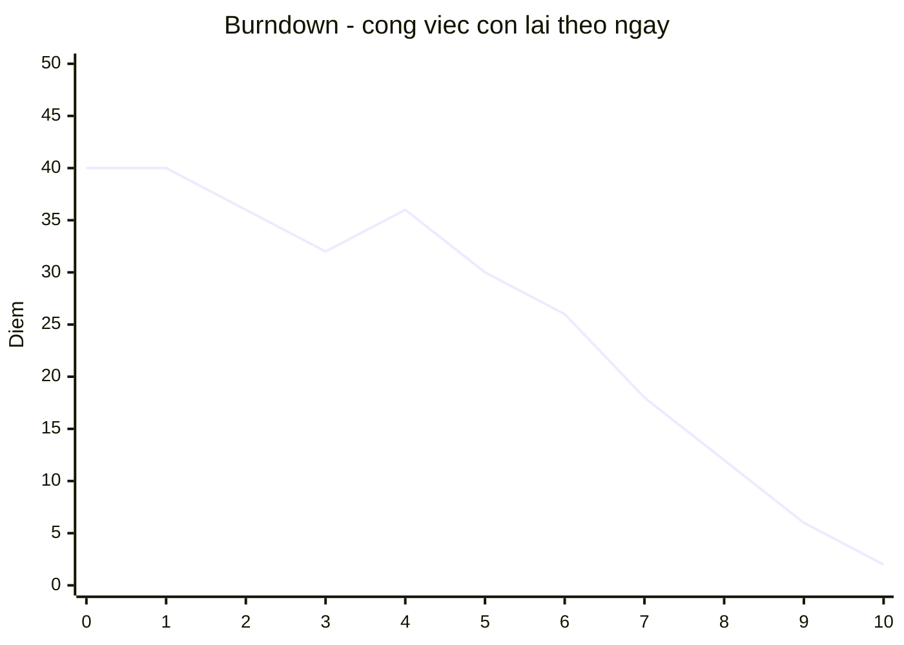
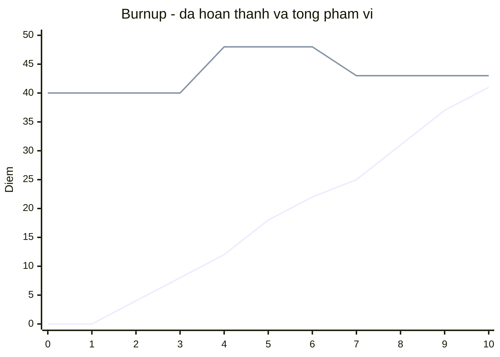
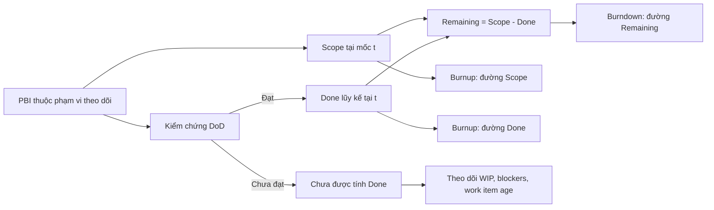

# Sử dụng biểu đồ công việc còn lại và công việc đã hoàn thành

## Mục tiêu học tập

Sau bài học này, bạn có thể:

- Giải thích hai dạng biểu đồ phổ biến trong đo lường Agile: **Burndown chart** (công việc còn lại) và **Burnup chart** (công việc đã hoàn thành so với tổng phạm vi).
- Đọc đúng **trục thời gian, đơn vị công việc, đường thực tế, đường tham chiếu và thay đổi phạm vi**; phân biệt chuyển động của đường biểu đồ với giá trị người dùng thật sự nhận được.
- Xây dựng dữ liệu biểu đồ từ những hạng mục **đã đạt Definition of Done (DoD)**, tránh tính những phần đang làm dở thành đã hoàn thành.
- Tính và giải thích burndown/burnup cho một **Sprint mười ngày**, kể cả khi đội bổ sung hoặc bỏ bớt hạng mục trong phạm vi đang theo dõi.
- Sử dụng biểu đồ để **đặt câu hỏi, tìm điểm nghẽn, điều chỉnh kế hoạch và trao đổi rủi ro**, không dùng biểu đồ làm công cụ gây áp lực cho từng cá nhân.
- So sánh biểu đồ cấp **Sprint, phát hành/release và Product Goal**, nêu tác động của thay đổi scope, đơn vị story points, số lượng hạng mục và giờ công còn lại.
- Phân biệt Burndown/Burnup với **velocity, throughput, cycle time, work item age và Cumulative Flow Diagram (CFD)**; biết khi nào cần bổ sung một góc nhìn khác.
- Thực hành trên ví dụ nền tảng học trực tuyến, tự lập bảng tính, diễn giải số liệu và đề xuất hành động dựa trên bằng chứng.

## 1. Biểu đồ không phải mục tiêu của Agile

Một nhóm đang xây nền tảng học Java có Sprint Goal:

> “Học viên đã ghi danh có thể mở đúng bài học đầu tiên với quyền truy cập hợp lệ.”

Mỗi ngày nhóm cập nhật bảng công việc. Product Owner muốn biết mục tiêu còn rủi ro gì; Developers cần biết hạng mục nào đang kẹt; các bên liên quan muốn hiểu liệu những lát sản phẩm hữu dụng đã thật sự được hoàn tất.

Hai biểu đồ có thể hỗ trợ việc thảo luận:

- **Burndown chart:** đến thời điểm này, **còn bao nhiêu công việc** trong phạm vi theo dõi?
- **Burnup chart:** đến thời điểm này, **đã hoàn thành bao nhiêu công việc**, và **tổng công việc đang được coi là phạm vi** là bao nhiêu?

Nhưng một biểu đồ đẹp không tự bảo đảm:

- Học viên mở đúng bài hoặc không bị lộ nội dung riêng.
- Các hạng mục đạt DoD và tích hợp được.
- Sprint Goal hoặc Product Goal có ý nghĩa và đạt được.
- Hạng mục tiếp theo có thể giao vào một ngày chắc chắn.
- Đội đang làm việc bền vững và học được điều gì từ phản hồi.

**Mục đích của đo lường Agile là cải thiện quyết định**, không phải điều khiển đội để đường biểu đồ luôn có hình dáng “đúng mẫu”.

### 1.1. Bốn câu hỏi cần có trước mọi biểu đồ

1. **Đang đo phạm vi nào?** Sprint Backlog, một lát phát hành, một mục tiêu sản phẩm hay một tập yêu cầu dịch vụ?
2. **Đơn vị đo là gì?** Số PBI, story points, giờ công *còn lại*, hoặc một đơn vị khác có định nghĩa rõ?
3. **Thế nào là hoàn thành?** Chuyển sang “Code review”, “Ready for QA” hay thực sự **Done theo DoD**?
4. **Ai sẽ dùng biểu đồ để quyết định việc gì?** Điều chỉnh Sprint Backlog, nhận diện tắc nghẽn, cập nhật dự báo hay trao đổi về thay đổi phạm vi?

Nếu bốn câu hỏi chưa thống nhất, cùng một biểu đồ có thể được đọc thành nhiều kết luận mâu thuẫn.

## 2. Burndown chart: nhìn công việc còn lại

**Burndown chart** thường có:

- **Trục ngang (X):** thời gian, ví dụ ngày trong Sprint hoặc tuần trước một release.
- **Trục dọc (Y):** công việc còn lại, theo một đơn vị đã định nghĩa.
- **Đường thực tế (actual remaining):** lượng công việc còn lại được ghi tại mỗi mốc.
- **Đường tham chiếu (ideal/guideline), nếu dùng:** cách giảm đều theo một giả định ban đầu để dễ thấy khác biệt; **không phải lời hứa** hoặc thước đo giá trị.

Ví dụ, ban đầu có **40 điểm ước lượng** thuộc phạm vi Sprint. Nếu tất cả các PBI được hoàn tất theo DoD mà **phạm vi không đổi**, lượng còn lại giảm từ 40 về 0.

### 2.1. Công thức khi đơn vị là điểm của các PBI

Với cùng một tập phạm vi tại mốc `t`:

```text
Remaining(t) = Total scope(t) - Done(t)

Total scope(t): tổng điểm ước lượng của các PBI thuộc phạm vi tại t
Done(t):        tổng điểm của các PBI thuộc phạm vi đã đạt DoD tới t
Remaining(t):   tổng điểm của các PBI thuộc phạm vi chưa đạt DoD
```

Điều kiện cần giữ:

- **Cùng một đơn vị** cho scope, Done và remaining.
- Mỗi PBI chỉ được tính **một lần** khi Done; không nhân đôi công việc do một PBI có nhiều task.
- Không tự cho điểm Done theo tỷ lệ “đã code 70%” nếu PBI chưa đáp ứng DoD.
- Nếu scope thay đổi, phải ghi lại **ngày và lý do thay đổi**, không âm thầm xóa lịch sử.
- Nếu một PBI đã Done rồi phải mở lại vì chưa thật sự đạt DoD, dữ liệu cần phản ánh **trạng thái và chính sách đếm nhất quán**, tránh che giấu lỗi.

Đối với **giờ công còn lại**, phép tính có thể xuất phát từ ước lượng còn lại được cập nhật cho từng task, không bắt buộc bằng tổng kế hoạch ban đầu trừ giờ đã làm. Phần này sẽ được tách riêng ở mục sau.

### 2.2. Đường tham chiếu lý tưởng là gì?

Nếu ban đầu có 40 điểm và có 10 ngày làm việc theo dõi, một đường tham chiếu giảm đều có thể là:

```text
Ideal remaining(day) = 40 × (1 - day / 10)

Ngày:             0   1   2   3   4   5   6   7   8   9  10
Ideal remaining: 40  36  32  28  24  20  16  12   8   4   0
```

Đây chỉ là **đường định hướng trực quan** nếu giả định scope cố định và công việc được hoàn thành đều đặn. PBI thường chỉ được tính Done khi toàn bộ điều kiện hoàn thành đạt, nên đường thực tế có thể **đứng ngang nhiều ngày rồi giảm theo bậc**.

**Không được kết luận chỉ từ việc đường thực tế nằm trên ideal rằng Developers “làm chậm”.** Có thể PBI lớn sắp Done, bị chặn ở một phụ thuộc hoặc scope đã thay đổi. Cần kiểm tra hạng mục và mục tiêu thực.

## 3. Burnup chart: nhìn công việc đã hoàn thành và tổng phạm vi

**Burnup chart** thường có:

- **Trục X:** thời gian.
- **Trục Y:** một đơn vị công việc nhất quán.
- **Đường Done:** tổng lượng công việc **đã hoàn thành lũy kế** tại mỗi mốc.
- **Đường Total Scope:** tổng lượng công việc **thuộc phạm vi theo dõi** tại mốc đó.

Khác với burndown, biểu đồ burnup cho thấy **hai biến riêng**: việc nhóm hoàn thành và việc phạm vi được bổ sung hoặc loại bỏ.

### 3.1. Vì sao đường tổng phạm vi quan trọng?

Giả sử tổng scope ban đầu là 40 điểm. Nhóm hoàn thành thêm 4 điểm trong ngày, nhưng Product Owner và Developers làm rõ một yêu cầu mới, thêm 8 điểm vào phạm vi trong điều kiện phù hợp.

- **Done tăng 4 điểm.**
- **Total Scope tăng 8 điểm.**
- **Remaining tăng 4 điểm** so với hôm trước.

Trên burndown, ta chỉ nhìn thấy đường **đi lên**, dễ bị hiểu nhầm là công việc đang lùi lại. Trên burnup, ta thấy **cả hai sự kiện**: đội đã hoàn thành thêm việc *và* scope đã tăng.

### 3.2. Công thức burnup

```text
Done(t)       = tổng lượng công việc đã đạt DoD tại t
Scope(t)      = tổng lượng công việc trong phạm vi theo dõi tại t
Remaining(t)  = Scope(t) - Done(t)
```

Khi **Done bằng Scope**, tất cả công việc thuộc phạm vi đang tính đã hoàn thành. Nhưng nếu scope được cắt xuống, việc hai đường gặp nhau **không có nghĩa** toàn bộ mục tiêu sản phẩm ban đầu đã đạt. Đội phải nêu rõ **công việc đã loại bỏ và tác động đến kết quả người dùng**.

### 3.3. Burnup không giống biểu đồ throughput

- **Burnup:** tổng Done **lũy kế**, từ lúc bắt đầu một phạm vi.
- **Throughput:** số lượng hạng mục **hoàn thành trong một đơn vị thời gian**, ví dụ 4 PBI/tuần.

Nếu tuần 1 hoàn thành 3 PBI, tuần 2 hoàn thành 5 PBI:

```text
Throughput:  tuần 1 = 3; tuần 2 = 5
Burnup Done: hết tuần 1 = 3; hết tuần 2 = 8
```

Không được lấy độ dốc burnup trong một khoảng ngắn làm một cam kết rằng tốc độ tương lai chắc chắn giữ nguyên.

## 4. So sánh Burndown và Burnup

| Khía cạnh | **Burndown** — công việc còn lại | **Burnup** — công việc hoàn thành |
| --- | --- | --- |
| **Câu hỏi trực tiếp** | Còn bao nhiêu việc trong scope? | Đã Done bao nhiêu và tổng scope hiện tại là bao nhiêu? |
| **Đường thường vẽ** | Remaining; có thể thêm ideal. | Done lũy kế và Total Scope. |
| **Đường thuận chiều** | Thường hướng xuống khi việc Done. | Done thường hướng lên khi việc Done. |
| **Tác động khi thêm scope** | Remaining có thể tăng, dù đội vẫn hoàn thành việc. | Đường Total Scope đi lên; đường Done thể hiện đóng góp riêng. |
| **Tác động khi bỏ scope chưa Done** | Remaining có thể giảm **không vì hoàn thành**. | Đường Total Scope đi xuống; Done không nhất thiết tăng. |
| **Ưu điểm** | Đọc nhanh mức việc còn lại, đặc biệt trong Sprint scope tương đối ổn định. | Minh bạch sự khác biệt giữa tiến độ và thay đổi phạm vi. |
| **Giới hạn** | Dễ hiểu sai nguyên nhân đường tăng/giảm nếu không có nhật ký scope. | Hai đường có thể gây cảm giác đã đạt mục tiêu khi scope được cắt hoặc điểm được định nghĩa lại. |
| **Khi hữu ích** | Điều chỉnh kế hoạch, hỏi vì sao việc chưa Done. | Trao đổi với stakeholders về Done, scope và mức độ thay đổi kế hoạch. |

**Không có biểu đồ nào tốt hơn trong mọi tình huống.** Một đội có thể dùng cả hai trên cùng nguồn dữ liệu, hoặc chỉ dùng dạng phục vụ quyết định thực tế. Điều quan trọng là **không làm mất dữ liệu scope và định nghĩa Done**.

## 5. Ví dụ xuyên suốt: Sprint 10 ngày của nền tảng học Java

Giả sử Sprint Goal của Scrum Team là:

> **“Học viên đã ghi danh có thể mở bài học đầu tiên với quyền truy cập chính xác.”**

Sprint Backlog ban đầu có các PBI và điểm ước lượng riêng của đội, tổng **40 điểm**. Đơn vị này chỉ dùng để minh họa theo **quy ước ước lượng nội bộ**, không quy đổi phổ quát sang giờ công.

### 5.1. Các sự kiện trong Sprint

- **Ngày 0:** chốt kế hoạch ban đầu cho phép theo dõi, tổng scope 40, chưa PBI nào đạt DoD.
- **Ngày 4:** qua việc làm rõ cùng Product Owner, đội bổ sung **8 điểm** công việc có liên quan, tổng scope thành 48; việc thay đổi được ghi nhận và được xem xét để **không làm nguy hại Sprint Goal**.
- **Ngày 7:** đội và Product Owner loại **5 điểm** hạng mục chưa Done khỏi phạm vi Sprint để tập trung vào mục tiêu; tổng scope còn 43. Hạng mục bị loại không biến thành Done và vẫn cần quản lý phù hợp ở Product Backlog.
- **Ngày 10:** Sprint kết thúc; **41 điểm** thuộc phạm vi cuối cùng đã đạt DoD, **2 điểm** vẫn chưa hoàn thành.

Đây là ví dụ mô phỏng. Các giá trị cố ý cho thấy **scope thay đổi** để người học phân biệt công việc hoàn thành và việc được chuyển khỏi kế hoạch.

### 5.2. Bộ dữ liệu gốc

| Ngày | Scope trong Sprint | Done lũy kế | Remaining = Scope − Done | Sự kiện đáng chú ý |
| ---: | ---: | ---: | ---: | --- |
| 0 | 40 | 0 | 40 | Kế hoạch ban đầu. |
| 1 | 40 | 0 | 40 | Các PBI đang làm, chưa PBI nào đạt DoD. |
| 2 | 40 | 4 | 36 | Một PBI hoàn thành. |
| 3 | 40 | 8 | 32 | Hoàn thành thêm 4 điểm. |
| 4 | 48 | 12 | 36 | Hoàn thành thêm 4; **scope tăng 8**. |
| 5 | 48 | 18 | 30 | Hoàn thành thêm 6. |
| 6 | 48 | 22 | 26 | Hoàn thành thêm 4. |
| 7 | 43 | 25 | 18 | Hoàn thành thêm 3; **loại 5 điểm chưa Done khỏi Sprint**. |
| 8 | 43 | 31 | 12 | Hoàn thành thêm 6. |
| 9 | 43 | 37 | 6 | Hoàn thành thêm 6. |
| 10 | 43 | 41 | 2 | Sprint kết thúc; còn một phần chưa đạt DoD. |

Có thể tự kiểm tra từng dòng bằng **Scope − Done = Remaining**. Đường Done chỉ tăng tại thời điểm PBI đạt DoD; **không cộng một phần điểm cho code đã viết nhưng chưa hoàn thành kiểm thử hoặc tích hợp bắt buộc**.

### 5.3. Biểu đồ Burndown từ bộ dữ liệu



**Cách đọc:** trục X là ngày 0–10; trục Y là **điểm PBI còn lại**. Đường lên ở ngày 4 không chứng minh đội làm kém: trong ngày nhóm đã Done thêm 4 điểm nhưng scope tăng 8 điểm.

Nếu môi trường Markdown không hỗ trợ `xychart-beta`, **bảng dữ liệu ở mục 5.2 vẫn là nguồn chính xác** để dựng chart bằng spreadsheet hoặc công cụ backlog.

### 5.4. Biểu đồ Burnup trên cùng dữ liệu



Trong biểu đồ trên, **đường thứ nhất** là Done lũy kế `0 → 41`; **đường thứ hai** là Total Scope `40 → 48 → 43`. Hai đường **không gặp nhau** ở cuối Sprint: vẫn còn 2 điểm chưa Done theo định nghĩa đang dùng.

Không cần dựa vào màu mặc định của trình hiển thị để hiểu đồ thị; hãy dùng **thứ tự đường cùng bảng dữ liệu** để xác định ý nghĩa.

### 5.5. Hai biến cố quan trọng được giải thích bằng số học

**Ngày 3 → ngày 4:**

```text
Scope:       40 → 48  (+8)
Done:         8 → 12  (+4)
Remaining:   32 → 36  (+4)

Thay đổi Remaining = +8 scope − 4 Done = +4
```

Mặc dù đội đã hoàn thành thêm 4 điểm, burndown **tăng 4 điểm** vì phạm vi tăng mạnh hơn. Burnup tách riêng hai dòng này.

**Ngày 6 → ngày 7:**

```text
Scope:       48 → 43  (−5)
Done:        22 → 25  (+3)
Remaining:   26 → 18  (−8)

Thay đổi Remaining = −5 scope − 3 Done = −8
```

Burndown giảm 8 điểm **không đồng nghĩa hoàn thành 8 điểm**. Trong ngày chỉ có **3 điểm Done**; phần giảm thêm đến từ **bỏ 5 điểm chưa Done khỏi phạm vi**.

**Bài học:** với scope thay đổi, không đọc độ dốc burndown như một thước đo duy nhất của throughput hoặc năng lực.

### 5.6. Kết luận cuối Sprint có trách nhiệm

Có thể nói:

- Scope Sprint ban đầu: **40 điểm**.
- Tổng điều chỉnh phạm vi: **+8 − 5 = +3 điểm**, nên scope cuối: **43 điểm**.
- PBI đạt DoD trong scope cuối: **41 điểm**.
- Chưa Done: **2 điểm**; không được ghi nhận là Increment hoàn thành.
- Tỷ lệ `41/43 ≈ 95,3%` chỉ mô tả **tỷ lệ điểm của phạm vi cuối cùng**, không có nghĩa đã hoàn thành 95,3% Product Goal, và cũng không tự chứng minh Sprint Goal đạt.

Đánh giá **Sprint Goal** phải dựa trên **Increment hoạt động được và hành vi người học**, không phải từ một tỷ lệ điểm. Nếu hai điểm còn lại thuộc chức năng cốt lõi bảo vệ quyền truy cập, kết quả khác hẳn trường hợp chúng thuộc cải tiến phụ đã được làm rõ.

## 6. Một sơ đồ về cách các đại lượng liên hệ



Sơ đồ cho thấy **Burndown và Burnup có thể tạo ra từ cùng dữ liệu**; khi phát sinh thay đổi scope, cần cập nhật cả hai góc nhìn. Tuy nhiên, một PBI nằm trong WIP chưa Done **vẫn phải được quan sát** qua bảng công việc và tín hiệu flow để quyết định hành động đúng lúc.

## 7. Khi nào dùng số hạng mục, story points hay giờ công còn lại?

Đơn vị đo có ảnh hưởng rất lớn đến cách đọc biểu đồ.

### 7.1. Số lượng PBI (count)

Ví dụ: Sprint có 10 PBI, 6 PBI Done, còn 4 PBI.

**Ưu điểm:** dễ hiểu, ít thao tác, gắn trực tiếp với trạng thái Done.

**Hạn chế:** một PBI sửa nhãn nhỏ và một PBI tích hợp đa hệ thống đều được đếm là **một**, có thể làm biểu đồ che độ lớn và độ bất định. Nếu PBI không tương đối đồng đều, số lượng đơn thuần khó dùng cho dự báo.

Phù hợp khi đội **chia hạng mục tương đối nhỏ và đồng nhất**, hoặc muốn nhìn **số đơn vị công việc** chứ không suy ra công sức.

### 7.2. Story points

Story points là thang **ước lượng tương đối theo quy ước nội bộ đội**, thường phản ánh đánh giá về quy mô/độ phức tạp và bất định của công việc tùy phương pháp đội thống nhất.

**Ưu điểm:** có thể giúp cân nhắc hạng mục khác nhau về quy mô và quan sát mức phạm vi tương đối được hoàn thành.

**Hạn chế:**

- Không phải giờ công và **không có tỷ lệ quy đổi chung** từ points sang ngày/người.
- Điểm giữa hai đội **không mặc nhiên so sánh được**.
- Nếu liên tục định nghĩa lại thang hoặc chia nhỏ PBI để tăng điểm Done, biểu đồ mất ý nghĩa.
- Điểm hoàn thành trong một Sprint **không đo giá trị người dùng trực tiếp**.
- Scrum Guide **không bắt buộc story points, Planning Poker hoặc velocity**.

Nếu đang dùng points, phải giữ **quy tắc ước lượng và theo dõi ổn định đủ để so sánh theo thời gian**, đồng thời công khai thay đổi phạm vi hoặc cách tính.

### 7.3. Giờ công còn lại (remaining effort)

Một số đội theo dõi **ước lượng thời gian làm việc còn lại** của các task:

```text
Remaining effort cuối ngày =
  tổng ước lượng giờ công còn cần để hoàn tất các task còn mở
```

Ví dụ một task ban đầu được ước lượng 20 giờ. Sau khi làm thực tế 8 giờ, đội phát hiện tích hợp ngoài phức tạp hơn, đánh giá **còn cần 25 giờ**.

**Remaining effort là 25 giờ**, không phải `20 − 8 = 12 giờ`. Ước lượng **được cập nhật theo hiểu biết mới**; nó có thể tăng dù người làm đã bỏ công sức.

| Loại con số | Ý nghĩa | Có dùng thay nhau được không? |
| --- | --- | --- |
| **Original estimate: 20 giờ** | Dự kiến khi chưa bắt đầu. | Không đồng nghĩa giờ thực tế. |
| **Spent effort: 8 giờ** | Giờ công đã dùng. | Không chứng minh còn 12 giờ. |
| **Updated remaining: 25 giờ** | Ước lượng mới cho công sức còn cần. | Có thể tăng vì phát hiện rủi ro. |
| **Elapsed time: 3 ngày lịch** | Thời gian đã trôi qua trên lịch. | Không đồng nghĩa giờ công hoặc phần Done. |

Nếu burndown dùng **giờ còn lại**, đường có thể tăng do *re-estimation* mà không phải scope tăng. Do đó cần **ghi nhận riêng thay đổi ước lượng, thay đổi phạm vi và việc thực sự Done**.

### 7.4. Giữ đơn vị phù hợp với câu hỏi

| Câu hỏi | Đơn vị có thể hữu ích | Cảnh báo |
| --- | --- | --- |
| Có bao nhiêu hạng mục Done? | Số PBI, throughput. | Chỉ phù hợp nếu đơn vị công việc có ý nghĩa và quy tắc đếm rõ. |
| Trong scope đã ước lượng, còn bao nhiêu? | Story points nếu đội đã có thực hành phù hợp. | Không dùng points để so sánh cá nhân hoặc giữa các đội. |
| Task nào còn bao nhiêu công sức kỹ thuật? | Giờ/ngày công còn lại được cập nhật. | Không đồng nhất với thời gian theo lịch hay độ chắc chắn của ngày giao. |
| Phát hành đã có bao nhiêu giá trị người dùng? | Tính năng/lát giá trị đã usable, outcome/goal metric. | Một PBI Done không tự chứng minh người học đạt mục tiêu. |

**Không trộn story points và giờ công trên cùng một trục**, cũng không cộng các loại PBI đã được định nghĩa khác nhau mà thiếu quy tắc quy đổi rõ.

## 8. Khi nào một hạng mục được tính là “đã hoàn thành”?

Điểm dễ làm méo cả hai biểu đồ là **định nghĩa Done không nhất quán**.

### 8.1. Definition of Done bảo vệ ý nghĩa của đường Done

Trong Scrum, **Definition of Done** là cam kết gắn với Increment, mô tả trạng thái chất lượng bắt buộc của phần tăng trưởng. PBI chưa đáp ứng DoD **không được coi là một phần của Increment hoàn thành**, dù đã viết xong mã hoặc demo chạy trong môi trường riêng.

Ví dụ PBI “Học viên ghi danh khóa miễn phí” có các điều kiện nghiệp vụ:

- Học viên hợp lệ ghi danh thành công.
- Yêu cầu gửi lại không tạo ghi danh trùng.
- Người chưa xác thực không ghi danh trái phép.
- Quy tắc sức chứa và quyền được xác minh.

Và DoD của sản phẩm có thể yêu cầu:

- Mã đã tích hợp, các kiểm thử liên quan đạt.
- Không có vấn đề quyền/dữ liệu bắt buộc chưa giải quyết.
- Hành trình hoạt động với các phần trước của sản phẩm.
- Các yêu cầu chất lượng, vận hành hoặc tài liệu áp dụng được hoàn tất.

Chỉ khi các điều kiện tương ứng được thỏa mãn thì **điểm của PBI mới được cộng vào Done**, theo cách thống nhất.

### 8.2. Task Done không đồng nghĩa PBI Done

Một PBI có task “viết API”, “tạo DB migration”, “làm UI”, “test quyền”, “tích hợp”. Nếu bốn trong năm task đã xong, PBI vẫn có thể **chưa Done**.

Có thể dùng biểu đồ **remaining task effort** để xem khả năng hoàn thành công việc kỹ thuật, nhưng không được biến nó thành **burnup điểm PBI Done** rồi thông báo sản phẩm đã hoàn tất 80%.

### 8.3. Nếu phát hiện lỗi sau khi hạng mục đã Done

Cần phân biệt:

- **Hạng mục chưa thật sự đạt DoD tại thời điểm đóng:** cần sửa trạng thái và dữ liệu đo theo quy tắc minh bạch, không che giấu điều kiện chưa đạt.
- **Một lỗi mới xuất hiện sau khi sản phẩm đã đạt điều kiện được xác nhận:** tạo công việc sửa lỗi phù hợp, phân tích chất lượng và hậu quả. Không tự động viết lại toàn bộ lịch sử như thể không có phần mềm nào từng hoàn thành.

**Giữ lịch sử sự kiện và chính sách đo nhất quán**, ghi những sửa đổi dữ liệu rõ ràng để biểu đồ không trở thành công cụ tái tạo quá khứ theo mục tiêu báo cáo.

## 9. Phạm vi thay đổi: đọc đường biểu đồ cùng nhật ký quyết định

Trong môi trường Agile, backlog có thể thay đổi khi có phản hồi mới. Nhưng **thay đổi không được che giấu**; đặc biệt trong Sprint cần bảo vệ Sprint Goal.

### 9.1. Sprint Backlog khác Product Backlog

- **Product Backlog** là danh sách công việc cần thiết nhằm cải thiện sản phẩm, được Product Owner quản lý hiệu quả và sắp xếp thứ tự.
- **Sprint Backlog** bao gồm Sprint Goal, các PBI được chọn cho Sprint và kế hoạch tạo Increment do Developers lập, điều chỉnh khi học thêm trong Sprint.
- **Trong Sprint**, phạm vi có thể được làm rõ và thương lượng với Product Owner khi có thêm hiểu biết, **không được làm nguy hại Sprint Goal** và không được hạ chất lượng.
- Sprint Goal là cam kết cần giữ; **không được xem mọi thay đổi điểm trên biểu đồ là một sự cho phép thay đổi mục tiêu tùy ý**.

Các quy tắc trên giải thích vì sao đường scope có thể chuyển động, nhưng **mỗi thay đổi cần lý do và tác động tới mục tiêu**.

### 9.2. Ghi lại thay đổi với nguyên nhân

Một bảng nhật ký tối thiểu:

| Thời điểm | Hạng mục | Loại thay đổi | Độ lớn | Lý do và tác động |
| --- | --- | --- | ---: | --- |
| Ngày 4 | Kiểm chứng quyền mở bài ở điều kiện mới | Bổ sung scope | +8 điểm | Phát hiện trường hợp cần bảo vệ Sprint Goal, đã thống nhất cách xử lý. |
| Ngày 7 | Cải tiến giao diện phụ chưa thiết yếu | Loại khỏi scope Sprint | −5 điểm | Tập trung vào khả năng mở bài an toàn; công việc chưa Done vẫn được xem xét trong Product Backlog. |

Nếu chỉ nhìn burndown, ngày 7 dường như **hoàn thành rất nhanh**. Nhật ký cho thấy 5 điểm được rút khỏi Sprint, không phải đã giao thêm giá trị.

### 9.3. Không được thay đổi baseline âm thầm

Một anti-pattern là cuối Sprint **đặt lại đường ideal** dựa trên scope cuối để mọi thứ nhìn như đúng kế hoạch ban đầu. Điều đó làm biến mất quá trình học hỏi và đánh đổi phạm vi.

Có thể tạo một **đường kế hoạch đã điều chỉnh** để hỗ trợ dự báo từ thời điểm hiện tại, nhưng cần ghi rõ:

- Đây là **kế hoạch cập nhật**, không phải baseline ban đầu.
- Khi nào và vì sao được cập nhật.
- Công việc thêm/bớt hoặc ước lượng thay đổi thế nào.
- Điều gì còn bất định, nhất là các PBI chưa Done.

Mục đích là **minh bạch**, không phải bảo vệ đường biểu đồ khỏi có góc gấp.

## 10. Một đường Burndown có thể kể nhiều câu chuyện

### 10.1. Đường gần như nằm ngang nhiều ngày

**Có thể do:**

- Nhiều PBI đang làm dở, chưa hạng mục nào đạt DoD.
- Nhóm mở quá nhiều việc cùng lúc, WIP cao.
- Công việc bị chặn ở tích hợp/kiểm thử/phê duyệt.
- PBI quá lớn hoặc không chia theo lát giá trị.
- Dữ liệu bảng không được cập nhật đúng thời điểm.

**Câu hỏi nên hỏi:**

- Hạng mục nào đã bắt đầu lâu nhất?
- Điều gì ngăn nó đạt DoD?
- Có thể hỗ trợ hoàn thành một lát trước khi mở thêm việc không?
- Có rủi ro nào với Sprint Goal?

Không kết luận ngay “cả đội không làm gì”.

### 10.2. Đường giảm rất mạnh vào cuối Sprint

**Có thể do:**

- Nhiều hạng mục nhỏ cùng hoàn thành sau kiểm thử tích hợp.
- Phần lớn kiểm thử bị dồn tới cuối Sprint.
- Trạng thái Done được cập nhật muộn.
- Scope đã bị cắt giảm.
- Một hoạt động tích hợp/phê duyệt tập trung chỉ xử lý vào cuối kỳ.

**Hành động:** phân biệt **Done thực sự** và **biến động scope**; xem thử kiểm thử/CI có thể bắt đầu sớm hơn không. Một đường giảm nhanh **không nhất thiết xấu**, nhưng nếu luôn dồn kiểm chứng vào ngày cuối thì rủi ro giao phần mềm hữu dụng tăng.

### 10.3. Đường đột ngột tăng

**Có thể do:**

- Thêm scope.
- Ước lượng công sức còn lại tăng sau khi phát hiện rủi ro.
- Một PBI phải mở lại vì chưa đáp ứng DoD.
- Sửa lỗi dữ liệu theo dõi.

**Hành động:** xem loại dữ liệu và nhật ký thay đổi, không quy nguyên nhân trực tiếp cho tốc độ làm việc.

### 10.4. Đường “đi rất đẹp” nhưng không có phản hồi người dùng

Nếu đội hoàn tất đều một số điểm mỗi ngày nhưng **không có hành trình học viên hữu dụng**, khả năng cao biểu đồ đang đo **đầu ra cục bộ** thay vì giá trị. Cần xem PBI đã được chia đúng lát dọc, đáp ứng DoD, có thể tích hợp và trình bày cho stakeholders hay chưa.

### 10.5. Đường đã về 0

Cần xác minh:

1. Tất cả hạng mục thuộc scope hiện tại **đã đạt DoD**?
2. Có mục nào **bị loại khỏi scope** làm số 0 dễ đạt hơn?
3. Sprint Goal được đánh giá bằng **kết quả** gì?
4. Hành vi hệ thống có đáp ứng yêu cầu chất lượng, bảo mật và dữ liệu không?
5. Bằng chứng mới có gợi điều chỉnh Product Backlog tiếp theo không?

**Remaining bằng 0 là một dữ kiện**, không tự bằng thành công sản phẩm.

## 11. Một đường Burnup có thể kể nhiều câu chuyện

### 11.1. Done tăng, scope ổn định

Đội đang hoàn thành hạng mục trong tập phạm vi tương đối ổn định. Khoảng cách hai đường thu hẹp.

Vẫn cần hỏi: có đảm bảo DoD, giá trị và hạng mục ưu tiên cao nhất chưa? Việc Done tăng đều **không làm biến mất rủi ro** ở các PBI cuối.

### 11.2. Done tăng, scope tăng nhanh hơn

Đội có thể giao thêm phần mềm, nhưng khoảng cách đến mục tiêu theo phạm vi hiện tại **không thu hẹp** hoặc còn mở rộng.

Các câu hỏi:

- Scope tăng vì **bằng chứng mới hợp lý** hay do thay đổi ưu tiên thiếu kỷ luật?
- Các bên đã nhận thông tin về tác động tới dự báo?
- Có thể chia một lát giá trị nhỏ hơn, đàm phán phạm vi hoặc thay cách thử giả thuyết không?
- Cần tách **Product Goal/outcome** khỏi danh sách yêu cầu đang phình to không?

### 11.3. Scope giảm, Done không đổi

Khoảng cách giữa hai đường nhỏ lại, nhưng **không có công việc mới được hoàn thành**. Có thể scope đã được hợp lý hóa, điều này không nhất thiết sai, nhưng cần minh bạch:

- Phần nào đã bỏ?
- Tại sao không còn cần?
- Ảnh hưởng tới người dùng và cam kết như thế nào?
- Có phải chỉ đang “làm cho biểu đồ kết thúc đúng hạn” hay không?

### 11.4. Done tăng nhưng bị mất chất lượng

Một đội có thể tăng Done bằng cách nới tiêu chuẩn, đóng hạng mục khi chưa test và chỉ sửa lỗi sau. Đây là **số liệu tiến độ không đáng tin** nếu DoD bị thay đổi tùy tiện.

Cần giữ **chính sách Done và tiêu chí chất lượng ổn định**, theo dõi lỗi lọt ra và công việc làm lại. Burnup chỉ hữu ích khi điểm Done thực sự có ý nghĩa.

## 12. Biểu đồ cấp Sprint và cấp phát hành khác nhau ở đâu?

### 12.1. Burndown/Burnup của Sprint

- **Mốc X:** thường là các ngày làm việc trong Sprint.
- **Phạm vi:** công việc Sprint được chọn và điều chỉnh theo Sprint Goal.
- **Người dùng chính:** Developers và Scrum Team để thanh tra tiến độ, điều chỉnh kế hoạch.
- **Câu hỏi:** còn hạng mục nào cần hoàn thành để đạt Sprint Goal trong timebox hiện tại?
- **Cảnh báo:** Sprint không được đo thành công chỉ bằng tỷ lệ points; **Sprint Goal và Increment** mới là trọng tâm.

Trong Scrum, **Daily Scrum** để Developers kiểm tra tiến độ tới Sprint Goal và điều chỉnh Sprint Backlog. Burndown/Burnup **có thể hỗ trợ** nhưng **không bắt buộc** trong Scrum Guide.

### 12.2. Burnup của một phát hành hoặc lát sản phẩm lớn

Một release có thể trải qua nhiều Sprint. Burnup thường trực quan vì scope có thể tăng/giảm trong nhiều tuần.

Ví dụ một kế hoạch release có tổng 80 điểm ở thời điểm bắt đầu. Sau đó bổ sung thêm khả năng xác minh quyền và tiếp tục học, tổng scope thay đổi:

| Mốc | Scope của release | Done lũy kế | Remaining | Giải thích |
| --- | ---: | ---: | ---: | --- |
| Khởi đầu | 80 | 0 | 80 | Phạm vi ban đầu. |
| Sau Sprint 1 | 80 | 16 | 64 | Giao lát xem khóa và ghi danh đầu. |
| Sau Sprint 2 | 90 | 35 | 55 | Scope tăng 10 vì yêu cầu mới được làm rõ. |
| Sau Sprint 3 | 90 | 60 | 30 | Tiếp tục các lát tích hợp/tiến độ. |
| Sau Sprint 4 | 100 | 82 | 18 | Scope tăng thêm 10 vì ưu tiên mới. |
| Sau Sprint 5 | 100 | 95 | 5 | Vẫn còn PBI chưa Done. |

Nếu chỉ nhìn **Done: 0 → 95**, ta biết nhóm đã hoàn thành nhiều việc. Nếu nhìn cả **Scope: 80 → 100**, ta thấy kế hoạch release cũng mở rộng 20 điểm. Không được lấy “đã Done 95 điểm” làm bằng chứng hoàn thành 95% **giá trị** mà người học mong muốn.

### 12.3. Product Goal không phải một đường scope duy nhất

**Product Goal** mô tả trạng thái tương lai mong muốn của sản phẩm. Một Product Backlog có thể thay đổi nhiều lần trong lúc đội tiến tới mục tiêu đó. Chia Product Goal thành nhiều PBI giúp tổ chức công việc, nhưng tổng điểm PBI **không phải một thước đo trực tiếp của việc đạt mục tiêu**.

Ví dụ Product Goal: “Học viên có thể tự ghi danh và bắt đầu học an toàn.”

- Burnup có thể cho thấy nhiều PBI đã Done.
- **Outcome** cần quan sát: tỷ lệ ghi danh thành công, số người cần hỗ trợ, sự cố quyền truy cập, khả năng mở bài thực tế.

Vì thế, trong báo cáo cấp sản phẩm nên đặt biểu đồ công việc **cạnh dữ liệu giá trị và chất lượng**, không thay thế chúng.

## 13. Burndown/Burnup và dự báo: sử dụng có điều kiện

Biểu đồ là **dữ liệu về quá khứ và hiện tại**; dự báo tương lai cần thêm giả định.

### 13.1. Vì sao không lấy đường thẳng để hứa ngày hoàn thành?

Nếu nhóm đã hoàn thành 30 điểm trong 6 ngày, việc chia `30/6 = 5 điểm/ngày` rồi tuyên bố 10 điểm cuối **chắc chắn xong trong 2 ngày** là suy luận quá mạnh.

Có thể:

- Các hạng mục còn lại có phụ thuộc hoặc rủi ro lớn hơn.
- Việc mới có thể được thêm hoặc scope được làm rõ lại.
- Kiểm thử và tích hợp chưa xong dù phần mã gần hoàn tất.
- Tốc độ trước đó phụ thuộc PBI nhỏ; điểm nội bộ **không chuyển tuyến tính thành thời gian**.
- Ngày nghỉ, sự cố vận hành hoặc năng lực người tham gia khác đi.

Một đường chiếu thẳng có thể giúp **đặt câu hỏi**, không phải cam kết xác suất hay ngày chắc chắn.

### 13.2. Lịch sử throughput và dữ liệu flow

Khi có dữ liệu lịch sử phù hợp, đội có thể nghiên cứu:

- **Throughput:** số hạng mục hoàn thành trong từng tuần/Sprint.
- **Cycle time:** thời gian từ Started đến Done cho hạng mục đã hoàn thành.
- **Work item age:** thời gian đã trôi qua của hạng mục đang làm.
- **WIP:** số hạng mục đã bắt đầu nhưng chưa hoàn tất.
- **Scope change:** mức thay đổi công việc dự kiến.

Những dữ liệu này hỗ trợ dự báo có điều kiện, ví dụ dự báo theo phân bố throughput hoặc mô phỏng **Monte Carlo** khi đủ dữ liệu và giả định. Nhưng **biểu đồ burndown một Sprint không tự tạo ra xác suất tin cậy**.

### 13.3. SLE khác ngày cam kết release

Trong Kanban, **Service Level Expectation (SLE)** là kỳ vọng về thời gian một hạng mục đi qua workflow, thường được mô tả bằng thời gian và xác suất dựa trên dữ liệu phù hợp.

SLE của **một hạng mục** không đồng nghĩa ngày chắc chắn hoàn thành **cả release** gồm nhiều hạng mục, phụ thuộc và thay đổi scope. Muốn dự báo release, cần mô hình số lượng công việc còn lại, lịch sử giao việc và bất định.

### 13.4. Cách nói có trách nhiệm với stakeholders

Thay vì:

> “Burndown còn 12 điểm, chắc chắn hai ngày nữa xong.”

Nên nói:

> “Ở ngày 8, scope hiện tại 43 điểm và đã Done 31 điểm; còn 12 điểm chưa đạt DoD. Scope đã tăng 8 và giảm 5 điểm trong Sprint. Chúng tôi đang xem các hạng mục bị chặn, mức rủi ro và ảnh hưởng tới Sprint Goal; chưa đủ cơ sở để bảo đảm một ngày hoàn thành chỉ từ đường biểu đồ.”

Điều này **minh bạch và hữu ích hơn** một con số có vẻ chính xác nhưng thiếu căn cứ.

## 14. Phân biệt với Velocity, CFD và thước đo flow

### 14.1. Velocity

**Velocity** thường được đội dùng như số lượng story points của PBI Done trong một Sprint theo thang nội bộ, dùng để xem khả năng nhận việc trong bối cảnh tương tự.

Không nên dùng velocity để:

- So sánh hiệu suất giữa hai đội có thang điểm khác nhau.
- Đặt KPI bắt buộc velocity phải tăng mỗi Sprint.
- Ép tăng ước lượng để tạo số đẹp.
- Thay thế việc kiểm tra chất lượng và outcome.

**Scrum Guide không quy định phải dùng velocity.**

### 14.2. Cumulative Flow Diagram (CFD)

**CFD** thường dùng các vùng/band chồng nhau để biểu diễn số lượng công việc ở các **trạng thái workflow** theo thời gian. Nó hữu ích khi muốn thấy WIP và hàng đợi:

- “Đang phát triển” ngày càng dày lên?
- “Chờ kiểm thử” tăng nhanh?
- Thời gian từ bắt đầu đến Done có dấu hiệu kéo dài?

Burndown có thể **nằm ngang** trong nhiều ngày, nhưng không cho biết liệu hạng mục đang chờ kiểm thử, chờ môi trường hay chờ phân tích. CFD, bảng workflow và work item age cung cấp **ngữ cảnh vận hành**.

### 14.3. Bảng chọn công cụ theo câu hỏi

| Câu hỏi | Biểu đồ/thước đo nên xem | Điều không được suy ra |
| --- | --- | --- |
| Còn bao nhiêu việc trong Sprint? | **Burndown**. | Đường nằm ngang = nhân viên không làm gì. |
| Đã Done bao nhiêu so với scope đang đổi? | **Burnup**. | Hai đường gặp nhau = mục tiêu người dùng đã đạt. |
| Công việc kẹt ở trạng thái nào? | **CFD, bảng workflow, WIP/age**. | Nhìn burndown là biết nơi bị chặn. |
| Mỗi tuần Done bao nhiêu đơn vị công việc? | **Throughput**. | Số PBI Done = giá trị khách hàng. |
| Một PBI đã Done mất bao lâu từ Start? | **Cycle time**. | Trung bình cycle time = cam kết mọi PBI tới. |
| Có bao nhiêu điểm Done trong Sprint? | **Velocity nội bộ nếu dùng points**. | Đội có velocity cao hơn luôn tốt hơn. |
| Người học có nhận lợi ích không? | **Outcome, lỗi, chất lượng và feedback**. | Đã Done nhiều = sản phẩm thành công. |

Có thể kết hợp vài góc nhìn, nhưng không cần tạo **một dashboard quá nhiều số**. Chọn những tín hiệu giúp đội quyết định tốt hơn.

## 15. Cách lập và cập nhật biểu đồ trên thực tế

### Bước 1 — Xác định phạm vi

Nêu rõ:

- Sprint nào, release nào hoặc tập PBI nào?
- Mốc bắt đầu và kết thúc?
- PBI được thêm/bớt theo chính sách nào?
- Những hạng mục bị rút khỏi Sprint có được **giữ lịch sử** và quản lý trong Product Backlog không?

### Bước 2 — Chọn đơn vị đo

Chọn **một đơn vị nhất quán**, ví dụ số PBI hoặc points nội bộ. Nếu dùng remaining task effort, phải thống nhất cách cập nhật ước lượng còn lại.

Không lấy tổng points ban đầu, trừ số giờ đã làm, rồi gọi đó là Remaining.

### Bước 3 — Định nghĩa Done

Dùng DoD và quy tắc tính điểm một lần. Đội cần thống nhất:

- Khi nào một PBI được xem là Done?
- Ai xác minh theo quy tắc chất lượng hiện hành?
- Nếu đã Done rồi phát hiện thiếu DoD, cần sửa lịch sử/trạng thái thế nào?
- Công việc đang ở review/testing được ghi nhận ra sao để không mất tầm nhìn?

### Bước 4 — Lưu các sự kiện thay đổi

Một tập dữ liệu tối thiểu ở cấp PBI có thể gồm:

| Trường thông tin | Ý nghĩa |
| --- | --- |
| `item_id` | Mã hạng mục ổn định, tránh đếm trùng. |
| `scope_id` | Sprint hoặc release mà hạng mục thuộc phạm vi. |
| `estimate_unit` | `item`, `point`, `hour_remaining`... theo chính sách. |
| `estimate_value` | Quy mô hạng mục theo đơn vị đã định. |
| `scope_added_at` / `scope_removed_at` | Thời điểm thay đổi phạm vi, nếu có. |
| `done_at` | Thời điểm hạng mục đạt DoD theo quy tắc. |
| `status` | Trạng thái công việc hiện tại. |
| `scope_change_reason` | Lý do điều chỉnh để giải thích đường biểu đồ. |

Đừng biến biểu đồ thành lý do lưu trữ dữ liệu cá nhân không cần thiết về thành viên đội. Đo **dòng công việc và giá trị**, không theo dõi vi mô từng nhân viên.

### Bước 5 — Tạo bảng snapshot theo từng ngày/mốc

Tại mỗi thời điểm:

1. Cộng **Scope** của các PBI còn thuộc phạm vi.
2. Cộng **Done** của các PBI thuộc phạm vi và đã đạt DoD.
3. Tính **Remaining = Scope − Done**.
4. Ghi chú scope change hoặc sửa dữ liệu.
5. Kiểm tra sự nhất quán trước khi vẽ.

Với hệ thống có giờ công còn lại, snapshot có thể lấy **ước lượng còn lại hiện thời** thay vì `Scope − Done` theo points; **không gộp hai mô hình tính** vào cùng biểu đồ.

### Bước 6 — Vẽ và đặt tên rõ

**Burndown:** trục X thời gian, trục Y Remaining; đường ideal nếu cần và nếu có ý nghĩa.

**Burnup:** trục X thời gian, trục Y Done lũy kế và Total Scope; chú thích các mốc scope thay đổi.

Đặt tên chart có **phạm vi + đơn vị + thời gian**:

> “Sprint 12 — PBI points còn lại — ngày 0–10”.

Không đặt tên mơ hồ “Hiệu suất đội Scrum”.

### Bước 7 — Sử dụng trong cuộc trao đổi phù hợp

Trong Daily Scrum, Developers có thể dùng chart để:

- Nhận diện hạng mục chưa Done ảnh hưởng Sprint Goal.
- Xem WIP đang nhiều hay ít; hỗ trợ công việc gần hoàn thành.
- Điều chỉnh Sprint Backlog và phối hợp với Product Owner về phạm vi nếu cần.
- Kiểm tra bất định tăng do công việc hoặc phụ thuộc mới.

**Daily Scrum không phải buổi báo cáo đường burndown cho cấp trên**, và Scrum Guide không bắt buộc biểu đồ này.

### Bước 8 — Xem lại dữ liệu và cải tiến

Trong Sprint Review và các buổi trao đổi sản phẩm, nhìn cả Increment và phản hồi. Trong Sprint Retrospective, nhóm có thể xem:

- Vì sao công việc thường chỉ Done vào cuối Sprint?
- Vì sao scope tăng liên tục?
- Hạng mục có được chia đủ nhỏ không?
- Các bước kiểm thử và tích hợp có gây chờ?
- Dữ liệu báo cáo có đáng tin không?
- Biện pháp nào cần thử ở Sprint sau?

**Giữ vòng học hỏi**, không thưởng/phạt từ hình dáng đường biểu đồ.

## 16. Chất lượng, thay đổi hành vi và những giới hạn của biểu đồ

### 16.1. Không có chuyện “Done 80%” nếu DoD chưa đạt

Trong Scrum, hạng mục chưa đạt DoD không được tính là Increment hoàn thành. Tránh các cách:

- Tính một nửa story points khi code đã viết xong.
- Đánh dấu Done khi còn kiểm thử quyền hoặc dữ liệu bắt buộc.
- Đưa PBI ra khỏi Sprint chỉ để burndown chạm 0, rồi nói mục tiêu đạt.
- Đổi cách tính điểm vào giữa kỳ nhưng không công bố.

Một đội có thể theo dõi **tiến độ task nội bộ** để hỗ trợ kế hoạch, nhưng không đồng nhất nó với **giá trị đã giao**.

### 16.2. Bảng đẹp không bảo vệ người học khỏi lỗi

Với nền tảng học trực tuyến, các outcome và rủi ro cần theo dõi cạnh biểu đồ:

| Loại | Chỉ số/quan sát ví dụ | Vì sao cần? |
| --- | --- | --- |
| **Outcome** | Học viên ghi danh và mở được bài đầu. | Xác minh giá trị thực, không chỉ điểm Done. |
| **Chất lượng** | Truy cập trái phép bị từ chối đúng; dữ liệu tiến độ không mất. | Bảo vệ người học và niềm tin. |
| **Phản hồi** | Phản ánh về lỗi tiếp tục học, thời gian tìm bài. | Phát hiện nhu cầu và vấn đề mới. |
| **Flow** | Work item age, cycle time, WIP tại bước kiểm thử. | Tìm điểm nghẽn mà burndown chưa chỉ ra. |
| **Vận hành** | Lỗi sau phát hành, khả năng khôi phục nếu cập nhật tiến độ sai. | Đánh giá chất lượng khi sản phẩm chạy thực. |

Một Sprint có burndown về 0 nhưng đưa tính năng sai quyền truy cập tới học viên **không phải ví dụ thành công về Agile**.

### 16.3. Biểu đồ là công cụ mô tả, không phải chứng cứ nguyên nhân

Nếu sau khi giảm WIP, burndown giảm đều hơn, **có thể** nhóm hoàn thành việc trôi chảy hơn. Nhưng cũng có thể PBI nhỏ hơn, scope khác đi, số người tham gia thay đổi hoặc dữ liệu được cập nhật kịp thời hơn.

Để đánh giá một cải tiến, nhóm cần so sánh các yếu tố liên quan và hiểu **thay đổi nào thật sự gây ra tác động**, thay vì nhìn đồ thị có hình dáng khác rồi tuyên bố kết luận chắc chắn.

## 17. Ngộ nhận và anti-pattern thường gặp

### 17.1. “Burndown bắt buộc nếu làm Scrum”

**Sai.** Scrum Guide 2020 không bắt buộc Burndown, Burnup, story points, velocity hay công cụ theo dõi cụ thể. Chúng là kỹ thuật tùy chọn để hỗ trợ **thanh tra và thích nghi**.

**Hành động:** chọn biểu đồ khi nó trả lời một câu hỏi thật của Scrum Team.

### 17.2. “Đường phải giảm đều hằng ngày”

**Sai.** PBI thường được tính Done khi đủ chất lượng, không phải khi đã tiêu tốn một tỷ lệ thời gian. Một số ngày đường nằm ngang là bình thường.

**Hành động:** xem PBI già, blockers, WIP và DoD thay vì ép đội điều chỉnh số liệu cho đẹp.

### 17.3. “Burndown đi lên nghĩa là tốc độ làm việc giảm”

**Không đủ bằng chứng.** Có thể scope tăng hoặc ước lượng remaining tăng sau khi phát hiện rủi ro.

**Hành động:** đối chiếu Scope, Done và nhật ký thay đổi; dùng Burnup nếu cần tách hai biến.

### 17.4. “Burndown giảm mạnh nghĩa là hoàn thành rất nhiều”

**Không luôn đúng.** Nếu loại một PBI chưa Done khỏi scope, Remaining giảm nhưng Done không tăng.

**Hành động:** kiểm tra lượng thực sự đạt DoD và phần bị bỏ khỏi kế hoạch.

### 17.5. “Story points là ngày công nên có thể so sánh các đội”

**Sai.** Points là thang tương đối theo quy ước đội và bối cảnh, không có hệ số quy đổi phổ quát.

**Hành động:** không dùng điểm làm KPI cá nhân hoặc bảng xếp hạng giữa đội.

### 17.6. “Còn 2 điểm nghĩa là mất đúng một giờ”

**Sai.** Hai điểm không đồng nghĩa một số giờ hay ngày cố định. PBI nhỏ vẫn có thể vướng tích hợp, quyền hoặc chờ kiểm thử.

**Hành động:** đọc mô tả hạng mục, rủi ro và phụ thuộc; đừng suy dự báo tuyệt đối từ điểm.

### 17.7. “Mã đã xong 90% nên cho PBI Done 90% điểm”

**Sai nếu dùng PBI Done theo DoD.** “Đã làm nhiều” khác với “đạt điều kiện Done”.

**Hành động:** giữ metric ở cấp PBI theo DoD, dùng tiến độ task để hỗ trợ nội bộ khi cần.

### 17.8. “Đội có burnup cao hơn là đội tốt hơn”

**Không hợp lệ** khi points, scope, kích thước hạng mục, chất lượng và mục tiêu khác nhau.

**Hành động:** đánh giá đội theo khả năng tạo giá trị, chất lượng và cải tiến trong bối cảnh của họ.

### 17.9. “Về 0 là đã đạt Sprint Goal”

**Không chắc.** Scope có thể bị cắt hoặc những hạng mục đã hoàn thành không tạo ra hành vi mục tiêu cần có.

**Hành động:** kiểm tra Increment và Sprint Goal bằng bằng chứng người dùng.

### 17.10. “Cứ tăng velocity là năng suất tăng”

**Không nhất thiết.** Thang ước lượng hoặc cách chia PBI có thể thay đổi, đội có thể ưu tiên task dễ để nâng số.

**Hành động:** xem outcome, lỗi, flow và khả năng giao giá trị xuyên suốt.

### 17.11. “Càng nhiều biểu đồ càng tốt”

**Không chắc.** Dashboard đầy số liệu có thể khiến mọi người chú ý tới hình thức và mất thời gian cập nhật.

**Hành động:** xác định một số quyết định quan trọng và chỉ giữ tín hiệu phục vụ chúng.

### 17.12. “Đổi scope không cần ghi vì Agile luôn đón nhận thay đổi”

**Sai.** Thích nghi cần **minh bạch về mục tiêu, đánh đổi và tác động**. Trong Sprint không nên thay đổi làm nguy hại Sprint Goal.

**Hành động:** ghi thay đổi scope, nêu ai tham gia quyết định và ảnh hưởng tới dự báo.

### 17.13. “Đường đi đúng ideal nghĩa là không có rủi ro”

**Sai.** Hạng mục quyền hoặc dữ liệu quan trọng có thể vẫn còn, dù số điểm còn lại rất nhỏ.

**Hành động:** kết hợp biểu đồ với danh sách rủi ro và độ quan trọng của PBI.

### 17.14. “Đường burnup luôn phải tăng hoặc đứng yên”

Nếu chỉ tính Done của một **phạm vi cố định**, đường Done lũy kế thường không giảm. Nhưng khi **thay đổi tập phạm vi được đo, mở lại hạng mục chưa thật sự Done hoặc sửa dữ liệu**, biểu đồ có thể cần điều chỉnh.

**Hành động:** công bố rõ **quy tắc đo, định nghĩa phạm vi và lịch sử thay đổi**, không chỉnh số kín đáo để duy trì hình dáng mong muốn.

## 18. Bài tập thực hành

### Bài tập A — Tính Burndown từ dữ liệu

Một Sprint có scope cố định **30 điểm**, với Done lũy kế qua 6 mốc:

```text
Mốc:              0   1   2   3   4   5
Done lũy kế:      0   3   9  12  21  26
Scope:           30  30  30  30  30  30
```

Hãy:

1. Tính Remaining tại từng mốc.
2. Vẽ burndown bằng bảng hoặc một công cụ tùy chọn.
3. Xác định ở mốc 5 còn bao nhiêu điểm chưa đạt DoD.
4. Giải thích vì sao Done 26/30 **không tự chứng minh Sprint Goal đã đạt 86,7%**.
5. Nêu hai câu hỏi đội cần hỏi trước khi dự báo có thể hoàn tất vào ngày tiếp theo.

**Đáp án định hướng:** Remaining là **30, 27, 21, 18, 9, 4** điểm. Tỷ lệ 26/30 mô tả points Done trên scope, không đo trực tiếp kết quả mục tiêu.

### Bài tập B — Vì sao Burndown tăng dù đội làm được việc?

Dữ liệu giả định:

- Ngày 3: Scope = 24, Done = 10.
- Ngày 4: Scope = 33, Done = 15.

Trả lời:

1. Remaining ngày 3 và ngày 4 là bao nhiêu?
2. Trong ngày 4 Done tăng bao nhiêu, Scope tăng bao nhiêu?
3. Vì sao burndown có thể đi lên?
4. Burnup sẽ cho thấy hai đường thay đổi thế nào?
5. Người có trách nhiệm nên ghi thông tin scope change nào?

**Đáp án định hướng:** Remaining ngày 3 = **14**, ngày 4 = **18**; Done tăng **5**, Scope tăng **9**, Remaining tăng **4**. Không thể kết luận đội kém năng suất chỉ từ đoạn đường đi lên.

### Bài tập C — Tách việc hoàn thành và cắt phạm vi

Ngày 6: Scope = **50**, Done = **28**. Ngày 7: nhóm Done thêm **4** điểm và bỏ **6** điểm chưa Done khỏi Sprint.

Hãy tính:

- Scope mới.
- Done mới.
- Remaining ở hai mốc.
- Mức giảm của burndown.
- Phần nào của mức giảm do **Done** và phần nào do **bỏ scope**.
- Những điều cần thông báo nếu PBI bị bỏ ảnh hưởng Sprint Goal.

**Đáp án định hướng:** Scope mới **44**, Done **32**, Remaining từ **22** xuống **12**, giảm **10**; trong đó **4** từ Done và **6** do loại scope. Nếu Sprint Goal bị ảnh hưởng, không thể coi đây chỉ là thao tác làm đẹp biểu đồ.

### Bài tập D — Chọn đơn vị đúng

Một nhóm theo dõi:

- PBI A: 3 story points, đã code xong nhưng chưa qua kiểm thử tích hợp.
- PBI B: 5 story points, đã đạt DoD.
- PBI C: task dự kiến ban đầu 16 giờ, đã dùng 8 giờ, phát hiện còn cần 14 giờ.
- PBI D: 2 story points, chưa bắt đầu.

Hãy giải thích:

1. Nếu tính **points Done**, A có được cộng 3 điểm không? Vì sao?
2. B đóng góp bao nhiêu điểm Done?
3. Công việc còn lại của C theo **remaining effort** là bao nhiêu giờ?
4. Có được trừ 8 giờ đã làm khỏi 16 giờ rồi tuyên bố C chỉ còn 8 giờ không?
5. Có được cộng 3 + 5 + 14 + 2 vào một “total scope” duy nhất không?
6. Hãy đề xuất **hai biểu đồ khác nhau** nếu nhóm muốn xem points theo PBI và giờ còn lại theo task.

**Định hướng:** A chưa Done theo DoD; B Done **5 điểm**; C còn **14 giờ** theo ước lượng mới; không trộn đơn vị points và giờ.

### Bài tập E — Đọc một Sprint có đồ thị “đẹp”

Cuối Sprint, burndown về 0 nhưng:

- Product Owner cho biết chức năng mở bài với quyền hợp lệ **chưa thể sử dụng**.
- Một PBI liên quan phân quyền đã bị bỏ khỏi Sprint vào ngày áp cuối.
- Một số PBI “Done” thực tế chưa qua kiểm thử tích hợp.
- Thời gian chờ QA tăng nhiều ngày liên tục.

Hãy:

1. Chỉ ra **những chỗ cần xác minh trạng thái Done và DoD**.
2. Vì sao biểu đồ về 0 không chứng minh Sprint Goal đạt?
3. Burnup kèm scope có thể giúp nhìn thấy điều gì?
4. Cần xem thêm **WIP, work item age, CFD hoặc lỗi tích hợp** như thế nào?
5. Đề xuất hai thay đổi cho Sprint tiếp theo để hoàn tất lát giá trị sớm hơn.

### Bài tập F — Tạo báo cáo Release Burnup

Một release có dữ liệu:

```text
Tuần               0    1    2    3    4
Tổng scope        100  100  115  115  120
Done lũy kế         0   25   45   72   90
```

Hãy:

1. Tính Remaining từng tuần.
2. Nêu tuần nào scope tăng và tổng tăng bao nhiêu.
3. Giải thích vì sao “90 điểm Done” **không tương đương hoàn thành 90% phạm vi hiện tại**.
4. Đề xuất cách vẽ Burnup có **hai đường rõ chú thích**.
5. Giả sử các PBI cuối có phụ thuộc chưa giải quyết; có thể cam kết ngày hoàn thành chỉ từ đường Done không?

**Đáp án định hướng:** Remaining = **100, 75, 70, 43, 30**; scope tăng tổng **20** điểm; tỷ lệ Done cuối là **90/120 = 75% phạm vi hiện tại**, chưa đo outcome và không tạo ra lịch hoàn thành chắc chắn.

### Bài tập G — Chọn metric để giải quyết tắc nghẽn

Một Scrum Team có burndown đứng ngang bốn ngày. Trên bảng workflow thấy:

- 6 PBI đang phát triển.
- 4 PBI đang chờ kiểm thử.
- 1 PBI đã bị chặn bởi môi trường trong 9 ngày.
- Không có PBI nào đạt DoD trong bốn ngày.

Hãy đề xuất:

1. Ba câu hỏi Developers cần thảo luận trong Daily Scrum.
2. Chính sách WIP/pull nào có thể thử để ưu tiên hoàn thành việc?
3. Chỉ số work item age và cycle time sẽ bổ sung điều gì?
4. Những thay đổi kỹ thuật XP nào giúp giảm chờ kiểm thử nếu nguyên nhân phù hợp?
5. Cách đánh giá một Sprint cải tiến mà **không ép burndown phải giảm đều**.

### Bài tập H — Viết thông điệp tiến độ trung thực

Dựa trên bộ dữ liệu ở mục 5, hãy viết cho stakeholders **một đoạn 5–7 câu**, trong đó:

- Nêu scope ban đầu và scope cuối.
- Nêu lượng Done, Remaining và điều kiện Done.
- Giải thích hai lần scope thay đổi.
- Nói rõ Sprint Goal cần được kiểm chứng bằng Increment.
- Nêu một rủi ro hiện còn, nếu chưa đủ dữ liệu thì **không được bịa**.
- Đề xuất bước kiểm tra hoặc quyết định tiếp theo.

**Mẫu định hướng:**

> “Sprint bắt đầu với 40 điểm và kết thúc với scope 43 điểm sau khi bổ sung 8 và loại 5 điểm theo quyết định đã ghi nhận. Có 41 điểm thuộc scope cuối đạt DoD, còn 2 điểm chưa hoàn tất. Burndown đã tăng vào ngày 4 vì scope tăng nhiều hơn phần Done, và giảm mạnh vào ngày 7 một phần do bỏ công việc chưa Done. Các con số cho biết tiến độ hạng mục, chưa đủ để kết luận Sprint Goal đã đạt. Nhóm sẽ kiểm tra Increment thực tế, điều kiện quyền truy cập và các PBI còn mở trước khi đánh giá kết quả Sprint và sắp xếp công việc tiếp theo.”

### Checklist tự đánh giá

| Câu hỏi | Biểu hiện hiểu đúng |
| --- | --- |
| Burndown đo gì? | Công việc còn lại của một scope với đơn vị rõ. |
| Burnup đo gì? | Done lũy kế và tổng scope trên cùng trục đơn vị. |
| Scope thay đổi có ảnh hưởng ra sao? | Burndown có thể tăng/giảm không do Done; burnup cho thấy riêng scope. |
| Done lấy từ đâu? | PBI đạt DoD, không lấy “% code xong” làm Done. |
| Có biết chọn đơn vị? | Phân biệt count, story points và giờ công còn lại, không cộng trộn. |
| Có thể đánh giá Sprint Goal từ điểm không? | Không; cần Increment hữu dụng và kết quả mục tiêu. |
| Có đọc được đường đứng ngang hoặc giảm mạnh? | Đặt giả thuyết, xem WIP/blockers/scope trước khi kết luận. |
| Có biết chọn CFD/flow metrics khi cần? | Dùng WIP, age, cycle time để thấy trạng thái và điểm chờ. |
| Có dùng biểu đồ để dự báo có trách nhiệm? | Nêu giả định, bất định và giới hạn; tránh hứa ngày chắc chắn. |

## 19. Ghi nhớ cốt lõi

1. **Burndown chart** cho biết **công việc còn lại** theo thời gian; **Burnup chart** thể hiện **công việc Done lũy kế** cùng **tổng phạm vi**.
2. Hai loại biểu đồ có thể tạo từ **cùng một bộ dữ liệu**, khi đơn vị nhất quán: `Remaining = Scope − Done`.
3. **Scope tăng** có thể làm burndown đi lên dù đội vẫn Done thêm việc; **scope giảm** có thể làm burndown đi xuống mà **không có phần việc mới hoàn thành**.
4. Với Scrum, chỉ tính PBI **đạt Definition of Done** là hoàn thành; không gộp code complete, task complete và Increment Done thành cùng trạng thái.
5. **Story points** là ước lượng tương đối nội bộ, không phải giờ công; **remaining effort** cần được cập nhật theo hiểu biết mới, không đơn giản bằng ước lượng ban đầu trừ công sức đã dùng.
6. **Đường ideal là tham chiếu**, không phải hợp đồng tốc độ. Burndown nằm ngang, nhảy bậc hoặc tăng không tự xác định nguyên nhân, năng suất hay chất lượng.
7. **Scrum Guide không bắt buộc burndown, burnup, velocity hoặc points.** Scrum Team dùng công cụ nào giúp thanh tra tiến độ tới mục tiêu và thích nghi tốt hơn.
8. Biểu đồ công việc **không thay Sprint Goal, Product Goal, Increment, DoD hoặc phản hồi người dùng**; phải xem cùng dữ liệu giá trị và chất lượng.
9. **CFD, throughput, cycle time, work item age và WIP** giúp lý giải điểm nghẽn và khả năng dự báo mà Burndown/Burnup chưa thể hiện.
10. **Đo lường Agile tốt làm rõ thực tế, thúc đẩy học hỏi và điều chỉnh kế hoạch**, chứ không tạo KPI hình thức hay che giấu thay đổi phạm vi.

Khi nhìn một đường biểu đồ, hãy hỏi:

> **“Con số này đã thay đổi do hạng mục thực sự đạt Done, do phạm vi được điều chỉnh, do ước lượng thay đổi hay do cách đo — và điều đó ảnh hưởng thế nào tới giá trị chúng ta đang cố giao cho người dùng?”**

## Nguồn tham khảo

- [The Scrum Guide (2020)](https://scrumguides.org/scrum-guide.html) — Scrum Team, Sprint Goal, Product Backlog, Sprint Backlog, Increment và Definition of Done; Scrum không quy định bắt buộc burndown/points.
- [Manifesto for Agile Software Development](https://agilemanifesto.org/) và [Principles behind the Agile Manifesto](https://agilemanifesto.org/principles.html) — giao phần mềm hữu dụng, cộng tác, đón nhận thay đổi và cải tiến liên tục.
- [The Kanban Guide](https://kanbanguides.org/the-kanban-guide/) — workflow, WIP, throughput, work item age, cycle time và Service Level Expectation.
- [Scrum.org — Evidence-Based Management](https://www.scrum.org/resources/evidence-based-management-guide) — tư duy đo lường giá trị và cải tiến bằng bằng chứng, thay vì chỉ đếm đầu ra.
- [Agile Alliance — Glossary](https://agilealliance.org/agile101/agile-glossary/) — các thuật ngữ Agile, gồm các kỹ thuật theo dõi và dự báo thường dùng; không thay các định nghĩa chính thức trong Scrum Guide.
