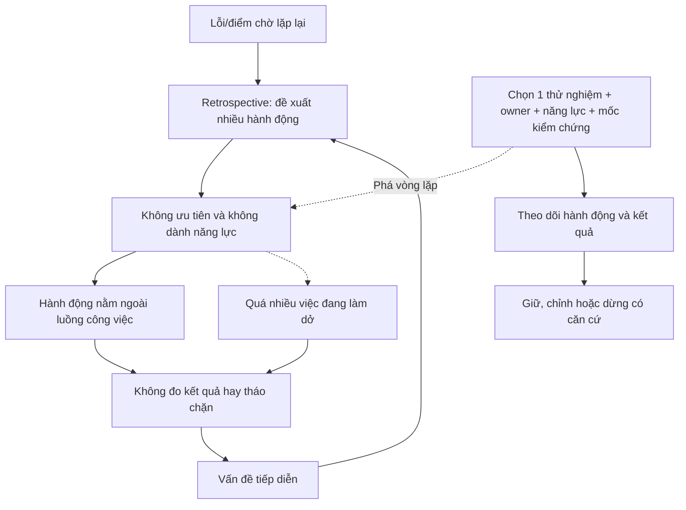

# Nhận diện cải tiến hình thức và các hành động liên tục bị bỏ quên

## Mục tiêu học tập

Sau bài học này, bạn có thể:

- Phân biệt **cải tiến liên tục thật sự** với **cải tiến hình thức**: thay đổi tên cuộc họp, vẽ thêm biểu đồ hoặc ghi nhiều hành động nhưng không làm công việc trở nên tốt hơn.
- Nhận ra các dấu hiệu **retrospective theater** (hồi tưởng theo nghi thức), **action-item graveyard** (danh sách hành động bị lãng quên), cải tiến chỉ tồn tại trên bảng và những vòng lặp vấn đề lặp đi lặp lại.
- Phân tích vì sao hành động không được thực hiện: **không có năng lực dành riêng, không ai chịu trách nhiệm thúc đẩy, phạm vi quá lớn, phụ thuộc ngoài đội, không có tín hiệu kiểm chứng hoặc môi trường thiếu an toàn để nói thật**.
- Thiết kế một **thử nghiệm cải tiến nhỏ** theo vòng **Plan–Do–Check/Study–Act (PDCA/PDSA)**, có giả thuyết, mốc dữ liệu ban đầu, người điều phối, giới hạn thời gian và điều kiện xem lại.
- Sử dụng **improvement backlog/nhật ký hành động**, các chính sách rõ về WIP, ưu tiên, minh bạch và cách quyết định **tiếp tục – điều chỉnh – dừng** một cải tiến.
- Phân biệt **đầu ra** (đã tổ chức workshop, đã sửa bảng), **thay đổi hành vi làm việc** và **kết quả** (ít thời gian chờ, ít lỗi lọt, đạt mục tiêu người dùng tốt hơn).
- Kết nối hoạt động cải tiến với **Scrum Retrospective, Scrum Team accountabilities, Kanban, XP, Lean và Agile**, nhưng không gán các mẫu bảng hay KPI tùy chọn thành quy định bắt buộc.
- Thực hành trên đội phát triển **nền tảng học trực tuyến**, từ việc kiểm thử liên tục bị dồn cuối Sprint tới một kế hoạch thử nghiệm và đo tác động minh bạch.

## 1. Tình huống mở đầu: “Chúng ta đã cải tiến chuyện này rồi mà?”

Một Scrum Team phát triển nền tảng học Java tổ chức **Sprint Retrospective** đều đặn. Ba Sprint gần nhất, bảng thảo luận liên tục ghi những câu:

- “Kiểm thử tích hợp luôn đến quá muộn.”
- “Có quá nhiều việc đang làm dở.”
- “Cần giao tiếp tốt hơn giữa backend và người kiểm thử.”
- “Mỗi Sprint hãy cố gắng hoàn thành sớm hơn.”

Cuối mỗi buổi, cả đội chụp ảnh bảng, thêm một cột *Action items* và kết thúc bằng lời hứa “Sprint sau sẽ cải thiện”. Nhưng Sprint kế tiếp:

1. Developers vẫn nhận nhiều PBI mới trước khi hoàn tất những PBI đang kẹt.
2. Kiểm thử API vẫn bắt đầu khi phần lớn tính năng đã viết xong.
3. Những hành động từ buổi trước **không xuất hiện trong kế hoạch thực hiện**.
4. Không ai biết một hành động đã được làm đến đâu, có tác dụng gì, hoặc vì sao không được làm.
5. Đến Retrospective tiếp theo, nhóm lại thảo luận **cùng vấn đề với cùng giải pháp**.

Nhóm có thể rất chăm chỉ và trung thực. Vấn đề là **vòng cải tiến bị đứt ở đoạn từ quyết định sang hành động và học từ kết quả**.

Đây là một dạng **cải tiến hình thức**: tổ chức hoạt động mang tên cải tiến nhưng hệ thống làm việc vẫn gần như giữ nguyên.

> **Cải tiến không được xác nhận bởi số cuộc họp, số ý tưởng hay số thẻ hành động. Cải tiến được kiểm chứng khi cách làm thực sự đổi và đội có bằng chứng để biết thay đổi đó hữu ích, vô ích hay cần điều chỉnh.**

### 1.1. Ba loại kết quả khác nhau

| Loại | Ví dụ | Nó chứng minh điều gì? |
| --- | --- | --- |
| **Hoạt động (activity)** | Đã tổ chức Retrospective 60 phút. | Buổi họp đã diễn ra. |
| **Đầu ra (output)** | Đã tạo 12 action items và cập nhật một bảng Jira. | Đã tạo hiện vật hoặc quyết định. |
| **Thay đổi hành vi (behavior)** | Đội giới hạn công việc đang làm, hỗ trợ hoàn thành PBI bị chặn và chạy kiểm thử tích hợp sớm. | Cách phối hợp đã thay đổi theo hướng được thử nghiệm. |
| **Kết quả (outcome)** | Ít PBI tồn đọng lâu hơn, ít lỗi tích hợp phát hiện muộn hơn, học viên nhận được Increment hữu dụng ổn định hơn. | Có tín hiệu rằng hệ thống đang hoạt động tốt hơn theo mục tiêu. |

Một hoạt động và đầu ra **có thể cần thiết**, nhưng chưa đủ để gọi là cải tiến thành công.

### 1.2. Vì sao không nên đổ lỗi cá nhân ngay?

Nếu hành động “tự động hóa kiểm thử” không được thực hiện, có thể vì:

- Không ai có quyền ưu tiên công việc đó.
- Đội liên tục bị kéo vào xử lý sự cố production.
- Hành động quá lớn và không có lát đầu rõ.
- Thiếu môi trường CI hoặc dữ liệu kiểm thử cần thiết.
- Một phụ thuộc tổ chức chưa được giải quyết.
- Nhóm tưởng hành động là trách nhiệm của người khác.
- Mỗi Sprint mọi người được đánh giá bằng **số tính năng mới**, khiến cải tiến kỹ thuật bị đẩy khỏi kế hoạch.

Chẩn đoán phải nhìn **hệ thống ưu tiên, năng lực, chính sách và phụ thuộc**, không chỉ quy cho “mọi người thiếu quyết tâm”.

## 2. Cải tiến liên tục thật sự là gì?

Trong bối cảnh Agile, **cải tiến liên tục** là quá trình quan sát công việc và kết quả, xác định một vấn đề quan trọng, thử thay đổi cách làm, kiểm chứng ảnh hưởng rồi duy trì, điều chỉnh hoặc loại bỏ giải pháp dựa trên bằng chứng.

Cải tiến có thể liên quan tới:

- **Giá trị sản phẩm:** hiểu người học tốt hơn, giảm việc xây tính năng không ai dùng.
- **Dòng công việc:** giảm WIP, thời gian chờ, hạng mục bị chặn và sự đổi ngữ cảnh.
- **Chất lượng kỹ thuật:** phát hiện lỗi sớm, kiểm thử đáng tin, tích hợp thường xuyên, kiến trúc dễ sửa.
- **Cộng tác:** trao đổi sớm về các giả định, rõ trách nhiệm, giảm bàn giao không cần thiết.
- **Phát hành và vận hành:** quan sát tốt hơn, khôi phục nhanh hơn, giảm rủi ro khi thay đổi.
- **Sự bền vững:** giữ nhịp làm việc có thể duy trì, hạn chế làm thêm liên tục để bù những lỗi hệ thống.

**Liên tục** không nhất thiết nghĩa là “phải thay một quy trình mỗi ngày”. Nó nghĩa đội có khả năng **thường xuyên nhận tín hiệu, học và điều chỉnh** trong phạm vi phù hợp, không chỉ cải tiến khi dự án gặp khủng hoảng.

### 2.1. Một cải tiến tốt gồm cả thử nghiệm thất bại

Một thử nghiệm có giả thuyết rõ và kiểm chứng được có thể cho kết quả **không cải thiện**. Nếu đội phát hiện sớm, không che giấu dữ liệu và chọn hướng tốt hơn, đó vẫn là **học hỏi có giá trị**.

Ví dụ:

> Giả thuyết: “Rút Daily Scrum từ 15 phút xuống 7 phút sẽ giúp phối hợp tốt hơn.”

Sau thử nghiệm, thời gian họp giảm nhưng PBI bị chặn không được nhắc đến và thời gian chờ tăng. Đội có thể kết luận **không nên tiếp tục thay đổi này**, hoặc thử một cách điều phối khác. Cải tiến không yêu cầu mọi thử nghiệm đều “thành công trên báo cáo”.

### 2.2. Cải tiến hình thức có thể không hề vô dụng trong mọi trường hợp

Đổi cách đặt tên bảng hoặc rút gọn cuộc họp **có thể hữu ích** nếu nó giải quyết một vấn đề thật được quan sát, ví dụ giảm hiểu nhầm trạng thái công việc.

Nó trở thành **hình thức** khi:

- Không có vấn đề cần giải quyết được diễn đạt rõ.
- Không thay đổi chính sách/hành vi hoặc không ai sử dụng kết quả.
- Không có cách nhận biết tác động.
- Chỉ dùng để chứng minh “đội đang Agile”.
- Chi phí nghi thức lớn hơn lợi ích, nhưng không ai được phép xem lại.

**Không đánh giá bằng vẻ ngoài của thực hành; đánh giá theo vấn đề, hành vi và kết quả.**

## 3. Mười hai dấu hiệu đội đang “cải tiến trên giấy”

| Dấu hiệu | Vì sao đáng nghi? | Câu hỏi cần hỏi |
| --- | --- | --- |
| **1. Cùng một vấn đề xuất hiện qua nhiều retrospective.** | Vòng hành động và học hỏi có thể chưa hoàn tất. | Các hành động trước đã được thực hiện, dừng hay bị chặn? |
| **2. Action items chỉ là khẩu hiệu.** | “Giao tiếp tốt hơn” không có thay đổi cụ thể. | Tuần tới ai làm khác đi điều gì? |
| **3. Không có người thúc đẩy.** | Trách nhiệm bị hòa tan dù cả đội đồng ý. | Ai điều phối thực hiện và giúp tháo chặn? |
| **4. Hành động không có chỗ trong kế hoạch/năng lực.** | Công việc cải tiến luôn thua việc cấp bách. | Đã dành năng lực nào và điều gì được giảm ưu tiên? |
| **5. Mở quá nhiều hành động cùng lúc.** | Hành động trở thành một lớp WIP mới. | Có thể tập trung thử một thay đổi quan trọng trước? |
| **6. Đóng thẻ khi đã làm hoạt động, không kiểm chứng kết quả.** | Đầu ra bị gọi nhầm là outcome. | Sau khi triển khai, chờ đợi/lỗi/giá trị đổi ra sao? |
| **7. Chỉ sửa bảng/công cụ, không sửa chính sách.** | Giao diện thay nhưng dòng công việc không đổi. | Điều kiện kéo việc, Done và xử lý blocker có thay? |
| **8. Tăng KPI nhưng công việc người dùng không tốt lên.** | Chỉ số có thể bị tối ưu bằng cách chơi với định nghĩa. | Có chỉ số bảo vệ chất lượng và outcome không? |
| **9. Không có kiểm tra lại hành động cũ.** | Nhóm luôn tạo thêm ý tưởng mà không học từ thử nghiệm. | Khi nào nhóm xem lại bằng chứng và quyết định giữ/sửa/bỏ? |
| **10. Vấn đề ngoài quyền đội bị ghi là “cần cố gắng hơn”.** | Không xử lý phụ thuộc, năng lực hoặc cơ chế tổ chức. | Ai có thẩm quyền tháo chặn và kênh nào? |
| **11. Không ai dám nói điều chưa tốt.** | Dữ liệu cải tiến bị méo vì sợ đổ lỗi. | Có cách nêu rủi ro an toàn, được phản hồi nghiêm túc? |
| **12. Mỗi Sprint đổi một quy trình mới mà không theo dõi.** | Không biết thay đổi nào có tác dụng, tăng chi phí đổi ngữ cảnh. | Thử nghiệm nào đang chạy, bao lâu và tiêu chí dừng? |

**Một dấu hiệu không đủ để kết luận đội làm hình thức.** Ví dụ cùng một trở ngại lặp lại có thể vì vấn đề tổ chức thực sự khó, không phải đội không cố gắng. Cần kiểm tra **bằng chứng tiến triển, phạm vi quyền quyết định và phản hồi**.

### 3.1. Ví dụ cải tiến chỉ thay tên

Trước: bảng có các cột `To Do → Doing → Testing → Done`.

Sau “cải tiến”: đổi thành `Ready → In Progress → Verification → Complete`.

Nếu đội vẫn mở 12 PBI cùng lúc, không giới hạn WIP, không nêu điều kiện “Complete”, và công việc tiếp tục đợi kiểm thử nhiều ngày, **thay tên cột không giải quyết nút thắt**.

Nhưng nếu việc đổi tên đi kèm **định nghĩa workflow mới, chính sách WIP, điều kiện chuyển trạng thái và cuộc trao đổi cụ thể**, nó có thể là phần nhỏ của một cải tiến thực.

## 4. “Hành động liên tục bị bỏ quên” là tình trạng gì?

Một hành động cải tiến có thể bị bỏ quên theo nhiều cách:

1. **Không ghi lại:** cả đội đồng ý bằng lời nhưng sau họp không ai còn nhìn thấy.
2. **Có ghi nhưng không được ưu tiên:** thẻ tồn tại ngoài Product/Sprint Backlog hoặc luồng công việc thực.
3. **Có người được gán nhưng không có năng lực:** vẫn phải hoàn thành toàn bộ phạm vi khác.
4. **Đang làm dở nhưng không có tiến triển:** gặp phụ thuộc rồi nằm im.
5. **Bị thay bởi việc mới:** hành động cũ không được quyết định dừng hay tiếp tục.
6. **Đã thực hiện nhưng chưa kiểm chứng:** không ai biết tác dụng.
7. **Đã thất bại nhưng không được ghi nhận:** nhóm lại thử đúng cách cũ trong Sprint sau.
8. **Bị coi là công việc phụ của một cá nhân:** thay đổi chung phụ thuộc một người, không có cơ chế phối hợp.
9. **Được mở lại lặp lại:** cùng vấn đề đã xử lý bề mặt nhưng nguyên nhân cốt lõi vẫn còn.
10. **Được đánh dấu Done sai:** một công cụ được cài đặt, nhưng chính sách và hành vi cũ không thay.

### 4.1. Phân biệt “bỏ quên” và “quyết định hoãn có căn cứ”

Nếu nhóm nhận ra một hành động **ít giá trị hơn việc khắc phục lỗi dữ liệu nghiêm trọng**, họ có thể chủ động hoãn hoặc dừng. Đây **không nhất thiết là thất bại cải tiến** nếu quyết định được ghi và truyền đạt:

- Hành động nào bị hoãn/dừng?
- Vì sao? Có dữ liệu hoặc rủi ro mới nào?
- Ai có quyền quyết định?
- Khi nào cần xem lại, hoặc điều kiện nào sẽ kích hoạt?
- Có tác động còn lại mà stakeholders cần biết không?

**Điều đáng lo là sự im lặng và trạng thái mập mờ**, không phải việc mọi ý tưởng phải được làm bằng mọi giá.

### 4.2. Một hành động bị chặn vẫn là dữ liệu có ích

Ví dụ: “Thiết lập kiểm thử API tự động” bị chặn vì môi trường CI không cho phép tạo database thử.

Nếu nhóm ghi rõ **phụ thuộc, người có quyền giải quyết, thời gian chờ và lựa chọn thay thế**, đây là thông tin để cải tiến dòng công việc ở cấp tổ chức. Nếu chỉ ghi “Developers thiếu chủ động”, nhóm có thể bỏ qua nguyên nhân chính.

## 5. Vì sao cải tiến bị bỏ quên? Nhìn vòng lặp hệ thống

Một cơ chế điển hình:

Cách phản ứng tốt không phải tạo thêm biểu mẫu để “kiểm soát” sự trì hoãn. Nó là **sửa cơ chế chuyển ý tưởng thành công việc có thể được thực hiện, kiểm chứng và học**.

### 5.1. Năm nhóm nguyên nhân cần xem xét

| Nhóm nguyên nhân | Dấu hiệu | Hành động điều tra |
| --- | --- | --- |
| **Ưu tiên/năng lực** | Mọi Sprint đều kín đặc tính năng, cải tiến không được chọn. | Làm minh bạch đánh đổi và mức năng lực thực tế dành cho cải tiến. |
| **Quyền quyết định** | Đội cần người ngoài phê duyệt nhưng không biết gọi ai. | Xác định người có thẩm quyền, phụ thuộc và cơ chế escalation. |
| **Cách diễn đạt** | “Cải thiện communication”, không có thử nghiệm cụ thể. | Viết lại thành hành vi có thể quan sát và kết quả mong muốn. |
| **Thiếu dữ liệu** | Không biết vấn đề tệ tới đâu hoặc cải tiến có tác dụng không. | Thu một baseline nhỏ đủ dùng trước khi thay đổi. |
| **An toàn tâm lý và văn hóa** | Thành viên né nói vấn đề, bị phê bình khi nêu lỗi. | Tạo kênh trao đổi an toàn, xử lý phản hồi không đổ lỗi. |

### 5.2. Hỏi “tại sao” nhưng tránh kết luận quá sớm

**Five Whys (5 lần hỏi tại sao)** có thể giúp đào sâu, nhưng không phải công thức bảo đảm tìm được một “root cause” duy nhất. Hệ thống phần mềm thường có nhiều nguyên nhân tương tác.

Ví dụ:

> Vấn đề: kiểm thử tích hợp thường phát hiện lỗi vào cuối Sprint.

- Vì sao kiểm thử muộn? Hạng mục chỉ được chuyển cho người kiểm thử khi code đã “hoàn thành”.
- Vì sao chuyển muộn? Nhóm tách công việc thành backend/frontend/test, thiếu lát dọc.
- Vì sao không làm lát dọc? Chính sách ưu tiên đẩy nhiều phần “bắt đầu mới” hơn “hoàn tất”.
- Vì sao chính sách như vậy? Dashboard và báo cáo đang thưởng việc bắt đầu nhiều, không nhìn tuổi công việc.
- Vì sao không điều chỉnh? Cải tiến thay đổi chính sách không có chỗ trong kế hoạch và cần sự đồng thuận của người phụ trách delivery.

Đây mới là **chuỗi giả thuyết**, chưa chắc là sự thật. Đội cần nhìn dữ liệu workflow, thử chính sách và lắng nghe người có liên quan, không biến một sơ đồ nguyên nhân thành kết luận đạo đức về con người.

## 6. Vòng PDCA/PDSA: từ ý tưởng cải tiến đến bằng chứng

**PDCA** thường được trình bày là **Plan–Do–Check–Act**; **PDSA** nhấn mạnh **Plan–Do–Study–Act**. Cả hai có thể được dùng để minh họa vòng thử nghiệm và học hỏi có kiểm chứng.

| Bước | Câu hỏi cần trả lời | Ví dụ về kiểm thử tích hợp muộn |
| --- | --- | --- |
| **Plan** | Vấn đề, bằng chứng nền, giả thuyết, cách thử, ngưỡng bảo vệ, ai làm, khi nào xem lại? | “Giới hạn WIP và kiểm tra API sớm có thể làm giảm tuổi PBI chờ kiểm thử.” |
| **Do** | Tiến hành thay đổi ở phạm vi nhỏ có kiểm soát; ghi những gì thực sự xảy ra. | Một luồng công việc trong Sprint thử giới hạn WIP và ghép cặp khi gần Done. |
| **Check/Study** | So sánh quan sát với giả thuyết; xem dữ liệu và tác dụng phụ. | So tuổi PBI, cycle time, lỗi lọt, thời gian hỗ trợ và điểm chặn. |
| **Act** | Duy trì, mở rộng, điều chỉnh hay dừng? Cập nhật chính sách và backlog? | Tiếp tục nếu có ích và bền vững; thay nếu chỉ chuyển hàng đợi sang nơi khác. |

**Đừng coi PDCA là thủ tục bắt buộc của Scrum Guide.** Đây là một khung tư duy cải tiến chung; đội có thể dùng các cách phản hồi phù hợp khác.

### 6.1. Một giả thuyết cải tiến đủ cụ thể

Câu mơ hồ:

> “Sprint sau chúng ta sẽ kiểm thử tốt hơn.”

Câu có thể kiểm chứng:

> “Nếu giới hạn số PBI đang phát triển và hỗ trợ kiểm thử API trước khi bắt đầu PBI mới, thì tuổi các PBI chờ kiểm thử có thể giảm, trong khi lỗi phân quyền nghiêm trọng không tăng.”

Câu này có:

- **Can thiệp:** giới hạn WIP, thay cách phối hợp.
- **Dự kiến:** giảm thời gian chờ.
- **Điều kiện bảo vệ:** không làm lỗi nghiêm trọng tăng.
- **Khả năng quan sát:** số PBI và thời gian ở trạng thái chờ kiểm thử.

Chưa có con số ngưỡng được chọn; cần xem baseline thực tế và khả năng đo trước khi quyết định.

### 6.2. Phân biệt hoạt động và giả thuyết kết quả

| Cải tiến được đề xuất | Đầu ra có thể quan sát | Kết quả cần đánh giá |
| --- | --- | --- |
| Thêm cột **Blocked** vào bảng. | Cột và chính sách đánh dấu được tạo. | PBI bị chặn được tháo sớm hơn; người cần giúp biết cách hỗ trợ. |
| Viết thêm kiểm thử API. | Các test mới có mặt trong CI. | Lỗi API được phát hiện sớm hơn, ít hồi quy hơn, pipeline đáng tin. |
| Giảm WIP. | Chính sách WIP được áp dụng và người trong đội tuân thủ. | Ít việc già/chờ, cycle time và chất lượng có cải thiện phù hợp. |
| Tổ chức họp refinement sớm. | Buổi trao đổi và các ví dụ nghiệp vụ được ghi lại. | Ít hiểu sai điều kiện chấp nhận, giảm làm lại do lệch nghiệp vụ. |
| Đổi công cụ quản lý ticket. | Dữ liệu đã chuyển sang công cụ mới. | Quyết định, cộng tác hoặc flow thực sự được cải thiện. |

Một cải tiến có thể có **nhiều hiệu ứng**: giảm WIP khiến một loại thời gian chờ giảm nhưng làm một hàng đợi khác tăng. Cần theo dõi **tác dụng phụ** trước khi kết luận.

## 7. Thiết kế action item có thể làm và có thể học

Một action item tốt không nhất thiết dài; nó phải đủ rõ để không cần giải đoán lại trong Sprint tiếp theo.

### 7.1. Bảy thành phần thực dụng

1. **Vấn đề và bằng chứng:** có hiện tượng nào cần đổi? Dữ liệu nền là gì?
2. **Hành vi/thay đổi cụ thể:** đội sẽ thử làm khác điều gì?
3. **Giới hạn phạm vi:** thử ở loại công việc, module hoặc thời gian nào?
4. **Người điều phối (owner/driver):** ai theo dõi tiến triển và chủ động gọi hỗ trợ?
5. **Năng lực và phụ thuộc:** thời gian/nguồn lực nào dành để làm, có ai cần phối hợp?
6. **Tín hiệu/điều kiện bảo vệ:** làm sao biết kết quả hữu ích hoặc có hại?
7. **Mốc xem lại và quyết định:** ngày/sự kiện nào để đánh giá **giữ, chỉnh, bỏ hoặc mở rộng**?

Không nhất thiết biến mỗi mục thành form dài. Với một thay đổi rất nhỏ, một dòng có thể đủ. Với thay đổi quyền truy cập hoặc DB, cần thêm đánh giá rủi ro và cơ chế khôi phục.

### 7.2. Bảng chuyển “khẩu hiệu” thành thử nghiệm

| Câu thường gặp ở Retrospective | Vì sao chưa đủ? | Hành động cụ thể có thể thử |
| --- | --- | --- |
| “Tăng communication.” | Không biết ai cần trao đổi về việc gì. | Với PBI có phụ thuộc API, tổ chức trao đổi ba góc nhìn để chốt ví dụ và lỗi biên trước khi bắt đầu, kiểm tra sau một Sprint. |
| “Test sớm hơn.” | Không có mốc và phạm vi. | Với các PBI về quyền, có ít nhất một kiểm thử API phù hợp chạy trong CI **trước khi** PBI được coi là sẵn sàng tích hợp. |
| “Giảm việc bị chặn.” | Không nêu điều gì gây chặn. | Gắn nhãn blocked và người hỗ trợ; xem PBI blocked trong Daily Scrum, thử giải quyết trước khi kéo việc mới. |
| “Giảm họp.” | Giảm thời gian chưa chắc cải thiện cộng tác. | Thử thay một buổi báo cáo trùng lặp bằng bảng trạng thái cập nhật rõ, theo dõi nhu cầu trao đổi phát sinh. |
| “Chúng ta phải tập trung.” | Dễ thành lời nhắc không có hành động. | Thử chính sách WIP phù hợp, swarming để hoàn tất PBI đang già; xem cycle time và chất lượng. |
| “Tăng velocity.” | Velocity có thể bị thao túng và không đo outcome. | Tập trung giảm thời gian chờ kiểm thử/việc làm lại; theo dõi Done đạt DoD, flow và lỗi. |

### 7.3. Không phải action item nào cũng cần “hoàn thành trong một Sprint”

Một cải tiến tổ chức lớn có thể cần nhiều vòng. Điều quan trọng là chia thành:

- **Bước đầu có thể kiểm chứng** trong phạm vi phù hợp.
- **Mốc trung gian** cho các phụ thuộc.
- **Người có quyền đưa quyết định** khi vượt quyền của đội.
- **Một lịch xem lại** để tránh tồn tại vô thời hạn.

Nếu ý tưởng chưa thể hành động, có thể ghi **vấn đề cần điều tra** hoặc **phụ thuộc cần tháo**, không giả mạo thành task đã sẵn sàng.

## 8. Improvement backlog không phải “nghĩa địa của sticky notes”

**Improvement backlog** là cách gọi phổ biến cho danh sách có quản lý những cơ hội cải tiến, thử nghiệm và hành động đang theo dõi. Đây **không phải hiện vật bắt buộc** của Scrum Guide; đội có thể dùng bảng riêng, hạng mục trong Product/Sprint Backlog, chính sách Kanban hoặc một cách theo dõi nhẹ phù hợp.

### 8.1. Một mẫu bảng đủ dùng

| ID | Vấn đề | Giả thuyết/thử nghiệm | Owner thúc đẩy | Trạng thái | Mốc xem lại | Bằng chứng/điều kiện quyết định |
| --- | --- | --- | --- | --- | --- | --- |
| CI-01 | PBI chờ kiểm thử lâu. | Thử giới hạn WIP và hỗ trợ kiểm thử API sớm. | Developer điều phối + người kiểm thử. | Đang thử. | Sau Sprint kế tiếp. | Work item age, cycle time, lỗi lọt. |
| CI-02 | Lỗi quyền truy cập tái phát. | Thêm regression tests cho các trường hợp quyền trọng yếu. | Người phụ trách thực hành kỹ thuật. | Đã lên kế hoạch. | Khi kiểm thử tích hợp chạy. | Test fail đúng khi tái tạo lỗi; tỷ lệ lỗi sản phẩm. |
| CI-03 | Phê duyệt môi trường CI quá lâu. | Làm rõ quyền và điều kiện yêu cầu môi trường thử. | Người được giao liên hệ vận hành. | Blocked. | Buổi phối hợp với vận hành. | Có quyết định/đường cấp quyền được xác nhận. |
| CI-04 | Đề xuất đổi công cụ dù vấn đề chưa rõ. | Điều tra nguyên nhân chờ, không chuyển công cụ ngay. | Scrum Master hỗ trợ. | Cần phân tích. | Sau khi có baseline. | Có bằng chứng công cụ là nguyên nhân thật. |

Mục đích của cột owner là **điều phối và thúc đẩy**, không chuyển trách nhiệm của cả đội thành một người làm tất cả.

### 8.2. Chính sách cho improvement backlog

Đội có thể thống nhất:

- Mỗi hành động cần **vấn đề rõ và một bước tiếp theo**.
- Hành động đang thử có **giới hạn WIP hợp lý**, tránh mở quá nhiều.
- Đầu kỳ công việc, xem lại **hành động còn mở và bị chặn**.
- Nếu hành động nằm ngoài thẩm quyền, ghi **người cần hỗ trợ và đường escalation**.
- Khi kết thúc thử nghiệm, ghi **bằng chứng và quyết định**, không chỉ trạng thái “Done”.
- Nếu bỏ một ý tưởng, ghi **lý do dừng** để lần sau không khởi động lại mà không biết bài học.
- Định kỳ dọn mục cũ **bằng quyết định rõ ràng**, không xóa lịch sử chỉ để bảng đẹp.

Những chính sách trên là **đề xuất có thể điều chỉnh**; không cần biến thành quy định cứng của cả tổ chức nếu chưa có nhu cầu.

### 8.3. Một nhịp theo dõi rất ngắn có thể đủ

Một nhóm không nhất thiết mở thêm cuộc họp “improvement committee” dài. Họ có thể dùng:

- Cuối Retrospective: chọn ít hành động quan trọng, kiểm tra tính khả thi.
- Trong Sprint: xem trạng thái khi cần, cùng công việc tạo Increment.
- Trước Retrospective tiếp theo: mang theo **bằng chứng đã làm gì và kết quả**.
- Retrospective kế tiếp: quyết định **giữ – điều chỉnh – ngừng**, thay vì chỉ ghi ý tưởng mới.

**Chỉ tạo cuộc họp mới khi nó thực sự cải thiện luồng quyết định**, không phải vì thiếu một nghi thức.

## 9. Owner, trách nhiệm chung và năng lực thực hiện

Một hành động có tên owner dễ đi tới kết quả hơn một lời hứa chung chung, nhưng **owner không phải người duy nhất chịu trách nhiệm về sự cải tiến**.

### 9.1. Vai trò của owner

Owner/driver có thể:

1. Biết trạng thái và bước kế tiếp của thử nghiệm.
2. Gọi đúng người để phối hợp, không cố làm mọi thứ một mình.
3. Nhắc nhóm xem các phụ thuộc bị chặn.
4. Thu thập bằng chứng và đề xuất quyết định.
5. Báo sớm khi không đủ năng lực hoặc thẩm quyền.

Owner **không mặc nhiên có quyền giao task cho các Developers khác** hoặc thay đổi ưu tiên Product Backlog ngoài quyền được giao.

### 9.2. Trong Scrum, ai chịu trách nhiệm gì?

| Scrum accountability | Góp phần vào cải tiến | Không nên gán sai |
| --- | --- | --- |
| **Product Owner** | Làm rõ giá trị, thứ tự Product Backlog và tác động ưu tiên khi cải tiến cần năng lực sản phẩm. | Không phải người tự quyết mọi kỹ thuật hoặc được phép hạ DoD. |
| **Developers** | Tự quản cách tạo Increment; đề xuất, thực hiện và kiểm chứng cải tiến trong cách làm, kỹ thuật, chất lượng. | Không phải chỉ làm task được quản lý giao rồi chờ Scrum Master sửa tất cả. |
| **Scrum Master** | Giúp Scrum Team cải thiện hiệu quả, hiểu Scrum, tháo trở ngại và tạo môi trường thực nghiệm. | Không phải Project Manager phân việc, cũng không phải chủ sở hữu duy nhất của Retrospective actions. |

**Sprint Retrospective** trong Scrum dùng để lập kế hoạch tăng chất lượng và hiệu quả. Những cải tiến có tác động lớn cần được xử lý **sớm nhất có thể**, và có thể đưa vào Sprint Backlog kế tiếp khi phù hợp; **Scrum Guide không bắt buộc mỗi Sprint phải có đúng ba action items hoặc một bảng riêng**.

### 9.3. Năng lực thực hiện là đánh đổi thực tế

Nếu đội có 100% năng lực đã dành cho phạm vi tính năng mới, rồi thêm yêu cầu “tự động hóa bộ regression tests” mà không thay kế hoạch, hành động cải tiến dễ bị đẩy khỏi ưu tiên.

Nên làm rõ:

- Cần bao nhiêu năng lực/những kỹ năng nào để thực hiện bước thử đầu?
- Công việc nào có thể **đổi thứ tự hoặc giảm phạm vi** mà vẫn giữ mục tiêu?
- Có thể đưa cải tiến vào **cách thực hiện PBI** thay vì task riêng không?
- Hành động có tác động tới **Definition of Done**, chất lượng hoặc phụ thuộc khác không?
- Nếu cần quyết định ngoài đội, ai trao đổi và khi nào?

Không có một tỷ lệ “luôn dành 20% Sprint cho cải tiến” là quy định Scrum. Đội chọn mức đầu tư theo tình trạng hệ thống và mục tiêu thực, bảo đảm không âm thầm hy sinh chất lượng.

## 10. Ưu tiên hành động và quản lý WIP cải tiến

Nếu Retrospective tạo 15 ý tưởng mà đội bắt đầu cả 15, chính danh sách cải tiến sẽ trở thành **WIP quá tải**.

### 10.1. Chọn theo tác động và khả năng học hỏi

Một cách thảo luận:

| Câu hỏi | Ý nghĩa |
| --- | --- |
| Vấn đề này gây tác động nào lên **giá trị, chất lượng, flow hoặc con người**? | Phân biệt khó chịu nhỏ với lỗi nghiêm trọng. |
| Nó xuất hiện thường xuyên hay có hậu quả lớn dù hiếm? | Lỗi quyền/dữ liệu nghiêm trọng không cần chờ lặp nhiều lần. |
| Có đủ căn cứ về nguyên nhân? | Tránh áp dụng giải pháp theo thói quen. |
| Bước thử nhỏ nhất là gì? | Giảm rủi ro và thời gian chờ phản hồi. |
| Có ai có quyền và năng lực giúp thực hiện? | Tránh cam kết không thể thực hiện. |
| Nếu thử thất bại, hệ thống có được bảo vệ? | Cần guardrails và khả năng khôi phục. |
| Có cách đo hoặc quan sát thay đổi không? | Không cải tiến bằng phỏng đoán vô hạn. |

### 10.2. Ví dụ chọn một hành động thay vì năm

Đội đưa ra:

1. Thay Jira bằng công cụ mới.
2. Làm thêm một buổi báo cáo trạng thái.
3. Giảm WIP và hỗ trợ kiểm thử tích hợp trước khi kéo việc mới.
4. Tăng điểm story points để kế hoạch trông nhiều tiến triển.
5. Tạo dashboard theo dõi tuổi PBI đang bị chặn.

Nếu dữ liệu cho thấy **PBI bị chặn nhiều ngày ở kiểm thử**, phương án (3) là thử nghiệm có liên hệ nhân quả đáng điều tra; (5) hỗ trợ quan sát. (1) có thể không liên quan, (2) thêm chi phí nghi thức, (4) làm méo số liệu.

Đội có thể thử **(3) với một bảng theo dõi (5) đủ nhỏ**, rồi đánh giá. Đừng thay nhiều thứ cùng lúc nếu không biết phần nào giải quyết vấn đề.

### 10.3. Đừng biến giới hạn WIP thành trò chơi số

Giả sử đội đề xuất WIP ≤ 3 nhưng lại:

- Để thêm PBI ở cột “Ready for Testing” mà không tính vào WIP.
- Tạo thẻ “subtask” ngoài bảng để không vượt giới hạn.
- Chuyển PBI bị chặn về Backlog để số đẹp.
- Mở các PBI không khai báo.

Đó là **WIP limit trên giấy**. Trong Kanban, đội cần **Definition of Workflow (DoW), ranh giới Start/Finish và chính sách WIP rõ**, phù hợp thực tế. Một thay đổi quản lý WIP có giá trị khi **hành vi kéo việc và hoàn tất công việc thật sự đổi**.

## 11. Đo kết quả cải tiến: số liệu không thay thế hiểu biết

Một thử nghiệm cải tiến có thể có ba nhóm thước đo:

1. **Adoption/behavior:** đội có làm theo cách mới không?
2. **Outcome:** vấn đề cần giải quyết có giảm không?
3. **Balancing/guardrails:** cách mới có gây tác dụng phụ không?

### 11.1. Bảng lựa chọn tín hiệu

| Mục tiêu cải tiến | Tín hiệu hành vi | Tín hiệu kết quả | Guardrail |
| --- | --- | --- | --- |
| Giảm chờ kiểm thử | PBI có test API phù hợp sớm; WIP được quản lý. | Tuổi PBI chờ test, cycle time, việc làm lại. | Lỗi nghiêm trọng, chất lượng kiểm thử. |
| Giảm lỗi hồi quy | Regression tests chạy thường xuyên trong CI. | Lỗi chức năng tái phát và lỗi sau release. | Pipeline flaky và thời gian phản hồi quá dài. |
| Tăng cộng tác refinement | Các trường hợp nghiệp vụ quan trọng được làm rõ trước khi bắt đầu. | Số hạng mục quay lại vì hiểu sai acceptance criteria. | Thời gian họp và mức độ hiểu biết chung. |
| Giảm gián đoạn | Chính sách phân loại việc khẩn và kéo việc được dùng. | Thời gian hoàn tất công việc thông thường, số việc bị gián đoạn. | Thời gian xử lý sự cố nghiêm trọng. |
| Cải thiện phát hành | Các bước quan sát/rollback được chuẩn bị sớm. | Lỗi rollout, thời gian giảm tác động và phục hồi. | Rủi ro dữ liệu và quyền truy cập. |
| Nâng cao an toàn trao đổi | Thành viên có thể nêu rủi ro mà không bị phản ứng trừng phạt. | Vấn đề được đưa ra sớm, chất lượng quyết định. | Không dùng số ý kiến cá nhân để xếp hạng thành viên. |

### 11.2. Ba nhóm chỉ số dòng công việc

**WIP** cho biết bao nhiêu hạng mục đã bắt đầu nhưng chưa Done.

**Work item age** cho biết hạng mục đang dở đã ở trong workflow bao lâu.

**Cycle time** cho biết hạng mục đã hoàn tất mất bao lâu từ Start đến Finish.

Thêm **throughput** giúp xem trong một khoảng thời gian đã Done bao nhiêu đơn vị công việc.

Đây là các thước đo giúp xem flow, **không tự chứng minh sản phẩm hữu ích**. Chất lượng và phản hồi người dùng vẫn phải được xem xét.

### 11.3. Lỗi diễn giải số liệu trước–sau

Giả sử:

- Trước thử nghiệm, cycle time trung vị là 10 ngày lịch.
- Sau thử nghiệm, cycle time trung vị còn 7 ngày.
- Nhưng trong kỳ sau, các PBI nhỏ hơn, đội có thêm người kiểm thử và ít sự cố hơn.

Đội có thể nói **“có dấu hiệu flow cải thiện”**, nhưng không đủ căn cứ khẳng định **“chỉ riêng WIP limit làm cycle time giảm 30%”**.

Để diễn giải có trách nhiệm:

- Giữ định nghĩa Start/Finish nhất quán.
- Xem số hạng mục, loại việc, phân bố và các ngoại lệ.
- Kiểm tra phạm vi và chính sách Done có thay đổi không.
- Quan sát tác dụng phụ về chất lượng và năng lực đội.
- Ghi rõ điều **chưa biết**, điều cần thử tiếp.

### 11.4. Tránh tối ưu KPI làm hỏng mục tiêu

Ví dụ đội được thưởng theo **số ticket Done** nên chia mỗi PBI thành nhiều thẻ cực nhỏ, hoặc đưa phần kiểm thử sang Sprint khác để tăng số Done.

Chỉ số tăng nhưng **giá trị, chất lượng và khả năng dự báo không chắc tăng**.

Cách dùng số liệu an toàn hơn:

- Chọn **mục tiêu cải tiến** trước khi chọn metric.
- Không đặt KPI khiến một cá nhân bị trừng phạt vì trung thực nêu vấn đề.
- Theo dõi **tín hiệu bảo vệ**: DoD, lỗi nghiêm trọng, dữ liệu người dùng, chất lượng.
- Dùng biểu đồ để **đặt câu hỏi và quyết định**, không để chứng minh trước rằng một cải tiến chắc chắn tốt.

## 12. Tình huống xuyên suốt: kiểm thử luôn dồn vào cuối Sprint

### 12.1. Bối cảnh

Đội phát triển nền tảng học Java làm các tính năng:

- Ghi danh khóa miễn phí.
- Mở bài riêng theo quyền.
- Lưu tiến độ.
- Tiếp tục bài học đang dở.

Đội có Sprint dài hai tuần. Mục tiêu là tạo **Increment đạt DoD** với các hành trình hữu dụng và bảo vệ quyền/dữ liệu.

Ba Sprint vừa qua, Retrospective đều ghi “test sớm hơn”, nhưng không có thay đổi đáng kể ở cách tổ chức công việc.

### 12.2. Dữ liệu giả định ban đầu

| Tín hiệu | Sprint S1 | Sprint S2 | Sprint S3 |
| --- | ---: | ---: | ---: |
| PBI được chọn khi Sprint bắt đầu | 9 | 10 | 9 |
| PBI đạt DoD cuối Sprint | 4 | 5 | 4 |
| WIP cao nhất quan sát được | 7 | 8 | 7 |
| PBI chờ kiểm thử trên 3 ngày tại một thời điểm trong Sprint | 5 | 6 | 5 |
| Lỗi quyền/tiến độ nghiêm trọng phát hiện sau phát hành trong kỳ | 2 | 1 | 2 |

Đây là **dữ liệu mô phỏng**, không phải mức chuẩn cho một Scrum Team. “PBI được chọn” và “PBI Done” phụ thuộc kích thước hạng mục; không dùng tỷ lệ này để so sánh hiệu suất với đội khác. Chỉ số “chờ trên 3 ngày” cần ranh giới thời gian và cách lấy mẫu rõ khi thực thi thật.

Nhóm quan sát được ba vấn đề có thể liên quan:

1. **Nhiều PBI bắt đầu đồng thời** nhưng ít PBI đạt DoD.
2. Hạng mục **xếp hàng chờ kiểm thử** sau khi phát triển xong.
3. Lỗi quyền và dữ liệu đôi khi bị phát hiện sau khi đã phát hành.

### 12.3. Cải tiến hình thức đã từng thử

**S1:** đổi tên cột `Testing` thành `Quality Gate`.

**S2:** thêm một buổi họp trạng thái 20 phút mỗi tuần.

**S3:** tạo 8 action items, trong đó có “test sớm hơn”, “chủ động hơn”, “giao tiếp tốt hơn” nhưng không đưa vào công việc có năng lực và điều kiện xem lại.

Những hoạt động này **không tự giải quyết** hàng đợi kiểm thử. Nếu buổi họp mới chỉ cập nhật trạng thái mà không điều chỉnh cách kéo việc, thời gian chờ còn có thể tăng.

### 12.4. Giả thuyết cải tiến

Nhóm thống nhất một thử nghiệm:

> **“Nếu giới hạn số PBI đang phát triển, mời người có chuyên môn kiểm thử tham gia làm rõ ví dụ sớm và ưu tiên hoàn tất kiểm thử tích hợp của PBI gần Done, thì tuổi PBI chờ kiểm thử có thể giảm, trong khi chất lượng quyền truy cập và tiến độ học không giảm.”**

Họ chọn **phạm vi thử đủ nhỏ** để đánh giá, ví dụ trong hai Sprint tiếp theo đối với những PBI liên quan ghi danh và tiến độ.

**Chính sách thử** (cần được Developers thống nhất và điều chỉnh theo năng lực thực):

- Không kéo PBI mới chỉ để mọi người luôn có nhiều việc đang làm.
- Thử giới hạn **WIP đang thực hiện là 3 hạng mục** trong phạm vi thử.
- Khi một PBI bị chặn ở kiểm thử, xem trước cách **swarming/pairing** để hoàn tất việc đó.
- Với PBI quyền truy cập, làm rõ **Given–When–Then** và chuẩn bị kiểm thử API phù hợp trước khi đầu tư nhiều mã.
- Không đánh dấu Done cho PBI chưa đáp ứng DoD.
- Nếu có sự cố nghiêm trọng, áp dụng **chính sách xử lý khẩn**, không bảo vệ WIP limit một cách máy móc.
- Theo dõi age, cycle time, lỗi và mức gián đoạn; ghi lần nào phải phá chính sách và vì sao.

**Con số WIP = 3 chỉ minh họa**, không phải quy định chung của Kanban hay Scrum.

### 12.5. Mẫu hành động có owner, năng lực và thời điểm xem lại

| Trường | Giá trị minh họa |
| --- | --- |
| **Vấn đề** | PBI đã viết xong mã nhưng kiểm thử tích hợp chờ nhiều ngày. |
| **Baseline** | S1–S3: WIP cao nhất 7–8; 4–5 PBI Done; nhiều PBI chờ test trên 3 ngày. |
| **Giả thuyết** | WIP thấp và kiểm thử sớm giúp giảm hàng đợi, tránh phát hiện lỗi cuối Sprint. |
| **Thử nghiệm** | WIP thử 3, swarming khi gần Done, ví dụ nghiệp vụ và test API sớm. |
| **Owner điều phối** | Một Developer tình nguyện và người có chuyên môn kiểm thử; cả Developers vẫn chịu trách nhiệm Done. |
| **Năng lực** | Điều chỉnh cách chọn/kéo PBI trong Sprint; không thêm đầy đủ scope khác lên cùng người. |
| **Thời hạn xem lại** | Sau S4, sơ kết; sau S5, quyết định giữ/điều chỉnh/dừng. |
| **Đo lường** | WIP, age chờ test, cycle time, PBI đạt DoD, lỗi nghiêm trọng. |
| **Guardrail** | Không hạ DoD, không bỏ test quyền hoặc để lỗi dữ liệu lọt vì chạy theo throughput. |
| **Quyết định** | Dựa trên bằng chứng, tiếp tục nếu có ích và bền vững; thay nếu chỉ chuyển tắc nghẽn. |

Một action như vậy **có khả năng thực hiện và đánh giá**, khác với lời hứa “mọi người hãy chủ động”.

### 12.6. Dữ liệu sau thử nghiệm (giả định)

| Tín hiệu | S3 trước thử | S4 thử nghiệm | S5 thử nghiệm |
| --- | ---: | ---: | ---: |
| PBI chọn đầu Sprint | 9 | 8 | 7 |
| PBI đạt DoD cuối Sprint | 4 | 6 | 6 |
| WIP cao nhất | 7 | 4 | 3 |
| PBI chờ kiểm thử trên 3 ngày | 5 | 2 | 1 |
| Lỗi quyền/tiến độ nghiêm trọng sau phát hành trong kỳ | 2 | 1 | 0 |

**Cách đọc thận trọng:**

- WIP và việc chờ kiểm thử **có dấu hiệu giảm** trong dữ liệu minh họa.
- PBI đạt DoD tăng nhưng **không thể kết luận năng suất tăng theo cùng tỷ lệ** vì kích thước PBI có thể khác.
- Số lỗi nghiêm trọng giảm trong kỳ nhưng **mẫu rất nhỏ**, chưa đủ xác nhận thay đổi đã loại bỏ rủi ro.
- S4 có WIP cao nhất 4, **cao hơn giới hạn thử 3**: cần hỏi đây là vi phạm, ngoại lệ có căn cứ, hay cách đếm chưa rõ; không che sự kiện để dữ liệu trông đẹp.
- Cần kiểm tra **flow của các PBI chưa Done**, tác động tới Sprint Goal và **kết quả người học**.

### 12.7. Quyết định sau S5 không nên dựa vào một bảng đẹp

Một biên bản phản ánh đúng tinh thần học hỏi:

> “Việc giới hạn WIP và cộng tác kiểm thử sớm có dấu hiệu làm giảm số PBI chờ test. Chưa đủ cơ sở kết luận hai Sprint thử đã chứng minh nguyên nhân hoặc loại bỏ lỗi. Chúng ta sẽ giữ chính sách thử đối với nhóm PBI đã kiểm chứng, xem tiếp phân bố cycle time và lỗi hồi quy, kiểm tra nguyên nhân WIP vượt giới hạn ở S4, và điều chỉnh khi dữ liệu thay đổi.”

Nếu nhóm chỉ viết “**Thành công 100% – Đã cải tiến chất lượng**”, họ có nguy cơ trở lại **cải tiến hình thức**, lần này chỉ thay bằng một báo cáo số đẹp hơn.

## 13. Từ Retrospective đến hành động mà không tạo thêm nghi thức

Một buổi Retrospective hiệu quả không cần cố tạo thật nhiều hoạt động. Nó cần giúp Scrum Team **kiểm tra chất lượng/hiệu quả và lập kế hoạch cải thiện**.

### 13.1. Mở buổi bằng tiến độ hành động cũ

Trước khi thu thêm ý tưởng:

- Action nào đã được làm? **Có bằng chứng gì?**
- Action nào chưa làm? **Nguyên nhân, rào cản, ưu tiên và năng lực**?
- Có thử nghiệm nào cần **dừng hoặc điều chỉnh**?
- Vấn đề nào vẫn lặp? Nó có phải **cùng nguyên nhân** hay chỉ trùng biểu hiện?
- Người dùng và chất lượng sản phẩm có chịu ảnh hưởng không?

Nếu không làm điều này, danh sách ý tưởng có thể dài ra vô hạn mà không tạo học hỏi.

### 13.2. Thu thập quan sát, không kết luận người khác có động cơ xấu

Thay vì:

> “Bên kiểm thử lúc nào cũng chậm.”

Hãy mô tả:

> “Trong ba PBI quyền truy cập gần nhất, test API lần đầu được chạy sau khi code hoàn thành nhiều ngày; ở hai trường hợp phát hiện quy tắc sai khiến phải sửa lại.”

Mô tả thứ hai **có thể kiểm tra và cùng giải quyết**. Nó không mặc định nguyên nhân là người kiểm thử thiếu năng lực, và không bỏ qua phần việc của Developers, Product Owner hoặc môi trường.

### 13.3. Chọn ít vấn đề có tác động

Một cấu trúc câu hỏi:

1. Điều gì làm chúng ta **khó đạt Sprint Goal hoặc chất lượng**?
2. Điều gì đã giúp nhóm giao Increment tốt?
3. Có một vấn đề quan trọng nào cả đội **có thể tác động** trong vòng tiếp?
4. Nếu ngoài quyền đội, ai có thể hỗ trợ và cách kết nối?
5. Thử nghiệm nhỏ nào tạo bằng chứng nhanh nhất?

Không có yêu cầu Scrum Guide rằng phải bỏ phiếu chấm điểm hoặc dùng một công cụ facilitation cụ thể.

### 13.4. Kết thúc bằng điều kiện có thể kiểm chứng

Một buổi Retrospective chỉ nên kết thúc “đã có hướng cải tiến” khi nhóm có thể nói:

- **Điều gì sẽ đổi** trong cách làm?
- **Ai phối hợp và ai theo dõi**?
- **Công việc này nằm ở đâu và được ưu tiên thế nào**?
- **Đến khi nào xem lại**?
- **Bằng chứng nào cho biết nó có ích hoặc có hại**?

Nếu chưa đủ dữ liệu để chọn can thiệp, một hành động hợp lý có thể là **điều tra nguyên nhân bằng quan sát có giới hạn**, không buộc phải đưa ra giải pháp lớn ngay.

## 14. Cải tiến không chỉ xảy ra ở Sprint Retrospective

Agile nhấn mạnh học hỏi thường xuyên. Nhóm không nên phải chờ cuối Sprint mới xử lý lỗi nghiêm trọng hay một nút thắt rõ ràng.

### 14.1. Những điểm cải tiến có thể xảy ra

| Hoạt động | Cơ hội cải tiến | Điều cần tránh |
| --- | --- | --- |
| **Daily Scrum** | Developers điều chỉnh kế hoạch khi thấy rủi ro tới Sprint Goal, blockers và WIP. | Biến thành buổi báo cáo cá nhân cho cấp trên. |
| **Product Backlog refinement** | Làm rõ giả định, phát hiện sự hiểu sai và cải thiện chia nhỏ PBI. | Đòi mọi PBI phải hoàn hảo trước khi đưa vào Sprint. |
| **Sprint Review** | Học từ Increment, thay đổi bối cảnh và phản hồi stakeholders. | Chỉ trình diễn slide tiến độ, né sản phẩm chạy được. |
| **Sprint Retrospective** | Xem chất lượng và hiệu quả của Scrum Team, lập hướng cải thiện. | Ghi nhiều hành động nhưng không thực hiện/kiểm chứng. |
| **Kanban flow review** | Nhìn WIP, age, cycle time, chính sách pull và tắc nghẽn. | Chỉ đổi tên cột, không thay workflow thực. |
| **Pairing/code review/CI** | Phát hiện vấn đề thiết kế, test hoặc tích hợp ngay khi làm. | Tích lũy rủi ro rồi đợi “ngày trả nợ kỹ thuật”. |
| **Sau sự cố production** | Học từ lỗi, khả năng quan sát và khôi phục. | Đổ lỗi cá nhân, bỏ qua hành động ngăn tái phát. |
| **Phản hồi người dùng** | Kiểm tra giả thuyết giá trị và điều chỉnh Product Backlog. | Chỉ tăng số feature Done mà không xét outcome. |

Không cần xây **một quy trình cải tiến riêng cho từng hàng**. Điều cần là thông tin từ các điểm này **được đưa vào quyết định và công việc thực**, không dừng ở lời nhắc.

### 14.2. Ví dụ một cải tiến kỹ thuật được làm ngay

Nếu CI phát hiện test quyền truy cập liên tục flaky và không đáng tin, Developers có thể dừng việc mở thêm công việc khi cần, điều tra nguyên nhân và khôi phục pipeline theo chính sách chất lượng. Họ **không cần đợi tới Retrospective** mới được phép làm công việc bảo vệ Increment.

Retrospective có thể dùng để xem **vì sao test flaky không được xử lý sớm hơn** và quyết định thay đổi chính sách dài hạn.

## 15. Khi trở ngại nằm ngoài quyền kiểm soát của đội

Không phải tất cả vấn đề có thể giải quyết bằng một action item của Scrum Team.

Ví dụ:

- Tổ chức yêu cầu bốn cấp phê duyệt cho môi trường kiểm thử.
- Phụ thuộc vào một bộ phận vận hành đang quá tải.
- Cơ chế ngân sách không cho phép đầu tư kiểm thử tự động.
- Quy định bảo mật hợp lệ nhưng chưa có công cụ/phương án đáp ứng phù hợp.
- Một chương trình có nhiều nhóm chia sẻ cơ sở dữ liệu nhưng không có người quyết định ranh giới.

### 15.1. Phân loại theo phạm vi tác động

| Loại vấn đề | Có thể làm gì? | Khi nào cần phối hợp ngoài đội? |
| --- | --- | --- |
| **Trong quyền đội** | Thay cách kéo việc, pairing, chuẩn kiểm thử và tương tác. | Nếu ảnh hưởng cam kết sản phẩm hoặc chính sách tổ chức. |
| **Phụ thuộc trực tiếp** | Làm rõ đầu mối, giao diện, lịch phối hợp và bằng chứng chờ. | Khi người ngoài sở hữu tài nguyên hoặc quyền cần thiết. |
| **Chính sách tổ chức** | Đề xuất phương án với dữ liệu chi phí–rủi ro. | Cần người có thẩm quyền sửa quy định. |
| **Rủi ro pháp lý/an toàn** | Nêu trở ngại, thiết kế phương án tuân thủ tốt hơn. | Không được tự bỏ kiểm soát bắt buộc. |

### 15.2. Escalation không phải thất bại của tự quản

Tự quản không có nghĩa Scrum Team **có quyền bỏ mọi quy định** hoặc tự giải quyết một phụ thuộc ngoài tầm kiểm soát. Gọi đúng người, mô tả tác động và lựa chọn có căn cứ là một phần của **cộng tác hiệu quả**.

Một yêu cầu hỗ trợ tốt nêu:

- Vấn đề đang chặn gì?
- Có bao nhiêu hạng mục/người dùng chịu ảnh hưởng?
- Đội đã thử gì?
- Cần quyết định hoặc quyền truy cập cụ thể nào?
- Hạn hoặc điểm cần phản hồi là khi nào?
- Có phương án thay thế ít rủi ro hơn không?

Nếu người nhận chưa phản hồi, trạng thái phải là **blocked/waiting có người theo dõi**, không phải “Done vì đã gửi email”.

## 16. An toàn tâm lý và phản hồi trung thực

Cải tiến liên tục khó thực hiện nếu thành viên cho rằng nêu vấn đề sẽ bị **đánh giá cá nhân, trừng phạt hoặc gạt bỏ**.

### 16.1. Tín hiệu môi trường không an toàn

- Mọi người chỉ nêu “cần cố gắng hơn”, tránh nói lỗi kỹ thuật hoặc ưu tiên sai.
- Một số người luôn nói, người khác im lặng.
- Người nêu lỗi bị gọi tên trước tập thể.
- Dữ liệu được chọn lọc để tránh báo cáo không đạt KPI.
- Có vấn đề lặp lại nhưng cả đội ngại đề nghị thay đổi chính sách.
- Một thử nghiệm không có tác dụng bị gọi là thất bại cá nhân.

### 16.2. Cách tạo điều kiện cho đối thoại

- Bắt đầu từ **quan sát và ví dụ**, không từ gán động cơ.
- Phân biệt **hành vi, hệ thống và con người**; không phủ nhận trách nhiệm cá nhân nhưng tránh quy kết thiếu bằng chứng.
- Đảm bảo người ít nói có cơ hội đóng góp theo cách phù hợp.
- Tránh yêu cầu chia sẻ công khai điều nhạy cảm vượt mức an toàn của cuộc họp.
- Ghi rõ quyết định, người có quyền hỗ trợ và việc cần kiểm chứng.
- Với báo cáo lỗi nghiêm trọng, có **kênh phản hồi/escalation đáng tin** thay vì chỉ dựa vào một buổi họp.

Không có một kỹ thuật retrospective nào tự tạo an toàn tâm lý. Đó là **cách tổ chức phản ứng với phản hồi thật**, đặc biệt khi phản hồi khó nghe.

### 16.3. Không dùng “blameless” để tránh trách nhiệm

**Postmortem/Retrospective không đổ lỗi** giúp mọi người đưa dữ kiện ra ánh sáng. Nhưng điều này không có nghĩa:

- Không cần ai quyết định.
- Không cần xem ai có quyền thực hiện hành động.
- Không cần sửa những hành vi hoặc quy tắc gây hại.
- Không cần phản hồi khi có vi phạm an toàn hoặc nghĩa vụ đã xác định.

Trách nhiệm cải tiến là **minh bạch sự thật và sửa hệ thống**, không né các vấn đề khó.

## 17. Đánh giá và khép lại một thử nghiệm cải tiến

Một thử nghiệm không nên tồn tại vô hạn chỉ vì đội đã đầu tư vào nó.

### 17.1. Bốn quyết định có thể đưa ra

| Quyết định | Khi nào hợp lý? | Cần ghi gì? |
| --- | --- | --- |
| **Adopt / Duy trì** | Có bằng chứng phù hợp rằng thay đổi có ích, bền vững và không gây tác dụng phụ nghiêm trọng. | Chính sách mới, người duy trì, cách kiểm tra định kỳ. |
| **Adapt / Điều chỉnh** | Có phần hiệu quả nhưng xuất hiện giới hạn hoặc vấn đề mới. | Điều chỉnh điều gì, giả thuyết mới và mốc xem lại. |
| **Stop / Dừng** | Tác động không đáng kể, gây hại hoặc không còn phù hợp. | Bằng chứng/lý do, cách quay lại chính sách cũ nếu cần. |
| **Investigate / Tìm hiểu thêm** | Chưa đủ dữ liệu hoặc có nguyên nhân cạnh tranh. | Thiếu dữ liệu gì, phạm vi thí nghiệm tiếp và điều kiện dừng. |

**Dừng một thử nghiệm không tạo giá trị là quyết định cải tiến hợp lý.** Cố duy trì để không “mất mặt” là dấu hiệu cải tiến hình thức.

### 17.2. “Done” của action item có ít nhất hai tầng

Với cải tiến, hữu ích khi phân biệt:

- **Implementation complete:** thay đổi dự định đã được thực hiện.
- **Evaluation complete:** đã xem dữ liệu và quyết định có giữ/điều chỉnh/dừng không.

Ví dụ `CI-01` “Thử WIP limit cho PBI về quyền” có thể đã **triển khai chính sách**, nhưng tới mốc xem lại mới có dữ liệu đánh giá. Nếu chỉ có một nhãn Done, cần chú thích rõ **Done nghĩa là gì** để không mất tầng học hỏi.

Đây là **quy ước quản lý cải tiến tùy chọn**, không phải Definition of Done chính thức cho Increment trong Scrum. Không được làm mờ ranh giới giữa **công việc thử cải tiến nội bộ** và **Increment sản phẩm đã đạt DoD**.

## 18. Các ngộ nhận thường gặp

### 18.1. “Càng nhiều action items sau Retrospective càng tốt”

Không đúng. Nhiều hành động không có năng lực làm sẽ thành WIP và lãng quên. **Một thử nghiệm quan trọng được thực hiện và học đầy đủ** thường hữu ích hơn mười khẩu hiệu.

### 18.2. “Chỉ cần giao action item cho một người là xong”

Không đủ. Owner cần quyền thúc đẩy, năng lực, người phối hợp, mốc xem lại và cách biết kết quả. Không thể chuyển vấn đề hệ thống thành gánh nặng cá nhân bằng một tên được gán.

### 18.3. “Mọi vấn đề lặp lại là do đội thiếu trách nhiệm”

Không nhất thiết. Có thể chính sách ưu tiên hoặc phụ thuộc ngoài đội chưa thay đổi. Cần **dữ liệu và phân tích ràng buộc**, không suy đoán động cơ.

### 18.4. “Cải tiến thất bại nếu thử nghiệm không cho kết quả tốt”

Không đúng khi thử nghiệm được thiết kế để học, bảo vệ chất lượng và ghi nhận bằng chứng. **Không học gì và không quyết định tiếp theo** mới là điểm đáng lo.

### 18.5. “Retrospective tốt phải làm cho mọi người vui”

Sự gắn kết quan trọng, nhưng buổi họp chỉ tích cực mà tránh vấn đề thật có thể biến thành hình thức. Mọi người cần có khả năng **nêu và xử lý vấn đề khó một cách tôn trọng**.

### 18.6. “Thay công cụ sẽ tự sửa quy trình”

Không chắc. Nếu WIP, cách phối hợp và DoD không đổi, việc chuyển bảng chỉ di chuyển các vấn đề sang giao diện mới.

### 18.7. “Scrum Guide bắt buộc ba action items và một improvement backlog”

Sai. Scrum Guide định nghĩa Sprint Retrospective và mục đích, không bắt buộc số lượng action items hoặc công cụ. Cải tiến quan trọng được xử lý sớm và **có thể** đưa vào Sprint Backlog tiếp theo.

### 18.8. “Tăng velocity chứng minh đã cải tiến”

Không đủ. Velocity tùy thang điểm nội bộ và có thể tăng do cách ước lượng. Cần theo dõi **flow, chất lượng và giá trị**, không dùng điểm làm bảng xếp hạng con người.

### 18.9. “Bỏ kiểm thử để giảm cycle time là cải tiến Lean”

Không đúng nếu làm tăng lỗi hoặc rủi ro. **Loại bỏ lãng phí** không có nghĩa xóa các hoạt động chất lượng bắt buộc.

### 18.10. “Cải tiến nào cũng phải hoàn tất ngay trong Sprint tới”

Không nhất thiết. Vấn đề lớn cần chia bước, có phụ thuộc và quyền quyết định. Nhưng **bước kế tiếp và mốc xem lại** không nên mơ hồ.

### 18.11. “Không cần đo nếu cả đội đều cảm thấy tốt hơn”

Cảm nhận là tín hiệu quan trọng nhưng có thể bị thiên lệch. Có thể bắt đầu với dữ liệu định tính rõ, nhưng khi quyết định thay đổi lớn cần **bằng chứng phù hợp với vấn đề**.

### 18.12. “Đã thử một Sprint, số liệu tốt hơn nghĩa là đã chứng minh nguyên nhân”

Không đủ. Cần xét biến thiên, độ lớn mẫu, scope, người tham gia, loại việc và tác dụng phụ; tránh khẳng định chắc chắn từ một so sánh trước–sau.

### 18.13. “Không làm action cũ nhưng có nhiều ý tưởng mới cũng là tiến bộ”

Chỉ có thêm ý tưởng chưa thay hệ thống. Cần biết action cũ **được thực hiện, bị chặn, hoãn, dừng hay đã được học xong**.

### 18.14. “Có bảng improvement là đã cải tiến liên tục”

Bảng chỉ là công cụ. Nếu thiếu **ưu tiên, năng lực, chủ sở hữu thúc đẩy và vòng đánh giá**, đó có thể chỉ là nơi lưu việc bị bỏ quên.

## 19. Bài tập thực hành

### Bài tập A — Phát hiện cải tiến hình thức

Một đội ghi báo cáo:

> “Trong Sprint này, chúng tôi tổ chức hai workshop, tạo 17 action items, đổi bảng sang công cụ mới, giảm Daily Scrum còn 10 phút và đạt 15% tăng velocity.”

Hãy trả lời:

1. Thông tin nào mô tả **hoạt động/đầu ra**, chưa phải kết quả?
2. Điều gì cần biết về **chất lượng Increment, flow và phản hồi người dùng**?
3. Thay đổi velocity có thể do những nguyên nhân nào ngoài cải tiến thật?
4. Ba câu hỏi bạn sẽ hỏi để kiểm chứng **một vấn đề cụ thể đã được giải quyết**?
5. Cách viết lại báo cáo sao cho **minh bạch điều đã biết và chưa biết**?

**Định hướng:** không kết luận đội không cải tiến chỉ từ báo cáo thiếu dữ liệu; cần yêu cầu bằng chứng về thay đổi hành vi và kết quả.

### Bài tập B — Sửa action item mơ hồ

Chuyển bốn câu sau thành **thử nghiệm có bước thực hiện, owner/nhóm phối hợp, mốc xem lại và tín hiệu đo**:

1. “Cải thiện giao tiếp.”
2. “Bớt bug.”
3. “Tăng tốc kiểm thử.”
4. “Tập trung hơn vào mục tiêu Sprint.”

Dùng mẫu:

| Vấn đề | Thay đổi nhỏ sẽ thử | Người điều phối | Mốc xem lại | Tín hiệu kết quả | Guardrail |
| --- | --- | --- | --- | --- | --- |
| ... | ... | ... | ... | ... | ... |

**Gợi ý:** chọn một tình huống cụ thể như lỗi phân quyền, PBI chờ kiểm thử hoặc thiếu ví dụ acceptance criteria. Tránh chỉ thay một khẩu hiệu bằng một khẩu hiệu khác.

### Bài tập C — Phân tích hành động bị bỏ quên

Sau ba Sprint, cải tiến “tự động hóa kiểm thử API” vẫn không được làm. Developers nói họ luôn bị kéo vào lỗi production; Product Owner tin rằng “mọi công việc kỹ thuật tự làm ngoài giờ”; môi trường CI lại chưa có quyền tạo DB thử.

Hãy:

1. Xác định các **rào cản về năng lực, ưu tiên, quyền và kỹ thuật**.
2. Đề xuất **một bước đầu có thể kiểm chứng**.
3. Ai cần tham gia quyết định khi phải điều chỉnh ưu tiên và môi trường?
4. Cách theo dõi blocked, owner và mốc escalation?
5. Khi nào nên chủ động **hoãn hoặc dừng** thay vì để action treo vô hạn?

**Định hướng:** không quy trách nhiệm cho một Developer bằng nhãn “thiếu chủ động”; nhưng vẫn phải nêu người thúc đẩy và các quyết định cần được thực hiện.

### Bài tập D — Xây PDCA cho nút thắt kiểm thử

Bối cảnh: PBI của nền tảng học thường chờ kiểm thử tích hợp 4–6 ngày; lỗi quyền được phát hiện muộn.

Hãy viết:

- **Plan:** giả thuyết, baseline, thử nghiệm WIP/kiểm thử sớm, guardrails.
- **Do:** phạm vi thử, người điều phối và cách ghi ngoại lệ.
- **Check/Study:** các chỉ số tuổi PBI, cycle time, lỗi và phản hồi.
- **Act:** điều kiện để duy trì, điều chỉnh, dừng hoặc điều tra thêm.

**Yêu cầu:** không tự chọn ngưỡng số nếu chưa có dữ liệu nền; nếu dùng WIP limit minh họa, ghi rõ là thử nghiệm.

### Bài tập E — Đọc dữ liệu mà không kết luận vội

Dùng bảng ở mục 12 (S1–S5):

1. Tín hiệu nào cho thấy **cách phối hợp có thể** đã cải thiện?
2. Vì sao không so sánh trực tiếp **số PBI Done** nếu kích thước và loại việc có thể khác?
3. Vì sao S4 có WIP cao nhất là 4 dù thử giới hạn 3 đáng được xem lại?
4. Có đủ dữ liệu kết luận lỗi sản phẩm đã được loại bỏ chưa?
5. Cần kiểm tra **tác động tới Product Goal và trải nghiệm người học** như thế nào?
6. Nếu dữ liệu chưa đủ, nhóm nên ghi trạng thái thử nghiệm là gì?

**Định hướng:** một kết luận tốt chỉ ra tín hiệu, giới hạn dữ liệu và quyết định học tiếp, không bịa nguyên nhân.

### Bài tập F — Xử lý vấn đề ngoài quyền đội

Đội muốn giảm thời gian cấp môi trường kiểm thử. Họ đã gửi yêu cầu nhưng bộ phận vận hành chưa trả lời sau nhiều ngày.

Hãy đề xuất:

1. Cách mô tả **tác động tới Sprint Goal, DoD và việc chờ**.
2. Người nào cần trao đổi hoặc escalation?
3. Một phương án thay thế **không bỏ kiểm soát an toàn**.
4. Mốc xem lại và người theo dõi.
5. Cách báo cáo trạng thái **blocked** trung thực.
6. Một chỉ số để xem **thời gian chờ cấp môi trường** có giảm về sau không.

### Bài tập G — Thiết kế Retrospective không lặp vô ích

Một đội đã tổ chức Retrospective đều đặn nhưng các thành viên ngày càng ít tham gia. Hãy soạn đề cương một buổi có:

1. Bắt đầu bằng **bằng chứng của action cũ**.
2. Thu thập các **quan sát cụ thể** về công việc, không đổ lỗi.
3. Làm rõ một vấn đề có tác động đáng kể.
4. Phân tích một vài nguyên nhân có thể, đánh dấu điều **chưa xác minh**.
5. Chọn **một thử nghiệm nhỏ**, xác định owner và năng lực.
6. Ghi mốc xem lại cùng outcome/guardrail.
7. Quy định cách phản hồi nếu hành động bị chặn hoặc không còn đáng làm.

**Tiêu chí thành công:** nhóm có thể kể rõ **mình sẽ làm khác điều gì và học bằng cách nào**, không phải bảng sticky notes nhiều hơn.

### Bài tập H — Viết thông điệp cho stakeholders

Một đội đã thử chính sách WIP trong hai Sprint. Dữ liệu cho thấy tuổi PBI chờ kiểm thử giảm, số PBI Done thay đổi và có một lỗi nghiêm trọng sau phát hành. Hãy viết **5–8 câu** cho stakeholders:

- Nêu vấn đề gốc và điều đã thử.
- Phân biệt hành vi mới với kết quả quan sát.
- Nhấn mạnh **chưa kết luận quan hệ nhân quả tuyệt đối**.
- Không che lỗi nghiêm trọng hoặc tuyên bố “thành công hoàn toàn”.
- Nêu quyết định tiếp theo và trách nhiệm bảo vệ chất lượng.

**Ví dụ mở đầu:** “Nhóm đã thử giới hạn WIP và kiểm thử API sớm vì các PBI thường chờ tích hợp lâu. Dữ liệu sơ bộ cho thấy tuổi hạng mục chờ kiểm thử giảm, nhưng chúng tôi cần xem loại công việc và tác động tới chất lượng trước khi kết luận...”

### Bài tập I — Phân loại hành động trong improvement backlog

Với các hành động sau, hãy phân loại là **Đang thử, Blocked, Đã triển khai nhưng chờ đánh giá, Hoãn có lý do, Dừng có căn cứ hoặc Chưa đủ rõ**:

- “Giao tiếp tốt hơn.”
- “Đã bật kiểm tra API trên CI, chưa xem kết quả lỗi hồi quy.”
- “Chờ quyền tạo database test; đã gửi yêu cầu và có mốc phản hồi.”
- “Ngừng thử daily report mới vì nó làm mất thời gian mà không phát hiện blocker.”
- “Tạm hoãn đổi công cụ để xử lý lỗi quyền truy cập nghiêm trọng.”
- “Đang thử giới hạn WIP cho PBI về tiến độ tới cuối Sprint.”

**Gợi ý:** quan trọng không phải nhãn trạng thái đẹp mà là **bước kế tiếp, người theo dõi và bằng chứng** cho nhãn.

### Bảng tự đánh giá

| Câu hỏi | Biểu hiện hiểu đúng |
| --- | --- |
| Cải tiến hình thức là gì? | Phân biệt nghi thức/đầu ra với thay đổi hành vi và outcome. |
| Hành động bị bỏ quên khác hoãn có căn cứ? | Có/không có quyết định, lý do, owner và mốc xem lại rõ. |
| Tại sao một action có owner vẫn thất bại? | Có thể thiếu năng lực, quyền, phụ thuộc hoặc phép đo. |
| PDCA/PDSA giúp gì? | Chuyển vấn đề thành giả thuyết, thử nghiệm, học và quyết định. |
| Improvement backlog có bắt buộc trong Scrum? | Không; là công cụ tùy chọn, có thể theo dõi bằng cách khác. |
| Có thể dùng WIP/age/cycle time thế nào? | Để quan sát flow và điểm chờ, không chấm điểm cá nhân. |
| Khi nào cần dừng thử nghiệm? | Khi không có ích, gây hại, không còn phù hợp; ghi bài học. |
| Làm gì với blocker ngoài quyền đội? | Ghi tác động, chủ động escalation và mốc theo dõi. |
| Có thể chứng minh kết quả từ trước–sau không? | Cần xét dữ liệu, biến thiên, yếu tố khác và guardrails. |
| Cải tiến liên quan giá trị thế nào? | Cuối cùng phải phục vụ Increment hữu dụng và outcome người dùng. |

## 20. Ghi nhớ cốt lõi

1. **Retrospective diễn ra đều không tự chứng minh đội đang cải tiến.** Giá trị nằm ở thay đổi cách làm, kiểm chứng kết quả và điều chỉnh khi học thêm.
2. **Cải tiến hình thức** thường có dấu hiệu: lặp lại cùng vấn đề, tạo nhiều hành động mơ hồ, sửa công cụ nhưng không đổi chính sách, tối ưu chỉ số để làm đẹp báo cáo và không xem lại thử nghiệm.
3. **Hành động bị bỏ quên** thường do thiếu ưu tiên/năng lực, trách nhiệm thúc đẩy, quyền quyết định, phạm vi nhỏ, baseline hoặc môi trường đối thoại an toàn — không nên quy kết cá nhân trước khi xem hệ thống.
4. **Một thử nghiệm có ích** cần vấn đề rõ, giả thuyết, bước thử có giới hạn, người điều phối, năng lực, tín hiệu kết quả, guardrail và mốc quyết định.
5. **PDCA/PDSA** giúp giữ vòng **đặt giả thuyết → thử → xem bằng chứng → duy trì/điều chỉnh/dừng**; không phải một biểu mẫu bắt buộc của Scrum.
6. **Improvement backlog là công cụ tùy chọn**; nếu sử dụng phải quản lý WIP và trạng thái thực, đặc biệt việc blocked, hoãn và chưa kiểm chứng.
7. **Scrum Retrospective** giúp lập kế hoạch tăng chất lượng và hiệu quả; cải tiến quan trọng cần xử lý sớm và có thể đưa vào Sprint Backlog, nhưng Scrum Guide không ấn định số action items.
8. **Kanban** hỗ trợ kiểm soát workflow và đo flow; **XP** đóng góp kiểm thử, refactoring, CI và cải tiến kỹ thuật; **Lean** hướng tới giá trị, giảm lãng phí và cải tiến có căn cứ.
9. **Đo cả hành vi, outcome và tác dụng phụ**. WIP, work item age, cycle time và lỗi sau phát hành là tín hiệu, không thay được phản hồi người dùng và chất lượng.
10. **Đừng cố thực hiện mọi ý tưởng.** Quyết định hoãn hoặc dừng có căn cứ cũng là cải tiến; đáng lo là hành động biến mất mà không ai biết vì sao.
11. **Cải tiến không chỉ ở cuộc họp cuối Sprint**; nó xảy ra khi Developers, Product Owner, Scrum Master và stakeholders dùng bằng chứng để thay đổi cách tạo giá trị.
12. **Mục tiêu cuối là năng lực giao sản phẩm hữu dụng, an toàn và học nhanh hơn**, không phải số workshop, số action items hay đồ thị KPI đẹp.

Trước khi kết thúc một buổi Retrospective, hãy hỏi:

> **“Trong vòng làm việc tiếp theo, điều gì sẽ thực sự khác đi, ai giúp nó diễn ra, chúng ta lấy đâu ra năng lực và bằng chứng nào cho biết thay đổi đó xứng đáng được giữ lại?”**

## Nguồn tham khảo

- [The Scrum Guide (2020)](https://scrumguides.org/scrum-guide.html) — mục đích Sprint Retrospective, cải thiện chất lượng/hiệu quả, Scrum Team accountabilities và Sprint Backlog.
- [Manifesto for Agile Software Development](https://agilemanifesto.org/) và [Principles behind the Agile Manifesto](https://agilemanifesto.org/principles.html) — các giá trị Agile và nguyên tắc nhóm thường xuyên suy ngẫm rồi điều chỉnh hành vi.
- [The Kanban Guide](https://kanbanguides.org/the-kanban-guide/) — Definition of Workflow, WIP, flow metrics và cải tiến dựa trên dữ liệu.
- [Kanban University](https://kanban.university/) — Kanban Method, cải tiến tiến hóa từ workflow hiện có.
- W. Edwards Deming, *The New Economics for Industry, Government, Education* (1993), MIT Press — học hỏi và cải tiến hệ thống; tham khảo khái niệm chu trình PDSA.
- Mike Rother, *Toyota Kata: Managing People for Improvement, Adaptiveness and Superior Results* (2009), McGraw-Hill — tư duy thói quen cải tiến và thử nghiệm dựa trên trạng thái hiện tại.
- Kent Beck và Cynthia Andres, *Extreme Programming Explained: Embrace Change*, ấn bản thứ hai (2004), Addison-Wesley — phản hồi, cộng tác, thiết kế đơn giản và thực hành kỹ thuật để thay đổi an toàn.
- [Scrum.org — Evidence-Based Management Guide](https://www.scrum.org/resources/evidence-based-management-guide) — sử dụng bằng chứng và kết quả giá trị để điều hướng cải tiến.
