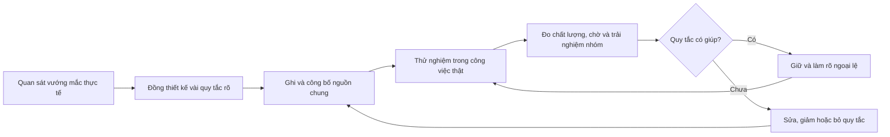

# Thiết lập thỏa thuận cộng tác cho nhóm làm việc từ xa

Một nhóm phát triển nền tảng học trực tuyến có Developers làm việc tại hai múi giờ, Product Owner thường trao đổi với khách hàng vào buổi sáng và một thành viên kiểm thử làm việc theo lịch linh hoạt. Mỗi người đều có chuyên môn tốt, nhưng Sprint liên tục xuất hiện những trở ngại khó lý giải: một pull request đợi phản hồi hai ngày, hai người sửa cùng một quy tắc phân quyền, quyết định đổi API chỉ nằm trong cuộc gọi mà người vắng mặt không biết, và một tin nhắn “cần gấp” tới lúc nửa đêm khiến cả nhóm căng thẳng.

Vấn đề không chỉ nằm ở khoảng cách địa lý hay lựa chọn ứng dụng chat. Nhóm chưa có **thỏa thuận rõ về cách làm việc với nhau**: khi nào cần tương tác trực tiếp, khi nào nên viết bất đồng bộ, thông tin ở đâu là nguồn đáng tin, ai cần tham gia quyết định, cách xử lý blocker và khi nào có thể kỳ vọng người khác phản hồi.

**Thỏa thuận cộng tác (*working agreement/team agreement*)** là tập hợp các quy tắc thực hành do những người liên quan cùng thảo luận và thường xuyên xem lại. Nó mô tả **cách nhóm phối hợp để tạo giá trị, bảo đảm chất lượng và tôn trọng thời gian của nhau**. Đối với nhóm từ xa, một bản thỏa thuận tốt tạo **khả năng dự đoán** mà không biến thành giám sát liên tục hay ép mọi người trực tuyến cả ngày.

Bài thuộc chương **Nhóm phân tán** của mô-đun **AGILE_DEVELOPMENT**. Mục đích là áp dụng các giá trị Agile — giao tiếp, cộng tác, phản hồi sớm, giao Increment, thích ứng và cải tiến — vào môi trường có nhiều địa điểm, múi giờ và cách thức làm việc. Thỏa thuận không thay thế user story, Product Backlog, Scrum, Kanban hay thực hành XP; nó giúp những phương pháp ấy **vận hành được trong bối cảnh phân tán**.

## 1. Mục tiêu học tập

Sau bài học, bạn có thể:

- Giải thích **thỏa thuận cộng tác** khác nội quy công ty, hợp đồng lao động, bản mô tả công việc hoặc lịch họp như thế nào.
- Xác định những chủ đề cần thống nhất: **thời gian làm việc, múi giờ, kênh liên lạc, mức độ khẩn cấp, kỳ vọng phản hồi, quyết định, trạng thái công việc, chất lượng và xử lý xung đột**.
- Phân biệt **bất đồng bộ (*asynchronous*)** và **đồng bộ (*synchronous*)**, lựa chọn cách phù hợp dựa trên độ phức tạp, độ khẩn và mức độ cần tương tác.
- Thiết kế lịch có **giờ giao nhau (*overlap window*)** hợp lý, không yêu cầu tất cả mọi người luôn có mặt.
- Viết thông điệp bất đồng bộ đủ **bối cảnh, yêu cầu, hạn trả lời hợp lý và liên kết tới nguồn thông tin**.
- Thiết lập cơ chế **công bố quyết định và lưu lịch sử** để người không dự họp vẫn tiếp tục làm việc.
- Làm rõ cách dùng **board, WIP, blocker, Definition of Done, code review, CI và pairing** trong nhóm phân tán.
- Xây dựng chính sách **escalation và trực sự cố** khác với nhắn tin gấp cho bất kỳ cá nhân nào ngoài giờ.
- Tổ chức cách góp ý, phản biện và xử lý mâu thuẫn có tính **an toàn tâm lý**, bảo mật và công bằng giữa địa điểm.
- Soạn một **bản working agreement ngắn, có người theo dõi, ngày áp dụng và mốc xem lại**.
- Đo hiệu quả thỏa thuận bằng các tín hiệu **thời gian chờ, work item age, cycle time, chất lượng và outcome**, không dùng trạng thái online làm thước đo năng suất.

## 2. Thỏa thuận cộng tác là gì và không phải là gì?

### 2.1. Định nghĩa thực dụng

Một thỏa thuận cộng tác tốt trả lời các câu hỏi thường gặp:

1. Khi cần giúp đỡ, tôi hỏi **ở đâu** và cung cấp bối cảnh gì?
2. Khi nào tôi có thể **mong đợi phản hồi** mà không gây sức ép ngoài giờ?
3. Quyết định nào cần trao đổi trực tiếp, **ghi ở đâu** và ai có quyền quyết định?
4. Một hạng mục bị chặn hoặc chưa đạt DoD phải được **hiển thị và xử lý** thế nào?
5. Khi chúng ta bất đồng, làm sao **phản biện mà vẫn tôn trọng**?
6. Khi xảy ra sự cố thật, **ai nhận cảnh báo và làm theo quy trình nào**?
7. Làm sao biết thỏa thuận hữu ích, **khi nào thay đổi nó**?

Nó là **cam kết về hành vi phối hợp có thể quan sát**, không chỉ một khẩu hiệu kiểu “phải tôn trọng và giao tiếp tốt”.

### 2.2. Những điều không nên nhầm lẫn

| Khái niệm | Vai trò | Quan hệ với working agreement |
| --- | --- | --- |
| **Quy định pháp lý và chính sách tổ chức** | Quyền truy cập, bảo mật, giờ làm, nghỉ phép, tuân thủ | Là giới hạn bắt buộc mà thỏa thuận phải tôn trọng; nhóm không được tự bỏ |
| **Hợp đồng lao động / đánh giá cá nhân** | Quan hệ lao động và nghĩa vụ chính thức | Không nên biến working agreement thành bảng chấm điểm giờ online |
| **Team charter** | Mục tiêu, thành phần, sứ mệnh, bối cảnh nhóm | Có thể chứa hoặc liên kết tới working agreement |
| **Working agreement** | Cách phối hợp hằng ngày và giải quyết trở ngại | Là những quy tắc có thể thử nghiệm, kiểm tra và sửa |
| **Definition of Done (DoD)** | Tiêu chuẩn chất lượng bắt buộc cho Increment trong Scrum | Cần được tham chiếu, không được thay thế bằng lịch họp |
| **Definition of Workflow (Kanban)** | Ranh giới, trạng thái, WIP, chính sách luồng và SLE | Có thể là nguồn quy tắc luồng được working agreement liên kết |
| **Quy trình ứng phó sự cố** | Phân loại, trách nhiệm, liên lạc, khôi phục | Working agreement chỉ cần xác định cách kích hoạt đúng quy trình |
| **Lịch họp** | Các mốc tương tác đã được xếp | Là một phần nhỏ, không phải toàn bộ thỏa thuận |

**Trong Scrum, working agreement không phải artifact hay sự kiện bắt buộc được Scrum Guide định nghĩa.** Nó là một thực hành cộng tác có thể hỗ trợ Scrum Team tự quản và đa chức năng.

### 2.3. Không phải “ký một lần rồi cất đi”

Nhóm phân tán thay đổi khi:

- Có thành viên mới ở múi giờ khác.
- Khách hàng hoặc đối tác đổi giờ phản hồi.
- Có dịch vụ mới cần người trực.
- Pipeline kiểm thử/CI thay đổi.
- Tần suất release tăng hoặc mô hình hỗ trợ đổi.
- Một quy tắc cũ gây họp nhiều hơn mức cần thiết.

Vì vậy, working agreement nên có **ngày áp dụng, phiên bản, chủ thể cùng thống nhất và mốc đánh giá lại**. Điều chỉnh không phải thất bại; đó là cách kiểm tra và thích ứng theo Agile.

## 3. Những nguyên tắc khi thiết kế thỏa thuận

### 3.1. Minh bạch thay cho suy đoán

Trong văn phòng, người ta đôi khi nhìn thấy một đồng nghiệp đang bận hoặc tự hỏi nhanh bên bàn. Từ xa, những tín hiệu ấy biến mất. Thay vì suy đoán:

- Thông tin quan trọng được **viết ở nơi chung**.
- Mỗi hạng mục có **trạng thái và blocker** rõ.
- Quyết định có **lý do và người được thông báo**.
- Kỳ vọng phản hồi có **giới hạn**.
- Trạng thái “ngoài giờ làm” không bị giải thích là thiếu cam kết.

### 3.2. Bất đồng bộ theo mặc định, đồng bộ khi tạo giá trị

**Async-first** nghĩa là ưu tiên chuẩn bị thông tin có thể đọc và phản hồi không cần cùng thời điểm, chứ không phải cấm họp hoặc pairing. Có những vấn đề cần đối thoại ngay: xung đột hiểu yêu cầu, whiteboard kiến trúc, rủi ro bảo mật, khủng hoảng sản phẩm hoặc phản hồi khó nói qua văn bản.

Câu hỏi thực hành:

> “Cách nào giúp người liên quan **hiểu, quyết định và tiếp tục công việc** với ít chờ đợi và ít gián đoạn nhất?”

### 3.3. Tôn trọng thời gian và quyền không phản hồi ngoài giờ

Người từ xa không đương nhiên phải có mặt mọi lúc. Một thỏa thuận bền vững cần:

- Tôn trọng giờ làm việc, ngày nghỉ, khác biệt múi giờ.
- Hạn chế kỳ vọng phản hồi ngay cho việc không khẩn.
- Không dùng dấu xanh online để đo đóng góp.
- Có kế hoạch người thay thế cho công việc quan trọng.
- Tách rõ **lịch trực đã thỏa thuận** khỏi **việc bất kỳ ai cũng phải trực 24/7**.

### 3.4. Ưu tiên kết quả và chất lượng

Đội không làm việc tốt hơn chỉ vì thêm nhiều cuộc họp. Kết quả quan trọng hơn là **user story được làm rõ, PBI đạt DoD, lỗi giảm, người dùng nhận giá trị sớm và người trong nhóm có thể phối hợp bền vững**.

### 3.5. Có thể thử nghiệm và điều chỉnh

Một quy tắc đáng có nếu trả lời được:

- Nó giảm vấn đề cụ thể nào?
- Hành vi cần thực hiện là gì?
- Ngoại lệ và giới hạn nào áp dụng?
- Điều gì chứng minh quy tắc hữu ích?
- Khi nào nhóm sẽ xem lại?

Không nên viết “mọi người phải giao tiếp tốt” mà không nêu cách nhận biết **khi nào một quyết định cần được ghi lại**.

## 4. Bắt đầu từ thực tế của nhóm, không từ mẫu có sẵn

### 4.1. Vẽ bản đồ công việc và địa điểm

Một buổi làm việc ngắn có thể thu thập:

| Nhóm thông tin | Câu hỏi |
| --- | --- |
| **Mục tiêu sản phẩm** | Nhóm tạo giá trị cho ai? Những thay đổi nào phải cùng hoàn tất? |
| **Vai trò và kỹ năng** | Ai có chuyên môn gì? Khu vực nào chỉ một người biết? |
| **Múi giờ và lịch làm** | Mỗi người có khoảng thời gian thường xuyên hiện diện nào? Có lịch linh hoạt hoặc ràng buộc chăm sóc không? |
| **Điểm nghẽn** | Những phần nào thường đợi review, test, câu trả lời nghiệp vụ hoặc quyền truy cập? |
| **Công cụ và quyền** | Nơi lưu backlog, mã nguồn, quyết định, tài liệu và cảnh báo là đâu? |
| **Rủi ro đặc thù** | Dữ liệu riêng tư, hệ thống thanh toán, thời gian phát hành, sự cố sản phẩm? |
| **Điều đang tốt** | Thực hành nào nên giữ để không tạo thay đổi vô ích? |

Không cần thu thập **địa chỉ riêng, lịch chăm sóc gia đình hoặc lý do cá nhân nhạy cảm** của mọi người. Chỉ cần hiểu **khả năng phối hợp và giới hạn thời gian được mỗi người chủ động chia sẻ**.

### 4.2. Tìm các điểm đau có ví dụ

Thay vì hỏi chung “chúng ta có giao tiếp tốt không?”, hãy hỏi:

- PR nào đã chờ quá lâu? **Chờ do thiếu reviewer hay chưa đủ ngữ cảnh?**
- Quyết định nào đã bị hiểu khác nhau? **Nguồn sự thật hiện ở đâu?**
- Cuộc họp nào cần người chưa thể tham gia theo múi giờ?
- PBI nào bị gắn Done dù chưa đạt kiểm thử?
- Khi một người nghỉ, nhóm có biết **việc đang mở và bước tiếp theo** không?
- Có ai đang thường xuyên phải giải quyết việc không khẩn sau giờ làm?

Có thể dùng **Retrospective hoặc một buổi workshop** với thông tin chuẩn bị trước để mọi người đều có cơ hội góp ý.

### 4.3. Thỏa thuận phải được đồng xây dựng

Nếu một người quản lý tự viết 40 quy tắc và yêu cầu mọi người “tuân thủ”, thỏa thuận dễ thành chính sách kiểm soát một chiều. Phương án hợp tác hơn:

1. Mọi người đề xuất vấn đề và nhu cầu riêng.
2. Nhóm gộp đề xuất giống nhau.
3. Thảo luận các đánh đổi, đặc biệt là người ít giờ giao nhau.
4. Chọn những quy tắc **ít nhưng rõ**.
5. Đặt thời hạn thử nghiệm và người nhắc xem lại.
6. Thống nhất cách xử lý trường hợp bất đồng và ngoại lệ.

**Không cần mọi quyết định đều bỏ phiếu**. Nhóm có thể áp dụng đồng thuận, consent hoặc cơ chế quyền quyết định hiện hữu; điều quan trọng là minh bạch ai có trách nhiệm với kết quả.

## 5. Sáu bước thiết lập working agreement

### Bước 1 — Phát biểu mục đích

Ví dụ:

> “Trong bốn tuần tới, chúng ta muốn giảm thời gian chờ quyết định và review, bảo đảm PBI có thể đạt DoD dù thành viên ở nhiều múi giờ, đồng thời không tạo kỳ vọng trực ngoài giờ.”

Mục đích này cụ thể hơn “tăng hiệu suất làm việc từ xa”.

### Bước 2 — Xác định những phần bắt buộc phải rõ

Ưu tiên các lĩnh vực đang gây vấn đề:

- Lịch khả dụng và giờ giao nhau.
- Quy tắc kênh và mức khẩn cấp.
- Cấu trúc yêu cầu hỗ trợ.
- Nguồn ghi quyết định và cách thông báo.
- Cập nhật backlog, blocker và trạng thái Done.
- Code review, test, CI, bàn giao và incident.

### Bước 3 — Chọn quy tắc nhỏ, quan sát được

Ví dụ không tốt:

> “Đừng để PR treo.”

Ví dụ hữu ích hơn:

> “PR cần mô tả mục tiêu, rủi ro, kiểm tra đã chạy và reviewer phù hợp. Nếu quá một ngày làm việc của reviewer chưa được nhìn nhận, người tạo PR ghi blocker trên board và hỏi ở kênh phát triển chung; nếu ảnh hưởng Sprint Goal, Developers trao đổi để phân công hỗ trợ.”

Đây là **một ví dụ chính sách**, không phải SLA phù hợp cho mọi sản phẩm.

### Bước 4 — Ghi ngoại lệ và mức ưu tiên

Ví dụ, sự cố mất dữ liệu thật có thể cần liên lạc ngay với **người trực đã được phân công**; không thể chờ một ngày như câu hỏi backlog thường. Cần quy định rõ trường hợp nào được gọi là **khẩn cấp**, ai có quyền kích hoạt và sau đó ghi lại điều gì.

### Bước 5 — Công bố một phiên bản dễ tìm

Không rải nội dung ở 20 tin nhắn. Có thể dùng **một tài liệu chính** liên kết tới:

- Board/backlog.
- Definition of Done.
- Definition of Workflow nếu dùng Kanban.
- Quy ước mã và CI.
- Decision log/ADR.
- Runbook sự cố.
- Lịch trực và hướng dẫn onboarding.

### Bước 6 — Thử rồi xem lại

Sau một hoặc hai Sprint hoặc một khoảng thời gian tương đương, nhóm hỏi:

- Có giảm thời gian chờ?
- Quyết định có dễ tìm?
- Có cuộc họp nào không còn cần?
- Có quy tắc nào gây áp lực ngoài giờ?
- Sự cố có đi đúng đường?
- Có cần thay đổi overlap khi có thành viên mới?



Thỏa thuận tồn tại để **giúp công việc và con người**, không phải ngược lại.

## 6. Múi giờ: dùng mốc chung để tránh nhầm lẫn

### 6.1. Không chỉ viết “họp lúc 9 giờ”

Nếu đội gồm người ở những vùng khác nhau, câu “họp 9 giờ” thiếu ít nhất:

- 9 giờ ở **múi giờ nào**?
- Ngày nào nếu chênh lệch qua đêm?
- Có thay đổi **giờ mùa hè (*daylight saving time*)** không?
- Lịch mời họp có hiển thị đúng múi giờ từng người không?

Nên ghi mốc thời gian bằng **UTC hoặc một múi giờ có tên định danh**, đồng thời để lịch làm việc chuyển sang giờ địa phương. Với ngày quan trọng có thể ghi **ngày, giờ, múi giờ và offset** theo thời điểm ấy.

### 6.2. Ví dụ tìm cửa sổ giao nhau

Giả sử hai nhóm làm việc theo lịch **minh họa với offset cố định**:

- Nhóm A: **UTC+7**, giờ làm ví dụ 09:00–18:00 địa phương.
- Nhóm B: **UTC+2**, giờ làm ví dụ 09:00–17:00 địa phương.

| Mốc UTC | UTC+7 (nhóm A) | UTC+2 (nhóm B) | Nhận xét |
| --- | --- | --- | --- |
| 08:00 | 15:00 | 10:00 | Đều trong giờ làm |
| 09:00 | 16:00 | 11:00 | Có thể họp ngắn |
| 10:00 | 17:00 | 12:00 | Cần chú ý giờ nghỉ trưa của B |
| 11:00 | 18:00 | 13:00 | A đã tới cuối giờ |
| 12:00 | 19:00 | 14:00 | Ngoài giờ giả định của A |

Nhóm có thể chọn **08:00–09:00 UTC** cho một số buổi cần đồng bộ, nếu phù hợp giờ nghỉ và thỏa thuận. **Đây không phải đề xuất mọi người phải họp hằng ngày**.

Offset UTC+2 trong ví dụ là **giả định cố định**. Nếu người thật làm ở nơi có daylight saving time, offset có thể đổi theo mùa; cần kiểm tra lịch vào ngày họp, không chuyển đổi máy móc quanh năm.

### 6.3. Giờ giao nhau là tài nguyên khan hiếm

Trong khoảng overlap ngắn, ưu tiên:

- Quyết định khó cần nhiều góc nhìn.
- Pairing cho vấn đề bị chặn.
- Phản hồi đối thoại nhạy cảm.
- Cùng làm rõ user story chưa thống nhất.
- Sự kiện Scrum cần tương tác thật.
- Điều phối sự cố hoặc thay đổi rủi ro cao.

Không lấp hết overlap bằng các cuộc họp chỉ đọc báo cáo. **Việc có thể đọc trước nên được chuẩn bị bất đồng bộ**.

### 6.4. Công bằng giữa các múi giờ

Nếu một nhóm liên tục phải họp muộn, thỏa thuận có thể:

- Xoay vòng giờ họp khi phù hợp.
- Cho gửi câu hỏi và góp ý trước.
- Ghi kết luận và lựa chọn sau họp.
- Dùng người đại diện có quyền báo lại nhưng không tự ý che tiếng nói người vắng.
- Tránh họp bất thường ngoài giờ trừ quy trình khẩn cấp chính thức.

Không nên coi người ở múi giờ thiểu số là **người luôn phải điều chỉnh**. Công bằng có thể nghĩa là **chia sẻ bất tiện có chủ đích**.

## 7. Bất đồng bộ (*async-first*) không phải im lặng

### 7.1. Khi nào ưu tiên bất đồng bộ?

Các tình huống thường phù hợp:

- Thông báo thay đổi kế hoạch đã rõ.
- Gửi PR kèm bối cảnh và test.
- Xin ý kiến về một đề xuất có tài liệu đọc được.
- Cập nhật blocker và yêu cầu hỗ trợ.
- Tổng hợp phản hồi Sprint Review.
- Ghi quyết định sau khi đã thống nhất.
- Câu hỏi không cần trả lời trong vài phút.
- Chuẩn bị backlog refinement bằng ví dụ trước buổi trao đổi.

Lợi ích là **giảm ngắt quãng và bảo vệ thời gian tập trung**, nhất là khi các múi giờ ít giao nhau.

### 7.2. Khi nào cần đồng bộ?

- Hai người tranh luận nhiều vòng nhưng chưa hiểu cùng vấn đề.
- Một quyết định quan trọng có nhiều mâu thuẫn về giả định.
- Pair programming hoặc debugging cùng nhau.
- Phản hồi cá nhân nhạy cảm và xung đột quan hệ.
- Sự cố cần hành động phối hợp theo thời gian thực.
- Cần xem sơ đồ/tác động thiết kế với nhiều chuyên môn cùng lúc.

Không nên biến nguyên tắc async-first thành “mọi chuyện phải xử lý qua 50 tin nhắn”. Nếu chi phí trao đổi tăng, **một cuộc gọi ngắn có mục tiêu và ghi lại kết luận** có thể hiệu quả hơn.

### 7.3. Quy tắc chuyển từ async sang sync

Một ví dụ:

> “Nếu một chủ đề đã có hai vòng hỏi–đáp mà chưa làm rõ giả định, hoặc đang chặn Sprint Goal, người điều phối đề nghị một cuộc trao đổi 15–25 phút trong giờ giao nhau. Trước buổi gọi phải gửi bối cảnh; sau gọi có kết luận bằng văn bản.”

Ngưỡng hai vòng chỉ là **heuristic**, không phải chuẩn Agile. Nhóm chọn ngưỡng theo thực tế.

### 7.4. Không dùng reaction emoji thay quyết định

Một biểu tượng “đã thấy” có thể xác nhận người nhận đã xem, nhưng không nhất thiết là đồng thuận với quyết định. Với thay đổi tác động dữ liệu, quyền truy cập, giá tiền hoặc API:

- Ghi rõ phương án đã chọn.
- Nêu người chịu trách nhiệm quyết định theo cơ chế thực tế.
- Liệt kê người cần được thông báo.
- Ghi hành động tiếp theo.
- Nêu điều kiện cần kiểm tra lại.

## 8. Ma trận kênh liên lạc

Nhóm nên hạn chế “một vấn đề có bốn nguồn sự thật”. Ma trận gợi ý:

| Loại thông tin | Nơi chính | Cách sử dụng |
| --- | --- | --- |
| **Mục tiêu sản phẩm và thứ tự công việc** | Product Backlog / công cụ quản lý công việc | Mỗi PBI có ngữ cảnh, acceptance criteria và trạng thái |
| **Trao đổi kỹ thuật theo thay đổi mã** | Pull request / issue liên quan | Ghi lý do, kiểm chứng, review và quyết định trực tiếp |
| **Hỏi đáp ngắn, hỗ trợ nhóm** | Kênh chat theo chủ đề | Đặt câu hỏi có liên kết; kết luận quan trọng chuyển về nguồn chính |
| **Quyết định kiến trúc dài hạn** | Decision log hoặc ADR | Ghi lựa chọn, bối cảnh, đánh đổi và thời điểm xem lại |
| **Tài liệu vận hành** | Runbook / nơi tài liệu được quản lý | Hướng dẫn sự cố, quyền truy cập và khôi phục theo chính sách |
| **Lịch làm việc và buổi đồng bộ** | Calendar có múi giờ | Ghi mục đích, người cần thiết, tài liệu chuẩn bị |
| **Phản hồi nhạy cảm** | Trao đổi phù hợp và bảo mật | Không đưa nhận xét cá nhân vào kênh công khai gây tổn thương |
| **Sự cố thực** | Kênh incident / công cụ cảnh báo trực | Kích hoạt người trực, ghi timeline và tình trạng phục hồi |

**Kênh chat không nên trở thành nơi duy nhất lưu một quyết định bắt buộc**. Lịch sử tin nhắn khó tìm và người mới có thể không đủ quyền xem.

### 8.1. Quy tắc chọn kênh ba bước

1. **Tác động và độ khẩn:** việc thường, blocker hay sự cố thật?
2. **Tính bền vững của thông tin:** người khác có cần tìm lại sau nhiều tuần?
3. **Đối tượng cần tham gia:** ai cần quyết định, ai chỉ cần được thông báo?

Ví dụ về lỗi phân quyền học viên: ticket ghi tác động và các bước tái hiện **không lộ dữ liệu riêng**; PR ghi cách sửa và test; incident channel được dùng nếu đang có nguy cơ rò rỉ thật; backlog được cập nhật về việc còn lại.

## 9. Kỳ vọng phản hồi: rõ ràng nhưng không phải trực 24/7

### 9.1. Đặt “response expectation” theo loại yêu cầu

Một bảng **chỉ mang tính ví dụ để nhóm điều chỉnh**:

| Loại yêu cầu | Kênh đề xuất | Kỳ vọng ban đầu | Nếu chưa phản hồi |
| --- | --- | --- | --- |
| **Câu hỏi thường, không chặn việc** | Ticket hoặc chat theo chủ đề | Xác nhận trong khoảng một ngày làm việc của người nhận | Ghi thêm bối cảnh, nhắc trong nhịp phối hợp tiếp theo |
| **PR cần review để hoàn tất PBI** | PR + board | Reviewer nhìn nhận trong một ngày làm việc theo lịch đã thống nhất | Đưa blocker lên board, tìm reviewer dự phòng có năng lực |
| **Quyết định có ảnh hưởng Sprint Goal** | Ticket + kênh nhóm | Trao đổi trong cửa sổ overlap gần nhất phù hợp | Developers/PO điều chỉnh kế hoạch và người tham gia |
| **Sự cố sản phẩm nghiêm trọng** | Cảnh báo incident theo lịch trực | Theo chính sách trực và mức độ sự cố | Kích hoạt cấp tiếp theo trong runbook |
| **Thông báo nghỉ/vắng** | Calendar/trạng thái công việc | Công bố trước khi vắng nếu có thể | Người phụ trách dự phòng tiếp nhận việc đã bàn giao |

“Phản hồi” có thể là **đã nhận, sẽ xử lý lúc nào hoặc cần ai hỗ trợ**, chưa chắc là giải quyết trọn vẹn trong cùng một ngày.

### 9.2. Tính theo giờ làm của người nhận

Một tin gửi lúc 18:30 theo giờ người nhận không nên tự động được đánh giá chậm nếu tới 08:30 hôm sau chưa có phản hồi. Với lịch linh hoạt, hãy thống nhất **khung khả dụng công khai ở mức đủ dùng**, không bắt cá nhân giải trình mọi khoảng nghỉ.

Ví dụ:

> “Câu hỏi bình thường: xác nhận trong một ngày làm việc theo lịch khả dụng đã thông báo; không kỳ vọng trả lời ngoài giờ. Nếu thực sự khẩn, dùng quy trình incident thay vì gắn @all.”

### 9.3. Độ khẩn phải dựa trên tác động, không dựa vào cách viết

Tin nhắn có chữ **URGENT** không tự động thành sự cố. Hãy định nghĩa:

- Có nguy cơ mất/lộ dữ liệu, mất dịch vụ hoặc ảnh hưởng nghiêm trọng tới người sử dụng?
- Có deadline tuân thủ hoặc giao dịch thời gian thực?
- Có cách giảm tác động an toàn tạm thời?
- Ai có quyền khai báo mức độ và kích hoạt người trực?
- Cần ghi lại quyết định và sự kiện ra sao?

Không nên dùng @everyone liên tục cho mọi câu hỏi, vì nó làm mất ý nghĩa của thông báo thật sự khẩn.

## 10. Mẫu thông điệp bất đồng bộ dễ xử lý

Một tin nhắn hữu ích cần đủ dữ kiện để người ở múi giờ khác **không phải chờ một vòng hỏi lại**.

### 10.1. Mẫu chung

```text
[Chủ đề / PBI / liên kết]
Bối cảnh: chúng ta đang làm gì, nhằm mục tiêu nào?
Hiện trạng: điều gì đã được thử/kiểm tra, kết quả ra sao?
Vấn đề hoặc quyết định cần: câu hỏi cụ thể là gì?
Phương án đề xuất: A/B và đánh đổi nếu đã có.
Tác động/thời hạn: hạng mục nào bị chặn; cần phản hồi khi nào?
Người cần phản hồi: ai có thông tin/quyền quyết định?
Nếu chưa có phản hồi: việc an toàn nào vẫn có thể tiếp tục?
```

Không nhất thiết mọi tin ngắn cần đủ tám dòng. **Mức thông tin nên tương xứng với chi phí của việc hiểu sai**.

### 10.2. Tin nhắn mơ hồ và phiên bản tốt hơn

**Mơ hồ:**

> “API có vấn đề. Ai đó xem giúp mình ngay nhé.”

**Có thể xử lý:**

> “PBI LP-42 – ‘Tiếp tục bài học’: integration test tài khoản B đọc tiến độ A đang thất bại tại endpoint `GET /learning-progress/{id}`. Tôi đã kiểm tra unit test của policy (đạt) và tái hiện lỗi trong môi trường thử, không dùng dữ liệu người dùng thật. Tôi đề xuất kiểm tra nơi lấy learnerId từ phiên đăng nhập; cần người hiểu authentication pairing trong khung giao nhau ngày mai. PR và kết quả test ở liên kết trong ticket. Hiện hạng mục bị chặn và tôi sẽ bổ sung kịch bản A/B.”

Tin thứ hai giúp người nhận **hiểu nhu cầu, mức rủi ro và bước tiếp theo** ngay cả khi trả lời sau nhiều giờ.

### 10.3. Phân biệt “FYI” và “Action required”

Một quy tắc nhỏ có ích:

- **FYI:** để biết, không cần phản hồi trừ khi phát hiện rủi ro.
- **Input requested:** cần góp ý trước mốc phù hợp.
- **Decision requested:** cần người có thẩm quyền chọn phương án.
- **Blocked:** không thể tiếp tục phần việc theo cách an toàn.
- **Incident:** đi theo kênh trực sự cố, không phải ticket thông thường.

Không dựa vào emoji hay màu chữ để truyền đạt **thông tin bắt buộc** mà người dùng công cụ trợ năng có thể bỏ lỡ.

## 11. Tài liệu và quyết định: một nguồn sự thật dễ tìm

### 11.1. Vì sao quyết định bằng lời nói dễ mất?

Giả sử trong một cuộc gọi, ba người quyết định **kiểm tra quyền khóa học tại backend thay vì frontend**. Hai người không tham gia vẫn đang sửa API theo giả định cũ. Nếu không có kết luận bằng văn bản, cùng một nhóm có thể tạo hai thiết kế mâu thuẫn.

Một nguồn ghi quyết định nên có:

- Vấn đề và bối cảnh.
- Những phương án đã cân nhắc.
- Phương án chọn và lý do.
- Tác động, rủi ro, giả định.
- Người/nhóm chịu trách nhiệm quyết định.
- Ngày có hiệu lực và điều kiện cần xem lại.
- Liên kết đến PBI/PR hoặc tài liệu liên quan.

### 11.2. Mẫu Decision Record ngắn

```text
Decision ID: DR-07
Chủ đề: Nguồn danh tính cho API tiến độ học
Bối cảnh: client có thể gửi learnerId không đáng tin
Lựa chọn: lấy danh tính từ cơ chế xác thực phía server;
             chính sách phân quyền dùng cùng learnerId đã xác thực
Lý do: tránh truy cập tiến độ tài khoản khác và giảm khác biệt endpoint
Ảnh hưởng: cập nhật API, test tài khoản A/B, kiểm tra dữ liệu cũ
Người tham gia: Developers, chuyên gia bảo mật khi cần, PO về hành vi
Quyết định bởi: người/nhóm được phân quyền thiết kế theo chính sách
Ngày áp dụng: ngày ghi trong tài liệu
Xem lại: khi thay đổi cơ chế xác thực hoặc hợp đồng API
Liên kết: PBI, PR, test và hướng dẫn bảo mật liên quan
```

Mẫu là ví dụ, không phải định dạng bắt buộc. Một thay đổi tên biến nhỏ thường không cần ADR; quyết định ảnh hưởng nhiều module hoặc khó đảo ngược có thể đáng ghi kỹ hơn.

### 11.3. Họp xong phải để người vắng mặt vẫn làm tiếp

Sau một cuộc họp có quyết định:

1. Ghi **kết luận và người chịu trách nhiệm bước tiếp theo**.
2. Ghi điều gì còn chưa rõ.
3. Liên kết vào ticket/board.
4. Thông báo đúng đối tượng, không gửi cả tổ chức nếu không cần.
5. Cho phép người vắng mặt nêu tác động mới theo khoảng phản hồi đã thỏa thuận.

**Bản ghi cuộc họp không thay thế quyết định dễ đọc**. Video dài 60 phút không phải hình thức tìm kiếm hiệu quả và có thể gây rủi ro riêng tư; cần chính sách ghi hình và đồng ý phù hợp.

## 12. Sự kiện Scrum trong nhóm từ xa

### 12.1. Nhịp Scrum giữ mục tiêu, không biến thành báo cáo trạng thái

Nếu nhóm dùng Scrum:

- **Sprint Planning** làm rõ vì sao Sprint có giá trị, PBI nào có thể hoàn tất và cách thực hiện.
- **Daily Scrum** là sự kiện 15 phút của Developers vào mỗi ngày làm việc của Sprint để kiểm tra tiến độ hướng Sprint Goal và thích ứng Sprint Backlog.
- **Sprint Review** kiểm tra kết quả cùng stakeholder và điều chỉnh hướng sản phẩm.
- **Sprint Retrospective** xem cách tăng chất lượng và hiệu quả.
- **Refinement** là hoạt động liên tục làm rõ Product Backlog, không phải một sự kiện chính thức được timebox riêng trong Scrum Guide.

Không cần cố đưa mọi chi tiết vào cùng một cuộc họp chỉ vì mọi người có ít giờ giao nhau.

### 12.2. Daily Scrum khi các múi giờ ít giao nhau

Các khả năng hỗ trợ:

- Chọn thời điểm tương tác trực tiếp ngắn trong overlap hợp lý.
- Cho Developers cập nhật board trước để sự kiện tập trung vào **kế hoạch và trở ngại**.
- Thảo luận sâu sau Daily Scrum chỉ với người liên quan.
- Ghi kết quả điều chỉnh có ý nghĩa vào Sprint Backlog.

**Một chuỗi tin nhắn “hôm qua làm gì, hôm nay làm gì” không tự động đáp ứng mục đích của Daily Scrum** nếu Developers không cùng kiểm tra tiến độ và thích ứng kế hoạch. Nhóm dùng Scrum cần bảo vệ mục đích và yêu cầu của sự kiện, đồng thời chọn cách tổ chức phù hợp.

Nếu nhóm ở múi giờ gần như không có giao nhau, đó là **trở ngại tổ chức thật sự**, cần trao đổi lại cấu trúc Scrum Team, lịch làm việc hoặc cách phối hợp; đừng chỉ gọi bất kỳ bản tin async nào là “đã có Daily Scrum”.

### 12.3. Sprint Planning không bắt đầu từ cuộc gọi trắng

Trước cuộc họp:

- PO chuẩn bị thứ tự Product Backlog và mục tiêu cần trao đổi.
- Developers xem thông tin, rủi ro, phụ thuộc và năng lực dự kiến.
- Những câu hỏi có thể giải đáp trước được viết vào PBI.
- Người khó tham gia một phần được tạo cơ hội gửi bối cảnh.

Trong cuộc họp, tập trung quyết định **Sprint Goal, những việc có thể làm và cách khởi động**. Sau cuộc họp, Sprint Backlog rõ cho người không ở cùng địa điểm.

### 12.4. Sprint Review cần phản hồi hai chiều

Một buổi demo qua video chưa đủ nếu nhóm chỉ trình chiếu rồi kết thúc. Hãy:

- Chia sẻ Increment sử dụng được theo điều kiện phù hợp.
- Nhờ stakeholder nêu tình huống sử dụng, tác động kinh doanh và thay đổi ngoài nhóm.
- Cho người vắng mặt gửi phản hồi theo kênh đã thống nhất.
- Ghi câu hỏi và lựa chọn mới vào Product Backlog.

**Sprint Review không phải cổng duyệt release**, cũng không phải cuộc thi trình bày công việc của từng người.

### 12.5. Retrospective tạo không gian cải tiến thật

Nhóm từ xa cần tạo điều kiện để người ít nói hoặc không ở múi giờ ưu thế có thể góp ý:

1. Cho viết ý kiến cá nhân trước buổi họp.
2. Nhóm chủ đề mà không gán lỗi cho cá nhân.
3. Thảo luận tác động và điều có thể đổi.
4. Chọn tối đa một vài thử nghiệm khả thi.
5. Đặt người theo dõi và mốc xem lại.
6. Công bố kết quả ở nơi dễ tìm.

Khi chủ đề nhạy cảm, không nên mặc định mọi phản hồi phải đưa lên bảng công khai nguyên văn; cần tôn trọng chính sách và sự an toàn của người tham gia.

## 13. Board, WIP và việc hiển thị blocker

### 13.1. Board là nơi xem việc, không phải màn hình giám sát người

Một workflow ví dụ:

```text
Product Backlog -> Ready -> In Progress -> Review -> Verification -> Done
                               ____________ WIP ___________/
```

Team agreement có thể liên kết tới **Definition of Workflow (Kanban)** và làm rõ:

- Start và Finish ở đâu?
- Khi nào một PBI chuyển trạng thái?
- Blocked được đánh dấu thế nào?
- WIP limit áp dụng cho cột hoặc toàn hệ thống nào?
- Trạng thái Done có thật sự gắn với DoD không?
- Ai điều phối khi WIP cao hoặc một item đã già?
- Cách tiếp nhận việc khẩn có ngoại lệ gì?

Board không cần có cột “người đang online” hoặc phần đếm số giờ gõ phím.

### 13.2. Blocker không được biến mất khi người phụ trách nghỉ

Một quy tắc minh họa:

> “Khi một PBI bị chặn hơn một khoảng đáng chú ý của ngày làm việc, người đang xử lý ghi blocker, tác động và hỗ trợ cần thiết lên board; khi đi nghỉ hoặc chuyển ca, ghi bước tiếp theo và người có thể tiếp nhận.”

Ngưỡng cụ thể do nhóm chọn theo loại dịch vụ. Điểm chính là **thông tin đủ để công việc tiếp tục**, không phải ghi log từng phút.

### 13.3. Khi WIP tăng, ưu tiên hoàn tất

Nhóm phân tán dễ mở thêm việc mới để “không ngồi chờ”. Nhưng điều đó có thể làm review, QA và tích hợp bị nghẽn.

Khi bảng cho thấy nhiều item đang chờ:

- Kiểm tra item già nhất và quan hệ với Sprint Goal.
- Hỏi ai có thể pairing/test/review để đưa item tới Done.
- Dừng kéo việc mới khi chính sách WIP yêu cầu.
- Chọn lát cắt nhỏ và tích hợp sớm.
- Thông báo điều chỉnh dự báo cho người liên quan.

**WIP limit là cơ chế cộng tác trên toàn hệ thống**, không phải chỉ tiêu kiểm soát một cá nhân.

## 14. Review mã, pairing và chất lượng trong nhóm phân tán

### 14.1. Collective code ownership cần dấu vết hiểu được

Trong XP, **collective code ownership** cho phép Developers cải thiện phần mã cần thiết theo chuẩn của đội, giảm phụ thuộc tác giả gốc. Khi ở xa nhau, điều đó cần:

- Quy ước mã thống nhất.
- Bộ test đủ tin cậy.
- CI chạy trên thay đổi liên quan.
- PR mô tả ý định và rủi ro.
- Người biết module có thể pairing hoặc hỗ trợ review.
- Quyền truy cập và phê duyệt phù hợp đối với phần nhạy cảm.

**Ai cũng có thể góp phần sửa mã không đồng nghĩa ai cũng được bỏ kiểm tra chất lượng hoặc quyền bảo mật.**

### 14.2. Mẫu pull request dễ review bất đồng bộ

```text
Mục tiêu / PBI: người học mở đúng bài đang dở
Thay đổi chính: sửa chính sách chọn tiến độ theo tài khoản
Điều không thay đổi: không mở rộng sang đồng bộ nhiều thiết bị
Rủi ro: quyền truy cập A/B, dữ liệu tiến độ cũ, API client
Kiểm chứng: unit tests, API integration tests, CI
Cách thử: liên kết test / môi trường phù hợp
Người cần review: backend hiểu authentication, người kiểm thử API
Quyết định cần: có giữ tương thích trường cũ không?
Khi cần hỗ trợ: liên kết ticket và khung overlap đề xuất
```

Nhờ đó reviewer ở múi giờ khác có thể đánh giá **không cần mở cuộc gọi chỉ để hỏi nội dung PR**.

### 14.3. Pair programming từ xa

Pairing có thể thực hiện qua chia sẻ màn hình hoặc công cụ lập trình cộng tác, nhưng cần chú ý:

- Chọn bài toán cụ thể, thời lượng phù hợp.
- Nêu mục tiêu và cách nhận biết kết quả.
- Đổi vai driver/navigator khi hữu ích.
- Dùng cùng test/CI để kiểm chứng.
- Ghi phần quyết định quan trọng sau phiên.
- Tránh chia sẻ màn hình có secret hoặc dữ liệu cá nhân không cần thiết.

Một phiên pairing tốt không phải **người giỏi nói, người mới chỉ nhìn**. Cả hai cần có cơ hội đặt câu hỏi, giải thích và hình thành kiến thức có thể sử dụng sau đó.

### 14.4. Không biến review thành hàng chờ của một chuyên gia

Nếu mọi PR đều cần một người duyệt dù rủi ro thấp, người ấy trở thành điểm nghẽn khi đi nghỉ. Đội có thể:

- Phân loại review theo rủi ro.
- Tạo reviewer dự phòng có đủ năng lực.
- Dùng pair review cho khu vực khó.
- Tự động hóa formatter/lint để con người tập trung vào hành vi.
- Ghi quyết định kỹ thuật chung để giảm phụ thuộc.
- Giữ phê duyệt chuyên môn bắt buộc cho dữ liệu, thanh toán, an toàn.

**Thời gian review nên được quan sát cùng chất lượng**, không dùng tốc độ merge làm lý do bỏ kiểm tra cần thiết.

## 15. Bàn giao xuyên múi giờ: đưa ngữ cảnh đi trước người

### 15.1. Khi nào cần bàn giao?

Bàn giao (*handoff*) đặc biệt quan trọng khi:

- Một người kết thúc giờ làm trước khi người ở múi giờ khác bắt đầu.
- Một sự cố cần tiếp tục theo lịch trực.
- Một PBI có nhiều chuyên môn tham gia.
- Reviewer phát hiện vấn đề mà người sửa chưa thể phản hồi ngay.
- Thành viên nghỉ phép hoặc đổi nhiệm vụ.

Bàn giao không có nghĩa **luôn phải chia việc nối tiếp theo múi giờ**. Quá nhiều handoff có thể tăng chờ và mất ngữ cảnh. Với công việc đòi thiết kế chung sâu, pairing trực tiếp có thể tốt hơn.

### 15.2. Mẫu bàn giao sáu thông tin

```text
Hạng mục và mục tiêu: LP-42 – kiểm tra đúng quyền truy cập tiến độ
Trạng thái hiện tại: PR đã mở, test A/B còn đỏ
Điều đã kiểm tra: policy unit test xanh; API integration test lỗi
Giả thuyết / rủi ro: learnerId đang lấy từ request thay vì session
Bước an toàn kế tiếp: kiểm tra authentication gateway và bổ sung test
Cần hỗ trợ / người liên quan: backend reviewer, bảo mật nếu thay hợp đồng
Liên kết: ticket, PR, kết quả CI, decision record
```

Không ghi token, thông tin đăng nhập hoặc dữ liệu học viên thật vào mẫu bàn giao.

### 15.3. Tránh hứa “follow-the-sun” khi điều kiện chưa đủ

*Follow-the-sun* có thể tạo tiến triển qua nhiều múi giờ nếu công việc **được chia đủ rõ, kiểm chứng được và ít phụ thuộc trao đổi trực tiếp**. Nhưng nếu mỗi nhóm phải mất hai giờ hiểu lại và sửa sai bàn giao, hệ thống chỉ đang tăng số lần chuyển giao.

Trước khi chọn mô hình này, hãy hỏi:

- Có test và tài liệu đủ tốt không?
- Đường đi tiếp theo đã rõ chưa?
- Quyền truy cập được cấp đúng chưa?
- Có người nhận chính thức không?
- Lỗi bất ngờ được leo thang thế nào?
- Có làm ai phải trực ngoài giờ thường xuyên không?

## 16. Quyết định và quyền tự quản: ai cần tham gia?

### 16.1. Đội tự quản không đồng nghĩa mọi việc phải được mọi người phê duyệt

Trong Scrum, **Scrum Team tự quản**: họ quyết định trong nội bộ ai làm gì, khi nào và như thế nào để tạo giá trị trong giới hạn Scrum. **Product Owner** chịu trách nhiệm về thứ tự Product Backlog và tối đa hóa giá trị sản phẩm; **Developers** chịu trách nhiệm xây Increment đáp ứng DoD; **Scrum Master** chịu trách nhiệm hiệu quả Scrum và hỗ trợ nhóm.

Working agreement nên giúp người khác biết:

- Quyết định ưu tiên Product Backlog đưa tới ai.
- Quyết định thực hiện kỹ thuật và chia công việc thuộc ai.
- Khi nào cần chuyên gia bảo mật, dữ liệu hoặc vận hành tham gia.
- Ai có quyền phát hành hoặc xử lý production theo chính sách.
- Ai chỉ cần được thông báo sau quyết định.

**Không nên biến mọi việc thành cuộc bỏ phiếu toàn nhóm**, đặc biệt khi việc cần phản hồi trong lúc múi giờ không giao nhau.

### 16.2. Ghi rõ thời hạn góp ý khi cần

Một mẫu quyết định bất đồng bộ:

> “Đề xuất đổi tên trường `lastLessonId` thành `resumeLessonId` trong API v2. Có mô tả tác động tới client và phương án tương thích trong ticket. Những người dùng API vui lòng góp ý trước 09:00 UTC thứ Năm. Nếu có rủi ro chưa được giải quyết, chúng ta họp 20 phút; người được phân quyền quyết định sẽ công bố lựa chọn cuối.”

**Hết thời hạn góp ý không đương nhiên đồng nghĩa mọi người đã đồng ý**, nhất là với người nghỉ hoặc quyết định có quy tắc phê duyệt bắt buộc. Phải theo cơ chế quyền quyết định đã thống nhất.

### 16.3. Quyết định có thể đảo ngược và khó đảo ngược

Không cần cùng một mức nghi thức cho:

- Đổi tên biến trong một module có test.
- Đổi hợp đồng API công khai.
- Migration dữ liệu người dùng.
- Chuyển phương án xác thực.
- Thay đổi chính sách lưu dữ liệu.

Càng khó đảo ngược hoặc có rủi ro lớn, càng cần **bằng chứng, review và ghi lại đánh đổi**. Async-first không được dùng để bỏ qua các kiểm soát chính đáng.

## 17. An toàn tâm lý và xử lý bất đồng khi không cùng phòng

### 17.1. Văn bản dễ bị hiểu sai giọng điệu

Một câu ngắn như “Thiết kế này sai” có thể được hiểu là đánh giá con người thay vì phản biện cách làm. Khi giao tiếp qua văn bản:

- Nêu **quan sát cụ thể**.
- Giải thích tác động, rủi ro hoặc test đã chứng minh.
- Hỏi về giả định mà mình chưa hiểu.
- Đề xuất cách kiểm chứng.
- Dùng kênh riêng khi phản hồi cá nhân nhạy cảm.
- Tránh suy luận động cơ từ việc trả lời chậm.

Ví dụ:

| Phản hồi khó cộng tác | Phiên bản hữu ích hơn |
| --- | --- |
| “Bạn không hiểu code này.” | “Đường API hiện chưa kiểm tra tài khoản A/B; chúng ta thêm test tích hợp trước khi merge nhé?” |
| “Sao giờ này mới trả lời?” | “Vấn đề đang chặn PBI. Chúng ta có thể thống nhất người dự phòng hoặc khung phản hồi phù hợp múi giờ không?” |
| “Viết tài liệu thế này vô dụng.” | “Decision record còn thiếu lý do bỏ phương án B; bổ sung để người ở ca sau hiểu được không?” |
| “Ai cũng phải bật camera.” | “Cuộc trao đổi này cần tương tác. Ta có thể dùng lời nói, chat hoặc bảng chung, tôn trọng khả năng kết nối của mọi người.” |

### 17.2. Đặt quy tắc khi căng thẳng

Một thỏa thuận có thể nêu:

1. Tránh chỉ trích cá nhân trong kênh công khai.
2. Chuyển sang trao đổi trực tiếp có điều phối khi văn bản tạo hiểu lầm kéo dài.
3. Tóm tắt các điểm **đã đồng ý** và **còn bất đồng**.
4. Dùng bằng chứng/tiêu chí ra quyết định thay vì cấp bậc cá nhân khi phù hợp.
5. Nếu liên quan hành vi không an toàn, quấy rối hoặc phân biệt đối xử, dùng **quy trình bảo vệ và báo cáo của tổ chức** thay vì ép mọi người tự hòa giải.

**An toàn tâm lý không nghĩa không phản biện hoặc không có trách nhiệm giải trình.** Nó giúp người trong nhóm nói thật về rủi ro và sai sót đủ sớm.

### 17.3. Không ép mọi người công khai hoàn cảnh riêng

Một thành viên có thể từ chối camera vì băng thông, môi trường riêng tư, lý do cá nhân hoặc khả năng tiếp cận. Thỏa thuận nên tập trung vào **khả năng tham gia và đầu ra của cuộc trao đổi**, không coi việc không bật camera là thiếu cam kết.

## 18. Tính hòa nhập, khả năng tiếp cận và bảo mật

### 18.1. Hòa nhập người có điều kiện làm việc khác nhau

Cân nhắc:

- Khả năng đọc và trả lời theo nhiều múi giờ.
- Chất lượng kết nối không đồng đều.
- Người dùng công cụ trợ năng, phụ đề hoặc bàn phím.
- Khác biệt ngôn ngữ và mức tự tin khi nói trong cuộc gọi.
- Ngày nghỉ và lịch làm việc địa phương.
- Vai trò chăm sóc hoặc công việc khác đã được thỏa thuận hợp lệ.
- Thành viên mới chưa biết toàn bộ từ viết tắt và ngữ cảnh.

Việc ghi kết luận rõ, có bản tóm tắt và tránh trói thông tin vào video có thể giúp nhiều người hơn một cách **không cần biết lý do riêng tư của họ**.

### 18.2. Nguyên tắc bảo mật trong cộng tác từ xa

- Không chia sẻ secret, token hoặc mật khẩu vào chat và PR.
- Không dùng dữ liệu người dùng thật trong ảnh chụp nếu chưa được phép.
- Không mặc định ghi âm/ghi hình mọi cuộc họp.
- Bảo vệ link tài liệu theo phân quyền cần thiết.
- Không chuyển tài liệu nội bộ sang dịch vụ cá nhân trái chính sách.
- Khi pair screen-sharing, kiểm tra cửa sổ và dữ liệu sẽ hiển thị.
- Dùng thiết bị, VPN và quy trình truy cập theo yêu cầu tổ chức.
- Hủy quyền truy cập khi thay đổi vai trò hoặc nghỉ việc theo chính sách.

**Thỏa thuận đội không thể ghi đè chính sách bảo mật và quyền riêng tư**. Với mã xử lý dữ liệu nhạy cảm, cần review và kiểm chứng tương xứng rủi ro.

### 18.3. Ghi hình và AI hỗ trợ tóm tắt cần ranh giới

Nếu dùng công cụ ghi cuộc họp hoặc AI tóm tắt:

- Kiểm tra chính sách tổ chức và sự đồng ý khi áp dụng.
- Biết dữ liệu được lưu ở đâu, ai có quyền xem và thời hạn lưu.
- Không đưa secret hoặc dữ liệu riêng vào nội dung không được phép.
- Người tham gia xác nhận quyết định quan trọng, vì bản tóm tắt tự động có thể sai.
- Bảo đảm người không dùng được công cụ vẫn có thể tiếp cận kết luận.

Bản ghi tự động **không phải nguồn sự thật không cần kiểm tra**.

## 19. Sự cố thật và yêu cầu thường ngày cần hai con đường khác nhau

### 19.1. Phân biệt “bị chặn” với “dịch vụ đang có sự cố”

Ví dụ:

- **Blocker phát triển:** chờ thông tin API để hoàn tất PBI; cần hỗ trợ trong giờ làm hoặc overlap.
- **Sự cố production:** có dấu hiệu tiến độ tài khoản A lộ cho B; cần kích hoạt quy trình bảo vệ người dùng và người trực phù hợp.
- **Yêu cầu kinh doanh gấp:** stakeholder muốn đổi nhãn nút trước buổi trình bày; cần đánh giá mục đích và thứ tự, không tự động là incident.
- **Rủi ro hệ thống:** CI không chạy do runner lỗi; tác động tùy khả năng giao sản phẩm, có thể cần đội hạ tầng theo chính sách.

Dùng một nhãn “khẩn” cho tất cả sẽ khiến người nhận **mệt mỏi vì cảnh báo** và phản ứng chậm với sự cố thật.

### 19.2. Mẫu thỏa thuận escalation

```text
1. Người phát hiện đánh giá tác động, không tự làm lộ dữ liệu nhạy cảm.
2. Nếu là sự cố thuộc tiêu chí nghiêm trọng:
   - kích hoạt kênh incident và người trực đã được phân công;
   - cung cấp hệ thống, thời điểm, biểu hiện và tác động;
   - theo runbook giảm tác động và bảo vệ dữ liệu.
3. Người điều phối sự cố ghi diễn biến, quyết định và người nhận việc.
4. Nếu cần chuyển ca, bàn giao bằng trạng thái và bước tiếp theo rõ.
5. Sau khôi phục, làm rõ nguyên nhân và cơ chế phòng ngừa phù hợp.
6. Nếu chỉ là blocker thường, dùng board/kênh hỗ trợ theo giờ làm.
```

Đây là **mẫu tổ chức trao đổi**, không phải quy trình kỹ thuật đủ dùng cho mọi sự cố. Hệ thống thật phải tuân thủ incident-response plan và trách nhiệm pháp lý của tổ chức.

### 19.3. Lịch trực phải được phân công và bền vững

Nếu sản phẩm cần hỗ trợ ngoài giờ:

- Có lịch trực và người dự phòng rõ.
- Người trực biết mức tác động nào phải hành động.
- Có quyền và runbook cần thiết.
- Có cơ chế nghỉ bù/chính sách phù hợp theo tổ chức.
- Có cách bàn giao ca và xử lý trường hợp không thể liên lạc.
- Không gán mặc định trách nhiệm trực cho “người viết module”.

**Sự hiện diện bất đồng bộ 24/7 của cả nhóm không phải điều kiện để làm Agile.**

## 20. Mẫu working agreement hoàn chỉnh để điều chỉnh

Phần này là **mẫu thỏa thuận minh họa** cho một Scrum Team phát triển nền tảng học. Những thời gian và ngưỡng không phải chuẩn bắt buộc. Nhóm thật cần đồng thuận, đối chiếu chính sách tổ chức và thay bằng điều kiện phù hợp.

### 20.1. Thông tin phiên bản và mục đích

```text
Tên: Working Agreement – Learning Platform Team
Phiên bản: 1.0 (thử nghiệm)
Áp dụng: từ Sprint tiếp theo
Mục đích:
  - giảm chờ ở review/verification;
  - minh bạch quyết định và blocker giữa múi giờ;
  - giữ Increment đạt DoD;
  - bảo vệ giờ nghỉ và giảm cảnh báo không cần thiết.
Người tham gia thỏa thuận: toàn bộ Scrum Team
Người nhắc đánh giá lại: một thành viên được nhóm chọn luân phiên
Xem lại: sau hai Sprint tại Retrospective
Phạm vi: công việc sản phẩm và cộng tác của nhóm
Giới hạn: không thay quyền truy cập, chính sách tổ chức hay DoD
```

### 20.2. Các điều khoản vận hành

| Mã | Thỏa thuận hành vi minh họa | Cách kiểm tra |
| --- | --- | --- |
| **WA-01** | Lịch khả dụng theo múi giờ được công bố ở mức cần thiết; không kỳ vọng trả lời ngoài giờ | Người mới biết khung phù hợp, không có áp lực phản hồi không khẩn ngoài giờ |
| **WA-02** | Dùng UTC trong lời mời chung; lịch hiển thị giờ địa phương; xem lại khi có DST | Không có cuộc họp bị bỏ lỡ vì nhầm giờ |
| **WA-03** | Câu hỏi thường ghi ở ticket/kênh chủ đề; nêu bối cảnh và yêu cầu rõ | Người nhận không phải hỏi lại nhiều lần |
| **WA-04** | Câu hỏi thường được nhìn nhận trong khoảng một ngày làm việc của người nhận; blocker ảnh hưởng Sprint Goal được nêu rõ | Giảm chờ không được nhận diện |
| **WA-05** | Quyết định có tác động bền được ghi trong decision log và liên kết PBI | Người vắng cuộc gọi tiếp tục được công việc |
| **WA-06** | Board phản ánh trạng thái thật; blocked vẫn được hiển thị; Done tuân thủ DoD | Không có item “Done giả” hoặc biến mất khi bị chặn |
| **WA-07** | PR mô tả mục đích, test và rủi ro; review theo chính sách rủi ro với người dự phòng khi phù hợp | Thời gian chờ review giảm mà lỗi không tăng |
| **WA-08** | Trong overlap, ưu tiên việc cần tương tác; gửi tài liệu chuẩn bị trước, ghi kết luận sau | Họp ngắn, có quyết định và hành động |
| **WA-09** | Sự cố production dùng incident channel và lịch trực, không dùng @all cho blocker thường | Cảnh báo nghiêm trọng tới đúng người |
| **WA-10** | Phản biện dựa trên hành vi/bằng chứng, chuyển sang đối thoại khi văn bản hiểu lầm | Thành viên dám nêu rủi ro, xung đột được giải quyết |
| **WA-11** | Không chia sẻ secret/dữ liệu riêng trong chat, PR, họp; ghi hình theo chính sách | Giữ an toàn và quyền riêng tư |
| **WA-12** | Sau hai Sprint xem age của item bị chặn, thời gian review, chất lượng và ý kiến nhóm để điều chỉnh | Thỏa thuận được cải thiện, không thành tài liệu chết |

### 20.3. Kênh, giờ giao nhau và ngoại lệ

```text
Kênh nguồn:
- Backlog/board: mục tiêu, công việc, trạng thái, blocker
- PR/issue: thay đổi kỹ thuật, test, review
- Decision log/ADR: quyết định bền và lý do
- Kênh nhóm: hỏi đáp ngắn, liên kết đến nguồn chính
- Incident channel: sự cố thật theo runbook
- Calendar: lịch đồng bộ và lịch vắng mặt ở mức cần thiết

Thời gian đồng bộ (minh họa):
- Múi giờ hiển thị: UTC và giờ địa phương
- Các buổi chung xếp chủ yếu trong overlap 08:00–09:00 UTC
- Không mặc định mọi ngày đều phải họp trong toàn bộ overlap
- Nếu xếp ngoài giờ một người, cần trao đổi phương án phù hợp

Kỳ vọng:
- Việc thường: phản hồi ban đầu theo ngày làm việc người nhận
- PR: reviewer nêu thời điểm xem, hoặc nhờ người dự phòng
- Blocker: hiện trên board, nêu tác động và hỗ trợ cần thiết
- Sự cố: đi theo lịch trực và mức khẩn, không theo quy tắc chat thường

Ngoại lệ:
- Nghỉ phép hoặc ốm: cập nhật trạng thái và bàn giao khi phù hợp
- Sự cố: theo runbook, lưu decision/timeline có kiểm soát
- Quy định bảo mật/tuân thủ: luôn có hiệu lực ưu tiên
```

### 20.4. Điều gì không thuộc mẫu?

Mẫu không yêu cầu:

- Mọi thành viên bật camera trong mọi buổi.
- Ai cũng online giống giờ của người quản lý.
- Trả lời chat ngay trong vòng vài phút.
- Chụp màn hình hoặc báo cáo từng giờ để chứng minh làm việc.
- Mọi quyết định kỹ thuật phải có sự chấp thuận của toàn bộ nhóm.
- Bỏ review/CI để “giảm thời gian phản hồi”.
- Chia sẻ lịch cá nhân chi tiết.
- Tự ý gọi một người ngoài giờ bất kể người ấy có trực hay không.

**Mẫu cần được đội cùng sửa**, không chép nguyên rồi đánh giá người khác theo những ngưỡng chưa thống nhất.

## 21. Tình huống xuyên suốt: làm việc tại hai múi giờ

Toàn bộ tên, mốc và số liệu trong phần này là **giả định để học**, không phải dữ liệu của một doanh nghiệp có thật.

### 21.1. Nhóm và vấn đề

Scrum Team phát triển nền tảng học lập trình gồm:

- **Product Owner:** thường trao đổi yêu cầu sản phẩm trong giờ UTC+7.
- **Hai Developers backend:** UTC+7, phụ trách luồng dữ liệu tiến độ và xác thực.
- **Hai Developers frontend/integration:** UTC+2, phụ trách giao diện và tích hợp API.
- **Một người có chuyên môn kiểm thử:** lịch linh hoạt, tham gia cùng Developers.
- **Scrum Master:** hỗ trợ Scrum Team tháo gỡ trở ngại và cải tiến cách cộng tác.

Ba Sprint gần đây có tình trạng:

- Hai nơi kiểm tra quyền tiến độ học khác nhau.
- PR thường chờ người review ở múi giờ khác.
- Một quyết định API chỉ được nói trong cuộc gọi.
- Từ “urgent” xuất hiện trong cả câu hỏi thường và sự cố.
- Một số người có cảm giác phải để chat mở suốt buổi tối.

### 21.2. Dữ liệu baseline minh họa

| Tín hiệu | Quan sát giả định |
| --- | --- |
| Cycle time trung vị của PBI Done | 8 ngày lịch |
| Work item age của PBI đang mở lâu nhất | 15 ngày |
| PR chờ phản hồi ban đầu | Trung vị khoảng 2 ngày làm việc |
| Số lần phải hỏi lại vì thiếu bối cảnh trong một tuần | 9 trường hợp được ghi nhận |
| Sự cố dữ liệu quyền truy cập mới | 1 trường hợp cần xử lý |
| Phản hồi nhóm | Nhiều tin không khẩn tới ngoài giờ |

Các chỉ số trên chỉ gợi ý **cơ hội điều tra**. Không thể suy ra rằng mọi chậm trễ đều do cách làm việc từ xa hay do cá nhân nào.

### 21.3. Buổi workshop thiết kế thỏa thuận

Trước buổi gọi, mọi người viết:

- Vướng mắc nhiều nhất trong tuần.
- Khung giờ có thể tham gia trao đổi hiệu quả.
- Điều họ cần từ quyết định kỹ thuật.
- Những việc không nên bị ngắt quãng.
- Ý tưởng giảm chờ và bảo vệ chất lượng.

Trong overlap, họ chọn **bốn ưu tiên**:

1. Một nguồn ghi quyết định API và dữ liệu.
2. Mẫu PR và người review dự phòng theo năng lực.
3. Quy tắc blocker/response khác incident.
4. Hạn chế họp báo cáo trạng thái, dùng board trước khi tương tác.

### 21.4. Tuần đầu áp dụng

PBI **“Tiếp tục bài học đúng quyền”** cần đổi API. Developers viết ticket có:

- User story, acceptance criteria.
- Trường hợp tài khoản A/B.
- Điều kiện khóa đã hết quyền.
- Phạm vi không bao gồm đồng bộ nhiều thiết bị.
- Rủi ro client cũ.

Người frontend UTC+2 gửi đề xuất field mới bất đồng bộ trước overlap. Người backend UTC+7 thấy trước, chuẩn bị hai phương án. Nhóm gọi ngắn để chốt thiết kế, sau đó ghi decision record. **Những người không có mặt không phải dựa vào trí nhớ hoặc bản ghi video để biết quyết định**.

### 21.5. Review ở hai ca mà không ép trực ngoài giờ

Người backend tạo PR với test A/B và mô tả. Khi kết thúc ca UTC+7, ticket ghi:

> “PR sẵn sàng review, đã chạy unit và API tests, còn một câu hỏi về tương thích client. Người UTC+2 có thể xem trong giờ của mình; nếu cần quyết định bảo mật, đề nghị buổi pairing trong overlap hôm sau. Không có yêu cầu phản hồi tối nay.”

Người UTC+2 review vào giờ làm, ghi một vấn đề hợp đồng, không tự merge khi điều kiện bắt buộc chưa đạt. Hôm sau họ phối hợp kiểm tra và hoàn tất PBI theo DoD.

**Tốc độ đến từ bối cảnh rõ và kiểm chứng tốt, không từ việc một người phải thức muộn.**

### 21.6. Một sự cố thật đi con đường khác

Giả sử hệ thống phát hiện nguy cơ người học B đọc được tiến độ của A. Đây là rủi ro quyền riêng tư; nhóm không để ticket “đợi ngày mai vì async-first”.

Theo chính sách tổ chức:

1. Kích hoạt kênh incident và người trực đang được phân công.
2. Đánh giá phạm vi, giảm tác động và bảo vệ dữ liệu.
3. Ghi sự kiện và quyết định vào nơi có quyền truy cập thích hợp.
4. Nếu phải chuyển ca, bàn giao đầy đủ tình trạng.
5. Sau khôi phục, đánh giá nguyên nhân kỹ thuật và cải tiến test/quy ước.

Điều này **không tạo kỳ vọng rằng mọi thành viên của Scrum Team phải online 24/7**.

### 21.7. Retrospective sau hai Sprint

Một bảng hậu kiểm giả định:

| Tín hiệu | Baseline | Sau thử nghiệm |
| --- | ---: | ---: |
| Cycle time trung vị của PBI Done | 8 ngày | 6 ngày |
| Age lớn nhất của PBI đang mở | 15 ngày | 11 ngày |
| Thời gian PR chờ phản hồi đầu | 2 ngày làm việc | 1 ngày làm việc |
| Số lần hỏi lại vì thiếu bối cảnh/tuần | 9 | 4 |
| Lỗi hồi quy được ghi nhận trong kỳ | 1 | 1 |

Có **tín hiệu tích cực**, nhưng chưa thể khẳng định working agreement là nguyên nhân duy nhất. Nhóm cũng có thể đã chia PBI nhỏ hơn, CI ổn định hơn hoặc không gặp sự cố lớn. Cần xem:

- Loại PBI có tương tự không?
- DoD có giữ nguyên không?
- Dữ liệu có được ghi nhất quán không?
- Người ở các múi giờ có thấy ít áp lực hơn không?
- Chất lượng và người dùng có bị ảnh hưởng xấu không?

Một kết luận thực dụng:

> “Giữ cách ghi quyết định và mẫu PR vì nhóm đánh giá hữu ích. Thử giảm thêm một cuộc họp báo cáo, chuyển nội dung sang board; tiếp tục theo dõi blocker và lỗi hồi quy hai Sprint nữa.”

## 22. Onboarding và khi một thành viên vắng mặt

### 22.1. Working agreement là bản đồ cho người mới

Người mới vào nhóm phân tán cần biết:

- Mục tiêu sản phẩm và ai là người dùng.
- Giờ làm và cách liên lạc hợp lý.
- Board/backlog nằm ở đâu.
- Điều gì được coi là Start, Blocked, Done.
- Cách chạy test và mở PR.
- Nơi lưu quyết định kỹ thuật.
- Khi nào cần pairing hoặc review chuyên môn.
- Quy trình xử lý incident và ai được phép truy cập dữ liệu.
- Cách góp ý thay đổi thỏa thuận.

Một **buddy** có thể hỗ trợ trong vài tuần đầu. Không nên đòi người mới tự suy ra mọi quy tắc từ lịch sử chat.

### 22.2. Nghỉ phép cần bàn giao theo rủi ro

Một mẫu chuẩn bị trước khi vắng:

- Những PBI chưa Done và trạng thái mới nhất.
- Những quyết định đang chờ.
- Rủi ro cần theo dõi và test đang lỗi.
- Người có khả năng tiếp nhận khi thật cần.
- Các quyền/trực đã được điều chỉnh theo lịch phù hợp.
- Những mốc người vắng **không thể phản hồi**.

Không bắt người đang nghỉ phải luôn sẵn sàng. Một hệ thống tốt **có thể vận hành khi một thành viên vắng mặt** nhờ tri thức được chia sẻ và đường escalation đúng.

### 22.3. Phân tán theo tổ chức khác phân tán trong một nhóm

Nếu nhiều Scrum Team cùng làm một sản phẩm, việc phối hợp có thể yêu cầu:

- Cùng Product Goal, Product Backlog và Product Owner theo *Scrum Guide* nếu thực sự là các Scrum Teams trên một sản phẩm.
- Một **Definition of Done chung** cho cùng sản phẩm.
- Thỏa thuận API/contract và cách tích hợp giữa các nhóm.
- Quy trình xử lý phụ thuộc không tạo hàng chờ vô hạn.
- Nguồn quyết định có thể truy cập cho những nhóm liên quan.

Mỗi nhóm vẫn có thể có working agreement riêng về giờ và cách trao đổi; nhưng **thỏa thuận cục bộ không được mâu thuẫn với các ràng buộc chất lượng chung**.

## 23. Đo hiệu quả thỏa thuận mà không giám sát con người

### 23.1. Tín hiệu nên theo dõi

| Tín hiệu | Câu hỏi cần trả lời | Giới hạn |
| --- | --- | --- |
| **Work item age** | Có PBI nào đang mở quá lâu và cần hỗ trợ? | Chưa cho biết nguyên nhân nếu không đọc blocker |
| **Cycle time** | Thời gian từ Start tới Done có thay đổi? | Chịu ảnh hưởng kích thước PBI và loại công việc |
| **WIP** | Nhóm có mở quá nhiều việc song song? | Phải tính việc blocked, không được giấu |
| **Throughput** | Có bao nhiêu PBI thực sự Done theo kỳ? | Đếm item không tự đo giá trị |
| **Thời gian chờ review/decision** | Có giảm nút cổ chai giao tiếp? | Cần phân biệt thời gian làm và chờ |
| **Số lần hỏi lại vì thiếu bối cảnh** | Mẫu thông điệp/tài liệu có giúp? | Chỉ là tín hiệu định tính, cách ghi có thể đổi |
| **Lỗi hồi quy / sự cố** | Chất lượng có bị đánh đổi khi tăng tốc? | Tần suất chịu ảnh hưởng lưu lượng và cách báo cáo |
| **Phản hồi nhóm về khả năng tập trung** | Có giảm gián đoạn và áp lực ngoài giờ? | Cần hỏi an toàn, không suy từ giờ online |
| **Outcome người sử dụng** | Increment có cải thiện trải nghiệm? | Không thể suy ra chỉ từ chat/board |

### 23.2. Những chỉ số không nên dùng để xếp hạng cá nhân

Tránh áp chỉ tiêu đơn lẻ như:

- Số giờ “available” hoặc chấm xanh trong chat.
- Số tin nhắn/ngày.
- Số cuộc họp đã tham dự.
- Số lần bật camera.
- Thời gian phản hồi tin nhắn tính từng phút không xét lịch làm.
- Số commit hoặc số ticket Done theo người.

Những thước đo này có thể tạo **động cơ giả vờ bận, ngắt quãng liên tục và bỏ qua công việc khó**, trái với mục tiêu tạo phần mềm có giá trị.

### 23.3. Đánh giá bằng trước–sau có bối cảnh

Một thử nghiệm working agreement nên ghi:

1. Vấn đề quan sát ban đầu.
2. Thay đổi quy tắc cụ thể.
3. Tín hiệu dự kiến cải thiện.
4. Guardrail không được xấu đi.
5. Điều kiện gây nhiễu có thể xảy ra.
6. Mốc xem lại và quyết định sau thử nghiệm.

**Không có cuộc họp nào tốt chỉ vì nó diễn ra đúng giờ; nó tốt khi giúp nhóm quyết định, phối hợp và giao phần mềm đáng tin hơn.**

## 24. Kế hoạch áp dụng trong bốn tuần

| Tuần | Mục tiêu | Hoạt động thực tế | Cách biết đã tiến triển |
| --- | --- | --- | --- |
| **1 — Quan sát** | Biết trở ngại do phân tán và điểm đang tốt | Thu thập ví dụ chờ review, quyết định thất lạc, giờ họp bất công, blocker bị ẩn; lập baseline | Có 3–5 vấn đề cụ thể và mục tiêu rõ |
| **2 — Đồng xây thỏa thuận** | Chọn quy tắc ít, khả thi | Workshop theo overlap; chốt kênh, giờ, phản hồi, quyết định, PR/DoD và incident; công bố bản v1 | Mọi người biết tìm tài liệu, đồng ý thử và hiểu ngoại lệ |
| **3 — Thử trong PBI thật** | Kiểm tra khả năng phối hợp | Dùng mẫu async/PR, ghi quyết định, pairing theo nhu cầu, xử lý aging WIP | Ít vòng hỏi lại, blocker và người nhận việc rõ |
| **4 — Kiểm tra và thích ứng** | Quyết định giữ/sửa/bỏ | Xem review wait, work item age, chất lượng và ý kiến thành viên; bỏ quy tắc gây gián đoạn | Có bản v1.1 và một số cải tiến dựa trên bằng chứng |

Đây là **lộ trình thử nghiệm**, không phải nghĩa vụ mọi nhóm phải hoàn thành trong đúng bốn tuần. Với sản phẩm có rủi ro cao, những kiểm soát an toàn cần được tuân thủ ngay, không chờ đến tuần sau.

## 25. Những sai lầm thường gặp

| Ngộ nhận / anti-pattern | Vì sao gây hại | Cách điều chỉnh |
| --- | --- | --- |
| “Remote tốt là mọi người online cùng giờ.” | Bỏ qua múi giờ, giờ tập trung và cách làm linh hoạt. | Có khung overlap đủ dùng, ưu tiên async có bối cảnh. |
| “Nhắn tin là xong trách nhiệm giao tiếp.” | Người nhận có thể thiếu thông tin hoặc không biết hành động cần làm. | Nêu bối cảnh, yêu cầu, thời hạn và nguồn liên quan. |
| “Mọi câu hỏi cần trả lời trong 5 phút.” | Tạo ngắt quãng và trực không chính thức. | Kỳ vọng theo mức khẩn và giờ làm của người nhận. |
| “Không bật camera là không tham gia.” | Thiếu tôn trọng riêng tư, băng thông và khả năng tiếp cận. | Đánh giá chất lượng đóng góp, tạo nhiều cách tham gia. |
| “Họp nhiều chứng minh cộng tác tốt.” | Giảm thời gian tập trung và tạo bất công múi giờ. | Họp khi cần tương tác, chuẩn bị trước và ghi kết luận. |
| “Async-first nghĩa là không bao giờ họp.” | Vấn đề phức tạp dễ kéo dài qua nhiều vòng tin nhắn. | Chuyển sang sync ngắn khi có lợi ích rõ. |
| “Kết luận trong cuộc gọi là đủ.” | Người vắng mặt không biết và quyết định khó truy tìm. | Ghi decision record/summary ở nguồn chung. |
| “Ai có mặt là người quyết định.” | Có thể loại bỏ người có trách nhiệm hoặc kiến thức quan trọng. | Công bố quyền quyết định và cách lấy ý kiến. |
| “Thỏa thuận nghĩa là ai cũng phải đồng ý mọi quyết định.” | Tạo hàng chờ và không rõ trách nhiệm. | Phân quyền quyết định hợp lý, công khai bối cảnh và kết quả. |
| “Daily Scrum chỉ cần điền ba dòng status.” | Có thể mất mục đích kiểm tra Sprint Goal và thích ứng kế hoạch. | Giữ mục đích tương tác của sự kiện Scrum, dùng async hỗ trợ. |
| “PBI code xong là Done.” | Bỏ qua test, tích hợp và DoD. | Duy trì ranh giới chất lượng chung. |
| “Blocked thì chuyển về Backlog để WIP thấp.” | Che công việc đang chờ và mất lịch sử. | Ghi blocker minh bạch, xử lý công việc thực. |
| “Chỉ tác giả mới được review/sửa module.” | Tạo điểm nghẽn khi tác giả vắng. | Pairing, chia sẻ tri thức và reviewer dự phòng đủ năng lực. |
| “Một người phải trực 24/7 vì họ viết code.” | Không bền vững và vi phạm ranh giới công việc. | Lịch trực, runbook và người thay thế theo chính sách. |
| “Không khẩn nhưng gắn @everyone cho nhanh.” | Làm mất ý nghĩa cảnh báo nghiêm trọng. | Kênh và mức độ khẩn rõ. |
| “Bản ghi video thay được quyết định.” | Khó tìm, có rủi ro lưu trữ/riêng tư và sai ngữ cảnh. | Tóm tắt kết luận bằng văn bản. |
| “Mọi cuộc họp cần ghi hình mặc định.” | Có thể xâm phạm riêng tư và chính sách tổ chức. | Chỉ ghi khi phù hợp và có quyền/đồng ý cần thiết. |
| “Một template áp dụng cho mọi đội.” | Bỏ qua rủi ro, múi giờ, sản phẩm và quy trình. | Đồng thiết kế từ vấn đề thực và xem lại. |
| “Thỏa thuận được ký thì không cần sửa.” | Quy tắc nhanh chóng lỗi thời. | Có phiên bản, thử nghiệm và retrospective. |
| “Nhiều tin nhắn/ngày là có năng suất.” | Khuyến khích hoạt động bề mặt thay vì outcome. | Đo luồng, chất lượng, giá trị và trải nghiệm phối hợp. |

## 26. Checklist tự đánh giá

### 26.1. Trước khi công bố thỏa thuận

- [ ] Đã tham khảo những người chịu tác động, bao gồm múi giờ thiểu số.
- [ ] Có ví dụ trở ngại thật và mục đích rõ.
- [ ] Đã kiểm tra giới hạn chính sách bảo mật, nhân sự, tuân thủ.
- [ ] Có quy tắc giờ làm, overlap và ngày nghỉ không áp đặt 24/7.
- [ ] Có ma trận kênh theo loại thông tin và mức khẩn.
- [ ] Có cách phân biệt câu hỏi thường, blocker và incident.
- [ ] Có ranh giới nguồn sự thật cho backlog, PR, quyết định và runbook.
- [ ] Có cách xem DoD và WIP/board được giữ minh bạch.
- [ ] Có cơ chế trao đổi khi bất đồng, bao gồm phản hồi nhạy cảm.
- [ ] Có người nhắc xem lại và mốc đánh giá cụ thể.

### 26.2. Trong công việc hằng ngày

- [ ] Khi cần phản hồi async, thông điệp có đủ bối cảnh và yêu cầu.
- [ ] Khi họp, có mục đích và người cần thiết.
- [ ] Khi quyết định, có kết luận bằng văn bản và liên kết tới công việc.
- [ ] Khi item bị chặn, board phản ánh đúng thực tế.
- [ ] Khi PR cần review, có test, rủi ro và người dự phòng phù hợp.
- [ ] Khi thành viên vắng, công việc quan trọng có bàn giao vừa đủ.
- [ ] Không kỳ vọng người không trực phải phản hồi sự cố ngoài giờ.
- [ ] Không dùng thông tin nhạy cảm trong nơi cộng tác không được phép.
- [ ] Mỗi Increment vẫn tuân thủ chất lượng và DoD.

### 26.3. Khi xem lại

- [ ] Những quy tắc nào giúp giảm chờ hoặc làm rõ quyết định?
- [ ] Quy tắc nào tạo thêm thủ tục không cần thiết?
- [ ] Người ở các múi giờ có cơ hội tham gia công bằng?
- [ ] Có giảm áp lực ngoài giờ không?
- [ ] Cycle time, aging WIP, review wait và lỗi hồi quy có xu hướng nào?
- [ ] Người mới có thể tự tìm ngữ cảnh mà không phải hỏi một người liên tục?
- [ ] Điều gì cần cập nhật vì công cụ, thành phần nhóm hoặc sản phẩm thay đổi?
- [ ] Nhóm có quyết định **giữ, sửa hoặc bỏ** một quy tắc dựa trên bằng chứng?

## 27. Bài tập thực hành

### Bài tập 1 — Từ khẩu hiệu thành quy tắc

Một nhóm có ba câu:

1. “Mọi người phải giao tiếp chủ động.”
2. “Không được để PR lâu.”
3. “Luôn tôn trọng thời gian của nhau.”

Hãy viết lại thành ba quy tắc **quan sát được**, nêu kênh, hành vi, ngoại lệ và cách kiểm tra sau hai Sprint.

### Bài tập 2 — Lịch hai múi giờ

Nhóm A làm 09:00–18:00 tại UTC+7; nhóm B làm 09:00–17:00 tại UTC+2, theo **offset cố định giả định**.

- Chuyển các khung giờ về UTC.
- Tìm ít nhất một khoảng overlap.
- Đề xuất giờ họp 30 phút phù hợp.
- Nếu nhóm B chuyển sang offset khác theo mùa, phải kiểm tra gì?
- Làm sao tránh áp cùng bất tiện lên một nhóm mãi?

### Bài tập 3 — Tình huống tin nhắn thiếu bối cảnh

Một Developer nhắn: “Mình đang bị chặn ở backend, cần giúp gấp”, rồi kết thúc ca.

Hãy viết lại tin bằng mẫu async sao cho người ở ca khác có thể **đọc, tái hiện và đề xuất bước an toàn tiếp theo** mà không phải chờ người gửi thức dậy. Không dùng dữ liệu người dùng thật.

### Bài tập 4 — Lựa chọn async hay sync

Phân loại và giải thích cách xử lý:

1. Xin ý kiến về một thay đổi tên API có tài liệu.
2. Hai Developers tranh luận ba vòng không thống nhất quyền truy cập.
3. Báo thông tin Sprint Review đã được ghi.
4. Một người báo bị xúc phạm qua tin nhắn review.
5. PR sửa lỗi nhỏ với unit test đầy đủ.
6. Sự cố production có nguy cơ lộ tiến độ người học.

Nêu khi nào cần **cuộc gọi ngắn, kênh riêng hoặc incident channel**.

### Bài tập 5 — Working agreement và Scrum

Scrum Team dùng Sprint hai tuần. Nhóm đổi Daily Scrum thành một biểu mẫu status tự động, không có dịp Developers cùng điều chỉnh kế hoạch.

- Mục đích cốt lõi của Daily Scrum là gì?
- Vì sao biểu mẫu có thể hỗ trợ nhưng chưa chắc thay được sự kiện?
- Đề xuất cách tạo tương tác phù hợp overlap mà vẫn tôn trọng lịch làm việc.
- Nếu không có giờ giao nhau thực tế, nhóm cần trao đổi trở ngại tổ chức nào?

### Bài tập 6 — Review không phụ thuộc một người

Một module xác thực chỉ có một senior reviewer. PR loại thường chờ ba ngày; senior đang nghỉ phép.

Hãy đề xuất:

- Cách phân loại thay đổi theo rủi ro.
- Reviewer dự phòng hoặc pairing để tăng tri thức.
- Các test/CI bắt buộc.
- Cách ghi và leo thang blocker.
- Điều không được bỏ qua với thay đổi liên quan bảo mật.

### Bài tập 7 — Quyết định bị thất lạc

Ba người đã đồng ý đổi trường `lastLessonId` trong cuộc gọi, nhưng client team không được thông báo và tiếp tục dùng hợp đồng cũ.

Hãy viết một **decision record ngắn**, nêu phương án tương thích, người cần biết, cách xem lại và bước kiểm chứng.

### Bài tập 8 — Sự cố ngoài giờ

Một người phát hiện nguy cơ tài khoản B đọc tiến độ của A lúc nửa đêm theo giờ mình. Không có ai được phân công trực, nhưng quản lý yêu cầu gọi toàn bộ nhóm.

Phân tích thiếu sót của working agreement và đề xuất **chính sách incident/on-call bền vững**, bao gồm phân quyền, người dự phòng, tài liệu, bảo vệ người dùng và ranh giới giờ làm.

### Bài tập 9 — Đọc số liệu không đổ lỗi

Sau hai Sprint, cycle time giảm 8 xuống 6 ngày và thời gian review chờ giảm từ 2 xuống 1 ngày; lỗi hồi quy giữ nguyên. Một người đề nghị “cứ bắt mọi người phản hồi chat dưới 10 phút là nhanh hơn”.

Hãy đánh giá:

- Số liệu hiện có hỗ trợ điều gì?
- Những yếu tố gây nhiễu là gì?
- Quy tắc phản hồi 10 phút có tác dụng phụ nào?
- Có thử nghiệm nhỏ nào hữu ích hơn?
- Kết hợp chỉ số flow, chất lượng và trải nghiệm nhóm thế nào?

### Bài tập 10 — Soạn bản thỏa thuận ngắn

Hãy viết **working agreement v1.0 tối đa một trang** cho nhóm Agile có hai múi giờ và PBI cần phối hợp frontend/backend/kiểm thử. Yêu cầu có:

- Mục tiêu và phạm vi.
- Giờ giao nhau và không trực ngoài giờ.
- Kênh theo loại thông tin.
- Kỳ vọng phản hồi thường/blocker/incident.
- Decision log và nguồn sự thật.
- Board/WIP và DoD.
- PR, pairing, CI.
- Cách góp ý và xử lý bất đồng.
- Mốc xem lại sau hai Sprint và một tín hiệu thành công.

Giải thích vì sao **một trang dùng được** tốt hơn 20 trang không ai mở.

### Bài tập 11 — Onboarding thành viên mới

Một Developer mới ở múi giờ khác chỉ được đưa liên kết chat cũ và yêu cầu “cứ hỏi bất kỳ ai”. Sau một tuần, họ bỏ lỡ quyết định kiến trúc và không biết chạy integration tests.

Hãy tạo **checklist onboarding 10 mục**, phân loại nội dung nào thuộc working agreement, tài liệu kỹ thuật, quyền truy cập hoặc buddy support.

### Bài tập 12 — Retrospective cải tiến thỏa thuận

Đội nhận thấy giờ overlap ít nhưng đang có ba cuộc họp status mỗi tuần. PR vẫn chậm, PBI blocked chưa được cập nhật và người ở múi giờ thứ hai thường phải họp muộn.

Hãy đề xuất **hai thử nghiệm cho hai Sprint tiếp theo**, nêu:

- Giả thuyết giảm trở ngại.
- Quy tắc sẽ thay đổi.
- Ai chịu trách nhiệm theo dõi, không phải “sở hữu người khác”.
- Tín hiệu đo và guardrail.
- Cách người vắng họp vẫn có tiếng nói.
- Khi nào nên giữ, sửa hoặc bỏ thử nghiệm.

## 28. Ghi nhớ cốt lõi

**Thỏa thuận cộng tác cho nhóm làm việc từ xa là tập hợp các cách phối hợp được đồng xây dựng, minh bạch và có thể sửa**, chứ không phải một bảng nội quy theo dõi giờ online. Nó nên quy định đủ rõ về **múi giờ, overlap, async/sync, kênh liên lạc, kỳ vọng phản hồi, quyết định, board và blocker, review/test/DoD, bàn giao, sự cố, bảo mật và xử lý bất đồng**.

Nguyên tắc thực hành là **ưu tiên bất đồng bộ khi có thể, tương tác trực tiếp khi giúp giải quyết vấn đề, lưu kết luận ở nguồn chung và bảo vệ giờ nghỉ**. Người ở múi giờ khác không nên bị loại khỏi quyết định; người có chuyên môn sâu không nên biến thành nút cổ chai; sự cố thật cần con đường khẩn cấp riêng thay vì ép cả nhóm trực liên tục.

Trong **AGILE_DEVELOPMENT**, thỏa thuận hỗ trợ Scrum Team tự quản, giao Increment đáp ứng DoD, áp dụng Kanban để nhìn blocker và WIP, dùng những thực hành XP như pairing, CI và collective code ownership để giảm chờ kỹ thuật. **Mục tiêu cuối cùng là khả năng giao giá trị, nhận phản hồi sớm và cải tiến liên tục**, không phải tối đa số cuộc họp, tin nhắn hay giờ có mặt.

Một working agreement hữu ích cần được **viết ngắn, dễ tìm, thử trong công việc thật, đo tác động và thay đổi khi không còn phù hợp**.

## Tài liệu tham khảo

1. [Manifesto for Agile Software Development](https://agilemanifesto.org/) và [Principles behind the Agile Manifesto](https://agilemanifesto.org/principles.html) — giao tiếp, cộng tác, trao đổi thường xuyên, chất lượng kỹ thuật và thích ứng.
2. [The Scrum Guide](https://scrumguides.org/scrum-guide.html), phiên bản tháng 11/2020 — Scrum Team tự quản/đa chức năng, Sprint Goal, Daily Scrum, Sprint Review, Retrospective, Definition of Done.
3. [The Kanban Guide](https://kanbanguides.org/english/) — Definition of Workflow, WIP, work item age, cycle time, throughput và các chính sách luồng rõ ràng.
4. Kent Beck & Cynthia Andres, *Extreme Programming Explained: Embrace Change*, ấn bản 2 (2004) — giá trị XP, pairing, collective code ownership, CI, phản hồi và giao phần mềm tăng dần.
5. [Agile Alliance — Working Agreements](https://agilealliance.org/glossary/working-agreements/) — khái niệm thỏa thuận làm việc như thực hành cộng tác.
6. [Agile Alliance — Distributed Teams](https://agilealliance.org/glossary/distributed-teams/) — thách thức giao tiếp và phối hợp của nhóm phân tán.
7. Matthew Skelton & Manuel Pais, *Team Topologies: Organizing Business and Technology Teams for Fast Flow* (2019) — các ranh giới cộng tác, luồng công việc và chi phí phối hợp giữa nhóm.
8. Jason Fried & David Heinemeier Hansson, *REMOTE: Office Not Required* (2013) — suy nghĩ về làm việc từ xa, giao tiếp, thời gian tập trung và kỷ luật phối hợp.
9. John O'Duinn, *Distributed Teams: The Art and Practice of Working Together While Physically Apart* (2018) — thực hành quản lý nhóm không cùng địa điểm và múi giờ.
10. [Google Engineering Practices — Code Review Developer Guide](https://google.github.io/eng-practices/review/) — cách đánh giá và trao đổi thay đổi mã trong quá trình review.
11. [Martin Fowler — Continuous Integration](https://martinfowler.com/articles/continuousIntegration.html) — tích hợp thay đổi thường xuyên, kiểm tra tự động và vòng phản hồi kỹ thuật.
