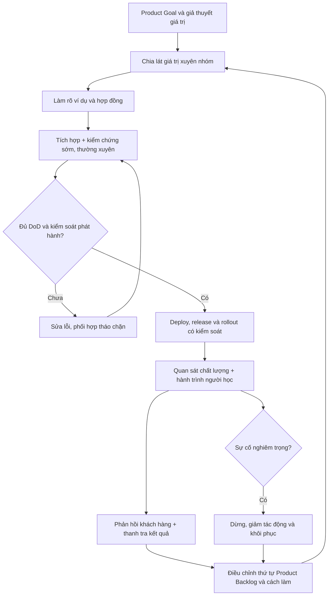
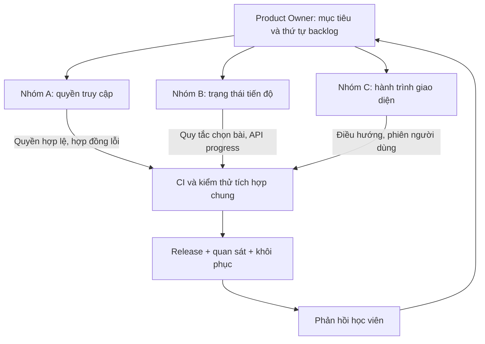
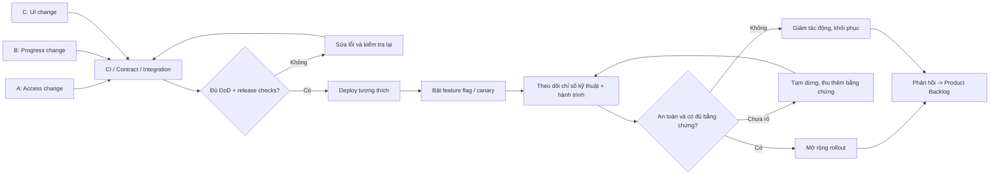

# Phối hợp nhịp kiểm chứng, phát hành và phản hồi khách hàng

## Mục tiêu học tập

Sau bài học này, bạn có thể:

- Phân biệt **nhịp kiểm chứng** (inspect/verify), **nhịp phát hành** (deploy/release/rollout) và **nhịp phản hồi khách hàng** (feedback/learn); hiểu vì sao ba nhịp cần liên kết nhưng không nhất thiết trùng lịch.
- Giải thích cách nhiều nhóm cùng tạo **một sản phẩm hữu dụng**, kể cả khi họ có cách làm hoặc chu kỳ công việc khác nhau.
- Áp dụng đúng các ràng buộc **Product Goal, Product Backlog, Product Owner và Definition of Done** theo Scrum Guide khi nhiều Scrum Team cùng làm **một sản phẩm**.
- Thiết kế một **lát giá trị xuyên nhóm**, làm rõ phụ thuộc, hợp đồng API, trách nhiệm tích hợp, kiểm thử xuyên hệ thống và dữ liệu tương thích.
- Lập kế hoạch phối hợp **kiểm chứng sớm, tích hợp thường xuyên, rollout theo rủi ro và khả năng khôi phục**, tránh biến buổi trình diễn cuối Sprint thành lần ghép hệ thống đầu tiên.
- Tổ chức phản hồi từ khách hàng/người dùng bằng tín hiệu **định tính và định lượng**, đủ ngữ cảnh về phiên bản, nhóm người dùng và chất lượng; chuyển kết quả thành quyết định backlog.
- Lựa chọn chỉ số **flow, chất lượng, hành trình khách hàng và khả năng giao thay đổi**, tránh dùng velocity giữa các nhóm để xếp hạng hiệu suất.
- Nhận diện các anti-pattern: **mini-waterfall xuyên nhóm, tích hợp muộn, nhiều backlog/ưu tiên xung đột, release train hình thức, nhận phản hồi nhưng không hành động**.
- Thực hành qua tình huống ba nhóm phát triển **nền tảng học trực tuyến**, với ví dụ Sprint, hợp đồng, kiểm thử, kế hoạch phát hành, canary và vòng phản hồi.

## 1. Tình huống mở đầu: ba nhóm đều “Done”, nhưng người học chưa dùng được

Một tổ chức đang phát triển nền tảng học Java có ba nhóm:

- **Nhóm A — Catalog & Enrollment:** danh mục khóa, ghi danh và quyền truy cập.
- **Nhóm B — Learning Progress:** ghi nhận bài đã học và xác định bài đang dở.
- **Nhóm C — Learner Experience:** giao diện web, điều hướng và trải nghiệm học.

Mục tiêu chung của sản phẩm là:

> **Học viên có thể ghi danh khóa Java, bắt đầu bài học và quay lại đúng vị trí đang học một cách an toàn.**

Trong cùng một khoảng thời gian:

- Nhóm A tuyên bố hoàn thành API kiểm tra quyền truy cập.
- Nhóm B báo hoàn thành API lấy bài đang dở.
- Nhóm C đã có nút **“Tiếp tục học”** trên giao diện.

Nhưng khi ghép lại, đội phát hiện:

1. Nhóm C gửi `learnerId` từ trình duyệt, trong khi nhóm A yêu cầu danh tính lấy từ **phiên xác thực đáng tin**.
2. Nhóm B trả bài gần nhất **theo thời gian mở**, còn nhóm C hiểu là bài **chưa hoàn thành gần nhất**.
3. Nhóm A thay đổi mã lỗi khi người dùng hết quyền, nhưng contract ở nhóm C chưa được cập nhật.
4. Nhóm B đã thêm trường dữ liệu tiến độ mới mà phiên bản cũ vẫn đang chạy không hiểu.
5. Mỗi nhóm có dashboard riêng; không có tín hiệu **học viên mở đúng bài sau khi bấm nút**.
6. Buổi demo của từng nhóm đều đẹp, nhưng không có một hành trình người học hoàn chỉnh.

Vấn đề không phải chỉ “thiếu một cuộc họp đồng bộ”. Ba nhóm đang tối ưu **đầu ra cục bộ** mà chưa tổ chức chung **cơ chế kiểm chứng, phát hành và nhận phản hồi ở cấp sản phẩm**.

**Nguyên tắc chính của bài:**

> **Phối hợp nhiều nhóm cần làm cho giá trị đi xuyên qua ranh giới nhóm: kiểm chứng chung sớm, phát hành có kiểm soát và học từ phản hồi khách hàng thật, thay vì ghép các danh sách Done của từng nhóm.**

## 2. Ba nhịp cần kết nối nhưng không nhất thiết phải trùng nhau

### 2.1. Nhịp kiểm chứng: chúng ta đang tạo đúng điều gì?

**Kiểm chứng** gồm nhiều tầng:

- **Nghiệp vụ:** người học thật sự cần hành vi nào; các ví dụ và acceptance criteria có thống nhất chưa?
- **Kỹ thuật:** API/schema/hợp đồng giữa các nhóm có tương thích không?
- **Chất lượng:** các trường hợp quyền, dữ liệu, lỗi, đồng thời và trải nghiệm có được kiểm tra không?
- **Sản phẩm:** Increment có giải quyết một phần mục tiêu chung, thay vì chỉ hoàn tất từng module?
- **Thực nghiệm:** kết quả đã quan sát có làm thay đổi hiểu biết về nhu cầu hoặc ưu tiên không?

Kiểm chứng có thể diễn ra **liên tục trong ngày** thông qua test và tích hợp, **theo nhịp Sprint** tại các cơ hội kiểm tra, hoặc **theo nhịp sản phẩm** khi có đủ phản hồi từ người dùng.

### 2.2. Nhịp phát hành: khi nào người dùng được tiếp cận thay đổi?

Một nhóm có thể triển khai mã nhiều lần mà **chưa mở tính năng**; ngược lại một tính năng đã có trong môi trường có thể được bật từng phần bằng flag.

Cần phân biệt:

| Khái niệm | Nghĩa | Ví dụ |
| --- | --- | --- |
| **Integrate** | Ghép thay đổi và kiểm chứng sự tương tác trong hệ thống. | Nhóm A, B, C tích hợp contract và chạy hành trình xuyên suốt. |
| **Deploy** | Đưa phiên bản ứng dụng tới môi trường. | Đưa API Progress mới lên production nhưng chưa mở tính năng. |
| **Release** | Cho người dùng mục tiêu sử dụng khả năng sản phẩm. | Bật “Tiếp tục học” cho một nhóm học viên. |
| **Rollout** | Mở rộng phạm vi sử dụng theo chính sách và tín hiệu. | Từ nhóm thử nghiệm tới các nhóm người dùng khác. |
| **Recover** | Giảm tác động và đưa dịch vụ/dữ liệu về trạng thái an toàn khi có lỗi. | Tắt đường ghi nguy hiểm, rollback ứng dụng hoặc sửa dữ liệu có kiểm chứng. |

Nếu thời điểm phát hành phụ thuộc đối tác hoặc chính sách tổ chức, vẫn có thể **tích hợp và kiểm chứng tăng dần trước thời điểm đó**, không phải chờ “ngày release” mới ghép code.

### 2.3. Nhịp phản hồi: khi nào có đủ bằng chứng để học?

Phản hồi không chỉ là một buổi Sprint Review hay khảo sát cuối quý. Nó có thể đến từ:

- Học viên dùng thử và quan sát trực tiếp.
- Dữ liệu hành trình: ghi danh, mở bài, lưu tiến độ, tiếp tục học.
- Ticket hỗ trợ, phỏng vấn người dùng, phản hồi giảng viên.
- Sự cố production, lỗi quyền/dữ liệu, khả năng tiếp cận.
- Stakeholders trao đổi kết quả Increment trong Sprint Review.
- Thí nghiệm giả thuyết có phạm vi và tiêu chí rõ.

**Phản hồi chất lượng cần đủ ngữ cảnh:** ai thuộc nhóm thử nghiệm nào, đang dùng phiên bản nào, có quyền hợp lệ hay không, thời gian quan sát, cách đo và giới hạn dữ liệu.

### 2.4. Ghép ba nhịp theo chu kỳ học hỏi



Sơ đồ **không buộc mọi đội có cùng lịch**. Nó cho thấy một cơ chế phối hợp phải truyền thông tin giữa ba nhịp để quyết định sản phẩm thay đổi dựa trên thực tế.

## 3. Cùng một sản phẩm Scrum: điều gì cần thống nhất?

### 3.1. Không nhầm nhiều Scrum Team với nhiều sản phẩm độc lập

Theo **Scrum Guide 2020**, khi Scrum Team trở nên quá lớn, tổ chức có thể sắp xếp thành nhiều Scrum Team gắn kết cùng tập trung vào **một sản phẩm**. Khi đó, họ nên chia sẻ:

- **Cùng Product Goal.**
- **Cùng Product Backlog.**
- **Cùng Product Owner.**

Khi nhiều Scrum Team cùng làm một sản phẩm, họ phải **cùng xác định và tuân thủ một Definition of Done chung**.

Điều này không có nghĩa mọi Developer thuộc cùng một nhóm khổng lồ, cũng không yêu cầu mọi Scrum Team dùng cùng công cụ hoặc chia hết task theo một trưởng dự án. Các Scrum Team vẫn có **trách nhiệm giải trình và tự quản** trong phạm vi công việc của mình.

### 3.2. Vì sao Product Backlog chung quan trọng?

Nếu nhóm A ưu tiên bảo mật quyền, nhóm B ưu tiên tiến độ, nhóm C ưu tiên giao diện nhưng **không có một thứ tự giá trị sản phẩm được quản lý thống nhất**, họ có thể hoàn thành ba đầu việc độc lập mà chưa tạo ra khả năng người học sử dụng.

**Product Backlog chung** giúp hiển thị hạng mục và thứ tự của toàn sản phẩm, kể cả công việc phát sinh do phụ thuộc, kiểm thử, rủi ro kỹ thuật và phản hồi khách hàng.

Product Owner chịu trách nhiệm **quản lý hiệu quả Product Backlog và tối đa hóa giá trị sản phẩm**; công việc mô tả/chi tiết có thể được ủy quyền, nhưng trách nhiệm giải trình vẫn thuộc Product Owner.

### 3.3. Vì sao Definition of Done chung quan trọng?

Giả sử:

- Nhóm A coi Done khi API unit tests qua.
- Nhóm B coi Done khi mã đã merge.
- Nhóm C coi Done khi giao diện demo được.

Khi ba nhóm ghép kết quả, không bên nào đã chứng minh **hành trình người học hoạt động an toàn**.

Một DoD chung có thể yêu cầu, tùy sản phẩm:

- Increment được tích hợp vào hệ thống.
- Kiểm thử liên quan đạt, kể cả quyền truy cập và dữ liệu.
- Hợp đồng giữa các thành phần tương thích.
- Không bỏ sót điều kiện chất lượng hoặc quy định tổ chức áp dụng.
- Các phần của sản phẩm đã Done hoạt động cùng nhau.

**DoD không tự động đòi mỗi lần thay mã phải phát hành cho toàn bộ người dùng.** Nó xác định **chuẩn hoàn thành của Increment**, còn quyết định phát hành thêm các điều kiện rủi ro và chính sách phù hợp.

### 3.4. Có bắt buộc đồng bộ Sprint?

Scrum yêu cầu **mỗi Scrum Team** có Sprint một tháng hoặc ngắn hơn và các sự kiện của khung Scrum. Nhưng Scrum Guide **không bắt buộc các đội phải có ngày bắt đầu/kết thúc Sprint giống hệt nhau**.

Việc đồng bộ lịch Sprint **có thể hữu ích** khi sản phẩm có nhiều phụ thuộc và cần cửa sổ cùng thanh tra kết quả. Tuy nhiên:

- Đồng bộ lịch không tự giải quyết contract sai hoặc tích hợp muộn.
- Không đồng bộ lịch vẫn có thể phối hợp bằng test, chính sách tích hợp và các điểm kiểm chứng thường xuyên.
- Nếu cùng một sản phẩm, cần có **Increment tích hợp hữu dụng và DoD chung**, bất kể chọn lịch nào.
- Một buổi **cross-team sync** là thực hành bổ sung, **không phải sự kiện thứ sáu của Scrum**.

### 3.5. Khi các nhóm đang làm những sản phẩm khác nhau

Nếu nhóm A cung cấp **dịch vụ nền tảng cho nhiều sản phẩm**, còn B/C thuộc các sản phẩm khác với Product Goal và Product Owner riêng, không được áp máy móc quy tắc “một Product Backlog cho mọi bộ phận”.

Khi đó, phối hợp qua **hợp đồng dịch vụ, kỳ vọng, lịch phát hành, ưu tiên liên sản phẩm và cơ chế phản hồi**. Trước khi chọn cách quản trị nhiều nhóm, phải xác định **ranh giới sản phẩm** và giá trị khách hàng mà mỗi nhóm chịu trách nhiệm.

## 4. Bắt đầu từ hành trình người học thay vì sơ đồ tổ chức

### 4.1. Vẽ value stream từ nhu cầu đến phản hồi

```mermaid
flowchart LR
    A["Học viên muốn tiếp tục học"] --> B["Khám phá nhu cầu"]
    B --> C["Ưu tiên và chia lát"]
    C --> D["Thiết kế nghiệp vụ + API"]
    D --> E["Xây dựng và tích hợp"]
    E --> F["Kiểm chứng end-to-end"]
    F --> G["Phát hành"]
    G --> H["Quan sát hành vi, hỗ trợ"]
    H --> I["Học và cập nhật backlog"]
```



Ở mỗi bước, hỏi:

- Bước này **tạo bằng chứng hoặc giá trị gì**?
- Có phải đợi người/nhóm khác không? Đợi vì lý do hợp lệ nào?
- Có nhiều lần bàn giao mà mất ngữ cảnh không?
- Ai chịu trách nhiệm đảm bảo **quyết định xuyên ranh giới** được thực hiện?
- Rủi ro nào có thể xuất hiện muộn nhất?
- Khi phát hành, ai biết người học **đã nhận được kết quả đúng**?

### 4.2. Nhìn cả thời gian xử lý và thời gian chờ

Ví dụ minh họa:

| Công đoạn | Thời gian thực hiện | Thời gian chờ trước khi bắt đầu |
| --- | ---: | ---: |
| Làm rõ hành vi | 0,5 ngày | 1 ngày |
| Thống nhất hợp đồng API | 0,5 ngày | 2 ngày |
| Xây dựng các thành phần | 3 ngày | 1 ngày |
| Kiểm thử tích hợp | 1 ngày | 3 ngày |
| Kiểm tra và phát hành | 0,5 ngày | 2 ngày |

Tổng thời gian thực hiện trong ví dụ là **5,5 ngày**, tổng thời gian chờ là **9 ngày**, nên thời gian toàn dòng nếu các chặng diễn ra tuần tự là **14,5 ngày**. Đây là **dữ liệu giả định**, không phải thời gian thực của tổ chức.

Nhóm chỉ tăng tốc lập trình từ 3 xuống 2 ngày nhưng vẫn để công việc chờ 9 ngày thì tác động toàn dòng có thể hạn chế.

**Lean** giúp nhìn toàn dòng giá trị; **Kanban** giúp trực quan hóa hàng đợi, WIP và age; **Scrum** giúp kiểm tra mục tiêu/Increment; **XP và CI** giúp tích hợp và thay đổi kỹ thuật sớm hơn.

## 5. Chia lát giá trị xuyên nhóm để có thể kiểm chứng

Một lỗi phổ biến là chia một tính năng:

- Sprint 1: nhóm A làm hết API.
- Sprint 2: nhóm B làm hết dữ liệu.
- Sprint 3: nhóm C làm hết giao diện.
- Cuối Sprint 3: mới kiểm tra với người dùng.

Cách chia này tối ưu **dòng công việc từng chuyên môn** nhưng trì hoãn bằng chứng sản phẩm.

### 5.1. Chia theo hành vi hoàn chỉnh

Với tính năng “Tiếp tục học”, có thể chia:

| Lát | Giá trị/điều cần học | Nhóm cần phối hợp | Kiểm chứng tối thiểu |
| --- | --- | --- | --- |
| **L1 — Mở bài đã ghi danh** | Học viên có quyền mở được bài đầu. | A + C, B chưa bắt buộc. | Quyền hợp lệ và từ chối trái phép; hành trình E2E. |
| **L2 — Lưu tiến độ một thiết bị** | Khi quay lại, học viên mở được bài đang dở theo quy tắc rõ. | B + C; A xác nhận ranh giới quyền. | Đọc/ghi tiến độ, điều hướng, từ chối khi mất quyền. |
| **L3 — Xử lý gửi lại** | Tải lại hoặc gửi cập nhật lặp không làm sai tiến độ. | B + C, phối hợp kiểm thử API. | Idempotency/nhất quán theo thiết kế; regression L1–L2. |
| **L4 — Hai thiết bị** | Học viên không bị ghi đè sai khi cập nhật đồng thời. | B + C, A khi thay đổi danh tính/quyền. | Kiểm thử đồng thời và quy tắc hòa giải được xác nhận. |

Đây chỉ là **lát minh họa**. Nếu sản phẩm đã đòi hỏi đồng bộ hai thiết bị là điều kiện an toàn bắt buộc ngay từ L2, không được giao L2 với hành vi làm mất dữ liệu rồi hẹn L4 sửa. Cần xác định **ranh giới giá trị và điều kiện chất lượng** trước khi chia.

### 5.2. Mỗi lát cần một “đường kiểm chứng” chung

Trước khi các nhóm bắt đầu, mô tả:

1. **Ai dùng?** Danh tính và quyền nào?
2. **Làm gì?** Tình huống nghiệp vụ chính và ngoại lệ.
3. **Đi qua thành phần nào?** UI, API, DB, dịch vụ và phụ thuộc ngoài.
4. **Thế nào là Done?** Acceptance criteria riêng và DoD chung.
5. **Kiểm tra cách nào?** Unit, contract, integration, E2E, exploratory theo rủi ro.
6. **Triển khai thế nào?** Thay đổi có tương thích, dữ liệu và khả năng khôi phục?
7. **Học điều gì sau phát hành?** Tín hiệu outcome, chất lượng và phản hồi khách hàng.

Nếu không có đường kiểm chứng chung, việc A, B, C đều “Done” có thể chỉ chứng minh ba thành phần chạy riêng.

## 6. Phụ thuộc liên nhóm: phân loại trước khi tạo thêm cuộc họp

Một phụ thuộc là điều khiến tiến độ hoặc chất lượng của một nhóm phụ thuộc vào quyết định/đầu ra của một nhóm khác. Không phải mọi phụ thuộc đều phải được giải bằng họp định kỳ.

### 6.1. Năm loại phụ thuộc thường gặp

| Loại | Ví dụ | Biện pháp phù hợp |
| --- | --- | --- |
| **Nghiệp vụ/ngữ nghĩa** | “Bài đang dở” được hiểu khác ở nhóm B và C. | Ví dụ Given–When–Then, glossary, buổi làm rõ ngắn với Product Owner. |
| **Hợp đồng kỹ thuật** | API đổi tên trường hoặc mã lỗi. | Schema/contract versioning, consumer-driven contract tests khi phù hợp. |
| **Dữ liệu và trạng thái** | Hai dịch vụ cùng ghi tiến độ/học viên. | Xác định nguồn sự thật, giao dịch/idempotency, đối soát và kế hoạch migration. |
| **Thời gian/công việc** | Nhóm C cần API giả lập để làm UI trước khi B hoàn thành. | Thống nhất contract sớm, mock có kiểm chứng, tích hợp thật định kỳ. |
| **Phát hành và vận hành** | B thay schema, A/C chưa tương thích. | Release plan chung, expand–migrate–contract, flags, test cùng phiên bản. |

### 6.2. Một bản đồ phụ thuộc cho lát “Tiếp tục học”



Sơ đồ không có nghĩa Product Owner **chỉ đạo từng công việc kỹ thuật**. Product Owner định hướng giá trị và backlog, trong khi Developers phối hợp lập kế hoạch và tạo Increment.

### 6.3. Một thẻ phụ thuộc đủ cụ thể

```text
DEPENDENCY: DEP-07
Lát giá trị: L2 — Tiếp tục đúng bài đang dở

Nhóm phụ thuộc: C (Learner Experience)
Nhóm cung cấp: B (Learning Progress)
Cần: hợp đồng GET /courses/{courseId}/resume
Ngữ nghĩa: trả bài dở theo quy tắc đã thống nhất;
           nếu không có bài dở, trả trạng thái rõ ràng
Tiêu chí kiểm chứng: contract test phía consumer và provider;
                     integration test với quyền hợp lệ
Ngày cần quyết định: trước khi làm luồng UI phụ thuộc
Trạng thái: Đang làm rõ "nhiều bài dở" với Product Owner
Người điều phối: Developer đại diện hợp đồng từ B và C
Bước tiếp theo: buổi làm rõ ví dụ, chốt schema rồi commit contract
```

Một thẻ như vậy **nêu đúng điều đang chặn**, khác với “Nhóm B chưa làm xong, cần họp với nhau”.

### 6.4. Quản lý phụ thuộc như WIP

Nếu một nhóm có 15 phụ thuộc đang mở và không ai biết tuổi của chúng, chính danh sách phụ thuộc có thể thành điểm nghẽn.

Có thể theo dõi:

- Phụ thuộc **mới, đang xử lý, bị chặn, đã xác minh**.
- **Thời gian chờ quyết định** hoặc artifact từ nhóm khác.
- Số phụ thuộc có **tác động tới Sprint Goal/DoD**.
- Phụ thuộc do **bất đồng ngữ nghĩa** so với do **năng lực kỹ thuật**.
- Những phụ thuộc cần xử lý bằng **thay cấu trúc trách nhiệm** thay vì tiếp tục tạo ticket bàn giao.

Không đặt WIP limit để “làm đẹp bảng”; chính sách chỉ có giá trị khi giúp đội **ưu tiên hoàn tất và tháo chặn**.

## 7. Hợp đồng chung và kiểm chứng kỹ thuật sớm

### 7.1. Contract first không có nghĩa tài liệu lớn

Nếu nhóm C đang chờ B xây API, hai nhóm có thể chốt **ngữ nghĩa và mẫu phản hồi nhỏ** trước khi viết mã chi tiết.

Ví dụ minh họa cho kết quả thành công:

```json
{
  "courseId": "java-foundation",
  "resumeLessonId": "lesson-05",
  "progressRevision": 12,
  "access": "ALLOWED"
}
```

Và một phản hồi tình huống không có bài dở:

```json
{
  "courseId": "java-foundation",
  "resumeLessonId": null,
  "progressRevision": 0,
  "access": "ALLOWED"
}
```

**Đây là schema minh họa**, chưa phải một hợp đồng sản xuất. Cần làm rõ:

- `progressRevision=0` có thực sự hợp lệ hay cần `null` khi chưa có tiến độ?
- Trường `access` được quyết định bởi **dịch vụ tin cậy** hay client có thể tự gửi?
- Khi **không có quyền**, API trả mã HTTP và payload nào, có tiết lộ dữ liệu riêng không?
- Nếu có nhiều bài chưa hoàn thành, quy tắc chọn `resumeLessonId` là gì?
- Client cũ có thể đọc phản hồi sau khi thêm trường không?
- Có cần gắn `correlationId` trong header/log để truy vết?

Đừng xây một enum chung chỉ vì nhìn giống nhau; **cùng tên trường phải có cùng ngữ nghĩa** trong hợp đồng được sử dụng.

### 7.2. Test ở đâu để không chỉ kiểm chứng từng silo?

| Loại kiểm chứng | Chủ yếu kiểm tra | Ví dụ |
| --- | --- | --- |
| **Unit/component** | Quy tắc nội bộ từng nhóm. | B chọn bài dở theo trạng thái đã chốt. |
| **Contract test** | Provider và consumer đồng ý về request/response và ngữ nghĩa quan trọng. | C gửi request mà B hiểu; mã lỗi khi hết quyền nhất quán. |
| **Integration test** | Dịch vụ/DB/hàng đợi thực sự phối hợp đúng. | A xác nhận quyền, B trả tiến độ, C điều hướng đúng. |
| **End-to-end/acceptance** | Hành trình người học hoạt động xuyên suốt. | Người học ghi danh rồi quay lại bài dở. |
| **Security/reliability tests** | Quyền, dữ liệu, retry, đồng thời và rủi ro đáng kể. | Người dùng khác không được truy cập bài riêng; hai thiết bị không làm mất tiến độ. |
| **Production observability** | Hành vi thực và lỗi khó tái tạo trong môi trường thử. | Tỷ lệ tiếp tục đúng bài theo cohort/phiên bản; xung đột cập nhật. |

**Hợp đồng xanh không tự chứng minh toàn hệ thống đúng**. Một contract test có thể xác nhận trường `resumeLessonId` là chuỗi, nhưng vẫn không biết nó **chọn sai bài**. Cần kiểm chứng nghiệp vụ và hành trình ở tầng thích hợp.

### 7.3. Kiểm thử hành vi dùng chung

```gherkin
Feature: Học viên tiếp tục khóa học

  Scenario: Học viên còn quyền mở lại bài dở
    Given Lan đã đăng nhập và có quyền hợp lệ với khóa "Java nhập môn"
    And Lan có bài chưa hoàn thành được xác định theo quy tắc nghiệp vụ
    When Lan nhấn "Tiếp tục học"
    Then hệ thống mở đúng bài dở của Lan
    And không hiển thị dữ liệu tiến độ của học viên khác

  Scenario: Học viên mất quyền sau khi đã lưu tiến độ
    Given Lan có tiến độ cũ trong khóa "Java nhập môn"
    And Lan không còn quyền truy cập nội dung riêng
    When Lan nhấn "Tiếp tục học" hoặc dùng liên kết cũ
    Then hệ thống từ chối truy cập nội dung riêng

  Scenario: Chưa có bài dở
    Given Lan còn quyền với khóa "Java nhập môn"
    And Lan chưa có bài đang dở theo quy tắc đã chốt
    When Lan mở trang khóa
    Then giao diện hiển thị trạng thái phù hợp
    And không tự đánh dấu một bài là đã hoàn thành
```

Các ví dụ cần được **Product Owner/những người hiểu nghiệp vụ xác nhận**. Viết Gherkin chưa tự tạo kiểm thử có thể chạy; Developers cần bước ánh xạ và môi trường phù hợp.

### 7.4. Tích hợp sớm hơn lịch demo

Một nhịp kỹ thuật hợp lý là:

1. Các nhóm thống nhất **ngữ nghĩa và contract nhỏ** trước khi code tách nhánh dài.
2. Có **test và môi trường tích hợp** cho các thay đổi liên quan.
3. Mỗi nhóm tích hợp thường xuyên, xử lý lỗi kết nối sớm.
4. Thực hiện **end-to-end slice** ngay khi đủ thành phần tối thiểu, không đợi mọi nhóm hoàn thành toàn bộ danh sách.
5. Khi thêm hành vi mới, giữ **regression tests** cho các lát trước.
6. Trước phát hành, kiểm tra **DoD chung** và các điều kiện an toàn/vận hành tương ứng.

**Continuous Integration (CI)** giúp giảm độ trễ phản hồi kỹ thuật, nhưng CI xanh chỉ chứng minh những điều pipeline thực sự kiểm tra.

## 8. Phối hợp dữ liệu và tương thích trong nhiều phiên bản đang chạy

Đặc biệt nguy hiểm khi các nhóm thay đổi schema/API độc lập mà hệ thống production vẫn cần chạy ổn định.

### 8.1. Ví dụ chuyển kiểu dữ liệu tiến độ

Bản cũ:

```text
lesson_progress.completed : boolean
```

Bản mới:

```text
lesson_progress.status : NOT_STARTED | IN_PROGRESS | COMPLETED
```

Nếu B chuyển dữ liệu và xóa `completed` ngay trong khi A/C hoặc ứng dụng web cũ vẫn đọc trường cũ, hệ thống có thể lỗi dù từng nhóm đã “pass test” riêng.

### 8.2. Expand–migrate–contract là một lựa chọn chuyển đổi

Một đường chuyển đổi phổ biến:

- **Expand:** bổ sung cấu trúc mới mà vẫn giữ đường cũ tương thích.
- **Migrate:** chuyển dữ liệu có kiểm chứng, xử lý các trường hợp thiếu thông tin và theo dõi sai lệch.
- **Switch:** chuyển dần consumer/producer sang cách đọc/ghi mới; kiểm tra các phiên bản đồng tồn tại.
- **Contract:** xóa phần cũ **sau khi** các consumer đã di trú và phương án khôi phục được đánh giá.

**Không được tự suy ra** `completed=false` nghĩa là `NOT_STARTED`: có thể người học **đã bắt đầu nhưng chưa hoàn thành**. Nếu dữ liệu cũ không đủ thông tin, cần quyết định nghiệp vụ và nguồn bổ sung hoặc trạng thái chưa xác định an toàn.

### 8.3. Dữ liệu là hợp đồng, không phải “việc riêng của nhóm B”

Khi B là nguồn sự thật của tiến độ, C vẫn phải hiểu **ý nghĩa hành vi và giao diện**; A vẫn phải bảo đảm **quyền truy cập**. Không có nghĩa cả ba nhóm đều được tự ghi/sửa bản ghi theo ý mình.

Nên làm rõ:

- **Nguồn sự thật** của ghi danh, quyền và tiến độ.
- Quy tắc **đồng thời, gửi lại, idempotency** và xử lý lỗi.
- Các phiên bản API/client cần hỗ trợ.
- Ai được phép sửa dữ liệu và cách đối soát.
- Điều kiện rollback/roll-forward an toàn.
- Kiểm thử xuyên nhóm và người liên hệ khi phát hiện sai lệch.

Một thay đổi về dữ liệu có tác động cao có thể cần đánh giá sớm hơn một hạng mục giao diện. **Agile không có nghĩa mọi quyết định đều có thể đảo ngược dễ dàng**.

## 9. Thiết kế các điểm đồng bộ ít nhưng tạo quyết định thật

Phối hợp không nên đồng nghĩa thêm một lớp “Scrum of Scrums” chỉ để đọc trạng thái của từng nhóm.

### 9.1. Một lịch phối hợp minh họa

| Nhịp | Mục đích | Người tham gia cần thiết | Đầu ra hữu ích |
| --- | --- | --- | --- |
| **Trước khi chọn lát** | Thống nhất Product Goal, thứ tự giá trị, ranh giới và phụ thuộc chính. | Product Owner; Developers có kiến thức liên quan. | Lát dọc đủ nhỏ, acceptance criteria, phụ thuộc rõ. |
| **Đầu chu kỳ làm việc** | Đàm phán thứ tự công việc, cam kết chất lượng, đường kiểm chứng. | Các Scrum Team tự lập Sprint plans, phối hợp nếu có phụ thuộc. | Kế hoạch nhóm và điểm tích hợp chung, không giao task từ trên xuống. |
| **Hằng ngày hoặc khi có thay đổi** | Phát hiện contract sai, blocker và nguy cơ tới mục tiêu. | Người có phụ thuộc thực tế, không bắt buộc mọi thành viên. | Quyết định kỹ thuật, owner tháo chặn, thay đổi kế hoạch. |
| **Khi một lát có thể chạy** | Kiểm chứng end-to-end với dữ liệu và quyền thực. | Người liên quan về nghiệp vụ, kiểm thử, phát triển. | Bằng chứng chất lượng và công việc còn thiếu. |
| **Trước rollout** | Đánh giá DoD, phiên bản, quan sát và khôi phục. | Người có trách nhiệm kỹ thuật/vận hành/phát hành. | Quyết định go/pause, tín hiệu dừng và runbook. |
| **Sau rollout/feedback** | Hiểu hành vi người dùng và kết quả, cập nhật thứ tự sản phẩm. | Product Owner, các nhóm liên quan, stakeholders phù hợp. | Quyết định backlog và giả thuyết tiếp theo. |
| **Theo Retrospective** | Học từ phụ thuộc, chờ đợi, lỗi và phối hợp. | Scrum Team; thêm trao đổi xuyên nhóm khi cần. | Một vài cải tiến có chủ sở hữu và bằng chứng kiểm chứng. |

Đây là **gợi ý**, không phải yêu cầu một tổ chức phải thêm bảy loại cuộc họp. Nhiều cuộc trao đổi có thể là **đồng bộ bất đồng bộ bằng artifact, kiểm thử, bảng phụ thuộc và thông tin trạng thái**.

### 9.2. Có nên làm “Scrum of Scrums”?

Các tổ chức đôi khi dùng tên **Scrum of Scrums** cho buổi phối hợp liên nhóm, tập trung vào **phụ thuộc, rủi ro tích hợp, trở ngại và quyết định cần đồng thuận**.

Nó **không phải sự kiện bắt buộc của Scrum Guide 2020**. Nếu dùng, nên hỏi:

- Có **vấn đề xuyên nhóm cụ thể** cần xử lý không?
- Ai cần tham gia để đưa ra quyết định, thay vì chỉ mang báo cáo?
- Sau buổi họp có thay đổi **kế hoạch, contract, phụ thuộc hoặc việc tháo chặn**?
- Có thông tin nào nên được đưa vào **CI, tài liệu contract hoặc bảng workflow** để khỏi họp lại?
- Buổi họp này có lặp chức năng Daily Scrum của từng đội hay không?

Nếu chỉ nghe “Nhóm A hôm qua làm gì”, “Nhóm B hôm nay làm gì”, cuộc họp có nguy cơ tăng chi phí phối hợp mà không giảm phụ thuộc.

## 10. Phân biệt kiểm chứng theo nhịp Scrum với kiểm chứng liên tục

### 10.1. Sprint Review kiểm tra sản phẩm, không phải nghiệm thu từng silo

Một **Sprint Review** có ích khi stakeholders cùng Scrum Team xem **Increment thực**, tình hình Product Goal và những gì đã thay đổi để quyết định bước tiếp theo.

Khi nhiều Scrum Team cùng làm một sản phẩm, đội có thể **phối hợp thể hiện hành trình tích hợp**, tránh ba buổi demo chỉ có API, schema và UI độc lập. Cách tổ chức Review cụ thể tùy bối cảnh; không có quy định Scrum Guide bắt buộc một “Super Review” cho mọi doanh nghiệp.

**Sprint Review không phải cổng phê duyệt phát hành duy nhất**. Không nên đợi tới Review mới biết ba thành phần không tương thích.

### 10.2. Kiểm chứng liên tục bổ sung Review

- Contract tests có thể chạy **mỗi lần thay API**.
- Integration tests có thể chạy **khi code được tích hợp**.
- E2E quan trọng có thể chạy **nhiều lần trong Sprint**.
- Kiểm tra quyền và dữ liệu cần chạy **khi rủi ro phát sinh**, không chờ demo.
- Phản hồi từ nhóm dùng thử có thể đến **trước hoặc sau Sprint Review**.
- Tình hình Product Goal và kết quả người dùng được xem **ở các điểm phù hợp** thay vì chỉ khi đủ một chu kỳ lịch.

Nếu cần đợi buổi Review mới có môi trường tích hợp chạy được, đó là tín hiệu về **khả năng tạo Increment chất lượng**, không phải lý do để tăng thời lượng Review.

### 10.3. Khả năng kiểm chứng là công việc xuyên nhóm

Một lát chưa thể chạy end-to-end vì A/B/C chưa đồng bộ contract là **rủi ro của toàn sản phẩm**. Không nên gắn nhãn “chỉ nhóm C bị chặn” rồi coi A và B đã xong trách nhiệm chất lượng nếu DoD chung chưa đạt.

Điều này không phải quy tắc **cả ba nhóm phải cùng làm mọi task**. Mỗi nhóm vẫn có trách nhiệm và quyền tự quản, nhưng phải **phối hợp để tạo kết quả tích hợp có thể dùng**.

## 11. Phát hành liên nhóm: một kế hoạch có thể vận hành

### 11.1. Phát hành không nhất thiết trùng Sprint

Một sản phẩm có thể:

- Tích hợp thay đổi nhỏ hằng ngày.
- Tạo một hoặc nhiều Increment đạt DoD trong Sprint.
- Deploy liên tục theo pipeline khi đáp ứng chính sách.
- Bật tính năng cho khách hàng theo **rollout có kiểm soát**.
- Nhận phản hồi sản phẩm theo nhịp phù hợp với hành vi người dùng.

Điều này không xung đột về nguyên tắc với Scrum. Cần phân biệt **chu kỳ kiểm tra Sprint** và **lịch mở tính năng tới người dùng**.

### 11.2. Bản kế hoạch phát hành tối thiểu

| Thành phần | Câu hỏi cần chốt | Ví dụ “Tiếp tục học” |
| --- | --- | --- |
| **Giá trị và phạm vi** | Khả năng nào, người dùng nào, mức rủi ro nào? | Học viên đang theo học quay lại bài dở. |
| **Increment/DoD** | Lát đã tích hợp và đáp ứng chất lượng chưa? | Quyền/tiến độ/điều hướng và hồi quy đạt DoD. |
| **Phiên bản và contract** | A/B/C và client cũ có tương thích không? | API resume và schema progress cùng phiên bản hợp lệ. |
| **Phụ thuộc dữ liệu** | Migration có bảo toàn dữ liệu không? | Giữ tương thích trường cũ, đối soát tiến độ. |
| **Rollout** | Mở cho ai trước, mở rộng khi nào? | Nhóm học viên dùng thử rồi tăng phạm vi khi có bằng chứng. |
| **Observability** | Đo kết quả kỹ thuật và nghiệp vụ ra sao? | Tỷ lệ mở đúng bài, xung đột lưu tiến độ, lỗi quyền. |
| **Guardrails** | Sự kiện nào buộc dừng? | Bất kỳ sai quyền hoặc mất dữ liệu được xác nhận. |
| **Khôi phục** | Tắt flag/rollback/roll-forward/repair khác nhau thế nào? | Flag tắt đường mới nhưng không tự sửa tiến độ đã hỏng. |
| **Quyền quyết định** | Ai triển khai, ai quyết định pause/go, ai truyền thông? | Đại diện kỹ thuật/vận hành được phân quyền, phối hợp Product Owner. |
| **Phản hồi** | Xem dữ liệu và backlog vào thời điểm nào? | Kiểm tra hành vi học viên, hỗ trợ và quyết định ưu tiên. |

**Đây là cấu trúc tham khảo**. Hệ thống an toàn cao hoặc có điều kiện pháp lý có thể cần thêm quy trình; một thay đổi giao diện nhỏ có thể dùng phiên bản rút gọn.

### 11.3. Một sơ đồ thay đổi từ nhiều nhóm tới production



### 11.4. Release train: dùng để phối hợp, không dùng để che chưa Done

Một số tổ chức có **release train** hoặc lịch phát hành định kỳ. Điều này có thể giúp phối hợp với khách hàng, kiểm soát và hệ thống ngoài.

Nhưng nếu release train trở thành cơ chế:

- Ép đưa mã chưa đạt DoD vào bản phát hành.
- Đợi tới cuối chu kỳ mới kiểm thử tích hợp.
- Báo “đã onboard đủ nhóm” thay vì chứng minh giá trị.
- Bỏ qua khôi phục vì “không thể lỡ tàu”.

...thì lịch phát hành đang **che rủi ro**, không giảm rủi ro. Phát hành theo lịch phải có **điều kiện chất lượng và quyết định loại bỏ chức năng chưa sẵn sàng** khi cần.

## 12. Rollout có kiểm soát, feature flags và giới hạn tác động

### 12.1. Canary giúp học với phạm vi rủi ro nhỏ

**Canary release** mở một thay đổi cho một nhóm nhỏ rồi quan sát để quyết định có mở rộng không. Đặc biệt với thay đổi xuyên A/B/C, cần:

- Có nhãn **phiên bản, cohort, flag variant** trong telemetry.
- Theo dõi **hành trình tổng thể** và dịch vụ liên quan, không chỉ lỗi từng API.
- Bảo đảm nhóm canary phù hợp hành vi cần quan sát (ví dụ học trên nhiều thiết bị).
- Có **điều kiện tạm dừng/dừng** và quyền quyết định.
- Đánh giá **đủ mẫu và thời gian**; không kết luận an toàn chỉ vì ít phút không có HTTP 500.

### 12.2. Feature flags là một công cụ, không phải phép hoàn tác dữ liệu

Nhóm C có thể ẩn nút “Tiếp tục học” khi flag tắt; B có thể tắt đường cập nhật mới nếu thiết kế cho phép.

Nhưng:

- Dữ liệu đã bị **ghi đè sai** vẫn còn.
- Client có thể còn đường URL cũ, nên **server vẫn phải bảo vệ quyền**.
- Nhiều phiên bản service có thể đang cùng chạy, cần **compatibility**.
- Flag cũ cần người phụ trách và điều kiện **dọn bỏ** để tránh nợ kỹ thuật.

### 12.3. Khi nào rollback chưa đủ?

Nếu bản Progress mới chỉ **đọc sai** bài dở mà không ghi dữ liệu sai, tắt flag hoặc rollback tương thích có thể hạn chế tác động.

Nếu đã **ghi hỏng tiến độ**, rollback mã có thể ngăn lỗi mới nhưng **không phục hồi dữ liệu**. Cần xác định phạm vi, bảo toàn bằng chứng, chọn nguồn sửa dữ liệu, kiểm chứng toàn vẹn và truyền thông phù hợp.

Kế hoạch liên nhóm phải biết ai chịu trách nhiệm:

- Khôi phục dịch vụ.
- Xác định quyền truy cập đúng.
- Đối soát dữ liệu tiến độ.
- Kiểm tra hành trình web.
- Thông báo và hỗ trợ học viên.

**Không dùng một nút rollback làm lý do bỏ kế hoạch dữ liệu.**

## 13. Phản hồi khách hàng: tránh chỉ nghe một nhóm stakeholders

Phản hồi có ích khi nó trả lời **giả thuyết giá trị**, đủ ngữ cảnh và dẫn đến **quyết định thực tế**.

### 13.1. Ba nguồn tín hiệu bổ sung

| Nguồn | Có thể cho biết | Giới hạn |
| --- | --- | --- |
| **Khách hàng/stakeholders** | Mục tiêu, ràng buộc, ưu tiên, tình huống nghiệp vụ. | Người phát biểu không luôn đại diện mọi nhóm người dùng. |
| **Quan sát và phỏng vấn người học** | Khó khăn thực tế, lý do hành vi, điều khó hiểu. | Mẫu có thể nhỏ, dễ thiên lệch lựa chọn và diễn giải. |
| **Telemetry và hỗ trợ vận hành** | Mức độ sử dụng, lỗi, thời gian thao tác, vấn đề lặp theo phiên bản. | Con số không tự giải thích **vì sao** và không chứng minh nhân quả. |

Một hành trình sử dụng được nhiều người nhấn có thể vì **nút bị đặt nhầm dễ bấm**, không có nghĩa tính năng hữu ích. Một học viên phàn nàn về độ trễ có thể là tín hiệu quan trọng nhưng chưa đủ cho một giả thuyết tổng quát.

### 13.2. Chuyển câu “khách hàng không hài lòng” thành câu hỏi kiểm chứng

Ví dụ phản hồi:

> “Nút Tiếp tục học đôi khi không đưa tôi tới nơi tôi muốn.”

Cần làm rõ:

1. Người phản ánh có quyền hợp lệ không?
2. Họ hiểu “bài đang dở” theo quy tắc nào? Nhóm sản phẩm có cùng định nghĩa không?
3. Trường hợp xảy ra trên một hay nhiều thiết bị?
4. Nó có xảy ra ở **phiên bản mới và cohort canary** không?
5. Log/trace và dữ liệu tiến độ có giải thích được tình huống không?
6. Có phải lỗi thiết kế, dữ liệu, giao diện hay kỳ vọng chưa thống nhất?
7. Nếu sửa, acceptance criteria và kiểm thử hồi quy nào cần bổ sung?

Thay vì gửi yêu cầu chung “nhóm B sửa API”, hãy làm rõ **bằng chứng và tác động xuyên nhóm**.

### 13.3. Phản hồi chất lượng cần được gắn vòng quyết định

```text
Quan sát/feedback
  → Triage: tác động, mức khẩn, mức chắc chắn
  → Làm rõ giả thuyết và nguyên nhân
  → Product Owner cân nhắc Product Goal và thứ tự backlog
  → Các nhóm chia lát và kiểm chứng thay đổi
  → Release có tín hiệu và guardrails
  → Xem lại outcome/chất lượng, cập nhật hiểu biết
```

Triage nên phân biệt:

- **Lỗi nghiêm trọng** về quyền/dữ liệu: xử lý theo chính sách sự cố, không chờ ưu tiên tính năng thông thường.
- **Nhu cầu/tính năng mới**: đánh giá giá trị, quy mô, bằng chứng và chi phí cơ hội.
- **Ý tưởng/giả thuyết chưa rõ**: nghiên cứu/experiment nhỏ trước khi đầu tư lớn.
- **Sự cố vận hành**: khôi phục trước, sau đó phân tích nguyên nhân và cập nhật backlog cải tiến.

### 13.4. Ai có quyền đổi ưu tiên?

Nếu nhiều Scrum Team cùng một sản phẩm, **Product Owner chung** chịu trách nhiệm quản lý hiệu quả Product Backlog. Các Developers và stakeholders đóng góp thông tin, ước lượng, rủi ro và phương án kỹ thuật.

Không nên để:

- Mỗi trưởng nhóm tự nhận yêu cầu riêng từ stakeholder rồi tạo ba backlog ưu tiên xung đột.
- Một bộ phận chỉ đạo nhóm thay đổi Sprint Goal mà không xem tác động.
- Những feedback được chuyển cho “nhóm phụ trách” nhưng không có người xem **giá trị tổng sản phẩm**.
- Một cuộc họp ban quản lý bỏ qua quyền tự quản của Developers hoặc trách nhiệm Product Owner.

Điều này không ngăn **ủy quyền công việc mô tả backlog** hoặc phân công người liên hệ khách hàng; ranh giới trách nhiệm vẫn phải rõ.

## 14. Ví dụ dữ liệu: một lần canary cần dừng để điều tra

Giả sử các nhóm phát hành “Tiếp tục học” cho một cohort thử nghiệm. Nhóm định nghĩa:

- **Success:** học viên có quyền, nhấn Tiếp tục học và mở **đúng bài dở** theo quy tắc nghiệp vụ được chốt.
- **Incorrect resume:** mở nhầm bài dù request trả thành công về mặt kỹ thuật.
- **Access incident:** một tài khoản không có quyền vẫn xem được nội dung riêng.
- **Data loss:** một cập nhật hợp lệ bị ghi đè sai và không thể tái tạo từ nguồn đáng tin.

### 14.1. Dữ liệu giả định sau lần mở đầu

| Tín hiệu | Giá trị trong kỳ minh họa | Cách đọc |
| --- | ---: | --- |
| Lượt nhấn hợp lệ được đo trong cohort mới | 1.000 | Mẫu số của phép đo ở cohort. |
| Lượt mở đúng bài | 982 | Có bằng chứng đúng ở các lượt đã đo. |
| Lượt mở nhầm bài | 18 | **1,8%** lượt nhấn hợp lệ trả sai hành vi. |
| Request API trả HTTP 200 | 997 | **99,7%** chỉ phản ánh mức giao thức, không tự chứng minh đúng bài. |
| Sự cố truy cập trái quyền được xác nhận | 0 | Chưa quan sát sự cố, không chứng minh tuyệt đối không thể xảy ra. |
| Lỗi ghi đè tiến độ cần điều tra | 2 | Phải xác minh có ảnh hưởng dữ liệu hợp lệ không. |

Đây **hoàn toàn là số liệu giảng dạy**, không mô tả một sản phẩm thật hay một ngưỡng ngành.

Trong ví dụ, mục tiêu an toàn đã thống nhất trước rollout là: **không mở rộng khi có hành vi mở nhầm bài vượt ngưỡng chấp nhận đã đặt hoặc có nghi ngờ mất dữ liệu chưa được làm rõ**. Vì có 18 lượt sai bài và hai sự kiện ghi đè cần điều tra, đội nên **tạm dừng mở rộng** thay vì coi HTTP 200 là thành công.

**Không được suy ra 18 học viên khác nhau** chỉ từ 18 lượt nhấn; một học viên có thể thao tác nhiều lần.

### 14.2. Tại sao phải nhìn A, B, C cùng nhau?

- **Nhóm A** xác nhận người dùng có quyền hợp lệ và không có lỗi phân quyền.
- **Nhóm B** kiểm tra quy tắc chọn bài và dữ liệu tiến độ có bị ghi đè hay không.
- **Nhóm C** kiểm tra việc dùng response và điều hướng đúng.
- **Nhóm vận hành/người có quyền release** đánh giá phạm vi, dừng flag/rollout và khả năng khôi phục.
- **Product Owner** đánh giá ảnh hưởng trải nghiệm và điều chỉnh thứ tự backlog với thông tin có căn cứ.

Không nên kết luận “lỗi của nhóm B” chỉ vì trường `resumeLessonId` do B trả. Có thể hợp đồng chưa rõ, UI dùng trạng thái cache cũ hoặc dữ liệu bị ghi sai ở một tương tác.

### 14.3. Khi nào mở lại rollout?

Cần quyết định từ bằng chứng, ví dụ:

1. Nguyên nhân sai bài đã được mô tả và tái hiện hoặc bằng chứng đủ đáng tin.
2. Bản sửa hoặc chính sách tạm thời được **kiểm thử trên hành trình xuyên nhóm**.
3. Dữ liệu bị ảnh hưởng được **xác minh/khôi phục** nếu cần; rollback mã không tự làm được việc này.
4. Dashboard, logs/traces và kiểm tra quyền cho phép theo dõi bản sửa.
5. Người có quyền phát hành xác nhận **điều kiện go**; mở phạm vi phù hợp rồi theo dõi tiếp.

Không tự đặt một tỷ lệ canary “5% rồi 25% rồi 100%” như chuẩn chung. Mức rollout, thời gian quan sát và ngưỡng phải **phù hợp rủi ro, lưu lượng và tính đại diện**.

## 15. Minh họa kế hoạch phối hợp mười ngày làm việc

Đây là lịch **minh họa cho một khoảng triển khai**, không có nghĩa tất cả nhóm phải có Sprint bằng mười ngày hay tuần tự thực hiện từng bước.

| Mốc | Mục tiêu phối hợp | Ví dụ kiểm chứng và đầu ra |
| --- | --- | --- |
| **Trước ngày 1** | Product Owner làm rõ giá trị và thứ tự; các nhóm xác định lát nhỏ. | Product Goal, acceptance criteria, dữ liệu và phụ thuộc chính rõ. |
| **Ngày 1–2** | A/B/C thống nhất ngữ nghĩa quyền và bài dở, hợp đồng API. | Gherkin, contract/schema, cách xử lý lỗi và phiên bản. |
| **Ngày 2–4** | Phát triển thay đổi nhỏ, tích hợp sớm. | Unit tests, contract tests phía consumer/provider, môi trường integration. |
| **Ngày 4–6** | Kiểm chứng một lát end-to-end; xử lý các phụ thuộc phát hiện. | Học viên có quyền đi được hành trình; người không có quyền bị từ chối. |
| **Ngày 6–8** | Bổ sung lỗi biên, dữ liệu đa thiết bị, hồi quy; chuẩn bị release. | DoD, migration, dashboard, guardrail, runbook và phương án khôi phục. |
| **Ngày 8–9** | Deploy tương thích, mở canary nếu đủ điều kiện. | Theo dõi cohort, hành trình đúng bài, dữ liệu và quyền. |
| **Ngày 9–10** | Kiểm chứng phản hồi, xử lý lỗi và quyết định phạm vi tiếp. | Go/pause/rollback có căn cứ, backlog được cập nhật. |
| **Theo nhịp Scrum thực** | Review và Retrospective ở cuối Sprint tương ứng của từng đội. | Kiểm tra Increment/giá trị và cải tiến phối hợp, không dùng demo thay test. |

**Lưu ý:** một thay đổi tác động dữ liệu có thể cần thời gian quan sát dài hơn lịch mười ngày. Không ép phát hành trước khi đủ DoD hoặc bỏ bước bắt buộc để “đúng mốc”.

### 15.1. Minh họa hai kịch bản phụ thuộc

**Kịch bản 1 — Nhóm C sẵn sàng trước API B:** dùng contract được xác nhận để phát triển giao diện với mock có kiểm chứng, nhưng **không gọi lát Done** trước khi tích hợp thật và đạt DoD.

**Kịch bản 2 — Nhóm B phải đổi schema giữa chu kỳ:** có thể triển khai theo expand–migrate–contract, kiểm tra phiên bản cũ/mới và thông báo tác động tới A/C sớm. Không xóa trường chỉ để “đã hoàn thành migration” nếu consumer chưa sẵn sàng.

## 16. Những tài liệu/phương tiện tối thiểu giúp phối hợp

Một hệ thống phối hợp tốt **không cần kho tài liệu đồ sộ**, nhưng các quyết định xuyên ranh giới phải đủ rõ để người mới và người ngoài giờ họp hiểu được.

### 16.1. Bộ artifact nhẹ nhưng hữu ích

| Artifact/tín hiệu | Câu hỏi nó giải quyết | Ai cập nhật theo thỏa thuận? |
| --- | --- | --- |
| **Product Goal + Product Backlog** | Mục tiêu và thứ tự giá trị của sản phẩm là gì? | Product Owner chịu trách nhiệm hiệu quả backlog, các nhóm đóng góp. |
| **Story map/lát giá trị** | Hành trình người dùng nào đang được hoàn tất xuyên nhóm? | Developers và Product Owner phối hợp. |
| **Acceptance examples/glossary** | Các nhóm hiểu “quyền”, “bài dở”, “hoàn thành” giống nhau không? | Người hiểu nghiệp vụ và người phát triển liên quan. |
| **API/event contract** | Cấu trúc và ý nghĩa dữ liệu giữa các nhóm là gì? | Provider/consumer cùng kiểm chứng. |
| **Dependency board** | Điều gì đang chặn, ai có bước tiếp theo, cần quyết định khi nào? | Người phụ trách phụ thuộc cập nhật. |
| **DoD chung và test evidence** | Increment tích hợp đã đạt chất lượng chưa? | Các Scrum Team cùng áp dụng, Developers đưa bằng chứng. |
| **Release plan + runbook** | Điều kiện go/pause, rollback/repair và quyền quyết định là gì? | Người được phân quyền phát hành và các nhóm liên quan. |
| **Outcome/quality dashboard** | Người học có nhận đúng giá trị, hệ thống có an toàn không? | Các nhóm sản phẩm/kỹ thuật phân công rõ. |
| **Decision log ngắn** | Tại sao đổi scope, contract hoặc lịch? | Người ra quyết định ghi lý do, tác động và điều chưa biết. |

### 16.2. Một quyết định có thể ghi rất ngắn

```text
DECISION: D-12 — Quy tắc chọn bài đang dở
Bối cảnh: B và C đang hiểu "bài gần nhất" khác nhau.
Quyết định: Chọn theo quy tắc nghiệp vụ được PO xác nhận;
            không dùng "last opened" như đồng nghĩa với "not completed".
Ảnh hưởng: Hợp đồng API, acceptance tests, UI label.
Người tham gia: PO, Developers B và C.
Bằng chứng cần: Test nhiều bài dở và trường hợp hết quyền.
Mốc xem lại: Sau khi có phản hồi người học từ lát thử.
```

Mục đích của **decision log** là bảo toàn lý do và hệ quả, không biến mọi quyết định nhỏ thành buổi phê duyệt mới.

### 16.3. Cẩn trọng với bảng RACI/DACI

RACI, DACI hoặc sơ đồ quyết định có thể hữu ích khi có **nhiều tổ chức/đối tác** và quyền phê duyệt phức tạp. Đây **không phải thành phần bắt buộc của Scrum Guide**.

Nếu dùng, phải tránh:

- Tạo nhiều người cùng “A” cho cùng một quyết định mà không có cơ chế xử lý bất đồng.
- Đưa vai trò Product Owner thành một hội đồng bỏ phiếu không ai chịu trách nhiệm.
- Dùng sơ đồ quyền để **chỉ định mọi task** cho Developers, làm mất tự quản.
- Để quyền phát hành dữ liệu nhạy cảm mơ hồ.

**Chỉ phân vai đến mức giúp quyết định nhanh và an toàn hơn.**

## 17. Đo lường phối hợp xuyên nhóm: giá trị, flow và chất lượng

Một tổ chức dễ bị cuốn vào so sánh:

> “Nhóm A có velocity 60, nhóm B chỉ 30, vậy nhóm B đang làm chậm release.”

Đây là so sánh thiếu căn cứ vì **story points là thang nội bộ**, loại công việc, độ khó và rủi ro khác nhau. Một nhóm bảo vệ quyền truy cập quan trọng có thể ít điểm Done mà lại ngăn tổn thất lớn.

### 17.1. Nhóm chỉ số hữu ích

| Nhóm | Ví dụ | Dùng để quyết định gì? |
| --- | --- | --- |
| **Outcome khách hàng** | Tỷ lệ học viên ghi danh và mở được bài; thời gian tìm lại bài dở; phản hồi hỗ trợ. | Có giải quyết đúng vấn đề người học không? |
| **Chất lượng chung** | Lỗi quyền, sai/mất tiến độ, lỗi hồi quy xuyên module, lỗi sau phát hành. | Increment và release có an toàn không? |
| **Flow end-to-end** | Lead time từ PBI được bắt đầu tới hành trình Done; WIP, cycle time, work item age. | Công việc đang kẹt ở đâu và nên thay chính sách nào? |
| **Phụ thuộc** | Tuổi phụ thuộc, số chặng bàn giao, thời gian chờ quyết định và số lần contract phá vỡ. | Nút thắt điều phối ở đâu? |
| **Khả năng giao** | Tần suất triển khai phù hợp, lead time thay đổi, sự cố sau triển khai và phục hồi. | Có thể đưa thay đổi nhỏ tới người dùng an toàn không? |
| **Học hỏi** | Thí nghiệm có giả thuyết và kết quả; thời gian từ feedback tới quyết định backlog. | Đội có học và thay đổi ưu tiên không? |
| **Sức khỏe hợp tác** | Mức gián đoạn, phụ thuộc một người, thời gian họp không tạo quyết định. | Cơ chế phối hợp có bền vững không? |

### 17.2. Định nghĩa ranh giới đo thống nhất

Ví dụ, `cycle time` của nhóm A bắt đầu khi A nhận task và kết thúc khi A merge code; nhóm C lại tính từ lúc bắt đầu story tới khi sản phẩm release. **Hai số đo không thể đem so trực tiếp**.

Đối với flow xuyên nhóm, đội có thể thống nhất:

```text
Start = thời điểm PBI/lát xuyên nhóm bắt đầu được thực hiện thật
Finish = thời điểm lát tích hợp đạt DoD chung

Cycle time xuyên nhóm = Finish - Start
Work item age = thời gian từ Start tới thời điểm hiện tại nếu chưa Finish
```

Nếu muốn đo **thời gian tới khách hàng thực nhận giá trị**, cần ghi thêm mốc **Release/Exposure**, không đồng nhất nó với DoD.

### 17.3. Một ví dụ về điểm nghẽn xuyên nhóm

Giả sử lát giá trị L2 có:

- 2 ngày thực hiện ở A.
- 3 ngày thực hiện ở B.
- 2 ngày thực hiện ở C.
- 5 ngày chờ contract được xác nhận.
- 4 ngày chờ môi trường tích hợp.
- 2 ngày chờ phê duyệt release.

Không được cộng cơ học tất cả công việc thực hiện nếu **A, B, C làm song song**. Để đo lead time toàn dòng, cần **dữ liệu mốc thực** và đường phụ thuộc. Tuy nhiên, các thời gian chờ nổi bật cho thấy nơi nên điều tra trước: **contract và integration**, thay vì chỉ yêu cầu mỗi nhóm lập trình nhanh thêm.

### 17.4. Chỉ số tốt phục vụ cuộc đối thoại

Một dashboard đa nhóm có ích khi trả lời được:

- Lát giá trị nào **đã tích hợp và đạt DoD**?
- Phụ thuộc nào đang già nhất, đe dọa Sprint Goal/Product Goal?
- Kết quả người học nào thay đổi sau release?
- Những lỗi hoặc rủi ro nào **không được phép đánh đổi**?
- Dữ liệu nào **chưa đủ** để cam kết một ngày hoặc quyết định mở rộng rollout?

**Không dùng dữ liệu để xếp hạng các nhóm theo số point**, hoặc để giấu việc chỉ một nhóm phụ trách phần kiểm thử khó.

## 18. Khi các nhóm dùng Scrum, Kanban hoặc XP khác nhau

Trong một tổ chức, không phải mọi nhóm đều dùng cùng một khung làm việc:

- Nhóm sản phẩm có thể vận dụng **Scrum**.
- Nhóm vận hành/hỗ trợ có luồng công việc đến liên tục, dùng **Kanban**.
- Các nhóm phát triển áp dụng **XP practices** như TDD, pair programming, CI.
- Tư duy **Lean** giúp nhìn toàn dòng giá trị và hàng đợi.

Điều cần thống nhất **không nhất thiết là tên nghi thức**, mà là:

1. Hành vi/giá trị người dùng và mục tiêu liên quan.
2. Điều kiện chất lượng và hợp đồng tại ranh giới.
3. Chính sách nhận/yêu cầu hỗ trợ và mức ưu tiên.
4. Điểm kiểm chứng/tích hợp và dữ liệu đủ để điều tra lỗi.
5. Quyền phát hành và cơ chế khôi phục.
6. Đường tiếp nhận phản hồi sản phẩm và sự cố.
7. Cách cải tiến khi có vấn đề xuyên nhóm.

### 18.1. Phân biệt một sản phẩm Scrum và một dịch vụ liên sản phẩm

Nếu hai Scrum Team thực sự cùng làm một sản phẩm, cần áp dụng yêu cầu **Product Goal, Product Backlog, Product Owner và DoD chung** nêu ở mục 3.

Nếu nhóm vận hành cung cấp dịch vụ cho nhiều sản phẩm, họ có thể dùng **workflow, chính sách WIP và Service Level Expectation (SLE)** phù hợp, đồng thời có hợp đồng dịch vụ với nhóm sản phẩm. Không cần ép họ dùng Sprint giống nhóm phát triển chỉ để “đồng bộ Agile”.

### 18.2. Các khung mở rộng quy mô: Nexus, LeSS, SAFe

Những cách tiếp cận như **Nexus, Large-Scale Scrum (LeSS), Scaled Agile Framework (SAFe)** có các mô hình phối hợp ở quy mô nhiều đội. Chúng **không phải một phần bắt buộc của Scrum Guide** và khác nhau về cấu trúc, vai trò, sự kiện và phạm vi quản trị.

Bài này không giả định tổ chức dùng một khung cụ thể. Trước khi áp dụng, cần phân tích:

- Có thật sự cần nhiều đội cho cùng sản phẩm?
- Các phụ thuộc phát sinh từ **kiến trúc, cách chia đội, quyết định sản phẩm hay chính sách**?
- Một cơ chế tích hợp và backlog rõ có giải quyết được nút thắt mà không thêm tầng quản trị không?
- Khung mở rộng sẽ cải thiện **giá trị, tích hợp, quyền quyết định và học hỏi** bằng cách nào?
- Những chi phí mới về cuộc họp và điều phối có đáng không?

Không nên dùng từ “scale” để hợp thức hóa **càng nhiều vai trò kiểm soát càng tốt**.

## 19. Những sai lầm thường gặp

### 19.1. “Mỗi nhóm Done nghĩa là toàn sản phẩm Done”

Sai nếu các phần chưa tích hợp, chưa đúng contract hoặc chưa đáp ứng DoD chung. **Done cục bộ không tự trở thành Increment hữu dụng.**

**Khắc phục:** kiểm tra lát xuyên nhóm và chất lượng chung.

### 19.2. “Dùng cùng ngày kết thúc Sprint là giải quyết xong phụ thuộc”

Không đúng. Lịch trùng nhau không sửa ngữ nghĩa API, schema và dữ liệu sai.

**Khắc phục:** thống nhất hợp đồng sớm, tích hợp thường xuyên, theo dõi phụ thuộc.

### 19.3. “Scrum of Scrums là sự kiện bắt buộc của Scrum”

Không đúng. Đó là cơ chế phối hợp tùy chọn.

**Khắc phục:** chỉ dùng khi giúp ra quyết định và tháo trở ngại thật, không để biến thành buổi đọc báo cáo.

### 19.4. “Mỗi nhóm cùng sản phẩm nên có Product Backlog và Product Owner riêng”

Nếu thực sự là **cùng một sản phẩm Scrum**, Scrum Guide hướng tới **Product Goal, Product Backlog và Product Owner chung**, cùng DoD chung.

**Khắc phục:** làm rõ ranh giới sản phẩm, quyền sắp xếp thứ tự và trách nhiệm giải trình.

### 19.5. “Một đội làm API trước, đội khác test sau là nhanh hơn”

Có thể tối ưu sử dụng nguồn lực ngắn hạn nhưng trì hoãn tích hợp và tăng thời gian chờ.

**Khắc phục:** chia lát dọc, contract trước, kiểm chứng hành trình sớm.

### 19.6. “Contract test qua thì người dùng nhận đúng giá trị”

Không đủ. Schema đúng nhưng `resumeLessonId` có thể chọn sai bài.

**Khắc phục:** thêm acceptance và integration/E2E tests theo rủi ro.

### 19.7. “Sprint Review là cổng release”

Không đúng theo Scrum Guide. Increment đạt DoD có thể được phát hành trước Review khi các điều kiện release áp dụng đã đạt.

**Khắc phục:** tách nhịp kiểm tra Scrum khỏi nhịp deploy/rollout.

### 19.8. “Có feature flag thì không cần rollback dữ liệu”

Sai. Tắt đường mới không tự phục hồi bản ghi đã bị ghi sai.

**Khắc phục:** kế hoạch bảo vệ/đối soát dữ liệu, kiểm thử tương thích và khôi phục.

### 19.9. “Dashboard 200 OK nghĩa là học viên mở đúng bài”

Sai. Kết quả nghiệp vụ sai vẫn có thể trả 200.

**Khắc phục:** theo dõi correctness, quyền/dữ liệu và hành trình người dùng.

### 19.10. “Nhóm velocity thấp là nút thắt”

Không có căn cứ nếu thang points, loại việc và phạm vi khác nhau.

**Khắc phục:** xem flow end-to-end, work item age, phụ thuộc và kết quả sản phẩm.

### 19.11. “Phát hành theo lịch thì phải đưa tất cả tính năng vào”

Sai khi phần chưa đạt DoD hoặc có rủi ro không chấp nhận được.

**Khắc phục:** minh bạch scope, khả năng tắt/loại tính năng chưa sẵn sàng, kiểm soát chất lượng.

### 19.12. “Phản hồi khách hàng chỉ thu ở Sprint Review”

Không đúng. Có thể thu theo thời điểm sử dụng, hỗ trợ, phỏng vấn và dữ liệu thực.

**Khắc phục:** nhiều kênh phản hồi phù hợp, nguồn đáng tin và đường quyết định backlog.

### 19.13. “Mọi feedback đều phải đưa vào Sprint hiện tại”

Không đúng. Cần triage theo rủi ro, Product Goal, bằng chứng và quyền ưu tiên; sự cố nghiêm trọng xử lý theo chính sách sự cố.

**Khắc phục:** phân biệt sự cố an toàn, lỗi sản phẩm, giả thuyết mới và yêu cầu tính năng.

### 19.14. “Càng nhiều cuộc họp đồng bộ càng phối hợp tốt”

Không nhất thiết. Cuộc họp không tạo quyết định có thể làm tăng WIP và thời gian chờ.

**Khắc phục:** ưu tiên contract, kiểm thử, chính sách và quyết định ghi ngắn; họp khi người phù hợp cần giải quyết vấn đề.

### 19.15. “Nhóm phát hành xong thì trách nhiệm phản hồi thuộc bộ phận khác”

Nếu không có đường phản hồi vào Product Backlog và năng lực xử lý lỗi, đội tiếp tục xây trên giả định sai.

**Khắc phục:** xác định người theo dõi outcome, người phụ trách sự cố và cách học từ production.

### 19.16. “Bỏ kiểm thử bắt buộc là cách tăng tốc release train”

Sai khi làm tăng lỗi, mất dữ liệu hoặc vi phạm DoD.

**Khắc phục:** tự động hóa và kiểm thử sớm, giảm chờ vô ích, không cắt chất lượng cần thiết.

## 20. Quy trình thực hành: xây một vòng phối hợp nhỏ cho nhiều nhóm

Một đội có thể bắt đầu cải thiện phối hợp mà **không cần áp dụng đồng loạt một framework quy mô lớn**.

### Bước 1 — Chốt ranh giới sản phẩm và giá trị

Nêu rõ **người dùng, Product Goal, ai chịu trách nhiệm ưu tiên và các luồng giá trị**. Nếu nhiều Scrum Team cùng một sản phẩm, bảo đảm cách tổ chức đáp ứng Scrum Guide về Product Goal, Product Backlog, Product Owner và DoD chung.

### Bước 2 — Vẽ hành trình và chọn một lát dọc

Chọn một hành vi đủ nhỏ để tích hợp và kiểm chứng, ví dụ:

> “Học viên đã ghi danh có thể mở đúng bài đang dở, người mất quyền bị từ chối.”

Ghi rõ phần nào cần A/B/C, trường hợp biên, giả định và điều kiện Done.

### Bước 3 — Xác định ít phụ thuộc quan trọng nhất

Đừng liệt kê hàng trăm kết nối. Ghi những phụ thuộc **có khả năng chặn lát giá trị**: quyền, hợp đồng API, trạng thái dữ liệu, điều kiện phát hành, rủi ro bảo mật.

Có **người điều phối và bước kế tiếp** cho mỗi phụ thuộc; đánh dấu blocked rõ.

### Bước 4 — Chốt ví dụ/contract và đường kiểm chứng

Dùng một số kịch bản Given–When–Then có người hiểu nghiệp vụ xác nhận. Thống nhất dữ liệu, API, mã lỗi và kiểm thử tại ranh giới.

Thiết lập **integration test** trước khi chờ một nhóm xây toàn bộ tính năng.

### Bước 5 — Tích hợp và kiểm chứng theo thay đổi nhỏ

Giữ CI và test đủ tin cậy. Ưu tiên hoàn tất lát cũ khi có blocker, thay vì mở thêm nhiều PBI chỉ để mọi người bận.

Nếu các nhóm dùng lịch Sprint khác nhau, xác định **điểm cùng kiểm chứng kỹ thuật** theo sự kiện thực, không buộc đồng bộ nghi thức khi không cần.

### Bước 6 — Lập release plan có guardrails và recovery

Trước rollout, kiểm tra DoD, schema/client compatibility, quyền và dữ liệu. Chọn tín hiệu kỹ thuật/nghiệp vụ, người ra quyết định go/pause, phương án rollback/roll-forward/repair phù hợp.

Không mở rộng khi **tín hiệu quan trọng không quan sát được** hoặc có lỗi nghiêm trọng chưa được làm rõ.

### Bước 7 — Thu phản hồi có ngữ cảnh và ra quyết định backlog

Kết hợp phản hồi người học, hỗ trợ, metrics, logs/traces và dữ liệu outcome. Phân biệt:

- Điều đã quan sát chắc chắn.
- Giả thuyết chưa kiểm chứng.
- Tác động của việc thay đổi thứ tự.
- Phần nào cần bổ sung kiểm thử/khôi phục.
- Lát giá trị nào nên làm tiếp.

### Bước 8 — Cải tiến chính cơ chế phối hợp

Nhìn lead time, phụ thuộc già, lỗi contract, thời gian chờ tích hợp, số cuộc họp không tạo quyết định. Thử **một thay đổi có thể kiểm chứng** như đưa contract test sớm hơn hoặc giảm WIP phụ thuộc.

Không đánh giá chỉ qua số buổi họp hoặc lượng biểu đồ đã tạo.

## 21. Bài tập thực hành

### Bài tập A — Phân biệt ba nhịp

Một đội có các hoạt động:

1. Chạy contract tests sau khi API đổi.
2. Deploy mã Progress lên production với flag tắt.
3. Bật tính năng cho một nhóm người học.
4. Thảo luận Increment trong Sprint Review.
5. Xem dữ liệu học viên nhấn Tiếp tục học và mở đúng bài.
6. Sửa giả thuyết rằng “bài gần nhất” luôn là “bài đang dở”.
7. Khôi phục dữ liệu sau khi phát hiện lỗi ghi đè.
8. Chạy E2E test với quyền truy cập ở môi trường tích hợp.

**Yêu cầu:** gắn hoạt động với nhịp **kiểm chứng, phát hành, phản hồi/học hỏi hoặc khôi phục**; giải thích vì sao có việc phục vụ nhiều nhịp. Không đồng nhất deploy với release, Sprint Review với lần kiểm thử đầu tiên hoặc feedback với yêu cầu phải xây ngay.

### Bài tập B — Thiết kế lát dọc xuyên A/B/C

Product Goal:

> “Học viên tự ghi danh và tiếp tục học an toàn.”

Hãy thiết kế một lát đầu đủ nhỏ, sau đó trả lời:

1. Giá trị/giả thuyết cần kiểm chứng là gì?
2. A, B và C đóng góp hành vi nào?
3. Contract nào cần chốt sớm, ai là provider/consumer?
4. Ít nhất **năm acceptance examples** gồm happy path, mất quyền, chưa có tiến độ, gửi lặp và đa thiết bị.
5. Những kiểm thử nào là unit/contract/integration/E2E?
6. DoD chung bảo vệ những rủi ro nào?
7. Làm sao biết lát thật sự có thể sử dụng chứ không chỉ mỗi module đã merge?

### Bài tập C — Đọc bảng phụ thuộc

Các phụ thuộc:

| ID | Vấn đề | Trạng thái | Tuổi chờ |
| --- | --- | --- | ---: |
| D1 | Nhóm C chưa biết mã lỗi hết quyền của A. | Blocked. | 5 ngày |
| D2 | Nhóm B muốn đổi schema nhưng client cũ chưa được kiểm tra. | Chưa xác minh. | 3 ngày |
| D3 | Nhóm C chờ môi trường integration. | Blocked. | 7 ngày |
| D4 | Product Owner chưa chốt ngữ nghĩa “bài dở”. | Cần quyết định. | 2 ngày |

Hãy:

1. Xếp thứ tự xử lý **theo tác động tới lát và rủi ro**, không chỉ ngày chờ.
2. Xác định **người có quyền quyết định** và người cần phối hợp.
3. Nêu bước tiếp theo có thể kiểm chứng của từng phụ thuộc.
4. Đề xuất cách tránh để D1 hoặc D4 tái diễn bằng contract/acceptance examples.
5. Giải thích vì sao chuyển D3 sang cột “Resolved” chỉ vì đã gửi yêu cầu môi trường là sai.

### Bài tập D — Đề xuất nhịp phối hợp mà không tăng nghi thức vô ích

Ba nhóm Scrum cùng một sản phẩm có Sprint dài khác nhau. Họ đã có CI nhưng chỉ kiểm thử end-to-end một lần mỗi tháng.

Hãy thiết kế một cơ chế gồm:

- Các ràng buộc **Product Goal, Product Backlog, Product Owner và DoD** cần thống nhất.
- Điểm làm rõ phụ thuộc trước khi triển khai.
- Tần suất/tín hiệu kiểm chứng kỹ thuật phù hợp.
- Cách tổ chức Sprint Review không thay tích hợp.
- Điểm quyết định phát hành riêng với Review.
- Cách đưa feedback người dùng vào thứ tự Product Backlog.
- Một cuộc họp/hoạt động đang trùng lặp có thể bỏ hoặc rút gọn.

**Gợi ý:** không cần ép toàn bộ nhóm dùng cùng lịch nếu chưa chứng minh lợi ích; nhưng cần **Increment tích hợp hữu dụng**.

### Bài tập E — Kiểm chứng một contract

Hai nhóm không đồng ý về `GET /courses/{courseId}/resume`. Nhóm B trả bài mới mở gần đây nhất; nhóm C cần bài chưa hoàn thành theo thứ tự học. Nhóm A cảnh báo có trường hợp mất quyền.

Hãy:

1. Viết ít nhất **ba ví dụ Given–When–Then** để làm rõ ngữ nghĩa.
2. Đề xuất phản hồi API cho **có bài dở, không có bài dở và không có quyền**.
3. Nêu kiểm thử **contract** và **nghiệp vụ** khác nhau thế nào.
4. Chỉ ra nơi cần kiểm tra danh tính đáng tin.
5. Nêu cách thay đổi hợp đồng mà không phá client cũ.
6. Ghi một **decision log ngắn** cho lựa chọn đã thống nhất.

### Bài tập F — Đọc canary và quyết định go/pause

Sử dụng bảng minh họa ở mục 14:

- 1.000 lượt nhấn hợp lệ được đo.
- 982 lượt mở đúng bài.
- 18 lượt mở sai bài.
- 997 request trả HTTP 200.
- Có hai lỗi ghi đè tiến độ cần điều tra.

Trả lời:

1. Tỷ lệ mở đúng bài là bao nhiêu?
2. Vì sao tỷ lệ HTTP 200 không thể thay tỷ lệ đúng bài?
3. Có thể kết luận 18 học viên khác nhau bị ảnh hưởng không?
4. Những điều kiện nào buộc tạm dừng rollout?
5. Nhóm A/B/C cần cung cấp bằng chứng gì?
6. Vì sao rollback mã có thể chưa đủ nếu dữ liệu đã sai?
7. Cần có tín hiệu nào trước khi cân nhắc mở rộng tiếp?

**Đáp án định hướng:** tỷ lệ đúng bài theo lượt đã đo là **98,2%**, tỷ lệ sai bài **1,8%**, tỷ lệ HTTP 200 **99,7%**. Các tỷ lệ đo những điều khác nhau; số lượt nhấn không bằng số người. Không mở rộng khi nghi ngờ mất dữ liệu chưa được làm rõ hoặc vi phạm guardrails đã chốt.

### Bài tập G — Phân biệt một sản phẩm và nhiều sản phẩm

Xét hai tình huống:

**Tình huống 1:** Ba Scrum Team cùng phát triển một ứng dụng học Java cho cùng tập người học, chia theo các năng lực Catalog, Progress và Web.

**Tình huống 2:** Một nhóm cung cấp dịch vụ xác thực dùng chung cho ứng dụng học Java, ứng dụng thương mại và một cổng quản trị khác; mỗi sản phẩm có mục tiêu riêng.

Hãy:

- Phân tích vì sao **Product Goal, Product Backlog, Product Owner và DoD chung** được đặt khác nhau.
- Đề xuất hợp đồng/dịch vụ và chính sách ưu tiên khi có phụ thuộc liên sản phẩm.
- Chỉ ra những quyết định Product Owner có trách nhiệm đưa ra và những quyết định Developers tự quản.
- Giải thích vì sao không thể tự suy từ “nhiều nhóm” rằng phải dùng cùng framework mở rộng.

### Bài tập H — Đo flow mà không xếp hạng velocity

Nhóm A có 60 story points Done, nhóm B có 30 points Done, nhóm C có 45 points Done. Release vẫn chậm vì kiểm thử tích hợp và xác nhận contract thường mất nhiều ngày.

Hãy:

1. Giải thích vì sao không kết luận B chậm hơn A.
2. Đề xuất **ba chỉ số hoặc quan sát xuyên nhóm** giúp tìm nút thắt.
3. Đề xuất **hai tín hiệu chất lượng và outcome** để bảo vệ người học.
4. Viết giả thuyết cải tiến nhỏ, ví dụ **chạy contract tests trước**.
5. Xác định điều gì cần đo để biết thử nghiệm có ích, và những yếu tố gây nhiễu.

### Bài tập I — Viết thông báo cho stakeholders

Các nhóm đã phát hành canary nhưng phải tạm dừng vì một số học viên mở sai bài, và chưa rõ có mất dữ liệu hay không. Viết một thông báo **6–8 câu**:

- Nêu tính năng, phạm vi thử và sự cố đã quan sát.
- Phân biệt **đã biết** với **đang điều tra**.
- Nêu hành động dừng mở rộng và giảm tác động.
- Không đổ lỗi một nhóm khi chưa đủ bằng chứng.
- Không tuyên bố rollback đã sửa dữ liệu nếu chưa xác minh.
- Nêu các bước kiểm tra và điều kiện xem lại quyết định rollout.
- Cho biết feedback sẽ được chuyển thành thay đổi Product Backlog/kiểm thử.

### Checklist tự đánh giá

| Câu hỏi | Dấu hiệu hiểu đúng |
| --- | --- |
| Ba nhịp khác nhau thế nào? | Biết kiểm chứng chất lượng, phát hành cho người dùng và nhận phản hồi có thể liên kết nhưng không cần cùng lịch. |
| Nhiều Scrum Team cùng sản phẩm chia sẻ gì? | Product Goal, Product Backlog, Product Owner và DoD chung. |
| Đồng bộ Sprint có bắt buộc không? | Không phải quy định Scrum Guide cho ngày bắt đầu/kết thúc giống nhau. |
| Vì sao cần lát dọc xuyên nhóm? | Tạo hành vi người dùng hoàn chỉnh và kiểm chứng sớm, không chỉ Done từng module. |
| Contract test có đủ chứng minh giá trị không? | Không; cần kiểm chứng ngữ nghĩa, tích hợp, quyền và hành trình. |
| Release có được trước Sprint Review? | Có thể khi Increment đạt DoD và các điều kiện phát hành áp dụng. |
| Canary/flag có thay kế hoạch dữ liệu không? | Không; cần bảo toàn dữ liệu và khả năng khôi phục riêng. |
| Feedback đi đâu? | Được triage và chuyển vào quyết định backlog/khắc phục sự cố có trách nhiệm. |
| Đo phối hợp bằng gì? | Flow end-to-end, phụ thuộc, chất lượng, outcome và khả năng giao; không xếp hạng velocity đội. |

## 22. Tổng kết

1. **Phối hợp nhiều nhóm là phối hợp dòng giá trị**, không phải cộng các báo cáo tiến độ cục bộ.
2. **Nhịp kiểm chứng** giúp các nhóm biết hành vi, hợp đồng và Increment đã đúng chưa; **nhịp phát hành** đưa thay đổi đến người dùng an toàn; **nhịp phản hồi** cho biết người dùng thực sự nhận được gì và cần đổi hướng ra sao.
3. Ba nhịp **phải kết nối về dữ liệu và quyết định**, nhưng không bắt buộc trùng ngày Sprint, ngày deploy hoặc ngày khảo sát khách hàng.
4. Khi nhiều **Scrum Team cùng một sản phẩm**, cần chia sẻ **Product Goal, Product Backlog, Product Owner và Definition of Done** theo Scrum Guide.
5. **Lát dọc, acceptance examples, contract tests, integration/E2E tests và CI** giúp phát hiện sai lệch xuyên nhóm trước khi phát hành; demo riêng của từng nhóm không đủ.
6. **Phụ thuộc có ngữ nghĩa, kỹ thuật, dữ liệu, thời gian và vận hành**; cần chủ động quản lý theo rủi ro, owner và bước tiếp theo, không chỉ tăng họp.
7. **Release plan** cần scope, chất lượng, tương thích phiên bản, rollout, observability, guardrails và khôi phục; **tắt flag hay rollback mã không tự chữa dữ liệu đã sai**.
8. **Phản hồi khách hàng** cần cả định tính, định lượng, hành vi và an toàn; kết quả phải được triage và đi vào quyết định backlog thay vì nằm trong báo cáo.
9. **Đo lường xuyên nhóm** nên nhìn flow toàn dòng, phụ thuộc, chất lượng và outcome; velocity của các nhóm không phải bảng xếp hạng.
10. **Không áp dụng cơ học một framework mở rộng** trước khi hiểu ranh giới sản phẩm, cách chia đội, kiến trúc và nút thắt thật.
11. **Kiểm chứng và học liên tục** là cơ chế giúp nhiều đội vẫn giao sản phẩm như **một trải nghiệm nhất quán cho người dùng**.

Trước khi kết thúc một lần phối hợp nhiều nhóm, hãy hỏi:

> **“Người học có thể sử dụng một kết quả xuyên suốt nào đã được kiểm chứng, chúng ta phát hành nó an toàn bằng cách nào, và bằng chứng nào từ khách hàng sẽ quyết định điều nên thay đổi tiếp theo?”**

## Nguồn tham khảo

- [The Scrum Guide (2020)](https://scrumguides.org/scrum-guide.html) — nhiều Scrum Team cùng một sản phẩm, Product Goal, Product Backlog, Product Owner, Definition of Done, Increment và Sprint Review.
- [Manifesto for Agile Software Development](https://agilemanifesto.org/) và [Principles behind the Agile Manifesto](https://agilemanifesto.org/principles.html) — phản hồi sớm, cộng tác, giao phần mềm thường xuyên và cải tiến liên tục.
- [The Kanban Guide](https://kanbanguides.org/the-kanban-guide/) — workflow, WIP, throughput, work item age, cycle time và kỳ vọng dịch vụ.
- [Scrum.org — Nexus Guide](https://www.scrum.org/resources/nexus-guide) — một lựa chọn tham khảo về phối hợp nhiều Scrum Team để tạo Increment tích hợp; không phải Scrum Guide bắt buộc.
- [LeSS — Large-Scale Scrum](https://less.works/) — tham khảo các nguyên tắc Scrum ở quy mô nhiều đội và cách tổ chức theo sản phẩm.
- [Scaled Agile Framework](https://scaledagileframework.com/) — tham khảo về mô hình phối hợp ở quy mô tổ chức; không mặc định phù hợp mọi bối cảnh.
- [Martin Fowler — Continuous Integration](https://martinfowler.com/articles/continuousIntegration.html) — tích hợp thường xuyên và kiểm thử tự động.
- [Martin Fowler — Evolutionary Database Design](https://martinfowler.com/articles/evodb.html) — thay đổi dữ liệu có kiểm soát và tương thích.
- [Martin Fowler — Feature Toggles](https://martinfowler.com/articles/feature-toggles.html) — tách triển khai khỏi mở chức năng và quản lý rủi ro flag.
- [DORA](https://dora.dev/) — nghiên cứu về năng lực giao thay đổi và ổn định vận hành.
- [OpenTelemetry — Observability Primer](https://opentelemetry.io/docs/concepts/observability-primer/) — logs, metrics, traces và quan sát hệ thống.
- [Cucumber — Gherkin Reference](https://cucumber.io/docs/gherkin/reference/) — diễn đạt ví dụ nghiệp vụ xuyên nhóm bằng Given–When–Then.
