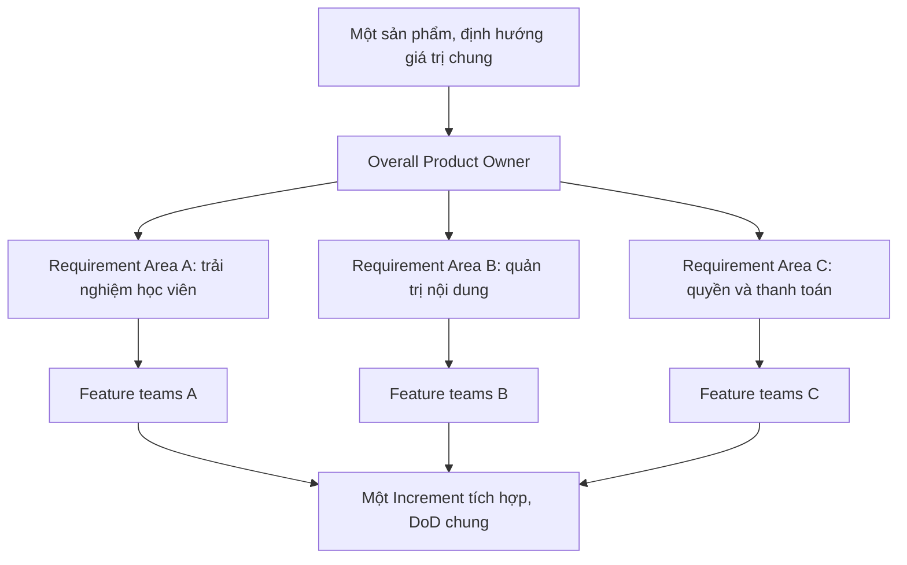
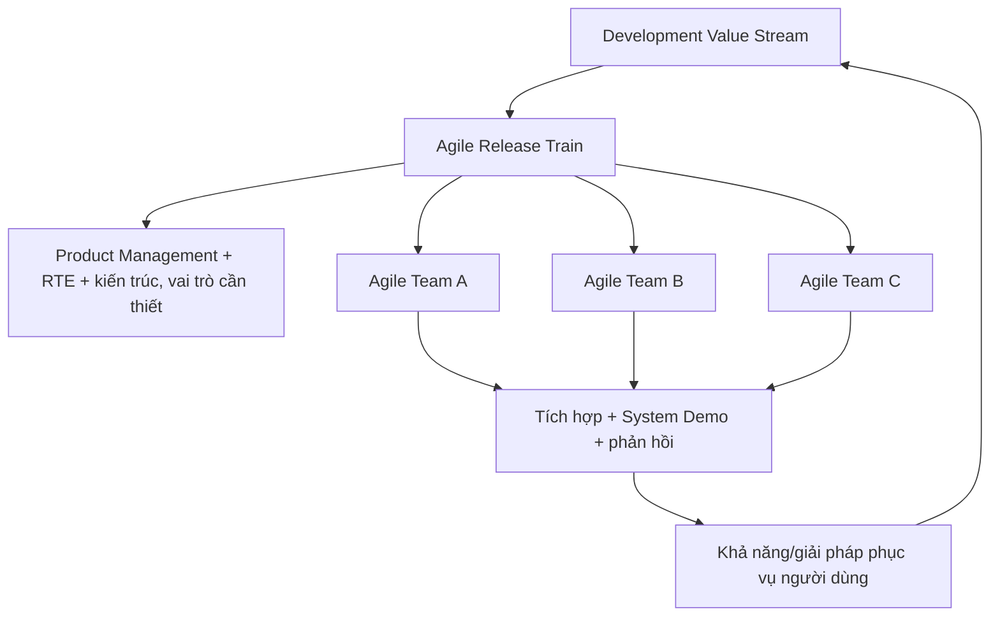
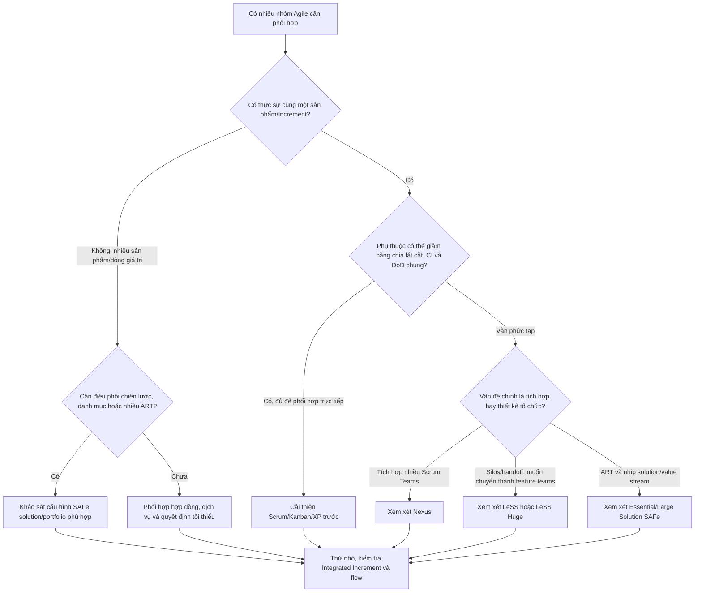

# Nhận diện phạm vi của Nexus, LeSS và SAFe trong mở rộng Agile

Một nền tảng học trực tuyến khởi đầu với một Scrum Team, sau đó mở rộng thành năm nhóm phát triển các khả năng: nội dung khóa học, tiến độ học tập, thanh toán, tìm kiếm và trải nghiệm học viên. Mỗi nhóm hoàn thành Sprint Goal riêng, nhưng đến khi tích hợp, tính năng **“Tiếp tục bài học đang dở”** vẫn không chạy xuyên suốt: API tiến độ đổi hợp đồng nhưng giao diện chưa cập nhật; thay đổi quyền truy cập ở thanh toán ảnh hưởng nội dung; cùng một người phụ trách hệ thống xác thực phải review cho nhiều nhóm. Các buổi họp “đồng bộ liên nhóm” tăng lên mà lỗi tích hợp không giảm.

Một đề xuất xuất hiện: “Hãy dùng Nexus”. Người khác cho rằng: “LeSS mới giúp giữ mọi nhóm cùng hướng về một sản phẩm”. Ban lãnh đạo lại hỏi: “SAFe có phù hợp nếu sau này mở rộng lên cả danh mục nhiều sản phẩm?”. Không thể trả lời bằng việc **framework nào phổ biến hơn** hoặc **framework nào có nhiều vai trò hơn**.

**Nexus, LeSS và SAFe đều liên quan đến mở rộng Agile, nhưng chúng được thiết kế cho các phạm vi phối hợp khác nhau.** Quyết định tốt phải bắt đầu từ **ranh giới sản phẩm, số nhóm thực sự cần chung một Increment, loại phụ thuộc, quyền ưu tiên, mức tích hợp và nhu cầu điều phối chiến lược**.

Bài học thuộc chương **Phối hợp nhiều nhóm** của mô-đun **AGILE_DEVELOPMENT**. Nó giúp người học liên hệ Agile với user story, Product Backlog, Scrum, Kanban, XP, kiểm chứng sớm và đo lường dòng công việc. Trọng tâm không phải “cài đặt” một mô hình tổ chức trên giấy, mà là **hiểu khi nào mỗi cách tiếp cận có ích, giới hạn của nó và những điều kiện chất lượng không được đánh đổi**.

> **Lưu ý phạm vi:** Các framework có tài liệu và phiên bản được cập nhật theo thời gian. Bài dùng các khái niệm nền tảng được biết đến trong Nexus Guide, LeSS và hệ thống cấu hình SAFe; với quyết định triển khai thực tế, tổ chức cần đối chiếu hướng dẫn chính thức của phiên bản đang sử dụng. Những con số quy mô dưới đây là **phạm vi tham chiếu điển hình**, không phải quy tắc cơ học để chọn framework.

## 1. Mục tiêu học tập

Sau bài này, bạn có thể:

- Phân biệt **“nhiều nhóm cùng một sản phẩm”** với **“nhiều sản phẩm, nhiều dòng giá trị hoặc một danh mục đầu tư”**.
- Tóm tắt **Nexus** như một cách mở rộng Scrum cho khoảng **3–9 Scrum Teams** cùng phát triển **một sản phẩm và một Integrated Increment**.
- Giải thích **Nexus Integration Team**, Nexus-level events, Nexus Sprint Backlog, phụ thuộc liên nhóm và yêu cầu tích hợp thường xuyên.
- Tóm tắt **LeSS** cho khoảng **2–8 nhóm** cùng một sản phẩm; phân biệt **LeSS Huge** dành cho phạm vi nhiều hơn, sử dụng **Requirement Areas** và **Area Product Owners**.
- Giải thích LeSS nhấn mạnh **một sản phẩm, một Product Owner, một Product Backlog, một Sprint, một Increment, feature teams** và việc giảm phức tạp tổ chức.
- Nhận diện **Essential, Large Solution, Portfolio và Full SAFe**, cùng vai trò của **Agile Release Train (ART)**, **Planning Interval (PI)**, phối hợp hệ thống và Lean Portfolio Management.
- Lập bảng so sánh các khung theo **mục tiêu, phạm vi, nhịp phối hợp, cấu trúc backlog, quyền quyết định, rủi ro và chi phí tổ chức**.
- Phân tích một tình huống để chọn **không mở rộng framework**, chọn Nexus/LeSS/LeSS Huge hoặc xem xét cấu hình SAFe phù hợp.
- Nhận diện những rủi ro như **đồng bộ nhiều cuộc họp nhưng thiếu Integrated Increment**, quản trị tập trung quá mức và team phụ thuộc thành phần kỹ thuật.
- Đề xuất kế hoạch thử nghiệm phối hợp dựa trên **Done chung, CI, kiểm thử tích hợp, flow metrics và giá trị người dùng**.
- Tránh dùng framework như **điều kiện bảo đảm thành công** hoặc coi quy mô nhân sự là tiêu chí duy nhất.

## 2. Khi nào “mở rộng Agile” là vấn đề thật?

### 2.1. Có nhiều nhóm chưa đủ để cần một framework mở rộng

Ba Scrum Teams có thể làm ba sản phẩm độc lập, mỗi sản phẩm có người dùng, mục tiêu, Product Backlog và Increment riêng. Họ có thể chỉ cần **phối hợp ở những hợp đồng API hoặc dịch vụ dùng chung**, không nhất thiết phải chuyển cả ba vào một Nexus hay một ART.

Ngược lại, bốn Scrum Teams cùng sửa một ứng dụng duy nhất, tất cả cần tạo một trải nghiệm học viên xuyên suốt, có thể gặp:

- Thay đổi API và dữ liệu đòi nhiều nhóm hoàn tất cùng nhau.
- Product Backlog bị chia theo bộ phận thay vì theo kết quả người dùng.
- Khác biệt Definition of Done gây “Done ở nhóm A nhưng chưa tích hợp được”.
- Khó chọn ưu tiên khi mỗi nhóm nhận yêu cầu từ một stakeholder.
- Kiểm thử E2E chỉ chạy cuối Sprint, làm phát hiện lỗi quá muộn.

**Vấn đề mở rộng ở đây là phối hợp tạo giá trị tích hợp**, không đơn giản là quản lý số lượng người.

### 2.2. Ba kiểu vấn đề cần phân biệt

| Bối cảnh | Câu hỏi chính | Hướng tiếp cận ban đầu |
| --- | --- | --- |
| **Nhiều nhóm, một sản phẩm** | Làm sao tạo một Increment có thể sử dụng, thống nhất ưu tiên và phụ thuộc? | Scrum nền tảng, Nexus hoặc LeSS có thể đáng xem xét |
| **Một sản phẩm rất lớn với nhiều nhóm** | Làm sao giữ hướng sản phẩm chung mà chia trách nhiệm theo vùng yêu cầu? | LeSS Huge, các cấu trúc tích hợp khác hoặc một số cấu hình SAFe tùy bối cảnh |
| **Nhiều dòng giá trị, sản phẩm, giải pháp lớn hoặc danh mục đầu tư** | Làm sao đồng bộ đầu tư, vận hành và phụ thuộc xuyên ART/đơn vị? | Các cấu hình SAFe phù hợp có thể là lựa chọn; không phải bắt buộc |
| **Hai nhóm có phụ thuộc nhỏ** | Có thể giải quyết bằng một backlog rõ, hợp đồng và tích hợp sớm? | Thử cải thiện Scrum/working agreement trước khi thêm tầng tổ chức |
| **Nhiều team theo chuyên môn kỹ thuật** | Vì sao một user story phải đi qua nhiều hàng chờ? | Giảm phụ thuộc bằng feature teams, ownership và kiến trúc phù hợp trước khi chọn framework |

### 2.3. Bốn câu hỏi chẩn đoán đầu tiên

1. **Ranh giới sản phẩm là gì?** Có một nhóm người dùng và một chuỗi giá trị sản phẩm thống nhất, hay nhiều sản phẩm độc lập?
2. **Một thay đổi tạo giá trị cần bao nhiêu nhóm phối hợp?** Có thể chia thành lát cắt dọc để từng nhóm tạo Increment sử dụng được không?
3. **Ai có quyền sắp thứ tự ưu tiên?** Có một Product Owner đối với cùng sản phẩm không hay nhiều người giao việc mâu thuẫn?
4. **Đâu là chỗ chờ thật?** Review, kiến trúc, môi trường, dữ liệu, chính sách, hay quyết định đầu tư?

Nếu chưa trả lời được, thêm khung quản trị có thể **che** vấn đề dưới một lớp thuật ngữ mới.

## 3. Khái niệm nền: sản phẩm, nhóm, dòng giá trị và tích hợp

### 3.1. “Một sản phẩm” không đồng nhất một repository

Một sản phẩm có thể gồm nhiều dịch vụ và repository, nhưng phục vụ **một mục tiêu và trải nghiệm giá trị liên kết**. Ví dụ nền tảng học trực tuyến có frontend, nội dung, tiến độ học, thanh toán và tìm kiếm; người học vẫn nhìn chúng như **một trải nghiệm sản phẩm**.

Ngược lại, một repository chứa ba công cụ độc lập không tự động tạo ra một sản phẩm chung.

**Ranh giới sản phẩm là quyết định sản phẩm và kiến trúc**, cần hiểu người dùng, stakeholder, vòng đời và khả năng độc lập của các thay đổi.

### 3.2. Product Team và component team

- **Feature team/product-oriented team** có kỹ năng đủ để đưa một lát cắt người dùng tới Done trong phạm vi hợp lý.
- **Component team** chủ yếu sở hữu một tầng/công nghệ như database, frontend hoặc authentication; mỗi tính năng end-to-end phải đi qua nhiều hàng chờ.

Component teams có thể phù hợp một số bối cảnh chuyên môn sâu, nhưng khi phụ thuộc lặp lại giữa nhiều nhóm, chúng có thể làm tăng **cycle time, WIP và công sức phối hợp**.

LeSS đặc biệt nhấn mạnh phát triển **feature teams**. Nexus cũng cần các Scrum Teams có thể tạo phần việc tích hợp đạt Done. SAFe có thể tổ chức Agile Teams và ART theo dòng giá trị, nhưng không có nghĩa mọi cấu trúc theo chức năng tự động được giải quyết.

### 3.3. Integrated Increment khác báo cáo “xong từng phần”

Giả sử:

- Nhóm A hoàn thành API trả bài đang dở.
- Nhóm B hoàn thành nút giao diện.
- Nhóm C sửa quyền truy cập nhưng không test với API mới.

Không thể mặc định tính năng đã **Done** vì ba nhóm đều đóng ticket. Người dùng cần **hành vi hoạt động xuyên suốt**.

Theo Scrum, nhiều Scrum Teams làm cùng sản phẩm phải **cùng một Product Goal, Product Backlog, Product Owner và cùng định nghĩa, tuân thủ một Definition of Done**. Mục tiêu là Increment tích hợp và có thể sử dụng.

### 3.4. Dòng giá trị (*value stream*)

Dòng giá trị mô tả các bước/cộng tác cần thiết để đưa nhu cầu thành giá trị cho người dùng hoặc khách hàng. Nó có thể vượt qua nhiều team, hệ thống và quyết định.

SAFe thường dùng định hướng **development value streams**, ART và các năng lực phối hợp theo dòng giá trị. Nhưng một dòng giá trị **không nhất thiết bằng một sản phẩm**, và không phải mọi sản phẩm đều cần một ART riêng.

## 4. Scrum cơ bản trước khi xem mô hình mở rộng

### 4.1. Các nền tảng không được mất khi tăng số nhóm

Với một sản phẩm chung, các nguyên tắc Scrum quan trọng gồm:

- **Một Product Goal** giúp các nhóm hướng về kết quả chung.
- **Một Product Backlog** làm minh bạch những gì cần cải thiện sản phẩm.
- **Một Product Owner** chịu trách nhiệm tối đa hóa giá trị và quản lý Product Backlog hiệu quả.
- **Các Scrum Teams nhỏ, đa chức năng, tự quản** cùng phát triển sản phẩm.
- **Increment** là bước tiến cụ thể, đã kiểm chứng, có thể sử dụng.
- **Definition of Done chung** áp dụng cho cùng sản phẩm.
- **Sprint Review** kiểm tra kết quả và thích ứng, không phải cổng phát hành bắt buộc.

Nếu nhiều nhóm vẫn duy trì **nhiều Product Backlog mâu thuẫn cho một sản phẩm** và mỗi nhóm có tiêu chuẩn Done khác nhau, gọi cuộc họp chung là “Nexus” hay “ART sync” chưa giải quyết gốc.

### 4.2. Không biến Scrum thành hệ thống báo cáo cấp bậc

Mở rộng không nghĩa:

- Tạo “Scrum Master cấp trên” để giao task cho mọi Developer.
- Biến Daily Scrum thành cuộc báo cáo trạng thái cho quản lý.
- Cho một ủy ban quyết định cách code thay Developers.
- Đưa việc chưa đạt DoD vào Increment để đẹp báo cáo.
- Chờ cuối Sprint mới được tích hợp hoặc chuyển giao Increment.

Các framework mở rộng có thể thêm **cấu trúc phối hợp**, nhưng giá trị chỉ xuất hiện khi giảm trở ngại thật.

### 4.3. Nên đơn giản hóa trước khi thêm nhiều lớp

Một đường đi thực dụng:

1. Làm rõ **Product Goal và Product Backlog**.
2. Thống nhất **Definition of Done**.
3. Chia user story thành **lát cắt dọc**.
4. Tích hợp code và kiểm tra sớm, thường xuyên.
5. Làm lộ phụ thuộc bằng board và trao đổi trực tiếp.
6. Theo dõi item bị chặn, chờ review và công việc chưa Done.
7. Chỉ xem framework mở rộng khi các vấn đề **không thể giải quyết đủ tốt bằng cải tiến cấu trúc đơn giản hơn**.

## 5. Nexus: phạm vi chính và vấn đề muốn giải quyết

### 5.1. Nexus là gì?

**Nexus** là một framework mở rộng Scrum được mô tả bởi **Nexus Guide**. Nó hướng đến **nhiều Scrum Teams, thường khoảng 3–9 nhóm, cùng làm một sản phẩm** với nhu cầu phối hợp và tích hợp công việc thành **một Integrated Increment**.

Nexus **không phải framework quản lý toàn bộ danh mục đầu tư doanh nghiệp**. Nó tập trung vào việc giải quyết **phụ thuộc, tích hợp, minh bạch và khả năng tạo Increment chung** khi một sản phẩm lớn hơn phạm vi một Scrum Team.

### 5.2. Khi nào Nexus đáng xem xét?

Có thể phù hợp khi:

- Một Product Backlog cần nhiều Scrum Teams cùng thực hiện.
- Cùng một Product Goal và người dùng của sản phẩm.
- Các nhóm thường có phụ thuộc API, dữ liệu hoặc hành vi.
- Không thể coi “Done của từng nhóm” là kết quả đủ.
- Muốn giữ nền tảng Scrum nhưng bổ sung **thực hành phối hợp tích hợp**.
- Số nhóm và độ phức tạp đủ lớn để phối hợp tự phát không còn đáng tin.

Ví dụ: năm nhóm cùng phát triển nền tảng học trực tuyến và **mỗi Sprint cần ít nhất một Increment tích hợp có thể sử dụng**.

### 5.3. Những yếu tố nền tảng của Nexus

| Thành phần | Vai trò |
| --- | --- |
| **Một Product Backlog** | Mọi Scrum Team có chung tập lựa chọn công việc của một sản phẩm |
| **Một Product Owner** | Chịu trách nhiệm giá trị và thứ tự Product Backlog chung |
| **Nhiều Scrum Teams** | Phát triển các lát cắt và chịu trách nhiệm chất lượng theo DoD |
| **Nexus Integration Team (NIT)** | Có accountability giúp bảo đảm ít nhất một Integrated Increment Done trong Sprint |
| **Nexus Sprint Backlog** | Minh bạch mục tiêu chung, công việc và phụ thuộc liên nhóm trong Sprint |
| **Nexus-level events** | Tạo cơ hội kiểm tra và thích ứng đối với công việc tích hợp |
| **Integrated Increment** | Kết quả tích hợp, Done, có thể sử dụng của sản phẩm |

### 5.4. Nexus Integration Team không phải “nhóm tích hợp nhận việc cuối Sprint”

Nexus Integration Team thường gồm:

- **Product Owner**.
- **Scrum Master** của Nexus Integration Team.
- Những **thành viên Nexus Integration Team** có năng lực cần thiết, có thể đồng thời thuộc các Scrum Teams.

Trách nhiệm của NIT gắn với **bảo đảm Integrated Increment đáp ứng Done**, thông qua làm rõ và hỗ trợ giải quyết phụ thuộc, kỹ năng, thực hành và trở ngại tích hợp.

**Không được hiểu NIT là đội nhận mã từ mọi nhóm vào cuối Sprint để tự ghép và sửa toàn bộ lỗi.** Nếu Developers nghĩ “đội tích hợp sẽ lo”, phụ thuộc càng bị đẩy muộn. Các Scrum Teams vẫn có trách nhiệm tạo phần việc Done, có thể tích hợp.

### 5.5. Điểm giới hạn quan trọng

- Nexus không tự quyết định chiến lược danh mục nhiều sản phẩm.
- Nexus không tự cấp kỹ năng đa chức năng hay giải quyết hệ thống dữ liệu kém.
- Nexus không quy định “tất cả phải phát hành vào cuối Sprint”.
- Nexus không thay Product Owner bằng hội đồng ưu tiên.
- Nexus không yêu cầu mọi Developer tham gia một cuộc họp khổng lồ hằng ngày.
- Nếu thực ra có nhiều sản phẩm độc lập, **đặt tất cả vào một Nexus** có thể tạo phụ thuộc nhân tạo.

## 6. Nexus: cơ chế phối hợp trên một sản phẩm

### 6.1. Minh bạch phụ thuộc từ refinement

Trong Product Backlog Refinement, những người cần thiết từ các Scrum Teams trao đổi:

- PBI có thực sự là **lát cắt giá trị**?
- Những nhóm nào phải phối hợp để PBI Done?
- Có thể giảm phụ thuộc bằng thay đổi cách chia việc?
- API/data contract nào cần được làm rõ?
- Kiểm thử chung và khả năng tích hợp ra sao?
- Một Sprint có đủ khả năng tạo Increment từ các lựa chọn ấy không?

**Refinement không phải một buổi “giao ticket cho từng nhóm”**. Nó nhằm làm công việc đủ hiểu và minh bạch để lập kế hoạch hiệu quả, đặc biệt tại những điểm phụ thuộc.

### 6.2. Nexus Sprint Planning

Hoạt động phối hợp kế hoạch các Scrum Teams, làm rõ **Nexus Sprint Goal** và những phụ thuộc quan trọng. Các Scrum Teams tiếp tục lập kế hoạch chi tiết của mình trong khuôn khổ Sprint Goal và mục tiêu chung.

Một cách hình dung:

```text
Product Backlog chung
        |
        v
Nexus-level Sprint Planning
  - mục tiêu tích hợp của Sprint
  - phụ thuộc giữa các Scrum Teams
        |
        +--> Scrum Team A: Sprint Backlog A
        +--> Scrum Team B: Sprint Backlog B
        +--> Scrum Team C: Sprint Backlog C
        |
        v
Nexus Sprint Backlog: minh bạch phối hợp và phụ thuộc
        |
        v
Integrated Increment đạt DoD
```

Mục tiêu không phải biến mọi Sprint Backlog thành kế hoạch phân công từ trên xuống; **Developers vẫn tự quản công việc thực hiện**.

### 6.3. Nexus Daily Scrum

Nexus Daily Scrum phục vụ **kiểm tra tiến độ hướng Nexus Sprint Goal và tình trạng Integrated Increment**, làm lộ phụ thuộc/khó khăn liên nhóm để các Scrum Teams điều chỉnh. Những người có thông tin và khả năng hỗ trợ liên quan có thể tham gia phù hợp.

Nó **không thay thế mục đích Daily Scrum của từng Scrum Team** và không nên biến thành vòng đọc status của từng nhóm trước ban quản lý.

### 6.4. Nexus Sprint Review

Các bên liên quan **kiểm tra Integrated Increment**, phản hồi về giá trị và thay đổi bối cảnh. Không nên tổ chức các bản demo rời rạc rồi gọi chúng là review của một sản phẩm nếu người dùng vẫn chưa thể trải nghiệm tính năng xuyên suốt.

### 6.5. Nexus Sprint Retrospective

Các Scrum Teams và thành viên liên quan kiểm tra **vấn đề tích hợp và cách phối hợp hệ thống**, đồng thời cải tiến ở cấp nhóm. Một vấn đề lặp lại như “mỗi Sprint phải sửa contract vào ngày cuối” cần được xử lý ở **cả thực hành kỹ thuật lẫn cách chia PBI**, không chỉ giao một người làm thư ký ghi trạng thái.

### 6.6. Kịch bản Nexus nhỏ

Giả sử Sprint Goal chung là:

> “Học viên mở lại bài đang dở theo đúng tiến độ và quyền truy cập trên một thiết bị.”

Nhóm A làm chính sách tiến độ, nhóm B tích hợp giao diện, nhóm C kiểm tra quyền. Thay vì lên ba kế hoạch độc lập, họ:

1. Cùng chốt **hợp đồng API và hành vi phân quyền A/B**.
2. Viết kiểm thử contract/integration trước khi mở rộng.
3. Tích hợp một lát cắt nhỏ ngay giữa Sprint.
4. Theo dõi trở ngại liên nhóm trên Nexus Sprint Backlog.
5. Thử Increment chung trong môi trường phù hợp.
6. Đảm bảo DoD chung được đáp ứng trước khi công nhận Done.

**Điểm tạo giá trị của Nexus ở đây là dòng tích hợp, không phải số cuộc họp.**

## 7. LeSS: mở rộng Scrum bằng cách giữ tổ chức đơn giản

### 7.1. LeSS là gì?

**LeSS (*Large-Scale Scrum*)** là một hướng mở rộng các nguyên tắc và thực hành Scrum cho **nhiều Scrum Teams cùng phát triển một sản phẩm**, với nỗ lực giữ cấu trúc càng đơn giản càng tốt. **LeSS cơ bản thường được mô tả cho khoảng 2–8 nhóm**; khi quy mô lớn hơn, LeSS có biến thể **LeSS Huge**.

LeSS nhấn mạnh:

- **Một sản phẩm và một Product Owner**.
- **Một Product Backlog** theo giá trị.
- **Một Sprint** chung cho các nhóm phát triển cùng sản phẩm.
- **Một Increment tích hợp** đáp ứng Definition of Done.
- **Feature teams** đa chức năng, có khả năng thực hiện lát cắt end-to-end.
Trong LeSS, cách nói **một Increment tích hợp** nhấn mạnh rằng mọi nhóm cùng phát triển **một sản phẩm có chất lượng chung**; nó **không giới hạn chỉ được tạo một Increment trong cả Sprint**. Việc tích hợp và kiểm chứng có thể diễn ra nhiều lần khi có phần việc Done.
- **Giảm các tầng quản lý/phối hợp** làm tăng handoff không cần thiết.
- Học hỏi từ hệ thống và thiết kế tổ chức, không chỉ thêm lịch họp.

### 7.2. Vấn đề LeSS muốn thay đổi sâu hơn quy trình họp

Một tổ chức có nhiều nhóm theo công nghệ: UI, backend, database và QA. Mỗi user story phải đi qua ít nhất bốn nhóm; Product Owner khó ưu tiên theo giá trị vì từng bộ phận có kế hoạch riêng.

LeSS thường khuyến khích **tổ chức các nhóm quanh tính năng/khách hàng**, để nhiều hạng mục có thể được hoàn tất bởi **một feature team** thay vì bị chuyển giao liên tục.

Đây là một thay đổi có thể đụng đến:

- Cách hình thành nhóm và phân bổ kỹ năng.
- Quyền sở hữu mã và review.
- Khả năng học kỹ năng mới.
- Cơ chế phối hợp Product Owner – Developers.
- Cách đánh giá kết quả và động lực công việc.

**Áp dụng LeSS không chỉ là đổi tên những cuộc họp hiện hữu.**

### 7.3. Các yếu tố LeSS cơ bản

| Yếu tố | Ý nghĩa thực hành |
| --- | --- |
| **Một Product Owner** | Tập trung quyết định ưu tiên sản phẩm chung |
| **Một Product Backlog** | Tránh các backlog chức năng tranh nhau ưu tiên |
| **Một Sprint** | Các nhóm cùng nhịp tạo sản phẩm tích hợp |
| **Một Increment** | “Done” là khả năng sử dụng toàn sản phẩm |
| **Nhiều feature teams** | Phân phối kỹ năng để giảm handoff liên nhóm |
| **Sprint Planning One** | Trao đổi những PBI chung và phối hợp liên nhóm cần thiết |
| **Sprint Planning Two** | Mỗi nhóm làm rõ kế hoạch thực hiện ở mức nhóm |
| **Overall Retrospective** | Cải thiện trở ngại hệ thống xuyên nhóm sau các trao đổi cấp nhóm |
| **Cross-team coordination** | Điều phối vừa đủ theo phụ thuộc thực tế, không tạo tầng phê duyệt vô hạn |

### 7.4. LeSS không phải không có phối hợp

“Less” trong tên **không có nghĩa loại bỏ mọi cấu trúc**. Nó có nghĩa giảm phần phức tạp tổ chức không tạo giá trị. Có thể cần:

- Multi-team Product Backlog Refinement.
- Trao đổi đặc thù giữa những nhóm dùng chung API.
- Sprint Review toàn sản phẩm.
- Overall Retrospective.
- Cộng tác với các chuyên gia dữ liệu, bảo mật và vận hành.
- Kiểm thử tích hợp trên thay đổi chung.

Điểm khác là tránh biến điều phối thành **một hệ thống giao việc từ tầng trên**, thay vì giúp feature teams chủ động tạo Increment.

### 7.5. Giới hạn của LeSS cơ bản

- Không phải khung quản lý mọi danh mục đầu tư doanh nghiệp.
- Không bảo đảm thành công nếu tổ chức không sẵn sàng thay đổi cách lập team.
- Một Product Owner cần năng lực và thời gian đủ để hiểu sản phẩm chung.
- Chuyển từ component teams sang feature teams cần **học kỹ năng, refactoring kiến trúc, test, dữ liệu và thời gian**.
- Không nhất thiết phù hợp với những sản phẩm **thực sự độc lập** mà không cần chung backlog.

## 8. LeSS Huge: khi một sản phẩm cần nhiều nhóm hơn

### 8.1. Tại sao có LeSS Huge?

Khi một sản phẩm có **hơn khoảng tám nhóm** cùng phát triển, mọi cuộc trao đổi chi tiết đều với một Product Owner và mọi nhóm có thể tạo bottleneck lớn. **LeSS Huge** mở rộng bằng cấu trúc **Requirement Areas**, vẫn giữ định hướng một sản phẩm chung.

Một sản phẩm có thể gồm những **vùng yêu cầu hướng khách hàng**, ví dụ:

- Trải nghiệm học viên và tiến độ học.
- Quản trị nội dung và giảng viên.
- Thanh toán, tổ chức và quyền sử dụng.
- Khám phá khóa học và đề xuất học tập.

### 8.2. Requirement Area không phải component silo

Một **Requirement Area** tập hợp những yêu cầu liên quan về **giá trị/khách hàng**, chứ không chỉ một lớp công nghệ. Mỗi vùng có thể gồm **vài nhóm, thường khoảng 4–8 nhóm trong các mô tả LeSS Huge**, với **Area Product Owner (APO)** hỗ trợ hiểu và sắp thứ tự yêu cầu trong vùng.

**Overall Product Owner** vẫn giữ định hướng và tối ưu giá trị của **toàn sản phẩm**. Các Area Product Owners không được hiểu như nhiều Product Owners của những sản phẩm độc lập vô tình cùng thương hiệu.

### 8.3. Backlog ở LeSS Huge

Trong LeSS Huge, có việc quản lý **Product Backlog tổng thể** và **Area Product Backlogs** để hỗ trợ các vùng yêu cầu. Điều quan trọng:

- Không biến các backlog vùng thành **nhiều chiến lược sản phẩm độc lập và mâu thuẫn**.
- Giữ Product Goal và kết quả sản phẩm chung.
- Những thay đổi ảnh hưởng nhiều vùng phải được làm rõ và tích hợp.
- DoD và Increment chung không tự biến mất vì có thêm Area Product Owner.

### 8.4. Khi nào không nên vội dùng LeSS Huge?

Nếu một tổ chức có 15 nhóm nhưng thật ra đang làm **ba sản phẩm độc lập**, việc ép tất cả vào một mô hình LeSS Huge có thể tạo gánh nặng ưu tiên và phối hợp không cần thiết.

Nếu 15 nhóm cùng một sản phẩm nhưng đang bị chia theo tầng công nghệ, chỉ vẽ thêm Requirement Areas mà không tạo **feature teams và khả năng tích hợp** cũng chưa giải quyết gốc.

### 8.5. Sơ đồ khái niệm



Sơ đồ mô tả tư duy chia vùng yêu cầu, không phải sơ đồ cấp bậc quản lý nhân sự. **APO tập trung vào sản phẩm/vùng yêu cầu, không phải người chỉ huy kỹ thuật của mọi Developer**.

## 9. LeSS: cơ chế cải thiện tổ chức thay vì thêm vai trò

### 9.1. Feature teams giảm phụ thuộc chuyển giao

Một tình huống trước/sau:

| Trước: component teams | Sau: feature teams theo định hướng LeSS |
| --- | --- |
| Ticket giao diện đợi API của nhóm khác | Một team có kỹ năng thay đổi UI và backend của lát cắt |
| QA chỉ kiểm tra vào cuối Sprint | Kiểm chứng xuyên chức năng trong quá trình phát triển |
| Database reviewer chỉ một người | Kiến thức và kiểm tra được chia sẻ, vẫn giữ review rủi ro cao |
| Mỗi nhóm có backlog kỹ thuật riêng | Product Backlog chung ưu tiên giá trị |
| “Done” nghĩa là phần code của từng tầng đã xong | “Done” nghĩa là Increment tích hợp đáp ứng DoD |

Không phải mỗi Developer phải biết mọi công nghệ ở mức chuyên gia. **Cross-functional ở cấp nhóm** nghĩa là nhóm có đủ kỹ năng hoặc khả năng phối hợp để hoàn tất giá trị mà không phụ thuộc hàng chờ không cần thiết.

### 9.2. Một Product Owner nhưng không phải “PO đọc mọi dòng code”

Product Owner tập trung vào giá trị, ưu tiên và Product Backlog. Developers cùng người hiểu nghiệp vụ có thể tham gia refinement, làm rõ dữ liệu và trao đổi trực tiếp với người dùng/stakeholder theo cách phù hợp.

Một PO không thể trở thành nút duyệt mọi chi tiết acceptance criteria nếu tổ chức thiếu cách chia sẻ tri thức. **LeSS đòi hỏi minh bạch và hợp tác mạnh**, không phải một người chịu mọi cuộc họp.

### 9.3. Chú trọng cải thiện hệ thống

Khi có nhiều nhóm, có thể xuất hiện những trở ngại không thuộc một team:

- Chính sách phân chia nhân lực theo dự án ngắn hạn.
- Kiến trúc bắt mọi thay đổi đi qua một component team.
- Hệ thống đánh giá khuyến khích tối ưu riêng từng bộ phận.
- Đội QA hoặc vận hành chỉ nhận việc ở cuối chuỗi.
- Sự phụ thuộc một chuyên gia làm nhiều PBI già đi.

Một **Overall Retrospective** có thể hướng vào những vấn đề ấy, thay vì chỉ sửa thời gian bắt đầu Daily Scrum.

### 9.4. Đừng biến “descaling” thành cắt bỏ kiểm soát an toàn

Giảm cấu trúc không có nghĩa:

- Bỏ kiểm tra quyền riêng tư hoặc bảo mật.
- Cho mọi người deploy production ngoài quyền được cấp.
- Không cần người có chuyên môn sâu.
- Bỏ các chính sách pháp lý, vận hành hoặc dữ liệu bắt buộc.
- Mọi team phải tự vận hành mọi thứ không có hỗ trợ chung.

**Mục tiêu là giảm chi phí phối hợp không cần thiết trong khi giữ hoặc tăng chất lượng.**

## 10. SAFe: mở rộng từ nhóm đến dòng giá trị và danh mục

### 10.1. SAFe là gì?

**SAFe (*Scaled Agile Framework*)** là một hệ thống thực hành, vai trò và mô hình phối hợp cho những tổ chức cần áp dụng Agile/Lean ở **nhiều nhóm và những phạm vi lớn hơn**, có thể gồm **dòng giá trị phát triển, giải pháp quy mô lớn và danh mục đầu tư**.

Khác với Nexus tập trung vào tích hợp Scrum Teams của một sản phẩm, SAFe cung cấp những **cấu hình** để giải quyết nhiều cấp độ phối hợp. Không phải tổ chức nào cũng cần tất cả các cấp.

### 10.2. Bốn cấu hình thường được mô tả

| Cấu hình | Phạm vi điển hình | Câu hỏi muốn giải quyết |
| --- | --- | --- |
| **Essential SAFe** | Phối hợp các Agile Teams trong một **Agile Release Train (ART)** | Làm sao nhiều nhóm cùng lên kế hoạch và giao giá trị theo một dòng phát triển? |
| **Large Solution SAFe** | Những giải pháp lớn cần **nhiều ART và nhà cung cấp/nhóm liên quan** | Làm sao phối hợp kiến trúc, tích hợp, khả năng giải pháp và phụ thuộc vượt ART? |
| **Portfolio SAFe** | Đồng bộ **chiến lược, đầu tư, danh mục và dòng giá trị** | Làm sao kết nối hướng doanh nghiệp với các dòng đầu tư/phát triển? |
| **Full SAFe** | Kết hợp phạm vi **portfolio, large solution và essential** | Làm sao tổ chức có cả nhu cầu danh mục và giải pháp lớn phối hợp thành hệ thống? |

Cấu hình là **những lựa chọn phạm vi**, không phải bốn cấp bắt buộc phải leo từng bước hay huy hiệu đánh giá độ trưởng thành.

### 10.3. SAFe không đồng nghĩa “Scrum cho nhiều team”

SAFe có thể dùng nhiều thực hành Scrum, Kanban, Lean, DevOps và phát triển sản phẩm. Nó còn có:

- Phối hợp nhiều team theo **ART**.
- Các vai trò điều phối như **Release Train Engineer (RTE)**.
- Product Management ở phạm vi ART.
- Kiến trúc hệ thống và phối hợp giải pháp.
- **Planning Interval (PI)** và các sự kiện phù hợp.
- **Lean Portfolio Management (LPM)** ở cấu hình danh mục.
- Cơ chế theo dõi năng lực giao giá trị và phụ thuộc.

Điều này làm SAFe có phạm vi rộng, nhưng cũng có **chi phí học, cấu trúc vai trò và các vòng phối hợp** cao hơn nếu áp dụng không đúng nhu cầu.

## 11. Essential SAFe: Agile Release Train và nhịp phối hợp

### 11.1. Agile Release Train (ART)

**ART** là tổ chức lâu dài gồm nhiều Agile Teams và các vai trò liên quan, cùng tập trung vào **một dòng giá trị phát triển**. Mô tả SAFe thường nói ART ở cỡ **50–125 người**, thường khoảng **5–12 Agile Teams**, tùy bối cảnh.

Đây là **phạm vi tham chiếu**, không phải quy tắc cứ có 50 người thì bắt buộc dựng ART. Điều quan trọng là có **một luồng giá trị/giải pháp chung** cần phối hợp ổn định.

### 11.2. Các vai trò thường gặp ở ART

| Vai trò/chủ thể | Trọng tâm |
| --- | --- |
| **Agile Teams** | Tạo các lát cắt giá trị với thực hành Agile, chất lượng và tích hợp phù hợp |
| **Product Management** | Quản lý hướng sản phẩm và nhu cầu ở cấp ART, ưu tiên các khả năng/feature |
| **Release Train Engineer (RTE)** | Hỗ trợ phối hợp, sự kiện và cải tiến luồng ở ART |
| **System Architect** | Hỗ trợ định hướng kỹ thuật, kiến trúc và tính toàn vẹn hệ thống |
| **Business Owners** | Đại diện trách nhiệm đối với kết quả kinh doanh liên quan |
| **System Team / Shared Services khi cần** | Hỗ trợ năng lực tích hợp, kiểm chứng hoặc chuyên môn dùng chung |

Vai trò cụ thể phụ thuộc cấu hình và phiên bản SAFe. **Không nên tự động coi RTE là người giao task thay Product Owner hoặc Developers**, hay System Team là nơi nhận tất cả việc tích hợp cuối kỳ.

### 11.3. Planning Interval (PI)

SAFe dùng **Planning Interval (PI)** để tạo nhịp lập kế hoạch và phối hợp ở phạm vi ART. Trong nhiều tài liệu cũ thuật ngữ **Program Increment** cũng được dùng cho PI; nên xác nhận phiên bản tài liệu đang áp dụng.

PI thường kéo dài **vài iteration, nhiều ví dụ khoảng 8–12 tuần**, bao gồm nhịp xem lại/chuẩn bị cải tiến. **PI Planning** giúp những người liên quan:

- Hiểu bối cảnh và ưu tiên.
- Làm rõ những mục tiêu có giá trị.
- Thấy phụ thuộc giữa các Agile Teams.
- Thảo luận năng lực, rủi ro và các giả định.
- Xây một kế hoạch đủ minh bạch để điều chỉnh khi thực tế đổi.

**PI Planning không nên bị biến thành hợp đồng bất biến cho mọi feature suốt nhiều tháng.** Agile vẫn cần kiểm tra và thích ứng.

### 11.4. Tích hợp và phản hồi trong PI

Một ART có thể sử dụng:

- Kiểm thử tự động và Continuous Integration.
- **System Demo** dựa trên phần đã tích hợp.
- Phối hợp phụ thuộc giữa các nhóm.
- **Inspect & Adapt** để xem kết quả và cải tiến hệ thống.
- DevOps và pipeline đưa giá trị đến người dùng theo nhu cầu.

**PI không buộc chờ đến cuối PI mới deploy hay release.** Tách nhịp lập kế hoạch, kiểm chứng và phát hành vẫn quan trọng, như trong mọi cách tiếp cận Agile.

### 11.5. Minh họa ART



Sơ đồ rút gọn **không thay cấu trúc chính thức của SAFe** và không hàm ý chỉ ba nhóm là ART chuẩn; nó minh họa một phạm vi phối hợp.

## 12. SAFe Large Solution, Portfolio và Full: khi nào phạm vi rộng hơn ART?

### 12.1. Large Solution SAFe

Có thể cần xem khi một giải pháp lớn:

- Phụ thuộc vào **nhiều ART**.
- Cần phối hợp kiến trúc và tích hợp ở cấp giải pháp.
- Có nhiều hệ thống con, đối tác hoặc nhà cung cấp.
- Một thay đổi chức năng phải đi qua nhiều ART mới có giá trị.
- Cần cùng hiểu về yêu cầu giải pháp và rủi ro không thể chia độc lập.

SAFe mô tả các vai trò và cấu trúc như **Solution Train**, Solution Management, Solution Architect/Engineering và Solution Train Engineer trong những trường hợp phù hợp.

**Nhiều ART không tự động cần một bộ máy quản trị lớn** nếu chúng thực sự độc lập. Cần xác định phụ thuộc nào đáng điều phối ở cấp solution.

### 12.2. Portfolio SAFe

Phạm vi Portfolio SAFe liên quan **chiến lược, đầu tư và luồng giá trị**, với các thực hành như:

- Lean Portfolio Management (LPM).
- Kết nối chiến lược và việc đầu tư vào dòng giá trị.
- Quản lý những sáng kiến lớn/epics theo chính sách.
- Portfolio Kanban để làm lộ lựa chọn và WIP ở phạm vi danh mục.
- Xem giá trị, rủi ro, năng lực và phân bổ nguồn lực phù hợp.

Một tổ chức có **nhiều sản phẩm và dòng giá trị độc lập** có thể cần quản lý danh mục mà **không cần biến mọi sản phẩm thành một Product Backlog chung**.

### 12.3. Full SAFe

**Full SAFe** kết hợp các cấu hình để xử lý cùng lúc:

- Điều phối nhóm ở ART.
- Phối hợp giải pháp lớn qua nhiều ART.
- Định hướng chiến lược và danh mục đầu tư.

Đây là **mức phạm vi rộng nhất** trong các cấu hình được mô tả, nhưng **không phải đích đến bắt buộc**. Một tổ chức nhỏ sẽ dễ lãng phí nếu sao chép tất cả vai trò/sự kiện chỉ để trông “đúng quy trình”.

### 12.4. Câu hỏi về chi phí tổ chức

Trước khi chọn cấu hình SAFe rộng hơn, hãy hỏi:

- Ai đang chờ ai, ở ranh giới nào?
- Những quyết định nào cần đồng bộ ở ART, solution hoặc portfolio?
- Có thể giảm phụ thuộc bằng kiến trúc và chia sản phẩm không?
- Có đủ khả năng duy trì các vai trò/sự kiện mới không?
- Có nguy cơ tạo nhiều tầng phê duyệt làm chậm quyết định của team không?
- Hệ thống sẽ đo **giá trị giao được**, không chỉ số buổi PI Planning, thế nào?

**Khung phối hợp đáng đầu tư khi chi phí mới thấp hơn rủi ro và thời gian chờ mà nó giúp giảm.**

## 13. So sánh Nexus, LeSS và SAFe theo phạm vi

| Chiều so sánh | Nexus | LeSS / LeSS Huge | SAFe |
| --- | --- | --- | --- |
| **Trọng tâm** | Phụ thuộc và tích hợp giữa Scrum Teams cùng một sản phẩm | Mở rộng Scrum và thiết kế tổ chức quanh một sản phẩm | Phối hợp Agile/Lean ở ART, solution, portfolio theo cấu hình |
| **Quy mô tham chiếu** | Khoảng **3–9 Scrum Teams** | **LeSS: 2–8 teams**; **LeSS Huge: hơn khoảng 8 teams** | **ART: thường 50–125 người**; solution/portfolio có thể rộng hơn |
| **Ranh giới chính** | **Một sản phẩm** | **Một sản phẩm**, kể cả ở LeSS Huge | **Value stream/ART**, **solution**, **portfolio** tùy nhu cầu |
| **Product ownership** | Một Product Owner, một Product Backlog | Một overall Product Owner; LeSS Huge có Area Product Owners theo vùng yêu cầu | Product Management, Product Owners và các vai trò khác tùy cấp |
| **Điều phối nổi bật** | Nexus Integration Team và Nexus-level events | Feature teams, Sprint chung, Planning One/Two, Overall Retrospective | PI Planning, RTE, ART sync/System Demo, phối hợp solution/portfolio |
| **Cách nhìn Increment** | **Một Integrated Increment Done** | **Một Increment tích hợp Done** | Giá trị tích hợp/giải pháp qua ART, chất lượng theo định nghĩa thích hợp |
| **Mức thay đổi tổ chức thường thấy** | Tăng minh bạch và trách nhiệm tích hợp trên nền Scrum | Có thể đòi thiết kế lại team, backlog, quyền quyết định để giảm silos | Có thể cần thêm vai trò và cơ chế phối hợp nhiều cấp, tùy cấu hình |
| **Không phải mục tiêu chính** | Quản trị portfolio doanh nghiệp | Tạo tầng quản trị nhiều sản phẩm độc lập | Bảo đảm tự động mọi team Agile hoặc mọi thay đổi tạo giá trị |
| **Rủi ro lạm dụng** | NIT thành team tích hợp cuối Sprint | “Feature team” chỉ đổi nhãn, PO thành nút cổ chai | Họp/role dày và báo cáo cấp trên thay vì giải quyết phụ thuộc |

**Không đọc bảng như bảng điểm “framework nào tốt nhất”.** Mỗi cột giải những vấn đề khác nhau. Nếu ranh giới sản phẩm, chất lượng và phụ thuộc chưa rõ, số đội chỉ cho biết một phần rất nhỏ.

### 13.1. Vùng giao thoa không nên bị hiểu là lựa chọn loại trừ tuyệt đối

Nexus và LeSS có thể cùng đáng xem cho một sản phẩm có nhiều nhóm; khác biệt nằm ở **cơ chế tích hợp/điều phối** và **mức nhấn mạnh thay đổi tổ chức**. SAFe Essential cũng có thể xử lý nhu cầu phối hợp nhiều nhóm tạo giải pháp chung, nhưng có cấu trúc ART/PI và vai trò riêng.

**Không nhất thiết tổ chức được chia thành những ô tuyệt đối tách biệt.** Trong triển khai, phải hiểu sự tương thích và chi phí bổ sung; đừng lấy toàn bộ nghi thức từ ba framework rồi gộp vào một lịch khổng lồ.

### 13.2. Framework không thay việc tạo giá trị

Một framework không thay thế việc hiểu người dùng, làm rõ sản phẩm và tạo Increment thực sự tích hợp.

## 14. Bắt đầu chọn framework từ vấn đề, không từ con số nhân sự

### 14.1. Bốn trục chẩn đoán

Một nhóm lãnh đạo có thể đặt các câu hỏi:

| Trục | Dữ liệu cần hiểu | Rủi ro nếu bỏ qua |
| --- | --- | --- |
| **Sản phẩm và giá trị** | Một hay nhiều sản phẩm? Khách hàng, Product Goal, chu kỳ giá trị? | Ép nhiều sản phẩm độc lập vào chung backlog |
| **Phụ thuộc thực** | Bao nhiêu team phải sửa để hoàn thành một lát cắt? Có thể giảm qua architecture/feature teams? | Thêm nhiều cuộc họp mà hàng chờ vẫn tăng |
| **Nhu cầu quản trị** | Chỉ tích hợp sản phẩm, hay cần đồng bộ giải pháp lớn/nguồn vốn/danh mục? | Dùng Nexus để giải vấn đề portfolio, hoặc SAFe quá rộng cho vài team |
| **Năng lực thực thi** | Test/CI, DoD, Product Ownership, kỹ năng, quyền quyết định có đủ? | Cấu trúc trên giấy đẹp nhưng không tạo Increment |

### 14.2. Những dấu hiệu thiên về Nexus

- Nhiều Scrum Teams đang làm **cùng một sản phẩm và Product Backlog**.
- Vấn đề nổi bật là **phụ thuộc và Integrated Increment**.
- Muốn sử dụng cấu trúc Scrum hiện có, thêm cơ chế tích hợp ở Nexus level.
- Đã có một Product Owner và định hướng giá trị chung.
- Sẵn sàng làm minh bạch kế hoạch, kiểm tra và rủi ro tích hợp theo Sprint.

**Không chọn Nexus chỉ vì có đúng năm nhóm.** Nếu năm nhóm không cùng sản phẩm, vấn đề đã khác.

### 14.3. Những dấu hiệu thiên về LeSS

- Một sản phẩm chung, khoảng 2–8 nhóm (hoặc nhiều hơn với LeSS Huge).
- Product Backlog chung nhưng **tổ chức bị chia theo chức năng**, phát sinh quá nhiều handoff.
- Muốn **giảm tầng phối hợp và trao quyền cho feature teams**.
- Lãnh đạo sẵn sàng thay đổi cơ cấu tổ chức, chính sách kỹ năng và cách đo kết quả.
- Đội có khả năng đầu tư vào học kỹ thuật, CI, kiểm thử và ownership chung.

Nếu tổ chức chỉ muốn **đổi nhãn component teams** nhưng giữ mọi ràng buộc cũ, gọi đó là LeSS có thể không tạo lợi ích.

### 14.4. Những dấu hiệu thiên về SAFe

- Có **development value stream** đòi nhiều Agile Teams phối hợp ổn định ở ART.
- Cần **PI-level planning**, làm lộ rủi ro/phụ thuộc và tạo nhịp phối hợp nhiều bên.
- Một giải pháp lớn cần nhiều ART hoặc nhà cung cấp cùng tích hợp.
- Chiến lược đầu tư ở mức portfolio cần kết nối với các dòng giá trị.
- Tổ chức có khả năng duy trì vai trò, dữ liệu và cơ chế phối hợp mà không làm mất quyền tự quản ở các team.

Đừng chọn **Full SAFe** chỉ vì công ty lớn; có thể chỉ một dòng giá trị cần Essential SAFe và các lĩnh vực khác có cách quản lý phù hợp riêng.

### 14.5. Dấu hiệu nên chưa chọn framework mở rộng

- Chỉ một hoặc hai team, phụ thuộc nhỏ và có thể trao đổi trực tiếp.
- Ranh giới sản phẩm chưa được hiểu.
- Không có Definition of Done hoặc CI tối thiểu.
- Các team là “nhóm dự án” thay người liên tục, không đủ ổn định.
- Mọi vấn đề nằm ở một cổng phê duyệt, reviewer hay môi trường chung.
- Các sản phẩm độc lập bị gom vào cùng chương trình vì cùng phòng ban.

Trong những trường hợp ấy, **giảm WIP, làm rõ mục tiêu, xây test/CI, cải thiện backlog và quyền quyết định** có thể đáng ưu tiên hơn.

## 15. Sơ đồ quyết định phạm vi



Sơ đồ là **heuristic để chọn câu hỏi tiếp theo**, không phải thuật toán chọn mô hình chính xác. Nexus, LeSS và SAFe có vùng giao thoa; một đánh giá thực tế cần nhiều dữ liệu hơn việc trả lời vài câu có/không.

### 15.1. Tại sao không dùng “nhiều team hơn thì framework càng lớn”?

Vì **số team không phản ánh độ phụ thuộc**.

- Mười nhóm làm mười sản phẩm độc lập có thể ít cần tích hợp hơn bốn nhóm cùng sửa một database cốt lõi.
- Một ART với nhiều nhóm có thể thuộc một dòng giá trị cần đồng bộ, dù số người nhỏ hơn một đơn vị chức năng độc lập.
- Một sản phẩm lớn được thiết kế thành các phần độc lập có thể giảm nhu cầu họp liên nhóm.
- Một tổ chức có ba ART phụ thuộc lẫn nhau có thể cần giải pháp coordination khác nhiều ART không phụ thuộc.

**Đầu tiên phải hiểu dòng giá trị và kiến trúc thay đổi**, sau đó mới xem quy mô.

### 15.2. Chỉ rõ yêu cầu kiểm chứng quyết định

Khi đề xuất một framework, nên ghi:

> “Chúng ta kỳ vọng giảm bao nhiêu thời gian chờ tích hợp, giảm lỗi liên nhóm nào, tăng khả năng hoàn tất lát cắt end-to-end ra sao, trong khoảng quan sát nào, và có rủi ro phát sinh nào?”

Một quyết định không có cách kiểm tra tác dụng sẽ dễ trở thành **việc tuân thủ nghi thức**.

## 16. Tình huống A: năm Scrum Teams làm một nền tảng học

### 16.1. Bối cảnh giả định

Nền tảng học trực tuyến có năm Scrum Teams:

| Team | Công việc chủ yếu hiện tại | Vấn đề |
| --- | --- | --- |
| **A – Học viên** | Giao diện xem bài và tiến độ | Chờ API từ B |
| **B – Tiến độ** | Tính toán/lưu lịch sử học | Chờ hợp đồng quyền C |
| **C – Quyền và đăng ký** | Thuê bao và quyền truy cập | Chờ test end-to-end |
| **D – Nội dung** | Bài học và điều kiện mở khóa | Thay đổi cấu trúc dữ liệu ảnh hưởng A, B |
| **E – Tìm kiếm** | Tìm và giới thiệu khóa học | Cần thông tin nội dung từ D |

Cả năm nhóm tạo **một sản phẩm**; Product Owner có một Product Backlog chung, nhưng mỗi nhóm đang có một kế hoạch riêng và chỉ chạy E2E ở cuối Sprint.

### 16.2. Chẩn đoán trước khi chọn

Phát hiện:

- **Cùng Product Goal**: giúp học viên tìm, học và tiếp tục khóa dễ dàng.
- **Cùng một Increment**: người dùng không phân biệt các thành phần.
- **Phụ thuộc tích hợp thường xuyên**: API, dữ liệu và quyền truy cập.
- **DoD chưa thống nhất**: một team gọi Done khi merge, team khác khi E2E xanh.
- **Review/tích hợp tập trung cuối Sprint**.

Đây là tình huống **Nexus hoặc LeSS cơ bản đều đáng khảo sát**, nhưng không thể quyết định chỉ từ số năm.

### 16.3. Lựa chọn 1 — thử Nexus

Giả thuyết:

> “Nếu chúng ta dùng một Nexus Sprint Goal, làm lộ phụ thuộc và trách nhiệm tích hợp sớm, thì PBI xuyên nhóm sẽ được đưa tới Done trong Sprint với ít lỗi muộn hơn.”

Các bước:

1. Thống nhất DoD chung.
2. Làm rõ các PBI có phụ thuộc ngay trong refinement.
3. Lập kế hoạch chung ở Nexus level, rồi Scrum Teams tự quản chi tiết.
4. Xác định năng lực cần cho Nexus Integration Team.
5. Tích hợp và kiểm chứng nhiều lần trong Sprint.
6. Review Integrated Increment cùng stakeholder.
7. Xem item chờ tích hợp và lỗi hồi quy tại retrospective.

**Không lập “team tích hợp” riêng để chịu hết trách nhiệm test cuối Sprint**.

### 16.4. Lựa chọn 2 — thử LeSS cơ bản

Giả thuyết khác:

> “Phần lớn chờ đợi xuất phát từ component teams và bàn giao. Nếu tạo các feature teams có đủ kỹ năng hoàn thành lát cắt end-to-end, phụ thuộc sẽ giảm và chúng ta không cần thêm nhiều điểm điều phối.”

Các bước:

1. Xem những thay đổi người dùng cần và đường kỹ thuật xuyên suốt.
2. Chuyển dần kỹ năng UI/backend/test vào các feature teams.
3. Giữ một Product Backlog và một Product Owner.
4. Sử dụng phối hợp LeSS như Planning One/Two và Overall Retrospective.
5. Tăng pairing và quyền sở hữu mã chung trong ranh giới bảo mật.
6. Có test và CI để feature teams hoàn tất Increment.
7. Đo số handoff thực và thời gian từ Start tới Done.

**Đây là thay đổi tổ chức sâu hơn một vòng họp**, đòi sự hỗ trợ của lãnh đạo và thời gian học.

### 16.5. Không cần “chọn bên thắng” trước khi hiểu nguyên nhân

Nếu nguyên nhân chính là E2E chỉ chạy ngày cuối, thử Nexus có thể giúp làm lộ và xử lý trách nhiệm tích hợp nhanh. Nếu nguyên nhân gốc là mọi user story phải đi qua năm component teams, LeSS có thể gợi ý một hướng thiết kế tổ chức mạnh hơn.

Tổ chức cũng có thể bắt đầu bằng **DoD chung, CI và lát cắt dọc** trước khi quyết định áp dụng toàn diện framework nào.

## 17. Tình huống B: mười bốn nhóm cùng phát triển một sản phẩm

### 17.1. Sản phẩm lớn nhưng vẫn là một sản phẩm

Giả sử một nền tảng giáo dục quốc tế có 14 nhóm, cùng một định hướng học tập xuyên suốt, dùng chung danh tính, trải nghiệm và dữ liệu. Những nhu cầu lớn được chia thành:

- Trải nghiệm học và tiến độ.
- Quản trị nội dung và giảng viên.
- Tổ chức, thanh toán và quyền sử dụng.

Hỏi ngay: **đây có đúng một sản phẩm không?** Nếu mỗi phần có khách hàng, mục tiêu và vòng đời độc lập, việc chia thành nhiều sản phẩm có thể hợp lý hơn cố ghép một model mở rộng.

### 17.2. Khảo sát LeSS Huge

LeSS Huge có thể hữu ích nếu:

- 14 nhóm vẫn phát triển một sản phẩm.
- Cần chia **Requirement Areas hướng khách hàng**.
- Có năng lực **Overall Product Owner** và **Area Product Owners**.
- Muốn giữ định hướng một Product Goal, một sản phẩm và Increment chung.
- Có thể xây feature teams trong từng vùng.
- Những thay đổi xuyên vùng có cách phối hợp và tích hợp rõ.

Ví dụ sơ đồ lựa chọn:

```text
Overall Product Owner / một hướng sản phẩm
            |
      +-----+-------------------+
      |                         |
Area: Học tập              Area: Quản trị & thương mại
(Feature teams)             (Feature teams)
      |                         |
      +-----------+-------------+
                  |
      Increment tích hợp của một sản phẩm
```

Số vùng và nhóm trong sơ đồ **chỉ để minh họa**. Thiết kế Requirement Areas phải dựa trên nhu cầu và độ phụ thuộc thực, không chia theo sơ đồ phòng ban.

### 17.3. Khảo sát SAFe

Nếu sản phẩm được vận hành như một **development value stream lớn**, có nhiều năng lực/ART và cần PI-level planning, Product Management, kiến trúc hệ thống và quản trị giải pháp, một cấu hình SAFe có thể đáng xét.

Cần hỏi:

- Có **một ART** phù hợp hay phải có nhiều ART?
- Những phụ thuộc nào cần phối hợp ở cấp solution?
- Có các nhà cung cấp hoặc hệ thống ngoài ranh giới kiểm soát không?
- Cần chính sách đầu tư portfolio hay chỉ điều phối ART?
- Các team có đủ tự quản và kỹ năng giao giá trị không?
- Vai trò mới có giảm chờ hay tạo thêm phê duyệt?

**14 nhóm không tự động = Large Solution SAFe**. Nếu chúng hoạt động độc lập theo nhu cầu được phân chia rõ, số team có thể không phải vấn đề chính.

### 17.4. Điều cần giữ dù chọn mô hình nào

- Bằng chứng về **giá trị sản phẩm**.
- Ưu tiên tránh mâu thuẫn.
- Kiểm chứng tích hợp và quyền truy cập dữ liệu.
- Tạo Increment hoặc giải pháp sử dụng được.
- Minh bạch dependency và WIP.
- Hỗ trợ quyết định nhanh gần nơi có tri thức.
- Khả năng phát hành và khôi phục an toàn.

Framework không thể tự sửa một hợp đồng API sai hoặc dữ liệu bị chia sẻ nhầm tài khoản.

## 18. Tình huống C: nhiều sản phẩm và nhiều dòng giá trị

### 18.1. Bối cảnh

Một doanh nghiệp có:

- **Learning Platform:** sản phẩm cho học viên.
- **Partner Portal:** sản phẩm cho đối tác nội dung.
- **Analytics Platform:** dịch vụ phân tích dùng cho nhiều bộ phận.
- **Billing Services:** năng lực thanh toán dùng chung.
- **Enterprise Admin:** công cụ quản trị tổ chức.

Có nhiều team và yêu cầu đầu tư cạnh tranh. Một số sản phẩm chia sẻ authentication hoặc dữ liệu, nhưng không có **một Product Goal duy nhất**.

### 18.2. Vì sao một Product Backlog chung có thể sai?

Nếu mọi yêu cầu của năm sản phẩm bị gom thành một danh sách và một PO, Product Owner có thể:

- Không đủ ngữ cảnh người dùng mỗi sản phẩm.
- Mất khả năng sắp thứ tự những đầu tư khác bản chất.
- Tạo hàng chờ quyết định và xung đột stakeholder.
- Không phân biệt giá trị của từng dòng kinh doanh.
- Ép các nhóm phải phối hợp dù sản phẩm có thể phát triển độc lập.

Ở đây cần **phân định sản phẩm/dòng giá trị trước**, rồi mới xem giải pháp điều phối.

### 18.3. Khi nào Portfolio SAFe đáng xem?

Nếu doanh nghiệp cần liên kết:

- Chiến lược và những khoản đầu tư lớn.
- Năng lực nhiều dòng giá trị.
- Quyết định ưu tiên portfolio.
- Giới hạn WIP của các sáng kiến lớn.
- Phối hợp rủi ro và kết quả cấp tổ chức.

**Portfolio SAFe** có thực hành giúp thảo luận các câu hỏi ấy. Nhưng nhóm vẫn cần Product Ownership rõ cho những sản phẩm cụ thể; **portfolio không phải một Product Backlog khổng lồ thay mọi backlog sản phẩm**.

### 18.4. Khi nào không cần Full SAFe?

Nếu các dòng giá trị chủ yếu độc lập, tổ chức có thể quản trị portfolio nhẹ và để sản phẩm tự chọn cách cộng tác hiệu quả. Full SAFe chỉ hợp lý khi **đồng thời tồn tại nhu cầu coordination ở ART, solution và portfolio**, và chi phí cấu trúc mang lại lợi ích ròng.

### 18.5. Dịch vụ dùng chung: tránh một điểm nghẽn mới

Một dịch vụ authentication phục vụ năm sản phẩm có thể gây bottleneck. Các lựa chọn cần xét:

- API và contract rõ, có phiên bản.
- Consumer-driven contract tests phù hợp.
- Lịch thay đổi và khả năng tương thích.
- Self-service trong giới hạn bảo mật.
- Cơ chế ưu tiên sự cố/chính sách vận hành.
- Hỗ trợ các product teams tích hợp sớm.

**Việc có một shared service không tự buộc mọi product team trở thành một Nexus hay một ART**.

## 19. Nhận diện và giảm phụ thuộc liên nhóm

### 19.1. Phân loại phụ thuộc trước khi tạo cuộc họp

| Loại phụ thuộc | Ví dụ | Hướng xử lý |
| --- | --- | --- |
| **Hợp đồng API** | Frontend chờ schema từ backend | Contract, versioning, kiểm thử tự động, làm rõ từ refinement |
| **Dữ liệu chung** | Hai team cùng đổi tiến độ học | Ranh giới dữ liệu, migration an toàn, kiểm chứng quyền |
| **Kiến thức/chuyên gia** | Chỉ một người hiểu authentication | Pairing, review dự phòng, tài liệu quyết định |
| **Môi trường/CI** | Chờ một staging dùng chung | Cô lập test, tự động hóa, cải thiện năng lực môi trường |
| **Ưu tiên** | Hai team bị giao mục tiêu mâu thuẫn | Product Backlog/goal và quyền quyết định minh bạch |
| **Phát hành** | Client cũ và API mới không tương thích | Kế hoạch tương thích, feature flag có kiểm soát, rollout |
| **Đối tác ngoài** | Cần thay đổi API nhà cung cấp | Xác nhận hợp đồng, mock/contract test, kế hoạch dự phòng |
| **Tuân thủ/bảo mật** | Kiểm tra bắt buộc trước release | Tham gia chuyên gia sớm, không bỏ điều kiện chất lượng |

### 19.2. Dependency board là công cụ, không phải giải pháp cuối

Một bản ghi phụ thuộc hữu ích gồm:

```text
Dependency ID: DEP-17
Mục tiêu người dùng: học viên tiếp tục đúng bài đang dở
Từ: Team giao diện
Đến: Team tiến độ
Cần gì: hợp đồng GET /resume với trường nextLessonId, quyền A/B
Mốc cần: trước khi integration test chung bắt đầu
Tình trạng: chưa xác nhận schema
Rủi ro: PBI của hai team không đạt DoD đúng Sprint Goal
Người phối hợp: đại diện Developers hai team
Bước tiếp: pairing thiết kế contract + test
Liên kết: Product Backlog Item, PR, contract test
```

Không nên lập board chỉ để tạo **hàng nghìn đường nối** mà không cải thiện kiến trúc. Nếu một loại phụ thuộc xuất hiện lặp lại, xem liệu có thể **giảm hoặc loại bỏ** nó bằng cách chia feature teams và thay đổi contract.

### 19.3. Bốn kỹ thuật giảm phụ thuộc

1. **Chia lát cắt dọc:** một PBI tạo hành vi sử dụng được, hạn chế bàn giao nhiều nhóm.
2. **Tách ranh giới hợp đồng:** API, schema và quyền thay đổi được làm rõ, kiểm chứng tự động.
3. **Tích hợp liên tục:** giữ thay đổi nhỏ, ghép sớm và phản hồi ngay.
4. **Chia sẻ tri thức:** pairing, swarming có mục tiêu, review và coding standards để giảm phụ thuộc một người.

Khi một phụ thuộc phải tồn tại, quản lý nó **có người, có thời điểm và có test**; không mặc định mọi phụ thuộc đều có thể xóa.

### 19.4. Phụ thuộc được chấp nhận có điều kiện

Một số kỹ năng an toàn hoặc dữ liệu cần review chuyên môn chính thức. Không nên cố “tự chủ tuyệt đối” tới mức bỏ bảo mật. Hãy cải thiện **cách phối hợp với chuyên gia**: tham gia sớm, tiêu chí rõ, nguồn phản hồi dự phòng và lịch dự báo hợp lý.

## 20. Điều kiện kỹ thuật tối thiểu cho mở rộng Agile

### 20.1. Không có tích hợp kỹ thuật thì họp liên nhóm chỉ giải quyết một phần

Nếu mười team làm cùng sản phẩm nhưng:

- Mỗi team dùng một phiên bản API khác nhau.
- Merge chỉ xảy ra cuối Sprint.
- Test phải chạy thủ công hàng ngày.
- Staging không đáng tin.
- Quy tắc quyền truy cập bị sao chép.
- Release cần một chuyên gia duy nhất.

Thì dù chọn framework nào, **Integrated Increment vẫn là rủi ro**.

### 20.2. Các năng lực nên có hoặc cải thiện dần

| Năng lực | Tại sao cần khi nhiều team |
| --- | --- |
| **Definition of Done chung** | Tránh Done cục bộ không thể sử dụng cùng nhau |
| **Continuous Integration** | Phát hiện lỗi hợp đồng và tích hợp sớm |
| **Automated unit/integration/contract tests** | Giảm thời gian kiểm chứng lặp lại và bất định |
| **Shared coding standards** | Giúp team khác đọc, review và sửa mã |
| **Trunk-based hoặc tích hợp thường xuyên thích hợp** | Giảm nhánh dài và xung đột tích hợp |
| **Data migration/compatibility plan** | Bảo vệ dữ liệu khi nhiều phiên bản chạy giao nhau |
| **Observability và incident response** | Phát hiện tác động thực khi phát hành |
| **Feature flags có vòng đời rõ khi cần** | Tách deployment/release mà không tạo vô hạn nhánh cũ |
| **Decision log/ADR** | Giảm quyết định bị mất giữa nhiều team |
| **Product analytics/outcome feedback** | Biết việc giao nhanh hơn có tạo giá trị không |

### 20.3. Một DoD chung không phải một checklist khổng lồ

Một nhóm trên sản phẩm có nghĩa vụ chất lượng chung nhưng công việc khác nhau. DoD nên mô tả **tiêu chuẩn mà Increment phải đạt**; loại kiểm tra cụ thể có thể dựa trên rủi ro thay đổi.

Ví dụ:

- Mã tích hợp, test bắt buộc đạt.
- Các hợp đồng liên quan được kiểm chứng.
- Quyền truy cập và dữ liệu nhạy cảm được bảo vệ.
- Increment sử dụng được theo phạm vi xác định.
- Tài liệu/observability cần thiết được cập nhật.
- Không giữ lỗi nghiêm trọng chưa xử lý để đánh dấu Done.

**Không được hạ DoD chỉ để nhiều team báo cáo hoàn tất đồng loạt**.

### 20.4. Thực hành XP trong môi trường mở rộng

Các thực hành **TDD, Pair Programming, Continuous Integration, Refactoring, Collective Code Ownership** hỗ trợ:

- Thay đổi mã do nhiều team cùng chia sẻ.
- Giảm nguy cơ phân quyền và tích hợp.
- Phản hồi sớm trước khi chờ các cuộc họp.
- Chia sẻ hiểu biết giữa các thành viên.
- Giữ kiến trúc đủ linh hoạt để thay đổi backlog.

Những thực hành này **không phải độc quyền của Nexus, LeSS hoặc SAFe** và có thể cải thiện hệ thống ngay cả khi chưa chọn framework mở rộng.

## 21. Backlog, sự kiện và trách nhiệm: tránh trộn lẫn các cấp

### 21.1. Đơn vị lập kế hoạch có thể khác nhau

| Phạm vi | Đơn vị công việc thường được thảo luận | Điều phải minh bạch |
| --- | --- | --- |
| **Scrum / Nexus** | Product Backlog Items, Sprint Backlogs, Nexus-level dependencies | Một Product Goal/Backlog/PO cho cùng sản phẩm, Integrated Increment |
| **LeSS** | Product Backlog Items, nhóm chọn lát cắt từ backlog chung | Một sản phẩm, một Product Backlog, feature teams, DoD chung |
| **LeSS Huge** | Product Backlog tổng và Requirement Area items/backlogs | Các vùng yêu cầu phục vụ cùng hướng sản phẩm |
| **SAFe Team/ART** | Stories, Features, Enablers theo mức phù hợp | Team và ART có hiểu cùng mục tiêu/PI và giá trị không? |
| **SAFe Large Solution** | Capabilities và những công việc tích hợp giải pháp | Phụ thuộc qua ART và khả năng giải pháp |
| **SAFe Portfolio** | Epics và luồng đầu tư theo chính sách | Giá trị đầu tư, WIP danh mục và liên kết chiến lược |

Các thuật ngữ **Features, Capabilities, Epics** trong SAFe có nghĩa cụ thể theo framework; không nên đánh đồng trực tiếp với **PBI trong Scrum** hoặc quy ước “Epic/Story” tùy ý của công cụ.

### 21.2. Tránh lặp cùng một cuộc họp ở ba tên khác nhau

Một tổ chức có thể tạo:

- Scrum of Scrums hằng ngày.
- Nexus Daily Scrum hằng ngày.
- ART sync hằng ngày.
- Meeting của từng component team.
- Meeting tổng hợp trạng thái cho quản lý.

Nếu tất cả cùng đọc một danh sách blocker, chi phí phối hợp tăng nhưng quyết định ít thay đổi. Nên hỏi:

1. Cuộc họp này có **quyền và thông tin nào độc nhất**?
2. Nó làm lộ vấn đề nào chưa được xử lý ở nơi khác?
3. Có thể ghi thông tin async và họp chỉ để quyết định?
4. Ai thực sự cần tham dự?
5. Có thể giảm tầng họp bằng thay đổi kiến trúc hoặc quyền tự quản?

**Framework là nguồn thực hành, không phải giấy phép tạo vô hạn sự kiện.**

### 21.3. Quyền quyết định theo phạm vi

Một mô hình trách nhiệm chung có thể gồm:

- **Product Owner / Product Management:** giá trị, nhu cầu, thứ tự theo phạm vi sản phẩm/ART phù hợp.
- **Developers/Agile Teams:** cách làm kỹ thuật, chất lượng, kiểm chứng và tạo Increment.
- **NIT hoặc vai trò điều phối liên nhóm:** làm lộ và giải quyết trở ngại tích hợp, không thay người làm.
- **Area Product Owner:** làm rõ yêu cầu trong Requirement Area theo cấu trúc LeSS Huge.
- **RTE và các vai trò SAFe liên quan:** hỗ trợ coordination, nhịp ART và cải tiến hệ thống.
- **LPM/Portfolio decision-makers khi có:** định hướng đầu tư và liên kết chiến lược.
- **Bảo mật, vận hành và pháp lý khi cần:** kiểm soát rủi ro theo trách nhiệm chính thức.

**Trách nhiệm không phải đồng nghĩa quyền can thiệp mọi chi tiết công việc.** Phân quyền càng rõ, càng ít vòng chờ xin phép không cần thiết.

## 22. Làm việc với nhóm phân tán và đối tác bên ngoài

### 22.1. Mở rộng Agile và phân tán là hai chiều khác nhau

Một Nexus có thể gồm các team cùng tòa nhà hoặc ở nhiều quốc gia. Một ART có thể làm việc hoàn toàn trực tuyến. **Quy mô và vị trí địa lý là hai vấn đề khác nhau**.

Thực hành hữu ích:

- Ghi quyết định, phụ thuộc và điều kiện Done ở nơi truy cập được.
- Có overlap hợp lý giữa người liên quan.
- Dùng async để chuẩn bị, sync khi cần quyết định.
- Ghi các mốc UTC hoặc múi giờ rõ ràng.
- Có người dự phòng và bàn giao phù hợp.
- Không coi việc online cả ngày là tiêu chí thành công.

### 22.2. PI Planning hoặc event liên nhóm không chỉ có thể làm trực tiếp

Một buổi phối hợp lớn có thể tổ chức trực tiếp hoặc từ xa khi có công cụ và thiết kế tương tác phù hợp. Điều quan trọng:

- Mọi nhóm nhận được bối cảnh tương đương.
- Phụ thuộc được nhìn thấy.
- Quyết định không bị khóa trong cuộc họp riêng.
- Người không tham gia một phần có cách cập nhật và phản hồi.
- Có đầu ra và bước tiếp theo rõ.

Không nên đánh giá sự thành công bằng **số người tham gia cuộc họp** thay cho kết quả phối hợp.

### 22.3. Đối tác và nhà cung cấp

Một giải pháp phụ thuộc nhà cung cấp bên ngoài cần hiểu:

- Thỏa thuận API và trách nhiệm chất lượng.
- Quy trình thay đổi tương thích.
- Thời gian phản hồi và quyền escalation.
- Môi trường kiểm thử và dữ liệu được phép.
- Quy trình incident, thông báo và bảo mật.
- Rủi ro hợp đồng, pháp lý hoặc hỗ trợ sản phẩm.

Large Solution SAFe có thể đưa ra cấu trúc điều phối nếu nhiều ART/supplier cùng giải pháp, nhưng **bản thân framework không thay hợp đồng, kiểm chứng và quản trị rủi ro**.

## 23. Đo hiệu quả mở rộng Agile

### 23.1. Chỉ số phải ở cấp hệ thống giá trị

| Nhóm tín hiệu | Ví dụ | Cách diễn giải thận trọng |
| --- | --- | --- |
| **Giá trị** | Người học quay lại đúng bài nhanh hơn; giảm lỗi mất tiến độ | Cần xác định nhóm người dùng, baseline và độ trễ outcome |
| **Tích hợp** | Số lỗi cross-team phát hiện muộn; thời gian từ merge đến integrated build | Chất lượng test và phạm vi hệ thống phải rõ |
| **Flow** | Work item age, WIP, cycle time, throughput | Đơn vị work item/DoD phải nhất quán |
| **Phụ thuộc** | Item đang blocked vì team khác; thời gian chờ contract | Đừng tính mọi cuộc trao đổi là “phụ thuộc xấu” |
| **Chất lượng** | Lỗi hồi quy, rủi ro bảo mật, tỷ lệ CI flaky | Không giảm test để làm đẹp số |
| **Phát hành** | Lead time for changes, deployment/release frequency, khả năng khôi phục | Phải phân biệt deploy và release, xem điều kiện vận hành |
| **Tổ chức** | Người có thể sửa module, thời gian đưa ra quyết định | Tránh chỉ đếm số vai trò hoặc sự kiện |
| **Chi phí phối hợp** | Giờ họp liên nhóm, thời gian chờ phê duyệt | Một cuộc họp dài có thể đáng giá nếu giúp giải quyết vấn đề lớn |

### 23.2. Đo trước–sau không chứng minh ngay quan hệ nhân quả

Giả sử trước khi áp dụng cơ chế Nexus-level coordination, một PBI xuyên nhóm mất trung vị **14 ngày**, sau đó còn **9 ngày**. Đây là **tín hiệu đáng xem**, không chứng minh Nexus là nguyên nhân duy nhất.

Những yếu tố gây nhiễu:

- PBI được chia nhỏ hơn.
- Test tự động được bổ sung cùng lúc.
- Product Owner làm rõ yêu cầu tốt hơn.
- Có ít kỳ nghỉ hoặc sự cố hơn.
- Team mới quen sản phẩm.
- Definition of Done thay đổi.
- Công cụ ghi thời điểm Started/Finished khác trước.

Nên công bố **các thay đổi đồng thời và giới hạn của dữ liệu**.

### 23.3. Một ví dụ chỉ số cân bằng

Bảng hoàn toàn **giả định**:

| Tín hiệu qua một giai đoạn | Trước cải tiến | Sau cải tiến |
| --- | ---: | ---: |
| Median cycle time PBI xuyên nhóm | 14 ngày | 9 ngày |
| Item blocked giữa team quá 5 ngày | 8 | 3 |
| Lỗi tích hợp phát hiện cuối Sprint | 7 | 2 |
| Giờ họp liên nhóm/tuần (ước tính) | 18 | 14 |
| Lỗi hồi quy nghiêm trọng được ghi nhận | 1 | 1 |
| Tác vụ học viên tiếp tục đúng bài | 78% | 84% |

Cần hỏi liệu thời gian quan sát, mẫu PBI và cohort học viên có đủ tương đồng. **Chỉ giảm giờ họp không chứng minh tạo giá trị; chỉ tăng tỷ lệ hoàn tất tác vụ cũng chưa chứng minh mọi rủi ro bảo mật được giải quyết**.

### 23.4. Không dùng số team hoặc số nghi thức làm KPI

Những cách đo sai:

- “ART càng nhiều team càng trưởng thành”.
- “Một Product Owner phụ trách càng nhiều PBI càng hiệu quả”.
- “Nexus Integration Team đóng bao nhiêu ticket tích hợp”.
- “SAFe tốt vì có đủ PI Planning và System Demo”.
- “Scrum Master tốt nếu attendance đạt 100%”.
- “LeSS tốt vì giảm mọi chuyên gia”.

Kết quả đáng quan tâm là **các nhóm giao giá trị chung nhanh hơn, an toàn hơn và bền vững hơn**.

## 24. Rủi ro và anti-pattern khi áp dụng

| Ngộ nhận | Vì sao sai/thiếu | Cách nhìn phù hợp |
| --- | --- | --- |
| “Có hơn ba team thì bắt buộc Nexus.” | Số team không quyết định sản phẩm hay phụ thuộc. | Xác định có một sản phẩm và nhu cầu tích hợp thật không. |
| “Nexus Integration Team sẽ làm tích hợp thay mọi team.” | Đẩy lỗi và phụ thuộc về cuối Sprint. | NIT hỗ trợ bảo đảm Integrated Increment; Scrum Teams vẫn cùng chịu chất lượng. |
| “Nexus là framework portfolio.” | Trọng tâm là phối hợp Scrum Teams cùng một sản phẩm. | Với nhiều dòng đầu tư, cần cách tiếp cận khác hoặc bổ sung phù hợp. |
| “LeSS = vài sự kiện Scrum có tên mới.” | Bỏ qua feature teams và thay đổi hệ thống. | Xem backlog, tổ chức, quyền và handoff thật. |
| “LeSS Huge tạo nhiều Product Owners cho nhiều sản phẩm.” | Area Product Owners phục vụ Requirement Areas trong một sản phẩm. | Giữ định hướng Overall Product Owner và tích hợp. |
| “Feature team nghĩa là ai cũng biết mọi thứ.” | Cross-functional là năng lực cấp nhóm, không phải từng người. | Pairing, học kỹ năng và hỗ trợ chuyên gia. |
| “SAFe lớn nhất luôn tốt nhất.” | Vai trò/sự kiện thêm có chi phí và có thể gây chậm. | Chọn cấu hình nhỏ nhất giải quyết nhu cầu thật. |
| “Full SAFe là mức trưởng thành phải đạt.” | Các cấu hình giải các phạm vi khác nhau. | Chọn theo value stream, solution, portfolio. |
| “PI Planning là cam kết bất biến mọi feature.” | Phản hồi và điều kiện thay đổi liên tục. | Dùng PI để phối hợp và điều chỉnh có minh bạch. |
| “SAFe buộc chỉ được release cuối PI.” | PI là nhịp phối hợp, không đồng nghĩa lịch release. | Continuous Delivery và phát hành theo giá trị/rủi ro. |
| “Có một ART thì mọi team phải dùng Scrum giống nhau.” | SAFe có thể kết hợp cách làm Agile/flow. | Giữ chất lượng và coordination phù hợp loại công việc. |
| “Nhiều cuộc họp đồng bộ là ít phụ thuộc hơn.” | Handoff vẫn tồn tại nếu kiến trúc không đổi. | Đo blocked time, test tích hợp và lát cắt Done. |
| “Một Product Backlog chung luôn tốt cho cả công ty.” | Nhiều sản phẩm độc lập cần trách nhiệm giá trị riêng. | Vẽ ranh giới sản phẩm và portfolio trước. |
| “Mỗi team có một Done riêng cũng được.” | Cùng một sản phẩm cần chuẩn chung cho Increment. | Xác lập một DoD chung và kiểm chứng xuyên team. |
| “Có Demo từng component nghĩa là Integrated Increment.” | Người dùng không thể dùng chức năng end-to-end. | Kiểm tra trải nghiệm tích hợp thực sự. |
| “Có SAFe/Nexus/LeSS thì không cần CI.” | Lỗi tích hợp kỹ thuật không được họp chữa khỏi. | Test, CI, hợp đồng và DoD là năng lực nền. |
| “Áp dụng framework là đổi tên vai trò.” | Quyền, trách nhiệm và cách cộng tác không đổi. | Thử thay đổi cơ chế gây chờ thật. |
| “Mọi phụ thuộc đều phải loại bỏ.” | Một số ràng buộc an toàn/chuyên môn là cần thiết. | Giảm phụ thuộc không tạo giá trị, quản lý phụ thuộc cần thiết. |
| “Giảm cycle time nghĩa là product tốt hơn.” | Có thể làm sai nhu cầu hoặc hạ chất lượng. | Kết hợp outcome, lỗi và rủi ro. |
| “Chọn framework một lần rồi không được sửa.” | Bối cảnh sản phẩm và tổ chức thay đổi. | Dùng inspect-and-adapt, xem lại lựa chọn dựa trên bằng chứng. |

## 25. Kế hoạch thử nghiệm phối hợp nhiều team

Đây là **lộ trình thử nghiệm minh họa trong 6–8 tuần**, không phải quy trình chính thức của bất kỳ framework nào. Một chuyển đổi tổ chức lớn có thể cần nhiều thời gian, nguồn lực và cơ chế an toàn hơn.

### 25.1. Giai đoạn 1 — Xác định sản phẩm và baseline

Trong 1–2 tuần đầu:

1. Vẽ **ranh giới sản phẩm, người dùng, Product Goal và value stream**.
2. Liệt kê các team và những công việc Done thực tế.
3. Xem PBI gần đây phải qua bao nhiêu team để tạo giá trị.
4. Thu thập ví dụ dependency, blocker, lỗi tích hợp, cycle time.
5. Kiểm tra DoD chung và mức tin cậy CI.
6. Xác định quyền quyết định sản phẩm, kỹ thuật và release.

**Đầu ra:** mô tả vấn đề phối hợp có bằng chứng, không chỉ danh sách chức danh.

### 25.2. Giai đoạn 2 — Chọn một thay đổi cơ chế rõ

Tùy vấn đề:

- Với **Nexus**: thử minh bạch dependency và trách nhiệm Integrated Increment cho một tập PBI xuyên team.
- Với **LeSS**: thử một hoặc vài lát cắt do feature team đa chức năng tạo, giảm handoff có thể kiểm tra.
- Với **SAFe**: thử nâng chất lượng nhịp ART/PI, minh bạch phụ thuộc và mục tiêu giá trị, tránh mang toàn bộ cấu hình không cần thiết.
- Với **chưa cần framework**: thử DoD chung, contract tests, CI và working agreement.

**Không triển khai tất cả nghi thức mới trong một tuần**, vì sẽ khó biết thay đổi nào có ích.

### 25.3. Giai đoạn 3 — Tạo Increment và phản hồi thật

Trong vài Sprint hoặc khoảng thời gian tương đương:

- Chọn lát cắt người dùng đủ nhỏ.
- Trao đổi phụ thuộc từ refinement/planning.
- Tích hợp thường xuyên.
- Kiểm chứng API, dữ liệu và quyền truy cập.
- Review phần mềm thực sự dùng được.
- Lắng nghe stakeholder và người sử dụng.
- Công bố blocker thật, không giấu để dashboard đẹp.

### 25.4. Giai đoạn 4 — Đánh giá và quyết định

Một cuộc trao đổi cải tiến có thể dùng bảng:

| Giả thuyết | Tín hiệu muốn cải thiện | Guardrail |
| --- | --- | --- |
| Tích hợp sớm giúp giảm chờ | Ít item blocked do contract; cycle time PBI liên nhóm giảm | Không tăng lỗi hồi quy |
| Feature teams giảm handoff | Một lát cắt do ít team hơn hoàn tất | DoD và test không bị bỏ |
| Một backlog chung giúp quyết định nhanh | Giảm thời gian tranh ưu tiên và rework | Không làm mất tiếng nói người dùng |
| PI coordination rõ giúp giảm phụ thuộc ART | Ít rủi ro quan trọng phát hiện muộn | Không tăng cuộc họp không tạo quyết định |
| Shared service có contract ổn định | Ít lần sửa API gây lỗi client | Không làm giảm kiểm soát bảo mật |

Nếu chi phí phối hợp tăng nhưng outcome không cải thiện, phải **điều chỉnh hoặc dừng thử nghiệm**, không lấy lý do “framework cần được tuân thủ đủ lâu” để bỏ qua bằng chứng.

## 26. Checklist chọn và áp dụng phạm vi

### 26.1. Trước khi chọn framework

- [ ] Biết **một hay nhiều sản phẩm** và ai là người dùng.
- [ ] Phân biệt Product Goal, value stream và portfolio.
- [ ] Hiểu **bao nhiêu team phải phối hợp** để một PBI tạo giá trị.
- [ ] Có bằng chứng về phụ thuộc/hàng chờ và rủi ro tích hợp.
- [ ] Đã thử những cải tiến đơn giản như DoD chung, CI và chia lát cắt.
- [ ] Xác định khả năng thay đổi cấu trúc feature teams nếu cần.
- [ ] Hiểu trách nhiệm Product Owner và quyền ưu tiên chung.
- [ ] Biết những ràng buộc bảo mật, dữ liệu và vận hành không thể bỏ.

### 26.2. Khi cân nhắc Nexus

- [ ] Có nhiều Scrum Teams thực sự làm **một sản phẩm**.
- [ ] Có Product Backlog và Product Owner chung.
- [ ] Có một DoD áp dụng cho Increment của sản phẩm.
- [ ] Hiểu trách nhiệm NIT **không phải đội ghép mã cuối Sprint**.
- [ ] Có cách làm lộ và xử lý dependencies ở Nexus level.
- [ ] Có thể kiểm tra **Integrated Increment** cùng stakeholder.
- [ ] Không biến Nexus Daily Scrum thành báo cáo của người quản lý.

### 26.3. Khi cân nhắc LeSS/LeSS Huge

- [ ] Sản phẩm và giá trị chung đã đủ rõ.
- [ ] Nhóm chấp nhận giảm các component silos và handoff.
- [ ] Feature teams có lộ trình xây kỹ năng, test và ownership.
- [ ] LeSS cơ bản có phạm vi nhóm phù hợp; với quy mô lớn hiểu **Requirement Areas** ở LeSS Huge.
- [ ] Area Product Owners không trở thành Product Owners của những sản phẩm độc lập không liên quan.
- [ ] Có Sprint/Increment/DoD chung trong phạm vi sản phẩm.
- [ ] Có năng lực xử lý những thay đổi tổ chức thực, không chỉ lịch họp.

### 26.4. Khi cân nhắc SAFe

- [ ] Biết đang cần **ART, Large Solution, Portfolio hay kết hợp**.
- [ ] ART gắn với dòng giá trị phát triển, không chỉ một phòng ban lớn.
- [ ] Vai trò RTE/Product Management/kiến trúc có mục đích cụ thể.
- [ ] PI Planning làm minh bạch mục tiêu, phụ thuộc và rủi ro, không khóa cứng mọi thay đổi.
- [ ] Không coi PI là lịch release bắt buộc.
- [ ] Nếu cần nhiều ART, có bằng chứng về nhu cầu solution coordination.
- [ ] Nếu cần portfolio, có câu hỏi thật về đầu tư, chiến lược và WIP ở cấp đó.
- [ ] Có cách đo chi phí vai trò/sự kiện mới và tác động tới tự quản.

### 26.5. Sau khi thử

- [ ] Các PBI xuyên team có đạt Done sớm hơn không?
- [ ] WIP/blocked time/lỗi tích hợp thay đổi ra sao?
- [ ] Test/CI và DoD có giữ được chất lượng?
- [ ] Có phụ thuộc nào được **loại bỏ**, không chỉ vẽ lên board?
- [ ] Những người cần quyết định có đủ bối cảnh và quyền?
- [ ] Người dùng nhận giá trị và phản hồi sớm hơn?
- [ ] Số giờ họp và hàng chờ phê duyệt có hợp lý?
- [ ] Có dữ liệu đủ để giữ, điều chỉnh hoặc dừng cách làm?

## 27. Bài tập thực hành

### Bài tập 1 — Một hay nhiều sản phẩm?

Một doanh nghiệp có sáu team: hai team xây nền tảng học trực tuyến, hai team xây công cụ chấm thi độc lập, hai team làm API thanh toán dùng chung. Cả ba lĩnh vực có khách hàng và mục tiêu khác nhau.

Hãy trả lời:

1. Có thể mặc định đây là một Nexus sáu team không?
2. Cần thông tin gì để xác định ranh giới sản phẩm?
3. Phụ thuộc API thanh toán nên được xử lý ở cấp nào?
4. Có nên tạo một Product Backlog cho tất cả hay không, và vì sao?

### Bài tập 2 — Nexus và Integrated Increment

Năm Scrum Teams cùng một sản phẩm; A báo Done UI, B báo Done API, C báo Done authorization. Đến Sprint Review, chức năng chưa chạy vì API trả trường khác.

Hãy:

- Giải thích vì sao ba báo cáo Done chưa đủ.
- Nêu trách nhiệm tích hợp của Scrum Teams và NIT.
- Đề xuất cách làm rõ dependency trước Sprint Planning.
- Chỉ ra 2–3 loại test cần chạy thường xuyên.
- Mô tả điều stakeholder nên thực sự kiểm tra tại Nexus Sprint Review.

### Bài tập 3 — LeSS hay chỉ đổi nhãn team?

Bốn team UI, backend, database và QA được đổi tên thành “feature team A–D” nhưng vẫn giữ quyền truy cập mã cũ; mọi feature qua cả bốn team, PO ưu tiên theo bộ phận.

Hãy chỉ ra **những yếu tố LeSS chưa hiện diện**, đề xuất lộ trình giảm handoff và lưu ý chất lượng/bảo mật khi mở rộng quyền sở hữu mã.

### Bài tập 4 — LeSS Huge: Requirement Area

Một sản phẩm có mười hai team. Những thay đổi phục vụ giáo viên, học viên và đơn vị tổ chức có nhu cầu khác nhau nhưng dùng chung nền tảng.

Hãy đề xuất **Requirement Areas có hướng khách hàng**, giải thích vai trò Overall PO và APO, cùng cách giữ một hướng sản phẩm và Increment tích hợp. Vì sao không chia area thành “frontend/database/QA” một cách máy móc?

### Bài tập 5 — Bốn cấu hình SAFe

Phân loại phạm vi SAFe nên **khảo sát**, không khẳng định bắt buộc:

1. Một ART khoảng tám team cần phối hợp PI và System Demo.
2. Ba ART cùng tích hợp một thiết bị/hệ thống lớn có supplier ngoài.
3. Doanh nghiệp có nhiều dòng giá trị cần quyết định đầu tư danh mục.
4. Tổ chức đồng thời cần phối hợp ART, giải pháp nhiều ART và portfolio.
5. Một Scrum Team độc lập có Product Backlog và CI đáng tin.

Với từng trường hợp, giải thích **vì sao chọn hoặc chưa cần**.

### Bài tập 6 — Nexus và LeSS cùng có thể phù hợp

Năm team cùng một sản phẩm, một PO, một backlog; nhiều PBI bị chậm. Điều tra thấy 70% chờ là do code tích hợp muộn; phần còn lại do ba component teams phải bàn giao tuần tự.

Hãy so sánh **một thử nghiệm Nexus-focused và một thử nghiệm LeSS-inspired**, nêu giả thuyết, phạm vi, công sức thay đổi tổ chức và dữ liệu đánh giá.

### Bài tập 7 — PI Planning và ngày release

Ban điều hành yêu cầu “vì chúng ta dùng SAFe, mọi team phải chờ cuối PI mới phát hành”. Hãy phân biệt **Planning Interval, CI, Continuous Delivery, deployment và release**, nêu khi nào một quyết định phát hành theo lịch có lý do và khi nào nó tạo hàng chờ không cần thiết.

### Bài tập 8 — Vẽ dependency board

Với tình huống “Tiếp tục bài học”, hãy tạo ba dependency records liên quan:

- Giao diện và API tiến độ.
- API tiến độ và quyền truy cập.
- Dữ liệu tiến độ cũ và migration.

Mỗi record cần có **mục tiêu người dùng, thông tin phải làm rõ, người phối hợp, mốc, rủi ro và kiểm chứng**. Đề xuất cách giảm ít nhất một phụ thuộc thực sự.

### Bài tập 9 — Đọc số liệu trước–sau

Dùng bảng giả định phần 23.3:

1. Những tín hiệu nào có vẻ được cải thiện?
2. Những rủi ro nào vẫn cần xem?
3. Vì sao không thể khẳng định framework là nguyên nhân duy nhất?
4. Có nên giảm DoD để cycle time xuống thêm không?
5. Chọn một thử nghiệm tiếp theo và mốc xem lại.

### Bài tập 10 — Chống overengineering tổ chức

Một công ty có hai Scrum Teams, một Product Backlog, cùng DoD và CI xanh. Lỗi chính là chỉ một reviewer có quyền duyệt thay đổi nhỏ; các team muốn triển khai Full SAFe ngay để “trưởng thành”.

Hãy viết phân tích ngắn:

- Vấn đề thực là gì?
- Framework lớn có giải quyết đúng nguyên nhân không?
- Có phương án đơn giản hơn?
- Điều kiện nào khiến cần xem xét ART/solution/portfolio về sau?

### Bài tập 11 — Phân biệt Product Goal và portfolio goal

Một tổ chức quản lý ba sản phẩm: học viên, đối tác nội dung và kế toán. Mỗi sản phẩm có khách hàng và chu kỳ phát triển khác nhau. Hội đồng đầu tư muốn tối ưu ngân sách cả ba.

Hãy chỉ ra **cấp Product Goal/Product Backlog của từng sản phẩm** và **cấp chiến lược/portfolio**. Vì sao không nên trao mọi quyết định một PBI nhỏ cho một hội đồng portfolio?

### Bài tập 12 — Kế hoạch thử nghiệm sáu tuần

Hãy viết một kế hoạch cho **năm Scrum Teams cùng phát triển một sản phẩm**:

- Baseline về cycle time/WIP/blocked time và lỗi tích hợp.
- Product Goal, DoD và ranh giới PBI.
- Cách làm rõ dependency/contract.
- Một thực hành điều phối theo Nexus hoặc LeSS.
- Một cải tiến kỹ thuật: CI, contract test hoặc pairing.
- Cơ chế phản hồi người dùng.
- Chất lượng không được đánh đổi.
- Mốc xem lại và điều kiện giữ/sửa/bỏ thử nghiệm.

## 28. Hướng dẫn tự kiểm và tổng kết

### 28.1. Gợi ý đáp án theo phạm vi

| Tình huống | Cách lý giải phù hợp |
| --- | --- |
| **3–9 Scrum Teams cùng một sản phẩm, rủi ro tích hợp nổi bật** | **Nexus** có phạm vi tham chiếu phù hợp; kiểm tra thêm DoD/CI/backlog chung |
| **2–8 teams cùng sản phẩm, silos làm thay đổi phải bàn giao liên tục** | **LeSS** đáng xem nếu tổ chức sẵn sàng tạo feature teams và giảm tầng phối hợp |
| **Một sản phẩm có trên khoảng 8 team và nhiều vùng yêu cầu** | **LeSS Huge** có Requirement Areas/APOs nhưng vẫn một hướng sản phẩm |
| **Một dòng giá trị cần ART và PI-level planning** | Khảo sát **Essential SAFe**; không mặc định phải có portfolio |
| **Giải pháp cần phối hợp nhiều ART và supplier** | Khảo sát **Large Solution SAFe** |
| **Nhiều dòng đầu tư/sản phẩm cần kết nối chiến lược** | Khảo sát **Portfolio SAFe**, giữ ownership sản phẩm rõ |
| **Cả ART, solution và portfolio đều có nhu cầu thật** | **Full SAFe** có thể phù hợp, nhưng phải tính chi phí tổ chức |
| **Hai team, CI/DoD tốt, chỉ nghẽn một reviewer** | Sửa chính sách review và chia sẻ tri thức trước khi mở rộng framework |

### 28.2. Các câu hỏi cần tự trả lời

- Tôi có thể giải thích **vì sao một sản phẩm khác nhiều sản phẩm** không?
- Tôi biết **Nexus Integration Team thực sự chịu trách nhiệm gì** và không phải làm gì?
- Tôi hiểu **LeSS Huge** vẫn là một sản phẩm dù có APO/Requirement Areas không?
- Tôi phân biệt **ART/PI** với **solution/portfolio** trong SAFe không?
- Tôi có nhận diện được **phụ thuộc do tổ chức hoặc kiến trúc tự tạo** không?
- Tôi có biết chọn một thử nghiệm **ít nghi thức nhưng có kiểm chứng** không?
- Tôi có thể bảo vệ **DoD, quyền người dùng và chất lượng** khi muốn tăng throughput không?

### 28.3. Kết luận

**Nexus** phù hợp để xem xét khi nhiều Scrum Teams cùng một sản phẩm cần minh bạch phụ thuộc và bảo đảm **Integrated Increment**. **LeSS** nhấn mạnh mở rộng Scrum bằng cách giữ tổ chức đơn giản, phát triển **feature teams**, một Product Backlog và một Increment; **LeSS Huge** hỗ trợ phạm vi một sản phẩm rất lớn bằng **Requirement Areas**. **SAFe** có nhiều cấu hình, từ **ART ở Essential** đến **Large Solution**, **Portfolio** và **Full**, hướng tới phối hợp đa nhóm, giải pháp hoặc đầu tư theo nhu cầu thực.

Không framework nào thay thế được **làm rõ Product Goal, tạo lát cắt có giá trị, DoD chung, kiểm thử tích hợp, CI, minh bạch flow và phản hồi người dùng**. Một tổ chức tốt không được đánh giá bằng số vai trò hay số cuộc họp, mà bằng khả năng **đưa thay đổi an toàn tới người dùng với thời gian chờ hợp lý, học sớm và cải tiến liên tục**.

**Quy tắc cuối:** Bắt đầu từ *phạm vi cần phối hợp*, không từ logo framework; **chọn cấu trúc nhỏ nhất có thể giải quyết vấn đề được quan sát**, đo tác động và tiếp tục thích ứng.

## Tài liệu tham khảo

1. [The Scrum Guide](https://scrumguides.org/scrum-guide.html), bản tháng 11/2020 — Scrum Team, Product Goal, Product Backlog, Product Owner, Increment và Definition of Done; nhiều Scrum Teams cùng sản phẩm.
2. [Scrum.org — The Nexus Guide](https://www.scrum.org/resources/nexus-guide) — Nexus, Nexus Integration Team, các events, Sprint Backlog và Integrated Increment.
3. [LeSS — Framework](https://less.works/less/framework/index) — LeSS cơ bản, feature teams, các sự kiện và một sản phẩm chung.
4. [LeSS — LeSS Huge](https://less.works/less/less-huge/index) — Requirement Areas, Area Product Owners và cách mở rộng một sản phẩm rất lớn.
5. [Scaled Agile Framework](https://scaledagileframework.com/) — nguồn chính thức về SAFe, Agile Release Train, Planning Interval, các vai trò và cấu hình.
6. [SAFe — Essential SAFe](https://scaledagileframework.com/essential-safe/) — ART, PI Planning và coordination ở phạm vi Essential.
7. [SAFe — Large Solution SAFe](https://scaledagileframework.com/large-solution-safe/) — nhu cầu phối hợp nhiều ART/supplier ở cấp giải pháp.
8. [SAFe — Portfolio SAFe](https://scaledagileframework.com/portfolio-safe/) — Lean Portfolio Management, chiến lược và dòng đầu tư.
9. [Manifesto for Agile Software Development](https://agilemanifesto.org/) và [Principles behind the Agile Manifesto](https://agilemanifesto.org/principles.html) — giá trị Agile, giao phần mềm thường xuyên, cộng tác và thích ứng.
10. [The Kanban Guide](https://kanbanguides.org/english/) — minh bạch workflow, WIP, work item age, cycle time và throughput.
11. Kent Beck & Cynthia Andres, *Extreme Programming Explained: Embrace Change*, ấn bản 2 (2004) — CI, test, refactoring, pairing và sở hữu mã chung.
12. [Martin Fowler — Continuous Integration](https://martinfowler.com/articles/continuousIntegration.html) — tích hợp thường xuyên và phản hồi khi thay đổi mã.
13. Craig Larman & Bas Vodde, *Large-Scale Scrum: More with LeSS* (2016) — nguyên tắc, cấu trúc và thực hành LeSS trong tổ chức phát triển sản phẩm lớn.
