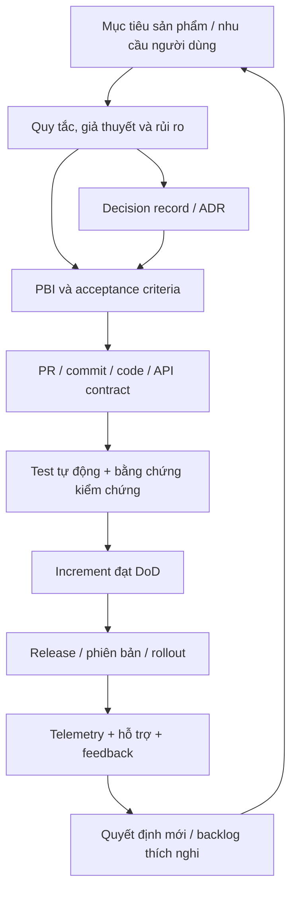
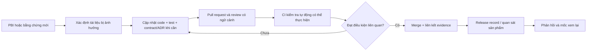
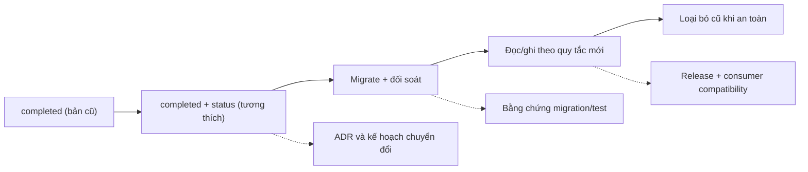

# Duy trì tài liệu cần thiết cùng khả năng truy vết quyết định

## Mục tiêu học tập

Sau bài học này, bạn có thể:

- Giải thích vì sao **Agile ưu tiên phần mềm hoạt động được hơn tài liệu toàn diện** nhưng không đồng nghĩa bỏ tài liệu, kiểm soát thay đổi hoặc trách nhiệm giải trình.
- Phân biệt **tài liệu hữu ích đang được sử dụng (living documentation)** với tài liệu hình thức, lỗi thời, trùng lặp hoặc chỉ phục vụ một bước phê duyệt.
- Xác định **mức tài liệu vừa đủ theo rủi ro**, người sử dụng, vòng đời và các ràng buộc thật của sản phẩm.
- Dựng chuỗi **truy vết hai chiều** giữa mục tiêu/nhu cầu, quyết định, hạng mục backlog, tiêu chí chấp nhận, hiện thực, kiểm thử, phiên bản phát hành và phản hồi.
- Viết một **Architecture Decision Record (ADR)** hoặc quyết định nghiệp vụ ngắn với bối cảnh, phương án, lý do chọn, tác động, người có thẩm quyền và điều kiện xem lại.
- Dùng **Git, code review, tài liệu cạnh mã (docs-as-code), kiểm thử, CI, hợp đồng API và bản ghi phát hành** để giảm cập nhật thủ công và giữ tài liệu nhất quán.
- Phân biệt **decision log** với **audit log**, **truy vết kỹ thuật** với **bằng chứng tuân thủ**; biết cách bảo vệ thông tin riêng tư và quản lý thời hạn lưu giữ.
- Áp dụng vào ví dụ nền tảng học trực tuyến: **ghi danh, quyền mở bài học, tiến độ học và phát hành thay đổi**.
- Nhận diện anti-pattern về tài liệu và truy vết, sau đó đề xuất một thử nghiệm cải tiến nhỏ có thể đo được.

## 1. Mở đầu: hệ thống chạy được, nhưng không ai biết vì sao nó hoạt động như vậy

Một đội Agile phát triển nền tảng học trực tuyến. Phiên bản đầu cho phép học viên **ghi danh khóa miễn phí rồi mở bài riêng**. Sau nhiều Sprint, một yêu cầu mới xuất hiện:

> “Đối với khóa có thu phí, học viên chỉ được mở bài riêng khi đã có ghi danh hợp lệ và quyền thanh toán đã được xác nhận.”

Developers tìm trong mã và thấy ba nơi kiểm tra quyền. Product Owner nhớ rằng từng có ngoại lệ dành cho tài khoản dùng thử. Người kiểm thử phát hiện một kịch bản cũ về hủy ghi danh nhưng không biết **ai đã chấp nhận quy tắc đó**. Nhóm vận hành lo ngại client cũ đang phụ thuộc vào một trường API sắp bị xóa.

Không nhất thiết do thiếu hàng trăm trang đặc tả. Đội đang thiếu một vài thông tin trọng yếu:

1. **Quy tắc nghiệp vụ hiện hành** và các trường hợp ngoại lệ đã được xác nhận.
2. **Lý do của quyết định** thiết kế và những phương án đã cân nhắc.
3. **Các hạng mục hiện thực, kiểm thử và phiên bản** chịu ảnh hưởng.
4. **Người có thẩm quyền** xác nhận thay đổi về quyền, dữ liệu và hợp đồng.
5. **Điểm phải xem lại** khi giả định ban đầu không còn đúng.

Nếu đội không truy được các thông tin này, một yêu cầu tưởng nhỏ có thể gây lỗi quyền truy cập, làm lại nhiều lần và tranh luận dựa vào ký ức cá nhân.

**Bài học:** tài liệu cần thiết không phải là tập giấy tờ càng dày càng tốt. Nó là **tri thức có thể tìm thấy, đáng tin và có liên kết đủ tốt để đội ra quyết định và thay đổi phần mềm an toàn**.

### 1.1. Hai rủi ro đối lập

| Cực đoan | Dấu hiệu | Hậu quả |
| --- | --- | --- |
| **Không lưu tri thức cần thiết** | Quy tắc chỉ nằm trong đầu một người; quyết định được chốt trong chat rồi mất; test và backlog không có liên hệ. | Tranh luận lại, khó sửa an toàn, mất khả năng giải trình. |
| **Tài liệu quá mức, xa sản phẩm** | Tài liệu lặp nội dung mã, phê duyệt nhiều vòng, hàng trăm trang không ai đọc, bản mô tả khác hệ thống đang chạy. | Tăng thời gian chờ, tạo cảm giác kiểm soát giả, thông tin cũ gây quyết định sai. |
| **Tài liệu vừa đủ, được duy trì** | Chỉ ghi điều khó suy từ mã, liên kết tới bằng chứng, có owner và mốc cập nhật. | Quyết định dễ hiểu, thay đổi có thể kiểm chứng, ít công sức duy trì hơn. |

Không có một “số trang chuẩn Agile”. Mức đủ phải được quyết định từ **rủi ro, người sử dụng, vòng đời sản phẩm và nghĩa vụ áp dụng**.

## 2. Hiểu đúng giá trị Agile về tài liệu

Tuyên ngôn Agile nêu giá trị **“Working software over comprehensive documentation”**: ưu tiên phần mềm hoạt động được hơn tài liệu toàn diện. Tuyên ngôn cũng nói các yếu tố ở vế sau **vẫn có giá trị**, nhưng vế trước được đánh giá cao hơn.

Điều này **không có nghĩa**:

- Mã nguồn là tài liệu duy nhất cần có.
- Không cần ghi quyết định hoặc lý do.
- Không được có quy trình phê duyệt khi rủi ro hoặc nghĩa vụ đòi hỏi.
- Không phải giải thích những điều đã đưa vào production.
- Có thể bỏ các tài liệu bảo mật, dữ liệu, vận hành hoặc tuân thủ bắt buộc.

Điều đó nhắc chúng ta **đừng để công việc tạo giấy tờ thay thế bằng chứng rằng sản phẩm hữu dụng và đạt chất lượng**.

### 2.1. Giá trị tài liệu được đo bằng khả năng giúp hành động

Một tài liệu tốt có thể giúp:

- Developer mới biết **quy tắc quyền** và lý do không được bỏ một kiểm tra.
- Product Owner giải thích **phương án nào đã được chọn**, khi nào cần đổi.
- Người kiểm thử xác định **trường hợp quan trọng** cần bảo vệ.
- Người vận hành tìm được **runbook khôi phục** khi release có vấn đề.
- Người đánh giá nội bộ truy được **quyết định, phê duyệt khi cần và bằng chứng kiểm tra**.
- Khách hàng hiểu **hành vi và giới hạn** đã được cam kết.

Nếu một tài liệu không còn người sử dụng hoặc không giúp quyết định nào, cần hỏi có nên **rút gọn, tự động hóa, gộp liên kết hoặc ngừng duy trì** nó hay không.

### 2.2. Tài liệu không tự chứng minh chất lượng

Một đặc tả ghi “người chưa ghi danh không được xem bài riêng” **không chứng minh** API thật sự từ chối truy cập. Cần kiểm thử và bằng chứng vận hành phù hợp.

Ngược lại, một test xanh cũng không tự giải thích **vì sao** nhóm chọn chính sách hủy quyền trong một trường hợp đặc biệt. Tài liệu quyết định và kiểm thử **bổ sung nhau**.

### 2.3. Đừng gọi tài liệu là lãng phí chỉ vì không chạy được

Có những tri thức không thể hoặc không nên suy ngược từ mã:

- Ai có quyền **chấp nhận rủi ro** nào?
- Vì sao chọn đồng bộ tiến độ theo quy tắc này thay vì quy tắc khác?
- Giả định nào đã dẫn đến lựa chọn một nhà cung cấp?
- Các dữ liệu nào **không được ghi vào log**?
- Khôi phục DB tới mốc nào có thể làm mất cập nhật hợp lệ?
- Quy định, hợp đồng hoặc yêu cầu kiểm toán áp dụng **cho tổ chức này** là gì?

Nếu những câu hỏi đó quan trọng, **ghi thông tin ngắn, chính xác và dễ tìm** có thể giảm đáng kể chi phí đổi hướng.

## 3. Phân loại tài liệu theo người dùng và rủi ro

Không cần biến mọi trao đổi thành một ADR hay mọi PBI thành một tài liệu dài. Hãy phân loại theo **quyết định và bằng chứng cần giữ**.

| Nhóm tài liệu | Người cần dùng | Nội dung tối thiểu thường có | Khi cần cập nhật |
| --- | --- | --- | --- |
| **Mục tiêu và ngữ cảnh sản phẩm** | Product Owner, Developers, stakeholders. | Product Goal, nhu cầu, giả thuyết, outcome cần quan sát. | Khi mục tiêu, giả thuyết hoặc bằng chứng đổi. |
| **Product Backlog / PBI** | Product Owner, Developers. | Hành vi mong muốn, lý do ưu tiên, điều kiện chấp nhận phù hợp. | Khi làm rõ, chia nhỏ hoặc thay đổi yêu cầu. |
| **Quy tắc miền nghiệp vụ** | PO, Developers, người kiểm thử, hỗ trợ. | Khái niệm, ràng buộc, ví dụ và ngoại lệ quan trọng. | Khi chính sách quyền, ghi danh hoặc tiến độ đổi. |
| **ADR / decision log** | Developers, người vận hành, bên chịu trách nhiệm thiết kế. | Bối cảnh, lựa chọn, lý do, đánh đổi, liên kết, trạng thái. | Khi có quyết định đáng ghi hoặc bị thay thế. |
| **Hợp đồng API / sự kiện** | Provider, consumer, kiểm thử, vận hành. | Request/response, ngữ nghĩa, lỗi, tương thích và phiên bản. | Khi giao diện công khai hoặc ý nghĩa dữ liệu đổi. |
| **DoD và chính sách chất lượng** | Scrum Team, người đánh giá chất lượng. | Tiêu chí chung để nhận biết Increment đạt chất lượng. | Khi chuẩn chung hoặc rủi ro sản phẩm đổi. |
| **Kiểm thử và bằng chứng CI** | Developers, QA, người đánh giá. | Các quy tắc được kiểm chứng, môi trường và kết quả thực thi. | Cùng với thay đổi mã và rủi ro. |
| **Runbook, release plan, restore plan** | Người triển khai, vận hành, hỗ trợ. | Điều kiện hành động, cảnh báo, rollback/khôi phục, liên hệ. | Khi hệ thống, công cụ hoặc rủi ro vận hành đổi. |
| **Chính sách dữ liệu/bảo mật** | Người chịu trách nhiệm an toàn, kỹ thuật, pháp lý khi áp dụng. | Phân quyền, lưu giữ, xử lý dữ liệu, rủi ro và kiểm soát. | Khi dữ liệu, pháp lý/hợp đồng hoặc hệ thống đổi. |
| **Phản hồi và quyết định cải tiến** | PO, Scrum Team, stakeholders. | Bằng chứng, quyết định ưu tiên hoặc thử nghiệm tiếp theo. | Sau sự cố, release, Review hoặc vòng nghiên cứu. |

**Lưu ý:** các tên tài liệu trên là **những cách tổ chức phổ biến**, không phải danh sách hiện vật Scrum bắt buộc hoặc checklist pháp lý phổ quát. Tổ chức phải xác định nghĩa vụ cụ thể từ quy định/hợp đồng thực tế.

## 4. “Vừa đủ” là bao nhiêu? Dùng cách nhìn theo rủi ro

### 4.1. Hai quyết định không cần cùng mức ghi chép

**Quyết định A:** đổi tên một phương thức nội bộ chưa được consumer ngoài sử dụng.

**Quyết định B:** chuyển từ trạng thái `completed: boolean` sang `progressStatus` cho dữ liệu học viên đã tồn tại, trong lúc client cũ vẫn đang hoạt động.

A có thể chỉ cần **commit có nghĩa, review và kiểm thử liên quan**. B thường cần làm rõ **ngữ nghĩa dữ liệu, kế hoạch tương thích, migration, rollback/roll-forward, tiêu chí đối soát và trách nhiệm quyết định**.

Cùng là “thay đổi mã”, nhưng **mức tác động và chi phí đảo ngược khác nhau**.

### 4.2. Ma trận minh họa để chọn mức tài liệu

| Tác động nếu sai | Khả năng đảo ngược | Tài liệu/bằng chứng có thể cần |
| --- | --- | --- |
| **Thấp** | **Dễ** | Mô tả thay đổi trong PBI/commit, test và review đủ rõ. |
| **Trung bình** | **Tương đối dễ** | Acceptance examples, liên kết code/test, ghi quyết định nếu có đánh đổi đáng nhớ. |
| **Cao** | **Khó** | ADR hoặc hồ sơ quyết định, phân tích phương án, hợp đồng, test và kế hoạch chuyển đổi/khôi phục. |
| **Rất cao / có yêu cầu kiểm soát** | **Khó** | Bằng chứng theo chính sách và nghĩa vụ thực tế: quyền phê duyệt, kiểm tra, audit trail, phân quyền, lưu giữ. |

Bảng này là **công cụ suy nghĩ**, không quy định mọi tổ chức phải có bốn cấp duyệt.

### 4.3. Các câu hỏi xác định mức tài liệu

1. Ai cần hiểu quyết định **khi người đưa ra không có mặt**?
2. Nếu sai, ảnh hưởng tới **quyền người dùng, tiền, dữ liệu, riêng tư, an toàn hay hợp đồng** ra sao?
3. Quyết định có ảnh hưởng **bên ngoài đội hoặc một phiên bản** không?
4. Có khó **đảo ngược** hay khôi phục dữ liệu không?
5. Có **nghĩa vụ luật/hợp đồng/chính sách** cụ thể phải chứng minh không?
6. Điều gì đã được thể hiện đáng tin trong **mã, test hoặc công cụ**, điều gì còn thiếu?
7. Ai chịu trách nhiệm giữ tri thức này **đúng và tìm thấy được**?
8. Chi phí duy trì có tương xứng với **rủi ro được giảm** không?

Không có đủ dữ liệu để xếp loại? Hãy ghi **giả định và người cần xác nhận**, đừng tự bịa một quy định tuân thủ.

## 5. Truy vết quyết định khác theo dõi trạng thái task như thế nào?

**Traceability (khả năng truy vết)** là khả năng đi theo các liên hệ có ý nghĩa giữa **nhu cầu, lựa chọn, hiện thực, kiểm chứng và kết quả**.

Một người có thể hỏi theo hai chiều:

- **Từ yêu cầu tới bằng chứng:** “Vì sao phải kiểm tra quyền học trước khi mở bài? Nó được hiện thực và test ở đâu, đã vào release nào?”
- **Từ thay đổi trở lại lý do:** “Commit vừa sửa chính sách quyền xuất phát từ quyết định/điều kiện nào? Ai cần xem xét khi sửa tiếp?”

Một bảng trạng thái có mỗi cột `Todo → Doing → Done` **không đủ trả lời** hai câu hỏi này.

### 5.1. Chuỗi truy vết tham khảo



Sơ đồ cho thấy **những mối liên hệ có thể cần**, không bắt mọi PBI phải có riêng một ADR, mỗi commit phải có một phê duyệt hoặc mọi thay đổi cần trải qua chính xác chín bước.

### 5.2. Truy vết hai chiều nên giúp trả lời câu hỏi gì?

| Điểm xuất phát | Câu hỏi | Liên hệ hữu ích |
| --- | --- | --- |
| **Product Goal** | Những lát sản phẩm nào đang phục vụ mục tiêu này? | Backlog items, outcome và release liên quan. |
| **Quy tắc nghiệp vụ** | Quy tắc này đã được ai làm rõ, test ở đâu? | Decision log, examples, PBI, acceptance tests. |
| **ADR** | Quyết định đã được áp dụng trong phần nào? | Code, schema, API contract, kế hoạch di trú. |
| **Pull request/commit** | Vì sao sửa đoạn này? Có rủi ro gì cần giữ? | PBI, quyết định, test và review. |
| **Test thất bại** | Điều kiện nghiệp vụ/chất lượng nào bị ảnh hưởng? | Acceptance criteria, requirement hoặc risk. |
| **Phiên bản phát hành** | Thay đổi nào và quyết định nào đã vào bản này? | Artifact, changelog, test evidence, flags. |
| **Sự cố production** | Quyết định hoặc giả định nào cần xem lại? | Incident record, runbook, ADR, backlog cải tiến. |

### 5.3. Truy vết không nhất thiết là một ma trận khổng lồ

Một hệ thống nhỏ có thể dùng **liên kết URL và mã ổn định** giữa PBI, pull request, ADR và CI. Chỉ cần những người có nhu cầu có thể tìm thấy **nguồn gốc và bằng chứng đáng tin**, không bắt ai copy nội dung dài sang nhiều nơi.

Một bảng tổng hợp chỉ nên làm khi:

- Có người cần xem toàn bộ phạm vi và trạng thái liên hệ.
- Việc tạo/duy trì có thể tự động hóa đáng kể.
- Bằng chứng liên hệ phục vụ kiểm toán, quản trị rủi ro hoặc quyết định thật.

Đừng tạo **ba bản sao khác nhau của cùng một acceptance criteria** rồi mất công đồng bộ thủ công.

## 6. Ví dụ chuỗi truy vết cho quyền mở bài trong nền tảng học

Giả sử nhóm đã xác nhận:

> **Người học chỉ mở được nội dung riêng của khóa trả phí khi có quyền hợp lệ, dựa trên ghi danh và xác nhận thanh toán từ nguồn đáng tin.**

Một chuỗi truy vết đơn giản có thể như sau.

### 6.1. Các mã minh họa

| Loại | Mã ví dụ | Nội dung |
| --- | --- | --- |
| **Product Goal / kết quả** | GOAL-01 | Học viên ghi danh và bắt đầu học an toàn. |
| **Quy tắc** | RULE-04 | Quyền mở bài riêng của khóa có phí theo nguồn dữ liệu đáng tin. |
| **Quyết định** | ADR-007 | Đưa quyết định quyền vào chính sách ở server, không tin cờ do client gửi. |
| **PBI** | PBI-026 | Áp dụng quy tắc mở bài riêng cho khóa trả phí. |
| **Acceptance criteria** | AC-026-1/2/3 | Hợp lệ, chưa xác nhận thanh toán, tài khoản khác. |
| **Kiểm thử** | TEST-ACCESS-11 | Integration test cho quyền truy cập, kiểm thử sai danh tính và trạng thái. |
| **Thay đổi mã** | PR-184 | Chuyển kiểm tra quyền về một chính sách chung phù hợp. |
| **Release** | REL-2.6 | Bản phát hành có thay đổi quyền. |
| **Phản hồi** | OBS-015 | Không phát hiện quyền sai trong kỳ đo được, có một trường hợp cần làm rõ. |

**Tất cả mã và dữ liệu ở bảng đều là ví dụ giả định**, không trỏ tới dự án thật. Mối liên hệ phải được xác lập và kiểm chứng khi dùng trên sản phẩm thực.

### 6.2. Từ quy tắc đến kiểm thử hành vi

```gherkin
Feature: Quyền mở bài riêng của khóa có phí

  Scenario: Có ghi danh và xác nhận thanh toán đáng tin
    Given Lan đã đăng nhập vào tài khoản của Lan
    And Lan có ghi danh hợp lệ cho khóa "Java nâng cao"
    And quyền thanh toán của Lan đã được nguồn đáng tin xác nhận
    When Lan yêu cầu mở bài riêng của khóa
    Then Lan được xem bài theo chính sách hiện hành

  Scenario: Chưa được xác nhận thanh toán
    Given Nam đã đăng nhập và có ghi danh hợp lệ cho khóa "Java nâng cao"
    And quyền thanh toán chưa được xác nhận theo chính sách
    When Nam yêu cầu mở bài riêng
    Then hệ thống từ chối truy cập nội dung riêng

  Scenario: Không được dùng quyền của người khác
    Given Lan có quyền hợp lệ với khóa "Java nâng cao"
    And Nam đã đăng nhập bằng tài khoản của Nam
    When Nam thử mở bài riêng bằng đường dẫn cũ của Lan
    Then hệ thống không cấp quyền cho Nam từ dữ liệu của Lan
```

Các kịch bản phải được xác nhận với người có thẩm quyền nghiệp vụ. Gherkin **không tự biến thành kiểm thử chạy được** nếu chưa có bước ánh xạ, dữ liệu và môi trường. Quy tắc thực tế về hoàn tiền, quyền dùng thử và hủy ghi danh cần được xử lý khi có yêu cầu xác nhận tương ứng.

### 6.3. Từ pull request về quyết định

Một mô tả PR có thể ngắn:

```text
PR-184 — Kiểm tra quyền khóa có phí tại server

Lý do: RULE-04, PBI-026, ADR-007
Thay đổi: kiểm tra quyền trước khi trả nội dung bài riêng
Bằng chứng: TEST-ACCESS-11 + kết quả kiểm thử tích hợp trong CI
Rủi ro: không tin trạng thái thanh toán do client tự gửi
Tương thích: không thay public API trong PR này
Release dự kiến: REL-2.6 (chỉ xác nhận sau khi thực sự phát hành)
```

Sau release, bản ghi phát hành có thể **liên kết tới PR đã merge và artifact thực tế**, không cần sửa lại lịch sử commit để giả vờ mọi thứ đã hoàn thành đúng như dự kiến.

### 6.4. Truy vết không tự chứng minh quy tắc đã đúng

Dù có đủ liên kết, vẫn phải xác minh:

- PR có thực sự chứa phần kiểm tra đã thỏa thuận không?
- Test có đang chạy với **dữ liệu đúng và điều kiện phù hợp** không?
- Artifact được deploy có thực sự chứa commit đó không?
- Kiểm tra quyền ở production có bị bypass qua endpoint khác không?
- Có phản hồi hoặc sự cố mới buộc xem lại quyết định không?

**Traceability là đường tới bằng chứng; nó không thay chất lượng của bằng chứng.**

## 7. Ghi quyết định bằng ADR: lưu lý do, không chỉ kết luận

**Architecture Decision Record (ADR)** là một tài liệu ngắn ghi lại **một quyết định thiết kế/kiến trúc đáng nhớ**, bối cảnh và hệ quả. Tên gọi có chữ “architecture”, nhưng đội cũng có thể dùng **decision log** tương tự cho lựa chọn quan trọng về dữ liệu, API hoặc cách vận hành.

ADR không phải định dạng bắt buộc của Agile hoặc Scrum.

### 7.1. Khi nào nên tạo ADR?

Thường hữu ích khi quyết định:

- Ảnh hưởng nhiều nhóm hoặc nhiều module.
- Có **phương án thay thế hợp lý** và đánh đổi đáng nhớ.
- Có chi phí đảo ngược cao, ví dụ dữ liệu, API công khai hoặc chọn công nghệ nền tảng.
- Động chạm quyền, riêng tư, tính toàn vẹn hoặc độ tin cậy.
- Cần hiểu rõ lý do **nếu đổi quyết định trong tương lai**.
- Dễ bị tranh luận lại vì bối cảnh không còn trong đầu người quyết định.

Không cần ADR cho mỗi tên biến, mỗi bug nhỏ hoặc cách định dạng CSS.

### 7.2. Mẫu ADR nhẹ

```text
ADR-[mã] — [Tên quyết định]

Trạng thái: Proposed | Accepted | Superseded | Rejected
Thời điểm: [ngày quyết định]
Người tham gia / thẩm quyền: [vai trò, người được giao]
Bối cảnh:
- Vấn đề phải giải quyết
- Ràng buộc và bằng chứng đã biết
- Điều chưa chắc chắn

Phương án cân nhắc:
A. [Ưu/nhược và rủi ro]
B. [Ưu/nhược và rủi ro]

Quyết định:
- Chọn phương án nào, trong phạm vi nào

Lý do:
- Vì sao ưu tiên lựa chọn này so với phương án khác

Hệ quả/đánh đổi:
- Được gì, mất gì, rủi ro nào còn lại

Liên kết:
- Product Goal / PBI / API / test / PR / runbook phù hợp

Điều kiện xem lại:
- Bằng chứng hoặc bối cảnh nào khiến quyết định cần đánh giá lại
```

Trạng thái ở đây là **quy ước ví dụ**. Đội nên định nghĩa rõ một ADR có được chấp nhận hay không, người nào có thẩm quyền và cách đánh dấu bị thay thế.

### 7.3. Ví dụ ADR cụ thể

```text
ADR-007 — Kiểm tra quyền mở bài riêng ở phía server

Trạng thái: Accepted (ví dụ giảng dạy)
Bối cảnh:
- Nền tảng có khóa miễn phí và sắp có khóa trả phí.
- Client có thể hiển thị nút mở bài nhưng không phải nguồn
  xác thực danh tính hoặc tình trạng thanh toán đáng tin.
- Phải ngăn tài khoản khác dùng quyền của người đã ghi danh.

Phương án A:
- Giao diện kiểm tra quyền rồi chỉ ẩn/hiện nút.
Ưu điểm: nhanh cho giao diện.
Rủi ro: người dùng có thể gọi trực tiếp API, bypass kiểm tra.

Phương án B:
- Server xác minh danh tính, ghi danh và quyền tương ứng
  trước khi trả nội dung riêng; UI phản ánh trạng thái.
Ưu điểm: kiểm soát ở ranh giới tin cậy.
Chi phí: cần hợp đồng dữ liệu quyền và kiểm thử tích hợp.

Quyết định:
- Chọn B cho mọi endpoint trả nội dung bài riêng.
- Không tin cờ "paid=true" do client tự cung cấp.

Liên kết:
- GOAL-01, RULE-04, PBI-026, TEST-ACCESS-11, PR-184

Điều kiện xem lại:
- Xuất hiện mô hình cấp quyền mới hoặc thay đổi nguồn sự thật
  về quyền, khi đó cập nhật quy tắc và kiểm thử.
```

Đây là **ADR minh họa**. Trong dự án thật, phần “nguồn đáng tin” cần được thiết kế cụ thể; ví dụ không đủ thay một mô hình phân quyền an toàn.

### 7.4. Không sửa quá khứ để che một quyết định đã thay

Giả sử ADR-007 bị thay bởi ADR-012 sau khi đội hỗ trợ học thử và quyền theo tổ chức. Đừng âm thầm sửa ADR-007 như thể đội luôn biết yêu cầu mới.

Một cách bảo toàn lịch sử:

1. Đánh dấu **ADR-007: Superseded by ADR-012**.
2. ADR-012 nêu **bối cảnh mới, lý do và rủi ro**.
3. Liên kết thay đổi PR, API, test và release tương ứng.
4. Xem lại tài liệu “hiện hành” để trỏ tới ADR mới, tránh người đọc áp dụng quyết định đã hết hiệu lực.

Lịch sử minh bạch giúp người sau hiểu **thiết kế đã tiến hóa theo bằng chứng**, không nhầm thay đổi là lỗi nhớ hoặc đòi hỏi phải giữ một lựa chọn mãi mãi.

## 8. Decision log, audit log và lịch sử Git không đồng nghĩa

Ba loại thông tin có thể bổ sung nhau nhưng phục vụ câu hỏi khác nhau.

| Loại | Câu hỏi chính | Ví dụ | Hạn chế |
| --- | --- | --- | --- |
| **Decision log / ADR** | **Vì sao** chọn phương án này? Ai quyết định và chấp nhận đánh đổi? | Quyết định chỉ cấp quyền ở server. | Không tự ghi mọi thao tác thực tế trong runtime. |
| **Git/PR history** | **Mã hoặc tài liệu đã đổi gì**, ai review và phiên bản nào chứa? | PR thêm `LessonAccessPolicy` và test. | Commit không tự giải thích đầy đủ quy tắc hoặc chính sách nghiệp vụ. |
| **Audit log / event history** | **Hành động/sự kiện nào thực sự xảy ra** trên hệ thống và theo dấu vết được phép? | Chính sách ghi nhận thời điểm thay đổi quyền theo người thực thi đã xác thực. | Chỉ có giá trị khi đủ tin cậy, toàn vẹn, phân quyền và lưu giữ đúng. |
| **CI/test evidence** | **Kiểm tra nào được chạy** trên phiên bản/môi trường nào, kết quả ra sao? | Test quyền chạy trên commit và môi trường xác định. | Xanh không có nghĩa các rủi ro ngoài phạm vi test đều đã được kiểm tra. |
| **Release record** | **Phiên bản nào, khi nào, ở đâu** và dưới điều kiện gì? | Artifact v2.6 đã được triển khai và flag mở cho cohort thử. | Không tự chứng minh outcome khách hàng hoặc khả năng khôi phục dữ liệu. |

### 8.1. Dấu vết quyết định cần giữ bằng chứng, không chỉ chữ ký

Nếu một quyết định tác động lớn cần phê duyệt theo chính sách, việc lưu “Approved” không đủ nếu không rõ:

- Người có **thẩm quyền** chấp nhận quyết định nào.
- **Phiên bản nội dung** đã được xem xét.
- Những điều kiện/rủi ro được chấp nhận hay còn mở.
- Thời điểm áp dụng và **phạm vi** của quyết định.
- Có sự thay đổi nào sau đó khiến phê duyệt không còn hiệu lực?

Nhưng **không mặc định mọi thay đổi nhỏ cần chữ ký nhiều cấp**. Cơ chế kiểm soát cần phù hợp với quy định thật và rủi ro, tránh tạo hàng đợi phê duyệt vô nghĩa.

### 8.2. Có log chưa chắc đã có bằng chứng đáng tin

Một hệ thống chỉ lưu `approved=true` mà không biết **ai, cho cái gì, từ phiên bản nào** không đủ giải thích quyết định. Ngược lại, một log chứa email, token hoặc toàn bộ dữ liệu người học có thể tạo **rủi ro riêng tư**.

Khi cần audit trail thật, phải xem xét **tính toàn vẹn, kiểm soát quyền xem/sửa, chính sách lưu giữ, đồng bộ thời gian và mức độ tối thiểu dữ liệu** theo bối cảnh.

## 9. Gắn tài liệu với backlog mà không biến refinement thành buổi viết tiểu luận

### 9.1. PBI nên đủ để người làm có thể hiểu và kiểm chứng

Một PBI ngắn có thể chứa:

- **Vấn đề hoặc kết quả** người dùng cần.
- Điều kiện/giới hạn quan trọng.
- Ví dụ chấp nhận và những câu hỏi chưa rõ.
- Các liên kết đến **quyết định/rủi ro** cần biết.
- Điểm phụ thuộc và cách phối hợp nếu ảnh hưởng nhóm khác.

Không cần mô tả mọi bước kỹ thuật trong PBI trước khi Developers khám phá. **Product Backlog là một hiện vật đang tiến hóa**, việc chi tiết hóa được thực hiện khi cần.

### 9.2. Ví dụ PBI có liên kết vừa đủ

```text
PBI-026 — Học viên đã thanh toán mở được bài riêng

Giá trị:
- Học viên có quyền hợp lệ bắt đầu học mà không cần hỗ trợ.
- Người không có quyền không thể truy cập nội dung riêng.

Tiêu chí chấp nhận:
- Đăng nhập + ghi danh hợp lệ + xác nhận quyền đáng tin → cho phép.
- Không có quyền hoặc dùng tài khoản khác → từ chối.
- Tình huống retry và trạng thái chưa xác nhận được xử lý theo chính sách.

Quyết định/ràng buộc:
- RULE-04, ADR-007; bảo vệ dữ liệu và quyền ở server.

Phụ thuộc:
- Nguồn sự thật xác nhận quyền, hợp đồng API với client.

Bằng chứng dự kiến:
- Unit tests cho quy tắc; integration/security tests theo rủi ro;
  các kiểm tra DoD liên quan.

Điều chưa rõ:
- Quy tắc hoàn tiền và học thử cần Product Owner xác nhận
  trước khi mở rộng phạm vi.
```

“Điều chưa rõ” không phải lỗi của PBI; việc **hiển thị bất định và người có quyền giải quyết** tốt hơn giả định âm thầm.

### 9.3. Acceptance criteria, DoD và quyết định có vai trò khác nhau

| Thành phần | Câu hỏi | Ví dụ |
| --- | --- | --- |
| **Acceptance criteria** | Hạng mục này cần hành vi nào? | Khi chưa đủ quyền, không trả nội dung riêng. |
| **Definition of Done** | Chất lượng tối thiểu chung để Increment được xem là Done? | Tích hợp, kiểm thử cần thiết, dữ liệu/quyền theo chính sách. |
| **ADR / decision** | Vì sao cấu trúc/ràng buộc được chọn như vậy? | Kiểm tra quyền ở server thay vì chỉ ẩn nút phía UI. |
| **Test evidence** | Hệ thống đã được kiểm chứng ra sao ở thời điểm nào? | Kết quả CI, test case và môi trường. |
| **Release record** | Phần nào đã tới môi trường/người dùng? | Artifact, thay đổi đã deploy, flag/cohort. |

Không đưa toàn bộ DoD vào từng PBI rồi giữ nhiều bản sao dễ lệch. Dùng **liên kết tới nguồn chuẩn** và mô tả riêng những điều chỉ áp dụng cho hạng mục.

## 10. Truy vết trong Scrum: tôn trọng hiện vật và không tự tạo “quy tắc Scrum”

**Scrum Guide 2020** định nghĩa các hiện vật và cam kết:

| Hiện vật | Cam kết gắn kèm | Giá trị đối với minh bạch |
| --- | --- | --- |
| **Product Backlog** | **Product Goal** | Làm rõ trạng thái tương lai mong muốn và thứ tự công việc sản phẩm. |
| **Sprint Backlog** | **Sprint Goal** | Minh bạch lý do Sprint, các PBI được chọn và kế hoạch Developers điều chỉnh. |
| **Increment** | **Definition of Done** | Minh bạch chất lượng và trạng thái hoàn thành của phần sản phẩm hữu dụng. |

Scrum cũng cung cấp các sự kiện để thanh tra và thích nghi. Nhưng Scrum Guide **không bắt buộc ADR, user story template, ma trận truy vết, RACI, Confluence, Jira hay thư mục Markdown cụ thể**.

### 10.1. Nhiều Scrum Team cùng một sản phẩm

Nếu nhiều Scrum Team cùng phát triển **một sản phẩm**, Scrum Guide yêu cầu họ chia sẻ **Product Goal, Product Backlog, Product Owner** và cùng xác định, tuân thủ **Definition of Done chung**.

Tài liệu liên quan tới quyền, API và dữ liệu nên có **nguồn thông tin nhất quán** để các đội không tự dùng những định nghĩa khác nhau. Điều này không có nghĩa mọi đoạn mã phải qua một trung tâm phê duyệt kiến trúc.

### 10.2. Ai chịu trách nhiệm làm gì?

| Accountability / bên liên quan | Góp phần vào tài liệu và truy vết |
| --- | --- |
| **Product Owner** | Chịu trách nhiệm hiệu quả của Product Backlog và giá trị; làm rõ quy tắc/ưu tiên, quyết định phạm vi theo quyền trách nhiệm. |
| **Developers** | Tạo Increment và tuân thủ DoD; bảo trì mã, test, hợp đồng, quyết định kỹ thuật và bằng chứng có liên quan. |
| **Scrum Master** | Hỗ trợ Scrum Team cải thiện hiệu quả, minh bạch, tháo trở ngại và giảm nghi thức không có giá trị. |
| **Người có trách nhiệm bảo mật/pháp lý/vận hành** | Đưa yêu cầu kiểm soát hoặc phê duyệt áp dụng theo chính sách và thẩm quyền của tổ chức. |
| **Stakeholders/người học** | Cung cấp phản hồi để xác nhận giá trị/giả thuyết; không thay bằng chứng kiểm thử kỹ thuật. |

Vai trò tuân thủ/pháp lý có thể khác nhau theo tổ chức. **Không tự suy rằng Product Owner có quyền miễn trừ yêu cầu pháp luật hoặc Developers có thể bỏ một kiểm soát an toàn**.

### 10.3. Không biến Sprint Review thành lần phê duyệt tài liệu đầu tiên

Một Increment có thể được phát hành trước Sprint Review nếu đáp ứng DoD và những điều kiện phát hành áp dụng. **Sprint Review không phải cổng phát hành bắt buộc** theo Scrum Guide.

Tài liệu và bằng chứng cần được cập nhật **trong quá trình tạo Increment**, không đợi cuối Sprint mới ghép các phiếu phê duyệt, test và lý do thay đổi.

## 11. Duy trì tài liệu sống cùng mã và kiểm thử

**Living documentation** là thông tin được tạo, sử dụng và cập nhật khi hệ thống tiến hóa, thay vì “viết xong một lần” rồi tách khỏi công việc.

### 11.1. Docs-as-code là một lựa chọn, không phải điều kiện để gọi là Agile

Đội có thể giữ:

- ADR và hướng dẫn kỹ thuật ở **Markdown trong hệ thống version control**.
- API contract bằng **OpenAPI hoặc schema** phù hợp.
- Ví dụ hành vi bằng Gherkin khi có ích.
- Sơ đồ và hướng dẫn build/run ở gần mã, nếu được kiểm tra cùng thay đổi.
- Runbook dạng tài liệu có chủ sở hữu và quyền truy cập thích hợp.

Không có nghĩa mọi tài liệu phải nằm trong Git. Tài liệu về **dữ liệu nhạy cảm, hợp đồng, quyền truy cập hoặc quy định nội bộ** có thể cần kho quản lý riêng với phân quyền và thời hạn lưu giữ phù hợp.

### 11.2. Một luồng cập nhật tài liệu cạnh thay đổi mã



Không nên thêm một danh sách tài liệu bắt buộc giống nhau vào mọi PR. **Checklist theo thay đổi/rủi ro** có thể làm rõ phần nào cần cập nhật, với lựa chọn “không áp dụng” có lý do khi thích hợp.

### 11.3. Kiểm tra tự động giúp gì?

Một số kiểm tra có thể tự động hóa:

- Markdown links và cấu trúc tài liệu có hợp lệ không.
- API schema có thay đổi phá vỡ hợp đồng không, theo các quy tắc đã cấu hình.
- Ví dụ mã hoặc snippet có được build/test đúng không khi khả thi.
- Test tự động liên quan có chạy trên **commit được review** không.
- Artifact phát hành có thể liên hệ với commit và kết quả CI không.
- File cấu hình/quy tắc bắt buộc có bị bỏ khỏi repository không.

Nhưng CI **không tự biết lý do kiến trúc đúng hay chính sách nghiệp vụ hợp lý**. Những phần đó vẫn cần người có kiến thức và thẩm quyền đánh giá.

### 11.4. Lời nhắc ở pull request nên ngắn, có điều kiện

Ví dụ:

```text
PR checklist — chỉ đánh dấu những mục áp dụng

[ ] Hành vi mới có acceptance examples và test phù hợp.
[ ] Nếu đổi hợp đồng, consumer/versioning đã được xem xét.
[ ] Nếu đổi quyết định đáng nhớ, ADR/decision link đã cập nhật.
[ ] Nếu đổi dữ liệu, migration/rollback/đối soát đã được cân nhắc.
[ ] Nếu ảnh hưởng vận hành, dashboard/runbook đã được cập nhật.
[ ] Không đưa secrets hoặc dữ liệu cá nhân không cần thiết vào PR/log.
[ ] Có liên kết đến PBI/rủi ro và bằng chứng test cần thiết.

Ghi chú "N/A" nếu một mục không áp dụng, kèm lý do khi đáng kể.
```

Đây là ví dụ **chính sách tùy chọn**, không phải danh sách chính thức của Scrum hoặc tiêu chuẩn tuân thủ quốc tế.

## 12. Quản lý phiên bản, lịch sử và “nguồn sự thật”

### 12.1. Tránh nhiều bản tài liệu mâu thuẫn

Một hệ thống có thể có:

- Một bảng Confluence ghi “đã cho phép học thử”.
- Một file Markdown nói “học thử chưa được hỗ trợ”.
- Một ticket đã đóng từ năm trước.
- Mã đang chạy theo một quy tắc thứ ba.

Nhiều tài liệu **không tự tạo sự minh bạch**. Cần biết **nguồn thông tin nào có thẩm quyền** cho từng loại nội dung.

Ví dụ:

| Thông tin | Nguồn có thể được chọn | Liên hệ cần giữ |
| --- | --- | --- |
| Thứ tự công việc sản phẩm | Product Backlog do PO quản lý hiệu quả. | Product Goal, PBI, feedback. |
| Quy tắc nghiệp vụ hiện hành | Tài liệu miền/decision đã xác nhận và acceptance examples. | PR, test, API, chính sách. |
| Hợp đồng API hiện hành | Schema được version hóa và kiểm chứng với consumer. | Test contract, release. |
| Hành vi đã triển khai | Artifact/mã của phiên bản đang chạy và telemetry. | Commit, CI, release record. |
| Cách khôi phục khi lỗi | Runbook và kế hoạch dữ liệu được kiểm chứng. | Dashboard, quyền vận hành, diễn tập. |

Không có một công cụ nào là “nguồn sự thật duy nhất cho mọi thứ”. Có thể có **nguồn có thẩm quyền theo từng loại thông tin**, kèm liên kết tới nhau.

### 12.2. Phân biệt bản hiện hành và lịch sử

Một tài liệu tốt cần cho biết:

- **Trạng thái:** nháp, đang dùng, đã thay thế, hết hiệu lực.
- **Phạm vi:** áp dụng cho thành phần, phiên bản, khách hàng hoặc nhóm nào.
- **Người chịu trách nhiệm:** ai được hỏi và khi nào cần xem lại.
- **Thời điểm có hiệu lực:** nhất là chính sách, API và runbook.
- **Liên kết thay thế:** nếu một quyết định không còn đúng.
- **Nguồn bằng chứng:** test, release hoặc dữ liệu liên quan.

Không nên xóa sạch lịch sử để làm tài liệu “đẹp”; cũng không nên bắt người đọc tự đoán giữa hai phiên bản mâu thuẫn.

### 12.3. Chú ý khác biệt thời điểm thực thi

Một PR có thể merge hôm nay nhưng **được phát hành** sau đó; feature flag có thể bật cho một nhóm nhỏ rồi mới mở rộng. Vì vậy câu “quy tắc đã vào production” cần bằng chứng:

- Artifact/build nào?
- Môi trường/vùng nào?
- Feature flag và cohort nào?
- Thời điểm nào?
- Sự kiện phát hành và quyền phê duyệt nếu áp dụng?
- Các kiểm tra xác minh sau triển khai nào đã qua?

Đó là lý do **truy vết quyết định không được dừng ở commit**.

## 13. API, schema và dữ liệu: nơi tài liệu cần bảo vệ sự tương thích

Những thay đổi nội bộ có thể dễ đảo ngược, nhưng khi đã có dữ liệu thật và consumer ngoài, quyết định trở nên khó hơn.

### 13.1. Ví dụ: từ boolean sang trạng thái học tập

Bản cũ lưu:

```text
lesson_progress.completed : boolean
```

Bản mới cần:

```text
lesson_progress.status : NOT_STARTED | IN_PROGRESS | COMPLETED
```

Nếu `completed=false` ở dữ liệu cũ, **không thể tự suy ra** học viên chưa bắt đầu hay đã học dở. Một tài liệu quyết định tốt cần ghi:

- Nguồn dữ liệu bổ sung có thể dùng hay không.
- Quy tắc chuyển đổi đã được người có thẩm quyền xác nhận.
- Cách biểu diễn trạng thái **chưa đủ thông tin** an toàn.
- Ảnh hưởng đến client, API và quyền đọc/ghi.
- Kiểm thử di trú và đối soát dữ liệu.
- Hành vi khi rollback ứng dụng nhưng DB đã thay đổi.

### 13.2. Expand–migrate–contract có thể giảm rủi ro

Một quy trình chuyển đổi phổ biến:

1. **Expand:** thêm cấu trúc mới, giữ đường cũ tương thích trong giai đoạn được thỏa thuận.
2. **Migrate:** chuyển dữ liệu, ghi kết quả đối soát và điều chưa xác định.
3. **Switch:** chuyển các consumer/producer sang cách đọc và ghi mới, quan sát sai lệch.
4. **Contract:** chỉ bỏ phần cũ sau khi các consumer đã di trú và khả năng khôi phục được xác nhận.



Cần tài liệu hóa **điều kiện chuyển bước**, chứ không chỉ mô tả cột mới. Một thủ tục chuyển schema thành công về mặt kỹ thuật vẫn có thể gây **mất dữ liệu hợp lệ**.

### 13.3. Rollback mã không có nghĩa rollback dữ liệu

Nếu bản mới đã ghi trạng thái theo dạng cũ không hiểu, quay lại mã cũ có thể khiến hệ thống lỗi hoặc dữ liệu bị giải thích sai.

Decision record và release plan nên ghi:

- Bản cũ có đọc được dữ liệu mới không?
- Phần thay đổi có tác dụng phụ ngoài DB không?
- Có thể roll-forward hoặc tắt tính năng an toàn không?
- Nếu cần sửa dữ liệu, nguồn đáng tin để khôi phục là gì?
- Ai được phép thực thi và kiểm chứng phục hồi?
- Người dùng cần được thông báo thế nào theo mức tác động?

Không nên dùng từ “rollback” như một câu trả lời tổng quát cho mọi thay đổi không đảo ngược.

## 14. Yêu cầu quản trị, tuân thủ và bằng chứng: làm rõ cái gì thật sự bắt buộc

**Governance (quản trị)** liên quan tới cách tổ chức đặt mục tiêu, phân quyền quyết định, quản lý rủi ro, kiểm soát và minh bạch trách nhiệm.

**Compliance (tuân thủ)** liên quan tới những nghĩa vụ **cụ thể** từ luật, hợp đồng, tiêu chuẩn được tổ chức áp dụng hoặc chính sách nội bộ có hiệu lực.

Hai khái niệm có liên hệ nhưng **không nên đồng nhất**. Một lựa chọn tài liệu tốt có thể vượt mức pháp lý tối thiểu để giúp cộng tác; một tài liệu dài có thể không hề đáp ứng nghĩa vụ nếu thiếu bằng chứng phù hợp.

### 14.1. Một yêu cầu quản trị nên được truy thành điều kiện kiểm chứng

Ví dụ giả định tổ chức có chính sách:

> “Thay đổi liên quan quyền truy cập nội dung riêng phải được review phù hợp và có bằng chứng kiểm thử trước phát hành.”

Để thực hiện, cần làm rõ:

| Câu hỏi | Thông tin cần chốt |
| --- | --- |
| **Phạm vi** | Những endpoint, dữ liệu và hành vi nào là “quyền truy cập nội dung riêng”? |
| **Quyền quyết định** | Vai trò nào phải review hoặc phê duyệt theo chính sách thực? |
| **Bằng chứng** | PR review, test quyền, kết quả CI và artifact nào? |
| **Thời điểm** | Trước merge, trước release hay ở một mốc khác? |
| **Ngoại lệ** | Nếu cấp cứu production cần sửa nhanh, thủ tục khẩn hợp lệ là gì? |
| **Lưu giữ** | Bằng chứng cần giữ ở đâu, trong bao lâu và ai có quyền xem? |
| **Xác minh** | Làm sao biết bản phát hành thực sự dùng mã/test được review? |

Không được tự coi ví dụ trên là quy định pháp luật. **Nghĩa vụ thực tế phải được kiểm tra trong bối cảnh tổ chức và khu vực pháp lý áp dụng**.

### 14.2. Ma trận yêu cầu kiểm soát và bằng chứng minh họa

| Ràng buộc giả định | Quyết định/hành vi | Bằng chứng có thể dùng | Ai xác nhận theo phân quyền |
| --- | --- | --- | --- |
| Kiểm tra quyền ở server. | ADR-007, RULE-04, PBI-026. | Test quyền, PR review, artifact release. | Người được phân quyền kỹ thuật/an toàn. |
| Thay đổi dữ liệu phải bảo toàn. | ADR về migration và bản kế hoạch chuyển đổi. | Migration tests, đối soát, restore test khi cần. | Người chịu trách nhiệm dữ liệu/vận hành. |
| Không đưa thông tin nhạy cảm vào log. | Chính sách telemetry. | Code review, cấu hình log, kiểm thử mẫu phù hợp. | Người chịu trách nhiệm bảo mật/riêng tư. |
| Có thể khôi phục khi rollout gây lỗi. | Release plan và runbook. | Diễn tập, kiểm tra tương thích và kết quả hậu triển khai. | Người có thẩm quyền vận hành. |

**Bằng chứng được chọn phải thực sự chứng minh điều cần kiểm soát.** Ví dụ, một PR có hai approvals không tự chứng minh dữ liệu migration an toàn nếu không ai kiểm tra phép chuyển đổi.

### 14.3. Tránh hai kiểu kiểm soát giả

**Kiểu 1 — “Có chữ ký là đủ.”** Bản thiết kế được duyệt nhưng mã thay sau phê duyệt, chưa có test hoặc release khác phiên bản.

**Kiểu 2 — “Có pipeline là đủ.”** Kiểm tra tự động xanh nhưng chưa có người xác nhận quy tắc hoàn tiền, quyền hoặc tác động pháp lý mà công cụ không thể tự suy ra.

Giải pháp là **kết hợp điều kiện tự động hóa với quyết định con người tại đúng điểm rủi ro**, không chọn một cực đoan.

## 15. Bảo mật, riêng tư và quyền truy cập vào tài liệu

Một hệ thống truy vết càng giàu liên kết có thể càng dễ **tiết lộ thông tin** nếu thiết kế không cẩn thận.

### 15.1. Không dùng dữ liệu thật chỉ để “có bằng chứng đẹp”

Để minh họa hoặc kiểm thử, ưu tiên **dữ liệu tổng hợp**. Không sao chép bừa:

- Email, số điện thoại hoặc thông tin định danh học viên.
- Access token, refresh token, mật khẩu, API secret.
- Dữ liệu thanh toán nhạy cảm.
- Toàn bộ lịch sử tiến độ cá nhân.
- Nội dung bài học riêng hoặc tài liệu hợp đồng hạn chế truy cập.

Nếu dữ liệu cá nhân thật cần cho điều tra có căn cứ, phải tuân thủ **quyền truy cập, mục đích sử dụng, bảo vệ và thời hạn lưu giữ** đã được xác định.

### 15.2. Quyền “đọc”, “sửa”, “duyệt” và “xóa” có thể khác nhau

Ví dụ:

| Loại tài liệu | Người có thể cần đọc | Quyền sửa/duyệt cần cân nhắc |
| --- | --- | --- |
| Hướng dẫn sử dụng công khai. | Người học và hỗ trợ. | Nhóm sản phẩm/nội dung được phân quyền. |
| API contract nội bộ. | Provider, consumer, kiểm thử. | Review khi có thay đổi ảnh hưởng tương thích. |
| ADR về quyền truy cập. | Developers và người có trách nhiệm liên quan. | Người được phân quyền chấp nhận quyết định. |
| Bản ghi sự cố có dữ liệu nhạy cảm. | Người xử lý sự cố có nhu cầu. | Hạn chế truy cập/sửa, bảo vệ bằng chứng theo chính sách. |
| Báo cáo kiểm toán hoặc hợp đồng. | Vai trò được phép. | Lưu trữ và phê duyệt theo nghĩa vụ thật của tổ chức. |

**Không công khai tất cả ADR hoặc incident logs** chỉ vì muốn “minh bạch”. Minh bạch nội bộ cần đi cùng **phân quyền và giảm thiểu dữ liệu**.

### 15.3. Đừng giữ dữ liệu vô thời hạn vì “có thể cần truy vết”

Thời hạn lưu giữ phải phù hợp **mục đích, nghĩa vụ và chính sách thực**. Một số dữ liệu cần giữ lâu; một số log có nguy cơ riêng tư hoặc chi phí cao và nên được giới hạn.

Cần phân biệt **giữ quyết định và lý do kỹ thuật** với **giữ dữ liệu định danh người dùng** trong log. Có thể cần lịch sử ADR lâu dài mà không cần giữ raw request chứa thông tin cá nhân tương ứng.

## 16. Tài liệu phát hành, vận hành và khôi phục

Một quyết định kỹ thuật tốt không chỉ nằm trong code; nó cần được biết **ở thời điểm triển khai và xử lý sự cố**.

### 16.1. Release record có ích

Một bản ghi phát hành minh họa:

```text
REL-2.6 — Quyền mở bài trả phí

Artifact/build: [định danh bản build đã xác minh]
Nguồn mã: [commit/tag/PR liên quan]
Phạm vi: khóa trả phí; khách hàng/cohort được mở theo kế hoạch
Các quyết định: ADR-007 và những quyết định có hiệu lực
Bằng chứng: integration/security/contract tests áp dụng đã chạy
Dữ liệu/API: thay đổi nào và tình trạng tương thích với client cũ
Điều kiện go/pause: các tín hiệu và guardrails đã thống nhất
Runbook: link phương án giảm tác động, rollback/roll-forward, liên hệ
Quyền phê duyệt: ghi theo chính sách tổ chức nếu áp dụng
Kết quả sau phát hành: thời điểm thực tế và tín hiệu quan sát
```

Một bản ghi không nên viết sẵn “đã phát hành thành công” **trước khi triển khai**. Tách **kế hoạch dự kiến** khỏi **sự kiện thực tế**.

### 16.2. Runbook phải trả lời “khi lỗi thì làm gì?”

Runbook cho lỗi quyền mở bài có thể có:

1. Cách phát hiện truy cập trái phép hoặc từ chối quyền sai.
2. Dashboard/logs/traces và phân đoạn phiên bản cần kiểm tra.
3. Người có quyền **dừng rollout** và kênh liên hệ.
4. Phương án tắt flag, rollback mã hoặc giảm cấp dịch vụ an toàn.
5. Kiểm tra dữ liệu và tác dụng phụ; có cần khôi phục riêng không?
6. Cách xác minh **người có quyền vẫn truy cập đúng, người không có quyền bị từ chối**.
7. Điều kiện ghi nhận và truyền thông sự cố.
8. Cách liên kết sự cố về **PBI, ADR và test** cần cải thiện.

Một runbook chưa từng được dùng hoặc diễn tập có thể chứa lệnh lỗi thời. Cần có **owner và tình huống kích hoạt xem lại**, không chỉ có file.

### 16.3. Postmortem làm phong phú truy vết

Nếu bản phát hành gây lỗi, một bản ghi sự cố có thể chỉ ra:

- Giả định trong ADR nào đã sai hoặc thiếu?
- Acceptance criteria nào không phản ánh hành vi thật?
- Test nào thiếu trường hợp dữ liệu/đồng thời?
- Release plan có bỏ qua khả năng khôi phục không?
- Tín hiệu monitoring có đủ phát hiện sớm không?
- Decision record nào cần **supersede** hoặc cập nhật?

Một hoạt động xem lại không đổ lỗi giúp thu thập **dữ kiện và cải tiến hệ thống**, nhưng không có nghĩa bỏ trách nhiệm xác minh hành động phòng tái phát.

## 17. Tình huống xuyên suốt: thay đổi quy tắc mở bài trong ba Sprint

Ta theo dõi một ví dụ giả định với ba mốc công việc; nó cho thấy **tài liệu và truy vết được duy trì cùng thay đổi**, không dồn tới cuối dự án.

### 17.1. Sprint S1 — Khóa miễn phí

**Hành vi được thống nhất:**

- Học viên đã xác thực và có ghi danh `ACTIVE` đúng khóa được mở bài riêng.
- Người chưa ghi danh hoặc dùng quyền người khác bị từ chối.
- Chưa có hình thức thanh toán trong phạm vi lát đầu.

**Tài liệu/bằng chứng vừa đủ:**

| Nội dung | Cách lưu minh họa |
| --- | --- |
| Mục tiêu giá trị | GOAL-01 trong Product Backlog. |
| PBI và acceptance examples | PBI-011, ví dụ hợp lệ/sai danh tính/hủy ghi danh. |
| Kiểm thử | Unit + integration tests cho quyền. |
| Mã | Pull request với liên kết PBI-011. |
| Chất lượng | Bằng chứng PBI đáp ứng DoD; không gọi Done nếu kiểm tra quyền thiếu. |
| Phát hành | Release record theo phiên bản khi thực sự được deploy/release. |

Không cần tạo một policy engine tổng quát và tài liệu hàng chục trang cho loại quyền chưa tồn tại.

### 17.2. Sprint S2 — Khóa có thu phí

**Thông tin mới:** Product Owner xác nhận khóa trả phí cần kiểm tra một quyền dựa trên thanh toán từ nguồn đáng tin.

Đội:

1. Làm rõ **quy tắc và ngoại lệ** (không tự suy hoàn tiền/học thử).
2. Ghi **ADR-007** vì đây là quyết định về ranh giới tin cậy và nhiều thành phần.
3. Tạo PBI-026 với acceptance criteria và test truy cập trái phép.
4. Hiện thực thay đổi nhỏ, giữ hồi quy khóa miễn phí.
5. Cập nhật API docs nếu hợp đồng thay đổi; nếu không đổi, ghi rõ phạm vi ảnh hưởng.
6. Giữ bằng chứng CI trên commit được tích hợp và liên kết release.
7. Sau khi mở cho người dùng, xem tín hiệu quyền và lỗi dữ liệu.

Những tài liệu được cập nhật **cùng bước làm việc**, không phải viết lại sau khi đã giao.

### 17.3. Sprint S3 — Học thử và thay đổi chính sách

**Thông tin mới:** nhu cầu cấp quyền học thử trong khoảng thời gian được Product Owner xác nhận.

Nhóm phát hiện ADR-007 mô tả hai loại quyền nhưng **không bao quát học thử**. Thay vì tự sửa lịch sử để trông như kế hoạch ban đầu đúng hoàn toàn, nhóm:

- Tạo **quyết định mới** hoặc cập nhật quy tắc theo cách có lịch sử rõ.
- Nêu việc nào của ADR-007 vẫn đúng: **kiểm tra tại server và không tin client**.
- Nêu phần nào cần mở rộng: hình thức quyền và thời gian có hiệu lực.
- Bổ sung kịch bản **hết hạn, đồng hồ và tài khoản không hợp lệ**.
- Liên kết quyết định, PBI, test và phiên bản.
- Quan sát khi rollout và đánh giá sự cố/feedback.

Không phải mọi thay đổi yêu cầu đều chứng minh quyết định cũ sai. **Thiết kế và tài liệu tiến hóa theo thông tin mới**.

### 17.4. Bảng truy vết theo thời điểm

| Thời điểm | Bối cảnh/điều mới | Quyết định còn hiệu lực | Mã/test/release cần theo dấu | Điểm xem lại |
| --- | --- | --- | --- | --- |
| **S1** | Chỉ có khóa miễn phí. | Ghi danh hợp lệ để xem bài riêng. | PBI-011, kiểm thử quyền, bản phát hành liên quan. | Khi xuất hiện loại quyền mới. |
| **S2** | Có khóa trả phí. | ADR-007: quyền ở server, từ nguồn đáng tin. | PBI-026, test tích hợp/bảo mật, PR-184, REL-2.6. | Khi chính sách cấp quyền thay đổi. |
| **S3** | Bắt đầu học thử. | Giữ nguyên ranh giới tin cậy; mở rộng mô hình quyền theo quyết định mới. | PBI/test/release mới được liên kết. | Hết hạn, thu hồi và quan sát lỗi. |

**Bảng chỉ minh họa cấu trúc liên kết**, không thay việc kiểm chứng mã và phiên bản đang chạy.

## 18. Tạo một bộ tài liệu tối thiểu có thể tìm thấy

Nếu đội hiện **không có tài liệu đáng tin**, đừng khởi động bằng việc yêu cầu mọi người viết lại toàn bộ tài liệu quá khứ trong một Sprint. Có thể bắt đầu với **phạm vi hẹp có giá trị**.

### 18.1. Một sơ đồ tổ chức nội dung tham khảo

```text
Tài liệu sản phẩm (nguồn được quản lý):
- Product Goal và những giả thuyết giá trị hiện hành
- Quy tắc miền quan trọng, acceptance examples
- Liên kết tới Product Backlog, phản hồi và outcome

Tài liệu kỹ thuật (gần code hoặc nơi được phân quyền):
- ADR / decision log và trạng thái
- API/event/schema contracts
- Hướng dẫn build/test/CI cần dùng
- Sơ đồ ranh giới và nguồn sự thật dữ liệu

Tài liệu vận hành:
- Release records, rollout/rollback/roll-forward
- Runbook, dashboards, cảnh báo và liên hệ
- Backup/restore và các điểm cần diễn tập

Bằng chứng chất lượng/quản trị:
- Test results, review, các phê duyệt áp dụng
- Truy vết tới artifact được deploy và release
- Audit records theo nghĩa vụ và quyền truy cập

Liên kết:
- Các mã PBI, ADR, PR, test, release, incident ổn định
```

Đây **không phải cấu trúc folder được phép tự tạo trong bài học này hoặc bắt buộc cho dự án thật**. Nó cho thấy cách **phân nhóm tri thức**, tránh giữ dữ liệu nhạy cảm lẫn với tài liệu công khai.

### 18.2. “Mỗi loại chỉ một nguồn chính” không có nghĩa thông tin không được trích dẫn

Đội có thể liên kết tới một ADR từ nhiều PBI mà **không chép lại toàn bộ ADR**. Nếu cần bản tóm tắt ở nơi khác, nên nêu **nguồn và trạng thái hiệu lực**, để người dùng biết đâu là thông tin chuẩn.

### 18.3. Tạo lối vào cho người mới

Một trang bắt đầu có thể trả lời trong vài phút:

- Product Goal hiện hành và người phụ trách giá trị?
- Cách chạy/test và xem DoD?
- Các hệ thống, API và nguồn sự thật dữ liệu quan trọng?
- Đâu là danh sách ADR đang có hiệu lực?
- Khi có lỗi quyền hoặc mất dữ liệu, runbook ở đâu?
- Làm sao xem một PBI đã vào phiên bản nào?

Nếu **người mới phải hỏi cùng câu cho từng thành viên** vì không tìm được câu trả lời, đó là tín hiệu tài liệu đang thiếu khả năng tiếp cận.

## 19. Đo sức khỏe tài liệu và truy vết mà không chạy theo số trang

Mục đích đo lường là xem **đội có ra quyết định và thay đổi an toàn hơn không**, chứ không phải tăng số lượng file Markdown.

### 19.1. Các tín hiệu hữu ích

| Góc nhìn | Câu hỏi | Tín hiệu có thể dùng |
| --- | --- | --- |
| **Khả năng tìm thấy** | Developer hoặc người trực có tìm đúng quyết định/runbook không? | Thời gian tìm tài liệu cho một tình huống thực. |
| **Độ đúng và cập nhật** | Tài liệu hiện hành có phản ánh code/API đang chạy không? | Số trường hợp contract/docs sai được phát hiện; ngày/mốc xem lại. |
| **Khả năng truy vết** | Có đi từ yêu cầu/rủi ro tới test/release và ngược lại được không? | Kiểm tra mẫu các thay đổi có liên kết đủ cho câu hỏi quan trọng. |
| **Chi phí duy trì** | Việc cập nhật có tạo hàng đợi hoặc làm lại không? | Thời gian chờ review tài liệu, số bản sao mâu thuẫn. |
| **Chất lượng** | Những rủi ro cần tài liệu có thực sự được bảo vệ? | Lỗi quyền/dữ liệu, lỗi tương thích, sự cố phát hành. |
| **Khả năng khôi phục** | Runbook/restore plan có dùng được không? | Kết quả diễn tập, thiếu quyền, thời gian phục hồi. |
| **Giá trị học hỏi** | Quyết định cũ có được xem lại khi bằng chứng thay đổi? | Liên kết incident/feedback tới ADR/PBI mới. |

### 19.2. Một phép kiểm tra mẫu tiết kiệm

Mỗi kỳ phù hợp, chọn **vài thay đổi có rủi ro đáng kể** và yêu cầu người không trực tiếp làm thử tìm:

1. Vì sao thay đổi được chọn?
2. Ai đã xác nhận quyết định quan trọng?
3. Quy tắc đang có hiệu lực là gì?
4. Code, test, artifact và release nào liên quan?
5. Khi lỗi xảy ra, phải xem dashboard/runbook nào?
6. Quyết định được xem lại ở thời điểm nào?

Nếu mất nhiều thời gian, cần tìm **điểm thiếu liên kết hoặc thiếu nguồn có thẩm quyền**, thay vì yêu cầu toàn đội viết thêm nhiều trang.

### 19.3. Cẩn thận với KPI “100% ticket có ADR”

ADR không cần thiết cho mọi ticket. Nếu ép 100%, Developers có thể tạo hàng trăm ADR vô nghĩa để đạt KPI, khiến quyết định quan trọng càng khó tìm.

Tương tự, KPI “tài liệu luôn có ngày cập nhật gần nhất” có thể dẫn tới **chạm file không thay nội dung** để làm đẹp số.

**Đo khả năng hỗ trợ quyết định thực**, không tối ưu dấu hiệu hình thức.

## 20. Những ngộ nhận và sai lầm phổ biến

### 20.1. “Agile không cần tài liệu”

Sai. Agile ưu tiên phần mềm hoạt động hơn tài liệu toàn diện, **không phủ nhận tài liệu có giá trị**, đặc biệt về quyền, dữ liệu, hợp đồng, vận hành và quyết định khó đảo ngược.

**Khắc phục:** ghi **những gì người khác cần để làm đúng, kiểm chứng và thay đổi an toàn**.

### 20.2. “Càng nhiều trang và chữ ký càng có kiểm soát”

Không chắc. Tài liệu dày hoặc chữ ký có thể không gắn với **phiên bản mã, bằng chứng test hoặc kết quả người dùng**.

**Khắc phục:** truy vết điều khoản/điều kiện cụ thể tới quyết định và evidence, giảm bản sao.

### 20.3. “Mã là nguồn sự thật duy nhất cho mọi quyết định”

Mã cho biết **hệ thống được hiện thực thế nào**, không tự nói lý do chọn phương án, rủi ro còn lại, quyền phê duyệt hoặc ý nghĩa nghiệp vụ được thống nhất.

**Khắc phục:** ADR/decision record cho các lựa chọn đáng nhớ, link tới code/test.

### 20.4. “Mỗi thay đổi đều phải có một ADR”

Quá mức. Đổi tên biến nội bộ thường không cần tài liệu quyết định dài.

**Khắc phục:** chọn ADR theo **mức tác động, phạm vi và chi phí đảo ngược**.

### 20.5. “Có bảng traceability là tất cả yêu cầu đã đúng”

Không đủ. Liên kết có thể trỏ tới test không chạy, mã không phát hành hoặc quy tắc nghiệp vụ bị hiểu sai.

**Khắc phục:** xác minh chất lượng **bằng chứng và hành vi thật**, không chỉ số ô có link.

### 20.6. “Đã phê duyệt bản thiết kế thì không được đổi”

Sai trong bối cảnh học hỏi. Quyết định cần có **trạng thái, điều kiện xem lại và lịch sử thay thế**; thay đổi có căn cứ không đồng nghĩa mất kiểm soát.

**Khắc phục:** tạo ADR mới/supersede, giải thích bối cảnh mới và kiểm chứng lại rủi ro.

### 20.7. “Chỉ cần cập nhật tài liệu khi kết thúc release”

Dễ dẫn tới lệch mã, mất ngữ cảnh và đợt viết tài liệu cuối kỳ.

**Khắc phục:** cập nhật tài liệu bị ảnh hưởng **cùng PR/PBI**, tự động hóa chỗ có thể.

### 20.8. “CI xanh nghĩa là đã đáp ứng mọi nghĩa vụ quản trị”

CI chỉ kiểm tra **những điều được mô hình hóa và chạy**. Nó không tự hiểu tất cả yêu cầu pháp lý/hợp đồng hoặc đánh đổi nghiệp vụ.

**Khắc phục:** gắn tự động hóa với review/thẩm quyền con người **ở đúng điểm rủi ro**.

### 20.9. “Có mã commit trong ticket là đã truy vết đầy đủ”

Commit không tự nêu quyết định, test, release và phản hồi; thậm chí chưa chắc đã được deploy.

**Khắc phục:** liên kết có mục đích tới bằng chứng cần tra, tránh dừng tại một mã commit.

### 20.10. “Decision log và audit log là một”

Sai. Decision log giải thích **vì sao**; audit log có thể ghi **sự kiện/hành động thực tế** theo yêu cầu và chính sách.

**Khắc phục:** thiết kế hai loại bằng chứng riêng, có quyền truy cập và lưu giữ phù hợp.

### 20.11. “Muốn truy vết thì ghi càng nhiều dữ liệu học viên càng tốt”

Nguy hiểm. Log/ảnh chụp/test có thể làm lộ thông tin riêng tư hoặc secrets.

**Khắc phục:** dùng dữ liệu tổng hợp, định danh tương quan được kiểm soát và chính sách tối thiểu hóa/lưu giữ.

### 20.12. “Có backup rồi nên không cần runbook hay diễn tập”

Có backup không chứng minh **khôi phục được** hoặc dữ liệu sau restore đúng.

**Khắc phục:** có runbook, restore test và kiểm tra RTO/RPO theo rủi ro thực.

### 20.13. “Tài liệu hiện hành và lịch sử quyết định có thể ghi đè nhau”

Làm vậy có thể che lý do và thời điểm quyết định cũ được áp dụng.

**Khắc phục:** phân biệt tài liệu **đang có hiệu lực** với bản ghi **đã bị thay thế**, giữ liên kết lịch sử.

### 20.14. “Có cùng một công cụ là mọi nhóm sẽ hiểu giống nhau”

Một trường `status` hoặc `Done` có thể có nghĩa khác nhau dù mọi nhóm dùng cùng công cụ.

**Khắc phục:** làm rõ **ngữ nghĩa, DoD, hợp đồng và điểm kiểm chứng chung**.

### 20.15. “Cập nhật tài liệu là trách nhiệm riêng của một thư ký”

Người điều phối có thể giúp duy trì hệ thống tài liệu, nhưng người đưa ra/hiện thực quyết định phải **đảm bảo nội dung đúng**.

**Khắc phục:** gắn cập nhật thông tin với **chính người và công việc tạo ra sự thay đổi**, có review phù hợp.

### 20.16. “Tài liệu hoàn chỉnh đồng nghĩa đã giao giá trị”

Không. Tài liệu hỗ trợ phần mềm hoạt động, chất lượng, thay đổi và quản trị; nó **không thay Increment hữu dụng hoặc phản hồi người dùng**.

**Khắc phục:** đặt tài liệu cạnh test, release và outcome, không đánh giá thành công bằng số file.

## 21. Bài tập thực hành

### Bài tập A — Phân loại tài liệu theo rủi ro

Một đội có sáu thay đổi:

1. Đổi tên một hàm nội bộ `getP` thành `getProgress`.
2. Thêm học thử giới hạn thời gian cho khóa có phí.
3. Xóa một trường API mà ứng dụng di động cũ đang đọc.
4. Thay chính sách giữ log có thông tin người dùng.
5. Sửa lỗi UI khiến nhãn nút bị lệch ở một trang.
6. Thay phương án phục hồi dữ liệu tiến độ.

Hãy lập bảng **rủi ro, khả năng đảo ngược, loại tài liệu/bằng chứng cần có, ai cần review và điểm xem lại**.

**Định hướng:** (1), (5) thường có thể được giải thích bằng PR/test phù hợp; (2), (3), (4), (6) có thể cần ghi quyết định và đánh giá tác động dữ liệu/quyền/hợp đồng. Không tự kết luận nghĩa vụ pháp lý khi chưa biết chính sách áp dụng.

### Bài tập B — Vẽ chuỗi truy vết hai chiều

Dùng quy tắc:

> “Người chưa có quyền không được xem nội dung bài riêng dù biết đường dẫn.”

Hãy tạo các nút:

- Product Goal.
- Quy tắc và ít nhất hai ví dụ nghiệp vụ.
- PBI và một decision record nếu có quyết định đáng lưu.
- API hoặc lớp mã kiểm tra quyền.
- Unit/integration/security tests.
- Phiên bản release và cách kiểm chứng production.
- Phản hồi/sự cố khiến đội phải xem lại quyết định.

Sau đó thử đi **từ yêu cầu tới release** và **từ một bug production về quyết định ban đầu**. Chỉ ra một liên kết không đủ tin cậy và cách cải thiện.

### Bài tập C — Viết một ADR có đánh đổi

Bối cảnh: quyền mở bài có thể được kiểm tra ở frontend hoặc ở server.

Hãy viết ADR ngắn với:

1. Tên, trạng thái, bối cảnh và rủi ro.
2. Ít nhất **hai phương án** và ưu/nhược.
3. Quyết định và **lý do chọn**.
4. Hậu quả, giới hạn và kiểm soát còn lại.
5. Liên kết tới PBI, contract và kiểm thử.
6. Điều kiện cần xem lại ADR khi thêm quyền học thử hoặc quyền theo tổ chức.

**Gợi ý:** không tin điều kiện thanh toán hoặc danh tính chỉ vì client gửi một giá trị; cần kiểm chứng tại ranh giới tin cậy.

### Bài tập D — Tách decision log, Git và audit log

Bạn nhận được các câu sau:

- “Vì sao đội chọn giữ tương thích API cũ thêm một giai đoạn?”
- “Pull request nào triển khai `progressStatus`?”
- “Bản v2.6 được mở cho cohort nào?”
- “Ai đã thực hiện thay đổi quyền của một tài khoản trong hệ thống thật?”
- “Kết quả kiểm thử migration đã chạy trên build nào?”
- “Điều kiện nào khiến ADR về dữ liệu bị thay thế?”

Hãy xác định nguồn tra cứu phù hợp: **ADR, PR/Git, release record, audit log, CI evidence** hoặc kết hợp. Nêu giới hạn khi chỉ có một nguồn.

### Bài tập E — Dựng ma trận ràng buộc và bằng chứng

Giả sử chính sách nội bộ *đã được tổ chức xác nhận* yêu cầu những thay đổi về quyền cần review và kiểm thử trước rollout.

Hãy xây bảng:

| Kiểm soát | Phạm vi | Người có thẩm quyền | Bằng chứng | Mốc cần có | Nơi tìm |
| --- | --- | --- | --- | --- | --- |
| ... | ... | ... | ... | ... | ... |

Sau đó giải thích:

- Vì sao “Approved” mà không biết phiên bản nội dung là chưa đủ?
- Vì sao test xanh không tự thay thế quyết định nghiệp vụ?
- Làm sao không nhân đôi bằng chứng thủ công giữa CI, PR và tài liệu?
- Khi có hotfix khẩn, **ai được phép quyết định quy trình ngoại lệ**?

**Gợi ý:** không tự bịa quy định luật; chỉ áp dụng giả thiết chính sách đã được xác nhận trong bài.

### Bài tập F — Thiết kế migration có truy vết

Bản cũ lưu `completed: boolean`; bản mới cần `NOT_STARTED`, `IN_PROGRESS`, `COMPLETED`.

Hãy:

1. Giải thích vì sao `completed=false` **không đủ** để suy ra một trạng thái mới duy nhất.
2. Ghi một **quyết định chuyển đổi dữ liệu** với điều chưa rõ.
3. Mô tả các bước **expand–migrate–contract** và consumer cũ.
4. Xác định test/đối soát quan trọng.
5. Nêu bằng chứng để chuyển bước và quyền rollback/roll-forward.
6. Liên kết PBI, ADR, PR, migration evidence và release.

### Bài tập G — Sửa tài liệu lỗi thời

Một đội có:

- ADR ghi bản mới **không hỗ trợ quyền học thử**.
- Product Backlog có PBI học thử đã Done.
- API docs đã có `trialAccess` nhưng không nêu nguồn xác nhận.
- Production log cho thấy một số request học thử bị từ chối.
- Không rõ phiên bản nào đã mở tính năng.

Hãy liệt kê **những điều chưa thể kết luận**, nguồn bằng chứng cần xem, bước xác định quy tắc **đang có hiệu lực**, tài liệu phải sửa và cách tránh tái diễn.

**Gợi ý:** đừng mặc định ADR sai hay production sai chỉ vì tài liệu mâu thuẫn; cần tra version/cohort, quyết định có hiệu lực và kết quả thực tế.

### Bài tập H — Khởi động docs-as-code vừa đủ

Nhóm có ít tài liệu, muốn bắt đầu trong hai Sprint. Hãy thiết kế một thử nghiệm nhỏ:

- Chọn **một loại quyết định có giá trị cao** để ghi ADR.
- Thống nhất liên kết mã PBI–PR–test.
- Chọn một kiểm tra CI có thể tự động hóa.
- Định nghĩa owner, quyền review và **trigger cập nhật tài liệu**.
- Đặt baseline về thời gian tìm quyết định/contract.
- Nêu tín hiệu **kết quả và chi phí duy trì**.
- Mốc quyết định giữ, chỉnh hoặc dừng thử nghiệm.

**Định hướng:** đừng triển khai cả một cổng tài liệu mới nếu đội chỉ đang thiếu một số liên kết quan trọng.

### Bài tập I — Xử lý bảo mật và riêng tư khi cần truy vết

Một incident ticket có ảnh chụp màn hình chứa email học viên, access token trong request và dữ liệu tiến độ thật. Đội dự kiến gửi ticket này cho toàn bộ nhóm qua kênh công khai nội bộ.

Hãy:

1. Nhận diện thông tin **không cần/không nên chia sẻ rộng**.
2. Nêu cách **loại bỏ hoặc che thông tin**, bảo toàn dữ kiện điều tra mà không phát tán secrets.
3. Xác định quyền truy cập và nguồn dữ liệu đáng tin.
4. Phân biệt lý do quyết định xử lý sự cố với audit trail thực tế.
5. Nêu cách quản lý thời hạn lưu giữ và chia sẻ bằng chứng theo chính sách.
6. Chỉ ra những điều cần xác minh với người có trách nhiệm bảo mật/riêng tư.

### Bài tập J — Viết báo cáo tiến độ trung thực cho stakeholders

Sau một thay đổi quyền, đội nói:

> “Có ADR, có hai approvals, có 25 tests xanh và đã merge vào main; vì vậy phát hành chắc chắn an toàn.”

Hãy viết lại thành **6–8 câu** nêu:

- Bằng chứng gì đã có.
- Điều gì chưa được chứng minh về artifact/deploy/cohort.
- Kiểm tra nào cần có cho hành vi người dùng và quyền truy cập.
- Kế hoạch quan sát, dừng rollout hoặc phục hồi.
- Quyết định còn phụ thuộc rủi ro hoặc quyền nào.
- Cách theo dõi phản hồi và cập nhật quyết định sau release.

### Bài tập K — Đánh giá tài liệu hình thức

Đội có 300 trang đặc tả. Người mới vẫn cần một tuần để biết ai quyết định chính sách quyền, trong khi hầu hết API docs đã lỗi thời và không liên kết tới tests.

Hãy trả lời:

1. Có thể kết luận “tài liệu nhiều = thiếu Agile” không? Vì sao?
2. Ba loại tài liệu nào nên ưu tiên **xác định nguồn hiện hành**?
3. Có thể **giảm trùng lặp** thế nào mà không mất bằng chứng cần thiết?
4. Cần đo **khả năng tìm thấy, tính cập nhật và chi phí duy trì** ra sao?
5. Đề xuất một thử nghiệm trong một hoặc hai Sprint thay vì viết lại 300 trang ngay.

### Checklist tự đánh giá

| Câu hỏi | Dấu hiệu hiểu đúng |
| --- | --- |
| Agile có bỏ tài liệu không? | Không; ưu tiên phần mềm hữu dụng nhưng giữ tri thức, kiểm soát và bằng chứng cần thiết. |
| Tài liệu vừa đủ do điều gì quyết định? | Rủi ro, người sử dụng, vòng đời và nghĩa vụ áp dụng. |
| Truy vết hai chiều nghĩa là gì? | Đi được từ yêu cầu tới code/test/release và từ thay đổi/sự cố về quyết định/lý do. |
| ADR khác audit log thế nào? | ADR giải thích vì sao chọn; audit log ghi sự kiện/hành động theo hệ thống kiểm soát. |
| PR link và CI xanh đã đủ chưa? | Chưa chắc; cần đánh giá hành vi, version, release và các rủi ro ngoài test. |
| Quyết định cũ hết hiệu lực cần làm gì? | Giữ lịch sử, đánh dấu superseded, liên kết quyết định mới. |
| DoD và acceptance criteria khác nhau? | Chất lượng chung của Increment và điều kiện riêng PBI. |
| Docs-as-code có bắt buộc không? | Không; là thực hành tùy chọn, chọn theo khả năng và quyền dữ liệu. |
| Thay schema sao cho truy vết được? | Ghi lý do, quy tắc di trú, test, đối soát, tương thích và điều kiện chuyển bước. |
| Tài liệu có được chứa mọi dữ liệu người học không? | Không; tối thiểu hóa, phân quyền và lưu giữ theo chính sách. |
| Đánh giá tài liệu tốt bằng gì? | Khả năng ra quyết định, tìm thông tin, kiểm chứng và thay đổi an toàn; không đếm trang. |

## 22. Ghi nhớ cốt lõi

1. **Tài liệu cần thiết** là tri thức có thể tìm thấy, được sử dụng và đúng với sản phẩm đang tiến hóa, không phải một tập tài liệu càng lớn càng tốt.
2. **Agile ưu tiên phần mềm hoạt động hơn tài liệu toàn diện**, nhưng không cho phép bỏ ràng buộc quyền, dữ liệu, bảo mật, vận hành hoặc nghĩa vụ thật.
3. **Mức tài liệu vừa đủ là theo rủi ro**: quyết định nhỏ dễ đảo ngược có thể chỉ cần PR/test; quyết định lớn ảnh hưởng dữ liệu/API/quyền có thể cần ADR, chuyển đổi và bằng chứng riêng.
4. **Truy vết quyết định** liên kết nhu cầu, quy tắc, lựa chọn, PBI, mã, kiểm thử, Increment, release và phản hồi theo **cả hai chiều**.
5. **ADR lưu bối cảnh và lý do**, khác với Git/PR history, CI evidence, release record và audit log; chúng bổ sung chứ không thay thế nhau.
6. **Không sửa quá khứ để che việc thay đổi quyết định**: dùng trạng thái, lịch sử và liên kết supersede để thể hiện tiến hóa có căn cứ.
7. **Product Goal, Product Backlog, Sprint Backlog, Increment và DoD** giúp minh bạch trong Scrum; Scrum Guide không bắt buộc một mẫu ADR hoặc ma trận truy vết cụ thể.
8. **Living documentation/docs-as-code** có thể giảm lỗi thời khi liên kết cập nhật với PR, contract tests và CI; tự động hóa không thay phán đoán nghiệp vụ.
9. **Dữ liệu và API cần kế hoạch tương thích/di trú/khôi phục**, vì rollback mã không tự phục hồi dữ liệu đã thay đổi.
10. **Quản trị và tuân thủ** cần được dịch thành quyền quyết định, điều kiện kiểm chứng và bằng chứng cụ thể theo nghĩa vụ áp dụng, không tạo phê duyệt giả chỉ để có chữ ký.
11. **Truy vết phải bảo vệ dữ liệu nhạy cảm**: không phát tán secrets, log định danh không cần thiết hoặc lưu dữ liệu vô hạn.
12. **Đo tài liệu theo tác dụng**: người mới tìm được thông tin, đội hiểu quyết định, lỗi tương thích giảm và sự cố được xử lý dễ hơn — không phải số trang, số ADR hay tỷ lệ ticket được điền biểu mẫu.

Trước khi đóng một thay đổi quan trọng, hãy hỏi:

> **“Nếu vài tháng nữa cần sửa hoặc giải trình quyết định này, người khác có tìm được vì sao chúng ta chọn như vậy, hành vi được kiểm chứng ở đâu, phiên bản nào đã áp dụng và điều kiện nào buộc phải xem lại hay không?”**

## Nguồn tham khảo

- [Manifesto for Agile Software Development](https://agilemanifesto.org/) và [Principles behind the Agile Manifesto](https://agilemanifesto.org/principles.html) — giá trị của phần mềm hoạt động, tài liệu, cộng tác và phản hồi với thay đổi.
- [The Scrum Guide (2020)](https://scrumguides.org/scrum-guide.html) — Product Goal, Product Backlog, Sprint Goal, Sprint Backlog, Increment, Definition of Done và trách nhiệm Scrum Team.
- [ADR GitHub Organization](https://adr.github.io/) — cộng đồng và tài nguyên về Architecture Decision Records và lưu quyết định ngắn.
- Michael Nygard, [Documenting Architecture Decisions](https://cognitect.com/blog/2011/11/15/documenting-architecture-decisions) — gợi ý lưu bối cảnh, quyết định và hệ quả.
- Martin Fowler, [Evolutionary Database Design](https://martinfowler.com/articles/evodb.html) — thực hành thay đổi schema có kiểm soát và giữ tương thích.
- Martin Fowler, [Continuous Integration](https://martinfowler.com/articles/continuousIntegration.html) — tích hợp thay đổi và nhận phản hồi kiểm tra sớm.
- [OpenAPI Specification](https://spec.openapis.org/oas/latest.html) — mô tả hợp đồng API có cấu trúc; việc áp dụng cần gắn với ngữ nghĩa nghiệp vụ và versioning.
- [Cucumber — Gherkin Reference](https://cucumber.io/docs/gherkin/reference/) — mô tả ví dụ nghiệp vụ bằng Given–When–Then.
- [OWASP Application Security Verification Standard](https://owasp.org/www-project-application-security-verification-standard/) — tham khảo việc xác định và kiểm chứng yêu cầu bảo mật ứng dụng.
- [NIST Secure Software Development Framework (SSDF)](https://csrc.nist.gov/Projects/ssdf) — tham khảo quản lý rủi ro và thực hành phát triển phần mềm an toàn; không mặc định mọi yêu cầu áp dụng cho mọi sản phẩm.
- [The Kanban Guide](https://kanbanguides.org/the-kanban-guide/) — workflow, flow metrics và cải tiến dựa trên bằng chứng.
