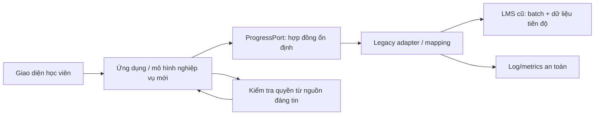
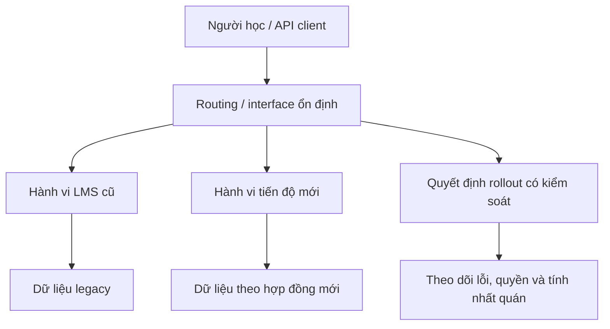

# Thích ứng trong hệ thống cũ hoặc môi trường bị giới hạn khả năng phát hành

Một nền tảng học trực tuyến muốn bổ sung tính năng **“Tiếp tục bài học đang dở”**. Nhưng tiến độ học hiện được ghi vào một hệ thống quản lý đào tạo (LMS) cũ: giao diện API chưa đầy đủ, dữ liệu đồng bộ theo lô vào ban đêm, môi trường kiểm thử thiếu dữ liệu đại diện, và production chỉ cho phép triển khai trong một cửa sổ thay đổi đã được phê duyệt mỗi tháng. Một số thay đổi còn phải đáp ứng yêu cầu về quyền truy cập, kiểm toán và khôi phục dữ liệu.

Scrum Team vẫn làm việc trong Sprint hai tuần. Developers đề nghị Continuous Integration, Product Owner muốn nhận phản hồi người học sớm, bộ phận vận hành lo rủi ro migration và stakeholder hỏi: “Nếu chưa thể phát hành hằng tuần, áp dụng Agile còn có ý nghĩa không?”.

**Có.** Agile không đồng nghĩa *bỏ kiểm soát* hay *phát hành mọi commit ngay lập tức*. Agile là cách **giao giá trị tăng dần, kiểm tra kết quả và thích ứng từ phản hồi**. Trong môi trường bị giới hạn phát hành, đội có thể tăng nhịp học hỏi, làm nhỏ thay đổi, tích hợp liên tục, chuẩn bị bằng chứng chất lượng và giảm rủi ro **ngay cả khi nhịp release thực tế vẫn theo cửa sổ cố định**.

Vấn đề cốt lõi là phân biệt:

- **Ràng buộc thật** cần được tuân thủ: an toàn, pháp lý, quyền riêng tư, dữ liệu, hợp đồng, lịch vận hành.
- **Hạn chế kỹ thuật hiện có** cần hiểu và cải thiện: API cũ, coupling, không có test, phụ thuộc môi trường, triển khai thủ công.
- **Thói quen quản trị có thể thay đổi**: nhiều tầng phê duyệt lặp lại, báo cáo không dùng để ra quyết định, chờ đến cuối Sprint mới kiểm tra tích hợp.
- **Khả năng thích ứng vẫn có thể xây dựng**: lát cắt nhỏ, kiểm chứng nhiều tầng, hợp đồng rõ, thử nghiệm an toàn, minh bạch backlog và cải tiến theo bằng chứng.

Bài học thuộc chương **Quản trị và ràng buộc** của mô-đun **AGILE_DEVELOPMENT**. Mục tiêu là liên hệ các giá trị, nguyên tắc Agile với **user story, Product Backlog, Scrum, Kanban, XP và đo dòng công việc** để lựa chọn cách phát triển phù hợp khi **không có toàn quyền thay đổi hệ thống hoặc lịch phát hành**.

## 1. Mục tiêu học tập

Sau bài học, bạn có thể:

1. Nhận diện sự khác nhau giữa **hệ thống cũ (*legacy system*)**, **nợ kỹ thuật**, **ràng buộc vận hành**, **yêu cầu tuân thủ** và **thói quen tổ chức**.
2. Phân biệt **phát triển, tích hợp, kiểm chứng, triển khai và phát hành**; giải thích vì sao Sprint và lịch release không buộc phải trùng nhau.
3. Làm rõ ranh giới **Definition of Done (DoD)**, **Increment** và **release readiness**, không dùng hạn chế production để hợp thức hóa sản phẩm chưa đạt chất lượng.
4. Phân loại rủi ro thay đổi theo **tác động, khả năng đảo ngược, dữ liệu, bảo mật, phụ thuộc và năng lực quan sát**.
5. Đề xuất cách thu thập **bằng chứng đủ tin cậy** khi môi trường legacy khó kiểm thử: characterization tests, unit tests, contract/integration tests, test data phù hợp và CI.
6. Ứng dụng **seams, adapter, anti-corruption layer, strangler-style migration, expand–migrate–contract** và feature flags khi phù hợp.
7. Thiết kế một **lát cắt dọc** cung cấp giá trị mà không phải viết lại toàn bộ hệ thống cũ.
8. Lập kế hoạch với **change window, lịch phê duyệt, release train hoặc kỳ đóng băng thay đổi**, nhưng vẫn giữ nhịp phản hồi ngắn.
9. Xây chính sách **rollback, roll-forward, migration và phục hồi dữ liệu** theo tính khả thi; hiểu vì sao tắt flag không khôi phục dữ liệu đã ghi.
10. Làm minh bạch phụ thuộc và lựa chọn trong **Product Backlog, Sprint Planning, Sprint Review, Retrospective và Kanban**.
11. Đo **work item age, WIP, cycle time, thời gian chờ phê duyệt, lỗi hồi quy và outcome**, tránh đánh giá cá nhân bằng số lần deploy.
12. Trình bày với stakeholder một đề xuất thích ứng **không đánh đổi quyền riêng tư, chất lượng hoặc nghĩa vụ bắt buộc**.

## 2. Legacy không có nghĩa “vô giá trị” hoặc “phải viết lại”

### 2.1. Hệ thống cũ là gì?

Một hệ thống được gọi là *legacy* khi nó tồn tại từ trước, đang được sử dụng và có thể khó thay đổi trong bối cảnh hiện tại. Nó có thể:

- Viết bằng ngôn ngữ/framework phiên bản cũ.
- Chạy với database khó migration hoặc giao diện tích hợp đã có nhiều client.
- Dựa trên các batch jobs, lịch dừng bảo trì hoặc cơ chế vận hành ít linh hoạt.
- Thiếu automated tests, tài liệu hoặc người hiểu đầy đủ.
- Có nhiều quy tắc nghiệp vụ tích lũy qua nhiều năm.
- Chịu ràng buộc bảo mật, tuân thủ hoặc hợp đồng với đối tác.
- Phục vụ **người dùng thật và quy trình kinh doanh quan trọng**.

**Tuổi đời không phải thước đo duy nhất.** Một ứng dụng mới viết nhưng coupling cao, không kiểm thử và không có khả năng phát hành có thể khó thay đổi hơn một hệ thống lâu năm nhưng ổn định, có test và contract rõ.

### 2.2. Vì sao không được coi mã cũ là lỗi của người đi trước?

Một quyết định thiết kế có thể phù hợp với nhu cầu, hạn chế phần cứng, deadline hoặc quy định ở thời điểm cũ. Phần mềm còn chạy nghĩa là nó **đang mang giá trị và tri thức nghiệp vụ**.

Cách đặt vấn đề hữu ích:

> “Khi cần bổ sung một trạng thái tiến độ mới, chúng ta phải sửa ba batch jobs và hai API; không có automated regression test cho dữ liệu khóa học đã kết thúc. Đó là cơ chế khiến thay đổi mới tốn nhiều thời gian và có rủi ro.”

Cách nói này tốt hơn “hệ thống dở, phải bỏ ngay”, vì nó cho thấy **một trở ngại có thể kiểm chứng**.

### 2.3. Nợ kỹ thuật khác hệ thống cũ

- **Legacy system:** hệ thống đã có, với bối cảnh vận hành và phụ thuộc hiện tại.
- **Technical debt:** phép ẩn dụ về những đánh đổi hoặc cấu trúc khiến thay đổi hợp lý về sau có thể tốn thêm công/rủi ro.
- **Bug:** hành vi sai so với điều được kỳ vọng.
- **Nghĩa vụ bảo mật/tuân thủ:** điều kiện bắt buộc xử lý theo mức rủi ro và trách nhiệm tương ứng.
- **Tính năng chưa được xây:** có thể chỉ là phạm vi sản phẩm chưa ưu tiên.

Không phải mọi dòng code cũ đều là nợ, và **không được gọi một lỗ hổng đang gây hại là “nợ” để trì hoãn biện pháp bảo vệ người dùng**.

## 3. Phân loại ràng buộc trước khi quyết định cách thích ứng

| Loại ràng buộc | Ví dụ trong LMS cũ | Điều cần làm rõ |
| --- | --- | --- |
| **Kỹ thuật** | API SOAP, database khó nâng schema, tích hợp theo batch | Có contract, adapter, test và bước migration nào an toàn? |
| **Dữ liệu** | Tiến độ học đã lưu nhiều năm, có bản ghi không nhất quán | Nguồn sự thật, quy tắc chuyển đổi, phục hồi và quyền riêng tư? |
| **Vận hành** | Production chỉ deploy vào cửa sổ hàng tháng | Cửa sổ nào, lý do nào, có loại thay đổi ít rủi ro hoặc emergency path không? |
| **An toàn/bảo mật** | Quyền truy cập theo tài khoản, dữ liệu học viên nhạy cảm | Biện pháp bắt buộc, bằng chứng kiểm chứng và người có thẩm quyền? |
| **Pháp lý/hợp đồng** | Phải lưu hoặc xóa dữ liệu theo nghĩa vụ cụ thể | Nghĩa vụ nào áp dụng, ai xác nhận và trong phạm vi nào? |
| **Tổ chức** | Chỉ một quản trị viên có quyền deploy | Có thể làm rõ quyền, tự động hóa bằng chứng, người dự phòng? |
| **Nguồn lực** | Không có môi trường staging giống production | Có thể dùng dữ liệu tổng hợp, contract tests, rehearsal được không? |
| **Sản phẩm** | Khách hàng doanh nghiệp chỉ chấp nhận nâng phiên bản theo lịch | Có thể thử prototype hoặc nhóm pilot khác trước không? |
| **Đối tác** | API bên ngoài không hỗ trợ rollback/phiên bản cũ | Cần điều kiện tương thích và kế hoạch xử lý khi lệch phiên bản? |

### 3.1. “Bắt buộc” cần có nguồn và người xác nhận

Khi nghe “không được release hơn một lần mỗi tháng vì compliance”, đội nên hỏi:

1. Đây là **yêu cầu pháp luật, hợp đồng hay chính sách nội bộ**?
2. Nguồn nào quy định phạm vi và điều kiện ấy?
3. Ai có quyền giải thích/phê duyệt trường hợp cụ thể?
4. Có phân loại thay đổi **khẩn cấp, tiêu chuẩn, ít rủi ro** hay không?
5. Những bằng chứng nào thực sự được yêu cầu trước/sau thay đổi?
6. Có thể chuẩn bị hoặc tự động hóa bằng chứng mà vẫn đáp ứng quy định không?

Không nên tự tuyên bố “compliance chỉ là thủ tục, cứ bỏ”, cũng không nên biến một **thói quen chưa được kiểm chứng** thành lệnh cấm vĩnh viễn.

### 3.2. Tạo bản đồ điều kiện thay vì danh sách “không thể”

Một bảng thực hành:

| Điều đang bị giới hạn | Nguồn xác nhận | Tác động | Không được thay đổi | Có thể thử cải thiện |
| --- | --- | --- | --- | --- |
| Release vào tối thứ Bảy hàng tháng | Lịch vận hành đã duyệt | Tính năng chờ tới kỳ tới | Không deploy production ngoài quyền | Tăng CI, rehearsal, release bundle nhỏ |
| Thay schema cần DBA duyệt | Chính sách dữ liệu | Chờ review/migration | Không tự ý sửa dữ liệu thật | Thiết kế expand–contract và review từ sớm |
| Không dùng dữ liệu thật tại dev | Chính sách bảo mật | Khó tái hiện lỗi hiếm | Không đưa PII vào môi trường thử | Synthetic data, mask hợp lệ, replay đã được phép |
| API cũ không có versioning | Hợp đồng đối tác | Khó thay đổi response | Không phá client đang dùng | Adapter/compatibility layer, contract tests |
| Chỉ một người biết batch job | Tri thức tập trung | Release phụ thuộc lịch cá nhân | Không cấp quyền trái chính sách | Pairing, runbook, rehearsal và người dự phòng |

Mục tiêu là thấy **đâu là giới hạn phải tôn trọng, đâu là cơ chế có thể cải tiến**.

## 4. Agile không bắt buộc mọi nhịp trùng nhau

### 4.1. Năm trạng thái dễ bị trộn lẫn

| Trạng thái | Câu hỏi được trả lời | Điều chưa được bảo đảm |
| --- | --- | --- |
| **Implemented** | Mã thay đổi đã được viết? | Chưa chắc tích hợp hoặc được kiểm chứng |
| **Integrated** | Mã đã ghép vào sản phẩm/nhánh phù hợp? | Chưa chắc đáp ứng DoD |
| **Verified/Done** | Increment đã đạt tiêu chuẩn chất lượng đã định? | Chưa chắc được mở cho người dùng |
| **Deployed** | Một artifact/configuration đã được đưa vào môi trường cụ thể? | Chưa chắc tính năng đã được bật |
| **Released** | Thay đổi được cho phép đến nhóm người dùng nào? | Chưa chắc tạo ra outcome mong đợi |
| **Validated** | Có bằng chứng người dùng nhận được lợi ích? | Không chứng minh mọi rủi ro dài hạn đã biến mất |

**Triển khai (*deployment*)** và **phát hành (*release*)** có thể trùng nhau trong hệ thống đơn giản, hoặc tách nhau khi dùng feature flag/entitlement. Dù tách, mã chạy ở production vẫn phải được đánh giá về tác động.

### 4.2. Sprint không phải nhịp release bắt buộc

Theo *Scrum Guide 2020*:

- Sprint có độ dài **một tháng hoặc ngắn hơn**, tạo nhịp kiểm tra và thích ứng.
- Một Sprint có thể tạo **nhiều Increment**.
- Increment có thể được chuyển giao trước khi Sprint kết thúc.
- **Sprint Review không phải cổng cho phép phát hành giá trị**.
- PBI chưa đạt **Definition of Done** không được tính vào Increment.

Vì vậy, một team có Sprint hai tuần và cửa sổ release production mỗi tháng vẫn có thể sử dụng Scrum có ý nghĩa, nếu họ **tạo những Increment Done và có thể sử dụng**, nhận phản hồi, rồi ra quyết định release dựa trên điều kiện thật.

### 4.3. Cần phân biệt Done và release readiness

- **Definition of Done:** cam kết về chất lượng của Increment sản phẩm. Với nhiều Scrum Teams cùng một sản phẩm, áp dụng **một DoD chung**.
- **Release readiness:** điều kiện vận hành/kinh doanh/tuân thủ để đưa một thay đổi tới phạm vi người dùng cụ thể. Có thể cần cửa sổ deploy, tài liệu kiểm soát, người trực, backup hoặc thông báo đối tác.
- **Validation:** đánh giá giải pháp có giúp người dùng, có thể diễn ra trước và sau production thông qua các phép thử phù hợp.

**Không hạ DoD để báo công việc “Done trước ngày duyệt”.** Nếu PBI chưa đạt DoD, hãy làm rõ phạm vi hoặc giữ nó chưa Done; giới hạn lịch release không làm thay đổi nghĩa của chất lượng.

### 4.4. Ví dụ ba nhịp trong tháng

```text
Tuần                  1             2             3             4
Phát triển        [ PBI nhỏ + CI ] [ PBI nhỏ + CI ] [ Cải tiến + CI ]
Scrum             |-- Sprint 1 --|  |-- Sprint 2 --|
Verification      unit/API/contract/CI mỗi thay đổi; E2E theo rủi ro
Validation        thử prototype/nhóm thử         học từ kết quả
Release           chuẩn bị hồ sơ      rehearsal   cửa sổ production
                                                      |
                                                  quan sát sau release
```

Sơ đồ mô tả **những nhịp khác nhau**, không đặt quy tắc cho mọi tổ chức phải phát hành cuối tuần 4. Trong thời gian chờ release, đội không nên ngừng kiểm chứng hay học từ phản hồi có thể tiếp cận hợp lệ.

## 5. Giá trị Agile vẫn tồn tại khi production không thay đổi hằng ngày

### 5.1. Phản hồi sớm không nhất thiết bắt đầu bằng release rộng

Nhóm có thể kiểm chứng giả thuyết sản phẩm qua:

- Phỏng vấn học viên về vấn đề tìm lại bài.
- Quan sát hành trình hiện tại và các lần bỏ cuộc.
- Prototype không nối dữ liệu production.
- Thử tác vụ với dữ liệu synthetic hoặc tài khoản thử hợp lệ.
- Demo một Increment Done với stakeholder trong môi trường phù hợp.
- Đánh giá khả năng sử dụng và accessibility sớm.
- Mở pilot trong phạm vi đã được phép khi điều kiện phù hợp.

Cần phân biệt **bằng chứng định tính/prototype** với **outcome sử dụng production**. Không được tuyên bố “đã chứng minh tăng tỷ lệ hoàn thành khóa học” chỉ vì năm người thích bản demo.

### 5.2. Giao tăng dần khác phát hành liên tục

Một team có thể làm các lát cắt giá trị liên tiếp:

1. Lấy đúng bài gần nhất theo tài khoản và quyền.
2. Hiển thị hành động Tiếp tục ở một vị trí phù hợp.
3. Xử lý khi bài/khóa đã hoàn tất.
4. Xử lý khóa hết quyền truy cập.
5. Bổ sung đồng bộ nhiều thiết bị khi có bằng chứng về nhu cầu.

Mỗi lát cắt phải đủ chất lượng, tích hợp được và có hành vi rõ. Có thể có **Increment Done nhưng chưa được release** khi còn chờ cửa sổ production được duyệt.

**Đừng tạo một núi tính năng chưa tích hợp và gọi đó là “giao tăng dần”** chỉ vì mỗi nhóm hoàn thành phần code.

### 5.3. Giảm lô thay đổi là mục tiêu riêng đáng theo dõi

Nếu cửa sổ release mỗi tháng, đội có thể vẫn:

- Tích hợp theo commit/PR nhỏ trong ngày.
- Không duy trì nhánh tính năng quá dài.
- Đảm bảo test nhanh và đáng tin.
- Chuẩn bị release artifact từ mã đã được kiểm chứng.
- Tách những thay đổi rủi ro cao nếu có thể.
- Phân loại changes để hỗ trợ duyệt theo bằng chứng.
- Làm rõ thứ gì được release ở cửa sổ nào.

**Cửa sổ release dài không buộc tất cả công việc phải phát triển thành một lô lớn duy nhất**.

## 6. Định hướng đầu tư: sửa hệ thống cũ, bao quanh hay thay thế?

### 6.1. Không có một lựa chọn đúng cho mọi legacy system

| Chiến lược | Khi có thể phù hợp | Rủi ro cần xét |
| --- | --- | --- |
| **Giữ nguyên có theo dõi** | Vùng ít thay đổi, hoạt động ổn định, rủi ro chấp nhận được | Chi phí và bảo mật có thể đổi theo thời gian |
| **Bổ sung test + refactor nhỏ** | Hành vi cũ còn hữu ích nhưng mã khó sửa | Test có thể ghi lại cả hành vi sai; cần phân biệt lỗi |
| **Adapter / anti-corruption layer** | API/dữ liệu cũ khác mô hình mới nhưng phải cùng tồn tại | Adapter có thể phình thành tầng phức tạp và che lỗi |
| **Strangler-style migration** | Có thể định tuyến hoặc chuyển từng hành vi sang phần mới | Hai đường chạy song song tăng độ phức tạp tạm thời |
| **Expand–migrate–contract** | Phải thay schema/hợp đồng mà client cũ còn hoạt động | Tương thích, đồng bộ dữ liệu, rollback khó |
| **Rewrite quy mô lớn** | Hệ thống không thể cải thiện an toàn theo lát cắt, hoặc thay đổi nền tảng bắt buộc | Có thể tái tạo lỗi, mất tri thức nghiệp vụ, trì hoãn giá trị |
| **Thay bằng sản phẩm/dịch vụ khác** | Chi phí duy trì và nhu cầu có thể giải bằng giải pháp phù hợp | Di trú dữ liệu, lock-in, hợp đồng, tính năng nghiệp vụ ẩn |

**Không được ra quyết định chỉ từ tuổi đời công nghệ.** Cần xét: mức thay đổi dự kiến, rủi ro dữ liệu, chi phí duy trì, năng lực kiểm chứng và giá trị sản phẩm.

### 6.2. Những câu hỏi thiết kế quan trọng

- Phần nào của hệ thống cũ **ổn định**, phần nào thường xuyên thay đổi?
- Hành vi cũ nào là yêu cầu thực sự, hành vi nào là lỗi lịch sử?
- Có nguồn thông tin nghiệp vụ đáng tin để kiểm chứng không?
- Có điểm nào có thể tách thay đổi mà không tác động toàn hệ thống?
- Người dùng hiện có sử dụng client phiên bản nào?
- Có thể đo tác dụng phụ của một đợt chuyển đổi không?
- Có khả năng phục hồi dữ liệu không?
- Có thời hạn hỗ trợ/lỗ hổng phải xử lý không?
- Có nên sửa một bottleneck nhỏ trước khi đầu tư một chương trình rewrite dài?

## 7. Tạo năng lực kiểm chứng khi mã cũ thiếu test

### 7.1. Phân biệt hành vi hiện có và hành vi mong muốn

Khi thay một module legacy, Developers cần biết:

- Hành vi hiện tại là gì?
- Hợp đồng nào đã được người dùng hoặc hệ thống ngoài phụ thuộc?
- Hành vi nào đang sai cần sửa?
- Những trường hợp biên và dữ liệu cũ nào tồn tại?

**Characterization tests** ghi nhận hành vi thực tế của mã hiện có để hỗ trợ thay đổi an toàn. Nhưng test có thể ghi cả **lỗi**; vì vậy phải đối chiếu với yêu cầu nghiệp vụ, bảo mật và ví dụ đúng đã được xác nhận.

### 7.2. Một tầng kiểm thử có mục đích rõ

| Tầng kiểm chứng | Bằng chứng muốn có | Giới hạn |
| --- | --- | --- |
| **Unit tests** | Quy tắc chuyển trạng thái, chọn bài, xác định quyền hoạt động đúng | Không xác nhận toàn bộ API/database |
| **Characterization tests** | Giữ hành vi legacy dự kiến trong quá trình refactor | Có thể vô tình khóa cả bug cũ |
| **Contract tests** | API giữa phần cũ/mới, consumer/provider có giao diện tương thích | Không thay E2E cho hành trình người dùng |
| **Integration tests** | Mapping, truy vấn, transaction, batch import/export hoạt động | Môi trường thử có thể khác production |
| **E2E tests chọn lọc** | Luồng học viên thật từ đăng nhập đến mở đúng bài | Chi phí lớn, có thể không bao phủ mọi biến thể |
| **Performance/soak tests** | Batch/DB/độ trễ ở tải tương ứng | Không có tải production tuyệt đối giống nhau |
| **Security/privacy tests** | Không truy cập nhầm tài khoản, xử lý dữ liệu đúng | Phải thêm review chính sách và cơ chế bảo vệ khác |
| **Rehearsal migration** | Chuyển đổi dữ liệu và phục hồi thử với trường hợp hợp lệ | Một rehearsal không bảo đảm không có lỗi production |

### 7.3. Khi thiếu dữ liệu thử đại diện

Nhóm có thể cân nhắc:

- **Synthetic data** có những phân phối/trường hợp biên phù hợp.
- Dữ liệu đã được **ẩn danh hoặc che thông tin** theo chính sách cho phép, kiểm tra khả năng tái nhận dạng.
- Bộ dữ liệu hợp đồng chỉ gồm trường cần kiểm chứng.
- Trường hợp hiếm được tạo bằng test fixtures.
- Các snapshot/biểu diễn chỉ sử dụng khi được phê duyệt và kiểm soát quyền truy cập.
- Cách tái hiện lỗi bằng **mã lỗi, tương quan sự kiện và trường không nhạy cảm**, không cần chép thông tin cá nhân vào chat.

**Không đưa dữ liệu học viên thật sang máy cá nhân hoặc công cụ không được cấp phép chỉ để chạy test dễ hơn**.

### 7.4. CI vẫn có thể phát triển trước khi có CD

Một hệ thống chưa tự động deploy production vẫn có thể:

1. Build được lặp lại từ cùng revision.
2. Chạy unit tests.
3. Kiểm tra contract/integration phù hợp.
4. Chạy static checks và kiểm tra dependency theo chính sách.
5. Tạo artifact versioned, có dấu vết.
6. Ghi bằng chứng kiểm tra phục vụ phê duyệt.
7. Dừng khi phát hiện lỗi quan trọng.

**Continuous Integration không yêu cầu Continuous Deployment.** CI có giá trị ngay vì rút ngắn thời gian phát hiện rủi ro và giảm chi phí kết hợp thay đổi.

## 8. Mẫu kỹ thuật: tạo seam trước khi thay đổi phần lõi

### 8.1. Seam là gì?

*Seam* là một điểm mà đội có thể thay thế một phần hành vi hoặc cấu trúc mà không buộc sửa toàn bộ hệ thống cùng lúc.

Trong nền tảng học, API cũ có thể trả `last_page_id` từ batch job, trong khi giao diện mới cần khái niệm `resumeLessonId`. Thay vì để mọi client tự hiểu dữ liệu cũ, đội có thể tạo adapter **ở ranh giới hợp đồng phù hợp**.

### 8.2. Sơ đồ anti-corruption layer



*Anti-corruption layer* tránh cho cách biểu diễn cũ lan khắp domain mới. Nhưng nó phải có **contract rõ và test**; đặt tên “ACL” cho một lớp mapping không tự giải quyết mọi phụ thuộc.

### 8.3. Pseudocode thiết kế ranh giới

```text
interface ProgressPort:
    getRecentProgress(authenticatedLearnerId, courseId)
        -> ProgressRecord | NotFound | Unavailable

resume(verifiedSession, courseId):
    learnerId = verifiedSession.learnerId
    assertAccessRights(learnerId, courseId)

    result = progressPort.getRecentProgress(learnerId, courseId)

    if result == NotFound:
        return eligibleStartingLesson(courseId)
    if result == Unavailable:
        return controlledErrorAndRetryGuidance()

    return validateAndMapLesson(result, courseId)
```

Đây là **giả mã minh họa**, không phải mã production. Điểm cần giữ:

- Danh tính lấy từ **session đã xác thực**.
- Quyền truy cập kiểm tra ở server.
- Tách trường hợp **không có tiến độ** và **dịch vụ legacy không khả dụng**.
- Không chọn bài từ bản ghi thuộc tài khoản/khóa khác.
- Có quan sát lỗi và giới hạn retry.
- Không “trả bài gần nhất bất kỳ” chỉ để che lỗi kết nối.

### 8.4. Đừng biến adapter thành hệ thống mới khổng lồ

Nếu chỉ một API cần chuyển đổi dữ liệu đơn giản, không cần tạo hàng chục lớp abstraction. Seam có giá trị khi **làm giảm phạm vi thay đổi và rủi ro tương lai**. Cần xem liệu adapter có đang chồng thêm duplicate logic hoặc làm chậm mọi request hay không.

## 9. Characterization tests và refactoring theo từng bước

### 9.1. Quy trình an toàn với logic khó hiểu

1. **Xác định rủi ro:** phần mã cũ điều khiển hành vi nào, người dùng nào có thể bị ảnh hưởng?
2. **Tìm dữ liệu/điều kiện thực:** có trường hợp bản ghi thiếu, trùng, sai trạng thái không?
3. **Viết characterization tests** cho những hành vi cần ghi nhận.
4. **Làm rõ expected behavior** với PO và chuyên gia, nhất là với quyền truy cập.
5. **Đánh dấu các hành vi sai** cần sửa ở test yêu cầu mới.
6. **Refactor rất nhỏ**, mỗi lần vẫn có bằng chứng kiểm chứng.
7. **Tích hợp liên tục**, không để một nhánh rewrite kéo dài hàng tháng.
8. **Kiểm chứng ở tầng phù hợp**, không chỉ unit test.
9. **Quan sát sau release** theo rủi ro.
10. **Cập nhật nguồn tri thức**, giảm phụ thuộc một chuyên gia.

### 9.2. Khi nào không nên “refactor trên production”?

Một số thao tác như đổi khóa chính, schema lưu tiến độ hoặc cơ chế mã hóa dữ liệu có thể **không đảo ngược được chỉ bằng git revert**. Chúng cần kế hoạch migration, tương thích, backup/restore rehearsal và kiểm soát vận hành.

Refactoring trong code có thể là thay đổi nội bộ giữ hành vi; **migration dữ liệu thật** phải được đánh giá như một thay đổi trạng thái có hậu quả vật lý.

## 10. Strangler-style migration: thay dần, không đổi mọi thứ cùng lúc

### 10.1. Tư duy

Khi hệ thống cũ vẫn đang phục vụ người dùng, một cách tiếp cận là **đặt ranh giới/định tuyến phù hợp và thay thế từng phần hành vi** bằng phần mới, sau đó loại đường cũ khi không còn phụ thuộc.

Các bước minh họa:

1. Chọn một luồng nhỏ có giá trị và có thể kiểm chứng.
2. Tạo **điểm định tuyến hoặc adapter**.
3. Chạy phần mới với contract tương thích và test.
4. Chuyển một nhóm trường hợp hợp lệ theo chính sách.
5. Quan sát lỗi và outcome.
6. Mở rộng phạm vi khi đủ bằng chứng.
7. Loại dần code cũ và flag không còn cần.
8. Đánh giá và xử lý dữ liệu legacy còn phụ thuộc.

### 10.2. Sơ đồ từng lát cắt



Sơ đồ không khẳng định phải tạo hai database. Có trường hợp dùng chung dữ liệu trong giai đoạn chuyển tiếp; điều đó cần **quyền sở hữu dữ liệu, transaction và tính tương thích** được thiết kế rõ.

### 10.3. Khi không thể tách luồng dễ dàng

Một hệ thống có transaction toàn cục, dữ liệu chồng chéo hoặc giao diện không thể định tuyến từng nghiệp vụ. Khi đó:

- Có thể cần **bước tách dữ liệu hoặc contract** trước.
- Có thể cần nâng cấp nền tảng, thêm test/rehearsal.
- Cần phân tích độ không thể đảo ngược và lựa chọn thay thế.
- Đừng hứa strangler pattern sẽ luôn rẻ hơn rewrite.
- Đừng tách thành microservices chỉ để có “kiến trúc Agile”.

**Chọn kỹ thuật theo đặc điểm hệ thống, không theo tên pattern.**

## 11. Expand–migrate–contract cho dữ liệu và API

### 11.1. Vì sao thay đổi schema cần nhiều bước?

Giả sử LMS cũ lưu tiến độ trong cột `last_page_id`, trong khi ứng dụng mới cần cấu trúc có `last_lesson_id` và thời điểm cập nhật đáng tin.

Đổi tên hoặc xóa cột ngay có thể làm các batch jobs và client cũ thất bại. Một chiến lược thông dụng là:

- **Expand:** bổ sung cấu trúc mới theo cách còn tương thích với consumer cũ.
- **Migrate:** chuyển dữ liệu/đường đọc–ghi theo giai đoạn đã kiểm chứng.
- **Contract:** loại cấu trúc/đường cũ **sau khi** xác nhận không còn consumer phụ thuộc.

### 11.2. Ví dụ kế hoạch migration

| Bước | Thay đổi | Bằng chứng và rào chắn |
| --- | --- | --- |
| **0. Khảo sát** | Liệt kê bảng, batch jobs, API và client dùng cột cũ | Không bỏ sót consumer quan trọng |
| **1. Expand** | Thêm trường mới nhưng chưa xóa trường cũ | Migration schema có cách lặp lại, backup phù hợp |
| **2. Compatibility** | Adapter đọc được cả biểu diễn cũ/mới khi cần | Contract/integration tests cho phiên bản giao nhau |
| **3. Backfill** | Điền dữ liệu mới theo quy tắc có thể kiểm chứng | Đối chiếu số bản ghi, giá trị bất thường, quyền truy cập |
| **4. Switch reads** | Chuyển dần một luồng đọc sang trường mới | So sánh kết quả, quan sát lỗi và latency |
| **5. Switch writes** | Đổi cơ chế ghi theo thiết kế nhất quán | Xác định nguồn sự thật và xử lý ghi đồng thời |
| **6. Observe** | Theo dõi đủ thời gian/nhóm user theo rủi ro | Không có lỗi hoặc consumer chưa chuyển chưa được giải quyết |
| **7. Contract** | Xóa đường/cột cũ khi đã xác minh an toàn | Có phê duyệt cần thiết, kế hoạch khôi phục phù hợp |

**Dual-write không tự động an toàn**. Nếu ghi hai nơi, lỗi một phần có thể làm dữ liệu lệch. Cần có chiến lược transaction, idempotency, reconciliation và quyền sở hữu nguồn sự thật phù hợp; không mặc định mọi hệ thống đều nên dual-write.

### 11.3. Tại sao rollback có thể không hoàn toàn?

- Schema mới đã được client đọc/ghi.
- Bản ghi cũ đã được biến đổi mất thông tin.
- Hành động người dùng đã tạo sự kiện không thể “chưa xảy ra”.
- Hệ thống bên ngoài đã nhận dữ liệu hoặc gửi email.
- Người dùng đã thay đổi tiến độ ở nhiều thiết bị.

Vì vậy, phải phân biệt:

- **Rollback mã:** quay về artifact/configuration cũ khi còn tương thích.
- **Disable feature:** ngừng cho nhóm người dùng tiếp cận hành vi mới.
- **Roll-forward:** đưa bản sửa an toàn tiếp theo, giữ trạng thái dữ liệu đã thay đổi.
- **Restore dữ liệu:** phục hồi theo backup/điểm phục hồi phù hợp, có thể mất thay đổi hợp lệ sau mốc.
- **Reconciliation:** đối chiếu và sửa bất nhất có kiểm soát.

Không có một “nút rollback” duy nhất bảo đảm an toàn cho mọi trường hợp.

## 12. Tích hợp với batch jobs và hệ thống không thời gian thực

### 12.1. Nhìn đúng độ trễ dữ liệu

LMS có batch job đồng bộ tiến độ lúc 02:00 mỗi ngày. Nếu người học hoàn tất bài lúc 18:00, dữ liệu từ hệ thống cũ có thể chưa cập nhật cho tới đợt đồng bộ tiếp.

Không được thiết kế nút Tiếp tục rồi tuyên bố **“luôn mở đúng bài mới nhất theo thời gian thực”** nếu contract dữ liệu không cung cấp điều đó.

Cần xác định:

- Nguồn sự thật của tiến độ.
- Tần suất và cửa sổ đồng bộ.
- Có thể nhận sự kiện sớm hơn không?
- Khi batch chậm/thất bại, ứng dụng thể hiện gì?
- Có dữ liệu stale gây truy cập sai quyền không?
- Khách hàng được thông báo **độ mới dữ liệu** như thế nào?

### 12.2. Chọn hành vi đúng theo ràng buộc

Một số khả năng:

| Phương án | Giá trị | Đánh đổi |
| --- | --- | --- |
| Hiển thị tiến độ theo bản đồng bộ gần nhất, có nhãn rõ | Dễ triển khai nếu nhu cầu cho phép | Có độ trễ, không được gọi là thời gian thực |
| Cho client gửi tiến độ mới qua dịch vụ được kiểm chứng | Phản hồi nhanh hơn | Cần đồng bộ, quyền sở hữu và reconciliation |
| Tăng tần suất batch theo khả năng vận hành | Giảm độ trễ không đổi toàn kiến trúc | Tăng tải và rủi ro tranh chấp tài nguyên |
| Dùng event integration phù hợp | Có thể phản hồi gần thời gian thực | Tăng yêu cầu idempotency, thứ tự và xử lý thất bại |
| Hoãn tính năng đồng bộ đa thiết bị | Giảm phạm vi sớm để học nhu cầu | Cần trung thực về giới hạn hiện tại |

### 12.3. Idempotency và xử lý sự kiện trùng

Nếu một batch được chạy lại sau khi lỗi, có thể tạo cùng sự kiện tiến độ hai lần. Đội nên thiết kế:

- Định danh bản ghi/sự kiện phù hợp.
- Cơ chế xử lý trùng hoặc upsert theo quy tắc.
- Quy tắc ưu tiên bản ghi theo phiên bản/thời gian có nguồn đáng tin.
- Kiểm chứng khi đồng hồ các hệ thống lệch nhau.
- Retry có giới hạn, tránh nhân lỗi vô hạn.
- Reconciliation và log theo chính sách bảo mật.

**Một lần chạy thử thành công không chứng minh batch chạy lại luôn đúng**; cần test các trường hợp thất bại, trùng và thứ tự sự kiện.

## 13. Feature flags và release theo nhóm: hữu ích nhưng không thần kỳ

### 13.1. Tách deploy và khả năng sử dụng

Một team có thể deploy code mới trong cửa sổ production hàng tháng, nhưng chỉ mở một tính năng cho một nhóm pilot khi có quyền và điều kiện phù hợp. **Feature flag** có thể hỗ trợ tách hai quyết định.

Ví dụ:

```text
handleResumeRequest(request):
    identity = authentication.verifiedIdentity(request)
    requireCourseAccess(identity, request.courseId)

    if flags.enabledFor("resume-v2", identity):
        return resumeV2(identity, request.courseId)

    return resumeLegacy(identity, request.courseId)
```

Đây là giả mã; **không được lấy ID từ tham số client làm danh tính đã xác thực**. Cả hai nhánh vẫn phải đáp ứng điều kiện an toàn. Nếu có thay đổi schema hoặc side effects nền, flag tắt vẫn có thể không ngăn tác động.

### 13.2. Pilot có thể là bước học có kiểm soát

Một kế hoạch minh họa:

1. Kiểm chứng đầy đủ chất lượng bắt buộc trong môi trường phù hợp.
2. Được phê duyệt deploy/release đúng theo chính sách.
3. Bật cho một nhóm người dùng đủ điều kiện và được chuẩn bị hỗ trợ.
4. Quan sát lỗi, quyền truy cập, độ trễ và outcome.
5. Mở rộng, điều chỉnh hoặc dừng theo tiêu chí đã thống nhất.
6. Dọn flag và đường cũ khi không còn cần, theo kế hoạch an toàn.

**Không đưa một tính năng chưa an toàn cho 1% người dùng để “thử” thay vì test**. Phạm vi nhỏ chỉ giảm số người có thể bị ảnh hưởng, không loại bỏ nghĩa vụ bảo vệ họ.

### 13.3. Có môi trường bị cấm bật flag ngoài kỳ phát hành

Nếu chính sách coi thay đổi cấu hình flag là một **release/change cần phê duyệt**, đội phải tuân thủ quy định ấy. Không được dùng flag như lối vòng qua cơ chế governance.

Cần hỏi:

- Ai được bật flag?
- Có audit trail không?
- Có cần kiểm tra rủi ro hoặc duyệt theo loại thay đổi?
- Khả năng tắt có thật sự an toàn không?
- Ai quan sát sau khi bật và ai có thể dừng?
- Điều kiện loại bỏ flag cũ là gì?

### 13.4. Đừng tích lũy nợ cấu hình

Một feature flag giữ hai nhánh logic và nhiều biến thể kiểm thử. Nếu cứ thêm flag nhưng không xóa, số trạng thái vận hành tăng, gây **chi phí thay đổi tích lũy**.

Mỗi flag nên có **mục đích, phạm vi, người theo dõi, thời điểm xem lại và điều kiện xóa**.

## 14. Quản trị thay đổi theo rủi ro thay vì theo số bước phê duyệt

### 14.1. Governance tốt trả lời những câu hỏi gì?

**Governance** là cách tổ chức xác định trách nhiệm, quyền quyết định, bằng chứng và kiểm soát rủi ro. Trong môi trường phát hành bị giới hạn, một cơ chế tốt cần trả lời:

1. **Điều gì được phép thay đổi** và trong khoảng thời gian nào?
2. **Ai có quyền quyết định** đối với code, dữ liệu, production và nghiệp vụ?
3. **Rủi ro thay đổi** đã được hiểu và giảm thiểu ra sao?
4. **Bằng chứng** kiểm thử, kiểm soát, phê duyệt và triển khai được lưu ở đâu?
5. Nếu có lỗi, **ai phát hiện, phản ứng, thông báo và phục hồi**?
6. Sau thay đổi, có cách **học và cải tiến** từ kết quả thực không?

Governance tốt không đồng nghĩa mọi thay đổi phải qua cùng số cuộc họp. Một sửa chính tả và một migration có khả năng mất dữ liệu không nhất thiết có cùng mức rủi ro; nếu chính sách cho phép, **cách kiểm soát có thể được phân loại theo tác động**.

### 14.2. Ma trận đánh giá trước thay đổi

| Chiều rủi ro | Câu hỏi | Ví dụ tín hiệu cao |
| --- | --- | --- |
| **Người dùng** | Có thể ảnh hưởng bao nhiêu người và nghiêm trọng thế nào? | Mất quyền truy cập hoặc mất tiến độ |
| **Dữ liệu** | Có sửa/xóa/chuyển dữ liệu thật và có đảo ngược được? | Schema migration xóa thông tin |
| **Bảo mật** | Có thay xác thực, phân quyền hoặc xử lý dữ liệu riêng? | Thay đổi quyền mở nội dung theo gói |
| **Tương thích** | Client/batch/đối tác cũ còn hoạt động? | API mới làm batch nightly thất bại |
| **Phụ thuộc** | Bao nhiêu team, môi trường, bên ngoài cần phối hợp? | Thay đồng thời ứng dụng và LMS |
| **Quan sát** | Nếu lỗi xảy ra có nhận ra nhanh? | Không có log đối chiếu tiến độ |
| **Khôi phục** | Có phương án an toàn, đã thử, có người chịu trách nhiệm? | Không có bản sao dữ liệu và rehearsal |
| **Thời điểm** | Có đang trong mùa cao điểm hoặc khung đóng băng? | Ngày thi/chứng nhận cuối học kỳ |

**Không cộng điểm cơ học để quyết định bỏ một kiểm tra bắt buộc.** Rủi ro bảo mật hoặc nghĩa vụ riêng tư có thể cần xử lý theo quy tắc chuyên biệt bất kể tổng điểm trông thấp.

### 14.3. Ví dụ chính sách thay đổi ba loại

Trong một tổ chức có thể định nghĩa:

- **Thay đổi tiêu chuẩn lặp lại, rủi ro thấp:** thực hiện theo một quy trình đã chuẩn hóa, đủ test và kiểm tra quyền.
- **Thay đổi thông thường có rủi ro:** có đánh giá tác động, bằng chứng CI, kế hoạch triển khai và người duyệt phù hợp.
- **Thay đổi khẩn cấp:** khi cần giảm nguy cơ cho người dùng hoặc khôi phục dịch vụ, thực hiện theo cơ chế incident/change khẩn đã được ủy quyền, có ghi lại và rà soát sau.

Đây là **một mẫu mô tả**, không phải quy định pháp lý hay định nghĩa cố định của ITIL. Đội phải dùng những phân loại, thẩm quyền và hồ sơ mà tổ chức của mình thực sự áp dụng.

### 14.4. Tự động hóa bằng chứng chứ không lách phê duyệt

Nếu chính sách yêu cầu chứng minh phiên bản đã qua một bộ kiểm tra, pipeline có thể:

1. Ghi **commit/revision và artifact version**.
2. Chạy test bắt buộc.
3. Lưu kết quả, môi trường và thời điểm.
4. Liên kết với PBI và change record.
5. Xác nhận người có thẩm quyền đã duyệt trường hợp cần duyệt.
6. Ghi lại artifact được deploy và kết quả sau deploy.

Tự động hóa giúp **giảm sao chép thủ công và sai sót**, trong khi vẫn giữ khả năng kiểm tra. Nếu policy yêu cầu phê duyệt độc lập, pipeline **không được tự giả danh chữ ký của người phê duyệt**.

## 15. Hồ sơ thay đổi: đủ truy vết, không thành báo cáo vô tận

### 15.1. Một chuỗi bằng chứng hữu ích

```text
Nhu cầu / rủi ro sản phẩm
        |
        v
PBI / acceptance criteria / Sprint Goal
        |
        v
PR / commit / test result / code review
        |
        v
Artifact có phiên bản, xác nhận nguồn gốc
        |
        v
Change request và approval theo chính sách
        |
        v
Deployment record + migration execution
        |
        v
Monitoring, outcome và incident (nếu có)
```

Mục đích là **truy ra điều gì đã đổi, ai quyết định, bằng chứng chất lượng gì và người dùng bị ảnh hưởng ra sao**.

### 15.2. Mẫu release/change record

```yaml
change_id: CHG-2026-042
service: learning-platform
release_artifact: learning-platform-2.6.0
# Minh họa: ID artifact phải trỏ tới đúng bản build đã kiểm chứng.
related_pbis:
  - LP-142
  - LP-155
scope: "Bật luồng tiếp tục bài học cho nhóm pilot đủ điều kiện"
legacy_dependency: "LMS batch progress export"
risk_classification: "Theo chính sách nội bộ đã xác nhận"
evidence:
  unit_tests: "CI run link"
  contract_tests: "CI run link"
  migration_rehearsal: "Record link"
  security_review: "Review link, nếu yêu cầu"
release_window: "Mốc được phê duyệt, kèm múi giờ"
approver: "Theo phân quyền tổ chức"
operator: "Theo lịch vận hành được phân công"
observability: "Dashboard link; các cảnh báo đã được xác nhận"
stop_conditions: "Không đạt điều kiện an toàn hoặc xuất hiện lỗi đã định"
recovery_plan: "Runbook link, gồm xử lý dữ liệu nếu cần"
post_release_review: "Mốc và người theo dõi được thống nhất"
```

Đây là **mẫu YAML nằm trong tài liệu học**, không phải cấu hình của một hệ thống thật. Không suy ra rằng một change record đủ để đáp ứng mọi yêu cầu kiểm toán hoặc chính sách pháp lý.

### 15.3. Phân biệt bằng chứng tự động và xác nhận thủ công

Có những điều có thể tự động hóa tốt:

- Build/revision, test results và trạng thái pipeline.
- Kiểm tra dependency/supply chain theo công cụ đã phê duyệt.
- Kết quả contract test và kiểm tra schema.
- Kiểm soát tính toàn vẹn artifact.
- Đối chiếu bản ghi migration ở môi trường rehearsal.

Có những điều cần người chịu trách nhiệm quyết định:

- Chấp nhận một rủi ro sản phẩm đáng kể.
- Giải thích nghĩa vụ hợp đồng/pháp lý.
- Phê duyệt deployment nếu chính sách yêu cầu.
- Chấp nhận một phương án khôi phục có mất dữ liệu tiềm tàng.
- Chọn có mở rộng pilot khi dữ liệu chưa chắc chắn không.

**Tự động hóa hỗ trợ quyết định; không thay sự chịu trách nhiệm về quyết định.**

## 16. Lập kế hoạch với cửa sổ phát hành cố định

### 16.1. Điều cần hỏi trước khi lên lịch

- Change window bắt đầu/kết thúc lúc nào, **múi giờ nào**?
- Có **freeze period** trước thi cử, tính phí hoặc công bố kết quả?
- Hạn nộp hồ sơ và hạn phê duyệt là gì?
- Có điều kiện không được deploy vào lúc batch đang chạy?
- Bước migration nào không thể hoàn tác?
- Hệ thống có thể tự động deploy hay cần người có quyền thao tác?
- Cửa sổ nào phù hợp để quan sát hậu triển khai?
- Có cơ chế change khẩn được ủy quyền và giới hạn thế nào?
- Client/đối tác có cần chuẩn bị phiên bản tương thích trước không?

### 16.2. Chia kế hoạch thành ba đường song song

| Đường công việc | Nhịp có thể chọn | Bằng chứng muốn đạt |
| --- | --- | --- |
| **Phát triển** | Sprint ngắn hoặc continuous flow; tích hợp thường xuyên | Increment Done và test phù hợp |
| **Kiểm chứng/chuẩn bị release** | Chạy CI theo thay đổi, rehearsal trước cửa sổ, kiểm tra rủi ro | Artifact tin cậy, migration và recovery plan |
| **Triển khai/phát hành** | Cửa sổ đã phê duyệt, pilot/rollout theo chính sách | Sự kiện deployment/release được ghi, monitoring và outcome |

Đội không cần trì hoãn **Product Backlog Refinement, unit tests hay contract tests** cho đến đúng tuần phát hành. Ngược lại, không vì “Sprint đã xong” mà tự ý bypass change window.

### 16.3. Tránh gom lô lớn vì cửa sổ hiếm

Một nguy cơ của monthly release là **một đợt chứa 40 thay đổi không liên quan**. Khi có lỗi:

- Khó tìm thay đổi gây sự cố.
- Khó biết những thay đổi nào có thể rollback độc lập.
- Nhiều team phải cùng chuẩn bị ngoài giờ.
- Hồ sơ kiểm chứng lớn và dễ bỏ sót.
- Thời gian khôi phục kéo dài.

Nếu không thể tăng số cửa sổ ngay, vẫn có thể **giảm kích thước thay đổi và tách rollout**:

- Đưa những Increment đã Done vào artifact có phiên bản rõ.
- Không bắt buộc mọi PBI mới phải cùng đi vào đợt release sắp tới.
- Tách feature flags hoặc modules khi được cho phép và kiểm chứng đúng.
- Giữ migration dữ liệu có kế hoạch riêng.
- Giảm nhánh dài và xung đột bằng CI.
- Có thể trì hoãn một thay đổi rủi ro mà không trì hoãn mọi thay đổi khác, nếu kiến trúc và chính sách cho phép.

### 16.4. Release train không đồng nghĩa mọi thay đổi phải đi cùng

Một lịch release định kỳ có thể giúp vận hành dự đoán, nhất là môi trường đối tác hoặc thay đổi khó đảo ngược. Nhưng việc có một ngày phát hành **không bắt buộc phải nhồi toàn bộ backlog vào ngày ấy**.

Một Product Owner và Developers có thể chọn **phạm vi nhỏ đủ giá trị và đủ bằng chứng**. Nếu rủi ro phát sinh, giảm phạm vi hoặc lùi một tính năng thường là lựa chọn tốt hơn bỏ kiểm chứng.

## 17. Nhánh mã, artifact và tính lặp lại của triển khai

### 17.1. Vấn đề của nhánh phát hành sống quá lâu

Một cách tổ chức cũ là mỗi team giữ một feature branch đến gần ngày release, rồi merge tất cả. Hệ quả:

- Xung đột mã và hợp đồng xuất hiện muộn.
- Test khó chạy với đúng tổ hợp phiên bản.
- Người review bị dồn việc.
- Khó xác định nguồn của lỗi.
- Sprint có nhiều việc “xong code” nhưng chưa có Increment thực sự tích hợp.

**Tích hợp thay đổi nhỏ thường xuyên** và kiểm thử sớm có thể giảm những chi phí này, ngay cả khi deployment vẫn thủ công theo lịch.

### 17.2. Phát hành cùng artifact đã kiểm chứng

Một nguyên tắc thực hành hữu ích:

> **Build một artifact xác định, gắn version/revision, kiểm chứng nó ở các môi trường phù hợp rồi triển khai đúng artifact ấy**, thay vì rebuild một bản khác không có dấu vết ngay trước production.

Đối với config, secrets và dữ liệu môi trường, cần quản lý riêng theo chính sách. Không đưa secrets vào artifact chỉ để “mọi môi trường giống nhau”.

### 17.3. Nếu phải duy trì release branch

Một số tổ chức cần release branch để phục vụ hỗ trợ phiên bản cũ. Khi đó:

- Xác định rõ nhánh nào đang phục vụ người dùng nào.
- Có chính sách backport/hotfix.
- Không làm mất test khi cherry-pick.
- Ghi rõ artifact và commit tương ứng.
- Tránh sửa trực tiếp trên production không có lịch sử.
- Có cơ chế đưa bản sửa về dòng mã chính.
- Đánh giá chi phí duy trì nhiều phiên bản trong backlog.

**Không phải mọi legacy system đều có thể chuyển ngay sang một chiến lược nhánh duy nhất**, nhưng cần giảm sự mơ hồ và công việc lặp lại không cần thiết.

### 17.4. Bản ghi cấu hình cũng là một phần thay đổi

Cùng một mã có thể chạy khác vì:

- Feature flags.
- Biến môi trường.
- Kết nối database và quyền truy cập.
- Job scheduler và batch configuration.
- Endpoint đối tác.
- Version của service phụ thuộc.
- Quy tắc caching hoặc queue.

Vì vậy, release evidence phải nói rõ **những thay đổi cấu hình có liên quan** và cách kiểm chứng; không chỉ ghi mã commit.

## 18. Release readiness và rehearsal

### 18.1. Kiểm chứng thay vì “tin rằng script đã chạy lần trước”

Một buổi rehearsal có thể bao gồm:

- Chạy deployment script trên môi trường thử tương thích đủ cho rủi ro cần kiểm tra.
- Chạy migration trên dữ liệu synthetic với trường hợp biên.
- Đo thời gian chạy và đánh giá phù hợp với change window.
- Kiểm chứng số bản ghi và quy tắc business sau chuyển đổi.
- Kiểm tra client/batch cũ vẫn hoạt động trong giai đoạn giao nhau.
- Thử khôi phục theo phạm vi cho phép.
- Kiểm tra dashboard/alert đã hiển thị các tín hiệu cần thiết.
- Ghi lỗi, thay đổi kế hoạch và những điều rehearsal chưa chứng minh.

**Một rehearsal đạt không chứng minh production không thể có lỗi.** Môi trường thử có thể khác về dữ liệu, concurrency, phân quyền và tải.

### 18.2. Bốn lựa chọn khi không sẵn sàng

Nếu còn lỗi hoặc bằng chứng thiếu trước cửa sổ:

1. **Giảm phạm vi** release xuống những phần đã đạt điều kiện.
2. **Hoãn thay đổi rủi ro** sang cửa sổ sau.
3. **Bổ sung kiểm chứng** nếu còn thời gian và đúng thẩm quyền.
4. **Sử dụng quy trình ứng phó khẩn** chỉ khi thật sự có điều kiện khẩn hợp lệ.

Không nên biến hạn nộp hồ sơ thành lý do **đánh dấu test chưa chạy là pass**.

### 18.3. Go/no-go: minh bạch trách nhiệm

Một quyết định **go/no-go** có thể cần các bên với quyền khác nhau: Product Owner, người vận hành, chuyên gia dữ liệu/bảo mật, người có thẩm quyền thay đổi. Hãy nêu:

- Bằng chứng nào bắt buộc.
- Rủi ro còn lại và ai có quyền chấp nhận.
- Phương án nếu không thể tiếp tục.
- Người gọi dừng nếu guardrail vi phạm.
- Mốc bắt đầu kết thúc change window.
- Bản thông báo cho stakeholder và đội hỗ trợ.

Không phải mọi bug nhỏ đều cần một “hội đồng go/no-go” mới; cách tổ chức phải theo **chính sách và rủi ro thật**.

## 19. Observability và phục hồi: release không kết thúc ở nút Deploy

### 19.1. Một đợt production change cần quan sát những gì?

Với tính năng Tiếp tục bài học:

| Tín hiệu | Rủi ro được nhìn thấy |
| --- | --- |
| Tỷ lệ mở sai bài hoặc không mở được bài | Hành vi sản phẩm không đúng |
| Lỗi truy cập sai tài khoản/khóa | Bảo mật và quyền riêng tư |
| Lỗi API, timeout, latency | Khả năng sử dụng và phụ thuộc legacy |
| Số batch jobs thất bại hoặc trễ | Độ mới dữ liệu không bảo đảm |
| Sự khác biệt dữ liệu cũ/mới | Migration/reconciliation có vấn đề |
| Số học viên bị ảnh hưởng theo nhóm rollout | Phạm vi tác động |
| Khả năng phục hồi và thời gian nhận biết lỗi | Rủi ro kéo dài sự cố |
| Outcome học viên tìm đúng bài nhanh hơn | Giả thuyết giá trị |

Không ghi các thông tin nhạy cảm như token, nội dung học viên riêng tư hoặc mật khẩu vào log chỉ vì muốn debug nhanh.

### 19.2. Dùng guardrails có thể hành động

Một guardrail tốt cần biết:

- Chỉ số nào được quan sát và baseline tương ứng.
- Điều kiện nào là dấu hiệu nguy hiểm.
- Ai đang trực quan sát trong cửa sổ release.
- Khi nào dừng rollout.
- Khi nào bật chế độ an toàn/giảm phạm vi.
- Khi nào phải kích hoạt incident response chính thức.
- Bước nào chỉ xử lý mã, bước nào phải xử lý dữ liệu.

Ví dụ:

> “Nếu phát hiện một bằng chứng đáng tin rằng tiến độ tài khoản B bị trả cho A, ngừng mở rộng release ngay và kích hoạt quy trình bảo vệ người dùng.”

Với rủi ro quyền riêng tư nghiêm trọng, **không cần đợi vượt một tỷ lệ lỗi đủ lớn mới hành động**.

### 19.3. Rollback không luôn là lựa chọn tốt nhất

Nếu đã đổi dữ liệu theo schema mới, code cũ có thể không đọc được trạng thái vừa ghi. Khi đó **roll-forward hoặc khôi phục có kiểm soát** có thể an toàn hơn một lần rollback mã cơ học.

Điều cần chuẩn bị là **cây lựa chọn khôi phục** theo từng loại lỗi, không phải lời hứa “đã có nút rollback nên mọi thứ an toàn”.

### 19.4. Sau release phải học từ thực tế

Một release thành công về kỹ thuật vẫn có thể không tạo giá trị mong muốn. Product Owner và Developers cần xem:

- Người dùng có nhận ra tính năng không?
- Tác vụ có thành công và nhanh hơn không?
- Có tác động bất ngờ với nhóm người dùng yếu thế không?
- Có sự cố không được phát hiện bởi môi trường thử?
- Dữ liệu nào cần điều chỉnh Product Backlog?
- Kỹ thuật hoặc quy trình release nào đáng cải tiến?

Đây là **nhịp validation** sau production, không chỉ nghiệm thu một hồ sơ triển khai.

## 20. Scrum khi hệ thống cũ hoặc release bị giới hạn

### 20.1. Sprint Goal không nên là “được deploy production bằng mọi giá”

Một Sprint Goal tốt hướng tới kết quả giá trị **có thể hoàn tất theo DoD** trong phạm vi Scrum Team, ví dụ:

> “Người học có thể nhận đúng vị trí tiếp tục bài học từ dữ liệu LMS đã đồng bộ, được kiểm chứng quyền truy cập.”

Điều đó khác:

> “Phải release tất cả ticket trước ngày 30 bất kể môi trường và test.”

Trong môi trường có change window, Sprint Goal nên phản ánh **kết quả tạo ra**, không biến quyết định do cơ quan bên ngoài kiểm soát thành một lời hứa kỹ thuật không thực tế.

### 20.2. Product Backlog chứa cả việc tạo khả năng và giảm rủi ro

Các PBI có thể bao gồm:

- Lát cắt tính năng người dùng.
- Contract tests cho LMS.
- Mục tiêu cải tiến migration/reconciliation.
- Thay đổi nhằm giảm lỗi phân quyền.
- Nâng độ tin cậy CI.
- Sửa hạn chế người dùng thực sự gặp.
- Một thử nghiệm kiểm chứng giá trị có phạm vi rõ.

**Không bắt buộc mọi PBI phải viết theo công thức user story “Là một người dùng, tôi muốn…”**. Cần diễn đạt giá trị, rủi ro và điều kiện hoàn tất đủ rõ để sắp thứ tự.

### 20.3. Sprint Planning có dữ kiện về ràng buộc

Developers và PO nên xem:

- Hạng mục nào có thể **Done** trong Sprint theo DoD?
- Có môi trường hoặc reviewer đặc thù bị giới hạn không?
- Cần contract với đối tác/DBA từ khi nào?
- Có migration hoặc batch job phải kiểm tra trong kỳ?
- Có phần công việc nào chỉ có thể chứng minh qua rehearsal?
- Khi change window bị lỡ, Increment đã Done vẫn mang giá trị học tập/khả năng tích hợp gì?
- Có nên chia PBI nhỏ hơn thay vì chấp nhận kéo dài qua nhiều Sprint?

Không dựa vào một công thức năng lực cứng khi có bất định lớn.

### 20.4. Daily Scrum tập trung gỡ trở ngại

Developers có thể kiểm tra:

- PBI nào gần Done và cần hỗ trợ?
- Bước kiểm chứng nào đang chờ?
- Ai cần phối hợp với chuyên gia legacy?
- Có hợp đồng dữ liệu nào thay đổi đe dọa Sprint Goal?
- Cần điều chỉnh Sprint Backlog để bảo vệ mục tiêu?
- Có thể pairing hoặc thêm automated test để giảm phụ thuộc?

Daily Scrum **không phải báo cáo cho quản lý** và không nên bị biến thành “bao nhiêu phần trăm hồ sơ change đã đi qua từng cổng” nếu thông tin ấy không giúp Developers điều chỉnh kế hoạch.

### 20.5. Sprint Review không phải hội đồng release

Sprint Review là dịp kiểm tra Increment và tình hình sản phẩm với stakeholder. Nếu Increment Done nhưng chưa được release production, nhóm vẫn có thể trình bày **bằng chứng hoạt động trong môi trường phù hợp và giới hạn chưa thể kiểm chứng từ người dùng thật**.

**Không tuyên bố một PBI chưa đạt DoD là Done chỉ để đưa vào demo.** Nếu phần thử nghiệm chưa hoàn tất, có thể chia sẻ học hỏi một cách trung thực mà không gọi đó là Increment Done.

### 20.6. Sprint Retrospective xử lý trở ngại ở hệ thống làm việc

Ví dụ:

- PR thường chờ một reviewer duy nhất.
- CI mất nhiều giờ vì flaky tests.
- Hồ sơ change luôn bị trả lại do thiếu một bằng chứng có thể tạo tự động.
- Một database migration chỉ một người biết thao tác.
- Việc chuẩn bị release xảy ra vào giờ cuối.
- Những câu hỏi về bảo mật không được đưa vào refinement sớm.

Retrospective tốt chọn **một hoặc hai cải tiến có thể thử**, đo tác dụng trong những Sprint sau; không chỉ nói “tháng sau phải phối hợp tốt hơn”.

## 21. Kanban và quản lý hàng chờ trong môi trường phát hành chậm

### 21.1. Làm rõ luồng từ Start đến Done

Một workflow ví dụ:

```text
Product Backlog -> Ready -> In Progress -> Review -> Verification -> Done
                             _______________ WIP ___________/

                                  |
                                  v
                        Release-ready queue
                                  |
                                  v
                         Approved release
```

Đường từ **Done** tới **Release** có thể là một luồng riêng để quản lý cửa sổ production. Nếu hạng mục chỉ được gọi Done sau release theo chính sách sản phẩm cụ thể, đội cần ghi rõ ranh giới và không trộn các phép đo. Với Scrum, **DoD của Increment** và **release readiness** phải được diễn giải nhất quán.

### 21.2. Đừng giấu thời gian chờ vì một dashboard đẹp

Nếu PBI đã Start nhưng chờ review legacy 12 ngày, nó vẫn đang WIP theo ranh giới đã chọn. Không nên đưa nó về Backlog chỉ để giảm WIP.

Tương tự, một Increment đã Done đang chờ cửa sổ release có thể cần được theo dõi bằng **release queue age** riêng; không tự ý cộng/thay nó vào cycle time phát triển mà không nói rõ đơn vị.

### 21.3. Bốn flow metrics hỗ trợ

Theo *Kanban Guide*, những tín hiệu tối thiểu thường gồm:

1. **WIP:** số hạng mục đã Start chưa Finish.
2. **Cycle time:** khoảng Start–Finish của item đã hoàn tất.
3. **Work item age:** thời gian item đang WIP đã trôi qua.
4. **Throughput:** số item hoàn tất trong một đơn vị thời gian.

Với release constrained, có thể bổ sung:

- **Release queue age:** Done nhưng chưa được release bao lâu, theo định nghĩa đội chọn.
- **Approval waiting time:** chờ phê duyệt thực tế bao lâu.
- **Rework after rehearsal:** số lần phải làm lại sau thử nghiệm release.
- **Failed change/incident signals:** chất lượng phát hành có bị ảnh hưởng?
- **Time to value:** từ nhu cầu có bằng chứng đến khi người dùng thật nhận được giá trị, theo phạm vi đo.

### 21.4. Một bài toán số liệu minh họa

Trong sáu tuần, một team có:

- Throughput development trung bình **5 PBI Done/tuần**.
- Release được phê duyệt **mỗi bốn tuần**.
- Sau một cửa sổ release, có **12 PBI Done nhưng chưa release**.
- Phần lớn PBI không phụ thuộc nhau, nhưng phải kiểm tra tương thích trong một artifact chung.

Không thể kết luận team “làm quá chậm” vì throughput 5. Cần phân biệt:

- **Luồng phát triển** có bottleneck không?
- **Luồng release** đang tích lũy bao nhiêu hạng mục?
- Có nên **giảm số PBI phụ thuộc** hoặc chia kế hoạch phát hành an toàn hơn?
- Một số hạng mục có thể **được đánh giá/thử nghiệm trước** mà không cần release production?
- Có cách nào tự động hóa bằng chứng release để cải thiện cửa sổ tiếp theo?
- Có phải backlog đang chứa việc không thật sự có giá trị?

**Không đếm mỗi ticket như một đơn vị giá trị ngang nhau**, cũng không đánh đồng việc release không thường xuyên với một Scrum Team không tạo Increment.

## 22. XP: các vòng phản hồi kỹ thuật nhỏ trong hệ thống cũ

### 22.1. Test-driven development (*TDD*)

TDD có thể giúp tách logic mới khỏi cơ chế legacy khó kiểm thử:

1. Viết một phép kiểm chứng mô tả hành vi cần có.
2. Thực hiện thay đổi tối thiểu.
3. Refactor trong khi test bảo vệ hợp đồng.
4. Tích hợp thay đổi.
5. Lặp lại với trường hợp biên tiếp theo.

Khi quy tắc được viết mới, TDD giúp khuyến khích **thiết kế có thể kiểm chứng**. Với mã cũ không có test, cần thêm characterization tests trước khi refactor; không giả định TDD tự giải quyết mọi nguy cơ migration.

### 22.2. Pair programming và chia sẻ tri thức

Nếu chỉ một Developer hiểu batch jobs, nhóm có thể:

- Pairing khi tìm hiểu quy tắc chuyển tiến độ.
- Ghi lại quyết định/hợp đồng quan trọng.
- Cho người khác chạy và kiểm chứng test trong môi trường an toàn.
- Chuẩn hóa cách tạo dữ liệu thử.
- Xây reviewer dự phòng theo năng lực.
- Có runbook cho thao tác thuộc quyền đã được cấp.

**Không mở quyền truy cập production cho mọi người chỉ để đạt collective ownership.** Chia sẻ tri thức khác cấp quyền hành động trái chính sách.

### 22.3. Refactoring và CI giúp giảm “lãi” của nợ

Một module khó sửa có thể khiến mỗi yêu cầu mới phải qua nhiều cuộc review và test thủ công. Khi thêm kiểm chứng, giảm coupling và tích hợp nhỏ thường xuyên, đội có thể giảm:

- Thời gian hiểu và sửa.
- Số nơi phải thay đổi cùng một quy tắc.
- Nguy cơ hồi quy.
- Hàng chờ review và kiểm tra.
- Công sức chuẩn bị release.

Cần đánh giá bằng **thời gian thay đổi và chất lượng sau nhiều lần thay đổi**, không chỉ số dòng code được refactor.

### 22.4. XP không bảo đảm phát hành ngoài điều kiện kiểm soát

Các thực hành XP có thể tăng khả năng tạo phần mềm đáng tin và thường xuyên, nhưng không hủy bỏ **change window, quy định dữ liệu, nghĩa vụ chứng nhận hoặc kiểm soát production**. Mục tiêu là làm tốt phần nhóm kiểm soát được và cải thiện dần những rào cản có thể thay đổi.

## 23. Case study: tám tuần cải tiến nền tảng học với LMS cũ

**Tất cả thời điểm, tên PBI và số liệu trong phần này đều giả định để học**, không phải dữ liệu một tổ chức thực.

### 23.1. Bối cảnh và rủi ro

Sản phẩm có:

- Một ứng dụng web mới.
- LMS cũ lưu tiến độ theo batch 02:00.
- Một cửa sổ production change **mỗi bốn tuần**.
- API cũ có trường `last_page_id` và không mô tả rõ thứ tự các lần học.
- Dữ liệu nhiều học viên, cần bảo vệ quyền truy cập.
- Một quản trị viên và một DBA có thẩm quyền triển khai/migration.
- Scrum Team chọn Sprint hai tuần.
- Chưa có automated contract tests cho luồng tiến độ.

**Product Goal:** giúp học viên quay lại khóa và tìm đúng bài cần học mà không làm lộ tiến độ tài khoản khác.

### 23.2. Phạm vi đầu tiên: công bố đúng giới hạn

Nhóm tránh hứa **đồng bộ thời gian thực** ngay. Lát cắt đầu:

> “Khi học viên đã xác thực mở trang khóa còn quyền truy cập, ứng dụng hiển thị nút Tiếp tục theo bản ghi tiến độ hợp lệ gần nhất đã được LMS đồng bộ. Nếu dữ liệu chưa sẵn hoặc đang trễ, giao diện giải thích trạng thái thay vì chọn sai một bài bất kỳ.”

Acceptance criteria minh họa:

1. Luồng chỉ dùng danh tính tài khoản đã xác thực.
2. Không trả tiến độ của tài khoản khác.
3. Không mở bài ngoài quyền truy cập.
4. Khi không có tiến độ, đưa tới điểm bắt đầu hợp lệ.
5. Khi LMS không khả dụng, hiển thị thông báo có kiểm soát; không coi lỗi là “chưa từng học”.
6. Thể hiện độ mới tiến độ trung thực, không tuyên bố realtime.
7. Có test cho bản ghi trùng/mất trường và batch chậm.
8. Luồng đạt DoD với contract/integration test và kiểm chứng sản phẩm cần thiết.

### 23.3. Sprint 1 (tuần 1–2): học hệ thống và tạo seam

| Hoạt động | Phần mềm/bằng chứng |
| --- | --- |
| Phỏng vấn học viên về việc tìm bài | Hiểu pain point, chưa kết luận outcome rộng |
| Xác định nguồn tiến độ và contract LMS | Bảng mapping trường, điều kiện batch |
| Viết characterization tests | Ghi nhận hành vi legacy cần giữ, nhận diện bug |
| Tạo `ProgressPort` và adapter nhỏ | Cô lập contract cũ |
| Viết unit/API tests cho tài khoản A/B | Bảo vệ quyền truy cập |
| Tích hợp vào CI | Phản hồi sớm trên mỗi thay đổi |
| Sprint Review | Demo phần đã Done, minh bạch giới hạn dữ liệu |

Đội **không cần đợi tuần 4 mới chạy kiểm chứng API**. Nhưng nếu phần chưa đáp ứng DoD, họ không gọi nó là Done.

### 23.4. Sprint 2 (tuần 3–4): rehearsal và release có phê duyệt

Developers:

- Hoàn thiện lát cắt UI và xử lý lỗi legacy unavailable.
- Chạy API contract/integration tests với mô hình dữ liệu phù hợp.
- Kiểm thử những bản ghi stale và trùng.
- Rehearsal deployment + những thay đổi cấu hình cần thiết.
- Chuẩn bị release artifact, link bằng chứng, runbook và monitoring.
- Xác nhận quyền release, cửa sổ và người trực phù hợp.

Một phần mã đã Done từ tuần 2 có thể được release trong **cửa sổ tuần 4**, nếu đủ mọi điều kiện.

Khi có lỗi chưa giải quyết ở rehearsal, đội **không lách duyệt**; có thể chỉ release phần an toàn hoặc hoãn luồng mới.

### 23.5. Sprint 3 (tuần 5–6): quan sát và điều chỉnh từ phản hồi

Sau đợt release được phép:

- Theo dõi lỗi mở sai bài, độ trễ batch và quyền truy cập.
- Phỏng vấn người học có trải nghiệm tiến độ lỗi/thành công.
- Đo thời gian họ bắt đầu lại bài.
- Xem thông báo độ mới dữ liệu có dễ hiểu không.
- Product Owner điều chỉnh backlog dựa trên dữ liệu.
- Developers xử lý flaky test hoặc bottleneck đã lộ khi release.

Nếu phát hiện lỗi quyền truy cập nghiêm trọng, kích hoạt **quy trình sự cố ngay**, không chờ Sprint Review hoặc cửa sổ phát hành thông thường để giảm tác động khi chính sách có emergency path.

### 23.6. Sprint 4 (tuần 7–8): Increment mới và cửa sổ tiếp theo

Giả sử người học phản hồi dữ liệu batch quá trễ với một số khóa. Đội cân nhắc:

- Đổi copy thông báo để tránh hiểu nhầm.
- Tăng tần suất batch nếu vận hành cho phép.
- Bổ sung cơ chế cập nhật sớm trên vài luồng, theo thiết kế dữ liệu đáng tin.
- Chỉ xem multi-device sync khi đủ bằng chứng và có chiến lược xử lý xung đột.

Lựa chọn phải dựa trên **giá trị, tác động, rủi ro và khả năng kiểm chứng**, không phải “đã làm Agile nên phải có realtime”.

### 23.7. Timeline ba làn minh họa

```text
Thời gian                  W1  W2  W3  W4  W5  W6  W7  W8
Scrum / phát triển       [Sprint 1][Sprint 2][Sprint 3][Sprint 4]
CI & verification         --------------------------------------> liên tục
Khám phá / validation    ====        ==        ======       ===
Rehearsal & approval                  [==]               [==]
Cửa sổ production                      X                   X
Quan sát hậu release                    ====                ===>
```

**Sprint không bị ép bằng release window**, và công việc tạo sản phẩm/nhận phản hồi vẫn tiếp diễn giữa hai lần thay đổi production.

### 23.8. Bảng chỉ số trước–sau minh họa

| Tín hiệu | Giai đoạn đầu | Sau cải tiến |
| --- | ---: | ---: |
| Median cycle time PBI từ Start tới Done | 11 ngày lịch | 8 ngày lịch |
| WIP trung bình của nhóm | 9 item | 6 item |
| PR chờ review trung vị | 3 ngày | 1,5 ngày |
| Số lỗi contract phát hiện trước release/kỳ | 1 | 4 |
| Lỗi hồi quy production được ghi nhận/kỳ | 3 | 1 |
| Release production theo lịch đã duyệt | 1 lần/4 tuần | 1 lần/4 tuần |
| Tỷ lệ người học tìm đúng bài trong thử tác vụ nhỏ | 65% | 80% |

Số lỗi contract **phát hiện trước release tăng** có thể là **tín hiệu kiểm chứng tốt hơn**, không tự động là code kém hơn. Tỷ lệ người học cải thiện trong mẫu nhỏ chỉ là **dữ liệu gợi ý**, cần xem mẫu, độ tin cậy và tác dụng phụ.

**Độ tăng nhịp deploy không phải điều kiện duy nhất để chứng minh nhóm đã học tốt hơn và giao giá trị an toàn hơn.**

## 24. Tạo dashboard phục vụ quyết định trong môi trường constrained

### 24.1. Tách ba đường đo

| Luồng | Mốc bắt đầu–kết thúc ví dụ | Tín hiệu |
| --- | --- | --- |
| **Development flow** | Từ PBI `In Progress` tới Increment `Done` | WIP, age, cycle time, throughput |
| **Release flow** | Từ `Release Ready` tới `Released` | Queue age, lead time chờ phê duyệt, số lô release, số hạng mục hoãn |
| **Value feedback** | Từ lúc người dùng có thể sử dụng tới khi đủ bằng chứng | Task success, lỗi trải nghiệm, độ trễ outcome |

Việc đưa cả ba vào một con số “lead time” có thể che nguyên nhân. Nếu muốn dùng lead time end-to-end, cần **định nghĩa ranh giới rõ và vẫn xem từng đoạn** để biết việc gì có thể cải thiện.

### 24.2. Giữ chất lượng là guardrail

Tín hiệu đi cùng flow:

- Lỗi hồi quy và incident có tác động.
- Kiểm tra quyền truy cập và dữ liệu.
- Tỷ lệ CI flaky.
- Test bị bỏ qua hoặc ngoại lệ DoD.
- Kết quả migration/reconciliation.
- Khả năng nhận biết lỗi và khôi phục.
- Ảnh hưởng tới người dùng thật.

Không thể gọi cải tiến nếu cycle time giảm từ 12 xuống 8 ngày bằng cách **bỏ contract tests** và làm tăng lỗi truy cập.

### 24.3. Đọc số liệu có điều kiện

Nếu cùng lúc team:

- Giảm WIP.
- Thêm CI.
- Chia PBI nhỏ hơn.
- Đổi quy tắc review.
- Giảm số lần thay schema.

Thì cycle time giảm **không tự chứng minh** chỉ WIP limit tạo kết quả. Cần xem bối cảnh, mẫu công việc và thay đổi Definition of Done.

### 24.4. Không dùng chỉ số để ép cá nhân

Tránh:

- Đếm số giờ “online” của Developer.
- Gán số lần release ít cho người viết code.
- Xếp hạng Product Owner theo số ticket Done.
- Thưởng cho người bỏ test để đưa feature nhanh.
- Phạt người báo rủi ro production vì làm trễ change window.

**Flow metrics là tín hiệu của hệ thống phối hợp**, không phải phép đo tuyệt đối năng lực cá nhân.

## 25. Kế hoạch thử nghiệm cải tiến 30 ngày

Lộ trình sau là **một ví dụ làm việc với tổ chức có release gate**, không phải quy trình chính thức của Scrum, Kanban, ITIL hay DORA.

### Tuần 1 — Minh bạch hệ thống

- Vẽ **các ranh giới sản phẩm, dữ liệu và release**.
- Đọc chính sách qua người có thẩm quyền, làm rõ điều bắt buộc.
- Chọn một user journey bị ảnh hưởng rõ.
- Thu thập baseline cycle time, thời gian chờ và lỗi.
- Xác định DoD/quality guardrails.
- Ghi dependency/owner, không đoán mọi việc có thể được thay ngay.

### Tuần 2 — Tạo bằng chứng kỹ thuật

- Thêm characterization tests và contract tests cho một seam.
- Giữ PR nhỏ, CI hoạt động trên từng thay đổi.
- Ghi hành vi legacy chưa rõ để trao đổi nghiệp vụ.
- Có nguồn tài liệu quyết định, không phụ thuộc một người.
- Làm rõ hồ sơ bắt buộc với vận hành/DBA/bảo mật từ sớm.

### Tuần 3 — Tạo một lát cắt Done và thử rehearsal

- Hoàn tất một lát cắt có giá trị đủ điều kiện DoD.
- Kiểm chứng quyền truy cập và dữ liệu.
- Rehearsal theo rủi ro.
- Lưu bằng chứng gắn với artifact.
- Đánh giá khả năng rollback, roll-forward và recovery.
- Nếu chưa đạt, giảm phạm vi thay vì ghi hồ sơ giả.

### Tuần 4 — Kiểm tra và thích ứng

- Nếu đến cửa sổ release phù hợp và được duyệt, triển khai theo kế hoạch.
- Quan sát các guardrails và outcome trong khả năng.
- Retrospective kiểm tra blocker, waiting time và chi phí tuân thủ.
- Chọn một cải tiến tiếp theo.
- Báo rõ phần đã Done, phần đã Released và phần còn chưa Verified.

Mục tiêu không phải **“biến legacy thành cloud-native trong 30 ngày”**. Mục tiêu là **tạo một vòng bằng chứng và cải tiến an toàn, có thể lặp lại**.

## 26. Những ngộ nhận và anti-pattern thường gặp

| Ngộ nhận | Vì sao sai hoặc thiếu | Hướng xử lý |
| --- | --- | --- |
| “Không release hằng ngày thì không Agile.” | Agile nhấn mạnh thích ứng và phần mềm giá trị, không quy định deployment mỗi ngày. | Giữ Increment nhỏ, kiểm chứng sớm, phát hành đúng điều kiện. |
| “Sprint kết thúc là production phải deploy.” | Sprint và release là hai nhịp khác. | Phân biệt Done, deploy và release. |
| “Compliance cấm CI.” | CI là kiểm chứng/tích hợp, không tự ý thay production. | Xác nhận yêu cầu cụ thể, tự động hóa bằng chứng phù hợp. |
| “Mọi quy định chỉ là quan liêu, nên bỏ.” | Có nghĩa vụ bảo vệ người dùng, dữ liệu và an toàn. | Làm rõ nguồn/điều kiện; cải thiện phần có thể thay. |
| “Mọi thay đổi phải qua cùng 12 người duyệt.” | Dễ tạo hàng chờ cho thay đổi ít rủi ro. | Xem phân loại theo rủi ro nếu chính sách cho phép. |
| “Hệ thống cũ thì cứ rewrite toàn bộ.” | Mất tri thức nghiệp vụ, chi phí và rủi ro migration. | Chọn seam, thử lát cắt, so phương án. |
| “Characterization test chứng minh hành vi cũ đúng.” | Test có thể ghi lại cả bug. | Xác nhận expected behavior bằng nhu cầu/bảo mật. |
| “Có adapter là đã tách kiến trúc.” | Adapter có thể giữ coupling hoặc thêm độ trễ. | Có contract test và theo dõi chi phí thay đổi. |
| “Feature flag tắt thì production an toàn.” | Mã/DB/batch vẫn có thể bị ảnh hưởng. | Kiểm tra tác động khi flag bật và tắt. |
| “Bật flag không phải release nên khỏi duyệt.” | Có thể vi phạm chính sách change. | Phân loại theo ảnh hưởng và thẩm quyền thật. |
| “Canary 1% là đủ để thử chức năng chưa test.” | Rủi ro dữ liệu/bảo mật vẫn không chấp nhận được. | Đạt chất lượng bắt buộc trước, rollout để hạn chế tác động còn lại. |
| “Rollback mã luôn khôi phục dữ liệu.” | Dữ liệu đã đổi có thể không đảo ngược. | Kế hoạch dữ liệu, roll-forward và recovery riêng. |
| “Dual-write tự bảo đảm đồng bộ.” | Lỗi một phần làm lệch trạng thái. | Thiết kế idempotency/reconciliation và nguồn sự thật. |
| “Batch nightly có thể hứa kết quả realtime.” | Độ mới dữ liệu không đáp ứng. | Công bố giới hạn hoặc đổi kiến trúc theo nhu cầu. |
| “Mã build xong là Done.” | Chưa kiểm chứng hợp đồng, dữ liệu hay tích hợp. | Tuân thủ DoD và bằng chứng phù hợp. |
| “DoD có thể bỏ qua vì cần kịp change window.” | Làm hỏng cam kết chất lượng và tăng rủi ro. | Giảm phạm vi/hoãn phần chưa đạt. |
| “Có tài liệu approval dài là release an toàn.” | Hồ sơ không thay test, observability và recovery. | Kết hợp bằng chứng tự động và quyết định trách nhiệm. |
| “Tăng số cuộc họp CAB sẽ giảm lỗi.” | Không xử lý được nguyên nhân kỹ thuật nếu thiếu test. | Đưa review rủi ro sớm, giảm lô và tự động hóa thích hợp. |
| “CI xanh nghĩa là không có rủi ro.” | Pipeline chỉ kiểm tra những điều đã cấu hình. | Phân tích rủi ro còn lại và kiểm chứng theo ngữ cảnh. |
| “Pilot thành công nghĩa là release 100% chắc chắn tốt.” | Nhóm pilot có thể khác, lỗi tải có thể chưa xuất hiện. | Mở rộng theo tín hiệu và điều kiện dừng. |
| “Throughput tăng là người dùng nhận giá trị.” | Ticket Done có thể chưa Released/Validated. | Đọc ba đường development, release và outcome. |
| “Chỉ người viết hệ thống cũ chịu trách nhiệm.” | Tri thức cũ là tài sản; cần cộng tác và chia sẻ. | Pairing, runbook và ownership phù hợp. |
| “Không thể thay mọi thứ thì không thay gì.” | Có thể thay test, contract, cách chia PBI và chờ. | Tìm thay đổi nhỏ, kiểm chứng được trong giới hạn thật. |

## 27. Checklist thực hành

### 27.1. Khi khám phá ràng buộc

- [ ] Xác định sản phẩm, người dùng và hành trình bị ảnh hưởng.
- [ ] Phân biệt legacy, nợ kỹ thuật, lỗi và ràng buộc thật.
- [ ] Có nguồn xác nhận policy/change window và người có thẩm quyền.
- [ ] Biết phần nào thuộc an toàn, dữ liệu hoặc nghĩa vụ bắt buộc.
- [ ] Biết đâu là điểm chờ review, CI, vận hành và phê duyệt.
- [ ] Có baseline vừa đủ, không đo hoạt động cá nhân vô ích.
- [ ] Biết các hệ thống/client/batch đang phụ thuộc nhau.

### 27.2. Khi thiết kế một lát cắt

- [ ] Lát cắt có hành vi người dùng và phạm vi rõ.
- [ ] Có acceptance criteria và DoD không bị giảm.
- [ ] Có characterization tests nhưng đã phân biệt bug cần sửa.
- [ ] Có contract/integration tests cho legacy.
- [ ] Danh tính và quyền truy cập được kiểm chứng ở nguồn đáng tin.
- [ ] Không tuyên bố realtime khi dữ liệu chỉ cập nhật batch.
- [ ] Seam/adapter có phạm vi đủ nhỏ để kiểm chứng.
- [ ] Những thay đổi dữ liệu khó đảo ngược đã được đánh giá.

### 27.3. Khi chuẩn bị release

- [ ] Artifact/revision được xác định và liên kết bằng chứng.
- [ ] Chính sách change window, quyền phê duyệt và người triển khai rõ.
- [ ] Rehearsal đã kiểm tra những rủi ro quan trọng có thể thử.
- [ ] Đã kiểm tra phiên bản client và batch tương thích.
- [ ] Feature flag có người theo dõi và điều kiện bật/tắt phù hợp.
- [ ] Backup/restore/migration/reconciliation có kế hoạch khi cần.
- [ ] Có observability, incident path và người chịu trách nhiệm.
- [ ] Có tiêu chí go/no-go và điều kiện dừng.
- [ ] Không có kiểm chứng bắt buộc nào bị ghi “đạt” khi chưa chạy.
- [ ] Nếu hoãn một phần, phạm vi thực tế được công bố minh bạch.

### 27.4. Sau release và trong Retrospective

- [ ] Đã theo dõi lỗi, độ mới dữ liệu, quyền truy cập và tác động người dùng.
- [ ] Đã có mốc kiểm chứng outcome theo độ trễ thực tế.
- [ ] Đã cập nhật backlog từ điều học được.
- [ ] Đã xem WIP, work item age, cycle time và release queue age.
- [ ] Đã xem lỗi được phát hiện sớm và sự cố lọt production.
- [ ] Đã rà lại bước phê duyệt gây chờ và giá trị kiểm soát thật.
- [ ] Đã chọn một hoặc hai thử nghiệm cải tiến, có người theo dõi.
- [ ] Đã loại dần flag/đường tương thích cũ khi an toàn.
- [ ] Đã giữ tri thức và runbook để không phụ thuộc một người.

## 28. Bài tập ứng dụng

### Bài tập 1 — Ràng buộc nào là thật?

Trong một LMS cũ:

1. Chỉ release mỗi tháng vì hợp đồng khách hàng.
2. Developer không được dùng dữ liệu người dùng thật ở laptop.
3. PR nhỏ phải chờ bốn người ký vì “trước giờ vẫn vậy”.
4. Production DB cần DBA có quyền thực hiện migration.
5. Test chỉ chạy thủ công vì chưa đầu tư CI.
6. API đối tác không hỗ trợ phiên bản mới.
7. Đội muốn viết lại ứng dụng chỉ vì framework cũ.

Hãy phân loại **bắt buộc, cần xác minh nguồn, giới hạn kỹ thuật có thể cải thiện hoặc quyết định sản phẩm/kiến trúc**, nêu người cần tham gia và một thử nghiệm phù hợp.

### Bài tập 2 — Sprint và release window

Scrum Team dùng Sprint hai tuần, production chỉ deploy trong tuần thứ tư. Một PBI đạt DoD ngày thứ sáu của Sprint 1; PBI khác chưa đạt contract test ở ngày cuối Sprint 2.

Hãy giải thích:

- PBI đầu có thể là Increment Done không?
- Sprint Review có bắt buộc chờ production?
- PBI thứ hai có thể đánh dấu Done vì tới cửa sổ không?
- Có thể giảm phạm vi hoặc điều chỉnh backlog thế nào?
- Dữ liệu người dùng nào chưa thể có khi chưa release?

### Bài tập 3 — Characterization tests

Mã legacy đang trả dữ liệu tiến độ của tài khoản A cho B trong một kịch bản lỗi. Một Developer viết characterization test ghi nhận đúng hành vi này.

Hãy trả lời:

- Vì sao characterization test không chứng minh hành vi đúng?
- Cần kiểm chứng expected behavior từ đâu?
- Những test quyền truy cập nào cần bổ sung?
- Nên xử lý lỗi nghiêm trọng theo cơ chế nào?
- Làm sao tránh dùng test cũ để chặn việc sửa bug?

### Bài tập 4 — Thiết kế adapter an toàn

LMS trả các trường `learner_code`, `course_code`, `last_page_id` và `synced_at`. Ứng dụng mới cần `ProgressSnapshot` theo tài khoản đã xác thực.

Hãy mô tả:

1. Hợp đồng của adapter.
2. Cách kiểm tra kết quả thuộc đúng learner/course.
3. Phân biệt “không có tiến độ” và “LMS không khả dụng”.
4. Cách xử lý tiến độ stale.
5. Unit/contract/integration tests cần có.

### Bài tập 5 — Migration không thể rollback đơn giản

Đội muốn đổi schema tiến độ, chạy backfill 100.000 bản ghi và mở client mới. Sau khi ghi dữ liệu thật, UI mới có lỗi. Quản lý yêu cầu “git revert cho xong”.

Hãy phân tích:

- Vì sao rollback code chưa chắc an toàn?
- Lập kế hoạch expand–migrate–contract.
- Cần rehearsal và reconciliation nào?
- Khi nào dùng roll-forward, disable feature, restore hoặc incident response?
- Có những điều kiện bắt buộc không được bỏ dù change window sắp đóng?

### Bài tập 6 — Batch job và lời hứa sản phẩm

LMS chỉ đồng bộ tiến độ vào 02:00. Product Owner muốn hiển thị dòng “Luôn tiếp tục chính xác bài vừa học gần nhất trên mọi thiết bị”.

Hãy:

- Chỉ ra mâu thuẫn dữ liệu.
- Viết acceptance criteria trung thực cho lát cắt đầu.
- Đề xuất hai lựa chọn kỹ thuật theo chi phí/rủi ro khác nhau.
- Nêu dữ liệu cần thu thập để quyết định đầu tư đồng bộ nhanh hơn.
- Giải thích vì sao không cần làm mọi chức năng đa thiết bị ngay lập tức.

### Bài tập 7 — Feature flag có phải cách né quản trị?

Team deploy một nhánh code trong cửa sổ đã duyệt, rồi muốn bật flag ngoài giờ vì “không deploy thêm nên không phải release”.

Hãy liệt kê những câu hỏi cần xác nhận về **chính sách change, người có quyền bật, tác động dữ liệu, test hai trạng thái, observability và incident path**. Không kết luận có thể bật chỉ từ việc không có commit mới.

### Bài tập 8 — Phân loại bằng chứng phê duyệt

Một thay đổi quyền khóa học cần PR, unit tests, API tests, contract checks, migration rehearsal, xác nhận bảo mật và lịch người trực.

Hãy thiết kế **một change record ngắn** gắn những bằng chứng với đúng artifact. Phân biệt phần có thể tự động hóa với phần cần quyền quyết định của người chịu trách nhiệm.

### Bài tập 9 — Đọc luồng công việc

Đội có WIP 10, throughput 5 PBI Done/tuần, nhưng release một lần mỗi bốn tuần. Trong release queue có 15 PBI Done chưa đến người dùng.

Hãy nêu:

- Những phép đo nào thuộc development flow?
- Những phép đo nào thuộc release flow?
- Từ dữ liệu này có kết luận đội không Agile được không?
- Những thay đổi nào làm giảm chờ mà không phá change policy?
- Guardrail chất lượng và outcome nên đặt là gì?

### Bài tập 10 — Chọn chiến lược thay thế legacy

Một module lưu tiến độ đã 12 năm, hầu như không đổi; một module quyền truy cập chỉ mới ba năm nhưng được sửa mỗi Sprint và thường tạo lỗi.

Hãy phân tích nên **ưu tiên refactor, test, adapter hay rewrite phần nào trước**, dựa trên tần suất thay đổi, rủi ro người dùng, nợ kỹ thuật và chi phí. Vì sao tuổi đời mã không đủ để quyết định?

### Bài tập 11 — Rehearsal có lỗi

Một migration chạy nhanh ở staging nhưng batch nightly production có thể ghi vào bảng cùng lúc. Cửa sổ release còn 45 phút và chưa test kịch bản ghi đồng thời.

Hãy viết quyết định go/no-go có căn cứ, những điều cần kiểm chứng và phương án giảm phạm vi/hoãn. Vì sao “đã chạy staging thành công” chưa đủ bằng chứng?

### Bài tập 12 — Sprint Retrospective trong môi trường constrained

Trong ba Sprint gần đây, PR thường chờ DBA, hồ sơ release bị trả vì thiếu link test, và có ba lần batch job thất bại nhưng được phát hiện muộn.

Hãy đề xuất **hai thử nghiệm cải tiến** với:

- Giả thuyết.
- Hành động nhỏ.
- Người phối hợp và thẩm quyền.
- Tín hiệu đo trước–sau.
- Guardrail chất lượng/bảo mật.
- Mốc xem lại và tiêu chí dừng.

### Bài tập 13 — Viết kế hoạch tám tuần

Từ case study mục 23, hãy dựng bảng ba làn:

- Scrum/Development: Sprint Goal và các Increment Done.
- Verification/Validation: test/CI, rehearsal, nghiên cứu người dùng, outcome.
- Release: approval, change window, monitoring và recovery.

Yêu cầu: **không ép tất cả nhịp trùng ngày cuối Sprint**, ghi rõ những trường hợp Done nhưng chưa Released.

### Bài tập 14 — Đề xuất với stakeholder

Stakeholder nói: “Hệ thống cũ khó thay đổi, vậy hãy ngừng Agile và làm một dự án waterfall một năm để viết lại toàn bộ”.

Hãy viết phản hồi có cấu trúc gồm:

1. Rủi ro thật đang được quan sát.
2. Những điều có thể thử sớm mà không vi phạm chính sách.
3. So sánh cải tiến tăng dần với rewrite toàn bộ.
4. Cách giữ DoD, kiểm chứng dữ liệu và quyền truy cập.
5. Cách dùng bằng chứng để quyết định có mở rộng đầu tư không.

## 29. Hướng dẫn tự kiểm và câu hỏi trọng tâm

### 29.1. Những đáp án cần nắm

| Câu hỏi | Điểm mấu chốt |
| --- | --- |
| **Làm Agile nhưng release theo tháng được không?** | Được, nếu vẫn tạo Increment Done, phản hồi sớm và thích ứng; release tuân thủ ràng buộc thật. |
| **CI có cần quyền deploy production không?** | Không. CI là tích hợp/kiểm chứng thường xuyên; production có thể giữ chính sách release riêng. |
| **Chưa release thì Increment có thể Done không?** | Có, nếu đáp ứng Definition of Done; không được gọi Done khi thiếu chất lượng bắt buộc. |
| **Feature flag có thể bypass approval không?** | Không được tự giả định; việc bật flag có thể là thay đổi cần quản trị theo policy. |
| **Characterization test giữ mọi hành vi cũ?** | Nó mô tả hiện trạng, có thể chứa bug; phải đối chiếu yêu cầu và bảo mật. |
| **Rollback code đồng nghĩa rollback dữ liệu?** | Không; cần đánh giá migration, phục hồi và tính tương thích. |
| **Batch nightly có thể bảo đảm realtime?** | Không nếu chưa có cơ chế bổ sung đủ tin cậy. |
| **Thế nào là rủi ro quản trị có thể tối ưu?** | Một bước chờ không tạo quyết định/bằng chứng đáng kể và policy cho phép cải thiện. |
| **Đo thành công bằng deployment frequency?** | Không chỉ vậy; còn flow, chất lượng, khả năng khôi phục và outcome. |
| **Legacy system có nhất thiết phải rewrite?** | Không. Cần xem thay đổi thật, rủi ro và chiến lược tăng dần. |

### 29.2. Năm câu hỏi tự phản tư

1. Tôi có biết **điều gì bị cấm theo nguồn đáng tin**, khác với lời truyền miệng không?
2. Tôi có phân biệt được **Increment Done, artifact deployed, tính năng released và outcome validated** không?
3. Tôi có thể chọn **một lát cắt có giá trị và an toàn** dù chưa thể thay toàn hệ thống không?
4. Tôi có biết **điều gì phải test, rehearsal và quan sát** trước một migration dữ liệu không?
5. Tôi có thể nêu **một cải tiến nhỏ có bằng chứng** thay vì chỉ đề xuất thay toàn bộ quy trình hoặc công nghệ không?

## 30. Tóm tắt kiến thức cốt lõi

**Hệ thống cũ và môi trường có cửa sổ phát hành hạn chế không làm Agile mất giá trị.** Chúng làm thay đổi **cách đội tổ chức kiểm chứng, quản lý phụ thuộc và quyết định release**. Agile có ý nghĩa khi nhóm vẫn tạo Increment nhỏ đáp ứng chất lượng, học sớm từ người dùng, làm rõ những ràng buộc thực và cải tiến khả năng thay đổi liên tục.

Hãy **tách phát triển, kiểm chứng, deployment, release và validation**. Scrum Sprint không phải lịch phát hành bắt buộc; Increment Done vẫn phải tuân thủ **Definition of Done**. Kanban giúp nhìn WIP, age và hàng chờ release. Các thực hành XP như TDD, CI, pairing và refactoring giúp giảm chi phí thay đổi ngay cả khi production không thể deploy thường xuyên.

Trong môi trường legacy, hãy bắt đầu bằng **hiểu hành vi và dữ liệu, tạo test bảo vệ đúng rủi ro, xây seams/adapter, migration tương thích và lát cắt nhỏ**. Sử dụng **strangler-style migration hoặc expand–migrate–contract** khi chúng phù hợp; không mặc định rewrite hay feature flags luôn an toàn. Với những thay đổi khó đảo ngược, cần **rehearsal, bằng chứng, thẩm quyền, khả năng quan sát và phương án khôi phục**.

Quản trị tốt không phải chấp nhận mọi hàng chờ mãi mãi, cũng không phải gỡ các kiểm soát có ích. Nó giúp phân biệt **nghĩa vụ cần giữ** với **quy trình có thể đơn giản hóa dựa trên bằng chứng**. Đích đến là **phần mềm thích ứng được, người dùng được bảo vệ và giá trị được giao trong giới hạn thực tế**.

## Tài liệu tham khảo

1. [The Scrum Guide](https://scrumguides.org/scrum-guide.html), bản tháng 11/2020 — Sprint, Increment, Definition of Done, Product Backlog và khả năng chuyển giao Increment trong Sprint.
2. [Manifesto for Agile Software Development](https://agilemanifesto.org/) và [Principles behind the Agile Manifesto](https://agilemanifesto.org/principles.html) — giao phần mềm giá trị thường xuyên, phản hồi và cải tiến liên tục.
3. Michael Feathers, *Working Effectively with Legacy Code* (2004) — quản lý phụ thuộc, seams và characterization tests cho mã cũ.
4. [Martin Fowler — Strangler Fig Application](https://martinfowler.com/bliki/StranglerFigApplication.html) — mô hình thay thế hành vi hệ thống theo từng phần.
5. [Martin Fowler — Feature Toggles](https://martinfowler.com/articles/feature-toggles.html) — cách tách deployment và release, phân loại flags và quản lý vòng đời.
6. Martin Fowler & Pramod J. Sadalage, *Refactoring Databases: Evolutionary Database Design* (2006) — tiến hóa schema, migration và tương thích dữ liệu.
7. Jez Humble & David Farley, *Continuous Delivery: Reliable Software Releases through Build, Test, and Deployment Automation* (2010) — release readiness, deployment pipeline và tự động hóa kiểm chứng.
8. [Martin Fowler — Continuous Integration](https://martinfowler.com/articles/continuousIntegration.html) — tích hợp thường xuyên và phát hiện lỗi sớm.
9. [The Kanban Guide](https://kanbanguides.org/english/) — WIP, work item age, cycle time, throughput và Definition of Workflow.
10. Kent Beck & Cynthia Andres, *Extreme Programming Explained: Embrace Change*, ấn bản 2 (2004) — TDD, pairing, CI, refactoring và phản hồi kỹ thuật.
11. [DORA — DevOps Research and Assessment](https://dora.dev/) — nghiên cứu về hiệu quả giao phần mềm, tốc độ, độ tin cậy và cải tiến hệ thống.
12. [NIST — Secure Software Development Framework (SSDF)](https://csrc.nist.gov/Projects/ssdf) — khung thực hành phát triển phần mềm an toàn; áp dụng theo yêu cầu và chính sách liên quan.
13. [OWASP — Application Security Verification Standard](https://owasp.org/www-project-application-security-verification-standard/) — các yêu cầu/kiểm tra an toàn ứng dụng có thể tham chiếu theo rủi ro.
14. [Google — Site Reliability Engineering Books](https://sre.google/books/) — thực hành vận hành đáng tin, giám sát, xử lý sự cố và cải tiến hệ thống.
