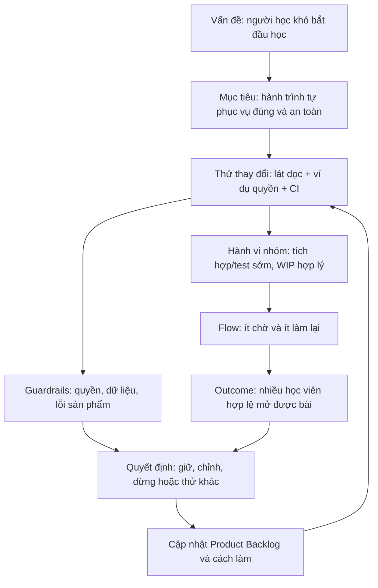
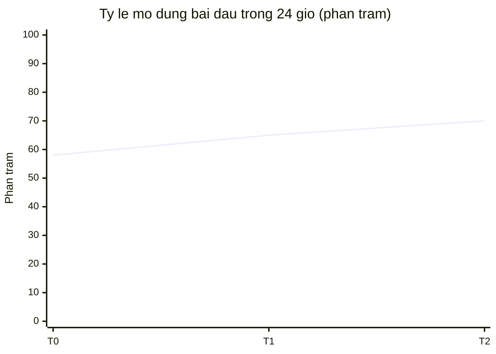
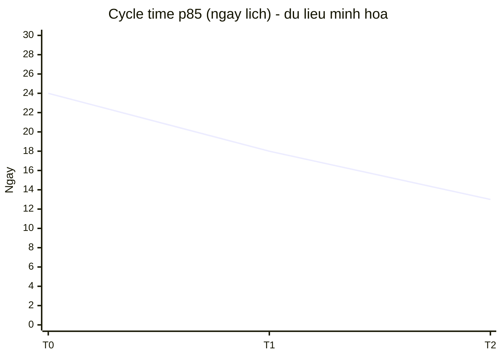

# Theo dõi tiến triển bằng kết quả thực tế của nhóm và sản phẩm

## Mục tiêu học tập

Sau bài học này, bạn có thể:

- Giải thích **tiến triển chuyển đổi Agile** khác gì với việc **triển khai nghi thức Agile** như Daily Scrum, bảng Kanban, story points hoặc một công cụ quản lý mới.
- Thiết kế một cách theo dõi dựa trên **giá trị người dùng, chất lượng sản phẩm, năng lực giao hàng và sức khỏe hợp tác của nhóm**.
- Phân biệt **activity, output, outcome và impact**; tránh gọi số lượng cuộc họp, số ticket Done hoặc số lần deploy là kết quả cuối cùng.
- Chọn **baseline, đối tượng đo, mẫu số, cửa sổ thời gian, phân đoạn, tín hiệu bảo vệ (guardrails)** và xác định giới hạn của dữ liệu.
- Sử dụng có điều kiện những khái niệm từ **Evidence-Based Management (EBM), các thước đo DORA, Kanban flow metrics** và Scrum để ra quyết định.
- Viết **giả thuyết cải tiến**, thiết kế thử nghiệm nhỏ, nhận phản hồi và quyết định tiếp tục, điều chỉnh hay dừng.
- Giải thích vì sao **velocity, story points, tỷ lệ bận rộn, số chứng chỉ hoặc phần trăm “áp dụng Agile”** không đủ đánh giá một cuộc chuyển đổi.
- Đọc một bộ số liệu ví dụ về **nền tảng học trực tuyến**, phân biệt điều quan sát được với suy luận nhân quả, và báo cáo tiến triển trung thực cho stakeholders.
- Đề xuất cách đo cải tiến ở **cấp nhóm, sản phẩm và tổ chức** mà không biến dữ liệu thành công cụ xếp hạng hoặc gây áp lực che giấu vấn đề.

## 1. Tình huống mở đầu: tổ chức “Agile hơn” nhưng người học vẫn chờ lâu

Một công ty xây nền tảng học Java quyết định **chuyển đổi Agile**. Sau ba tháng, báo cáo nội bộ ghi:

- 100% nhóm đã tạo bảng công việc.
- 90% thành viên đã tham gia khóa học về Scrum.
- Các Sprint đều có Planning, Daily Scrum, Review và Retrospective.
- Số user story “Done” tăng đáng kể.
- Mỗi nhóm đều có biểu đồ burndown.

Tuy nhiên, phía người học và người vận hành cho biết:

1. Người đã ghi danh vẫn phải chờ lâu mới mở được bài.
2. Yêu cầu mở quyền truy cập hoặc sửa tiến độ phải đi qua nhiều nhóm và hàng đợi.
3. Một số lỗi chỉ xuất hiện ở production vì kiểm thử tích hợp bị dồn sát ngày phát hành.
4. Nhóm phát triển thường xuyên phải làm thêm giờ để hoàn thành các cam kết cứng.
5. Stakeholders vẫn không biết bản phát hành tiếp theo sẽ **giải quyết vấn đề người học nào**.

Có thể tổ chức đang **áp dụng các kỹ thuật Agile** nhưng chưa chắc đang **cải thiện năng lực tạo giá trị**.

> **Chuyển đổi Agile tiến triển khi sản phẩm mang lại kết quả tốt hơn và hệ thống làm việc có khả năng học hỏi, thích ứng, giao hàng chất lượng, bền vững hơn — không đơn thuần khi số nghi thức hoặc chỉ số hoạt động tăng.**

### 1.1. Bốn loại bằng chứng không nên nhầm với nhau

| Cấp | Câu hỏi | Ví dụ trong nền tảng học | Giới hạn |
| --- | --- | --- | --- |
| **Activity — hoạt động** | Nhóm đã làm gì? | Tổ chức Sprint Review, khóa Scrum, workshop refinement. | Chứng minh hoạt động diễn ra, không chứng minh hiệu quả. |
| **Output — đầu ra** | Đã tạo/hoàn thành gì? | Có 12 PBI đạt DoD, triển khai API mới, hoàn tất tài liệu. | Có thể chưa được người học sử dụng hoặc chưa tạo giá trị. |
| **Outcome — kết quả gần** | Hành vi/trải nghiệm đã thay đổi ra sao? | Tỷ lệ học viên có quyền mở được bài đầu tăng; thời gian tìm lại bài dở giảm. | Có thể chịu ảnh hưởng yếu tố ngoài thay đổi của nhóm. |
| **Impact — tác động dài hơn** | Kết quả rộng và lâu dài là gì? | Người học duy trì học tập tốt hơn, ít phải nhờ hỗ trợ, trải nghiệm đáng tin hơn. | Khó quy hoàn toàn cho một tính năng hoặc một Sprint. |

**Hoạt động và đầu ra không xấu**: chúng là điều kiện để thay đổi. Vấn đề là **dùng chúng thay cho bằng chứng outcome và impact**.

### 1.2. Hai câu hỏi chủ đạo

Khi nghe một câu như “Tất cả nhóm đã dùng Scrum”, hãy hỏi:

1. **Sản phẩm:** “Người dùng nhận được gì tốt hơn, nhanh hơn hoặc an toàn hơn?”
2. **Nhóm:** “Chúng ta có khả năng giao Increment hữu dụng, học từ phản hồi và đổi hướng với ít rủi ro hơn không?”

Nếu không trả lời được, cần tiếp tục quan sát, không vội tuyên bố chuyển đổi thành công.

## 2. Tiến triển chuyển đổi Agile là tiến triển của hệ thống tạo giá trị

**Chuyển đổi Agile** là thay đổi cách tổ chức **xác định giá trị, phối hợp, ra quyết định, xây dựng, kiểm chứng, phát hành và học hỏi**. Nó không có một trạng thái “Agile 100%” áp dụng đồng đều cho mọi tổ chức.

Một đội có thể cải thiện đáng kể khi:

- Giao một **lát giá trị nhỏ có thể sử dụng** sớm hơn.
- Làm rõ nhu cầu với người dùng trước khi viết hàng tháng mã không được kiểm chứng.
- Giảm phụ thuộc và thời gian chờ ở hàng đợi.
- Phát hiện lỗi quyền/dữ liệu trong CI thay vì sau release.
- Thấy sớm rằng một giả thuyết sản phẩm sai và **dừng đầu tư**.
- Có quyết định ưu tiên rõ và năng lực xử lý trở ngại ngoài quyền đội.
- Duy trì chất lượng và tốc độ làm việc **không dựa vào kiệt sức**.

Những thay đổi ấy có thể đạt bằng thực hành Scrum, Kanban, XP, Lean, DevOps hoặc kết hợp phù hợp. **Tên mô hình không phải kết quả cần tối ưu**.

### 2.1. Năm góc nhìn cân bằng

| Góc nhìn | Kết quả mong muốn | Ví dụ câu hỏi đo |
| --- | --- | --- |
| **Giá trị người dùng/sản phẩm** | Người dùng giải quyết vấn đề thật. | Bao nhiêu học viên hợp lệ bắt đầu học thành công? |
| **Flow và khả năng giao hàng** | Công việc tạo giá trị đi qua hệ thống ít chờ, có thể dự báo hơn. | PBI nằm chờ bao lâu, WIP có giảm không? |
| **Chất lượng và độ tin cậy** | Thay đổi an toàn, dữ liệu/quyền được bảo vệ. | Lỗi quyền, lỗi tiến độ và sự cố sau release ra sao? |
| **Học hỏi và thích nghi** | Giả thuyết được kiểm tra nhanh và backlog đổi theo bằng chứng. | Bao lâu từ feedback tới quyết định và thí nghiệm tiếp? |
| **Năng lực tổ chức và tính bền vững** | Quyết định đúng cấp, phụ thuộc được tháo, nhịp làm việc có thể duy trì. | Việc chờ phê duyệt và gián đoạn ngoài kế hoạch có giảm không? |

Không có lý do đưa **tất cả** chỉ số vào một dashboard. Mỗi góc nhìn có thể có một vài tín hiệu **đủ để phục vụ quyết định trong bối cảnh thật**.

### 2.2. Không có một công thức chung cho mọi đội

Một đội vận hành xử lý yêu cầu phát sinh liên tục có thể cần **work item age, thời gian phản ứng, độ ổn định dịch vụ**. Một đội nghiên cứu sản phẩm mới có thể ưu tiên **thời gian kiểm chứng giả thuyết và tín hiệu sử dụng**. Một đội bảo vệ dữ liệu học viên phải đặt **quyền, độ đúng và khả năng khôi phục** lên hàng đầu.

Áp một bảng KPI giống nhau lên các nhóm không cùng loại công việc có thể làm giảm minh bạch và dẫn tới tối ưu số liệu.

## 3. Thiết kế phép đo từ mục tiêu sản phẩm, không từ dashboard có sẵn

Một câu hỏi tốt đi từ **vấn đề → giả thuyết → thay đổi → tín hiệu → quyết định**.

### 3.1. Ví dụ chọn hướng chuyển đổi

Mục tiêu sản phẩm:

> “Học viên đủ điều kiện có thể tự ghi danh và bắt đầu bài học đầu tiên an toàn, không cần hỗ trợ thủ công.”

Vấn đề quan sát:

> “Nhiều học viên đủ điều kiện bỏ cuộc trước khi mở được bài đầu, còn các yêu cầu sửa lỗi quyền phải chờ nhiều nhóm.”

Giả thuyết cải tiến:

> “Nếu Product Owner và Developers chia công việc thành lát dọc, làm rõ quyền bằng ví dụ sớm và kiểm thử tích hợp thường xuyên, thì hành trình bắt đầu học có thể hoạt động ổn định hơn, đồng thời thời gian từ yêu cầu tới Increment đạt DoD giảm.”

Tín hiệu cần nhìn:

- **Outcome sản phẩm:** tỷ lệ học viên đủ điều kiện hoàn tất hành trình “ghi danh → mở bài đầu”.
- **Flow:** cycle time của lát giá trị, tuổi PBI bị chặn, mức WIP và thời gian chờ liên nhóm.
- **Chất lượng:** lỗi quyền, sai tiến độ, lỗi phát hiện sau phát hành.
- **Hành vi đội:** số lát dọc được kiểm chứng với người dùng, thời điểm test tích hợp bắt đầu.
- **Guardrails:** không tăng quyền truy cập trái phép, mất dữ liệu hoặc áp lực làm thêm kéo dài.

**Không xem số story points Done là proxy trực tiếp của hành trình học viên thành công**.

### 3.2. Một chuỗi giả thuyết về cách thay đổi tạo kết quả



Đây là **mô hình giả thuyết**, không phải bằng chứng rằng C gây ra F. Có thể đồng thời thay đổi marketing, đối tượng người học, chính sách ghi danh hoặc thiết bị sử dụng. Phải kiểm tra dữ liệu, các yếu tố khác và giới hạn suy luận.

### 3.3. Cùng một metric có thể phục vụ hai mục tiêu khác nhau

**Thời gian cycle time giảm** có thể giúp người học nhận tính năng sớm hơn, nhưng nếu đội làm việc bằng cách bỏ test, tăng lỗi sau release thì đây **không phải cải tiến cân bằng**.

Ngược lại, một tuần cycle time tăng vì đội phát hiện và sửa sớm lỗ hổng quyền có thể là **đầu tư chất lượng cần thiết**. Cần đọc **nguyên nhân, chất lượng và kết quả**, không chỉ đường đi xuống của một biểu đồ.

## 4. Đo giá trị sản phẩm bằng hành trình và outcome

### 4.1. Định nghĩa kết quả qua hành vi người dùng

Với nền tảng học trực tuyến, có thể chọn một hành trình:

```text
Đến trang khóa
    → Có đủ điều kiện/được xác thực
    → Ghi danh hợp lệ
    → Được cấp quyền đúng
    → Mở bài đầu
    → Học và lưu được tiến độ
    → Quay lại tiếp tục học
```

Mỗi bước cần có định nghĩa rõ:

- **Đối tượng:** ai thuộc mẫu đo?
- **Sự kiện:** hành vi nào được ghi nhận là thành công?
- **Cửa sổ:** sau ghi danh bao lâu được tính?
- **Ngoại lệ:** ai không đủ quyền, khóa nào không nằm trong phạm vi?
- **Nguồn dữ liệu:** telemetry, DB, synthetic journey, phỏng vấn hay hỗ trợ?
- **Bảo vệ riêng tư:** dữ liệu nào cần thu, dữ liệu nào không cần?
- **Ý nghĩa:** sự kiện cho thấy **hành vi đúng**, hay chỉ một HTTP 200?

### 4.2. Tỷ lệ bắt đầu học thành công

Một chỉ số minh họa:

```text
Tỷ lệ bắt đầu học thành công trong 24 giờ =
  Số học viên đủ điều kiện mở đúng bài đầu trong 24 giờ sau ghi danh
  -----------------------------------------------------------------
  Số học viên đủ điều kiện được ghi danh trong cùng cohort theo dõi
```

**Từ “đủ điều kiện” phải được chốt trước**: ví dụ tài khoản xác thực, quyền hợp lệ và khóa trong phạm vi thử. Không loại khỏi mẫu số **những người thất bại vì lỗi hệ thống**, rồi báo tỷ lệ thành công cao giả tạo.

Nếu mẫu là **học viên duy nhất**, không dùng **số lượt click** làm tử số. Một người có thể nhấn nhiều lần; hai đại lượng không đồng nhất.

### 4.3. Các outcome sản phẩm có thể chọn

| Giả thuyết giá trị | Một tín hiệu có thể quan sát | Rủi ro diễn giải |
| --- | --- | --- |
| Tự ghi danh dễ hơn. | Tỷ lệ đủ điều kiện hoàn tất ghi danh và mở bài đầu. | Lưu lượng quảng cáo mới có thể thay đổi thành phần mẫu. |
| Tiếp tục học thuận tiện hơn. | Tỷ lệ quay lại mở đúng bài dở; thời gian tìm bài. | Click nút nhiều không tự chứng minh trải nghiệm tốt. |
| Ít phụ thuộc hỗ trợ. | Tỷ lệ ticket liên quan ghi danh trên số lần ghi danh hợp lệ. | Ticket giảm có thể do kênh hỗ trợ khó tìm hơn. |
| Trải nghiệm đáng tin hơn. | Tỷ lệ thao tác đúng, lỗi dữ liệu và sự cố quyền. | HTTP 200 không đủ chứng minh ngữ nghĩa đúng. |
| Học viên nhận giá trị lâu dài. | Hành vi học tiếp, hoàn thành mục tiêu học phù hợp. | Không được suy nguyên nhân từ một thay đổi UI đơn lẻ. |

Không cần chọn mọi tỷ lệ. **Một vài outcome có ý nghĩa gắn trực tiếp mục tiêu** sẽ hữu ích hơn dashboard hàng trăm metric.

### 4.4. Phân đoạn để không che vấn đề của nhóm nhỏ

Một tỷ lệ thành công tổng là 90% có thể che nhóm dùng thiết bị di động cũ chỉ đạt 60%. Phân đoạn có thể xét:

- Trình duyệt/thiết bị và điều kiện mạng phù hợp.
- Người mới và người quay lại.
- Khóa miễn phí và khóa có phí nếu hành trình khác nhau.
- Phiên bản ứng dụng và **cohort rollout**.
- Người dùng ở những trạng thái quyền khác nhau.

Chỉ thu thập phân đoạn **cần thiết, được phép và bảo vệ riêng tư**. Đừng dùng email hoặc thông tin định danh làm nhãn metric có cardinality vô hạn.

## 5. Đo khả năng tạo Increment bằng flow, không phải “ai bận hơn”

Một hệ thống Agile lành mạnh cần nhìn **công việc đi qua luồng từ bắt đầu tới Done**.

### 5.1. Bốn Kanban flow metrics thiết yếu

| Thước đo | Định nghĩa thực dụng | Câu hỏi giúp trả lời |
| --- | --- | --- |
| **WIP (Work in Progress)** | Số hạng mục đã bắt đầu nhưng chưa hoàn tất tại một thời điểm, theo workflow được định nghĩa. | Có quá nhiều việc đang làm dở không? |
| **Work item age** | Thời gian đã trôi qua của một hạng mục đang thực hiện kể từ mốc Started. | Hạng mục nào đang già, cần hỗ trợ? |
| **Cycle time** | Thời gian từ Started đến Finished của một hạng mục đã Done. | Những hạng mục hoàn tất mất bao lâu? |
| **Throughput** | Số hạng mục Done trong một đơn vị thời gian. | Hệ thống hoàn tất bao nhiêu hạng mục trong kỳ? |

Đây là nhóm thước đo theo **The Kanban Guide**, nếu đội dùng Kanban cần làm rõ **Definition of Workflow (DoW), các điểm Start/Finish và chính sách WIP**.

### 5.2. Cycle time khác lead time nào?

Tùy bối cảnh, thuật ngữ **lead time** có thể bắt đầu từ lúc khách hàng yêu cầu, lúc ý tưởng được chấp nhận hoặc lúc mã được commit. Do đó phải nêu rõ:

```text
Customer-request lead time =
  thời điểm khả năng tới tay người dùng - thời điểm nhu cầu được ghi nhận

Work item cycle time =
  thời điểm PBI đạt Done - thời điểm PBI bắt đầu trong workflow

Change lead time (một định nghĩa đo giao phần mềm) =
  thời điểm thay đổi được triển khai - mốc nguồn mã đã định nghĩa
```

Ba phép đo này có thể khác nhau **rất nhiều**. Không so sánh số “lead time” giữa các đội nếu điểm bắt đầu/kết thúc không giống nhau.

### 5.3. Tránh hiểu sai throughput hoặc cycle time

Một đội chia mỗi PBI thành hai ticket thì throughput có thể tăng dù không thêm giá trị. Một đội chỉ chọn việc rất nhỏ có thể giảm cycle time nhưng bỏ hạng mục rủi ro cao.

Phải kiểm tra:

- Loại và kích thước hạng mục có thay đổi?
- Có việc làm lại, lỗi nghiêm trọng hoặc test bị hoãn?
- Ranh giới Done có còn nhất quán?
- WIP đã chuyển sang hàng đợi không được đo?
- Việc đến có biến động theo tuần hoặc theo mùa?

**Flow metrics là tín hiệu để điều tra hệ thống**, không phải bảng chấm điểm cá nhân.

### 5.4. Nhìn phân bố thay vì chỉ trung bình

Nếu cycle time của 9 PBI nhỏ là 2 ngày và một PBI bị chặn mất 32 ngày, **trung bình** có thể che nhiều điều. Xem **trung vị, phân vị cao như p85 hoặc p95, độ phân tán và các hạng mục già** giúp hiểu rủi ro dự báo.

Một đội có median 7 ngày nhưng p85 23 ngày có thể có **đuôi dài** do phụ thuộc hoặc kiểm thử. Việc cải thiện p85 có thể có giá trị hơn việc giảm median thêm nửa ngày.

**Cần đủ mẫu và định nghĩa ổn định** mới diễn giải được các phân vị; p85 với vài hạng mục không nên coi là cam kết xác suất.

## 6. Đo chất lượng và an toàn cùng tiến độ

Một cuộc chuyển đổi không được xem là tiến triển nếu làm nhanh hơn bằng cách **giảm chất lượng bắt buộc**.

### 6.1. Những kết quả cần giữ

- **Correctness:** quyền, tiến độ và các quy tắc nghiệp vụ được áp dụng đúng.
- **Reliability:** người học có thể sử dụng dịch vụ trong điều kiện phù hợp.
- **Security/privacy:** không mở nội dung riêng trái phép hoặc tiết lộ dữ liệu.
- **Maintainability:** có thể thay đổi hệ thống mà không gây hàng loạt lỗi dây chuyền.
- **Recoverability:** có khả năng giảm tác động, phục hồi dịch vụ và dữ liệu khi có sự cố.
- **Accessibility:** người học thuộc các nhóm nhu cầu khác nhau có thể sử dụng theo tiêu chí áp dụng.
- **Sustainable pace:** đội không phụ thuộc vào làm thêm kéo dài để giữ một đường KPI đẹp.

### 6.2. Bộ guardrails minh họa

| Mục tiêu tốc độ/giá trị | Guardrail phải nhìn cùng |
| --- | --- |
| Giảm thời gian mở bài sau ghi danh. | Không tăng trường hợp mở bài trái quyền, lỗi phân quyền và dữ liệu sai. |
| Tăng tần suất deploy. | Theo dõi sự cố do thay đổi, thời gian giảm tác động, kiểm thử và rollout. |
| Giảm cycle time. | DoD vẫn được giữ, lỗi lọt production không tăng bất thường. |
| Tăng throughput. | Không chia nhỏ ticket giả, không che phần công việc đang chờ kiểm thử. |
| Giảm thời gian họp. | Rủi ro/phụ thuộc vẫn được phát hiện sớm, quyết định không bị treo. |
| Giảm thời gian xử lý ticket hỗ trợ. | Không đóng ticket khi người dùng chưa có kết quả thực. |

Một **sự cố bảo mật hoặc mất dữ liệu nghiêm trọng được xác nhận** có thể buộc dừng rollout dù chỉ số trung bình sản phẩm vẫn đẹp. Không lấy “error budget còn dư” làm lý do chấp nhận rủi ro trái chính sách.

### 6.3. Definition of Done bảo vệ ý nghĩa Done

Trong Scrum, **Increment** phải đáp ứng **Definition of Done (DoD)**. Một PBI còn thiếu kiểm thử quyền bắt buộc không được tính là phần Increment hoàn thành chỉ vì code đã merge.

Nếu trong chuyển đổi tổ chức giảm DoD để tăng velocity, con số Done có thể tăng nhưng **sự tin cậy của người dùng giảm**. Cần theo dõi **cách định nghĩa Done** và sự thay đổi chất lượng theo thời gian.

### 6.4. Không suy từ “không có lỗi được ghi nhận” là “không có lỗi”

Lỗi có thể chưa được phát hiện vì:

- Chưa có telemetry cho hành vi sai nhưng HTTP trả 200.
- Học viên không biết gửi phản hồi hoặc ticket khó tìm.
- Một cohort hiếm chưa sử dụng tính năng.
- Kiểm thử không bao phủ tình huống nhiều thiết bị.
- Quy trình phân loại incident thay đổi.

**Chất lượng phép đo** và khả năng quan sát cần được đánh giá cùng số lỗi.

## 7. Đo khả năng học và phản hồi, không chỉ tốc độ xây dựng

Một đội có thể giao nhiều tính năng nhưng tiếp tục xây theo giả định sai. Tiến triển Agile còn gồm **năng lực học sớm và điều chỉnh quyết định**.

### 7.1. Một vòng học hỏi có thể quan sát

```text
Vấn đề người dùng
  → Giả thuyết
  → Lát sản phẩm/experiment nhỏ
  → Kiểm chứng hành vi và chất lượng
  → Quan sát khách hàng
  → Quyết định: tiếp tục / đổi / dừng
  → Cập nhật Product Backlog
```

Một đội có thể đo:

- Thời gian từ **feedback đáng tin** tới quyết định sản phẩm.
- Tỷ lệ giả thuyết quan trọng có **tiêu chí kiểm chứng rõ trước khi làm**.
- Số lần đội **đổi ưu tiên có căn cứ** khi phát hiện nhu cầu khác.
- Công việc làm lại do **hiểu sai yêu cầu** hoặc thiếu kiểm chứng sớm.
- Tính hữu ích của Review và thử nghiệm: có ảnh hưởng **thực tới backlog** không?

Không biến những số này thành KPI “càng nhiều thí nghiệm càng tốt”. Một giả thuyết rủi ro được làm rõ sâu có thể đáng giá hơn hàng chục thử nghiệm hời hợt.

### 7.2. Sprint Review không chỉ là demo output

Scrum Guide mô tả Sprint Review là cơ hội **kiểm tra kết quả Sprint và xác định thích nghi tương lai** với stakeholders.

Nếu Review chỉ trình bày % task Done mà không xem Increment chạy được, thay đổi bối cảnh, tình hình Product Goal hoặc feedback, đội có thể đang **thực hiện nghi thức nhưng ít học hỏi**.

Một tín hiệu có ý nghĩa hơn số buổi Review là: **quyết định backlog có được làm rõ bởi bằng chứng và phản hồi** hay không.

### 7.3. Retrospective cần đi qua hành động

Một Scrum Team có thể tổ chức Retrospective đều nhưng hành động cải tiến luôn bị bỏ quên.

Theo dõi tốt hơn:

1. Vấn đề cần cải thiện đã được mô tả bằng bằng chứng?
2. Có thử nghiệm/điều chỉnh cụ thể nào được chọn?
3. Có owner thúc đẩy, năng lực và mốc xem lại?
4. Đội đã thử làm khác đi?
5. Sau thử nghiệm, có bằng chứng để **giữ, điều chỉnh, dừng**?

**Đếm số sticky notes không thay được vòng học hỏi này.**

## 8. Evidence-Based Management (EBM) hỗ trợ nhìn tiến triển ra sao?

**Evidence-Based Management** do Scrum.org giới thiệu là một cách hướng tới mục tiêu và cải tiến bằng **bằng chứng thực nghiệm**, tránh chỉ đo đầu ra nội bộ.

EBM thảo luận bốn **Key Value Areas (KVA)**:

| KVA | Câu hỏi | Ví dụ cách nhìn trong nền tảng học |
| --- | --- | --- |
| **Current Value (CV)** | Sản phẩm hiện tạo được giá trị gì cho người dùng và stakeholders? | Người học đủ điều kiện có mở được bài và tiếp tục học đúng không? |
| **Unrealized Value (UV)** | Còn cơ hội/nhu cầu giá trị nào chưa được đáp ứng? | Có nhóm học viên cần hỗ trợ tiếp cận, luồng học thử chưa được đáp ứng? |
| **Time-to-Market (T2M)** | Khả năng giao thay đổi và tiếp nhận phản hồi nhanh thế nào? | Thời gian từ một giả thuyết tới lát sản phẩm được kiểm chứng. |
| **Ability-to-Innovate (A2I)** | Điều gì cản trở năng lực tạo giá trị mới? | Nợ kỹ thuật, hỗ trợ sự cố, phụ thuộc, thời gian chờ môi trường, WIP cao. |

Đây là **một khung tham khảo**, không phải một tập KPI cứng hay yêu cầu mọi tổ chức phải mua công cụ EBM. Bốn KVA giúp tránh **chỉ nhìn delivery và quên giá trị**.

### 8.1. EBM và mục tiêu có thể kiểm chứng

Thay vì chiến lược chung chung:

> “Trở thành tổ chức Agile hàng đầu trong sáu tháng.”

Có thể chọn mục tiêu trung gian có thể đánh giá:

> “Trong kỳ thử nghiệm đã xác định, tăng tỷ lệ học viên đủ điều kiện mở thành công bài đầu trong vòng 24 giờ, trong khi duy trì quyền và dữ liệu an toàn; giảm thời gian chờ của lát giá trị xuyên nhóm.”

Cần nói rõ **baseline, ngưỡng mục tiêu do tổ chức chọn, cách đo, chủ sở hữu quyết định và mốc xem lại**. Nếu dữ liệu mới cho thấy giả định sai, hãy điều chỉnh cách làm, không làm đẹp số.

### 8.2. Không biến KVA thành bốn điểm số xếp hạng đội

Current Value của sản phẩm học trực tuyến không cùng định nghĩa với một dịch vụ nền tảng. Ability-to-Innovate của một đội đang khắc phục nợ bảo mật cần đọc trong bối cảnh khác với đội thử sản phẩm mới.

**Không cộng bốn KVA thành một “Agile Score = 87/100” không có cơ sở** rồi dùng nó để so sánh nhóm.

## 9. DORA: nhìn năng lực giao thay đổi mà không đồng nhất với giá trị

Các nghiên cứu và hướng dẫn của **DORA** tập trung vào hiệu năng giao phần mềm và năng lực tổ chức. Các phép đo thường được bàn luận gồm:

- **Thời gian đưa thay đổi tới môi trường phục vụ** theo mốc được định nghĩa.
- **Tần suất triển khai (deployment frequency)**.
- **Tỷ lệ thay đổi gây lỗi/sự cố (change failure rate)** hoặc các tín hiệu về độ ổn định.
- **Thời gian khôi phục dịch vụ/giảm tác động** khi thay đổi gây vấn đề.
- **Lượng làm lại do sự cố/phần mềm lỗi**, khi đội có định nghĩa và dữ liệu tương ứng.

Các phiên bản hướng dẫn DORA có thể thay đổi cách gọi và phân nhóm chỉ số. Khi dùng trong tổ chức, cần dựa vào **phiên bản hướng dẫn được chọn, định nghĩa dữ liệu và bối cảnh vận hành**, không sao chép tên một metric rồi đo tùy ý.

### 9.1. Vì sao deployment frequency tăng chưa đủ?

Giả sử đội chuyển từ deploy hai tuần một lần sang nhiều lần mỗi tuần. Đây có thể là dấu hiệu pipeline và phối hợp được cải thiện, nhưng:

- Có phát hành **Increment chất lượng** hay chỉ thay cấu hình vô nghĩa?
- Tần suất deploy tăng có làm **change failure rate** hoặc sự cố dữ liệu tăng?
- Có khách hàng sử dụng được hành vi tốt hơn?
- Có khả năng rollback/roll-forward và quan sát đủ để giảm tác động?
- Việc giao thường xuyên có **bền vững**, hay dựa vào làm thêm liên tục?

**Không “đặt chỉ tiêu phải deploy hằng ngày” cho một đội có rủi ro chưa kiểm soát** mà bỏ qua chất lượng và giá trị.

### 9.2. Định nghĩa thời gian khôi phục rõ hơn một từ “MTTR”

Chữ `MTTR` có thể được hiểu khác nhau: thời gian phát hiện, khắc phục, sửa chữa hoặc phục hồi tùy tổ chức. Nên nêu rõ:

```text
T0 = thời điểm ảnh hưởng thực tế bắt đầu (nếu xác định được)
T1 = thời điểm phát hiện / nhận cảnh báo đáng tin
T2 = thời điểm giảm tác động / khôi phục dịch vụ chấp nhận được
T3 = thời điểm sửa nguyên nhân bền vững và đóng hành động liên quan
```

Nếu chỉ đo `T3 - T1` mà không theo dõi **ảnh hưởng người dùng trước T1**, có thể bỏ qua thời gian phát hiện chậm. Nếu API hoạt động lại nhưng dữ liệu tiến độ vẫn sai, **không nên tuyên bố khôi phục hoàn toàn** chỉ vì HTTP 200 tăng.

### 9.3. DORA và flow metrics bổ sung nhau

Một đội có **deployment frequency tốt** nhưng PBI chờ Product Owner làm rõ hàng tuần thì vấn đề nằm **trước khâu triển khai**. Ngược lại, cycle time code ngắn nhưng rollout bị chặn lâu do chính sách hoặc môi trường thì cần nhìn **cả dòng từ nhu cầu tới người dùng**.

Đừng dùng một nhóm chỉ số thay thế mọi góc nhìn. **Kết nối delivery, flow, chất lượng và outcome** mới giúp hiểu nơi cần cải tiến.

## 10. Thiết lập baseline và chất lượng dữ liệu trước khi tuyên bố tiến bộ

**Baseline** là tình trạng làm mốc đối chiếu trước hoặc lúc bắt đầu một thay đổi có chủ đích. Nó cần đủ rõ để tránh “đo sau rồi chọn lại mốc cho kết quả đẹp”.

### 10.1. Một từ điển chỉ số tối thiểu

| Trường | Cần ghi điều gì? |
| --- | --- |
| **Tên chỉ số** | Ví dụ: “Tỷ lệ mở bài đầu hợp lệ trong 24 giờ”. |
| **Câu hỏi quyết định** | Đội cần biết điều gì để chọn bước tiếp? |
| **Định nghĩa tử số/mẫu số** | Ai được tính, sự kiện nào được coi là thành công? |
| **Đơn vị và ranh giới thời gian** | Người học duy nhất, lượt thao tác, PBI, ngày lịch/giờ làm việc? |
| **Nguồn dữ liệu** | Sự kiện sản phẩm, ticket, workflow, CI, release, khảo sát? |
| **Phân đoạn quan trọng** | Loại khóa, cohort, thiết bị, version nếu cần. |
| **Tần suất và chủ sở hữu đo** | Ai kiểm tra chất lượng dữ liệu và khi nào ra quyết định? |
| **Guardrail** | Lỗi nào buộc điều tra/dừng? |
| **Giới hạn và yếu tố gây nhiễu** | Mẫu nhỏ, sự kiện thiếu, thay đổi chính sách, mùa vụ? |
| **Điều kiện xem lại** | Khi định nghĩa thay đổi hoặc mục tiêu không còn phù hợp. |

Nếu một số liệu không có **định nghĩa mẫu số**, so sánh qua thời gian có thể vô nghĩa.

### 10.2. Những sai lệch dữ liệu thường gặp

**Đổi định nghĩa Done:** trước tính khi code merge, sau tính khi đã test tích hợp. Cycle time tăng không nhất thiết hiệu quả kém hơn; **mốc kết thúc đã thay đổi**.

**Đổi cách ghi dữ liệu:** trước không ghi lỗi quyền nhưng sau có logging tốt hơn. Số lỗi tăng có thể vì **khả năng phát hiện tốt hơn**.

**Đổi cơ cấu người dùng:** chương trình marketing đưa nhiều học viên mới chưa quen công nghệ vào cohort. Tỷ lệ thành công có thể giảm dù giao diện đã cải thiện cho từng phân đoạn.

**Đổi kích cỡ công việc:** chia PBI thành nhiều thẻ nhỏ, throughput tăng nhưng giá trị chưa thay đổi.

**Thiếu dữ liệu trong canary:** không có lỗi với vài thao tác không có nghĩa rủi ro bằng 0.

### 10.3. Cách ứng xử khi baseline yếu

Nếu chưa có telemetry đủ tin cậy:

1. Nói rõ **chưa có baseline đáng tin**, không tự tạo mốc lịch sử.
2. Chọn **một hoặc hai hành trình quan trọng** để đo đúng.
3. Dùng synthetic checks, kiểm tra mẫu và phản hồi trực tiếp khi dữ liệu sản phẩm còn thiếu.
4. Ghi ngày bắt đầu có dữ liệu đáng tin và thay đổi định nghĩa.
5. Chỉ so sánh các kỳ **tương thích về cách đo**, hoặc giải thích vì sao không thể so trực tiếp.

**Năng lực nhìn thấy thực tế là một phần của chuyển đổi Agile.** Không nên phạt đội vì báo “chưa đủ dữ liệu” một cách trung thực.

## 11. Từ baseline tới thử nghiệm: giả thuyết, phạm vi và guardrails

Một sáng kiến “chuyển đổi toàn công ty ngay” thường khó biết thay đổi nào tạo tác dụng. Một cách thực nghiệm hơn là **chọn điểm nghẽn có tác động, thử ở phạm vi kiểm soát được và xem kết quả**.

### 11.1. Mẫu thử nghiệm

```text
Vấn đề quan sát:
- [Hành trình/flow/chất lượng nào đang khó và bằng chứng gì?]

Giả thuyết:
- Nếu chúng ta [đổi hành vi hoặc chính sách X]
- thì [kết quả Y] có thể cải thiện
- bởi vì [cơ chế dự đoán Z].

Phạm vi:
- [Nhóm, lát giá trị, cohort, thời gian thử và ngoại lệ]

Baseline:
- [Định nghĩa metric, kỳ đo và mức quan sát được]

Tín hiệu thay đổi hành vi:
- [Cách biết X đã được làm thực tế, không chỉ đã đào tạo]

Outcome:
- [Cách biết Y tốt hơn trong bối cảnh]

Guardrails:
- [Rủi ro chất lượng, dữ liệu, con người không được đánh đổi]

Thẩm quyền:
- [Ai quyết định, ai hỗ trợ, ai theo dõi?]

Mốc xem lại:
- [Khi đủ bằng chứng hoặc khi có điều kiện dừng]

Quyết định:
- [Duy trì / điều chỉnh / dừng / tìm hiểu thêm]
```

### 11.2. Ví dụ giảm chờ kiểm thử

**Vấn đề:** các PBI gần hoàn tất thường chờ kiểm thử tích hợp nhiều ngày. **Giả thuyết:** nếu Developers hạn chế WIP và chuẩn bị acceptance examples/test API sớm, thì age của PBI chờ kiểm thử và thời gian tạo Increment đạt DoD có thể giảm.

**Thử nghiệm:** một dòng công việc về ghi danh/tiến độ trong hai Sprint, có chính sách kéo việc rõ.

**Tín hiệu:** WIP thực, work item age, cycle time, lỗi lọt production, feedback phối hợp.

**Guardrails:** không giảm DoD, không bỏ kiểm tra quyền hoặc sử dụng làm thêm kéo dài.

**Quyết định:** tiếp tục nếu có lợi và bền vững; điều chỉnh nếu chỉ chuyển điểm nghẽn sang review hoặc DB; dừng nếu làm tăng rủi ro.

Không có mức WIP hay số Sprint “đúng cho mọi đội”; chúng là **phạm vi thử nghiệm có thể sửa theo dữ liệu**.

### 11.3. Bảo vệ quyền dừng khi thử nghiệm gây hại

Một thử nghiệm Agile không có nghĩa thử thay đổi bất chấp rủi ro:

- Phát hiện sai quyền/ghi đè tiến độ: **ngừng mở rộng, giảm tác động, xử lý sự cố theo chính sách**.
- Không có telemetry quan trọng: **không tuyên bố thử nghiệm qua** nếu không có nguồn xác minh phù hợp.
- Có tác dụng phụ tới người dùng/đội: **xem guardrail và điều chỉnh phạm vi**.
- Không đủ mẫu hoặc có sự kiện ngoài lớn: **nêu chưa đủ cơ sở kết luận**, tiếp tục điều tra.

Đây là cách kết hợp **thích nghi nhanh với trách nhiệm bảo vệ chất lượng**.

## 12. Xây một scorecard nhỏ cân bằng sản phẩm và nhóm

**Scorecard** là một cách nhìn nhanh vào các kết quả và tín hiệu cần ra quyết định, không phải bảng xếp hạng những người “Agile tốt nhất”.

### 12.1. Mẫu scorecard cho một dòng giá trị

| Góc nhìn | Câu hỏi quyết định | Metric chính | Tín hiệu hỗ trợ/guardrail |
| --- | --- | --- | --- |
| **Outcome** | Người học đủ điều kiện có bắt đầu học dễ hơn? | Tỷ lệ mở đúng bài đầu trong 24 giờ. | Phản hồi người học, lỗi quyền, kết quả theo thiết bị. |
| **Flow** | Lát giá trị mất bao lâu để đạt DoD? | Phân vị p85 cycle time theo định nghĩa ổn định. | WIP, work item age, phụ thuộc đã bị chặn. |
| **Delivery** | Đội có thể đưa thay đổi nhỏ tới môi trường phục vụ an toàn? | Change lead time theo định nghĩa được chọn. | Sự cố do thay đổi, mức độ phục hồi. |
| **Quality** | Kết quả có chính xác và đáng tin? | Sự cố quyền/tiến độ và lỗi hồi quy theo tác động. | Kiểm thử, telemetry, cách phát hiện và định nghĩa incident. |
| **Learning** | Feedback có dẫn đến quyết định kịp thời? | Thời gian từ feedback đã xác minh đến quyết định backlog. | Chất lượng giả thuyết, mức độ ảnh hưởng quyết định. |
| **Sustainability** | Nhóm có thể duy trì cách làm mới? | Phân bố gián đoạn, việc chờ và phản hồi định tính được bảo vệ. | Không dùng dữ liệu làm thêm/cảm nhận để xếp hạng cá nhân. |

Một nhóm có thể chỉ chọn **một outcome, một flow metric và vài guardrails**, rồi bổ sung tín hiệu khi cần. Việc tạo scorecard không phải bằng chứng tiến triển nếu **không ai dùng nó để quyết định**.

### 12.2. Mỗi chỉ số cần có người chịu trách nhiệm về dữ liệu, không phải “chủ sở hữu con số”

Ví dụ:

- Product Owner và người có hiểu biết sản phẩm làm rõ **ý nghĩa outcome**.
- Developers xác nhận những sự kiện kỹ thuật/nghiệp vụ có thể đo đúng.
- Người kiểm thử và vận hành kiểm tra **chất lượng và độ tin cậy** của tín hiệu.
- Scrum Master có thể giúp đội **đánh giá hiệu quả thực hành và trở ngại**, không biến mình thành người sở hữu toàn bộ dashboard.
- Stakeholders cung cấp mục tiêu và điều kiện ràng buộc; người có thẩm quyền đánh giá rủi ro đưa quyết định tương ứng.

**Không một vai trò nào có thể một mình “nâng KPI”** mà không xem bối cảnh sản phẩm.

### 12.3. Sử dụng scorecard như cuộc đối thoại

Một buổi xem số liệu tốt nên kết thúc bằng:

1. **Điều gì đã quan sát?** Số, mẫu số, kỳ và nguồn.
2. **Điều gì chưa biết?** Những yếu tố ngoài thay đổi, chất lượng dữ liệu.
3. **Điều gì có thể giải thích?** Giả thuyết, không tự coi là nguyên nhân chắc chắn.
4. **Tác động tới mục tiêu?** Giá trị người dùng và rủi ro.
5. **Quyết định nào cần đưa ra?** Tiếp tục, điều chỉnh, dừng hay kiểm chứng thêm.
6. **Ai theo dõi bước kế tiếp?** Người có quyền và mốc xem lại.

Nếu mọi người chỉ cố giải thích vì sao đường màu đỏ chưa chuyển xanh, scorecard đang bị dùng như **công cụ bảo vệ báo cáo**, không phải công cụ học hỏi.

## 13. Ví dụ xuyên suốt: theo dõi thử nghiệm chuyển đổi Agile trên nền tảng học Java

### 13.1. Bối cảnh ban đầu

Một công ty có ba nhóm cùng làm nền tảng học Java:

- **Catalog/Enrollment:** danh mục và ghi danh.
- **Learning Progress:** tiến độ và trạng thái bài học.
- **Learner Experience:** giao diện và điều hướng.

Đội phát hành ít, công việc bàn giao nhiều lượt, và quyền mở bài thường chỉ được kiểm tra đầy đủ khi tích hợp cuối kỳ. Người học đủ điều kiện đôi khi không thể bắt đầu bài đầu.

Tổ chức quyết định **không đánh giá chuyển đổi bằng số nhóm nhận chứng chỉ hay số buổi Daily Scrum**. Họ chọn một dòng giá trị:

> “Học viên đủ điều kiện có thể tự ghi danh và mở đúng bài đầu trong vòng 24 giờ, với quyền và dữ liệu an toàn.”

Nhóm sẽ thử các thay đổi về **lát dọc xuyên nhóm, acceptance examples, kiểm thử tích hợp sớm, giới hạn WIP phù hợp và progressive delivery**.

### 13.2. Ba kỳ đo có định nghĩa minh họa

- **T0 — Baseline:** bốn tuần trước thử nghiệm.
- **T1 — Thử nghiệm vòng 1:** bốn tuần đầu áp dụng một số thay đổi nhỏ.
- **T2 — Thử nghiệm vòng 2:** bốn tuần kế tiếp, nhóm điều chỉnh sau khi xem dữ liệu vòng 1.

Mọi con số dưới đây **hoàn toàn giả định để học cách phân tích**. Chúng không phải cam kết về hiệu quả chuyển đổi, chuẩn ngành hoặc bằng chứng từ một công ty thật.

**Quy tắc đo chính:**

- Mẫu số outcome là **số học viên đủ điều kiện duy nhất** có ghi danh trong kỳ.
- Thành công là học viên **mở đúng bài đầu, với quyền hợp lệ**, trong **24 giờ sau ghi danh**.
- Các kỳ phải theo dõi đầy đủ 24 giờ cho cohort mới nhất trước khi chốt tỷ lệ; nếu dữ liệu còn trễ, đánh dấu **chưa hoàn tất quan sát**.
- Cycle time đo từ **Started tới đạt DoD** cho lát/PBI theo chính sách thống nhất.
- Một “sự cố quyền nghiêm trọng” cần có định nghĩa phân loại và nguồn xác minh nhất quán.

### 13.3. Bảng dữ liệu chính

| Chỉ số | T0 — baseline | T1 — thử 1 | T2 — thử 2 |
| --- | ---: | ---: | ---: |
| Học viên đủ điều kiện được ghi danh trong kỳ | 1.000 | 1.000 | 1.080 |
| Học viên mở đúng bài đầu trong 24 giờ | 580 | 650 | 756 |
| **Tỷ lệ bắt đầu học thành công** | **58%** | **65%** | **70%** |
| Ticket hỗ trợ liên quan hành trình (đếm theo kỳ) | 60 | 48 | 43 |
| **Ticket trên 1.000 học viên đủ điều kiện** | **60** | **48** | **xấp xỉ 39,8** |
| Số PBI/lát đạt DoD dùng cho mẫu cycle time | 24 | 25 | 27 |
| **Cycle time p85** (ngày lịch, theo quy tắc minh họa) | **24 ngày** | **18 ngày** | **13 ngày** |
| WIP quan sát tại cùng thời điểm mỗi ngày, trung vị trong kỳ | 11 | 8 | 6 |
| Trung vị thời gian từ feedback đã phân loại tới quyết định backlog (ngày) | 18 | 12 | 8 |
| Sự cố quyền nghiêm trọng được xác nhận trong kỳ | 2 | 1 | 0 |

Giả định số liệu đã được trích xuất và định nghĩa nhất quán cho mục đích bài tập. Trong thực tế, **nếu không có bằng chứng tính nhất quán thì không được tự áp đặt giả định này**.

### 13.4. Tính toán outcome

Tỷ lệ T0:

```text
580 / 1.000 × 100% = 58%
```

Tỷ lệ T1:

```text
650 / 1.000 × 100% = 65%
```

Tỷ lệ T2:

```text
756 / 1.080 × 100% = 70%
```

So với baseline, outcome T2 cao hơn **12 điểm phần trăm**, tức `70% − 58% = 12` điểm phần trăm.

**12 điểm phần trăm khác với tăng 12%.** Nếu tính tỷ lệ tăng tương đối so với baseline, kết quả là `(70 − 58)/58 ≈ 20,7%`. Hai cách nói có ý nghĩa khác; cần ghi rõ.

Ticket hỗ trợ được chuẩn hóa theo mẫu số:

```text
T0: 60 / 1.000 × 1.000 = 60 ticket trên 1.000 học viên
T1: 48 / 1.000 × 1.000 = 48 ticket trên 1.000 học viên
T2: 43 / 1.080 × 1.000 ≈ 39,8 ticket trên 1.000 học viên
```

Nếu chỉ nhìn số ticket 60 → 43 mà bỏ việc mẫu số T2 có 1.080 học viên, đội có thể diễn giải sai độ lớn thay đổi.

### 13.5. Tính toán flow và những gì chưa thể kết luận

p85 cycle time giảm từ 24 xuống 13 ngày lịch, tức giảm **11 ngày** trong bộ số liệu giả định. WIP trung vị giảm từ 11 xuống 6.

**Những kết luận có thể nói:**

- Trong dữ liệu giả định, thời gian của các lát/PBI hoàn tất có dấu hiệu **giảm** theo một phép đo đã định nghĩa.
- WIP quan sát được có dấu hiệu **thấp hơn**.
- Hành trình bắt đầu học và số ticket chuẩn hóa có dấu hiệu **tốt hơn**.
- Tần suất sự cố quyền nghiêm trọng được ghi nhận **ít hơn trong những kỳ này**.

**Những kết luận chưa được chứng minh:**

- “Agile đã làm tỷ lệ thành công tăng chính xác 12 điểm phần trăm.”
- “Nhóm đã tăng năng suất 45,8% vì p85 giảm 11/24 ngày.”
- “Không còn lỗi quyền nào vì T2 ghi nhận 0 sự cố.”
- “Mọi nhóm nên nhận WIP = 6.”
- “Tổ chức đã đạt 70% mức trưởng thành Agile.”

Cycle time p85 trong mỗi kỳ dựa trên **24–27 hạng mục**, có thể nhạy với cách chọn PBI và phân bố. Số sự cố quyền là **mẫu rất nhỏ**; bằng chứng về độ tin cậy phải bao gồm kiểm thử, observability, cơ chế phát hiện và tác động, không chỉ số đếm.

### 13.6. Ghi thay đổi đã thực sự thực hiện

| Kỳ | Hành vi/cơ chế nhóm thử thay đổi | Bằng chứng áp dụng | Rủi ro chưa rõ |
| --- | --- | --- | --- |
| **T0** | Nhiều PBI làm song song; test tích hợp thường tới muộn. | Bảng workflow, thời điểm test và lịch sử lỗi. | Chất lượng dữ liệu baseline có thể thiếu. |
| **T1** | Thử lát giá trị nhỏ, contract sớm, chạy regression tests trong CI. | PR, test runs, PBI đạt DoD và những phụ thuộc được tháo. | Một số API/client cũ chưa được quan sát đủ. |
| **T2** | Điều chỉnh WIP, pairing/swarming ở điểm chờ kiểm thử; theo dõi canary. | WIP snapshots, lịch sử tích hợp, release records. | Cơ cấu người học và số PBI khác so với T0. |

Đừng viết “đã triển khai Scrum” như mô tả đủ về **hành vi làm việc đã thay đổi**. Cần xem **công việc được kéo, kiểm chứng, hoàn tất và giao giá trị khác đi thế nào**.

### 13.7. Đối chiếu kết quả người dùng

Giả sử vào T2, nhóm khảo sát một số học viên và nhận phản hồi:

> “Tôi dễ mở được bài đầu, nhưng trên điện thoại cũ trang vẫn tải khá chậm.”

Đây là dữ liệu định tính có ích. Nhóm cần phân tích có bao nhiêu người thuộc phân đoạn liên quan, đo thời gian tải theo thiết bị, và **không tuyên bố trải nghiệm đã tốt với mọi người** chỉ vì tỷ lệ tổng tăng.

Product Owner có thể ưu tiên kiểm tra vấn đề di động, trong khi Developers vẫn bảo vệ kiểm thử quyền và dữ liệu. Đó là **thích nghi dựa trên bằng chứng**, không chỉ giữ nguyên roadmap vì các số tổng nhìn đẹp.

## 14. Trực quan hóa kết quả nhưng giữ nguyên ý nghĩa dữ liệu

### 14.1. Biểu đồ outcome theo thời gian



Trục X là ba **kỳ quan sát**, không phải ngày trong một Sprint. Trục Y là **phần trăm học viên đủ điều kiện duy nhất** thành công. Chênh lệch thấy được có ý nghĩa mô tả, nhưng không tự là bằng chứng nhân quả.

### 14.2. Biểu đồ flow trên cùng ba kỳ



Sự kết hợp **outcome tăng và p85 cycle time giảm** là tín hiệu đáng nghiên cứu. Tuy nhiên, nếu số hạng mục và loại công việc khác nhau, p85 có thể đổi vì **thành phần mẫu**.

### 14.3. Vì sao không vẽ một đường tổng “Agile Score”?

Một tổ chức có thể thử cộng:

```text
Agile Score =
  20% tỷ lệ học viên thành công
+ 20% tần suất deploy
+ 20% số buổi Retrospective
+ 20% velocity
+ 20% mức hài lòng nhóm
```

Công thức này **không có cơ sở chung**: đơn vị khác nhau, trọng số tùy tiện, chất lượng dữ liệu khác nhau và động cơ chơi số. Một “điểm tổng” có thể tăng dù lỗi dữ liệu nghiêm trọng xuất hiện.

Tốt hơn là giữ **một số thước đo có ý nghĩa riêng**, mô tả đánh đổi và quyết định cụ thể. Không nên dùng scorecard để che rủi ro bằng phép trung bình.

## 15. Tránh đánh đồng tương quan với nguyên nhân

### 15.1. Những yếu tố gây nhiễu thường gặp

Khi outcome tăng sau khi áp dụng thực hành Agile, còn có thể do:

- Chiến dịch marketing hướng người dùng vào những khóa dễ bắt đầu hơn.
- Đổi chính sách ghi danh hoặc thay tiêu chí “đủ điều kiện”.
- Kênh hỗ trợ mới giải quyết thủ công các trường hợp khó.
- Học kỳ hoặc mùa tuyển sinh làm thay đổi loại người học.
- Thay đổi thiết bị/trình duyệt phổ biến.
- Bổ sung một người có kinh nghiệm tích hợp, không thuộc thay đổi quy trình đã báo.
- Việc theo dõi telemetry tốt hơn khiến dữ liệu chính xác hơn.
- Phần công việc khó bị hoãn, làm cycle time của những PBI đã Done trông ngắn hơn.

Vì thế, **“xảy ra sau” chưa chứng minh “xảy ra do”**.

### 15.2. Có thể dùng nhóm so sánh khi phù hợp

Giả sử hai cohort giả định có dữ liệu:

| Cohort | Trước thay đổi | Sau thay đổi | Chênh lệch |
| --- | ---: | ---: | ---: |
| **Nhóm thử một thay đổi sản phẩm/cách làm** | 58% | 70% | +12 điểm phần trăm |
| **Nhóm tham chiếu không nhận cùng thay đổi** | 60% | 66% | +6 điểm phần trăm |

Một phép so sánh chênh lệch (difference-in-differences) minh họa là:

```text
(70% - 58%) - (66% - 60%)
= 12 điểm phần trăm - 6 điểm phần trăm
= +6 điểm phần trăm
```

**Không được kết luận chắc chắn** thay đổi đã tạo +6 điểm phần trăm nếu thiếu các giả định phù hợp, chẳng hạn diễn biến các nhóm có xu hướng song song khi không có can thiệp, không có ảnh hưởng chéo, định nghĩa đo ổn định và yếu tố khác được xem xét.

Đối với thay đổi **cách làm của đội**, nhóm so sánh thường khó thiết kế sạch: người, backlog, công nghệ và bối cảnh khác nhau. Do đó đây chỉ là **một công cụ suy nghĩ có điều kiện**, không phải yêu cầu biến mọi Retrospective thành nghiên cứu thống kê.

### 15.3. Khi không thể có thử nghiệm kiểm soát tốt

Có thể:

- Ghi các sự kiện lớn ngoài cuộc thử nghiệm theo dòng thời gian.
- Theo dõi **lặp lại nhiều kỳ**, không chỉ so một tuần trước–sau.
- Kết hợp phản hồi định tính và telemetry.
- So sánh **cùng loại công việc và phân đoạn người dùng** khi hợp lý.
- Triangulate: nhiều nguồn bằng chứng có cùng gợi ý hay không?
- Nêu những giả thuyết cạnh tranh và bước cần kiểm chứng tiếp.
- Tránh tuyên bố mức tác động tuyệt đối khi bằng chứng chưa đủ.

**Minh bạch mức bất định là năng lực Agile**, không phải điểm yếu của báo cáo.

## 16. Chọn nhịp theo dõi: hằng ngày, Sprint, theo release và dài hạn

Không phải metric nào cũng cần xem mỗi ngày; không phải outcome nào có thể đổi rõ sau một Sprint.

### 16.1. Các nhịp quan sát khác nhau

| Nhịp | Tín hiệu có thể phù hợp | Quyết định chính |
| --- | --- | --- |
| **Hằng ngày hoặc liên tục** | PBI bị chặn, WIP/age, test fail, sự cố, telemetry guardrails. | Hỗ trợ hoàn tất, giảm tác động, điều chỉnh kỹ thuật và kế hoạch. |
| **Theo Sprint** | Increment đạt DoD, Sprint Goal, phản hồi từ Review, thử nghiệm phối hợp. | Điều chỉnh Sprint Backlog khi cần, ưu tiên và cách làm tiếp. |
| **Sau release/rollout** | Hành trình thật, lỗi quyền/tiến độ, adoption theo cohort, khả năng khôi phục. | Go/pause/rollback, sửa lỗi, cập nhật Product Backlog. |
| **Theo chu kỳ nhiều tuần/tháng** | Xu hướng outcome, phân bố flow, chất lượng, năng lực và chi phí chờ. | Giữ/đổi hướng thử nghiệm cải tiến; tháo nút thắt tổ chức. |
| **Dài hạn hơn** | Giá trị bền vững, khả năng đổi chiến lược, mức nợ kỹ thuật, kết quả khách hàng. | Đánh giá mục tiêu sản phẩm, đầu tư và cơ chế tổ chức. |

Một tổ chức không nên đợi đủ báo cáo quý mới xử lý **lỗi quyền nghiêm trọng**. Ngược lại, không nên đòi **mức hoàn thành học tập dài hạn** phải cải thiện ngay ngày đầu sau thay đổi UI.

### 16.2. Sử dụng tín hiệu dẫn dắt và tín hiệu kết quả

**Leading signals** là các tín hiệu có thể xuất hiện trước outcome mục tiêu trong một giả thuyết hợp lý, chẳng hạn:

- Acceptance examples được làm rõ sớm.
- Contract tests chạy trên thay đổi API.
- WIP và blocked age được nhìn thấy và xử lý.
- Lát nhỏ được tích hợp và tới nhóm thử.

**Lagging signals** là kết quả xuất hiện sau đó:

- Học viên bắt đầu học thành công hơn.
- Ít ticket hỗ trợ và lỗi sản phẩm hơn.
- Thời gian học viên chờ khả năng mới giảm.
- Sản phẩm tiến gần Product Goal hơn.

Một **leading signal không bảo đảm lagging outcome**. Tăng số test có thể vô ích nếu test chỉ lặp điều kiện đã biết mà bỏ rủi ro quan trọng.

### 16.3. Không kiểm soát cả chuyển đổi bằng một mốc “Go Live”

Một cải tiến về chất lượng, quyền tự quản hay flow thường không phải dự án bật công tắc xong là hết. Có thể định kỳ xem:

- Thử nghiệm nào đã có bằng chứng?
- Quyết định nào được sửa theo học hỏi mới?
- Chính sách nào trở thành thói quen thực tế?
- Rủi ro nào vẫn chưa thể chấp nhận?
- Giới hạn tổ chức nào cần hỗ trợ cấp trên?
- Chỉ số nào đã mất ý nghĩa hoặc tạo hành vi không mong muốn?

**Chuyển đổi tiến triển bằng năng lực thích nghi liên tục**, không chỉ ngày hoàn tất triển khai một bộ quy trình.

## 17. Đọc tiến triển trong Scrum, Kanban, XP, Lean và DevOps

### 17.1. Scrum: kiểm tra mục tiêu và Increment, không chấm điểm nghi thức

Các liên hệ trong Scrum Guide 2020:

| Thành phần | Bằng chứng có ý nghĩa |
| --- | --- |
| **Product Goal** | Sản phẩm có tiến về trạng thái giá trị mong muốn, với feedback và outcome phù hợp? |
| **Product Backlog** | Có được sắp xếp và điều chỉnh theo mục tiêu/bằng chứng mới? |
| **Sprint Goal** | Scrum Team có tạo một kết quả nhất quán cần cho mục tiêu Sprint? |
| **Increment + Definition of Done** | Có phần mềm hữu dụng đạt chuẩn chất lượng và tích hợp? |
| **Sprint Review** | Kiểm tra kết quả và thích nghi Product Backlog cùng stakeholders? |
| **Sprint Retrospective** | Có cải tiến chất lượng/hiệu quả được đưa vào cách làm và kiểm chứng? |
| **Daily Scrum** | Developers có thanh tra tiến độ tới Sprint Goal và điều chỉnh kế hoạch? |

**Không có yêu cầu Scrum Guide** rằng phải dùng story points, velocity, burndown hoặc đúng một dashboard chuyển đổi. Scrum Master giúp Scrum Team và tổ chức cải thiện hiệu quả Scrum, nhưng **không sở hữu một con số “maturity” đại diện cho mọi người**.

### 17.2. Kanban: xem dòng công việc thật

Nếu tổ chức áp dụng Kanban hoặc thực hành Kanban cùng Scrum:

- Minh bạch **workflow và chính sách**.
- Theo dõi **WIP, throughput, cycle time, work item age**.
- Nhận diện trạng thái chờ và nút thắt.
- Điều chỉnh chính sách kéo việc và ưu tiên hoàn tất.
- Dùng dữ liệu lịch sử và **Service Level Expectation (SLE)** phù hợp để thảo luận mức độ dự báo.

Một bảng có cột `To Do / Doing / Done` **không tự chứng minh flow tốt hơn**. Cần xem thời gian chờ và việc thật sự hoàn tất.

### 17.3. XP: chất lượng kỹ thuật giúp thích nghi

Các thực hành như **Test-Driven Development (TDD), Continuous Integration, pair programming, refactoring và thiết kế đơn giản** có thể tăng khả năng thay đổi an toàn.

Đo tác động của việc áp dụng thực hành bằng:

- Lỗi được phát hiện sớm hơn ở đâu?
- Thời gian từ thay đổi mã tới phản hồi test có giảm?
- Mức làm lại vì tích hợp hoặc lỗi hồi quy có giảm?
- Khi thêm một hành vi mới, đội có thể điều chỉnh mà không phá phần trước?
- Các phần mềm được phát hành có giữ DoD và chất lượng?

**Đếm số test hoặc số giờ pairing** chỉ là tín hiệu hoạt động, không tự là kết quả.

### 17.4. Lean và DevOps: tối ưu toàn dòng giá trị

**Lean** khuyến khích xem lãng phí và hàng đợi trên toàn dòng từ nhu cầu tới khách hàng. **DevOps** nhấn mạnh khả năng phối hợp, giao thay đổi, vận hành, quan sát và phản hồi.

Nếu nhóm phát triển tăng tốc viết mã nhưng:

- Phê duyệt môi trường mất ba tuần.
- Kiểm thử tích hợp phụ thuộc một người.
- Triển khai chỉ có thể thực hiện vào đêm cuối tháng.
- Không có telemetry sau release.

...thì khả năng tạo giá trị vẫn bị giới hạn. Cải tiến cần **nhìn tới ranh giới tổ chức**, không chỉ một đội.

## 18. Theo dõi chuyển đổi ở nhiều nhóm và cấp tổ chức

### 18.1. Không xếp hạng các nhóm bằng velocity

Story points là thang ước lượng tương đối theo **bối cảnh và quy ước nội bộ**. Nhóm A hoàn thành 60 điểm không chứng minh hiệu quả hơn nhóm B hoàn thành 30 điểm.

Nếu một nhóm xử lý rủi ro dữ liệu khó, số points hoặc throughput có thể thấp nhưng lại bảo vệ giá trị sản phẩm lớn. So sánh thô có thể khiến mọi người:

- Tăng điểm ước lượng mà không đổi thực tế.
- Chia ticket để tăng throughput.
- Chọn việc dễ và tránh việc cần phối hợp.
- Đóng PBI trước DoD.
- Che blocker, sự cố hoặc nợ kỹ thuật.

### 18.2. Khi nào cần theo dõi kết quả liên nhóm?

Nếu nhiều Scrum Team cùng làm **một sản phẩm**, Scrum Guide xác định các đội đó cùng chia sẻ **Product Goal, Product Backlog, Product Owner**, và cùng xác định, tuân thủ **Definition of Done chung**.

Điều đó giúp tránh một tình huống:

- Nhóm Catalog Done 12 PBI.
- Nhóm Progress Done 10 PBI.
- Nhóm Web Done 14 PBI.
- Nhưng người học **chưa thể mở trọn một hành trình có quyền hợp lệ**.

Theo dõi tiến triển nên bao gồm **Increment tích hợp, outcome người dùng và phụ thuộc end-to-end**. Không chỉ cộng số Done của từng silo.

### 18.3. Đo trở ngại tổ chức mà đội không tự giải quyết

Ví dụ:

| Trở ngại | Tín hiệu | Người cần cùng quyết định |
| --- | --- | --- |
| Phê duyệt môi trường thử quá lâu. | Thời gian chờ cấp quyền/môi trường, số PBI bị chặn. | Kỹ thuật, vận hành, an toàn, người có thẩm quyền quy trình. |
| Nhiều ưu tiên xung đột. | Số lần thay ưu tiên làm hỏng mục tiêu, việc bị ngắt không lý do rõ. | Product Owner, stakeholders và người điều phối danh mục. |
| Phụ thuộc kiến trúc khó tháo. | Cycle time xuyên nhóm, số lần contract phá vỡ, tuổi phụ thuộc. | Developers, người chịu trách nhiệm hệ thống liên quan. |
| Trực vận hành làm gián đoạn liên tục. | Phân bố công việc đột xuất, lỗi tái phát, khả năng khôi phục. | Nhóm vận hành, sản phẩm, người quyết định đầu tư chất lượng. |
| Cải tiến bị bỏ quên. | Số hành động có bước tiếp, mức blocked và bằng chứng sau thử nghiệm. | Scrum Team và bên có quyền tháo trở ngại. |

Một đội tự quản **không có nghĩa tự miễn trừ mọi quy định hoặc phải giải quyết ràng buộc ngoài thẩm quyền**. Kết quả chuyển đổi còn thể hiện ở việc tổ chức **tháo rào cản bằng quyết định và hỗ trợ thật**.

### 18.4. Không ép mọi bộ phận có cùng Sprint hoặc “mức Agile”

Một nhóm hỗ trợ nhận công việc liên tục có thể dùng Kanban; nhóm phát triển dùng Scrum với XP; nhóm nghiên cứu có thể đo tốc độ kiểm chứng giả thuyết.

Điều cần phối hợp là **mục tiêu, ranh giới chất lượng, phụ thuộc, cơ chế ưu tiên và phản hồi**, không phải số nghi thức giống nhau trên báo cáo.

## 19. Khi một metric “đẹp” nhưng sản phẩm hoặc nhóm đi xuống

Những tình huống sau giúp tránh lạm dụng metric.

### 19.1. Velocity tăng, lỗi quyền cũng tăng

**Quan sát:** Points Done tăng liên tục, nhưng lỗi phân quyền xuất hiện sau release.

**Không nên kết luận:** “Đội cải tiến năng suất, chấp nhận vài lỗi nhỏ.”

**Cần điều tra:** DoD có bị bỏ qua, story points có thay đổi, test quyền có thật sự chạy, quyền truy cập có rủi ro nghiêm trọng không? Có thể **tạm dừng rollout và bảo vệ dữ liệu trước khi tiếp tục tối ưu flow**.

### 19.2. Deployment frequency tăng, feedback vẫn tới rất muộn

**Quan sát:** API được deploy hằng ngày nhưng tính năng mới không được mở cho học viên trong nhiều tuần.

**Cần phân biệt:** Deploy và Release. Hỏi feature flags, phê duyệt, phụ thuộc và dữ liệu nào đang chặn người học tiếp cận; kiểm tra **thời gian từ giả thuyết tới feedback thật**.

### 19.3. Cycle time giảm nhờ bỏ những PBI khó

**Quan sát:** Trong một quý, các ticket Done đều nhỏ và nhanh, còn những việc liên quan tiến độ hai thiết bị vẫn nằm ngoài phạm vi.

**Cần điều tra:** Kích thước/loại việc, work item age của công việc đang dở, ưu tiên Product Goal và rủi ro chưa được xử lý. Một đường median giảm **có thể che hàng đợi tồn lâu**.

### 19.4. Ticket hỗ trợ giảm vì kênh hỗ trợ khó tìm

**Quan sát:** Số ticket ít hơn nhưng người học phản ánh không biết liên hệ ai.

**Cần điều tra:** Mẫu số và hành vi sử dụng, kênh liên lạc, khảo sát định tính, tỷ lệ tự giải quyết thật. **Ít khiếu nại không tự bằng ít vấn đề**.

### 19.5. Sự hài lòng đội tăng trên biểu mẫu nhưng mọi người né nói thật

**Quan sát:** Điểm khảo sát nội bộ tăng, trong khi cuộc họp không ai nêu trở ngại và tỷ lệ nghỉ việc có dấu hiệu tăng.

**Cần điều tra:** Tính tự nguyện, ẩn danh, an toàn tâm lý, thay đổi mẫu khảo sát, cách lãnh đạo phản ứng với phản hồi. **Không dùng câu trả lời cá nhân để đánh giá hiệu suất** hoặc suy đoán thông tin nhạy cảm.

### 19.6. Burndown về 0 nhờ giảm scope phút cuối

**Quan sát:** Tất cả điểm còn lại về 0 nhưng hạng mục quyền quan trọng bị đưa khỏi Sprint.

**Cần điều tra:** Scope thay đổi, Done theo DoD, Sprint Goal và Increment có thật sự tạo giá trị? Burndown giảm **không tự chứng minh công việc đã hoàn thành**.

## 20. Cách báo cáo tiến triển chuyển đổi trung thực

Một báo cáo hữu ích nên đủ ngắn để thúc đẩy **quyết định**, không phải chỉ để tạo cảm giác “đang xanh”.

### 20.1. Mẫu báo cáo một trang

```text
BÁO CÁO TIẾN TRIỂN AGILE — DÒNG GIÁ TRỊ [tên]

1. Mục tiêu người dùng/sản phẩm:
   [Hành trình hoặc kết quả muốn cải thiện]

2. Can thiệp đang thử:
   [Hành vi/chính sách thực tế được thay đổi và phạm vi áp dụng]

3. Kết quả quan sát:
   - Outcome: [tử số/mẫu số, kỳ, cohort]
   - Flow: [ranh giới Start/Finish, phân bố, số mẫu]
   - Quality: [lỗi, tác động, cách phát hiện]
   - Learning: [feedback dẫn tới quyết định nào]

4. Guardrails:
   [Không xảy ra điều gì, hoặc sự cố cần xử lý ngay]

5. Bất định/yếu tố gây nhiễu:
   [Định nghĩa đổi, số mẫu, thay đổi sản phẩm/marketing,
    phạm vi ngoài quyền đội, dữ liệu thiếu]

6. Quyết định:
   [Tiếp tục / điều chỉnh / dừng / điều tra thêm]

7. Bước tiếp và người chịu trách nhiệm điều phối:
   [Hành động có thể kiểm chứng, mốc xem lại, phụ thuộc]

8. Điều không được tuyên bố quá mức:
   [Giới hạn diễn giải nguyên nhân hoặc khả năng dự báo]
```

### 20.2. Ví dụ một đoạn cho stakeholders từ bảng T0–T2

> “Trong ba kỳ bốn tuần được theo dõi, tỷ lệ học viên đủ điều kiện mở đúng bài đầu trong 24 giờ tăng từ 58% lên 65% rồi 70%. Số ticket hỗ trợ liên quan hành trình trên 1.000 học viên giảm từ 60 xuống khoảng 39,8; p85 cycle time của các PBI/lát đã hoàn tất giảm từ 24 còn 13 ngày lịch. Trong cùng thời gian, các nhóm thử chia lát nhỏ, kiểm thử tích hợp sớm và quản lý WIP. Những dữ liệu này có dấu hiệu phù hợp với hướng cải tiến, nhưng chưa chứng minh chỉ các thay đổi cách làm gây ra toàn bộ kết quả: cơ cấu người học và loại hạng mục cũng có thể khác nhau. Chúng tôi tiếp tục kiểm chứng chất lượng quyền/tiến độ, phân đoạn theo thiết bị và điều tra các trường hợp lỗi; số sự cố nghiêm trọng bằng 0 trong kỳ gần nhất không đủ bảo đảm tuyệt đối. Quyết định tiếp theo là giữ những thực hành có bằng chứng hữu ích, xem lại tác dụng phụ và thử cải thiện trải nghiệm trên thiết bị cũ theo dữ liệu mới.”

Đoạn báo cáo **nêu điều đã thấy, điều chưa chắc, rủi ro và quyết định**, thay vì kết luận “chuyển đổi đã hoàn tất 85%”.

### 20.3. Phân biệt mục tiêu, mức quan sát và dự báo

Không nên đưa:

> “Từ T2 sẽ đạt 80% trong kỳ sau, chắc chắn.”

trừ khi có cơ sở dự báo phù hợp và nêu rủi ro. Có thể nói:

> “Tỷ lệ hiện quan sát là 70%. Mục tiêu tiếp theo do tổ chức lựa chọn cần được kiểm chứng bằng dữ liệu mới; chúng tôi chưa có đủ cơ sở để cam kết tốc độ tăng tuyến tính.”

Sự thận trọng này giúp stakeholders **ra quyết định thực tế hơn**, không phải làm báo cáo kém tích cực.

## 21. Những ngộ nhận và anti-pattern của đo lường chuyển đổi Agile

### 21.1. “Càng nhiều người có chứng chỉ Scrum nghĩa là chuyển đổi càng thành công”

**Vấn đề:** chứng chỉ hoặc đào tạo chứng minh một loại năng lực/hoạt động học, không tự chứng minh hệ thống làm việc khác đi.

**Thay thế:** xem cách nhóm lập mục tiêu, tạo Increment, học từ feedback và bảo vệ chất lượng có cải thiện không.

### 21.2. “Có Daily Scrum và bảng Kanban là đã Agile”

**Vấn đề:** nghi thức và công cụ có thể diễn ra nhưng công việc vẫn bàn giao nối đuôi, kiểm thử muộn.

**Thay thế:** quan sát phụ thuộc, WIP, hạng mục đã đạt DoD và kết quả sản phẩm.

### 21.3. “Velocity phải tăng theo tỷ lệ cố định mỗi Sprint”

**Vấn đề:** points là thang nội bộ, không đo outcome và có thể bị thao túng.

**Thay thế:** xem Product Goal, flow, chất lượng và bối cảnh; dùng velocity nội bộ khi thực sự giúp lập kế hoạch.

### 21.4. “Deployment frequency là chỉ số thành công cuối cùng”

**Vấn đề:** nhiều deploy không nhất thiết bằng nhiều giá trị được phát hành an toàn.

**Thay thế:** kết hợp thời gian tới người dùng, outcome, lỗi do thay đổi và khả năng phục hồi.

### 21.5. “Cycle time giảm thì mọi việc đều tốt”

**Vấn đề:** có thể nhờ bỏ test, chia nhỏ ticket giả hoặc né công việc khó.

**Thay thế:** giữ định nghĩa Done, xem phân bố age, PBI già và guardrails chất lượng.

### 21.6. “Số bug báo cáo tăng nghĩa là chuyển đổi làm chất lượng xấu đi”

**Vấn đề:** kiểm thử và observability tốt hơn có thể **phát hiện nhiều lỗi trước đây bị bỏ sót**.

**Thay thế:** phân biệt lỗi mới, lỗi tồn, mức nghiêm trọng, nguồn phát hiện và người dùng bị ảnh hưởng.

### 21.7. “Không có incident trong một tháng nghĩa là chất lượng đã được chứng minh”

**Vấn đề:** số mẫu ít, ghi nhận thiếu hoặc sự cố hiếm có thể chưa xuất hiện.

**Thay thế:** duy trì test, telemetry, kiểm tra quyền/dữ liệu và năng lực khôi phục.

### 21.8. “Đo mọi đội bằng một bộ KPI để công bằng”

**Vấn đề:** loại công việc, rủi ro, khách hàng và ranh giới đo khác nhau.

**Thay thế:** thống nhất **nguyên tắc chọn metric**, không ép mọi nhóm có số giống nhau; dùng outcome sản phẩm và flow xuyên nhóm khi có mục tiêu chung.

### 21.9. “Một Agile Maturity Score có thể thay toàn bộ evidence”

**Vấn đề:** trọng số tùy tiện che đánh đổi giữa giá trị, chất lượng, bền vững.

**Thay thế:** scorecard nhỏ, có nghĩa, nêu quyết định và bất định.

### 21.10. “Càng nhiều KPI càng biết rõ thực tế”

**Vấn đề:** tăng chi phí đo và tạo nhiễu; dễ chọn chỉ số đẹp thay vì tín hiệu giúp quyết định.

**Thay thế:** bắt đầu bằng câu hỏi kinh doanh và một số metric có người sử dụng.

### 21.11. “So hai kỳ là chứng minh nguyên nhân”

**Vấn đề:** mùa vụ, marketing, loại PBI và chất lượng đo có thể đổi.

**Thay thế:** quan sát dài hơn, nhóm so sánh khi phù hợp, giải thích giả thuyết cạnh tranh.

### 21.12. “Muốn số đẹp thì hạ Definition of Done một chút”

**Vấn đề:** Done trở nên không đáng tin, lỗi có thể lọt tới người dùng.

**Thay thế:** bảo vệ chất lượng, cải thiện CI và cách chia lát để giao nhanh **mà vẫn đạt DoD**.

### 21.13. “Feedback từ một stakeholder đại diện toàn bộ người dùng”

**Vấn đề:** mẫu phản hồi có thể lệch và không phản ánh hành vi thật.

**Thay thế:** kết hợp phỏng vấn, telemetry, support, segment và product goal.

### 21.14. “Cứ làm thêm giờ để đạt mọi mục tiêu là đang cải tiến”

**Vấn đề:** tốc độ có thể tăng tạm thời nhờ **tiêu hao sức khỏe và chất lượng**, khó duy trì.

**Thay thế:** đo công việc chờ, gián đoạn, năng lực thực và các yếu tố bền vững theo cách không giám sát cá nhân.

### 21.15. “Không đạt một thử nghiệm nghĩa là chương trình chuyển đổi thất bại”

**Vấn đề:** học được rằng một cách làm không có ích có thể giúp tránh lãng phí lớn hơn.

**Thay thế:** đánh giá chất lượng giả thuyết, phản hồi, tác dụng phụ và quyết định giữ/chỉnh/dừng.

### 21.16. “Tổ chức chọn framework xong là chuyển đổi hoàn tất”

**Vấn đề:** bản chất chuyển đổi là **năng lực học hỏi và tạo giá trị liên tục**, không phải lễ ra mắt quy trình.

**Thay thế:** duy trì nhịp kiểm chứng sản phẩm, flow và trở ngại tổ chức sau mỗi thay đổi.

### 21.17. “Chuyển đổi Agile phải loại bỏ mọi ràng buộc quản trị”

**Vấn đề:** những yêu cầu bảo mật, an toàn, hợp đồng hay pháp lý có thể là nghĩa vụ thật.

**Thay thế:** làm rõ điều bắt buộc, tích hợp bằng chứng vào luồng công việc và tự động hóa phù hợp; giảm chờ vô nghĩa chứ không bỏ kiểm soát.

### 21.18. “Dữ liệu về cá nhân càng chi tiết càng quản lý nhóm tốt”

**Vấn đề:** giám sát vi mô dễ tạo sợ hãi, che giấu vấn đề và rủi ro riêng tư.

**Thay thế:** đo **dòng công việc và kết quả chung**, bảo vệ thông tin cá nhân, dùng phản hồi đội theo cách an toàn.

## 22. Bài tập thực hành và hướng dẫn tự đánh giá

### Bài tập A — Nhận diện số liệu hình thức

Báo cáo chuyển đổi gồm:

- 20 người có chứng chỉ Scrum.
- 100% nhóm có Daily Scrum.
- Velocity tổng tăng 30%.
- 5 nhóm đã đổi công cụ quản lý backlog.
- Học viên phàn nàn việc mở bài chậm, nhưng không có dữ liệu đo.

Hãy:

1. Phân loại các số liệu đã có thành **activity/output/outcome**.
2. Xác định **ba kết quả sản phẩm** cần kiểm chứng.
3. Chọn **hai flow metrics** và **một guardrail chất lượng**.
4. Nêu vì sao cộng velocity các nhóm là phép đánh giá thiếu cơ sở.
5. Viết lại một đoạn kết luận không tuyên bố chuyển đổi thành công khi **chưa có outcome**.

**Gợi ý:** các dữ liệu hiện có chủ yếu là tín hiệu áp dụng thực hành, không chứng minh người học nhận giá trị tốt hơn.

### Bài tập B — Định nghĩa tỷ lệ ghi danh tới mở bài

Product Owner muốn biết:

> “Bao nhiêu học viên đủ điều kiện bắt đầu học được trong 24 giờ?”

Hãy nêu:

1. Đối tượng và **mẫu số**.
2. Điều kiện để một học viên vào **tử số**.
3. Cách xử lý một người nhấn nút nhiều lần.
4. Cách xử lý học viên thiếu quyền theo quy tắc.
5. Cửa sổ theo dõi khi một cohort chưa đủ 24 giờ.
6. Nguồn dữ liệu, phân đoạn và yếu tố riêng tư cần bảo vệ.
7. Hai tình huống HTTP 200 nhưng **không phải hành vi thành công**.

**Gợi ý:** không loại người thất bại vì lỗi hệ thống khỏi mẫu số; không nhầm số click với số người.

### Bài tập C — Tính chỉ số từ ba kỳ T0–T2

Sử dụng bảng ở mục 13.

1. Tính tỷ lệ bắt đầu học của từng kỳ.
2. Tính chênh lệch **điểm phần trăm** giữa T0 và T2.
3. Tính mức tăng tương đối của tỷ lệ thành công.
4. Tính ticket trên 1.000 học viên đủ điều kiện ở T2.
5. Tính mức giảm tuyệt đối p85 cycle time.
6. Nêu ba điều có thể quan sát và ba điều **không thể kết luận nhân quả**.
7. Giải thích vì sao “0 sự cố quyền trong T2” **chưa chứng minh không thể có lỗi**.

**Đáp án định hướng:** 58%, 65%, 70%; tăng **12 điểm phần trăm**; tăng tương đối khoảng **20,7%** so T0; `43/1080 × 1000 ≈ 39,8` ticket; p85 giảm **11 ngày lịch**. Cần xét chất lượng đo, cơ cấu người học và loại PBI.

### Bài tập D — Xây giả thuyết cải tiến flow

Đội có 12 PBI đang làm dở, 4 PBI chờ kiểm thử quá một tuần và thường tích hợp muộn.

Thiết kế một thử nghiệm có:

- Vấn đề và baseline cần quan sát.
- Hành vi cụ thể sẽ đổi, ví dụ WIP, swarming, contract tests.
- Phạm vi thử và người điều phối.
- Một **leading signal** và một **outcome flow**.
- Guardrails về quyền/dữ liệu/DoD.
- Mốc xem lại và điều kiện **giữ, chỉnh, dừng**.
- Cách tránh dùng số PBI Done để ép thành viên.

### Bài tập E — Phân biệt EBM và thước đo DORA

Ghép các câu hỏi với góc nhìn thích hợp:

| Câu hỏi | Gợi ý phân loại |
| --- | --- |
| Học viên hiện đang nhận giá trị gì? | EBM — Current Value. |
| Có nhóm người học quan trọng nào chưa được phục vụ? | EBM — Unrealized Value. |
| Bao lâu từ ý tưởng tới khả năng có phản hồi thật? | EBM — Time-to-Market. |
| Nợ kỹ thuật, hàng đợi nào cản việc thay đổi? | EBM — Ability-to-Innovate. |
| Thay đổi mã tới production mất bao lâu? | DORA/change-delivery metric theo định nghĩa. |
| Bao nhiêu thay đổi gây sự cố? | DORA/stability metric theo định nghĩa. |
| PBI đang làm dở đã nằm bao lâu? | Kanban — work item age. |
| Sprint Goal có đạt với Increment đúng DoD? | Scrum — mục tiêu và kết quả Sprint. |

**Giải thích:** vì sao **không được dùng một dòng DORA** để thay Current Value, hoặc một dòng EBM để xếp hạng các Developers?

### Bài tập F — Phân tích số liệu tăng nhưng chất lượng giảm

Một đội báo:

- Deployment frequency từ 1 lên 7 lần/tuần.
- Median cycle time từ 8 xuống 5 ngày.
- Lỗi quyền sau release từ 0 lên 3 vụ nghiêm trọng.
- Các PBI mới thường bỏ kiểm thử quyền để “đạt tốc độ”.

Hãy:

1. Đánh giá **kết quả nào cải thiện, guardrail nào bị vi phạm**.
2. Nêu hành động trước mắt khi lỗi quyền được xác nhận.
3. Giải thích vì sao đây chưa phải thành công chuyển đổi.
4. Chọn hai cải tiến kỹ thuật có thể thử sau khi xử lý tác động.
5. Đề xuất báo cáo trung thực cho stakeholders.

**Gợi ý:** bảo vệ người dùng và xử lý sự cố trước; không dùng tăng tần suất deploy để bù một lỗi an toàn nghiêm trọng.

### Bài tập G — Đọc dữ liệu so sánh với giả định

Dùng bảng ở mục 15:

- Nhóm thử từ 58% lên 70%.
- Nhóm tham chiếu từ 60% lên 66%.

Hãy:

1. Tính thay đổi của mỗi nhóm theo điểm phần trăm.
2. Tính phép **difference-in-differences** minh họa.
3. Liệt kê bốn điều kiện/nguồn sai lệch cần xem trước khi diễn giải.
4. Giải thích vì sao một thay đổi **cách làm của đội** khó có nhóm so sánh hoàn toàn giống.
5. Viết câu kết luận **có điều kiện**, tránh nói “đã chứng minh hiệu quả 6 điểm phần trăm”.

**Đáp án định hướng:** +12 và +6 điểm phần trăm; chênh lệch thay đổi **+6 điểm phần trăm**. Chỉ diễn giải nhân quả khi các giả định phù hợp được hỗ trợ.

### Bài tập H — Lập scorecard một trang

Chọn một trong hai mục tiêu:

**Mục tiêu 1:** người học có thể tiếp tục bài dở an toàn.

**Mục tiêu 2:** nhóm giảm thời gian chờ kiểm thử tích hợp mà vẫn giữ DoD.

Thiết kế một bảng có:

1. Outcome trực tiếp phục vụ mục tiêu.
2. Flow metric hoặc delivery metric thích hợp.
3. Một quality guardrail nghiêm trọng.
4. Một tín hiệu về khả năng học từ feedback.
5. Định nghĩa mẫu số/Start–Finish và nguồn dữ liệu.
6. Đối tượng/phân đoạn cần quan sát.
7. Mốc xem lại, người ra quyết định và lựa chọn khi dữ liệu xấu.

**Không dùng KPI “mỗi người phải Done 10 ticket” làm mục tiêu chuyển đổi**.

### Bài tập I — Theo dõi trở ngại ngoài quyền nhóm

Developers đã tự động hóa kiểm thử, nhưng môi trường test luôn mất tám ngày mới được cấp và việc triển khai chỉ có thể được phê duyệt cuối tháng.

Hãy:

1. Vẽ sơ bộ **value stream** từ PBI bắt đầu tới người học sử dụng.
2. Phân biệt thời gian thực hiện và **thời gian chờ**.
3. Xác định phần trở ngại nhóm tự đổi được và phần cần quyết định tổ chức.
4. Đề xuất đo tuổi phụ thuộc, thời gian chờ cấp môi trường, release lead time.
5. Nêu người cần phối hợp và cách escalation.
6. Viết thử nghiệm nhỏ **không bỏ yêu cầu kiểm soát an toàn**.

### Bài tập J — Viết báo cáo chuyển đổi có căn cứ

Dựa trên ví dụ T0–T2, viết **6–9 câu** cho Product Owner, Developers và stakeholders:

- Nhắc mục tiêu giá trị người học.
- Nêu **hai kết quả sản phẩm và flow** với số/mẫu số đúng.
- Mô tả **thực hành đã thay đổi**, không chỉ các sự kiện Scrum.
- Chỉ ra một guardrail và **giới hạn dữ liệu**.
- Tránh khẳng định nhân quả tuyệt đối hoặc “Agile 100%”.
- Đề xuất quyết định tiếp theo cùng điều cần kiểm chứng.

### Bài tập K — Cải thiện một dashboard gây hành vi sai

Một giám đốc yêu cầu toàn bộ nhóm đạt:
- Velocity tăng 20% mỗi Sprint.
- 100% ticket không còn quá 5 ngày.
- Ít nhất 5 deploy mỗi tuần.
- Không được báo sự cố làm “hỏng chỉ số”.

Hãy:

1. Chỉ ra các **rủi ro Goodhart/metric gaming**.
2. Nêu vì sao yêu cầu không báo lỗi làm dữ liệu mất tin cậy và tăng rủi ro.
3. Đề xuất bộ **mục tiêu quyết định** thay thế.
4. Phân biệt chỉ số cho một nhóm vận hành với một đội phát triển sản phẩm.
5. Thiết kế cách phản hồi từ nhóm mà không bị dùng để trừng phạt cá nhân.

### Bài tập L — Quyết định khi thử nghiệm không đạt kỳ vọng

Sau hai Sprint thử WIP limit, p85 cycle time không đổi nhưng số lỗi tích hợp phát hiện sớm hơn, thời gian họp tăng và Developers nói họ cần thêm ngữ cảnh.

Hãy đề xuất:

- Ít nhất hai **giả thuyết cạnh tranh** giải thích kết quả.
- Bằng chứng nào cần thu thêm.
- Có nên **duy trì, điều chỉnh, dừng hay điều tra tiếp**?
- Một cách giữ lợi ích chất lượng nhưng giảm chi phí phối hợp.
- Điều cần đưa vào Sprint Retrospective và Product Backlog nếu ảnh hưởng giá trị.

**Gợi ý:** không cần tuyên bố cải tiến thất bại toàn bộ; cũng không nên khăng khăng giữ giải pháp chỉ vì đội đã đầu tư thời gian.

### Checklist tự đánh giá

| Câu hỏi | Dấu hiệu hiểu đúng |
| --- | --- |
| Chuyển đổi Agile có thể đo bằng số buổi Scrum không? | Không; đó là hoạt động, cần outcome và năng lực tạo giá trị. |
| Outcome khác output? | Outcome là thay đổi hành vi/kết quả người dùng; output là hiện vật đã tạo. |
| Một metric cần gì trước khi so sánh? | Baseline, định nghĩa, mẫu số, kỳ, nguồn, phân đoạn và giới hạn. |
| WIP, age, cycle time, throughput giúp gì? | Nhìn flow và điểm chờ; không chấm điểm cá nhân. |
| Có được so velocity giữa các nhóm không? | Không mặc nhiên; story points là quy ước nội bộ và khác bối cảnh. |
| DORA đo cái gì? | Một số khía cạnh năng lực giao và ổn định thay đổi, không thay outcome người dùng. |
| EBM nhìn những gì? | Current/Unrealized Value, Time-to-Market, Ability-to-Innovate. |
| Guardrail có vai trò gì? | Bảo vệ chất lượng, quyền, dữ liệu và bền vững khi thử cải tiến. |
| Số liệu tốt hơn có tự chứng minh nhân quả? | Không; cần xem confounders, chất lượng đo và giả định. |
| Có thể công bố “chưa đủ dữ liệu” không? | Nên công bố trung thực và cải thiện cách quan sát. |
| Khi nào gọi cải tiến có tác dụng? | Có thay đổi hành vi thực, bằng chứng kết quả và quyết định thích nghi. |

## 23. Ghi nhớ cốt lõi

1. **Tiến triển chuyển đổi Agile phải thấy trong kết quả thật** của sản phẩm và hệ thống làm việc, không chỉ số chứng chỉ, số sự kiện Scrum hay số bảng Kanban.
2. **Activity, output, outcome và impact khác nhau**. Một đội có thể tạo nhiều đầu ra nhưng chưa giúp người dùng giải quyết vấn đề tốt hơn.
3. **Bắt đầu từ Product Goal/vấn đề người dùng**, xây giả thuyết cải tiến và chọn tín hiệu có định nghĩa rõ, thay vì lấy các KPI có sẵn rồi gán thành thước đo Agile.
4. **Đo cân bằng** giá trị người dùng, flow, khả năng giao, chất lượng, học hỏi và sức khỏe tổ chức. Không để một số tốc độ che rủi ro quyền hoặc dữ liệu.
5. **WIP, work item age, cycle time và throughput** giúp phát hiện điểm nghẽn; chúng chỉ có nghĩa khi workflow, Start/Finish và cách đếm nhất quán.
6. **DORA** cung cấp góc nhìn về năng lực giao thay đổi và ổn định; **EBM** giúp nhìn các vùng giá trị và khả năng cải tiến. Không biến chúng thành điểm xếp hạng mọi đội.
7. **Velocity/story points không phải KPI năng suất cá nhân** và không so sánh máy móc giữa các đội.
8. **Baseline, tử số, mẫu số, cửa sổ, cohort, phân đoạn và chất lượng dữ liệu** quyết định phép so sánh có đáng tin hay không.
9. **Số đo tốt hơn sau một thay đổi không tự chứng minh nguyên nhân**. Cần ghi giả thuyết cạnh tranh, biến động bối cảnh và sự bất định.
10. **Làm nhanh hơn không được đánh đổi DoD, quyền, dữ liệu và khả năng khôi phục**. Guardrails quan trọng phải dẫn tới hành động khi bị vi phạm.
11. **Mỗi thử nghiệm cải tiến cần hành động và mốc học hỏi**: tiếp tục, điều chỉnh, dừng hoặc tìm hiểu thêm dựa trên bằng chứng.
12. **Chuyển đổi Agile là năng lực thích nghi liên tục**, không phải một chương trình kết thúc khi toàn bộ nhóm đổi tên nghi thức.

Một câu hỏi cần giữ khi xem báo cáo chuyển đổi là:

> **“Người dùng và nhóm đang nhận kết quả nào tốt hơn, ta biết điều đó từ bằng chứng nào, đã bảo vệ những rủi ro gì, và quyết định tiếp theo sẽ khác đi ra sao?”**

## Nguồn tham khảo

- [Manifesto for Agile Software Development](https://agilemanifesto.org/) và [Principles behind the Agile Manifesto](https://agilemanifesto.org/principles.html) — giá trị Agile, giao phần mềm hữu dụng và điều chỉnh hành vi thường xuyên.
- [The Scrum Guide (2020)](https://scrumguides.org/scrum-guide.html) — Product Goal, Sprint Goal, Increment, Definition of Done, trách nhiệm Scrum Team và các sự kiện thanh tra–thích nghi.
- [Scrum.org — Evidence-Based Management Guide](https://www.scrum.org/resources/evidence-based-management-guide) — Current Value, Unrealized Value, Time-to-Market, Ability-to-Innovate và cải tiến dựa trên bằng chứng.
- [The Kanban Guide](https://kanbanguides.org/the-kanban-guide/) — Definition of Workflow, WIP, work item age, cycle time, throughput và Service Level Expectation.
- [DORA](https://dora.dev/) — nghiên cứu và tài liệu về năng lực giao phần mềm, hiệu quả tổ chức và khả năng giao thay đổi ổn định.
- [Google SRE Book — Monitoring Distributed Systems](https://sre.google/sre-book/monitoring-distributed-systems/) — đo tín hiệu chất lượng dịch vụ và tổ chức cảnh báo có hành động.
- [Google SRE Workbook — Alerting on SLOs](https://sre.google/workbook/alerting-on-slos/) — SLI/SLO và quản trị rủi ro dịch vụ dựa trên mức độ ảnh hưởng.
- [OpenTelemetry — Observability Primer](https://opentelemetry.io/docs/concepts/observability-primer/) — hiểu logs, metrics, traces trong việc quan sát hệ thống đang chạy.
- [Martin Fowler — Continuous Integration](https://martinfowler.com/articles/continuousIntegration.html) — tích hợp và nhận phản hồi kiểm thử sớm.
- [Martin Fowler — Feature Toggles](https://martinfowler.com/articles/feature-toggles.html) — tách deploy khỏi release, progressive rollout và quản lý vòng đời flag.
- Nicole Forsgren, Jez Humble và Gene Kim, *Accelerate: The Science of Lean Software and DevOps* (2018), IT Revolution — nghiên cứu về hiệu năng giao phần mềm và bối cảnh tổ chức.
