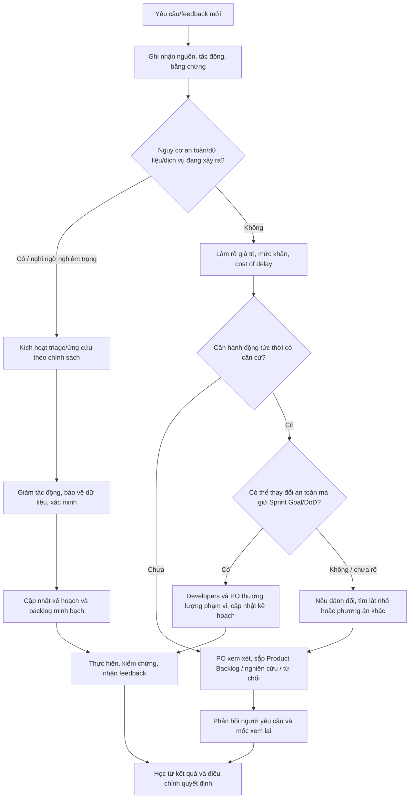

# Coi mọi yêu cầu mới đều phải làm ngay vì nhóm đang áp dụng Agile

## Mục tiêu học tập

Sau bài học này, bạn có thể:

- Phân biệt **đón nhận thay đổi yêu cầu** với **lập tức bắt tay thực hiện mọi yêu cầu**; giải thích vì sao hai hành vi này không tương đương trong Agile.
- Phân tích tác động của việc **ngắt ngang công việc, mở thêm WIP, đổi ưu tiên liên tục** lên Sprint Goal, chất lượng, thời gian hoàn tất và sự bền vững của nhóm.
- Phân loại yêu cầu mới thành **sự cố/rủi ro cần xử lý ngay, thay đổi cần làm rõ, cơ hội giá trị cao, yêu cầu thông thường và ý tưởng chưa đủ bằng chứng**.
- Mô tả vai trò của **Product Goal, Product Backlog và Product Owner** trong việc quyết định điều gì có giá trị hơn, cần làm trước, cần nghiên cứu hoặc chưa làm.
- Vận dụng đúng Scrum Guide: **Sprint Goal là cam kết**, phạm vi Sprint có thể được làm rõ/đàm phán với Product Owner khi học thêm, **không làm nguy hại Sprint Goal** và **không giảm chất lượng**.
- Hiểu cách Kanban hỗ trợ **intake, pull, giới hạn WIP, chính sách xử lý công việc khẩn và đo flow**, không hiểu Kanban là “ai yêu cầu gì thì kéo ngay”.
- Đặt câu hỏi về **giá trị, độ khẩn thật, chi phí trì hoãn, rủi ro, bằng chứng, phụ thuộc và chi phí cơ hội** trước khi thay đổi kế hoạch.
- Thiết kế một quy trình **tiếp nhận → làm rõ → triage → quyết định → thực hiện/để lại → phản hồi → học hỏi** đủ nhẹ nhưng có trách nhiệm.
- Thực hành trên bối cảnh nền tảng học trực tuyến, có các yêu cầu mới giữa Sprint, sự cố quyền truy cập, yêu cầu marketing, ý tưởng sản phẩm và phản hồi học viên.
- Trao đổi quyết định ưu tiên một cách minh bạch, kể cả khi cần nói **“chưa làm bây giờ”** hoặc **“phải dừng việc khác để xử lý rủi ro”**.

## 1. Tình huống mở đầu: “Agile mà, khách hàng vừa nói thì làm ngay chứ?”

Một Scrum Team phát triển nền tảng học Java đang ở **ngày thứ tư của Sprint hai tuần**. Sprint Goal được thống nhất là:

> **“Học viên đã ghi danh có thể mở bài học đầu tiên với quyền truy cập hợp lệ, an toàn.”**

Developers đang hoàn thiện lát tích hợp từ ghi danh, kiểm tra quyền đến giao diện xem bài. Cùng buổi sáng, nhiều yêu cầu xuất hiện:

1. Bộ phận marketing muốn đổi toàn bộ màu trang khóa học trước chiến dịch tuần tới.
2. Một khách hàng doanh nghiệp đề nghị có dashboard theo dõi tiến độ từng nhân viên.
3. Học viên báo có thể dùng liên kết cũ để xem nội dung riêng **sau khi quyền đã bị thu hồi**.
4. Product Owner nhận phản hồi rằng nút **“Bắt đầu học”** khó tìm trên điện thoại.
5. Một người quản lý muốn đổi thư viện frontend vì công nghệ hiện tại “không hiện đại”.
6. Developers phát hiện dữ liệu tiến độ có thể bị ghi đè khi hai thiết bị cập nhật đồng thời.
7. Nhóm hỗ trợ cần thông báo rõ hơn khi người dùng chưa được cấp quyền.
8. Stakeholder khác đề nghị thêm tính năng “AI gợi ý bài tiếp theo” vì đối thủ vừa giới thiệu.

Nếu nhóm hiểu Agile là **“mọi thay đổi đều phải nhận và làm ngay”**, mọi người có thể:

- Dừng PBI gần Done để nhận thêm việc.
- Mở 8 nhánh mã, 8 cuộc họp và 8 lịch triển khai.
- Bỏ kiểm thử quyền để kịp yêu cầu marketing.
- Chuyển Sprint Goal thành khẩu hiệu không còn tác dụng.
- Tạo cảm giác đáp ứng rất nhanh lúc đầu nhưng **giao sản phẩm hữu dụng chậm hơn**.

Một nhóm Agile trưởng thành sẽ **tiếp nhận và lắng nghe cả tám yêu cầu**, nhưng **không mặc định làm cả tám trong Sprint hiện tại**. Họ cần phân loại, tìm bằng chứng, cân nhắc hậu quả, làm rõ ai có quyền quyết định, rồi chọn hành động thích hợp.

**Điểm mấu chốt:**

> **Agile yêu cầu phản hồi có trách nhiệm với thay đổi, không yêu cầu thay đổi kế hoạch một cách vô điều kiện hoặc phá vỡ dòng công việc mỗi khi có đề xuất mới.**

## 2. Agile nói gì về việc đón nhận thay đổi?

Tuyên ngôn Agile đề cao **“Responding to change over following a plan”** — phản hồi với thay đổi hơn là bám cứng một kế hoạch. Một trong các nguyên tắc cũng khuyến khích **đón nhận thay đổi yêu cầu, kể cả muộn trong quá trình phát triển**, nhằm tạo lợi thế cho khách hàng.

Nhưng hai ý này không tương đương với:

- “Khách hàng yêu cầu gì cũng phải xây.”
- “Yêu cầu mới luôn quan trọng hơn công việc đang làm.”
- “Không cần ưu tiên, chỉ cần phản ứng thật nhanh.”
- “Hễ người quản lý nói khẩn thì mọi việc khác phải dừng.”
- “Đã làm Agile nên deadline nào cũng đạt được dù scope tăng.”
- “Mọi ý tưởng đều có giá trị đã được chứng minh.”

### 2.1. Đón nhận nghĩa là gì?

**Đón nhận** là:

1. **Lắng nghe** thông tin mới mà không bác bỏ chỉ vì khác kế hoạch.
2. **Hiểu vấn đề** người dùng hoặc rủi ro đằng sau đề xuất.
3. **Đánh giá mức giá trị, độ khẩn và sự bất định**.
4. **Thay đổi quyết định, thứ tự hoặc phương án** khi bằng chứng ủng hộ.
5. **Làm rõ đánh đổi** với công việc hiện tại, chất lượng và nguồn lực.
6. **Kiểm chứng tác động** sau khi thực hiện.

Đôi khi hành động đúng là **làm ngay**. Đôi khi là **tìm hiểu trước**, **đưa vào Product Backlog**, **hoãn có lý do** hoặc **không làm** vì không phục vụ mục tiêu.

### 2.2. Hai vế của Tuyên ngôn đều có giá trị

Tuyên ngôn Agile ưu tiên các yếu tố ở vế trái nhưng vẫn coi các yếu tố ở vế phải có giá trị. **Phản hồi với thay đổi** không có nghĩa bỏ hoàn toàn **kế hoạch**. Kế hoạch là giả thuyết phối hợp có thể điều chỉnh, không phải bản hợp đồng bảo đảm mọi ý tưởng mới tự động có thêm năng lực thực hiện.

Các nguyên tắc Agile còn nhấn mạnh:

- **Giao phần mềm hoạt động thường xuyên**.
- **Đơn giản**, tối đa hóa lượng công việc không cần làm.
- **Duy trì nhịp phát triển bền vững**.
- **Hợp tác hằng ngày** giữa người làm sản phẩm và phát triển.
- **Thường xuyên suy ngẫm rồi điều chỉnh cách làm**.

Nếu mỗi yêu cầu mới đều buộc đội mở thêm việc, tăng làm thêm và bỏ kiểm thử, cách vận hành đó có thể **đi ngược nhiều nguyên tắc Agile cùng lúc**.

### 2.3. “Agile” là khả năng thay đổi hướng một cách có căn cứ

Có thể hình dung ba mức phản ứng:

| Cách hành xử | Tác động | Minh họa |
| --- | --- | --- |
| **Cứng nhắc** | Bỏ qua thông tin có giá trị mới. | “Đã chốt Sprint nên lỗi quyền nghiêm trọng cũng đợi tuần sau.” |
| **Phản ứng hỗn loạn** | Mọi đề xuất đều ngắt ngang công việc. | “Có ý tưởng AI mới, cả đội chuyển sang làm ngay.” |
| **Thích nghi có kỷ luật** | Tiếp nhận thông tin và ra quyết định dựa trên mục tiêu, rủi ro, chi phí cơ hội. | “Lỗi quyền cần giảm tác động ngay; ý tưởng AI cần kiểm chứng giá trị và ưu tiên sau.” |

**Linh hoạt không phải không có ranh giới.** Ranh giới và chính sách minh bạch giúp phản hồi nhanh đúng việc, thay vì bị kéo bởi tiếng nói lớn nhất.

## 3. Vì sao làm ngay mọi yêu cầu thường khiến nhóm chậm hơn?

### 3.1. Công việc đang làm dở tăng, ít hạng mục đạt Done

Giả sử một nhóm có khả năng hoàn tất tương đối ổn định vài hạng mục mỗi tuần. Khi họ liên tục **bắt đầu** thêm PBI, mỗi hạng mục tranh nhau:

- Thời gian tập trung của Developers.
- Môi trường kiểm thử và review.
- Các quyết định về nghiệp vụ.
- Các cửa sổ tích hợp/phát hành.
- Người có chuyên môn hiếm.
- Năng lực giải quyết phụ thuộc.

Nhiều việc cùng mở có thể tăng **Work in Progress (WIP)** mà không tăng **throughput** (lượng hạng mục Done trong kỳ).

Hệ quả thường gặp: công việc gần hoàn tất phải đợi, thời gian hoàn tất kéo dài, rủi ro tồn đọng tăng.

### 3.2. Chi phí đổi ngữ cảnh không hiển thị như một ticket mới

Một Developer đang kiểm tra lỗi phân quyền chuyển sang thay màu giao diện có thể phải:

- Gián đoạn trạng thái tư duy về nguyên nhân lỗi.
- Chuyển nhánh và khởi tạo môi trường khác.
- Đọc lại điều kiện và kiểm thử khi quay về.
- Đồng bộ lại những giả định mà các thành viên đã sửa trong lúc vắng mặt.

Chi phí thực này **không tự hiện thành story points bổ sung**. Nó làm méo cảm giác “có thể thêm việc mà không cần bỏ việc”.

Không nên gán một tỷ lệ chi phí đổi ngữ cảnh cố định cho mọi đội. Có thể quan sát **số lần gián đoạn, thời gian chờ và hạng mục bị già** trong bối cảnh cụ thể.

### 3.3. Ví dụ flow đơn giản

Giả sử trong một thời kỳ, hệ thống hoàn tất trung bình **4 PBI/tuần** và WIP trung bình là **8 PBI**. Nếu các điều kiện ổn định và áp dụng được Little’s Law, quan hệ trung bình là:

```text
WIP ≈ Throughput × Average Flow Time

Average Flow Time ≈ 8 PBI / (4 PBI/tuần)
                  ≈ 2 tuần
```

Nếu đội nhận yêu cầu liên tục khiến WIP lên **16 PBI** trong khi throughput vẫn khoảng **4 PBI/tuần**, quan hệ minh họa cho thấy thời gian trung bình có thể tiến tới khoảng **4 tuần**, **nếu hệ thống đạt trạng thái ổn định với các giả định phù hợp**.

Đây **không phải công thức cam kết** rằng cứ WIP tăng gấp đôi là mọi PBI mất đúng gấp đôi thời gian. Khi công việc đến quá nhanh, hệ thống có thể **không ổn định**, phân bố thời gian và hạng mục thay đổi, và công thức đơn giản không đủ để dự báo từng PBI.

**Bài học thực hành:** muốn giao nhanh hơn, thường cần **hoàn tất việc đang làm trước khi kéo thêm việc**, hoặc thay đổi năng lực/nút thắt có căn cứ — không phải tự động mở thêm mọi yêu cầu.

### 3.4. Công việc không được Done thì chưa phải Increment

Trong Scrum, một PBI chưa đạt **Definition of Done (DoD)** không được coi là phần Increment hoàn thành. Việc báo “đã code xong 90% của tám yêu cầu mới” không tương đương giao tám phần giá trị.

Cần phân biệt:

- **Bắt đầu thêm nhiều PBI**.
- **Hoàn tất nhiều PBI đạt DoD**.
- **Giao Increment hữu dụng**.
- **Người dùng thực sự đạt outcome**.

Bốn điều này không đồng nhất.

## 4. Phân biệt thay đổi có giá trị với thay đổi cần làm tức thì

Một yêu cầu có thể **rất quan trọng** nhưng chưa phải việc phải thực hiện trong hôm nay. Ngược lại, một sự cố khó thấy có thể **cần hành động ngay** dù không thêm một tính năng nào.

### 4.1. Ma trận quan trọng và khẩn cấp

| | **Độ khẩn đã được chứng minh cao** | **Chưa có lý do phải làm tức thì** |
| --- | --- | --- |
| **Giá trị/tác động cao** | Giảm tác động sự cố quyền, ngăn mất tiến độ, đáp ứng một hạn bắt buộc đã được xác minh. | Cải tiến hành trình quan trọng, mở rộng đối tượng người học, giảm phụ thuộc kỹ thuật lớn. |
| **Giá trị/tác động còn thấp hoặc chưa rõ** | Có thể là yêu cầu do tiếng nói lớn; cần xác minh lý do khẩn trước khi chèn vào luồng. | Ý tưởng giao diện, tính năng chưa được kiểm chứng, yêu cầu “cho giống đối thủ”. |

Bảng chỉ là công cụ **đặt câu hỏi**, không phải thuật toán tự động xếp ưu tiên. Một rủi ro có xác suất thấp nhưng hậu quả cực lớn có thể cần ưu tiên cao dù chưa có dữ liệu xảy ra nhiều lần.

### 4.2. Năm dấu hiệu độ khẩn có căn cứ

1. **Tác động đang xảy ra hoặc sắp xảy ra:** truy cập trái phép, mất dữ liệu, dịch vụ không sử dụng được.
2. **Thời hạn bên ngoài có thật:** nghĩa vụ hợp đồng/pháp lý đã xác minh, cửa sổ phụ thuộc không thể chuyển dễ dàng.
3. **Chi phí chờ tăng đáng kể:** mỗi ngày chậm gây thiệt hại hoặc mất cơ hội có căn cứ.
4. **Phụ thuộc vào quyết định sớm:** nếu chưa chốt, nhiều việc khác sẽ bị chặn hoặc làm sai.
5. **Cơ hội học tập có giá trị:** có thể cần làm một thử nghiệm nhỏ sớm để tránh đầu tư lớn theo giả định sai.

Một câu “CEO cần trước cuối tuần” có thể là **thông tin về stakeholder và ràng buộc**, nhưng không tự chứng minh **giá trị, năng lực và chi phí đánh đổi**. Nhóm cần làm rõ hậu quả và quyền quyết định thích hợp.

### 4.3. “Làm ngay” cũng có nhiều nghĩa

Khi nhận một yêu cầu, tổ chức có thể cần **hành động ngay** mà **không cần xây toàn bộ giải pháp ngay**:

- **Ngay lập tức xác minh và giảm tác động** sự cố.
- **Ngay trong ngày làm rõ** phạm vi/ràng buộc pháp lý.
- **Nhanh chóng làm một spike/thử nghiệm có giới hạn** để giảm bất định.
- **Ghi nhận ngay** yêu cầu vào đầu vào backlog với người chịu trách nhiệm phản hồi.
- **Đợi một điểm kéo việc hợp lý** để thực hiện chính thức.
- **Chủ động từ chối** yêu cầu không phục vụ mục tiêu hoặc tạo rủi ro không chấp nhận.

“Không code ngay” **không đồng nghĩa phớt lờ yêu cầu**.

## 5. Phân loại yêu cầu trước khi quyết định làm

Một nhóm có thể thống nhất các loại yêu cầu theo hành động, thay vì dùng chung nhãn **Urgent** cho tất cả.

| Loại | Dấu hiệu | Phản ứng phù hợp |
| --- | --- | --- |
| **Sự cố ảnh hưởng an toàn/dữ liệu/dịch vụ** | Truy cập trái phép, ghi đè tiến độ, hỏng thanh toán hoặc dịch vụ chính. | Triage sự cố theo mức tác động; **giảm tác động và khôi phục** theo chính sách, điều tra nguyên nhân. |
| **Thay đổi bắt buộc đã xác minh** | Nghĩa vụ có hiệu lực, điều kiện hợp đồng rõ và thời hạn thật. | Xác minh phạm vi, người có thẩm quyền và lập kế hoạch đáp ứng; ưu tiên theo rủi ro. |
| **Lỗi sản phẩm thông thường** | Hành vi lệch khỏi tiêu chí đã chốt, mức tác động chưa nghiêm trọng. | Đánh giá mức nghiêm trọng, tần suất, workaround, sửa theo thứ tự phù hợp. |
| **Nhu cầu mới có bằng chứng giá trị** | Học viên nhiều lần bị chặn tại một bước có dữ liệu. | Product Owner cân nhắc thứ tự; có thể thử lát nhỏ trước. |
| **Thay đổi ý tưởng/giải pháp chưa xác minh** | “Thêm AI vì đối thủ có”, “đổi màu chắc tăng chuyển đổi”. | Làm rõ giả thuyết và đối tượng, nghiên cứu/phép thử phù hợp. |
| **Công việc cải tiến nội bộ** | CI flaky, phụ thuộc gây chờ, nợ kỹ thuật đang cản giao giá trị. | Phân tích tác động chất lượng/flow; dành năng lực phù hợp, không bỏ quên. |
| **Yêu cầu làm rõ thông tin** | Người dùng hỏi trạng thái quyền hoặc thay đổi đã hứa. | Có thể **trả lời/truyền thông** mà không cần code tính năng mới. |
| **Không phù hợp hoặc trùng** | Đã có chức năng, không phù hợp Product Goal hoặc mâu thuẫn ràng buộc. | Giải thích, liên kết đến giải pháp hiện có hoặc từ chối có lý do. |

**Phân loại không thể thay thế sự đánh giá thực tế.** Một lỗi “nhỏ” về giao diện có thể là lỗi tiếp cận làm nhiều người không dùng được; một “yêu cầu pháp lý” cũng cần xác minh văn bản, phạm vi và thời hạn, không dựa vào lời đồn.

### 5.1. Một checklist triage tối thiểu

Trước khi chèn yêu cầu vào công việc đang thực hiện, hãy hỏi:

- **Ai** bị ảnh hưởng, mức độ và phạm vi?
- **Điều gì** đang sai hoặc có cơ hội tạo giá trị?
- **Bằng chứng** hiện có và điều nào mới chỉ là giả định?
- **Nếu chờ**, hậu quả thực tế nào xảy ra, từ lúc nào?
- **Nếu làm ngay**, phải ngừng hoặc hoãn điều gì?
- **Rủi ro quyền, dữ liệu, chất lượng, nghĩa vụ** là gì?
- **Ai có quyền ưu tiên/ra quyết định** theo cơ chế đang áp dụng?
- **Bước nhỏ nhất có thể kiểm chứng** là gì?
- **Khi nào và bằng cách nào phản hồi** lại người đã nêu yêu cầu?

Trả lời các câu này có thể chỉ mất vài phút đối với trường hợp đơn giản; không cần biến thành biểu mẫu phê duyệt nhiều ngày.

## 6. Product Backlog không phải hàng đợi “ai đến trước làm trước”

Trong Scrum, **Product Backlog** là một danh sách công việc được sắp xếp và tiến hóa dành cho cải thiện sản phẩm. Product Owner chịu trách nhiệm **quản lý hiệu quả Product Backlog và tối đa hóa giá trị**.

Một đề xuất mới có thể dẫn đến:

- Bổ sung **Product Backlog Item (PBI)**.
- Điều chỉnh mô tả hoặc thứ tự PBI hiện có.
- Hợp nhất với một PBI tương tự.
- Chia một hạng mục lớn thành **lát giá trị nhỏ hơn**.
- Thực hiện một nghiên cứu để giảm bất định.
- Để lại chờ bằng chứng mới.
- Loại khỏi backlog nếu không còn cần.

**Đưa một ý tưởng vào Product Backlog không có nghĩa cam kết làm trong Sprint hiện tại hay chắc chắn sẽ làm sau này.**

### 6.1. Product Goal là bộ lọc ra quyết định

Giả sử Product Goal hiện tại:

> “Học viên có thể tự ghi danh và bắt đầu học an toàn.”

Hai đề xuất:

- **A:** sửa lỗi không thể mở bài khi đã có quyền hợp lệ.
- **B:** thêm bảng xếp hạng cộng đồng cho toàn bộ khóa.

A gắn trực tiếp với **mục tiêu và chất lượng hiện tại**; B có thể là cơ hội mới nhưng **chưa chứng minh là ưu tiên hơn A**. Product Owner có thể muốn hiểu giá trị của B, song không tự động phá kế hoạch hiện tại.

### 6.2. Thứ tự không chỉ từ “giọng nói to nhất”

Những yếu tố thường cần xem:

| Yếu tố | Câu hỏi |
| --- | --- |
| **Giá trị người dùng** | Ai hưởng lợi, vấn đề có thật và nghiêm trọng không? |
| **Mục tiêu sản phẩm** | Hạng mục giúp tiến tới Product Goal nào? |
| **Rủi ro** | Nếu không làm, hệ thống/người dùng chịu hậu quả gì? |
| **Chi phí trì hoãn** | Có ngày hoặc sự kiện khiến giá trị giảm nhanh không? |
| **Bất định** | Có cần thử nghiệm nhỏ thay vì xây giải pháp lớn? |
| **Phụ thuộc** | Việc nào phải có trước để nhóm khác không bị chặn? |
| **Năng lực và cơ hội bị bỏ** | Chọn việc này có nghĩa chưa chọn việc nào? |
| **Chất lượng và khả năng vận hành** | Có tác động quyền, dữ liệu, tương thích hoặc khôi phục không? |

Không có thuật toán ưu tiên duy nhất được Scrum Guide bắt buộc. Product Owner cần **quyết định có trách nhiệm** dựa trên giá trị và bối cảnh, phối hợp với Developers cùng stakeholders để hiểu phương án và rủi ro.

### 6.3. Các nguồn yêu cầu đều được lắng nghe, không tự có cùng quyền ưu tiên

Stakeholders, người học, marketing, hỗ trợ, vận hành, nhà tài trợ và Developers đều có thể **đưa thông tin có giá trị**. Nhưng không nên để mỗi bên **ra lệnh trực tiếp cho một Developer đang làm Sprint** rồi tạo các ưu tiên xung đột.

Theo Scrum, Product Owner là **một người**, không phải hội đồng bình chọn thứ tự Product Backlog. Công việc mô tả hạng mục có thể được ủy quyền, nhưng trách nhiệm hiệu quả backlog vẫn ở Product Owner.

Nếu rủi ro cần hành động theo chính sách **ứng cứu sự cố**, đội cần tuân thủ cơ chế phân quyền và an toàn tương ứng; không nên nhầm cơ chế ưu tiên tính năng thông thường với xử lý sự cố khẩn cấp.

## 7. Trong Scrum: thay đổi phạm vi khác phá vỡ Sprint Goal

### 7.1. Sprint Goal không phải danh sách từng task cố định

**Sprint Goal** là cam kết gắn với Sprint Backlog, cung cấp **một mục tiêu thống nhất** để Developers tập trung và linh hoạt điều chỉnh công việc nhằm đạt được mục tiêu đó.

Sprint Backlog bao gồm:

- **Vì sao:** Sprint Goal.
- **Làm gì:** những PBI được chọn.
- **Làm thế nào:** kế hoạch Developers lập để tạo Increment.

Kế hoạch có thể được điều chỉnh khi đội học thêm. Vì vậy, Scrum không phải một timebox “đóng cửa với mọi thông tin mới” sau Sprint Planning.

### 7.2. Những nguyên tắc cần giữ trong Sprint

Scrum Guide 2020 nêu trong Sprint:

- **Không có thay đổi làm nguy hại Sprint Goal.**
- **Chất lượng không giảm.**
- Product Backlog được **refine khi cần**.
- Phạm vi có thể được **làm rõ và thương lượng lại với Product Owner** khi có thêm hiểu biết.

Điều này **không** nói rằng:

- Mọi yêu cầu mới phải đưa vào Sprint.
- Chỉ có thể thay đổi phạm vi vào ngày Sprint Planning tiếp theo.
- Product Owner có thể đơn phương giao thêm task cho Developers bất chấp khả năng thực hiện.
- Developers buộc phải làm thêm giờ để giữ cả toàn bộ phạm vi cũ **lẫn** mọi phạm vi mới.
- Có thể hạ DoD để biểu đồ “Done” đẹp hơn.

### 7.3. Một bảng quyết định khi xuất hiện yêu cầu mới

| Tình huống | Câu hỏi | Hành động có thể hợp lý |
| --- | --- | --- |
| Yêu cầu làm rõ giúp đạt Sprint Goal. | Nó có nằm trong cách hoàn thành mục tiêu đã chọn? | Developers điều chỉnh kế hoạch, làm rõ PBI; trao đổi PO nếu cần đổi phạm vi. |
| Yêu cầu mới có giá trị nhưng chưa cấp thiết. | Làm ngay có gây chệch Sprint Goal không? | Product Owner đưa vào/làm rõ và sắp xếp Product Backlog. |
| Cần thêm khả năng thiết yếu mới phát hiện. | Có thể thương lượng scope mà vẫn bảo vệ Sprint Goal và DoD? | Developers và PO điều chỉnh phạm vi/kế hoạch có căn cứ. |
| Rủi ro quyền/dữ liệu nghiêm trọng phát hiện. | Có cần ứng cứu tức thời theo chính sách? | Giảm tác động, xử lý an toàn; xem ảnh hưởng tới kế hoạch và minh bạch. |
| Sprint Goal đã trở nên lỗi thời. | Mục tiêu có thực sự mất ý nghĩa, không chỉ khó đạt? | **Chỉ Product Owner có quyền hủy Sprint** theo Scrum Guide. |

Hủy Sprint là trường hợp đặc biệt khi **Sprint Goal trở nên lỗi thời**; đó không phải cách xử lý mặc định mỗi lần xuất hiện yêu cầu mới hoặc dự báo trễ.

### 7.4. “Không thay đổi Sprint Goal” không có nghĩa giấu rủi ro

Giả sử nhóm đang phát triển quyền truy cập, phát hiện một endpoint cho phép người dùng không có quyền lấy nội dung riêng.

Việc bảo vệ an toàn có thể cần **ứng cứu khẩn** và thay đổi công việc ngay. Đội không nên nói “đã chốt Sprint nên phải để lỗ hổng chạy thêm sáu ngày”.

Nhưng sau khi giảm tác động, cần **điều chỉnh kế hoạch minh bạch**: điều gì bị ảnh hưởng, phần nào còn có thể đạt DoD, cần ai quyết định, và Sprint Goal có tiếp tục phù hợp không.

### 7.5. “Definition of Ready” không phải cổng cứng bắt buộc

Một đội có thể dùng tiêu chí về mức độ đủ rõ trước khi kéo PBI, nhưng **Definition of Ready không phải hiện vật/cam kết được Scrum Guide yêu cầu**. Đừng dùng “chưa đạt Ready” để từ chối mọi phản hồi, nhất là rủi ro cấp thiết; ngược lại, cũng đừng lấy lý do Agile để phát triển yêu cầu **chưa rõ hành vi và điều kiện chấp nhận**.

**Làm rõ đúng mức rủi ro** giúp phản hồi nhanh hơn chứ không nhất thiết tạo thủ tục mới.

## 8. Trong Kanban: pull và WIP không đồng nghĩa nhận vô hạn yêu cầu

Kanban tập trung vào **dòng công việc**, làm rõ chính sách vận hành, kiểm soát WIP và cải tiến dựa trên dữ liệu.

Các thước đo flow cơ bản gồm:

- **WIP:** số hạng mục đã bắt đầu nhưng chưa Finished.
- **Work item age:** tuổi hạng mục đang thực hiện.
- **Throughput:** số hạng mục hoàn tất trong đơn vị thời gian.
- **Cycle time:** thời gian hoàn tất của hạng mục đã Done.

Theo The Kanban Guide, đội cần định nghĩa **Definition of Workflow (DoW)** gồm các ranh giới Start/Finish, trạng thái công việc, cách kiểm soát WIP, chính sách rõ và **Service Level Expectation (SLE)** phù hợp.

### 8.1. Từ push sang pull có trách nhiệm

**Push:** một bên tự giao thêm công việc cho người đang bận mà không xem WIP hoặc chính sách.

**Pull:** khi có năng lực phù hợp và chính sách cho phép, nhóm **kéo hạng mục đã được chọn ưu tiên** vào workflow.

Một yêu cầu xuất hiện trong hàng đợi **không bắt buộc được kéo ngay**. Mục đích là giúp nhóm **hoàn tất việc** thay vì bắt đầu không kiểm soát.

### 8.2. Cần phân biệt intake backlog với WIP

```text
Yêu cầu đến
   → Intake / Chưa cam kết thực hiện
   → Đã phân loại, làm rõ, sắp thứ tự
   → Ready for Pull
   → In Progress (tính vào WIP theo DoW)
   → Review / Test (cũng tính WIP nếu thuộc ranh giới)
   → Done (theo điều kiện Finish)

Công việc ở hàng đợi đầu vào không mặc nhiên được coi đang làm.
```

Không nên chuyển công việc đang kẹt tới cột ngoài WIP chỉ để số WIP giảm. **Các ranh giới và chính sách phải phản ánh workflow thật**.

### 8.3. Công việc khẩn và chính sách ngoại lệ

Một số hệ thống dùng các **lớp dịch vụ (classes of service)** như **expedite**, ngày cố định, chuẩn hoặc vô hình/đầu tư cải tiến để cân nhắc cách xử lý. Đây là một **thực hành có thể dùng**, không phải bốn loại bắt buộc được The Kanban Guide áp đặt cho mọi đội.

Nếu có lớp **expedite**, chính sách nên rõ:

1. Điều kiện nào mới đủ là expedite?
2. Ai xác minh mức nghiêm trọng và có quyền kích hoạt?
3. Có giới hạn hoặc cơ chế đánh đổi WIP không?
4. Việc nào sẽ tạm dừng hoặc không kéo thêm?
5. Khi nào kiểm tra lại và thoát trạng thái expedite?
6. Làm sao tránh mọi stakeholder tự gắn nhãn “khẩn”?

**Expedite không phải là “không cần chất lượng”**. Lỗi nghiêm trọng cần xử lý nhanh nhưng vẫn phải giữ kiểm soát quyền/dữ liệu, kiểm thử và phương án khôi phục phù hợp.

### 8.4. SLE không phải lời hứa cho yêu cầu chưa sẵn sàng

**SLE (Service Level Expectation)** là kỳ vọng về thời gian một hạng mục đi qua workflow theo định nghĩa và mức xác suất phù hợp, có thể dựa trên dữ liệu lịch sử.

Không được suy rằng “SLE là 8 ngày” nghĩa bất kỳ ý tưởng marketing mới nào cũng **chắc chắn được triển khai sau tám ngày**, bất kể độ lớn, ràng buộc và mức ưu tiên. Cần biết **điểm Start, loại công việc, tỷ lệ và điều kiện**.

### 8.5. Kanban giúp nói “chưa kéo ngay” minh bạch

Một phản hồi phù hợp:

> “Yêu cầu đã được ghi nhận và đánh giá giá trị. Hiện đội có ba hạng mục gần Done và một trường hợp bị chặn cần xử lý trước. Theo chính sách pull, chúng tôi chưa bắt đầu thêm hạng mục này; nó đang nằm ở hàng đợi đã được sắp thứ tự và sẽ được xem lại khi có năng lực hoặc bằng chứng thay đổi ưu tiên.”

Đó là **quản lý luồng công việc**, không phải chống thay đổi.

## 9. Quy trình tiếp nhận và quyết định đủ nhẹ

Một quy trình hữu ích không cần nhiều cấp phê duyệt. Nó cần **một nơi ghi nhận, cách triage rõ, người quyết định đúng và đường phản hồi**.

### 9.1. Dòng xử lý yêu cầu



Các nhánh ở đây là **cách suy nghĩ**, không phải thay thế quy trình xử lý sự cố/bảo mật hợp lệ hoặc vai trò Scrum. Trong tình huống an toàn nghiêm trọng, có thể cần **ứng cứu trước khi đủ thông tin ưu tiên sản phẩm thông thường**, theo phân quyền và chính sách được xác nhận.

### 9.2. Một mẫu intake đơn giản

```text
REQUEST-ID: RQ-042
Người báo / nguồn: Feedback học viên qua hỗ trợ
Vấn đề: Người đã được cấp quyền đôi khi không mở được bài đầu
Ai bị ảnh hưởng: Học viên có ghi danh hợp lệ, thiết bị di động
Bằng chứng: Ví dụ tái hiện, phiên bản, số ca hỗ trợ đã xác minh
Độ khẩn: Đang làm rõ mức tác động; chưa tự gắn "P0"
Rủi ro: Quyền, dữ liệu, tính đúng đắn
Giá trị mong muốn: Người đủ quyền mở được bài ngay
Điều chưa biết: Tỷ lệ xảy ra và nguyên nhân theo phiên bản
Bước tiếp: Triage với PO và Developers; kiểm tra logs/test
Quyết định: [Làm ngay / làm rõ / sắp backlog / hoãn / không làm]
Người điều phối: [người chịu trách nhiệm theo dõi]
Phản hồi cho người gửi: [kênh, mốc dự kiến, không hứa bừa]
```

Mẫu này là **gợi ý**. Một tổ chức có công cụ đã chứa đủ trường có thể không cần tạo thêm form.

### 9.3. Ba đường xử lý phải rõ

- **Incident lane:** sự cố có tác động/rủi ro nghiêm trọng được xử lý theo chính sách khẩn.
- **Product discovery/backlog lane:** nhu cầu, phản hồi và cơ hội được làm rõ, sắp thứ tự, thử nghiệm.
- **Delivery lane:** việc được chọn phù hợp năng lực, đạt DoD, phát hành và học từ thực tế.

Một lỗi phổ biến là đẩy **mọi feedback** vào delivery lane chỉ vì đều mang tên “request”. Cần phân biệt **nhận thông tin** với **cam kết thực hiện**.

## 10. Chi phí trì hoãn và chi phí cơ hội: tính để hỏi tốt hơn, không tạo chính xác giả

### 10.1. Cost of Delay (CoD) là gì?

**Cost of Delay** là cách nhìn tác động của việc **chờ thêm một khoảng thời gian** đối với giá trị/rủi ro của một hạng mục.

Ví dụ:

- Trì hoãn sửa một lỗi cho phép truy cập nội dung riêng trái phép có **rủi ro nghiêm trọng** mà tiền chưa chắc biểu diễn đủ.
- Chậm một tính năng liên quan sự kiện đăng ký đã xác minh có thể làm **mất một cửa sổ cơ hội thật**.
- Trì hoãn đổi màu một trang chưa có dữ liệu ảnh hưởng chuyển đổi có thể có **chi phí thấp hoặc chưa biết**.
- Chậm chuẩn hóa contract API có thể khiến **nhiều nhóm phải chờ và làm lại**.

Chi phí trì hoãn **không nhất thiết tuyến tính theo ngày**. Một số giá trị mất nhanh sau một ngày cố định, một số ảnh hưởng kéo dài, và nhiều trường hợp **không có đủ cơ sở quy tiền**.

### 10.2. Ví dụ lựa chọn giữa hai hạng mục

Giả sử hai yêu cầu **đều có giá trị đã được xác minh tương đối**:

| Hạng mục | Lợi ích bị trì hoãn ước tính | Quy mô ước tính | Giới hạn dữ liệu |
| --- | --- | --- | --- |
| A — cải thiện bước xác nhận ghi danh | 10 đơn vị giá trị tương đối/tuần chậm | 2 đơn vị kích thước tương đối | Giả định doanh thu/tác động còn bất định. |
| B — đổi nhãn phụ trong trang hồ sơ | 2 đơn vị giá trị tương đối/tuần chậm | 1 đơn vị kích thước tương đối | Chưa rõ có người dùng chịu ảnh hưởng lớn. |

Một phép so sánh **CoD tương đối trên kích thước tương đối**, nếu đơn vị có nghĩa và dữ liệu đủ tốt:

```text
A: 10 / 2 = 5
B:  2 / 1 = 2

A có tín hiệu nên được cân nhắc trước B trong ví dụ.
```

Đây chỉ là **minh họa của một heuristic ưu tiên**. Không thể lấy số 5 và 2 làm ngày hoàn thành, xác suất thành công hoặc quy chuẩn Agile. Công việc có rủi ro bảo mật nghiêm trọng **không nên bị làm nhẹ chỉ vì điểm quy tiền thấp hoặc khó ước tính**.

### 10.3. WSJF là lựa chọn, không phải “công thức Agile”

Trong một số phương pháp quản trị danh mục, **Weighted Shortest Job First (WSJF)** dùng một cách chấm điểm **Cost of Delay / Job Size** để hỗ trợ sắp thứ tự.

Điểm cần cẩn thận:

- Đây **không phải quy tắc bắt buộc của Agile hay Scrum Guide**.
- Tử số và mẫu số thường là **ước lượng tương đối** chứa bất định.
- Các đội khác nhau có thể dùng thang điểm khác, **không so được nếu thiếu chuẩn chung**.
- Các rủi ro, phụ thuộc, nghĩa vụ bắt buộc và hành trình người dùng có thể **không được biểu diễn đủ trong một điểm số**.
- Không cho phép một công thức lấn át **quyền quyết định và trách nhiệm đánh giá an toàn**.

Sử dụng điểm như **đầu vào hội thoại**, không như hệ thống tự động ra lệnh cho Developers.

### 10.4. “Cái gì phải dừng nếu nhận việc mới?” là câu hỏi bắt buộc

Nếu nhóm đã có 40 đơn vị phạm vi dự kiến trong Sprint mà được đề nghị thêm 8, không thể kết luận:

> “Chỉ thêm 20% thôi, cứ làm cả 48.”

Phải cân nhắc:

- Thêm phạm vi nào và **vì sao**?
- Việc này nằm trong Sprint Goal hay ảnh hưởng thế nào?
- Những PBI nào có thể thương lượng, chia nhỏ hoặc rời Sprint?
- Có tạo **WIP và phụ thuộc mới** khiến các PBI gần Done chậm?
- Có cần thay đổi dự báo hoặc thông báo stakeholders?
- Có ảnh hưởng tới DoD và chất lượng không?

**Không hứa làm cả phần mới và phần cũ chỉ để tránh một cuộc trao đổi khó.**

## 11. Từ yêu cầu đến quyết định: trách nhiệm rõ nhưng không quan liêu

Một yêu cầu mới nên có **đường ra quyết định**, không phải đi lạc vào chat riêng hoặc trở thành nhiệm vụ do người nói to nhất tự giao.

### 11.1. Các nhóm trách nhiệm cần phối hợp

| Bên liên quan | Đóng góp chính | Không nên làm |
| --- | --- | --- |
| **Người dùng/stakeholder** | Nêu vấn đề, bối cảnh, tác động, thời hạn thật và feedback. | Mặc nhiên giao trực tiếp task vào Sprint của Developers. |
| **Product Owner (Scrum)** | Chịu trách nhiệm quản lý hiệu quả Product Backlog, tối đa hóa giá trị và minh bạch thứ tự. | Tự hứa vô hạn scope mà không trao đổi năng lực/chất lượng với Developers. |
| **Developers (Scrum)** | Làm rõ rủi ro, ước lượng/phương án phù hợp, tự quản kế hoạch tạo Increment đạt DoD. | Chỉ im lặng nhận thêm việc rồi bỏ mục tiêu hoặc che việc chưa Done. |
| **Scrum Master (Scrum)** | Giúp Scrum Team và tổ chức hiểu Scrum, tháo trở ngại và cải thiện hiệu quả phối hợp. | Trở thành “cổng duyệt mọi yêu cầu” hoặc người đơn phương phân công Developers. |
| **Người được phân quyền ứng cứu sự cố** | Xác minh và giảm tác động rủi ro kỹ thuật/khách hàng theo chính sách. | Đợi ưu tiên feature thông thường khi tình huống yêu cầu phản ứng khẩn. |
| **Các nhóm phụ thuộc** | Cung cấp contract, rủi ro, phương án tích hợp và nguồn lực liên quan. | Tự đổi API/dữ liệu làm hỏng consumer mà không thông báo. |

**Vai trò phụ thuộc bối cảnh.** Một tổ chức không dùng Scrum có thể có cách phân quyền tương đương nhưng không nên gán máy móc danh xưng Scrum. Với dịch vụ dùng chung cho nhiều sản phẩm, ranh giới ưu tiên và thỏa thuận dịch vụ cần được thiết kế riêng.

### 11.2. Một “thông điệp đến” không phải cam kết

Cần phân biệt trạng thái:

- **Received:** đã tiếp nhận.
- **Clarifying:** cần xác minh tác động, mục tiêu hoặc bằng chứng.
- **Triaged:** đã xác định loại và mức độ tương đối.
- **Prioritized:** đã có vị trí trong danh sách được quản lý.
- **Selected/Committed:** được chọn để thực hiện theo cơ chế và năng lực phù hợp.
- **In Progress:** đã bắt đầu công việc thật.
- **Done:** đã đạt điều kiện hoàn thành áp dụng.
- **Released/Observed:** người dùng đã được tiếp cận và có tín hiệu thực tế.
- **Rejected/Deferred:** không làm hoặc hoãn có lý do.

Những trạng thái này là **mô hình minh họa**, không bắt buộc phải tạo đúng chín cột. Điều quan trọng là **đừng dùng chữ “đã nhận” để người yêu cầu hiểu lầm “đã được cam kết”**.

### 11.3. Cách ghi quyết định ngắn

```text
REQUEST: RQ-050 — Đổi thứ tự bài gợi ý

Nguồn: Phản hồi 6 học viên qua hỗ trợ
Vấn đề: Bài "nên học tiếp" khác bài chưa hoàn thành
Bằng chứng: 6 trường hợp có ngữ cảnh; chưa rõ tỷ lệ toàn cohort
Tác động: Nhầm điều hướng, có thể tăng thời gian tìm bài
Độ khẩn: Chưa đủ cơ sở gắn mức incident nghiêm trọng
Liên hệ mục tiêu: Có; nhưng cần hiểu quy tắc "bài dở"
Quyết định: Tạo nghiên cứu/lát kiểm chứng nhỏ, chưa đổi API ngay
Đánh đổi: Giữ công việc sửa quyền đang là ưu tiên cao
Người điều phối: PO + Developers phụ trách Progress/UI
Mốc xem lại: Sau khi tái hiện và kiểm tra dữ liệu phân đoạn
Phản hồi người yêu cầu: Nêu việc đã nhận, đang kiểm chứng gì
```

Như vậy, yêu cầu được **đối xử nghiêm túc** dù chưa có commit mã mới.

## 12. Giao tiếp với stakeholder khi không thể nhận thêm ngay

Nói **“chưa làm ngay”** không có nghĩa phủ nhận nhu cầu. Nhóm cần nói được **vì sao, phải đánh đổi gì, điều kiện xem lại và bước tiếp theo**.

### 12.1. Công thức phản hồi bốn phần

1. **Thừa nhận vấn đề:** “Chúng tôi hiểu điều gì đang bị ảnh hưởng.”
2. **Nêu trạng thái kiểm chứng:** “Đã có bằng chứng nào và còn điều gì chưa rõ.”
3. **Nêu đánh đổi và quyết định hiện tại:** “Nếu làm ngay, phần nào có rủi ro chậm hoặc không đạt DoD?”
4. **Đề xuất bước tiếp và mốc phản hồi:** “Ai sẽ xem, có thể thử lát nhỏ nào, khi nào có quyết định tốt hơn?”

### 12.2. Mẫu trao đổi cho yêu cầu không khẩn

> “Nhóm đã ghi nhận đề xuất thêm gợi ý bài học bằng AI. Hiện Sprint đang tập trung bảo đảm học viên đã ghi danh mở đúng bài với quyền hợp lệ, và chúng tôi chưa có bằng chứng rằng cách gợi ý mới giải quyết vấn đề ưu tiên hơn. Product Owner sẽ xem đề xuất trong Product Backlog, làm rõ nhóm người học và kết quả mong đợi. Trước khi cam kết xây tính năng, nhóm có thể thử một cách gợi ý đơn giản để kiểm chứng giá trị. Chúng tôi sẽ phản hồi khi có kết quả làm rõ; chưa có cơ sở để hứa ngày phát hành.”

**Không nên:** “Không nhé, Agile thì phải theo Sprint cứng.” Scrum cho phép thích nghi; vấn đề ở đây là **chưa đủ lý do và năng lực để ưu tiên ngay**.

### 12.3. Mẫu trao đổi khi cần thay đổi phạm vi Sprint

> “Tình huống quyền truy cập mới được xác nhận có tác động đáng kể tới học viên, nên đội cần xử lý trước khi mở rộng tính năng. Để bảo vệ Sprint Goal và Definition of Done, Developers sẽ cùng Product Owner xem lại các PBI đang được chọn, xác định phần có thể điều chỉnh và cập nhật dự báo. Điều này có thể khiến cải tiến giao diện phụ chưa được hoàn tất trong Sprint; chúng tôi sẽ nêu rõ phần nào đạt Done và phần nào chưa.”

**Không nên:** “Sếp bảo gấp, mọi người làm thêm để giữ nguyên mọi cam kết.” Câu đó che **chi phí cơ hội** và có thể đẩy rủi ro chất lượng sang người dùng.

### 12.4. Mẫu phản hồi trong tình huống nghi ngờ sự cố

> “Thông tin về khả năng truy cập nội dung sau khi thu hồi quyền đang được phân loại là rủi ro cần xác minh khẩn. Nhóm chịu trách nhiệm ứng cứu đang kiểm tra phạm vi và thực hiện biện pháp giảm tác động theo chính sách. Chúng tôi chưa thể kết luận nguyên nhân hay số học viên bị ảnh hưởng cho tới khi có bằng chứng. Kế hoạch phát hành và thông tin liên quan sẽ được cập nhật sau khi đánh giá tác động và mức an toàn.”

Không hứa “đã sửa xong” chỉ vì tắt một flag trong khi **dữ liệu hoặc đường API khác chưa được xác minh**.

### 12.5. Những câu hỏi hỗ trợ thương lượng tốt

Thay vì “Có làm hay không?”, có thể hỏi:

- “Nếu cần hạng mục này **trước một ngày cụ thể**, điều gì sẽ xảy ra nếu chậm?”
- “Trong ba yêu cầu, **điều nào đem lại kết quả quan trọng nhất**?”
- “Nếu thay đổi scope, **phần nào có thể để lại** mà vẫn đạt mục tiêu?”
- “Có một lát nhỏ nào đáp ứng vấn đề cốt lõi trước không?”
- “Chúng ta có thể **kiểm chứng nhu cầu** bằng prototype/phỏng vấn thay vì xây đầy đủ ngay không?”
- “Có điều gì bắt buộc vì **bảo mật, quyền, dữ liệu hoặc hợp đồng** mà chúng ta chưa làm rõ không?”
- “Điều gì sẽ khiến quyết định ‘chưa làm bây giờ’ cần được **xem lại ngay**?”

**Đàm phán phạm vi là công việc làm rõ giá trị và giới hạn**, không phải trò mặc cả để ai thắng.

## 13. Tình huống xuyên suốt: xử lý tám yêu cầu trong Sprint nền tảng học Java

Ta quay lại Sprint Goal:

> “Học viên đã ghi danh có thể mở bài học đầu tiên với quyền truy cập hợp lệ, an toàn.”

Giả sử Developers đã chọn một tập PBI phù hợp và đang ở **ngày 4/10 ngày làm việc**. Đây là **dữ liệu minh họa**, không phải dự án có thật.

### 13.1. Danh sách yêu cầu và quyết định giả định

| Mã | Yêu cầu xuất hiện | Bằng chứng/độ khẩn | Quyết định có căn cứ |
| --- | --- | --- | --- |
| **R1** | Marketing muốn đổi màu toàn bộ trang khóa. | Có chiến dịch tuần tới, nhưng chưa chứng minh đổi màu ảnh hưởng đáng kể mục tiêu hiện tại. | Làm rõ tác động và thời hạn; xếp backlog, không tự ngắt công việc quyền. |
| **R2** | Khách hàng muốn dashboard tiến độ theo nhân viên. | Nhu cầu B2B có giá trị tiềm năng; phạm vi dữ liệu/quyền quản lý chưa rõ. | Discovery và làm rõ chính sách quyền/dữ liệu, ưu tiên theo Product Goal và cơ hội. |
| **R3** | Liên kết cũ xem được bài sau khi quyền bị thu hồi. | Nguy cơ truy cập trái phép cần xác minh khẩn. | **Triage/giảm tác động ngay theo chính sách**, kiểm tra quyền, dữ liệu và tác động Sprint. |
| **R4** | Nút “Bắt đầu học” khó tìm trên điện thoại. | Có feedback thật, chưa rõ quy mô; liên quan trực tiếp hành trình Sprint Goal. | Xác minh nhanh bằng quan sát/số liệu; nếu lát sửa nhỏ thiết yếu, thương lượng scope/kế hoạch với PO. |
| **R5** | Đổi toàn bộ thư viện frontend vì không còn “trendy”. | Chưa có tác động người dùng/rủi ro kỹ thuật đã được chứng minh. | Không nhận ngay; nêu vấn đề kỹ thuật cụ thể nếu muốn đề xuất. |
| **R6** | Cập nhật đồng thời hai thiết bị có thể ghi đè tiến độ. | Rủi ro dữ liệu; cần xác định có đang ảnh hưởng sản phẩm hiện tại hay chỉ ở nhánh chưa release. | Triage mức nghiêm trọng, bảo vệ dữ liệu; chọn biện pháp tối thiểu an toàn trước rollout. |
| **R7** | Người chưa có quyền cần thông báo rõ hơn. | Trực tiếp hỗ trợ hành trình; có thể giảm yêu cầu hỗ trợ. | Làm rõ acceptance example; cân nhắc trong cùng lát giá trị nếu giữ Goal và DoD. |
| **R8** | Thêm AI gợi ý bài vì đối thủ có. | Giả thuyết giá trị chưa kiểm chứng, không có deadline thật. | Nghiên cứu nhu cầu nếu phù hợp chiến lược; **không cam kết triển khai ngay**. |

**Quan trọng:** R3 và R6 không có “điểm tuyệt đối” cố định. R6 có thể trở thành ưu tiên ứng cứu ngay nếu phát hiện mất dữ liệu production, hoặc được kiểm tra và khắc phục **trước khi mở đường ghi mới** nếu chỉ là rủi ro chưa xuất hiện ở môi trường phục vụ. Cần dựa trên **bằng chứng và chính sách tác động**.

### 13.2. Thứ tự ra quyết định trong buổi triage

Một cuộc trao đổi ngắn, có người đủ thông tin và thẩm quyền:

1. **Ứng cứu R3 trước:** bảo vệ người dùng, kiểm tra khả năng thu hồi quyền thực và những đường truy cập liên quan.
2. **Phân tích mức độ R6:** có mất dữ liệu thật không, đường ghi mới đã release chưa, có cần tạm dừng không?
3. **Bảo vệ Sprint Goal:** những phần nào của khả năng “mở đúng bài an toàn” cần hoàn tất để tạo Increment có ý nghĩa?
4. **Kiểm tra R4 và R7:** có thể được làm rõ/giải quyết trong cùng lát với chi phí nhỏ và giá trị trực tiếp không?
5. **Product Owner sắp các đề xuất còn lại:** R1, R2, R5, R8 dựa trên mục tiêu, giá trị, bằng chứng và thời hạn thật.
6. **Minh bạch điều thay đổi:** nếu thêm hoặc rút phạm vi, ghi nhận lý do, ảnh hưởng và dự báo mới.
7. **Gửi phản hồi:** người đề xuất biết đã được nghe và bước tiếp theo là gì.

Đây **không phải mệnh lệnh tất cả tám yêu cầu đều phải trở thành PBI**. Một số có thể là sự cố, câu hỏi nghiên cứu hoặc đề xuất không đáng làm.

### 13.3. Bảng minh họa về thay đổi Sprint scope

Giả sử Sprint có **40 điểm ước lượng nội bộ** ở thời điểm lập kế hoạch. Một vài PBI đã Done. Sau khi xem xét rủi ro và mục tiêu, nhóm và Product Owner lựa chọn một cách điều chỉnh:

| Sự kiện | Scope trong Sprint | Ghi chú |
| --- | ---: | --- |
| Ngày 0 — kế hoạch ban đầu | 40 điểm | Lát quyền và mở bài; Sprint Goal rõ. |
| Ngày 4 — bổ sung xử lý trường hợp R3 thuộc phạm vi cần kiểm chứng | 46 điểm | **+6 điểm** so với kế hoạch, không tự suy điểm = giờ. |
| Ngày 4 — đưa một cải tiến giao diện phụ chưa thiết yếu trở lại Product Backlog | 41 điểm | **−5 điểm** chưa Done; không tính là hoàn thành. |
| Ngày 7 — làm rõ R7, chia lại một hạng mục không làm đổi tổng scope được đo | 41 điểm | Có thể đổi cách triển khai mà không tự tạo thêm điểm. |

Đây là **một phương án minh họa**, chỉ hợp lệ nếu Sprint Goal vẫn phù hợp và chất lượng được bảo vệ. Nếu tình huống sự cố thay đổi hoàn toàn giá trị Sprint Goal, cần đưa ra quyết định phù hợp theo Scrum Guide, không che bằng phép cộng điểm.

### 13.4. Tại sao phải báo cả scope và Done?

Giả sử trước điều chỉnh:

```text
Ngày 3:
Scope = 40 điểm
Done  = 12 điểm
Remaining = 28 điểm
```

Và cuối ngày 4:

```text
Ngày 4:
Scope = 41 điểm  (ban đầu +6, rồi -5)
Done  = 16 điểm
Remaining = 25 điểm
```

Như vậy:

```text
Done tăng thêm 4 điểm.
Scope tăng ròng 1 điểm.
Remaining giảm 3 điểm (28 → 25).
```

Một đường Burndown giảm 3 điểm **không có nghĩa đội chỉ Done 3 điểm**, bởi trong ngày scope cũng tăng ròng 1 điểm. Burnup với hai đường **Done và Total Scope** cho thấy rõ hơn biến động phạm vi.

**Tránh biến ước lượng thành KPI:** 40/41 điểm chỉ minh họa quy mô nội bộ, không phải giá trị tiền hoặc công suất cố định của mọi Developer.

### 13.5. Kết quả cần kiểm tra cuối Sprint

Đội nên xem:

- Increment cho phép **học viên hợp lệ mở đúng bài**, và chặn đường truy cập khi quyền bị thu hồi?
- Những PBI nào **thật sự đạt DoD**, bao gồm kiểm thử quan trọng?
- R3 có còn tác động người dùng hoặc dữ liệu cần xử lý không?
- R6 đã được đánh giá đủ trước khi mở đường ghi tiến độ chưa?
- R4/R7 có làm trải nghiệm tốt hơn theo feedback hoặc phép kiểm tra phù hợp?
- Những hạng mục bị rút khỏi Sprint **có được quản lý lại** trong Product Backlog nếu còn giá trị?
- Đội đã học gì về tiếp nhận yêu cầu, dependencies và công việc bị chặn?

Kết quả tốt **không phải** “đã nhận được tất cả yêu cầu”; kết quả tốt là **ra quyết định có trách nhiệm và giao Increment chất lượng, có mục tiêu và phản hồi**.

## 14. Sự cố nghiêm trọng: đừng dùng Product Backlog để trì hoãn an toàn

Có một cực đoan đối lập với “nhận mọi yêu cầu”: **lấy Sprint đã chốt làm lý do bỏ qua sự cố đang gây hại**.

### 14.1. Một dấu hiệu nguy cơ cần hành động ngay

Ví dụ học viên báo:

> “Tôi đã mất quyền của khóa trả phí nhưng link cũ vẫn mở được bài riêng.”

Đây có thể là rủi ro truy cập trái phép. Không cần đợi một cuộc họp ưu tiên hàng tháng mới được **xác minh và giảm tác động** theo chính sách an toàn.

Nhưng cũng không nên ngay lập tức kết luận toàn bộ hệ thống bị lộ khi **chưa kiểm chứng**. Hành động theo thứ tự hợp lý:

1. **Ghi nhận** và kiểm chứng bằng dữ liệu/quan sát được phép.
2. **Đánh giá mức tác động**: đường nào, phiên bản nào, nhóm người dùng nào.
3. **Kích hoạt cơ chế ứng cứu** nếu đạt điều kiện rủi ro.
4. **Giảm tác động**: tắt đường nguy hiểm, thay kiểm soát, hạn chế quyền hoặc phương án được phân quyền.
5. **Xác minh hành vi** trên cả happy path và unauthorized path; không chỉ kiểm tra HTTP 200.
6. **Khôi phục/sửa dữ liệu** nếu có ảnh hưởng, theo kế hoạch riêng.
7. **Cập nhật stakeholders, Sprint plan và backlog** với điều đã biết/chưa biết.
8. **Học sau sự cố**: test nào thiếu, quyết định nào cần sửa, cách phát hiện sớm hơn.

**Không được hạ chất lượng** để xử lý nhanh; cần xác định **mức kiểm chứng tương xứng với rủi ro và bước giảm tác động**.

### 14.2. Triage không được biến mọi điều chưa chắc thành P0

Nếu một người dùng nói “nút rất khó nhìn”, cần lắng nghe nghiêm túc. Nhưng việc gắn ngay nhãn **P0** mà không có chính sách mức nghiêm trọng có thể làm:

- Sự cố thật bị chìm giữa nhiều yêu cầu “khẩn”.
- Đội liên tục bỏ mọi việc khác.
- Người dùng kỳ vọng sửa ngay mà thiếu thông tin.
- Việc khẩn mất ý nghĩa, WIP tăng.

Nên định nghĩa **điều kiện mức nghiêm trọng** theo tác động, phạm vi, thời gian, khả năng giảm thiểu và ràng buộc. Với nghi ngờ an toàn dữ liệu, nên **ưu tiên xác minh nhanh** thay vì chờ đủ số lượng báo cáo.

### 14.3. Xử lý khẩn không nhất thiết là sửa dài hạn ngay

Giảm tác động và khắc phục nguyên nhân bền vững có thể là **hai công đoạn khác nhau**:

- **Mitigation:** ngăn tác động tiếp tục hoặc giảm mức hại, ví dụ tạm vô hiệu đường truy cập lỗi.
- **Repair/Recovery:** sửa dữ liệu/sự cố hiện hữu, kiểm chứng trạng thái đúng.
- **Permanent fix:** thay đổi thiết kế hoặc chính sách để ngăn tái phát.
- **Learning:** bổ sung test, observability, runbook, ADR hoặc backlog cải tiến.

Không đánh dấu toàn bộ “Incident Done” nếu chỉ tắt một flag mà **dữ liệu hoặc đường cũ vẫn chưa an toàn**.

## 15. Làm rõ yêu cầu bằng ví dụ thay vì phản ứng bằng mã ngay

Nhiều yêu cầu nhìn đơn giản nhưng có **ngữ nghĩa chưa thống nhất**. Viết mã quá sớm có thể tạo ra công việc làm lại.

### 15.1. Từ câu mơ hồ đến vấn đề thật

Yêu cầu:

> “Nút Tiếp tục học phải tự động mở bài gần đây nhất.”

Các câu hỏi cần làm rõ:

- “Gần đây nhất” là **bài được mở gần nhất**, **bài chưa hoàn thành gần nhất**, hay bài được hệ thống gợi ý?
- Người dùng có thể học trên **hai thiết bị**?
- Nếu bài từng mở nay **mất quyền**, xử lý thế nào?
- Nếu không có bài dở, dẫn tới đâu?
- Có trường hợp bản lưu tiến độ bị lỗi, thiếu hoặc ghi đè?
- Hành vi này giúp người học **giảm bao nhiêu thao tác** hoặc tránh khó khăn gì?

Không có câu trả lời mà code ngay có thể khiến nhóm B trả một bài, nhóm C hiển thị khác, rồi team dành thêm một Sprint để sửa.

### 15.2. Một user story có mục tiêu và acceptance examples

Ví dụ:

> **Là một học viên đã ghi danh**, tôi muốn **quay lại bài chưa hoàn thành mà mình còn quyền truy cập**, để **tiếp tục học không phải tìm lại thủ công**.

Một số kịch bản:

```gherkin
Feature: Tiếp tục bài học hợp lệ

  Scenario: Học viên còn quyền và có bài đang dở
    Given Lan đã đăng nhập và còn quyền xem khóa "Java nhập môn"
    And hệ thống có bài chưa hoàn thành của Lan theo quy tắc đã xác nhận
    When Lan chọn "Tiếp tục học"
    Then hệ thống mở đúng bài đang dở của Lan
    And không hiển thị dữ liệu học viên khác

  Scenario: Quyền xem bài đã bị thu hồi
    Given Lan đã từng có tiến độ trong khóa "Java nhập môn"
    And Lan hiện không còn quyền truy cập bài riêng
    When Lan dùng liên kết cũ hoặc chọn "Tiếp tục học"
    Then hệ thống từ chối mở nội dung riêng

  Scenario: Chưa có bài dở
    Given Lan còn quyền xem khóa "Java nhập môn"
    And chưa có bài đang dở theo quy tắc nghiệp vụ
    When Lan mở trang khóa
    Then hệ thống hiển thị cách bắt đầu học phù hợp
```

Gherkin giúp trao đổi ví dụ; **viết Gherkin không tự tạo test chạy được**. Đội cần xác nhận ngữ nghĩa, ánh xạ kiểm thử và thỏa DoD.

### 15.3. Một yêu cầu mới có thể chỉ cần điều chỉnh cách làm

Nếu người học đã có chức năng “Tiếp tục học” nhưng không tìm thấy vì nhãn khó hiểu, có thể:

- Thử đổi vị trí/nhãn trong một nhóm nhỏ.
- Thu thập feedback và quan sát hành vi.
- Sửa hướng dẫn hoặc thông báo hỗ trợ.
- Chia lát thay đổi UI nhỏ có kiểm chứng.

Không cần tự động xây **một dịch vụ AI gợi ý khóa học mới** để giải quyết khó khăn tìm nút.

## 16. Yêu cầu mới xuyên nhiều nhóm: rủi ro đánh đổi tăng

Một yêu cầu mới có thể ảnh hưởng Catalog, Enrollment, Progress, UI và vận hành cùng lúc. Nếu chỉ một nhóm tự nhận làm ngay, các nhóm khác có thể chưa sẵn sàng về **hợp đồng, dữ liệu và nhịp phát hành**.

### 16.1. Ví dụ thay đổi điều kiện quyền

Stakeholder yêu cầu:

> “Nếu học viên đã từng mua khóa, cứ cho truy cập mãi dù đã hoàn tiền.”

Đây không chỉ là thay một điều kiện ở frontend. Cần xác nhận:

- Chính sách nghiệp vụ và hợp đồng đã chốt có cho phép không?
- Ảnh hưởng tới dữ liệu hoàn tiền, quyền và người dùng khác?
- Dịch vụ nào là nguồn sự thật của quyền?
- Client cũ đang dùng cách kiểm tra nào?
- Có kiểm thử truy cập trái phép/thu hồi quyền không?
- Nếu quyết định thay đổi, phiên bản và migration/rollback ra sao?
- Ai có thẩm quyền xác nhận chính sách và chấp nhận rủi ro?

**Câu “Agile thì đổi ngay” không trả lời bất kỳ câu hỏi nào trên.**

### 16.2. Làm rõ phụ thuộc sớm

Một thẻ phụ thuộc gọn có thể gồm:

```text
DEP-12 — Xác minh quyền sau hoàn tiền

Nhóm cần: Learner Experience
Nhóm cung cấp: Enrollment/Access
Quy tắc còn chưa rõ: quyền sau hoàn tiền
Nguồn quyết định: Product Owner + chính sách có hiệu lực
Hợp đồng bị ảnh hưởng: GET /lesson-access
Rủi ro: mở nội dung riêng trái quyền / chặn sai học viên
Điều kiện trước rollout: contract tests + integration tests
Người điều phối: Developers A/C
Bước tiếp: làm rõ ví dụ và chọn phương án ít rủi ro
```

Điều cần là **giải quyết phụ thuộc và bảo vệ dữ liệu**, không chỉ thêm cuộc họp để nói “nhóm kia đang bận”.

### 16.3. Mở thêm việc không tự tạo thêm năng lực liên nhóm

Một nhóm có thể nhận thêm PBI nhưng vẫn phải chờ:

- Product Owner xác nhận quy tắc.
- Nhóm Access cập nhật hợp đồng.
- Nhóm Progress bảo đảm dữ liệu nhất quán.
- QA/môi trường tích hợp.
- Người có quyền vận hành để release.

Nếu muốn phản hồi nhanh hơn, cần **tháo nút thắt thật**, cải thiện hợp đồng và kiểm thử sớm, chứ không chỉ chuyển nhãn priority thành **Highest**.

## 17. Bảo vệ nhịp làm việc bền vững khi ưu tiên thay đổi

### 17.1. Không thể có “mọi thứ đều là ưu tiên số một”

Khi mọi hạng mục là P0, thực tế **không hạng mục nào có vị trí ưu tiên rõ**. Developers phải đoán nhiệm vụ nào được quan tâm nhất ở thời điểm hiện tại, còn người yêu cầu liên tục hỏi trạng thái.

Cách giải quyết:

- Dùng chính sách **mức nghiêm trọng** cho sự cố, không dùng cho mọi ý tưởng.
- Xếp **thứ tự thực** trong Product Backlog.
- Giới hạn số việc đang thực hiện theo cách phù hợp.
- Rõ ai có quyền **đổi thứ tự** và ai làm rõ rủi ro.
- Nêu **công việc bị ảnh hưởng** khi có ngoại lệ.
- Ghi các quyết định **hoãn hoặc dừng** với lý do, không để treo mơ hồ.

### 17.2. Không dùng làm thêm giờ như “năng lực linh hoạt”

Ví dụ Sprint đã đầy việc thiết yếu, rồi mỗi ngày thêm một thay đổi mới. Nếu phản ứng mặc định là **làm thêm mỗi tối**, nhóm có thể tạm giao nhiều hơn nhưng:

- Kiểm thử bị rút ngắn.
- Lỗi và làm lại tăng.
- Thời gian phản hồi chậm vì mệt mỏi.
- Mất năng lực cải tiến kỹ thuật.
- Rủi ro nghỉ việc và phụ thuộc một số cá nhân tăng.

Một nguyên tắc Agile nhấn mạnh **sustainable development**: cần duy trì nhịp làm việc lâu dài. Khi nhận việc mới, hãy **tái cân đối phạm vi, ưu tiên và năng lực**, không giả định có thể vô hạn mở rộng sức người.

### 17.3. Dành năng lực cho chất lượng và cải tiến

Một số công việc không mang tên feature mới nhưng rất quan trọng:

- Test phân quyền và dữ liệu.
- Cải thiện CI.
- Giảm flakiness và công việc làm lại.
- Xử lý technical debt thật sự cản thay đổi.
- Cải thiện khả năng khôi phục và quan sát sau release.
- Tìm hiểu nhu cầu người học để tránh xây sai.

Nếu mọi yêu cầu mới đều lập tức lấy toàn bộ năng lực, những công việc này bị đẩy lùi, làm khả năng thích nghi **ngày càng kém**.

Không có quy định Scrum Guide bắt buộc “20% mỗi Sprint dành cho nợ kỹ thuật”. Đội và người có thẩm quyền cần chọn mức đầu tư theo **rủi ro, mục tiêu và điều kiện thực tế**.

## 18. Đo hệ quả của việc đổi ưu tiên liên tục

Chỉ số phù hợp giúp thấy rõ **đội đang phản hồi có ích hay chỉ đang bị ngắt ngang**.

### 18.1. Bộ tín hiệu cân bằng

| Câu hỏi | Chỉ số/quan sát có thể dùng | Giới hạn |
| --- | --- | --- |
| Nhiều yêu cầu mới đến mức nào? | Số yêu cầu đến theo loại, nguồn, mức tác động. | Nhiều feedback không đồng nghĩa hệ thống yếu; có thể do kênh thu tốt hơn. |
| Có bao nhiêu việc bị bắt đầu khi chưa có năng lực? | WIP snapshots, thay đổi số hạng mục In Progress. | Cần định nghĩa Start/Finish và workflow rõ. |
| Việc gần Done có bị kéo dài không? | Work item age, cycle time và phân bố đuôi dài. | Loại PBI/kích thước/định nghĩa có thể đổi. |
| Ngắt ngang có làm mất mục tiêu không? | Sprint Goal, Increment đạt DoD, hạng mục thiết yếu chưa Done. | Story points không đo trực tiếp mức đạt Goal. |
| Độ khẩn có được gắn đúng? | Số ngoại lệ expedite, lý do kích hoạt, hiệu quả xử lý. | Đừng tạo KPI khiến đội giấu sự cố thật. |
| Yêu cầu mới có tạo giá trị? | Outcome người học, lỗi quyền, tỷ lệ hoàn tất hành trình. | Cần mẫu số, cohort và chất lượng telemetry. |
| Chất lượng có bị đánh đổi? | Lỗi sau release, làm lại, kiểm thử bị bỏ, dữ liệu sai. | Số lỗi có thể tăng khi phát hiện tốt hơn. |
| Đội có bền vững? | Phản hồi định tính, gián đoạn, áp lực trực/ngoài giờ ở mức tổng hợp phù hợp. | Không dùng để giám sát hoặc xếp hạng cá nhân. |

### 18.2. Một ví dụ về yêu cầu đến và Done

Trong bốn tuần giả định:

| Tuần | Yêu cầu mới chưa phân loại | PBI được bắt đầu | PBI đạt DoD | WIP cuối tuần |
| --- | ---: | ---: | ---: | ---: |
| 1 | 5 | 5 | 4 | 7 |
| 2 | 12 | 10 | 4 | 13 |
| 3 | 15 | 12 | 5 | 20 |
| 4 | 9 | 8 | 5 | 23 |

Nếu cùng ranh giới workflow, mức WIP từ 7 lên 23 cho thấy **công việc bắt đầu nhiều hơn công việc Done**; có nguy cơ kéo dài age và cycle time.

Nhưng bảng **không đủ** để khẳng định nguyên nhân chỉ là yêu cầu mới. Cần xem:

- Số WIP ban đầu và có hạng mục nào bị hủy/chuyển phạm vi không.
- Các loại PBI có độ lớn/tính chất khác nhau không.
- Hạng mục bị chặn ở đâu.
- Định nghĩa DoD và dữ liệu có ổn định không.
- Có sự cố khẩn khiến năng lực bị chuyển sang ứng cứu không.

Theo bảng, nếu WIP đầu tuần 1 là **6**, thì `6 + 5 - 4 = 7`, khớp tuần 1; tuần sau `7 + 10 - 4 = 13`, tiếp theo `13 + 12 - 5 = 20`, và `20 + 8 - 5 = 23`. Công thức nhất quán **với giả định không có bước chuyển/hủy khác**:

```text
WIP_end = WIP_start + Started - Finished
```

Nếu đội đã **hủy hoặc trả hạng mục đang làm vào backlog**, cần ghi các sự kiện ấy riêng, không gọi chúng là Finished để làm throughput cao.

### 18.3. Một bảng “đã nhận” không nên là mục tiêu phải giảm về 0

Đội có thể nhận 100 ý tưởng, chọn 5 vấn đề đáng học và quyết định không làm nhiều đề xuất còn lại. Đó có thể là **quản trị giá trị tốt**, không phải backlog “nợ 95 feature”.

Đừng dùng **số item chưa làm** để đánh giá đội mà thiếu thông tin:

- Có thật là công việc cần làm?
- Có cùng thời hạn hay không?
- Có được làm rõ và sắp thứ tự?
- Có hạng mục đã trở nên vô nghĩa?
- Có yêu cầu cần phản hồi bằng thông tin thay vì code?

Một quy trình tốt giúp **nhìn thấy, quyết định và phản hồi**, không bảo đảm mọi ý tưởng sẽ được xây.

## 19. Thiết kế chính sách tiếp nhận thay đổi và xem lại định kỳ

Một cơ chế tốt giúp nhóm **ra quyết định nhanh khi cần**, nhưng không làm công việc thường ngày biến thành chuỗi các cuộc họp xin phép.

### 19.1. Chính sách mẫu cho một Scrum Team

Có thể thống nhất những nguyên tắc tùy chỉnh sau:

1. **Một kênh nhận nhu cầu sản phẩm dễ tìm:** stakeholder biết gửi yêu cầu và phản hồi ở đâu.
2. **Vấn đề quan trọng có định danh:** nhóm có thể theo dõi trạng thái, bằng chứng và cách phản hồi.
3. **Yêu cầu sản phẩm do PO quản lý hiệu quả Product Backlog:** stakeholders đóng góp nhưng không tự chèn task giữa Sprint.
4. **Developers tự quản cách thực hiện và kế hoạch:** cùng PO thương lượng khi đổi phạm vi, bảo vệ Sprint Goal và DoD.
5. **Sự cố có đường triage khẩn riêng:** theo mức tác động và phân quyền thực, không chờ ưu tiên feature thông thường.
6. **Công việc được kéo có ý thức:** không mở thêm vô hạn hạng mục khi WIP đã cao.
7. **Đề xuất chưa đủ bằng chứng có thể trở thành nghiên cứu nhỏ:** không biến ngay thành cam kết xây đầy đủ.
8. **Quyết định hoãn/từ chối có lý do:** nêu điều kiện xem lại, không im lặng bỏ quên.
9. **Thay đổi quan trọng được truyền thông:** nêu ảnh hưởng mục tiêu, scope, chất lượng và dự báo.
10. **Phản hồi sau làm:** xem outcome và rủi ro, không chỉ đánh dấu ticket Done.

Đây là **một bộ chính sách tham khảo**, không phải văn bản Scrum Guide bắt buộc. Nhóm có thể bắt đầu bằng ít quy tắc hơn và điều chỉnh khi thấy hàng đợi thực tế.

### 19.2. Khi nào nên xem backlog và yêu cầu mới?

Không cần mọi yêu cầu phải chờ một cuộc họp cố định. Có thể:

- **Ngay:** thông tin liên quan sự cố nghiêm trọng hoặc an toàn cần triage.
- **Khi làm rõ PBI:** người dùng phản hồi về hành vi trong phạm vi đang xây.
- **Theo nhịp refinement/ưu tiên phù hợp:** ý tưởng mới, nhu cầu chưa cấp thiết.
- **Trong Sprint khi xuất hiện bằng chứng mới:** đánh giá tác động tới Sprint Goal, thương lượng khi cần.
- **Trong Sprint Review:** xem Increment và bối cảnh thay đổi với stakeholders, có thể cập nhật Product Backlog.
- **Trong Retrospective:** xem quy trình tiếp nhận có gây ngắt ngang, WIP, chờ đợi hoặc xung đột quyền quyết định không.

Scrum Guide **không buộc Product Backlog chỉ được cập nhật ở một ngày cụ thể**. Điều cần là quyết định có thẩm quyền, minh bạch và phù hợp với mục tiêu.

### 19.3. Một chính sách xử lý yêu cầu khẩn được dùng đúng cách

Giả sử đội định nghĩa một lớp khẩn cho **sự cố ảnh hưởng quyền hoặc dữ liệu**.

```text
Chính sách "expedite" minh họa

Kích hoạt khi:
- Có sự cố hoặc nghi ngờ đáng tin về quyền truy cập trái phép,
  mất dữ liệu, dịch vụ thiết yếu không dùng được; hoặc ràng buộc
  bên ngoài có hiệu lực và hậu quả khẩn đã được xác minh.

Quyền:
- Người/nhóm có thẩm quyền ứng cứu xác minh mức tác động;
  PO được thông báo về ảnh hưởng tới giá trị/kế hoạch.

Dòng công việc:
- Đánh giá công việc đang làm; tạm dừng/không kéo thêm việc
  có ưu tiên thấp khi cần.
- Người phù hợp tập trung giảm tác động, kiểm chứng và khôi phục.
- Không hạ chất lượng hoặc phân quyền chỉ vì gắn nhãn expedite.

Theo dõi:
- Thời điểm kích hoạt, phạm vi người dùng, trạng thái, người xử lý,
  lựa chọn recovery, điều kiện thoát expedite.

Kết thúc:
- Xác minh an toàn và dữ liệu, cập nhật stakeholders;
  trả lại ưu tiên công việc và học từ sự cố.
```

Chính sách phải **phù hợp quy định và trách nhiệm thực** của tổ chức; không tự biến thành giấy phép thay bảo mật hoặc pháp lý.

### 19.4. Một câu hỏi kiểm tra chính sách

> “Nếu tuần này ba stakeholder đều nói ‘rất gấp’, chính sách có giúp chúng ta **chọn việc cần làm, nêu đánh đổi và giữ chất lượng** hay chỉ khiến ba người liên tục gọi điện cho Developers?”

Nếu mọi thứ vẫn phụ thuộc vào **ai nhắn tin vào thời điểm Developer trực tuyến**, có thể quy trình tiếp nhận và quyền ưu tiên chưa thực sự rõ.

## 20. Những ngộ nhận và anti-pattern thường gặp

### 20.1. “Đón nhận thay đổi nghĩa là làm mọi yêu cầu”

**Sai.** Đón nhận trước hết là hiểu và đánh giá thông tin mới; thực hiện cần dựa trên mục tiêu, giá trị, rủi ro và đánh đổi.

**Cách sửa:** ghi nhận, triage, chọn bước có trách nhiệm rồi phản hồi.

### 20.2. “Ai yêu cầu trước thì phải được làm trước”

**Không đúng theo cách ưu tiên giá trị.** Một yêu cầu mới phát hiện lỗ hổng nghiêm trọng có thể cần xử lý trước ý tưởng trang trí đến từ hôm trước.

**Cách sửa:** tách hàng đợi tiếp nhận khỏi thứ tự công việc được chọn, và xác minh độ khẩn.

### 20.3. “Yêu cầu đến từ người có chức vụ cao nên đương nhiên khẩn”

**Thiếu căn cứ.** Quyền quyết định có thể khác nhau theo bối cảnh, nhưng mức tác động, ràng buộc và chi phí cơ hội vẫn phải được làm rõ.

**Cách sửa:** hỏi hậu quả, mục tiêu, bằng chứng và việc phải điều chỉnh, không biến cấp bậc thành thước đo duy nhất.

### 20.4. “Đã chốt Sprint thì mọi thay đổi đều bị cấm”

**Sai.** Sprint Backlog và phạm vi có thể điều chỉnh khi học thêm, theo quy tắc Scrum; Sprint Goal và chất lượng cần được bảo vệ.

**Cách sửa:** thương lượng với Product Owner khi cần, duy trì minh bạch.

### 20.5. “Product Owner có thể tự thêm vô hạn task vào Sprint”

**Sai về cách tự quản trong Scrum.** Product Owner quản lý Product Backlog, Developers lập và điều chỉnh kế hoạch thực hiện trong Sprint.

**Cách sửa:** làm rõ phạm vi, mục tiêu, năng lực, phụ thuộc và đánh đổi cùng nhau.

### 20.6. “Nếu không nhận thêm thì đội không linh hoạt”

**Sai.** Duy trì WIP hợp lý và hoàn tất lát giá trị có thể tạo khả năng đổi hướng **nhanh hơn** việc dở dang ở khắp nơi.

**Cách sửa:** đo tuổi PBI, throughput và tác động gián đoạn trước khi kết luận.

### 20.7. “Mỗi yêu cầu mới đều phải có user story để chứng minh đã lắng nghe”

**Không cần thiết.** Một sự cố, câu hỏi hỗ trợ, giả thuyết nghiên cứu hay quyết định từ chối không nhất thiết là PBI chức năng mới.

**Cách sửa:** quản lý thông tin theo loại và bước tiếp theo, không ép tất cả vào một mẫu story.

### 20.8. “Yêu cầu đã vào Product Backlog nghĩa là đã cam kết giao”

**Sai.** Product Backlog là một danh sách sắp thứ tự, được làm rõ và thay đổi; không phải hợp đồng giao từng ý tưởng.

**Cách sửa:** phân biệt Received, Prioritized, Selected, Done và Released.

### 20.9. “Yêu cầu mới luôn có giá trị hơn vì gần thời điểm hiện tại hơn”

**Sai.** Tính mới không phải bằng chứng về giá trị.

**Cách sửa:** đánh giá liên hệ Product Goal, người dùng, rủi ro, cost of delay và việc bị bỏ lại.

### 20.10. “Cứ gắn Expedite là làm nhanh hơn mà không ảnh hưởng hạng mục khác”

**Sai.** Expedite sử dụng năng lực có hạn, tạo gián đoạn và có thể làm các hạng mục khác chờ.

**Cách sửa:** chính sách kích hoạt rõ, giới hạn và làm minh bạch phần bị ảnh hưởng.

### 20.11. “WIP limit không áp dụng khi stakeholder nói khẩn”

**Không đủ.** Có thể cần chính sách ngoại lệ có căn cứ, nhưng không thể xóa ràng buộc năng lực bằng cách đổi nhãn.

**Cách sửa:** quyết định chủ động việc nào tạm dừng và quan sát hệ quả lên flow.

### 20.12. “Độ khẩn có thể tính hoàn toàn bằng một bảng điểm”

**Không đúng trong mọi trường hợp.** Điểm ưu tiên có thể giúp trao đổi, nhưng rủi ro an toàn, nghĩa vụ bắt buộc và bất định không luôn được mô hình hóa đủ.

**Cách sửa:** dùng điểm như tín hiệu, giữ trách nhiệm phán đoán và quyền quyết định thích hợp.

### 20.13. “Có thể cộng mọi scope mới rồi vẫn giữ nguyên ngày giao”

**Không có cơ sở nếu không điều chỉnh năng lực/phương án.** Scope tăng có thể ảnh hưởng dự báo, WIP và chất lượng.

**Cách sửa:** nói rõ điều bỏ/hoãn, lát nhỏ và bất định; không hứa chắc bằng story points.

### 20.14. “Story points bằng giờ công nên thêm ba điểm là thêm ba giờ”

**Sai.** Story points là ước lượng tương đối tùy quy ước đội, không có hệ số quy đổi phổ quát.

**Cách sửa:** dùng hiểu biết kỹ thuật, phụ thuộc và dữ liệu lịch sử phù hợp để trao đổi dự báo.

### 20.15. “Nhận mọi ý tưởng giúp tối đa hóa hài lòng khách hàng”

**Không chắc.** Người học có thể cần **một hành trình chạy đúng** hơn là mười tính năng đang dở; yêu cầu từ một người có thể mâu thuẫn lợi ích nhóm khác.

**Cách sửa:** kiểm chứng outcome và ưu tiên dựa trên mục tiêu người dùng thực.

### 20.16. “Chỉ cần code xong là yêu cầu mới được giải quyết”

**Sai khi chưa đạt DoD, chưa tích hợp hoặc chưa phát hành cho người dùng cần thiết.**

**Cách sửa:** kiểm chứng Increment, điều kiện release và feedback.

### 20.17. “Sự cố khẩn cũng chỉ là một feature trong backlog”

**Nguy hiểm.** Rủi ro quyền/dữ liệu đang gây hại có thể cần ứng cứu theo cơ chế riêng ngay.

**Cách sửa:** có incident lane và chính sách giảm tác động, khôi phục, truyền thông.

### 20.18. “Cứ từ chối yêu cầu mới là bảo vệ Sprint Goal”

**Cũng sai.** Có thay đổi giúp đạt mục tiêu tốt hơn hoặc làm lộ giả định sai, cần được xem xét tích cực.

**Cách sửa:** phân biệt từ chối thiếu căn cứ với thương lượng phạm vi có hiểu biết.

### 20.19. “Kanban chỉ là bảng có tất cả công việc đổ vào Doing”

**Sai.** Kanban cần workflow và chính sách minh bạch, quản lý WIP và đo flow.

**Cách sửa:** phân biệt backlog/intake với hạng mục đã Started, quản lý pull.

### 20.20. “Phát hiện không ai sử dụng tính năng là thất bại nên phải xây thêm”

**Không nhất thiết.** Bằng chứng sản phẩm có thể chỉ ra **nên dừng đầu tư** và hiểu người dùng trước.

**Cách sửa:** dùng discovery/experiment, quyết định tiếp tục, đổi hoặc dừng.

### 20.21. “Nói chưa làm bây giờ là làm khách hàng thất vọng”

**Không luôn đúng.** Một lý do minh bạch, điều kiện xem lại và hướng thay thế hữu ích có thể tạo niềm tin hơn lời hứa sai.

**Cách sửa:** trao đổi rủi ro, chi phí cơ hội và bước tiếp rõ ràng.

### 20.22. “Khi có yêu cầu mới, cứ làm thêm giờ là xong”

**Không bền vững.** Mệt mỏi, lỗi và làm lại có thể tăng, làm giảm khả năng phản ứng trong tương lai.

**Cách sửa:** cân đối thứ tự, phạm vi và chất lượng; theo dõi sức khỏe nhóm theo cách tôn trọng riêng tư.

## 21. Bài tập thực hành

### Bài tập A — Phân biệt đón nhận và thực hiện ngay

Với mỗi câu, hãy đánh dấu **đúng/sai/chưa đủ căn cứ** và giải thích:

1. “Agile khuyến khích phản hồi với thay đổi hơn là bám cứng vào kế hoạch.”
2. “Mọi thay đổi từ khách hàng đều phải được code trong Sprint hiện tại.”
3. “Một yêu cầu mới có thể được lắng nghe, phân tích và không được thực hiện.”
4. “Nếu một lỗi dữ liệu nghiêm trọng xuất hiện, đội có thể cần ứng cứu trước khi tới Sprint Review.”
5. “Nhóm nên nhận thêm việc để duy trì công suất bận rộn 100%.”
6. “Phạm vi Sprint có thể được thương lượng lại khi xuất hiện hiểu biết mới, miễn giữ Sprint Goal và chất lượng.”
7. “Một yêu cầu đã ghi vào Product Backlog là một lời hứa ngày release.”
8. “Từ chối xây một tính năng chưa có bằng chứng có thể là quyết định Agile có trách nhiệm.”

**Đáp án định hướng:** (1) đúng; (2) sai; (3) đúng; (4) đúng tùy chính sách tác động; (5) sai như một mặc định; (6) đúng theo Scrum Guide; (7) sai; (8) đúng nếu đã xem xét giá trị và phản hồi minh bạch.

### Bài tập B — Triage tám yêu cầu của nền tảng học

Dùng danh sách **R1–R8 ở mục 13**. Hãy lập bảng:

| Mã | Loại | Bằng chứng còn thiếu | Tác động nếu chờ | Việc bị ảnh hưởng nếu làm ngay | Quyết định/owner | Mốc phản hồi |
| --- | --- | --- | --- | --- | --- | --- |
| R1 | ... | ... | ... | ... | ... | ... |
| R2 | ... | ... | ... | ... | ... | ... |
| R3 | ... | ... | ... | ... | ... | ... |

**Yêu cầu:** không gắn tất cả là “khẩn”; với R3/R6 phải phân biệt **đã xác nhận tác động production** và **rủi ro kỹ thuật cần kiểm chứng**. Đề xuất một thông điệp phản hồi phù hợp cho R8.

### Bài tập C — Điều chỉnh Sprint Backlog có đánh đổi

Một Sprint có Sprint Goal là “Học viên có quyền có thể mở bài đầu an toàn”. Tổng scope đầu kỳ là **40 điểm nội bộ**.

Ngày 4:

- Nhóm phát hiện trường hợp thu hồi quyền chưa được bảo vệ, cần xem xét **6 điểm** công việc.
- Có một cải tiến giao diện phụ **5 điểm chưa Done** có thể không thiết yếu cho Sprint Goal.
- Đội đã Done **16 điểm** tính đến cuối ngày, theo quy tắc đo đang dùng.

Hãy:

1. Đề xuất cuộc trao đổi giữa **Developers và Product Owner**.
2. Tính scope sau khi thêm 6 và bỏ 5 điểm **nếu quyết định được chấp nhận**.
3. Tính Remaining từ scope cuối ngày và Done.
4. Giải thích vì sao **giảm 5 điểm scope không phải hoàn thành 5 điểm**.
5. Nêu điều gì sẽ xảy ra nếu PBI bị bỏ thực ra **thiết yếu cho Sprint Goal**.
6. Nêu vì sao không nên đổi DoD để “giữ đúng kế hoạch”.

**Đáp án định hướng:** scope = `40 + 6 − 5 = 41`; remaining = `41 − 16 = 25`. PBI 5 điểm chỉ rời phạm vi Sprint chứ chưa thành Done; quyết định hợp lệ phải bảo vệ Sprint Goal.

### Bài tập D — Nhìn tác động tới WIP

Bảng mẫu:

| Tuần | Started | Finished |
| --- | ---: | ---: |
| 1 | 5 | 4 |
| 2 | 10 | 4 |
| 3 | 12 | 5 |
| 4 | 8 | 5 |

WIP ngay đầu tuần 1 là **6 hạng mục**. Giả sử **không có chuyển trạng thái ra ngoài workflow hoặc hủy hạng mục**.

Hãy:

1. Tính WIP cuối từng tuần.
2. Đánh giá xu hướng Started và Finished.
3. Đề xuất hai câu hỏi để tìm nút thắt.
4. Vì sao “đang làm nhiều việc” không chứng minh giao giá trị nhanh?
5. Nếu có ba hạng mục bị trả về backlog giữa tuần, dữ liệu cần thêm gì?
6. Nêu một chính sách pull/WIP thử nghiệm có thể xem xét, **không đưa ra giới hạn WIP như chuẩn chung**.

**Đáp án định hướng:** WIP = **7, 13, 20, 23**; cần theo dõi age, phân bố cycle time, trạng thái chờ và loại việc; các hạng mục rời workflow phải được ghi riêng, không giả là Finished.

### Bài tập E — Thiết kế chính sách Expedite

Một nhóm vận hành nhận cả feature requests và sự cố. Tuần nào marketing cũng gắn nhãn Expedite cho việc đổi banner, trong khi một lỗi mất tiến độ bị xếp vào backlog bình thường.

Hãy thiết kế:

1. Điều kiện để kích hoạt xử lý **khẩn có căn cứ**.
2. Ai xác nhận mức nghiêm trọng và quyền hành động.
3. Cách điều chỉnh WIP/phần việc đang dở.
4. Guardrails để không đánh đổi dữ liệu/quyền.
5. Thông tin cần truyền cho Product Owner và stakeholders.
6. Điều kiện thoát trạng thái khẩn.
7. Cách xem lại số lần gắn nhãn sai **mà không khiến người báo sự cố thật sợ bị phạt**.

### Bài tập F — Viết feedback không cam kết bừa

Khách hàng doanh nghiệp gửi:

> “Chúng tôi cần dashboard tiến độ theo từng nhân viên trước thứ Sáu. Các bạn dùng Agile nên thêm ngay được mà.”

Viết phản hồi **5–8 câu**:

- Công nhận nhu cầu và thời hạn họ nêu.
- Hỏi **hậu quả nếu trễ** và tác động thực tế.
- Nhắc quyền/riêng tư cần làm rõ khi hiển thị dữ liệu nhân viên.
- Nêu phạm vi Sprint hiện tại và đánh đổi có thể xảy ra.
- Đề xuất **bước nhỏ nhất có thể kiểm chứng**.
- Không hứa thứ Sáu khi chưa có đủ bằng chứng.
- Nêu ai sẽ xem và mốc phản hồi.

### Bài tập G — Chọn giữa làm ngay, nghiên cứu và đưa vào backlog

Các tình huống:

- G1: một học viên không mở được bài vì lỗi sai phiên bản client.
- G2: một khách hàng gợi ý AI tóm tắt bài, chưa có dữ liệu.
- G3: API có thể cho truy cập dữ liệu tiến độ tài khoản khác; vừa nhận báo cáo đáng tin.
- G4: thay nền tảng database để giảm nợ kỹ thuật, chưa có số liệu nút thắt.
- G5: một kỳ thi sắp diễn ra có hạn hợp đồng được xác minh, chức năng cần thiết vẫn thiếu.
- G6: Product Owner nhận feedback rằng nhãn nút làm nhiều người hiểu nhầm.

Hãy đề xuất **hành động tức thời ở mức cần thiết** cho từng tình huống, phân biệt **triage sự cố, làm rõ, ưu tiên, thử nghiệm và triển khai**.

**Định hướng:** G3 cần xác minh và giảm tác động nhanh; G2/G4 cần kiểm chứng vấn đề trước khi quyết định đầu tư lớn; G5 cần đánh giá nghĩa vụ, hậu quả và đánh đổi với công việc hiện tại.

### Bài tập H — Phân biệt cost of delay và “cảm giác khẩn”

Đội có ba yêu cầu:

- H1: sửa một lỗi quyền đã được xác nhận, có tác động bảo mật nghiêm trọng.
- H2: thêm banner sự kiện kết thúc sau hai tuần, lợi ích chưa có bằng chứng.
- H3: cải thiện hành trình bắt đầu học có dữ liệu drop-off ở một bước.

Hãy:

1. Nêu vì sao **không nên ép H1 vào một phép chấm điểm doanh thu đơn giản**.
2. Với H2, cần xác minh dữ liệu gì trước khi gọi là fixed-date?
3. Với H3, cách tính giá trị/trì hoãn có thể dùng những tín hiệu nào?
4. Nêu một hạng mục **có thể chia lát nhỏ để học nhanh**.
5. Giải thích vì sao không dùng điểm WSJF làm quy tắc bắt buộc Scrum.
6. Phân biệt **giá trị tuyệt đối, chi phí trì hoãn và chi phí cơ hội**.

### Bài tập I — Xử lý yêu cầu có ngữ nghĩa chưa rõ

Stakeholder nói:

> “Nút Tiếp tục học phải mở bài gần đây nhất.”

Hãy:

1. Đề xuất ít nhất năm câu hỏi về **quy tắc nghiệp vụ và quyền**.
2. Viết ba kịch bản **Given–When–Then**.
3. Chỉ ra các nhóm/API/dữ liệu liên quan.
4. Nêu một phương án **không cần xây chức năng mới ngay** để kiểm chứng nhu cầu.
5. Xác định những trường hợp có thể tạo lỗi mất dữ liệu hoặc truy cập sai.
6. Đề xuất cách ghi thông tin vào Product Backlog mà **không cam kết ngày triển khai**.

### Bài tập J — Chọn metric phù hợp

Ban lãnh đạo báo “đội đã Agile hơn” vì:

- Số ticket mới được mở tăng 80%.
- Số lần đổi ưu tiên tăng gấp đôi.
- Mọi yêu cầu đều có nhãn `Urgent`.
- Velocity tăng 20%.
- Người học vẫn phản ánh chờ lâu.

Hãy:

1. Giải thích vì sao bốn dấu hiệu đầu **không đủ chứng minh cải tiến**.
2. Chọn hai **flow metrics** và hai **outcome/quality metrics**.
3. Nêu cách kiểm tra chất lượng baseline và định nghĩa Done.
4. Chỉ ra một rủi ro **metric gaming**.
5. Đề xuất một thử nghiệm nhỏ để giảm yêu cầu chen ngang.
6. Nêu điều chưa được chứng minh về **nguyên nhân** của việc chờ lâu.

### Bài tập K — Bảo vệ Sprint Goal khi có thay đổi quan trọng

Một Scrum Team đang thực hiện Sprint Goal và gặp hai yêu cầu:

- Một thay đổi nghiệp vụ giúp **đạt Sprint Goal đúng hơn**.
- Một cơ hội kinh doanh rất mới nhưng **không liên quan mục tiêu hiện tại**.

Viết cách Developers và Product Owner nên trao đổi:

- Điều gì có thể thay đổi trong Sprint Backlog?
- Khi nào phải thương lượng scope?
- Tại sao chất lượng và DoD không thể bị hạ?
- Trường hợp nào Sprint Goal thật sự **trở nên lỗi thời**?
- **Ai có quyền hủy Sprint**?
- Việc gì cần trả lời ngay cho stakeholder nhưng **không nhất thiết xây ngay**?

**Đáp án định hướng:** Sprint Goal định hướng điều chỉnh; phạm vi có thể được làm rõ/đàm phán với PO; chỉ PO có quyền hủy Sprint khi Sprint Goal lỗi thời.

### Bài tập L — Thiết kế cơ chế tiếp nhận một tuần

Một nhóm 5 Developers và một Product Owner liên tục bị yêu cầu trực tiếp qua tin nhắn riêng. Hãy thiết kế thử nghiệm một tuần:

1. Một **đường tiếp nhận** dễ sử dụng.
2. Điều kiện định danh **incident nghiêm trọng**.
3. Người/nhóm thực hiện triage và quyền ưu tiên.
4. Cách thông báo “đã nhận nhưng chưa cam kết”.
5. Cách dùng WIP/pull để bảo vệ công việc gần Done.
6. Hai chỉ số quan sát **thời gian chờ và gián đoạn**.
7. Hai guardrails về chất lượng và sự bền vững.
8. Cuối tuần, tiêu chí **giữ, điều chỉnh hoặc dừng** thử nghiệm.
9. Một ví dụ stakeholder không đồng ý với thứ tự và cách giải quyết minh bạch.

**Gợi ý:** không bắt đầu bằng form dài hoặc thêm một cuộc họp quản lý mỗi ngày nếu một chính sách và bảng minh bạch đủ dùng.

## 22. Checklist áp dụng trong công việc

### 22.1. Khi nhận một yêu cầu mới

| Kiểm tra | Câu hỏi hành động |
| --- | --- |
| **Giá trị và người dùng** | Ai cần gì, vấn đề thật nào đang gặp? |
| **Nguồn và bằng chứng** | Chúng ta biết từ phản hồi, telemetry, sự cố hay giả định? |
| **Rủi ro** | Có tác động quyền, dữ liệu, chất lượng, vận hành không? |
| **Độ khẩn** | Nếu chờ, hậu quả rõ nào xảy ra và khi nào? |
| **Mục tiêu** | Liên hệ Product Goal/Sprint Goal ra sao? |
| **Đánh đổi** | Làm ngay sẽ ảnh hưởng hạng mục nào, WIP và DoD thế nào? |
| **Thẩm quyền** | Ai cần quyết định thứ tự hoặc kích hoạt ứng cứu? |
| **Bước nhỏ** | Có thể làm rõ, thử hoặc giảm tác động trước khi xây đầy đủ? |
| **Phản hồi** | Người đề xuất biết trạng thái và mốc xem lại không? |
| **Học hỏi** | Sau quyết định/triển khai, đo kết quả nào? |

### 22.2. Một sơ đồ quyết định rút gọn

```text
Có yêu cầu mới
  |
  +-- Nguy cơ nghiêm trọng đang xảy ra hoặc có bằng chứng đáng tin?
  |     |
  |     +-- Có: triage/ứng cứu, giảm tác động, kiểm chứng,
  |              minh bạch hậu quả với kế hoạch.
  |
  +-- Không:
        |
        +-- Chưa rõ vấn đề/giá trị? -> làm rõ/experiment nhỏ.
        |
        +-- Giá trị rõ nhưng chưa khẩn? -> sắp Product Backlog.
        |
        +-- Có căn cứ cần thay phạm vi hiện tại?
              |
              +-- Scrum: Developers + PO xem Sprint Goal,
              |           scope, DoD và năng lực.
              |
              +-- Kanban: xem chính sách pull, WIP, năng lực,
                          mức dịch vụ và thứ tự.
              |
              +-- Nếu không thể làm an toàn:
                    nêu đánh đổi, chọn giải pháp khác,
                    dời hoặc từ chối có lý do.
```

**Sơ đồ không thay chính sách sự cố, bảo mật hoặc pháp lý được áp dụng.** Với nguy cơ cao, không được để yêu cầu phải chờ qua các cổng ưu tiên thông thường.

### 22.3. Tự đánh giá cuối bài

| Câu hỏi | Biểu hiện hiểu đúng |
| --- | --- |
| Agile có yêu cầu làm mọi thay đổi ngay? | Không; phải đón nhận thông tin và quyết định dựa trên giá trị/rủi ro. |
| “Đón nhận” khác “cam kết”? | Đã nghe và đánh giá không đồng nghĩa đã được chọn triển khai. |
| Product Backlog có phải FIFO? | Không; danh sách được quản lý và sắp thứ tự theo giá trị/bối cảnh. |
| Ai quản lý hiệu quả Product Backlog trong Scrum? | Product Owner. |
| Trong Sprint có thể làm rõ/đàm phán phạm vi không? | Có khi học thêm, không nguy hại Sprint Goal và không giảm chất lượng. |
| Ai có quyền hủy Sprint? | Chỉ Product Owner, khi Sprint Goal trở nên lỗi thời. |
| Kanban xử lý yêu cầu mới thế nào? | Dựa trên chính sách workflow, pull, WIP và mức dịch vụ phù hợp. |
| Expedite có nghĩa bỏ DoD không? | Không; xử lý nhanh vẫn phải bảo vệ chất lượng/rủi ro. |
| Vì sao cần hỏi “làm ngay thì bỏ việc gì”? | Năng lực/WIP hữu hạn; thay đổi có chi phí cơ hội. |
| Yêu cầu không đủ bằng chứng có nhất thiết từ chối? | Có thể làm rõ hoặc thử nhỏ trước; không tự cam kết tính năng lớn. |
| Khi nào phải ứng cứu thay vì chờ backlog? | Khi rủi ro sự cố/ảnh hưởng nghiêm trọng cần xử lý theo chính sách. |
| Metric nào giúp thấy ngắt ngang? | WIP, age, cycle time, throughput, mục tiêu, lỗi và feedback theo định nghĩa rõ. |
| Một quyết định “không làm ngay” tốt cần gì? | Lý do, trạng thái, người/điều kiện xem lại và phản hồi minh bạch. |

## 23. Ghi nhớ cốt lõi

1. **Đón nhận thay đổi là một năng lực ra quyết định**, không phải nghĩa vụ code ngay mọi yêu cầu mới.
2. **Agile không loại bỏ kế hoạch**; nó giúp kế hoạch thay đổi khi có bằng chứng, đồng thời ưu tiên giá trị, chất lượng và sự bền vững.
3. **Nhận mọi việc ngay làm tăng WIP và chi phí đổi ngữ cảnh**, có thể kéo dài cycle time và làm ít phần mềm đạt Done hơn.
4. **Không phải yêu cầu nào cũng cùng loại**: sự cố quyền/dữ liệu, nghĩa vụ bắt buộc, lỗi thường, nhu cầu có bằng chứng và ý tưởng chưa kiểm chứng cần các phản ứng khác nhau.
5. **Product Backlog được sắp thứ tự theo giá trị**, không phải hàng đợi ai đến trước hoặc ai có chức vụ cao làm trước. Product Owner chịu trách nhiệm quản lý hiệu quả backlog trong Scrum.
6. **Sprint Goal định hướng linh hoạt**: phạm vi có thể được làm rõ và thương lượng với Product Owner khi học thêm, nhưng không làm nguy hại Sprint Goal và không hạ chất lượng.
7. **Trong Kanban, pull và WIP giúp hoàn tất công việc**. Một chính sách expedite có điều kiện không phải giấy phép mở vô hạn việc khẩn.
8. **Có khi cần hành động tức thời nhưng chưa cần xây toàn bộ giải pháp**: xác minh, giảm tác động, làm rõ, nghiên cứu hoặc tạo lát nhỏ.
9. **Mọi việc mới đều có chi phí cơ hội**. Trước khi nhận thêm, phải nói rõ điều gì bị hoãn, việc nào ảnh hưởng và mức bất định.
10. **Trao đổi “chưa làm ngay” minh bạch hơn lời hứa sai**: ghi vấn đề, bằng chứng, quyết định, mốc xem lại và phản hồi người gửi.
11. **Đo kết quả thật**: Increment đạt DoD, outcome người dùng, chất lượng, flow và khả năng học hỏi — không dùng số request đã nhận hoặc velocity để chấm điểm cá nhân.
12. **Cải tiến cách tiếp nhận yêu cầu là một phần của Agile**: chọn chính sách vừa đủ, quan sát tác động, điều chỉnh hoặc dừng khi không còn phù hợp.

Trước khi nhận một thay đổi mới vào công việc đang thực hiện, hãy hỏi:

> **“Thông tin này khiến chúng ta cần quyết định điều gì ngay bây giờ, ai được lợi hoặc chịu rủi ro, phải đánh đổi công việc nào, và cách nhỏ nhất để tạo giá trị hoặc giảm tác động một cách an toàn là gì?”**

## Nguồn tham khảo

- [Manifesto for Agile Software Development](https://agilemanifesto.org/) — giá trị “Responding to change over following a plan”, cùng các giá trị về phần mềm hoạt động, cộng tác và con người.
- [Principles behind the Agile Manifesto](https://agilemanifesto.org/principles.html) — đón nhận thay đổi yêu cầu, giao phần mềm thường xuyên, tính đơn giản và phát triển bền vững.
- [The Scrum Guide (2020)](https://scrumguides.org/scrum-guide.html) — Product Owner, Product Backlog, Product Goal, Sprint Goal, Sprint Backlog, sự điều chỉnh phạm vi trong Sprint, Definition of Done và quyền hủy Sprint.
- [The Kanban Guide](https://kanbanguides.org/the-kanban-guide/) — Definition of Workflow, WIP, throughput, work item age, cycle time, SLE và cải tiến dựa trên dữ liệu.
- [Kanban University](https://kanban.university/) — các thực hành Kanban Method, chính sách dòng công việc và cách cân nhắc các loại yêu cầu/dịch vụ trong bối cảnh phù hợp.
- [Scrum.org — Evidence-Based Management](https://www.scrum.org/resources/evidence-based-management-guide) — quyết định dựa trên giá trị/bằng chứng và cải tiến, tránh tối ưu đầu ra hình thức.
- [DORA](https://dora.dev/) — năng lực giao thay đổi an toàn và ổn định, giúp xem tác động khi lịch release, chất lượng và tốc độ thay đổi.
- [Martin Fowler — Continuous Integration](https://martinfowler.com/articles/continuousIntegration.html) — tích hợp và kiểm chứng thay đổi sớm, giảm rủi ro đổi hướng.
- [Cucumber — Gherkin Reference](https://cucumber.io/docs/gherkin/reference/) — diễn đạt ví dụ hành vi bằng Given–When–Then để làm rõ yêu cầu trước khi phát triển.
- John D. C. Little, “A Proof for the Queuing Formula: L = λW”, *Operations Research*, 1961 — cơ sở lý thuyết cho quan hệ Little’s Law trong các điều kiện phù hợp; không dùng để hứa thời gian hoàn thành từng PBI.
