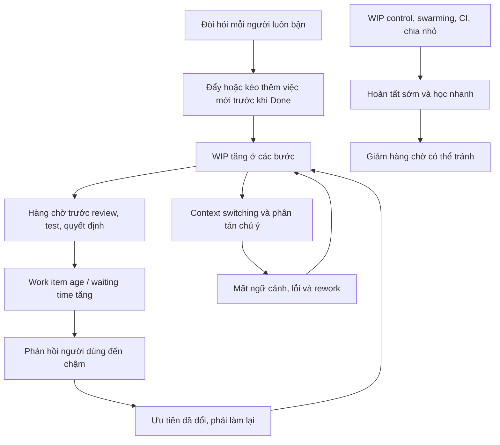

# Tối ưu mức bận rộn cá nhân làm tăng WIP và thời gian chờ

Một nhóm phát triển nền tảng học trực tuyến có sáu Developers. Để “tăng năng suất”, người quản lý muốn **mỗi người luôn có ít nhất một ticket đang làm**. Developer hoàn thành code nhưng chưa được review sẽ được giao ngay ticket mới; người kiểm thử đang bận thì nhóm đẩy thêm thay đổi vào hàng chờ; một chuyên gia xác thực nhận nhiều yêu cầu review vì mọi người đều được khuyến khích mở PR mới càng sớm càng tốt. Dashboard cho thấy ai cũng hoạt động, số ticket mang nhãn `In Progress` tăng, nhưng tính năng **“Tiếp tục bài học đang dở”** không đến được người học.

Tình huống này thể hiện một sai lầm trong phát triển phần mềm: **tối ưu mức bận rộn của từng cá nhân thay vì khả năng hoàn tất và giao giá trị của toàn hệ thống**. Khi không kiểm soát lượng việc đã bắt đầu, công việc chồng chất trước những bước có năng lực giới hạn. Hạng mục phải đợi lâu hơn, người làm đổi ngữ cảnh nhiều lần, lỗi tích hợp được phát hiện muộn và những công việc tưởng “gần xong” có thể không bao giờ đạt **Definition of Done** đúng lúc.

Bận rộn không đồng nghĩa lãng phí: con người cần tập trung, học hỏi, hỗ trợ nhau và đôi khi làm nhiều hoạt động cần thiết. Vấn đề xuất hiện khi tổ chức dùng **tỷ lệ thời gian cá nhân được lấp đầy** như đích tối ưu hoặc chỉ tiêu đánh giá, khiến mọi người ưu tiên **bắt đầu việc mới** thay vì **kết thúc việc đã nhận**.

Bài học thuộc chương **Sai lầm thường gặp** của mô-đun **AGILE_DEVELOPMENT**. Nội dung kết nối các giá trị Agile — giao phần mềm có ích sớm, cộng tác, phản hồi liên tục và cải tiến — với **user story, Product Backlog, Scrum, Kanban, XP và đo lường dòng công việc**. Mục tiêu không phải khiến mọi người “nhàn rỗi”, mà là xây một hệ thống **bền vững, ít chờ hơn, chất lượng hơn và giao giá trị có thể dự báo tốt hơn**.

## 1. Mục tiêu học tập

Sau bài này, người học có thể:

1. Phân biệt **mức sử dụng năng lực (*utilization*)**, mức bận rộn, công việc đã bắt đầu, throughput, cycle time và **giá trị người dùng**.
2. Giải thích tại sao việc cố giữ từng cá nhân **100% bận** có thể làm **Work in Progress (WIP)** và thời gian chờ tăng.
3. Nhận diện chuỗi nguyên nhân **đẩy việc mới → hàng chờ → context switching → phát hiện lỗi muộn → rework → WIP cao hơn**.
4. Dùng mô hình hàng chờ đơn giản để hiểu tác động của **utilization cao và biến động đầu vào**, đồng thời nêu rõ các giả định của mô hình.
5. Áp dụng **Little’s Law** đúng ranh giới, phân biệt tương quan trung bình với nguyên nhân hay lời hứa deadline.
6. Tính WIP, work item age, throughput và cycle time bằng bộ dữ liệu Start/Finish nhất quán.
7. Đọc **WIP limit, blocked work, aging WIP và cumulative flow diagram (CFD)** để nhận diện trở ngại hệ thống.
8. Phân biệt **resource efficiency** và **flow efficiency**, không quy kết chậm trễ cho từng cá nhân khi thiếu bằng chứng.
9. Đề xuất **pull, swarm, pairing, giới hạn WIP, chia lát cắt dọc và tự động hóa kiểm chứng** để hoàn tất giá trị sớm.
10. Hiểu cách Scrum Team bảo vệ **Sprint Goal, Definition of Done, Product Backlog** và sử dụng Kanban practices trong Sprint.
11. Giải thích vì sao XP **TDD, CI, refactoring, collective code ownership và pair programming** giúp giảm hàng chờ kỹ thuật.
12. Thiết kế chỉ số có guardrail **chất lượng, rủi ro, khả năng phục hồi và outcome**, tránh dùng số giờ online hoặc ticket cá nhân để xếp hạng.
13. Phân biệt **năng lực dự phòng lành mạnh** với thiếu việc hoặc lãng phí có thể cải thiện.
14. Xây một thử nghiệm cải tiến ngắn có baseline, chính sách, người tham gia, cách đo và điều kiện giữ/sửa/bỏ.
15. Phản biện những câu nói như “ai rảnh phải mở task mới” và “chuyển blocked item về backlog để WIP thấp”.

## 2. Sai lầm trung tâm: đánh đồng “bận” với “tạo giá trị”

### 2.1. Bốn khái niệm khác nhau

| Khái niệm | Câu hỏi nó trả lời | Điều nó chưa chứng minh |
| --- | --- | --- |
| **Activity / mức bận** | Người này đang hoạt động hoặc có công việc được giao không? | Công việc có đến được người dùng không? |
| **Utilization** | Năng lực của một người/tài nguyên được sử dụng trong khoảng quan sát ở mức nào? | Hệ thống có giao kết quả nhanh và chất lượng không? |
| **Throughput** | Bao nhiêu work item đi qua điểm Finish mỗi kỳ? | Mỗi item có giá trị tương đương hay sản phẩm có outcome tốt không? |
| **Flow/Cycle time** | Một item mất bao lâu từ Start tới Finish theo ranh giới đã chọn? | Việc cần làm có được chọn đúng hoặc đã được release chưa? |
| **Outcome** | Người dùng/kinh doanh nhận kết quả có ích nào? | Nguyên nhân cải thiện chỉ do một thay đổi quy trình? |

Ví dụ: Developer mở bốn PR nhưng chưa PR nào đạt review và kiểm thử. Mức bận của Developer cao, **throughput tại ranh giới Done bằng 0**. Ngược lại, một Developer dành buổi chiều giúp nhóm sửa một lỗi tích hợp khiến ba PBI hoàn tất có thể **không mở ticket riêng** nhưng đóng góp lớn vào dòng giá trị.

### 2.2. Tại sao “mọi người phải luôn có việc” nghe hợp lý?

Đây là phản xạ xuất phát từ mong muốn:

- Tránh lãng phí ngân sách hoặc thời gian làm việc.
- Không để người có chuyên môn ngồi đợi.
- Tối đa lượng công việc được khởi động.
- Tăng số đầu mục nhìn thấy trên dashboard.
- Đảm bảo người quản lý luôn có trạng thái để báo cáo.

Những mục đích ấy không tự động xấu. Sai lầm nằm ở **giả định** rằng nếu mỗi bộ phận hoặc cá nhân dùng hết năng lực, **toàn bộ hệ thống** cũng vận hành tối ưu.

### 2.3. Đơn vị giá trị là phần công việc hoàn tất, không phải trạng thái “đang làm”

Nếu user story là:

> “Là học viên đã đăng nhập, tôi muốn tiếp tục đúng bài học đang dở để không mất thời gian tìm lại.”

Thì việc viết xong UI hoặc tạo endpoint riêng **chưa đủ** khi chưa tích hợp và kiểm chứng đúng tài khoản/quyền truy cập. Kết quả người dùng quan tâm là **luồng hoạt động đáng tin**.

**Sự tiến bộ phải được nhìn ở Increment có thể sử dụng và phản hồi thực tế**, chứ không ở số người đang gõ code hoặc số ticket “80% Done”.

## 3. Tối ưu cục bộ và tối ưu toàn hệ thống

### 3.1. Hai cách ra quyết định

**Tối ưu cục bộ:**

> “Developer A đã viết xong code, đang chờ review. Để A không bị rảnh, giao thêm PBI mới.”

**Tối ưu theo dòng:**

> “Có ba PBI ở Review và một test thất bại. Trước khi mở việc mới, đội hỗ trợ review, sửa test, pairing hoặc làm rõ blocker để những PBI này tới Done.”

Cách thứ hai có thể khiến một vài người **không có ticket mới đứng tên** trong vài giờ, nhưng giúp công việc của cả đội **rời khỏi WIP và tạo giá trị**.

### 3.2. Ví dụ nút cổ chai

Một nhóm có:

- 4 Developers tập trung viết code.
- 1 người có khả năng review một phần bảo mật quan trọng.
- 1 môi trường integration test có khả năng chạy một số kịch bản nhất định.
- Nhiều PBI yêu cầu kiểm chứng cả ba bước.

Nếu code có thể tạo ra **10 PR/ngày**, nhưng khâu review phù hợp rủi ro chỉ xử lý **5 PR/ngày** trong điều kiện hiện tại, hàng chờ trước Review sẽ tăng **nếu tốc độ đến cao hơn khả năng hoàn tất trong thời gian đủ dài**.

Không cần kết luận “reviewer làm việc chậm”. Có thể phải:

- Chia sẻ chuyên môn và tạo reviewer đủ năng lực.
- Tự động hóa kiểm tra lặp lại.
- Giảm số PR lớn hoặc chưa đủ bối cảnh.
- Thay đổi cách chia PBI.
- Xem độ biến động và những loại review cần chuyên gia.
- Điều tiết việc kéo mới cho tới khi hàng chờ ổn định.

**Tối đa lượng code được tạo ra ở bước trước không giúp hệ thống nhanh nếu bước sau không theo kịp.**

### 3.3. “Suboptimization” không phải lỗi đạo đức cá nhân

Một Developer mở việc mới có thể đang **làm đúng chính sách giao việc hoặc tiêu chí đánh giá**. Nếu tổ chức khen người có nhiều ticket và phạt người “không có việc được gán”, họ sẽ có động lực tăng WIP.

Cần thay đổi **hệ thống khuyến khích, quyền hợp tác và các chính sách**, thay vì chỉ yêu cầu mọi người “hãy nghĩ về lợi ích chung” rồi tiếp tục chấm điểm cá nhân.

## 4. Chuỗi nguyên nhân khiến WIP và thời gian chờ tăng



Sơ đồ minh họa **các cơ chế có thể xảy ra**, không khẳng định mọi team đều có đủ mọi vòng. Một team có WIP cao có thể do nhu cầu lớn, môi trường tắc hoặc phân loại item khác; cần điều tra thực tế.

### 4.1. Hàng chờ là công việc chưa xong có chi phí

Một item đang đợi không biến mất khỏi hệ thống:

- Người yêu cầu chưa nhận giá trị.
- Những giả định có thể hết hạn khi bối cảnh thay đổi.
- Người nhận review phải hiểu lại quyết định đã cũ.
- Code có nguy cơ xung đột với các thay đổi mới.
- Người đang chờ có thể chuyển sang item khác, rồi quay lại phải dựng ngữ cảnh.
- Số lượng lựa chọn và kiểm tra cần nhớ tăng.

### 4.2. Mở việc mới không giải quyết blocker cũ

Nếu PBI A chờ test environment, bắt đầu PBI B không làm environment được sửa. Nó có thể là lựa chọn hợp lý **trong ngắn hạn** khi đội không thể can thiệp blocker, nhưng nếu cứ mở B, C, D mà không có người chịu trách nhiệm gỡ trở ngại, **WIP tích tụ**.

Một chính sách tốt quy định **khi nào được bắt đầu việc thay thế, có giới hạn và ngày xem lại**, không cực đoan rằng người bị chặn phải ngồi im hoặc luôn phải mở việc mới.

### 4.3. Tối ưu “ai cũng bận” có thể khiến công việc chậm qua nhiều team

Một user story cần:

1. Làm rõ yêu cầu.
2. Viết code.
3. Review.
4. Tích hợp.
5. Test.
6. Sửa lỗi.
7. Đáp ứng DoD.

Nếu mỗi bước được đo bằng “người làm bước đó phải đầy việc”, dòng công việc sẽ trải qua **nhiều hàng chờ nối tiếp**. Thời gian thực sự xử lý có thể chỉ vài giờ, nhưng cycle time kéo dài nhiều ngày.

## 5. Utilization cao và biến động: vì sao hàng chờ nhạy cảm?

### 5.1. Utilization là một tỷ lệ có ranh giới

Đối với một tài nguyên hoặc bước xử lý cụ thể:

```text
Utilization xấp xỉ = mức tải xử lý trung bình / năng lực phục vụ trung bình

Nếu một reviewer có thể xử lý trung bình 5 yêu cầu/ngày
và nhận trung bình 4,5 yêu cầu/ngày:

Utilization theo giả định = 4,5 / 5 = 0,9 = 90%
```

Đây là cách nhìn **ở một bước xử lý**, không suy ra chính xác “mỗi người của team bận 90%”. Trong công việc tri thức, năng lực không cố định và khó đo bằng số ticket nếu kích thước/độ phức tạp khác nhau.

### 5.2. Minh họa bằng mô hình M/M/1

Để thấy vì sao chờ đợi có thể tăng rất nhanh khi bước xử lý gần bão hòa, xét mô hình hàng chờ **M/M/1** rất đơn giản:

- Một server/reviewer.
- Yêu cầu đến theo tiến trình Poisson với tốc độ bình quân `λ`.
- Thời gian xử lý phân phối mũ, độc lập, tốc độ phục vụ bình quân `μ`.
- Không có chính sách ưu tiên, không giới hạn hàng chờ.
- Các đặc điểm ổn định theo thời gian.
- Điều kiện ổn định: `λ < μ`.

Khi các giả định ấy phù hợp, thời gian bình quân ở hệ thống và chờ trong queue có dạng:

```text
W = 1 / (μ - λ)                       (thời gian trong hệ thống)
Wq = λ / [μ × (μ - λ)]               (thời gian chờ trước xử lý)
ρ = λ / μ                            (utilization)
```

Giả sử `μ = 5 yêu cầu/ngày`:

| Tốc độ đến `λ` | Utilization `ρ` | Chờ trung bình `Wq` | Tổng thời gian `W` |
| ---: | ---: | ---: | ---: |
| 3 yêu cầu/ngày | 60% | 0,30 ngày | 0,50 ngày |
| 4 yêu cầu/ngày | 80% | 0,80 ngày | 1,00 ngày |
| 4,5 yêu cầu/ngày | 90% | 1,80 ngày | 2,00 ngày |
| 4,75 yêu cầu/ngày | 95% | 3,80 ngày | 4,00 ngày |

Cách tính ở `λ = 4,5`:

```text
W = 1 / (5 - 4,5) = 2 ngày
Wq = 4,5 / [5 × (5 - 4,5)] = 4,5 / 2,5 = 1,8 ngày
Thời gian xử lý trung bình = 1 / μ = 0,2 ngày
W = Wq + 0,2 = 2 ngày
```

Điều đáng nhớ: trong **mô hình giả định này**, tăng tải từ 60% lên 90% khiến thời gian chờ bình quân tăng **0,30 lên 1,80 ngày**, mặc dù thời gian xử lý cơ bản không đổi.

**Đừng dùng bảng M/M/1 để hứa rằng đội phần mềm sẽ chờ đúng 1,8 ngày ở mức 90%.** Review code có kích thước biến động, phụ thuộc, làm song song, nghỉ, đổi ưu tiên và tác động lẫn nhau; các giả định M/M/1 thường không khớp. Bảng chỉ minh họa cơ chế **bão hòa + biến động → hàng chờ khó kiểm soát**.

### 5.3. Vì sao chừa năng lực có thể có giá trị?

Năng lực chưa sử dụng hết ở một bước có thể giúp hấp thụ:

- Công việc đến dồn bất ngờ.
- Incident nghiêm trọng.
- Review rủi ro cao.
- Một PBI cần pairing để tháo blocker.
- Thời gian bổ sung test.
- Đào tạo kỹ năng để giảm phụ thuộc lâu dài.

**Không có mức utilization tối ưu duy nhất** cho mọi nhóm. Ý tưởng cần giữ là **khả năng phản ứng với biến động có giá trị**, và vận hành liên tục sát 100% có thể khiến queue dài, bất ổn.

### 5.4. Utilization không phải thứ duy nhất ảnh hưởng chờ đợi

Hàng chờ còn chịu tác động bởi:

- Độ biến động kích thước và thời gian xử lý item.
- Cường độ và thời điểm yêu cầu đến.
- Quy tắc ưu tiên hoặc preemption.
- Năng lực đa kỹ năng và số bước phải qua.
- Khả năng kiểm chứng tự động.
- Độ tin cậy của môi trường.
- Phân phối giữa những loại công việc.
- Giới hạn WIP, lịch vận hành và quy tắc batch.

Vì vậy, cải tiến nên dựa trên **dữ liệu thực và điều tra hệ thống**, không chỉ yêu cầu một reviewer “làm nhanh hơn”.

## 6. Biến động và hàng chờ trong phát triển phần mềm

### 6.1. Công việc tri thức không có kích thước đều

Một PR đổi câu thông báo có thể mất vài phút review. Một PR thay chính sách phân quyền có thể cần:

- Kiểm tra luồng đăng nhập.
- Xem schema dữ liệu.
- Tái hiện bug A/B.
- Kiểm chứng authorization và regression.
- Xác nhận từ nhóm bảo mật.

Nếu mọi PR được đếm là “một việc”, trung bình có thể che **sự khác biệt lớn về nhu cầu kỹ năng và thời gian**.

### 6.2. Yêu cầu đến theo từng đợt

Đặc biệt với hệ thống phục vụ người học:

- Đầu kỳ khai giảng có nhiều lượt đăng nhập.
- Cuối tuần hoặc sát bài thi xuất hiện lỗi batch và hỗ trợ.
- Đợt release có thể sinh một cụm bug.
- Một thay đổi luật/đối tác có deadline.
- Stakeholder có thể đổi ưu tiên khi thấy phản hồi người dùng.

Nếu mỗi người đã bị lấp kín bằng công việc từ nhiều tuần trước, **không có khả năng hấp thụ yêu cầu mới mà không làm những việc cũ trễ**.

### 6.3. Chia lát cắt nhỏ làm giảm một số dạng biến động

Một PBI “viết lại toàn bộ tiến độ học” khó dự báo và có nhiều điểm tích hợp. Có thể chia thành những lát cắt thực sự sử dụng được:

1. Hiển thị bài tiếp tục trong một khóa đã đăng ký.
2. Xử lý khóa đã kết thúc hoặc hết quyền.
3. Cho xem trạng thái đồng bộ bị trễ rõ ràng.
4. Bổ sung đồng bộ đa thiết bị theo nhu cầu kiểm chứng.

Đội vẫn phải giữ **tính toàn vẹn hành vi và DoD** cho mỗi lát cắt. Chia nhỏ thành ticket UI/backend/test riêng không tự làm người dùng nhận giá trị sớm hơn nếu tất cả vẫn phải chờ nhau.

## 7. Little’s Law: liên hệ WIP và Cycle Time đúng cách

### 7.1. Quan hệ trung bình

Theo Little’s Law, trong một hệ thống hàng chờ thỏa các điều kiện phù hợp, về dài hạn:

```text
Average WIP = Average Throughput Rate × Average Cycle Time

L = λ × W
```

Ở đây:

- `L`: số item bình quân trong ranh giới hệ thống.
- `λ`: tốc độ item đi qua Finish bình quân, ví dụ item/tuần.
- `W`: thời gian một item đi qua ranh giới đó bình quân.

Ví dụ một hệ thống có:

- WIP bình quân **12 item**.
- Throughput bình quân **3 item/tuần**.

Thời gian trung bình tương ứng:

```text
Cycle time bình quân = 12 item / (3 item/tuần) = 4 tuần
```

Nếu trong điều kiện tương đương, WIP bình quân giảm xuống **6 item** còn throughput vẫn **3 item/tuần**, quan hệ trên cho cycle time bình quân **2 tuần**.

### 7.2. Những điều kiện không thể bỏ

- WIP, throughput và cycle time phải đo **cùng ranh giới Start/Finish**.
- Hệ thống được quan sát đủ lâu và tương đối ổn định theo nghĩa phù hợp.
- Dòng vào/ra/loại bỏ hoặc reopen được xử lý nhất quán.
- Work items có thể so sánh về cách đếm và chính sách thay đổi không đột ngột.
- Không dùng một **WIP snapshot** để thay WIP bình quân dài hạn.
- Không lẫn số việc Done phát triển với số việc Released production.
- Không lấy phép chia trung bình làm **deadline cho từng item**.

**Little’s Law không khẳng định rằng chỉ cần ra lệnh giảm WIP thì mọi thứ tự động nhanh lên.** Nếu giới hạn làm throughput giảm hoặc team thiếu kỹ năng hoàn tất, kết quả có thể khác. Đây là quan hệ mô tả, không phải mệnh lệnh nhân quả.

### 7.3. Đâu là cách dùng hữu ích?

- Gợi ý câu hỏi “Tại sao WIP tăng trong khi throughput không đổi?”.
- Giúp hiểu chi phí hàng chờ khi nhiều item được mở.
- Xem liệu khuyến khích bắt đầu việc mới có đi cùng cycle time tăng không.
- Thử giảm WIP theo phạm vi và quan sát cả throughput/chất lượng.
- Trao đổi với stakeholder rằng **mở thêm việc không tương đương sớm hoàn tất**.

## 8. Phân biệt các loại thời gian trong một hạng mục

### 8.1. Một luồng end-to-end

```text
Khách hàng nêu nhu cầu
      |
      v
Chờ được lựa chọn/Ready      <- upstream queue
      |
      v
Start / In Progress
      |
      +--> Phân tích / code
      |
      +--> Chờ Review         <- waiting
      |
      +--> Review
      |
      +--> Chờ test / dữ liệu  <- waiting
      |
      +--> Verification + sửa nếu cần
      |
      v
Finish / Done (đạt chất lượng)
      |
      +--> Chờ change window  <- release queue nếu có
      |
      v
Released / người dùng tiếp cận
      |
      v
Validated / học từ outcome
```

Tùy ranh giới, một item có thể:

- Có **lead time từ request đến Done** khác với cycle time Start–Finish.
- Có **release queue age** sau Done.
- Có **value feedback delay** sau Released.
- Có **touch time/active processing time** ngắn hơn nhiều so với thời gian chờ.

Không nên trộn tất cả thành một chỉ số mà không nêu ranh giới.

### 8.2. Flow efficiency để đặt câu hỏi, không làm chỉ tiêu cứng

Một cách diễn đạt:

```text
Flow efficiency ≈ Thời gian xử lý chủ động / Tổng thời gian đi qua luồng
```

Ví dụ một item:

| Hoạt động | Thời gian minh họa |
| --- | ---: |
| Thảo luận và viết code | 4 giờ |
| Chờ review | 16 giờ |
| Review thực tế | 1 giờ |
| Chờ integration test | 8 giờ |
| Chạy test + sửa | 3 giờ |
| **Tổng** | **32 giờ** |

Nếu phân loại 4 + 1 + 3 = **8 giờ xử lý chủ động** và 16 + 8 = **24 giờ chờ**, flow efficiency xấp xỉ **8/32 = 25%** theo quy ước này.

Con số 25% là **ví dụ**; việc phân loại touch time trong tri thức có nhiều cách và không nên dùng để chấm điểm con người. Mục tiêu là nhìn **24 giờ chờ** có thể cải thiện bằng review phối hợp, test và quy tắc ưu tiên.

### 8.3. Một người có thể bận trong lúc item của họ đang chờ

Câu “Developer A bận 100%” không giúp biết:

- Item A viết code xong đang chờ Review.
- Item B đang chờ acceptance criteria.
- Item C đang code nhưng chưa tích hợp.
- Người dùng vẫn chưa nhận chức năng nào.

**Cần đo công việc chảy qua hệ thống**, không chỉ ghi nhật ký người làm.

## 9. Context switching là một khoản chi phí thường bị giấu

### 9.1. Không phải mọi thay đổi ngữ cảnh đều xấu

Developer có thể chuyển giữa review, pairing và viết test để **giúp một PBI tới Done**. Đó có thể là sự phối hợp cần thiết, không phải lãng phí.

Context switching trở thành vấn đề khi một người bị buộc **đồng thời sở hữu nhiều mục tiêu chưa hoàn tất**, liên tục quay lại các đoạn mã, họp hoặc giả định bị ngắt quãng.

### 9.2. Các chi phí quan sát được

- Đọc lại ticket, thiết kế và lịch sử PR.
- Xây lại mô hình tinh thần của module.
- Nhầm trạng thái branch, dữ liệu hoặc giả định.
- Mất khoảng tập trung để giải bài toán phức tạp.
- Delay phản hồi reviewer hoặc Product Owner.
- Tăng công việc phối hợp và kiểm chứng lại.
- Cảm giác nhiều hoạt động nhưng ít hạng mục Done.

Không cần viện dẫn một “định luật cố định mất 23 phút” để lý giải mọi trường hợp. **Chi phí đổi ngữ cảnh thay đổi theo công việc và người**; hãy quan sát thời gian chờ, rework và phản hồi của nhóm.

### 9.3. Tình huống một Developer có bốn PBI

| Thứ trong ngày | Hành động | Hệ quả |
| --- | --- | --- |
| Sáng | Xử lý PBI A, mở PR | A chưa Done, chờ review |
| Giữa buổi | Bắt đầu PBI B vì “đừng để rảnh” | WIP tăng thêm một |
| Chiều | Có phản hồi review A, đổi sang sửa | B bị gián đoạn |
| Gần cuối | Batch lỗi, chuyển qua PBI C | A và B vẫn chưa Done |
| Hôm sau | Được giao PBI D để “đủ utilization” | Nhiều bối cảnh và hàng chờ cùng mở |

Một phương án tốt hơn là **đưa thông tin blocker lên board, phối hợp giải quyết Review, phân loại incident và giới hạn số việc mở mới**. Không nhất thiết chỉ một việc ở mọi thời điểm; cần có **chính sách giúp hệ thống hoàn tất**.

## 10. Bộ dữ liệu thực hành: 12 hạng mục đang chồng lấn

Để kiểm tra sự khác biệt giữa **nhiều việc bắt đầu** và **số việc hoàn tất**, dùng bộ dữ liệu giả định. Mỗi mốc `D1`, `D2`, ... là **đầu một ngày lịch tương đối**. Theo quy ước này, Start ở đầu D3 và Finish ở đầu D8 nghĩa là **5 ngày lịch**. Khi xét WIP đúng đầu một ngày, item vừa Finish **không còn WIP**, item vừa Start **được tính WIP**.

### 10.1. Dữ liệu Start–Finish

| Item | Start | Finish | Cycle time (ngày) | Nội dung minh họa |
| --- | --- | --- | ---: | --- |
| I1 | D1 | D5 | 4 | Sửa nhãn trạng thái khóa |
| I2 | D1 | D8 | 7 | Khắc phục API tiến độ |
| I3 | D2 | D6 | 4 | Test quyền truy cập A/B |
| I4 | D3 | D10 | 7 | Refactor mapping LMS |
| I5 | D4 | D9 | 5 | Giao diện Tiếp tục bài học |
| I6 | D5 | D11 | 6 | Khắc phục batch đồng bộ |
| I7 | D6 | D13 | 7 | Cập nhật hợp đồng API |
| I8 | D7 | D12 | 5 | Kiểm tra khóa đã hoàn tất |
| I9 | D8 | D16 | 8 | Lỗi lịch sử tiến độ |
| I10 | D9 | D15 | 6 | Cải tiến trạng thái đồng bộ |
| I11 | D10 | D18 | 8 | Cải thiện CI contract tests |
| I12 | D12 | D19 | 7 | Sửa lỗi timeout |

**Tất cả số liệu chỉ để thực hành**, không đại diện một đội thật và không đủ để đánh giá hiệu quả tổ chức. Cột Cycle time được tính bằng **Finish trừ Start** theo mốc đầu ngày, không cộng cả hai ngày biên.

### 10.2. Cycle time trung bình và trung vị

```text
Theo I1..I12:
4, 7, 4, 7, 5, 6, 7, 5, 8, 6, 8, 7

Tổng = 4 + 7 + 4 + 7 + 5 + 6 + 7 + 5 + 8 + 6 + 8 + 7
     = 74 ngày-item

Trung bình = 74 / 12 = 6,166... ngày/item

Sắp tăng:
4, 4, 5, 5, 6, 6, 7, 7, 7, 7, 8, 8

Trung vị = (vị trí thứ 6 + thứ 7) / 2
         = (6 + 7) / 2
         = 6,5 ngày
```

Phân phối có các item ở đuôi **8 ngày**. Không được nói “mọi việc đều xong khoảng 6 ngày” vì dữ liệu có khác biệt và công việc chưa Done ở thời điểm quan sát còn không xuất hiện trong phân phối Completed items.

### 10.3. WIP và Work Item Age tại đầu D10

Công thức theo mốc thời gian giả định:

```text
WIP(D10) = số item thỏa Start <= D10 < Finish
```

Đúng đầu D10:

- I1 đã Finish ở D5.
- I2 đã Finish ở D8.
- I3 đã Finish ở D6.
- I4 vừa Finish ở D10 → **không còn WIP**.
- I5 đã Finish ở D9.
- I6: D5 → D11 → **đang WIP**, age = 10 − 5 = **5 ngày**.
- I7: D6 → D13 → **đang WIP**, age = **4 ngày**.
- I8: D7 → D12 → **đang WIP**, age = **3 ngày**.
- I9: D8 → D16 → **đang WIP**, age = **2 ngày**.
- I10: D9 → D15 → **đang WIP**, age = **1 ngày**.
- I11: vừa Start ở D10 → **đang WIP**, age = **0 ngày**.
- I12 chỉ Start ở D12.

Vậy **WIP tại đầu D10 = 6 item**, gồm **I6, I7, I8, I9, I10, I11**; age tương ứng **5, 4, 3, 2, 1, 0 ngày**.

Age là **thời gian đã trôi qua** đối với item chưa Finished, không phải cycle time dự kiến còn lại. Nếu I9 chưa Done, không thể biết chính xác nó cần thêm bao nhiêu ngày chỉ từ age.

### 10.4. Throughput theo ba kỳ không chồng lấn

Quy ước ba kỳ:

- **Kỳ 1:** `D1 ≤ Finish < D8`.
- **Kỳ 2:** `D8 ≤ Finish < D15`.
- **Kỳ 3:** `D15 ≤ Finish < D22`.

| Kỳ | Item Finished | Throughput |
| --- | --- | ---: |
| D1–trước D8 | I1 (D5), I3 (D6) | **2 item** |
| D8–trước D15 | I2 (D8), I5 (D9), I4 (D10), I6 (D11), I8 (D12), I7 (D13) | **6 item** |
| D15–trước D22 | I10 (D15), I9 (D16), I11 (D18), I12 (D19) | **4 item** |
| **Tổng** | **12 item** | **2 + 6 + 4 = 12** |

Throughput bình quân đơn giản **12 / 3 = 4 item/kỳ**, nhưng dữ liệu **2–6–4** cho thấy biến động. Không được khẳng định đội có công suất cố định đúng bốn item/tuần.

### 10.5. P85 theo nearest-rank

Với 12 cycle time đã sắp, theo phương pháp **nearest-rank**:

```text
rank = ceil(0,85 × 12) = ceil(10,2) = 11

Giá trị thứ 11 trong dãy tăng dần = 8 ngày.

P85 mẫu = 8 ngày (nearest-rank).
```

Ở mẫu này, cả 12 item đều ≤ 8 ngày, nghĩa là **100% mẫu** không vượt 8 ngày. Kết quả P85 là **một giá trị thống kê của mẫu nhỏ**, không đủ để cam kết 85% item mới sẽ xong trong 8 ngày. Phương pháp nội suy percentile khác có thể cho kết quả khác; khi báo cáo phải nói rõ quy ước.

### 10.6. Đọc dữ liệu như một người cải tiến hệ thống

Những câu hỏi thực chất:

1. Ở D10, sáu item WIP có đang tranh nhau cùng một reviewer hoặc test environment không?
2. Nếu đội tiếp tục mở thêm I12 rồi I13, **khả năng Finish** của hệ thống có tăng tương ứng không?
3. Một item age 12 ngày nhưng chưa Finish sẽ không nằm trong bảng 12 Completed items; làm sao đội phát hiện?
4. Sự khác biệt throughput 2–6–4 do biến động thông thường, thay đổi chính sách hay một bottleneck?
5. Nếu ticket I9 thực chất là một phần của PBI lớn chưa tích hợp, điểm Finish đã được chọn đúng chưa?
6. Nếu trong tuần tới team hạ DoD, phép đo có còn so sánh được không?

**Đo để tìm quyết định cần thay đổi, không để khen người tạo nhiều thẻ nhất.**

## 11. Work Item Age: tín hiệu sớm khi công việc bị “giữ mở”

### 11.1. Tại sao chỉ xem Completed items có thể gây lạc quan?

Một dashboard chỉ tính cycle time của 20 ticket Done gần đây có thể trông tốt, trong khi một PBI quan trọng bị chặn 25 ngày vẫn ở `In Progress`.

**Work Item Age** cho thấy thời gian item **chưa Finish** đã đi qua kể từ Start. Khi age lớn bất thường, đội nên hỏi:

- Có phụ thuộc bị quên không?
- Phần việc có quá lớn để hiểu hoặc kiểm chứng không?
- Có cần người khác pairing/review không?
- Có thay đổi ưu tiên nhưng chưa công bố không?
- Có thể hoàn tất một lát cắt đứng độc lập không?
- Người yêu cầu đã được cập nhật kỳ vọng chưa?

### 11.2. Cách xử lý item già

Thay vì “hãy làm nhanh lên”, dùng trình tự:

1. Xác nhận trạng thái và thời điểm Start thật.
2. Nêu blocker và tác động.
3. Xem người/nhóm có thể giúp làm Done.
4. Tránh kéo thêm việc Standard khi WIP đã đầy.
5. Điều chỉnh cách chia scope **chỉ khi vẫn tạo giá trị thật và đáp ứng chất lượng**.
6. Thông báo tình trạng, rủi ro và forecast mới cho người có liên quan.
7. Ghi một cải tiến hệ thống nếu nguyên nhân lặp lại.

**Không reset Start date** vì item đã chờ quá lâu. Làm vậy mất khả năng học từ vấn đề và làm số liệu đẹp giả.

## 12. Service Level Expectation và thời gian chờ

### 12.1. SLE là kỳ vọng có xác suất

*Service Level Expectation (SLE)* trong Kanban là cách diễn đạt **kỳ vọng thời gian item đi từ Start tới Finish**, thường dựa trên dữ liệu lịch sử và gồm **mức thời gian + phần trăm**.

Ví dụ **giả định**:

> “Với các bug Standard được định nghĩa cùng ranh giới hiện tại, chúng tôi kỳ vọng khoảng **85%** được Finished trong **không quá 10 ngày lịch**.”

Đây không phải lời hứa 100% hoặc SLA theo hợp đồng. Cần nêu:

- Loại item.
- Start/Finish.
- Khoảng thời gian và phần trăm.
- Dữ liệu/giả định.
- Những thay đổi workflow khiến cần tính lại.

### 12.2. SLE giúp nhìn vấn đề trước khi quá muộn

Nếu một item đã age 9 ngày trong luồng có SLE “85% ≤ 10 ngày”, team nên **chủ động gỡ blocker và cập nhật kỳ vọng**, không đợi nó vượt rồi bắt ai đó làm thêm giờ.

### 12.3. Không biến SLE thành deadline nhân tạo cho mọi người

Sai lầm:

> “Mọi Developer phải đóng ticket trước ngày thứ 10, nếu không đánh giá kém.”

Cách dùng đúng hơn:

> “Khi item có age gần hoặc vượt SLE, chúng ta cùng kiểm tra nguyên nhân, hỗ trợ hoàn tất và điều chỉnh forecast. Đo ở cấp dịch vụ, gắn với chất lượng.”

## 13. Cumulative Flow Diagram: khi đường Started bỏ xa đường Finished

### 13.1. CFD giúp thấy WIP tích tụ

Trong một **Cumulative Flow Diagram (CFD)**, các lớp trạng thái thể hiện số item tích lũy qua thời gian. Khi:

- **Started tăng nhanh**, Finished tăng chậm → WIP tăng.
- Dải Review dày lên → có thể có hàng chờ Review.
- Đường Finished phẳng trong một khoảng → hệ thống không có item Finish trong khoảng.
- Dải trạng thái tương đối ổn định → WIP có thể ổn định.

### 13.2. Sơ đồ minh họa

```text
Số item tích lũy
^
|                                  Started      /---------
|                                ___/         /
|                            ___/            /
|                        ___/    WIP         /
|                    ___/                  _/
|               ____/      Finished   ___/
|          ____/                    __/
|      ___/                     ___/
|_____/________________________/________________> Thời gian

Độ rộng vùng giữa Started và Finished thể hiện WIP
theo cách tính và ranh giới của hệ thống.
```

CFD thực tế thường là các dải trạng thái xếp chồng, không chỉ hai đường phác họa.

### 13.3. Không kết luận bằng biểu đồ một mình

Nếu dải Review ngày càng dày, nguyên nhân có thể là:

- PR quá lớn hoặc thiếu bối cảnh.
- Chỉ một reviewer đủ quyền/kiến thức.
- Reviewer bị gián đoạn vì incident.
- Code chạy test rất chậm.
- Policy “review theo tuần” tạo batch lớn.
- Công cụ không cập nhật đúng khi PR đã merge.
- Bước Review thực ra bao gồm chờ phê duyệt bảo mật.

Cần **xem item và hỏi người tham gia dòng**, không tự động đổ lỗi cho QA hoặc reviewer.

## 14. Chính sách WIP: điều tiết đầu vào để cải thiện đầu ra

### 14.1. Giới hạn WIP là rào chắn cấp hệ thống

Trong Kanban, **WIP control** giúp giới hạn lượng item đã Start nhưng chưa Finish. Một mô hình đơn giản:

```text
Options -> Ready -> In Progress -> Review -> Verification -> Done
                      (limit 3)   (limit 2)    (limit 2)
                  \___________________________/
                        overall WIP <= 5
```

Con số 3/2/2 và tổng 5 chỉ là **ví dụ thử nghiệm**. Team phải xem liệu từng cột và tổng limit có nhất quán với năng lực và cơ chế xử lý thật không.

### 14.2. Một bảng trạng thái mẫu

| Trạng thái | WIP hiện có | Limit thử nghiệm |
| --- | ---: | ---: |
| In Progress | 2 | 3 |
| Review | 3 | 2 |
| Verification | 1 | 2 |
| **Toàn hệ thống** | **6** | **5** |

Review và tổng WIP đang **vượt limit**. Một Developer vừa rảnh không nên mặc định Start thêm PBI, mà có thể:

- Review một thay đổi phù hợp chuyên môn/quyền.
- Pairing hỗ trợ reviewer giải thích ngữ cảnh.
- Sửa test đang đỏ.
- Gỡ phụ thuộc môi trường.
- Làm rõ một quyết định nghiệp vụ đang chặn Done.

### 14.3. Khi vượt limit không phải để phạt người

Vượt limit là **tín hiệu**. Đôi khi có lý do chính đáng:

- Sự cố sản phẩm thật.
- Hai item cần xử lý song song vì đang chờ bên ngoài.
- Môi trường hoặc cấp quyền không phù hợp.
- Chính sách limit đặt quá thấp so với đặc thù công việc.
- Thông tin trên board chưa được cập nhật.

Điều cần làm là **công bố lý do, xử lý rủi ro và xem lại chính sách**, không che item hoặc trách phạt người tạo tín hiệu.

### 14.4. Đừng giảm WIP bằng cách thay nhãn

Sai:

> “Đưa tất cả thẻ blocked về `Ready`; dashboard sẽ báo WIP = 2.”

Nếu item **đã Start nhưng chưa Finish**, nó vẫn cần được xem trong WIP theo ranh giới đã định. Đổi nhãn để giảm WIP khiến mô hình thời gian không còn đáng tin.

### 14.5. Điều gì xảy ra nếu giảm limit quá mạnh?

Nếu team chỉ cho phép một item WIP trong khi item cần review từ đối tác mất nhiều ngày, hệ thống có thể **không dùng được năng lực hợp lý**. Cần cân bằng:

- Sự độc lập và kích thước item.
- Khả năng swarming.
- Độ trễ ngoài quyền kiểm soát.
- Năng lực kỹ năng.
- Mức urgency và rủi ro.
- Throughput, cycle time, age và chất lượng quan sát được.

**Limit phù hợp được học qua thử nghiệm**, không được suy từ số nhân sự rồi cố định vĩnh viễn.

## 15. Pull và chính sách “hoàn tất trước khi bắt đầu thêm”

### 15.1. Pull khác đẩy việc cho người chưa có task

Trong push system, người quản lý có thể giao sẵn nhiều ticket cho mỗi Developer. Trong pull system, team **lựa chọn item tiếp theo khi đủ năng lực theo chính sách**, và xem xét lượng WIP còn mở.

“Stop starting, start finishing” là một **khẩu quyết thực hành hữu ích**, không phải nguyên tắc cấm mọi hoạt động song song.

### 15.2. Chuyển từ câu hỏi “ai đang rảnh?” sang “việc nào cần hoàn tất?”

Một daily flow review có thể hỏi:

1. Item nào ở Verification có thể Finish hôm nay?
2. Item nào đang chờ review quá lâu?
3. Item nào age cao nhất?
4. Có người có thể pairing/swarm gỡ điểm nghẽn?
5. Mức WIP hiện có cho phép kéo item mới không?
6. Công việc khẩn nào thật sự cần ưu tiên vượt luồng?
7. Người yêu cầu cần được báo thay đổi dự báo nào?

Câu hỏi cũ “mỗi người hôm qua làm gì?” có thể hữu ích trong một số bối cảnh, nhưng **không tự tạo quyết định điều tiết flow**.

### 15.3. Replenishment khi có năng lực

Nhóm không cần Start tất cả PBI đang `Ready`. Khi có năng lực:

- Chọn item có giá trị/rủi ro phù hợp.
- Làm rõ acceptance criteria trước khi kéo.
- Xem deadline thật, tác động người dùng.
- Xem phụ thuộc và năng lực kiểm chứng.
- Không chọn chỉ vì ticket dễ làm hoặc người đề nghị có quyền lực hơn.
- Không kéo tới mức vượt limit khi chưa có lý do minh bạch.

### 15.4. Không đồng nghĩa bỏ Product Owner

Nếu team dùng Scrum, **Product Owner** vẫn chịu trách nhiệm tối đa hóa giá trị sản phẩm và quản lý Product Backlog hiệu quả. Pull/WIP policies **không được dùng để bỏ accountability ấy**. Trong hệ thống không dùng Scrum, quyền ưu tiên và phân loại rủi ro vẫn cần được làm rõ.

## 16. Swarming, pairing và cộng tác vượt ranh giới cá nhân

### 16.1. Vì sao “một người — một PBI” có thể gây hại?

Khi mỗi PBI “thuộc sở hữu riêng” một Developer từ đầu đến cuối, có thể xuất hiện:

- Người khác ngại giúp review hoặc test.
- Chuyên gia chỉ có thời gian giải quyết phần việc cá nhân.
- Knowledge silo không giảm.
- Lỗi tích hợp bị coi là vấn đề “của team khác”.
- Người có năng lực trống bị giao việc mới thay vì giúp hoàn tất.

**Trách nhiệm giải trình về công việc không cần đồng nghĩa cô lập công việc vào một người.**

### 16.2. Swarming là gì?

*Swarming* là khi những người phù hợp **tạm tập trung hỗ trợ một vấn đề/hạng mục** để gỡ blocker hoặc đưa nó tới Done. Ví dụ:

- Developer frontend và backend cùng kiểm tra contract.
- Người kiểm thử hỗ trợ thiết kế scenario trước khi code.
- Chuyên gia bảo mật tham gia sớm để ngăn rework.
- Hai Developers cùng xác định nguyên nhân CI flaky.
- Product Owner làm rõ acceptance criteria ngay khi nhóm đang bị chặn.

Không cần huy động cả team vào một lỗi nhỏ; swarming phải có **mục tiêu, thời lượng và quyết định** cụ thể.

### 16.3. Pairing là đầu tư vào flow, không phải “hai người làm một việc nên phí”

Hai người cùng làm có thể:

- Giảm thời gian chờ review.
- Bắt lỗi sớm.
- Chia sẻ tri thức, giảm một điểm phụ thuộc.
- Làm rõ giả định phức tạp.
- Hỗ trợ Developer ít kinh nghiệm hiểu module.
- Tạo thay đổi nhỏ, test được và dễ bảo trì.

**Không được mặc định pairing luôn tốt hơn làm độc lập**; có những việc đơn giản không cần hai người. Đánh giá theo tác động lên **time-to-Done, chất lượng và khả năng duy trì năng lực** thay vì chỉ đếm số người cùng mở một màn hình.

### 16.4. Ví dụ hỗ trợ một item chờ Review

Trước:

- A mở PR.
- B không có việc và Start PBI mới.
- Reviewer C bận, PR A chờ ba ngày.
- A chuyển sang B, khó quay lại sửa code A.

Sau cải tiến:

- B đọc test và contract của PR A, phối hợp nếu đủ năng lực/quyền.
- C hỗ trợ quyết định phần rủi ro cao thay vì làm hết phần kiểm tra có thể tự động.
- A sửa feedback trong cùng ngữ cảnh.
- Item A qua Verification và Done.
- B chỉ kéo việc mới khi WIP còn năng lực.

Điểm cải thiện không phải **giảm mức bận của B**, mà là **biến thời gian của B thành tiến độ hoàn tất của hệ thống**.

## 17. Nút cổ chai: đừng ép một bước yếu làm việc nhanh bằng cách đẩy thêm vào nó

### 17.1. Nút cổ chai là ranh giới năng lực của toàn dòng

Trong một hệ thống có nhiều bước nối tiếp, một bước có năng lực giới hạn có thể **ràng buộc throughput toàn dòng**. Đẩy thêm item vào trước bước ấy có thể làm queue dài hơn mà không giúp hoàn tất.

Ví dụ:

| Bước trong luồng | Năng lực minh họa | Điều kiện |
| --- | ---: | --- |
| Code | 10 item/tuần | PBI tương tự nhau theo giả định |
| Review | 6 item/tuần | Có kỹ năng và thời gian review phù hợp |
| Verification | 5 item/tuần | Test environment và kiểm thử hiện tại |
| Đạt Done | Tối đa khoảng 5 item/tuần trong trường hợp lý tưởng | Bỏ qua rework/biến động để minh họa |

Nếu đầu vào liên tục là 10 item/tuần, việc bắt cả team **tạo đủ 10 item code mỗi tuần** không giúp khâu Verification vượt năng lực 5 item/tuần. Phần chênh lệch có thể trở thành WIP/queue.

Bảng là mô hình đơn giản, **không phản ánh một dây chuyền thực có rework và các item khác kích thước**. Nó giúp làm rõ vấn đề của tối ưu năng lực cục bộ.

### 17.2. Tìm nút cổ chai bằng chứng nào?

- Nhiều item chờ cùng một trạng thái.
- Work item age tăng trước một bước.
- Review wait hoặc test wait dài.
- Người ở bước trước liên tục “đang bận” trong khi Done ít.
- Việc có rủi ro cao chỉ một chuyên gia xử lý.
- Tỷ lệ rework hoặc test flaky cao.
- Đầu vào biến động làm thời gian chờ tăng mạnh.

Không kết luận nguyên nhân chỉ từ việc một cá nhân có ít ticket Done. **Cần phân biệt năng lực, chất lượng đầu vào, chính sách và phụ thuộc**.

### 17.3. Các chiến lược xử lý thực tế

1. **Giảm đầu vào** trước bước nghẽn bằng WIP limit và pull.
2. **Tăng chất lượng đầu vào**: PR nhỏ, test rõ, acceptance criteria đủ hiểu.
3. **Tăng năng lực có trách nhiệm**: pairing, đào tạo reviewer dự phòng, tự động hóa lặp lại.
4. **Giảm lô xử lý**: review sớm thay vì đợi thứ Sáu, chạy CI theo từng PR.
5. **Sắp thứ tự hợp lý**: ưu tiên item gần Done hoặc có rủi ro cần xử lý.
6. **Loại bỏ phụ thuộc không cần thiết**: feature teams, contract tests và self-service phù hợp.
7. **Đánh giá lại hệ thống**: khi bottleneck cũ giảm, bottleneck mới có thể lộ ra.

**Không giải nút nghẽn bảo mật bằng cách bỏ chuyên gia phê duyệt bắt buộc**. Cải thiện có thể là tham gia sớm, tự động hóa bằng chứng và người thay thế đủ thẩm quyền.

### 17.4. “Bận ở bottleneck” cũng không có nghĩa phải 100% mãi mãi

Một bước quan trọng cần năng lực dự phòng để xử lý biến động và kiểm soát chất lượng. Nếu reviewer luôn được xếp kín đến phút cuối, review khẩn có thể chờ và việc sửa lỗi nghiêm trọng cũng bị đẩy lùi.

**Năng lực đệm được thiết kế có mục đích có thể làm hệ thống đáng tin hơn**.

## 18. Năng lực dự phòng: không rảnh vô ích, cũng không phải luôn làm thêm

### 18.1. Tại sao khoảng trống có thể tạo giá trị?

Trong hệ thống có biến động, một khoảng năng lực chưa được phân bổ cứng cho một ticket mới có thể dùng để:

- Hỗ trợ item đang bị chặn.
- Review yêu cầu có rủi ro.
- Phản hồi incident.
- Cải thiện CI/test.
- Cập nhật tài liệu quan trọng.
- Học một kỹ năng giúp giảm knowledge silo.
- Làm rõ một thay đổi cần nhiều team phối hợp.
- Xử lý vấn đề nhỏ trước khi phát triển thành sự cố.

Không nên diễn giải **capacity buffer = bắt người làm việc miễn phí ngoài giờ**. Nó nằm trong khả năng phối hợp được tổ chức công nhận.

### 18.2. Năng lực đệm khác nhàn rỗi do thiếu việc thật

Một đội có thể thực sự thiếu nhu cầu, không rõ mục tiêu hoặc phân bổ nhân sự không phù hợp. Trong trường hợp ấy, cần trao đổi **chiến lược sản phẩm, kỹ năng và phân bổ năng lực**. Không nên viện dẫn Kanban để giữ cả team chờ vô hạn.

Điểm phân biệt là **đệm có mục đích phục vụ flow và biến động**, chứ không phải “không có việc làm nhưng không ai ra quyết định”.

### 18.3. Cách lập kế hoạch năng lực thực dụng

Giả sử team có tổng năng lực 100 đơn vị thời gian trong một chu kỳ quan sát, với lượng incident biến động. Có thể **thử nghiệm**:

- Một phần cho PBI có thứ tự rõ.
- Một phần cho việc đang chờ hoàn tất (review, integration).
- Một khoảng đệm để xử lý rủi ro hoặc unexpected work.
- Một khoảng đầu tư vào chất lượng và chia sẻ tri thức.

**Không có tỷ lệ 70/20/10 hoặc 80/20 cố định áp dụng mọi nơi**. Tỷ lệ thực tế phải được học từ nhu cầu và thay đổi theo mùa, loại công việc, rủi ro.

### 18.4. Nếu buffer không bao giờ được dùng vào điều gì hữu ích?

Hãy kiểm tra:

- Có thật team cần buffer lớn như vậy không?
- Có thể giảm biến động bằng CI, test, tri thức chung?
- Có việc nâng chất lượng nào đáng làm?
- Có thiếu thông tin về nhu cầu người dùng?
- Có thể thay lịch trực hoặc cơ chế hỗ trợ không?
- Có cần điều chỉnh phân bổ người giữa các dịch vụ?

**Đệm có ích không phải một lý do để ngừng cải tiến**.

## 19. Definition of Done: đừng giao phần mềm nhanh hơn bằng cách giao lỗi

### 19.1. “Code Complete” không phải “Done”

Trong Scrum, **Definition of Done (DoD)** mô tả trạng thái của Increment khi nó đáp ứng các biện pháp chất lượng cần thiết. Một Product Backlog Item chưa đạt DoD **không thể được tính vào Increment**, cũng không được trình bày như hoàn tất tại Sprint Review.

Đối với ví dụ “Tiếp tục bài học”:

- UI đã gọi API nhưng chưa kiểm tra quyền → **chưa Done**.
- API trả đúng bài nhưng integration tests còn đỏ → **chưa Done**.
- Test pass trong unit nhưng hành vi end-to-end không hoạt động → **chưa Done** theo DoD phù hợp.
- Chức năng đáp ứng DoD nhưng đang chờ cửa sổ phát hành được duyệt → có thể **Done nhưng chưa Released**, tùy ranh giới và chính sách sản phẩm.

**Đừng hạ DoD để tăng throughput hoặc làm đẹp Sprint burndown**.

### 19.2. Cơ chế tích lũy rework khi chất lượng bị bỏ qua

Tổ chức có thể cho phép mark Done khi code merge, nhưng đến cuối kỳ mới chạy test. Hàng chục item Done sau đó phát sinh bug cần sửa, khiến team phải:

- Mở lại ticket hoặc tạo bug mới.
- Khôi phục ngữ cảnh sau nhiều ngày.
- Tạm dừng PBI hiện tại để xử lý.
- Chờ review và test thêm lần nữa.
- Thực hiện hotfix rủi ro cao.

Một “thành tựu” throughput ngắn hạn có thể làm tăng **dòng rework tương lai**, phá khả năng dự báo và niềm tin người dùng.

### 19.3. Guardrails chất lượng khi thử giảm WIP

Nên theo dõi đồng thời:

- Lỗi hồi quy hoặc defect escape.
- Test tự động đáng tin và tỷ lệ flaky.
- Lỗi hợp đồng API giữa các thành phần.
- Kiểm tra phân quyền A/B và riêng tư.
- Tác động khách hàng và khôi phục sau sự cố.
- Các trường hợp bỏ qua test/ngoại lệ chính sách.
- Tỷ lệ PBI phải mở lại vì chưa thật sự hoàn tất.

Một can thiệp chỉ được coi là cải tiến nếu **các rủi ro quan trọng không bị đẩy ra ngoài phạm vi đo**.

## 20. Scrum: tránh biến Sprint thành cuộc đua lấp đầy lịch của Developers

### 20.1. Sprint Goal không phải “ai cũng phải đủ task”

Sprint Goal là cam kết giúp Scrum Team tập trung vào **một mục tiêu chung có giá trị**. Nếu Sprint Planning chọn quá nhiều PBI chỉ để sử dụng hết từng giờ, team có thể:

- Khó làm Increment Done.
- Có nhiều item dở dang cuối Sprint.
- Bị chặn ở test/review.
- Không còn năng lực xử lý phản hồi quan trọng.
- Đánh mất cơ hội điều chỉnh Sprint Backlog khi học được điều mới.

Một Sprint Goal như:

> “Học viên đã đăng nhập tiếp tục đúng bài đang dở, kể cả khi khóa học có trạng thái đặc biệt.”

Có ích hơn:

> “Mọi Developer hoàn tất đủ 12 ticket đã phân bổ, không để trống giờ nào.”

### 20.2. Sprint Planning phải tính khả năng hoàn tất

Developers và Product Owner nên thảo luận:

- PBI nào thực sự cần cho Sprint Goal?
- Có thể chia lát cắt nào nhỏ và có giá trị?
- Khả năng review/test/integration có theo kịp?
- Có rủi ro vận hành và incident dự kiến?
- WIP đang mở từ Sprint trước có gì chưa Done?
- Có kỹ năng nào đang là điểm nghẽn?
- Chất lượng và DoD yêu cầu điều gì?

**Không được tự động mang mọi PBI chưa Done sang Sprint tiếp theo như một cam kết đã được duyệt**. Product Owner xem lại thứ tự Product Backlog và Developers lập kế hoạch phù hợp Sprint mới.

### 20.3. Daily Scrum nhìn tiến độ hướng mục tiêu

Daily Scrum của Developers để **kiểm tra tiến độ hướng Sprint Goal và thích ứng Sprint Backlog**, không phải phiên báo cáo trạng thái cá nhân cho quản lý.

Một số câu hỏi hỗ trợ:

- Item nào đang gần Done nhất?
- Có item age cao đang đe dọa Sprint Goal?
- Có việc review/test cần swarm?
- Có nên dừng kéo PBI mới để hoàn tất Increment?
- Có thay đổi dự báo nào cần trao đổi với PO?

Scrum Guide không áp đặt mẫu “hôm qua–hôm nay–blocker” cứng; Developers chọn cấu trúc phù hợp miễn đạt mục đích.

### 20.4. Sprint Review và Retrospective

- **Sprint Review:** kiểm tra Increment thực sự Done với stakeholder và điều chỉnh Product Backlog. Không biến thành bản trình chiếu số giờ bận hoặc phần trăm code.
- **Sprint Retrospective:** xem điều gì làm giảm chất lượng/hiệu quả như queue review, WIP cao, lỗi CI, batch test cuối Sprint; chọn cải tiến có hành động.

**Không làm thêm một Sprint Review giả** chỉ để trình bày các PBI chưa đạt DoD như đã giao giá trị.

### 20.5. Scrum với Kanban practices

Một Scrum Team có thể bổ sung:

- Board có WIP control.
- Aging Work Item review.
- Cycle time/Throughput theo ranh giới.
- Pull policies và swarming.
- Phân phối flow metrics để hỗ trợ forecast.

Điều đó **không yêu cầu bỏ Scrum**. Vẫn có Product Owner, Scrum Master, Developers, các events, artifacts, commitments và yêu cầu chất lượng của Scrum.

## 21. Kanban: đo dòng thay vì đo sự bận rộn

### 21.1. Definition of Workflow

Một **Definition of Workflow (DoW)** rõ thường mô tả:

- Work items nào thuộc hệ thống.
- **Start** và **Finish** ở đâu.
- Các trạng thái giữa hai mốc.
- WIP được kiểm soát bằng cách nào.
- Các chính sách kéo việc, di chuyển trạng thái, xử lý blocker.
- **Service Level Expectation (SLE)** về thời gian đi qua flow.

Không cần mỗi team có cùng board hoặc giới hạn WIP. Cần đảm bảo **mọi người hiểu và có thể kiểm chứng chính sách hiện hữu**.

### 21.2. Bốn flow metrics tối thiểu

| Chỉ số | Định nghĩa thực dụng | Lưu ý |
| --- | --- | --- |
| **WIP** | Số item Start chưa Finish tại một thời điểm | Tính cả item blocked đang mở |
| **Throughput** | Số item qua Finish trong một kỳ | Không tự đo giá trị của từng item |
| **Work Item Age** | Thời gian đã trôi qua của item đang WIP | Phát hiện vấn đề sớm, trước khi Done |
| **Cycle Time** | Thời gian Start–Finish của item đã Done | Xem phân phối, tail và loại công việc |

### 21.3. WIP control phải dẫn tới hành động

Giới hạn WIP không có ích nếu team chỉ đổi màu cột. Nó nên dẫn tới:

- Người ở bước trước giúp gỡ nút cổ chai.
- Giảm số item mới được Start khi quá tải.
- Cải thiện cách chuẩn bị PR, test và review.
- Thử lát cắt nhỏ hơn.
- Ghi dependency rõ.
- Báo sớm về kỳ vọng cho người yêu cầu.
- Xem lại chính sách qua dữ liệu.

### 21.4. Kanban không có nghĩa mọi yêu cầu phải đến lượt theo FIFO

Có thể có phân loại service và mức ưu tiên phù hợp:

- Standard.
- Expedite cho incident thật.
- Fixed date có nguồn ràng buộc.
- Công việc cải tiến ít khẩn nhưng quan trọng.

Tuy nhiên, **Kanban Guide không bắt buộc một bộ class of service cố định**. Nếu đội chọn phân loại, cần mô tả ai có quyền ưu tiên và hậu quả với WIP khi ngoại lệ.

## 22. XP: giảm chờ kỹ thuật mà vẫn giữ chất lượng

### 22.1. CI và các thay đổi nhỏ

**Continuous Integration (CI)** giúp Developers tích hợp thay đổi thường xuyên và nhận phản hồi sớm. Nếu mỗi người giữ nhánh riêng trong nhiều tuần, ngày tích hợp có thể trở thành một lô lớn:

- Conflict nhiều.
- API không tương thích.
- Test thất bại khó xác định nguyên nhân.
- Review tập trung cuối kỳ.
- Item chờ Done dài hơn.

CI và thay đổi nhỏ không tự động loại mọi lỗi, nhưng giảm **khoảng thời gian lỗi có thể tồn tại mà chưa được phát hiện**.

### 22.2. TDD và kiểm thử đúng rủi ro

Test-driven development giúp viết hành vi mong muốn bằng test, thực hiện code tối thiểu và refactor với rào chắn phù hợp. Trong nền tảng học:

- Học viên A không xem tiến độ B.
- Khóa hết quyền không mở bài bị khóa.
- Khi LMS không phản hồi, hệ thống hiển thị lỗi có kiểm soát.
- Khi dữ liệu stale, không hứa đồng bộ realtime.

Một test suite đáng tin giúp **review và verification bớt phụ thuộc kiểm tra thủ công**.

### 22.3. Pair programming và collective code ownership

Nếu chỉ một người có thể sửa module tiến độ, mọi PR đều chờ người ấy. Pairing và sở hữu mã tập thể trong phạm vi quyền được cấp có thể:

- Chia sẻ hiểu biết.
- Giảm “single point of knowledge”.
- Tăng khả năng reviewer dự phòng.
- Phát hiện lỗi sớm.
- Giúp team hỗ trợ nhau hoàn tất item thay vì mở thêm nhiều item.

Điều đó **không có nghĩa ai cũng được bỏ kiểm soát quyền production hoặc tự phê duyệt mọi thay đổi bảo mật**.

### 22.4. Refactoring có mục tiêu

Nếu code khó thay đổi khiến mỗi PBI mất nhiều ngày review, refactoring cùng automated tests có thể giảm thời gian xử lý trong tương lai. Nhưng không nên mở một chương trình rewrite lớn **chỉ vì dashboard WIP cao**. Hãy dựa vào vùng code thay đổi thường xuyên, rủi ro, test và giá trị.

## 23. Khi chính sách tổ chức tạo ra “bận rộn bắt buộc”

### 23.1. Các chỉ tiêu thường tạo động lực sai

| Chỉ tiêu/quy tắc | Hành vi dễ phát sinh | Hậu quả |
| --- | --- | --- |
| “Mọi người phải có ≥ 2 ticket đang làm.” | Mở thêm việc khi chờ review | WIP và context switching tăng |
| “Một người phải Done ≥ 20 ticket/tháng.” | Chọn ticket dễ, chia ticket giả | Thông lượng trên giấy lệch giá trị |
| “Không được có thời gian chưa được gán.” | Ghi timesheet cho hoạt động không cần thiết | Che năng lực đệm và cơ hội swarm |
| “Code complete tính 100% tiến độ.” | Đẩy QA/test ra sau | Rework và lỗi tích hợp muộn |
| “Review phải chờ họp thứ Sáu.” | PR tụ thành lô | Thời gian chờ tăng |
| “Mọi sự cố đều urgent như nhau.” | Ngắt quãng liên tục | Không còn ưu tiên rõ |
| “Không đổi Sprint Backlog dù có bằng chứng mới.” | Bỏ qua rủi ro và phản hồi | Kém khả năng thích ứng |
| “Cấm giúp việc của người khác vì phải giữ billable hours.” | Không chia sẻ kỹ năng | Hàng chờ và phụ thuộc tăng |

### 23.2. Thay đổi cách trao đổi hiệu quả

Thay vì:

> “Tôi cần thấy mỗi Developer luôn có việc được giao.”

Hỏi:

> “Những hạng mục nào cần hoàn tất để người dùng nhận giá trị? Có điểm chờ nào có thể giảm bằng phối hợp? Chúng ta có năng lực xử lý biến động và giữ chất lượng không?”

Thay vì:

> “B tăng rất ít story points, phải làm nhanh hơn.”

Hỏi:

> “B đang hỗ trợ review/test cho nhiều item. Đóng góp ấy giúp cả team đưa những PBI nào tới Done? Có cần điều chỉnh cách lập kế hoạch và đo không?”

### 23.3. Sự an toàn tâm lý làm số liệu đáng tin hơn

Nếu người báo WIP cao bị phạt, họ có thể:

- Không ghi blocker.
- Đóng ticket trước khi test.
- Đổi Start date.
- Giấu việc hỗ trợ người khác.
- Báo tình trạng tiến độ lạc quan quá mức.

Cần tạo không gian để team **nói thật về việc đang chờ**, ngay cả khi con số không đẹp. Minh bạch không phải nơi miễn trách nhiệm; nó là điều kiện để cải thiện đúng nguyên nhân.

## 24. Mối liên hệ với Product Backlog và giá trị người dùng

### 24.1. Tối ưu dòng phải phục vụ sản phẩm

Một flow trơn tru đưa những thay đổi vô ích đến Done nhanh hơn **vẫn không phải thành công về sản phẩm**.

Product Owner, Developers và stakeholder cần kiểm tra:

- User story giải quyết pain point nào?
- Có giả thuyết giá trị rõ?
- Acceptance criteria có giúp hiểu đúng yêu cầu?
- Có cách thử/quan sát outcome?
- Những PBI nào bị giữ trong WIP dù giá trị đã đổi?
- Có thể dừng đầu tư vào việc không còn cần thiết không?

### 24.2. Một Product Goal giúp ra quyết định khi WIP đầy

Ví dụ Product Goal:

> “Giúp học viên tiếp tục đúng bài học trong khóa đã đăng ký, giảm thời gian tìm lại bài và bảo vệ quyền truy cập.”

Khi WIP đầy, một yêu cầu đổi màu nút ít quan trọng có thể chờ, trong khi lỗi phân quyền cần xử lý theo mức rủi ro. **Chính sách ưu tiên hướng kết quả tốt hơn quy tắc luôn làm việc nào đến trước**.

### 24.3. Chia theo lát cắt dọc, không chia theo giờ của mỗi người

Cùng một nhu cầu “Tiếp tục bài học”:

**Cách chia theo chức năng dễ gây chờ:**

- Ticket A: frontend.
- Ticket B: backend.
- Ticket C: database.
- Ticket D: QA.
- Ticket E: integration.

Nếu tất cả phải xong cùng nhau, người dùng **chưa nhận giá trị** khi một ticket đơn lẻ Done.

**Cách chia theo giá trị:**

1. Học viên đã xác thực xem đúng bài học gần nhất trong một khóa.
2. Học viên thấy trạng thái hợp lệ khi khóa hết quyền.
3. Học viên được hướng dẫn khi dữ liệu tiến độ chưa đồng bộ.
4. Học viên có trải nghiệm đa thiết bị khi đã có bằng chứng nhu cầu.

Mỗi lát cắt cần có test, tích hợp và DoD phù hợp. **Không nhất thiết mỗi lát cắt có đúng một Developer**; một team đa chức năng có thể cùng hoàn tất.

### 24.4. Đừng chọn việc nhỏ chỉ để tăng throughput

Những ticket nhỏ có thể đáng ưu tiên nếu tạo giá trị hoặc giảm rủi ro. Nhưng tách việc chỉ để báo “100 tickets Done” có thể phá khả năng dự báo vì đơn vị công việc không còn nhất quán.

Thước đo tốt hơn là kết hợp **value, flow và quality**, với cách định nghĩa item ổn định đủ để diễn giải.

## 25. Nhóm phân tán, nhiều team và ràng buộc phát hành

### 25.1. Tối ưu từng team có thể làm tăng WIP liên nhóm

Một tổ chức có:

- Team API.
- Team giao diện.
- Team dữ liệu.
- Team kiểm thử.
- Team vận hành.

Nếu mỗi team bị yêu cầu **tối đa hóa throughput cục bộ**, hệ thống có thể tạo hàng chờ ở ranh giới team. Từng nhóm báo “đã xong phần mình”, nhưng trải nghiệm người học chưa thể sử dụng.

Cách cải thiện:

- Một mục tiêu sản phẩm có giá trị chung.
- Contract API rõ.
- Tích hợp sớm và DoD chung nếu cùng sản phẩm theo Scrum.
- Feature teams hoặc cơ chế phối hợp giảm handoff khi phù hợp.
- Quan sát cycle time end-to-end.
- Quyền quyết định không bị đẩy qua nhiều tầng không cần thiết.

### 25.2. Nhóm từ xa cần giảm hàng chờ thông tin

Một người ở UTC+7 mở PR cuối ngày; reviewer ở UTC+2 có thể đọc bối cảnh và test khi bắt đầu ca. Nếu PR chỉ ghi “fix bug, please review ASAP”, sẽ mất thêm một vòng hỏi.

**Thỏa thuận cộng tác tốt** có:

- Mốc giờ/múi giờ và kỳ vọng phản hồi.
- PR đầy đủ thông tin.
- Decision log cho thay đổi quan trọng.
- Người dự phòng theo quyền và năng lực.
- Cơ chế incident khác câu hỏi thường.
- Không ép trả lời ngoài giờ để đạt “utilization 100%”.

### 25.3. Release window có thể là một hàng chờ riêng

Một hệ thống legacy chỉ cho phép deploy production hàng tháng. Team vẫn có thể:

- Tạo Increment Done thường xuyên.
- Dùng CI và kiểm thử tích hợp.
- Theo dõi `Release Ready → Released` riêng.
- Đo queue age của thay đổi đang chờ phát hành.
- Chuẩn bị bằng chứng và kế hoạch khôi phục sớm.
- Không tự ý bypass change window.

**Dòng phát triển và dòng phát hành là hai ranh giới khác nhau**. WIP development thấp không có nghĩa người dùng đã nhận giá trị nếu release queue vẫn đang tăng.

### 25.4. Kiểm soát pháp lý và bảo mật không phải “WIP xấu cần xóa”

Một số bước review bắt buộc để bảo vệ dữ liệu, an toàn và nghĩa vụ. Cần tối ưu **cách thực hiện** (tham gia sớm, bằng chứng tự động, lịch review), không bỏ kiểm soát để làm đẹp cycle time.

## 26. Bộ chỉ số cân bằng khi bỏ mục tiêu “ai cũng phải bận”

### 26.1. Nhóm phép đo và cách sử dụng

| Nhóm | Tín hiệu | Cách diễn giải |
| --- | --- | --- |
| **Flow** | WIP theo thời gian | Có đang tích lũy việc đã Start? |
| **Flow** | Work item age/aging WIP | Item nào đang mắc kẹt trước khi Done? |
| **Flow** | Cycle time phân phối (median, tail) | Item đã Finish đi qua luồng trong bao lâu? |
| **Flow** | Throughput theo kỳ | Hệ thống Finish bao nhiêu item? |
| **Chờ** | Review wait, blocked time, test wait | Điểm nghẽn cụ thể ở đâu? |
| **Chất lượng** | Lỗi hồi quy, defect escape, CI flaky | Có đẩy rework sang tương lai không? |
| **Giá trị** | Task success, tỷ lệ học viên tiếp tục đúng bài | Phần mềm có giúp người dùng không? |
| **Vận hành** | Incident, khôi phục và thay đổi thất bại | Hệ thống có đáng tin? |
| **Bền vững** | Gián đoạn, làm ngoài giờ, phản hồi của nhóm | Có đang trả giá bằng sức khỏe/khả năng duy trì? |
| **Phụ thuộc** | Số item chờ bên ngoài, reviewer duy nhất | Kiến trúc/tổ chức có tạo hàng chờ không? |

### 26.2. Những chỉ số không nên dùng để xếp hạng con người

- Số giờ online.
- Số phím gõ hoặc số lần hoạt động IDE.
- Số commit.
- Số ticket Done cá nhân khi item khác nhau.
- Số lần gắn nhãn “Busy”.
- Phần trăm thời gian timesheet đã lấp đầy.
- Story points tính theo cá nhân hoặc đem so team.
- Số PR mở nếu không xét review và chất lượng.
- Số giờ họp tham gia.

Những dữ liệu này có thể phục vụ nhu cầu vận hành riêng **khi có mục đích hợp lệ**, nhưng không nên là phép đo trực tiếp giá trị hoặc năng suất kỹ thuật.

### 26.3. Mẫu bảng đánh giá cải tiến

| Giả thuyết | Tín hiệu muốn cải thiện | Guardrail |
| --- | --- | --- |
| Hạn chế WIP giảm chờ Review | Review wait và aging WIP giảm | Lỗi hồi quy không tăng |
| Pairing tăng khả năng review | Số PR đợi một chuyên gia giảm | Review bảo mật bắt buộc vẫn đạt |
| Chia PBI theo lát cắt | Cycle time PBI giá trị giảm | Không tách Done giả thành nhiều ticket |
| CI đáng tin giảm rework | Ít lỗi tích hợp phát hiện muộn | Test coverage theo rủi ro không bị hạ |
| Bớt giao việc cá nhân song song | Số item Finish ổn định hơn | Người dùng vẫn nhận giá trị quan trọng |
| Giữ năng lực đệm cho incident | Phản hồi sự cố và recovery tốt hơn | Công việc thường không bị trì hoãn vô hạn |

### 26.4. Một can thiệp tốt cần nhìn biến động

Không chỉ xem mean. Một team có cycle time trung bình giảm nhưng item lớn nhất vẫn tăng từ 20 lên 40 ngày có thể đang **bỏ đói hạng mục khó**.

Hãy xem:

- Median và các phân vị cao theo ranh giới rõ.
- Work item age của item chưa Done.
- Throughput theo từng kỳ, cả kỳ thấp.
- Các loại item với kích thước/rủi ro khác nhau.
- Chất lượng và outcome.
- Những thay đổi đồng thời làm khó diễn giải nhân quả.

**Không được biến flow metrics thành công cụ gây áp lực tới từng cá nhân.**

## 27. Case study: giảm WIP ở nhóm nền tảng học trực tuyến

**Toàn bộ tên, sự kiện và số liệu trong tình huống này là giả định để học**, không phản ánh một tổ chức có thật.

### 27.1. Hệ thống và mục tiêu

Một Scrum Team sáu người phát triển ứng dụng học lập trình. Họ cần cải thiện:

- Nút Tiếp tục bài học.
- Tính đúng đắn của tiến độ đồng bộ LMS.
- Phân quyền khóa có trả phí.
- Tốc độ phản hồi lỗi người học.

**Product Goal:** học viên quay lại đúng bài của mình với độ tin cậy và quyền truy cập phù hợp.

Nhóm có Sprint hai tuần, nhưng nội bộ quản lý thường yêu cầu **mỗi Developer ít nhất hai ticket được gán**. Để tránh bị xem là thiếu việc, người vừa mở PR sẽ Start ngay một task khác.

### 27.2. Bức tranh ban đầu

| Quan sát trong bốn tuần giả định | Dữ liệu baseline |
| --- | ---: |
| WIP trung bình theo snapshot mỗi ngày | 12 item |
| Item mở lâu nhất tại cuối kỳ | 21 ngày |
| Median cycle time của PBI Done | 14 ngày lịch |
| Throughput bình quân | 4 item/tuần |
| Median thời gian PR đợi review đầu | 3 ngày làm việc |
| Lỗi tích hợp phát hiện cuối Sprint | 5 |
| Lỗi hồi quy production được ghi nhận | 2 |
| Tỷ lệ học viên hoàn thành tác vụ tìm đúng bài trong mẫu thử | 72% |

Không thể từ một bảng khẳng định nguyên nhân do “mỗi người bận”. Nhóm cần xem **cách phân công, review bottleneck, chất lượng test và loại PBI**.

### 27.3. Quan sát thực tế cho thấy gì?

Một buổi flow review phát hiện:

- Ba PR chờ review cùng chuyên gia phân quyền.
- Hai PBI bị chặn vì contract LMS chưa rõ.
- Một task UI chưa có test end-to-end.
- Có Developer đang mở bốn PBI và phải quay lại sửa cả bốn.
- Mỗi cuối Sprint lại có một lô lớn thay đổi tích hợp muộn.
- Người dùng chưa thể thử chức năng trong khi nhiều ticket được báo “xong code”.

Nhóm không gán lỗi cho ai, vì mọi người đang **theo chính sách giữ utilization cao**.

### 27.4. Giả thuyết cải tiến

> “Nếu giới hạn số PBI đã bắt đầu và ưu tiên giúp những item gần Done, chúng ta sẽ giảm thời gian chờ Review/Verification và cycle time mà không phải hạ chất lượng.”

Giả thuyết phụ:

> “Nếu chia sẻ kỹ năng review phân quyền bằng pairing và contract tests, chúng ta sẽ giảm một điểm phụ thuộc cá nhân.”

### 27.5. Các can thiệp trong sáu tuần

**Tuần 1 — Quan sát thật:** làm rõ Start/Finish, giữ tất cả item blocked trong WIP, đo age, ghi các phụ thuộc. Đội thảo luận và bỏ chỉ tiêu “mỗi Developer ít nhất hai ticket”.

**Tuần 2 — WIP control:** thử giới hạn tổng 6 item cho phần việc đã Start tới Done; có quy tắc incident ngoại lệ rõ. Khi Review đầy, team ưu tiên gỡ PR cũ.

**Tuần 3 — Pairing và test:** senior reviewer pairing với một Developer khác, viết test A/B về quyền tiến độ, tự động hóa một số kiểm tra PR. Thay đổi liên quan bảo mật vẫn cần review theo thẩm quyền.

**Tuần 4 — Chia lát cắt:** tách PBI lớn “đồng bộ toàn bộ tiến độ đa thiết bị” thành các luồng có giá trị; chỉ đưa lát cắt có kiểm chứng tích hợp tới Done.

**Tuần 5 — Review với stakeholder:** trình bày Increment Done và giới hạn sản phẩm, xem lỗi người dùng, điều chỉnh backlog. Không gọi code chưa test là Done.

**Tuần 6 — Retrospective:** đánh giá cycle time, age, throughput, lỗi, phản hồi người dùng và áp lực ngắt quãng. Quyết định giữ/sửa/bỏ limit và thực hành pairing.

### 27.6. Sau thử nghiệm: số liệu giả định

| Tín hiệu | Trước thử nghiệm | Sau thử nghiệm |
| --- | ---: | ---: |
| WIP trung bình | 12 item | 7 item |
| Item mở lâu nhất cuối kỳ | 21 ngày | 12 ngày |
| Median cycle time | 14 ngày | 9 ngày |
| Throughput bình quân | 4 item/tuần | 5 item/tuần |
| PR đợi review đầu, trung vị | 3 ngày | 1 ngày |
| Lỗi tích hợp phát hiện cuối Sprint | 5 | 2 |
| Lỗi hồi quy production được ghi nhận | 2 | 2 |
| Task success trong mẫu thử người học | 72% | 80% |

**Không thể suy ra quan hệ nhân quả một cách chắc chắn** từ bảng trước–sau: CI, cách chia PBI, lịch nghỉ, sự cố và mẫu người dùng có thể thay đổi cùng lúc. Tuy nhiên đây là tín hiệu để xem **những chính sách nào đáng tiếp tục kiểm tra**.

### 27.7. Bài học từ case

- Đội có thể **giảm WIP và giảm cycle time** mà không cần ép mọi người bớt hợp tác.
- Năng lực review đa người có thể quan trọng hơn tăng số PR được viết.
- Các item bị chặn cần hiển thị và quản lý, không bị giấu.
- Chất lượng phải được giữ để không đẩy rework sang tương lai.
- Việc giao giá trị và phản hồi người học cần được kiểm chứng, không suy ra từ throughput.
- Nếu sau thử nghiệm throughput giảm hoặc lỗi tăng, đội phải **điều chỉnh hoặc dừng can thiệp**.

## 28. Phân tích nguyên nhân trước khi chọn giải pháp

### 28.1. Không bắt đầu bằng câu “tất cả phải WIP = 1”

Một nhóm có công việc bao gồm feature, bug và incident; một số item chờ bên ngoài nhiều ngày. WIP limit quá cứng có thể gây đình trệ; limit quá rộng thì không có tác dụng.

Cần điều tra:

1. **Độ lớn và loại item:** có đủ tương đương để đếm không?
2. **Ranh giới đo:** Start/Finish có phản ánh Done thật không?
3. **Năng lực:** ai/công cụ là bottleneck, quyền hạn nào bắt buộc?
4. **Biến động:** arrivals và xử lý có dồn theo đợt không?
5. **Ưu tiên:** có item quan trọng bị bỏ đói không?
6. **Chất lượng:** có rework hoặc test muộn không?
7. **Phụ thuộc:** có thể tạo feature team hoặc contract rõ hơn không?
8. **Mục tiêu:** giá trị người dùng đang chờ ở đâu?

### 28.2. Kỹ thuật “5 Whys” cần bằng chứng

Ví dụ:

- **Vì sao PBI mất 16 ngày?** Vì chờ review 9 ngày.
- **Vì sao chờ review?** Vì chỉ một người có thể review phần authorization.
- **Vì sao chỉ một người?** Vì tri thức và quyền review tập trung, test chưa đủ.
- **Vì sao test chưa đủ?** Vì các bug trước được sửa gấp, không bổ sung regression tests.
- **Vì sao công việc chất lượng bị hoãn?** Vì chỉ tiêu yêu cầu mỗi người luôn phải nhận feature mới.

Những câu trả lời chỉ là **giả thuyết cần xác minh**, không phải chuỗi nguyên nhân được chứng minh. Có thể tồn tại nguyên nhân khác như compliance, môi trường hoặc phạm vi thay đổi.

### 28.3. Thử nghiệm một yếu tố hoặc công khai can thiệp đồng thời

Nếu nhóm đồng thời thay WIP, thêm người và viết CI, đừng tuyên bố **WIP limit đơn độc** tạo mọi kết quả. Có thể:

- Chọn một can thiệp ưu tiên trong khoảng ngắn.
- Ghi rõ những thay đổi liên quan khác.
- Dùng baseline có định nghĩa đo nhất quán.
- Theo dõi guardrails.
- Hỏi phản hồi người tham gia.
- Cập nhật giả thuyết khi bằng chứng khác dự đoán.

**Cải tiến liên tục là quá trình học, không phải việc chứng minh sếp đã chọn đúng công cụ.**

## 29. Kế hoạch thử nghiệm 30 ngày để giảm việc dở dang

Lộ trình sau là **minh họa**, không phải yêu cầu của Scrum Guide hoặc Kanban Guide.

### Tuần 1 — Bắt đầu bằng hệ thống thực

- Xác định Product Goal hoặc outcome dịch vụ.
- Chọn ranh giới Start/Finish và Definition of Done.
- Ghi mọi item đang WIP, kể cả blocked.
- Đo WIP snapshot, age, throughput và cycle time.
- Ghi chỗ chờ review, test, môi trường hoặc quyết định.
- Phỏng vấn team về ngắt quãng và thiếu khả năng hỗ trợ.
- Xem chính sách đánh giá có khuyến khích mở việc không.
- Chọn một giả thuyết rõ, không tự áp con số limit từ nơi khác.

**Đầu ra:** bản mô tả vấn đề và baseline có đủ ngữ cảnh.

### Tuần 2 — Điều tiết việc mới

- Đồng thiết kế WIP limit thử nghiệm.
- Làm rõ pull/Ready/blocked/expedite policies.
- Trong flow review, ưu tiên item gần Done hoặc già nhất.
- Gắn người phối hợp gỡ blocker và bước tiếp theo.
- Không tự động giao task mới cho người đang chờ review.
- Giữ mọi yêu cầu chất lượng và bảo mật.
- Báo trước cho stakeholder khi forecast thay đổi.

**Đầu ra:** một cách xử lý mới có thể quan sát chứ không chỉ bảng đẹp.

### Tuần 3 — Gỡ nút nghẽn có cơ chế

- Chọn một bottleneck lặp lại: review, CI, contract hoặc test.
- Pairing hoặc swarming có mục tiêu.
- Tạo reviewer dự phòng đủ quyền và chuyên môn khi phù hợp.
- Chia một PBI thành lát cắt dọc có giá trị.
- Cải thiện test tự động cho rủi ro hay gặp.
- Theo dõi item age, review wait và chất lượng.
- Không tối ưu riêng từng team nếu user story còn phải chờ nơi khác.

**Đầu ra:** một thay đổi kỹ thuật hoặc phối hợp giúp giảm waiting/rework.

### Tuần 4 — Đánh giá bằng flow + chất lượng + outcome

- So cycle time **phân phối**, không chỉ mean.
- Xem item vẫn chưa Done và age.
- Xem throughput cùng thay đổi loại item.
- Kiểm tra lỗi hồi quy, DoD và incident.
- Kiểm tra kết quả người học và stakeholder.
- Xem thời gian tập trung, làm thêm ngoài giờ và cảm giác phối hợp của team.
- Ghi các yếu tố gây nhiễu.
- Giữ, sửa hoặc bỏ WIP policy theo bằng chứng.

**Đầu ra:** cải tiến được thảo luận công khai, kế hoạch tiếp theo và trách nhiệm xem lại.

### 29.1. Một ví dụ tiêu chí giữ/sửa/bỏ

| Kết quả quan sát | Quyết định có thể cân nhắc |
| --- | --- |
| WIP giảm, age/cycle time giảm, chất lượng ổn | Tiếp tục thử thêm và điều chỉnh chính sách nếu cần |
| WIP giảm nhưng throughput giảm mạnh vì QA bị nghẽn | Xử lý năng lực/quality bottleneck; xem lại limit |
| WIP “giảm” vì item bị đẩy khỏi board | Sửa dữ liệu và chính sách, không coi đây là thành công |
| Cycle time giảm nhưng lỗi hồi quy tăng | Khôi phục guardrails, điều tra bỏ test hoặc cắt DoD |
| Không thay đổi vì item quá lớn | Cải thiện slicing/contract/skills rồi đo lại |
| Team liên tục phải làm thêm giờ để đạt số | Xem năng lực và cách ưu tiên; không đánh đổi tính bền vững |

## 30. Các ngộ nhận và anti-pattern cần nhận diện

| Câu nói/sai lầm | Vì sao gây hại | Điều chỉnh |
| --- | --- | --- |
| “Ai rảnh thì phải mở PBI mới.” | Đẩy thêm WIP khi queue cũ chưa Done. | Ưu tiên giúp hoàn tất, kéo theo năng lực. |
| “Mỗi Developer phải có hai ticket.” | Tạo động lực để giữ nhiều việc mở. | Đo flow cấp team và outcome. |
| “100% utilization luôn là tốt nhất.” | Không còn năng lực hấp thụ biến động, chờ có thể tăng. | Thiết kế buffer theo rủi ro và dữ liệu. |
| “Bước code làm nhanh, nên hệ thống cũng nhanh.” | Review/test có thể là bottleneck. | Xem Start–Finish end-to-end. |
| “Nếu reviewer bị ngập, cứ đưa thêm PR cho họ.” | Hàng chờ dài hơn. | Tăng chất lượng đầu vào, swarming và WIP control. |
| “Reviewer chậm là do không đủ nỗ lực.” | Bỏ qua kích thước PR, bảo mật, phụ thuộc và thay đổi ưu tiên. | Điều tra dữ liệu và chính sách. |
| “Blocked item không tính WIP.” | Che thời gian chờ thật. | Giữ WIP và hiển thị blocker. |
| “Chuyển item về Ready để báo WIP đẹp.” | Sai thống kê và mất dấu Start. | Không reset lịch sử khi chưa Finish. |
| “WIP limit là kỷ luật phạt người.” | Dẫn tới thao túng board. | Dùng limit làm tín hiệu cải tiến hệ thống. |
| “Tối đa bao nhiêu item mỗi người thì limit bấy nhiêu.” | Không xét swarming và constraint. | Thử giới hạn theo dòng và dữ liệu. |
| “Stop starting nghĩa là cấm mọi việc song song.” | Có thể chặn team vì phụ thuộc ngoài tầm. | Chính sách song song hợp lý, có guardrails. |
| “Pairing hai người cùng task là lãng phí 50%.” | Bỏ qua chất lượng, chuyển giao tri thức và review wait. | Đo time-to-Done, test và khả năng thay thế. |
| “Code merge là Done.” | Hợp thức hóa item chưa đạt chất lượng. | Duy trì DoD/Finish policy rõ. |
| “Cứ bỏ test để throughput tăng.” | Đẩy rework và rủi ro sang production. | Cải thiện CI/test, không giảm chất lượng. |
| “Story points của từng người là năng suất.” | Tạo động cơ làm đẹp ước lượng. | Dùng estimation để trao đổi, flow để học. |
| “Số ticket Done càng cao nghĩa là user càng vui.” | Item khác giá trị, có thể bị chia giả. | Xem product outcome và chất lượng. |
| “SLE là deadline tuyệt đối.” | Diễn giải sai kỳ vọng xác suất. | Nêu mức phần trăm và bất định. |
| “Little’s Law cho deadline chính xác của mỗi PBI.” | Công thức mô tả trung bình có điều kiện. | Kiểm tra giả định, dùng forecast thận trọng. |
| “Chỉ cần CFD là biết ai có lỗi.” | Biểu đồ cho thấy triệu chứng, không chứng minh nguyên nhân. | Xem item, test và chính sách. |
| “Mọi incident có thể xếp theo priority score thông thường.” | Bỏ qua hậu quả bảo mật/khẩn cấp. | Kích hoạt incident path khi đủ điều kiện. |
| “Sao chưa release thì Scrum Team không giao gì?” | Nhầm Done, deployment và release. | Đo hai dòng và giá trị thực. |
| “Mọi team phải full utilization riêng.” | Tối ưu cục bộ tạo handoff liên nhóm. | Chọn mục tiêu/DoD sản phẩm chung và giảm phụ thuộc. |
| “Nếu số liệu xấu, đừng ghi blocked.” | Mất minh bạch và khó cải tiến. | Khuyến khích báo rủi ro sớm. |
| “Chỉ cần đặt WIP limit một lần là xong.” | Năng lực và loại việc thay đổi. | Inspect-and-adapt theo thời gian. |
| “Tăng tốc chỉ cần làm thêm giờ.” | Không giải quyết constraint và làm mất tính bền vững. | Giảm queue, rework, phụ thuộc và bảo vệ thời gian tập trung. |

## 31. Checklist để nhóm tự đánh giá

### 31.1. Khi lựa chọn và lập kế hoạch

- [ ] Nhóm có Product Goal/outcome hoặc mục tiêu dịch vụ rõ.
- [ ] Phân biệt **việc đang làm** với **Increment Done**.
- [ ] Không đặt KPI buộc mỗi người mở thêm work item.
- [ ] Số việc được chọn phù hợp khả năng review/test/tích hợp.
- [ ] User story được chia thành lát cắt có giá trị và có test.
- [ ] Đã xem các phụ thuộc cần chuyên gia/đối tác.
- [ ] Có năng lực phù hợp để xử lý biến động hoặc incident theo chính sách.

### 31.2. Khi làm việc hằng ngày

- [ ] Board hiển thị WIP thật theo Start/Finish.
- [ ] Blocked item vẫn được tính WIP và có bước gỡ.
- [ ] Item già nhất được xem, không để biến mất trong dashboard.
- [ ] Khi WIP đầy, nhóm ưu tiên hoàn tất trước khi mở thêm.
- [ ] Review/test được xem là trách nhiệm cộng tác, không chỉ “việc của QA”.
- [ ] Pairing/swarming có mục tiêu rõ khi cần.
- [ ] Những thay đổi quan trọng có CI/test/hợp đồng phù hợp.
- [ ] Incident theo quy trình thích hợp, không buộc mọi người trực ngoài giờ.
- [ ] Không dùng giờ online/ticket cá nhân để đánh giá giá trị.

### 31.3. Khi đánh giá kết quả

- [ ] WIP được đo theo thời gian chứ không chỉ snapshot thuận lợi.
- [ ] Cycle time gồm phân phối và các item đuôi dài.
- [ ] Throughput dùng đơn vị item nhất quán, không tách giả.
- [ ] Work item age xem cả những item chưa Done.
- [ ] Chất lượng, lỗi hồi quy, bảo mật và DoD không bị hạ.
- [ ] Product outcome và phản hồi người dùng được theo dõi.
- [ ] Sự khác biệt của mix công việc và rủi ro được công bố.
- [ ] Có quyết định giữ/sửa/bỏ chính sách sau thử nghiệm.
- [ ] Cơ hội học và giảm bottleneck được chia cho team, không đổ lỗi cá nhân.

## 32. Bài tập thực hành

### Bài tập 1 — Tối ưu cá nhân hay dòng giá trị?

Một nhóm có năm Developers, mỗi người được giao ba PBI. Có 12 PR đang chờ Review, hai Developers có khả năng review và Sprint còn bốn ngày.

Hãy:

1. Giải thích vì sao “giao thêm việc để mọi người bận” có thể gây hại.
2. Đề xuất ba hành động ưu tiên đưa các PBI gần Done về Done.
3. Nêu loại dữ liệu cần kiểm tra trước khi thay đổi quy trình.
4. Giải thích vì sao không nên bỏ review bảo mật cần thiết.

### Bài tập 2 — M/M/1 và điều kiện

Giả sử một reviewer là server M/M/1 có `μ = 5 yêu cầu/ngày`; xét hai trường hợp `λ = 3` và `λ = 4,5`.

- Tính utilization, Wq và W.
- So sánh mức chờ.
- Liệt kê ít nhất **năm giả định** cần có để dùng công thức.
- Giải thích vì sao không thể tự suy thời gian Review thật của một Scrum Team từ bảng này.

### Bài tập 3 — Little’s Law

Một dòng tương đối ổn định có WIP bình quân 12 item, throughput 3 item/tuần.

1. Tính cycle time bình quân tương ứng.
2. Nếu WIP bình quân giảm còn 6 nhưng throughput giữ nguyên, quan hệ cho kết quả gì?
3. Giải thích tại sao đây không phải bằng chứng chắc chắn về quan hệ nhân quả.
4. Liệt kê những sai lầm khi dùng một snapshot WIP hoặc mix work items khác nhau.

### Bài tập 4 — Bộ dữ liệu 12 item

Dùng bảng ở mục 10:

- Tính cycle time I4, I9, I11.
- Tính tổng và trung bình.
- Sắp dãy tăng dần và tính trung vị.
- Tính P85 theo nearest-rank.
- Vì sao không đủ để cam kết SLE cho item tương lai?

### Bài tập 5 — WIP và Age đúng đầu ngày

Ở **đầu D10** trong bộ dữ liệu mục 10:

1. Item nào thuộc WIP?
2. Vì sao I4 đã Finish thì không tính WIP?
3. Work Item Age của I6 và I11 là bao nhiêu?
4. Nếu I8 vẫn bị blocked, nó có thuộc WIP không?
5. Vì sao không được đổi Start của item bị chặn sang ngày mới?

### Bài tập 6 — Throughput

Dùng ba kỳ `[D1,D8)`, `[D8,D15)`, `[D15,D22)`:

- Xác định item Finish mỗi kỳ.
- Tính throughput từng kỳ và bình quân.
- Nếu I2 Finish đúng đầu D8, nó nằm ở kỳ nào?
- Tại sao throughput cao ở một kỳ chưa tự chứng minh outcome tốt?
- Nếu lượng việc đến cao hơn trong một tháng khác, dự báo cần điều chỉnh gì?

### Bài tập 7 — Review bottleneck

Team có Code capacity 10 item/tuần, Review capacity 6 item/tuần, Verification capacity 5 item/tuần (các số được giả định đơn giản).

- Nhận diện constraint hiện tại.
- Dự báo xu hướng hàng chờ nếu cứ Start 10 item/tuần.
- Đề xuất ít nhất bốn cải tiến.
- Nêu guardrail bảo mật/quality cần giữ.
- Khi constraint đầu được cải thiện, team cần xem điều gì tiếp theo?

### Bài tập 8 — WIP limit vượt

Board có In Progress 2/3, Review 3/2, Verification 1/2, tổng 6/5.

- Những giới hạn nào đã vượt?
- Developer vừa rảnh nên có hành động nào?
- Khi nào kéo item mới vẫn có thể hợp lý?
- Vì sao không được giấu blocked items?
- Nếu limit cản công việc vì phụ thuộc ngoài đội, nên xử lý thế nào?

### Bài tập 9 — Flow efficiency

Một item có 4 giờ code, 16 giờ chờ Review, 1 giờ Review, 8 giờ chờ test và 3 giờ test/sửa.

- Tổng thời gian bằng bao nhiêu?
- Active processing time bằng bao nhiêu?
- Flow efficiency gần đúng?
- Những thời gian chờ nào đáng điều tra?
- Vì sao không nên dùng tỷ lệ này chấm điểm cá nhân?

### Bài tập 10 — Sprint Goal và WIP

Scrum Team chọn 16 PBI chỉ để tất cả Developers luôn có việc. Tới ngày thứ bảy, mười PBI chưa qua Review, bốn PBI thiếu integration tests và Sprint Goal có nguy cơ thất bại.

Hãy đề xuất cách Scrum Team **kiểm tra, thích ứng, swarm, giữ DoD và trao đổi với Product Owner**, tránh xem “đã viết code” là Done.

### Bài tập 11 — Kanban và phân loại khẩn

Một stakeholder muốn đổi màu nút và gắn nhãn “urgent”; cùng lúc có bằng chứng dữ liệu tiến độ học viên A bị hiển thị cho B.

- Việc nào có thể cần incident response?
- Cần tiêu chí và quyền phân loại nào?
- WIP limit được xử lý thế nào với công việc khẩn?
- Các Standard items bị ảnh hưởng cần được thông báo ra sao?
- Vì sao không được bỏ kiểm chứng quyền riêng tư để đẩy nhanh Done?

### Bài tập 12 — Pairing và điểm phụ thuộc cá nhân

Chỉ một người hiểu hệ thống LMS. Mọi PR tiến độ đều chờ người ấy, và tổ chức chấm điểm người đó theo số ticket cá nhân hoàn tất.

Hãy đề xuất cách thay **KPI, pairing, code review và automated contract tests** để giảm hàng chờ. Nêu điều kiện không được tự mở rộng quyền production cho người khác.

### Bài tập 13 — Đánh giá số liệu trước–sau

Dựa vào case study mục 27:

1. Những tín hiệu nào cải thiện?
2. Những guardrails nào không xấu đi theo số liệu minh họa?
3. Có thể quy toàn bộ kết quả cho WIP limit không?
4. Có rủi ro nào số liệu chưa cho thấy?
5. Nên chọn một thử nghiệm tiếp theo thế nào?

### Bài tập 14 — Phản biện KPI cá nhân

Một quản lý nói:

> “Mỗi Developer bắt buộc Done 20 ticket/tháng. Khi đợi review hãy mở ticket mới; không được để lịch trống. QA sẽ test tất cả cuối tháng.”

Hãy viết phản hồi ngắn dùng khái niệm **WIP, cycle time, queue, DoD, rework, flow và outcome**. Đề xuất bộ tín hiệu cấp hệ thống và một thử nghiệm nhỏ.

### Bài tập 15 — Thiết kế Retrospective

Nhóm có nhiều item hơn 15 ngày chưa Done, trong khi throughput của item nhỏ vẫn tăng. Các thành viên ngại báo blocker vì sợ bị đánh giá.

Đề xuất buổi Retrospective:

- Làm sao tạo an toàn để nêu vấn đề?
- Dữ liệu nào cần trình bày?
- Ai có thể tham gia gỡ bottleneck?
- Chọn hai cải tiến nào trong Sprint sau?
- Những điều nào không được thay đổi trong DoD?
- Sau bao lâu xem lại và quyết định thế nào?

### Bài tập 16 — Quyết định tổ chức liên nhóm

Ba team UI, backend và QA được yêu cầu mỗi team tối đa hóa số ticket Done riêng. Một user story thường phải qua cả ba team và mất ba tuần chờ, dù thời gian xử lý tổng chỉ hai ngày.

Hãy phân tích **local vs global optimization**, vẽ flow, đề xuất lát cắt dọc, hợp đồng tích hợp và cách đo end-to-end để giảm handoff.

### Bài tập 17 — Cửa sổ release cứng

Một sản phẩm có Increment Done mỗi tuần, nhưng production chỉ được release mỗi tháng theo chính sách có thẩm quyền.

- Tại sao không nên kết luận đội thiếu năng suất chỉ vì deployment frequency?
- Nêu hai hàng chờ khác nhau cần đo.
- Nếu release queue tăng, có thể cải tiến gì mà không bypass governance?
- Phân biệt Done, Deployed, Released và Validated.

## 33. Hướng dẫn tự kiểm và kết luận

### 33.1. Các kết quả số liệu cần đạt

**Bộ dữ liệu 12 item ở mục 10:**

| Câu hỏi | Kết quả |
| --- | --- |
| Cycle time I4 | D3 → D10 = **7 ngày** |
| Cycle time I9 | D8 → D16 = **8 ngày** |
| Cycle time I11 | D10 → D18 = **8 ngày** |
| Tổng cycle time | **74 ngày-item** |
| Trung bình | **74 / 12 ≈ 6,17 ngày/item** |
| Trung vị | **6,5 ngày** |
| WIP tại đầu D10 | **6 item**: I6, I7, I8, I9, I10, I11 |
| Work Item Age tại đầu D10 | **5, 4, 3, 2, 1, 0 ngày** |
| Throughput ba kỳ | **2, 6, 4 item**; bình quân **4 item/kỳ** |
| P85 nearest-rank của mẫu | **8 ngày** |

**Mô hình M/M/1 minh họa ở mục 5:**

- Với `μ = 5`, `λ = 3`: utilization **60%**, `Wq = 0,30 ngày`, `W = 0,50 ngày`.
- Với `μ = 5`, `λ = 4,5`: utilization **90%**, `Wq = 1,80 ngày`, `W = 2,00 ngày`.
- Đây là **mô hình hàng chờ giả định**, không phải số dự báo thực cho đội.

**Little’s Law ở mục 7:**

- WIP bình quân 12 / throughput 3 item/tuần = **4 tuần** cycle time bình quân khi điều kiện phù hợp.
- WIP bình quân 6 / throughput 3 item/tuần = **2 tuần** nếu throughput giữ nguyên và điều kiện khác phù hợp.

**Flow efficiency ở mục 8:**

- Active = 4 + 1 + 3 = **8 giờ**.
- Waiting = 16 + 8 = **24 giờ**.
- Total = **32 giờ**.
- Flow efficiency theo cách phân loại minh họa = **8/32 = 25%**.

### 33.2. Câu hỏi tự phản tư

1. Tôi có đang nhầm **“người có việc”** với **“giá trị được giao”** không?
2. Tôi có biết work item nào **đã Start, chưa Finish**, đặc biệt khi bị chặn?
3. Tôi có thấy hàng chờ trước reviewer/test environment thay vì chỉ số ticket đang code không?
4. Tôi có thể giải thích **utilization cao kết hợp biến động làm tăng chờ** mà không khẳng định một công thức luôn đúng không?
5. Tôi có phân biệt **Little’s Law là quan hệ trung bình** với cam kết ngày Done của một item không?
6. Tôi có biết dùng **Work Item Age** để phát hiện sớm việc sắp trễ không?
7. Khi WIP đầy, đội có quyền **giúp hoàn tất item cũ** thay vì bị bắt mở item mới không?
8. DoD và các kiểm tra quyền dữ liệu có được bảo vệ không?
9. Team có nhìn **Product Goal, Increment và outcome** thay vì đếm nỗ lực cá nhân không?
10. Chính sách sử dụng năng lực có cho phép **hỗ trợ, học hỏi và phản ứng với biến động** không?
11. Nếu số liệu đẹp hơn, có chắc đó là **cải tiến thật** hay vì thay cách đếm?
12. Chúng ta có thể quyết định **giữ, sửa hoặc bỏ** một chính sách bằng dữ liệu và phản hồi không?

### 33.3. Kết luận

Sai lầm **“tối ưu mức bận rộn cá nhân”** xuất hiện khi một tổ chức cố duy trì utilization tối đa cho từng người hoặc bộ phận, khiến mọi người **khởi động thêm việc mà không quan tâm khả năng hoàn tất của cả dòng**. Khi đầu vào dồn trước những bước có năng lực và độ biến động giới hạn, **WIP, hàng chờ, context switching và thời gian phản hồi có thể tăng**, ngay cả khi từng người đều rất bận.

**Cải tiến không đồng nghĩa làm ít việc để rảnh hơn**. Nó là thay đổi cách đội phối hợp nhằm hoàn tất **những lát cắt có giá trị, đạt Definition of Done và nhận phản hồi sớm**: làm rõ Product Goal, hạn chế WIP, áp dụng pull khi phù hợp, ưu tiên item già/gần Done, swarming/pairing, CI/test, chia sẻ kỹ năng và giảm handoff. Scrum cung cấp mục tiêu và nhịp kiểm tra–thích ứng; Kanban làm minh bạch flow và WIP; XP giúp giữ chất lượng kỹ thuật khi thay đổi nhỏ thường xuyên.

**Đừng đo năng suất phần mềm bằng số giờ online hay số ticket cá nhân.** Hãy xem **WIP, work item age, throughput, cycle time, chất lượng và outcome người dùng**, luôn ghi rõ ranh giới/giới hạn. Một team có thể có lúc không lấp đầy 100% năng lực của mọi cá nhân mà vẫn **giao phần mềm nhanh hơn, đáng tin hơn và bền vững hơn** vì toàn hệ thống ít phải chờ và ít làm lại.

**Nguyên tắc ghi nhớ:** *Đừng tối ưu để ai cũng luôn bắt đầu việc; hãy tổ chức để công việc quan trọng được hoàn tất an toàn và mang lại giá trị.*

## Tài liệu tham khảo

1. [Manifesto for Agile Software Development](https://agilemanifesto.org/) và [Principles behind the Agile Manifesto](https://agilemanifesto.org/principles.html) — giao phần mềm hoạt động, cộng tác, chất lượng kỹ thuật, tốc độ bền vững và cải tiến.
2. [The Scrum Guide](https://scrumguides.org/scrum-guide.html), bản tháng 11/2020 — Scrum Team, Product Goal, Sprint Goal, Increment và Definition of Done.
3. [The Kanban Guide](https://kanbanguides.org/english/) — Definition of Workflow, WIP, throughput, work item age, cycle time và SLE.
4. [Kanban University — The Official Guide to the Kanban Method](https://kanban.university/kanban-guide/) — trực quan hóa, giới hạn WIP, chủ động quản lý flow, feedback loops và cải tiến tiến hóa.
5. John D. C. Little, “A Proof for the Queuing Formula: L = λW”, *Operations Research*, 9(3), 1961 — quan hệ trung bình giữa số item, tốc độ qua hệ thống và thời gian.
6. Donald G. Reinertsen, *The Principles of Product Development Flow: Second Generation Lean Product Development* (2009) — kinh tế hàng chờ, biến động, batch size, giới hạn WIP và thiết kế dòng sản phẩm.
7. Daniel S. Vacanti, *Actionable Agile Metrics for Predictability: An Introduction* (2015) — flow metrics, phân phối cycle time, throughput, CFD và Work Item Age.
8. David J. Anderson, *Kanban: Successful Evolutionary Change for Your Technology Business* (2010) — flow, pull policies, feedback và thay đổi tiến hóa.
9. Eliyahu M. Goldratt & Jeff Cox, *The Goal: A Process of Ongoing Improvement* (1984) — tối ưu hệ thống và tư duy constraint/bottleneck; áp dụng ví dụ như tư duy, không đồng nhất sản xuất với phần mềm.
10. Kent Beck & Cynthia Andres, *Extreme Programming Explained: Embrace Change*, ấn bản 2 (2004) — TDD, pairing, CI, refactoring, cải tiến kỹ thuật và phản hồi nhanh.
11. [Martin Fowler — Continuous Integration](https://martinfowler.com/articles/continuousIntegration.html) — tích hợp thay đổi thường xuyên và phản hồi test sớm.
12. [Scrum.org — Kanban Guide for Scrum Teams](https://www.scrum.org/resources/kanban-guide-scrum-teams) — bổ sung các thực hành quản lý flow vào Scrum.
13. [DORA — DevOps Research and Assessment](https://dora.dev/) — các góc nhìn về hiệu quả giao phần mềm, độ tin cậy và cải tiến hệ thống.
14. Wallace J. Hopp & Mark L. Spearman, *Factory Physics*, ấn bản 3 (2011) — nền tảng lý thuyết về biến động, utilization và thời gian chờ; cần kiểm tra giả định khi áp dụng sang công việc tri thức.
