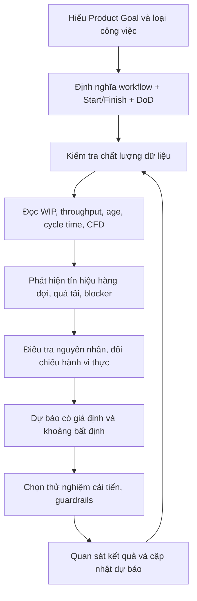
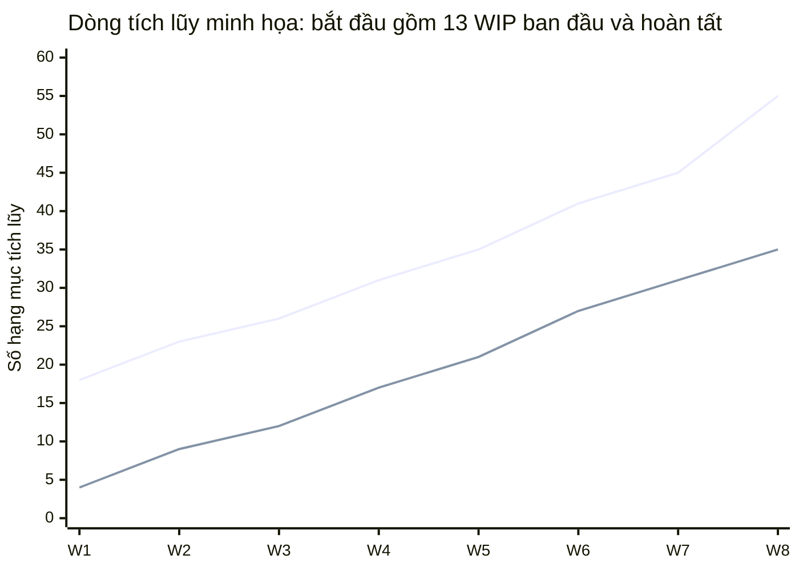
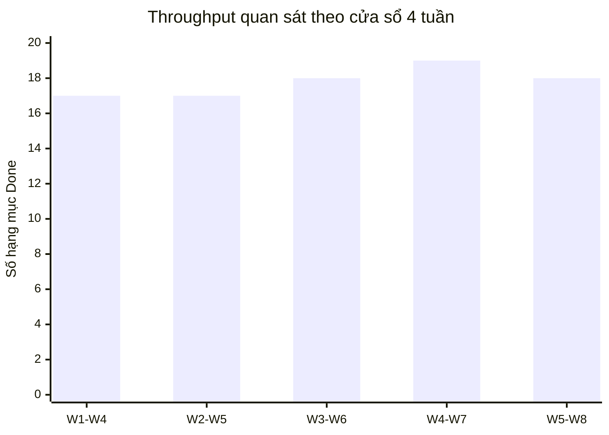

# Đọc dữ liệu dòng công việc để phát hiện nút thắt và lập dự báo

## Mục tiêu học tập

Sau bài học, bạn có thể:

- Xác định **đơn vị công việc**, ranh giới **Started/Finished**, các trạng thái đang xử lý/chờ và chính sách phù hợp trước khi đọc dữ liệu.
- Tính và giải thích đúng **Work in Progress (WIP)**, **throughput**, **cycle time** và **work item age**; hiểu sự khác biệt giữa dữ liệu **hạng mục đã hoàn thành** và **hạng mục chưa hoàn thành**.
- Phân tích **Cumulative Flow Diagram (CFD)**, hàng đợi, thời gian chờ, blocker và tốc độ ra/vào để **nêu giả thuyết về nút thắt**, không kết luận nguyên nhân chỉ từ một đồ thị.
- Dùng phân vị thực nghiệm để lập **Service Level Expectation (SLE)** có điều kiện, tránh biến SLE thành **bảo đảm** hoặc phép đo năng suất cá nhân.
- Thực hiện hai câu hỏi dự báo: **“Trong N tuần có thể hoàn tất bao nhiêu hạng mục?”** và **“Cần khoảng bao nhiêu tuần để hoàn tất N hạng mục?”**.
- Đánh giá giả định của dự báo theo **độ ổn định workflow, loại/kích cỡ công việc, ưu tiên, biến động đầu vào, số mẫu, kỳ nghỉ và chất lượng**.
- Phân biệt **dự báo theo throughput, dự báo theo cycle time, mô phỏng Monte Carlo** và các giới hạn khi dùng từng cách.
- Kết nối dữ liệu flow với **Product Goal, Sprint Goal, Definition of Done, Product Backlog**, chất lượng, phản hồi người dùng và các quyết định cải tiến.
- Xử lý tình huống nền tảng học Java với **bảng dữ liệu nhất quán, phép tính, biểu đồ, kịch bản ngoại lệ, kế hoạch thử nghiệm và bài tập tự kiểm tra**.

> **Thông điệp xuyên suốt:** Dữ liệu flow giúp thấy công việc đang di chuyển ra sao và dự báo trong những điều kiện nhất định; nó **không phải lời tiên tri**, không thay quyết định sản phẩm và không chứng minh riêng ai là “nút thắt”.

## 1. Tình huống mở đầu: “Sao việc nào cũng gần xong mà vẫn không ra bản mới?”

Một nhóm phát triển **nền tảng học trực tuyến** đang triển khai hành trình:

> “Học viên đã ghi danh có thể mở bài đúng quyền, lưu tiến độ và quay lại bài đang dở.”

Trong Daily Scrum, mọi người báo rằng backend đã gần xong, giao diện đã merge và một số kiểm thử đã viết. Nhưng Product Owner liên tục nghe:

- “Mỗi PBI còn thiếu một chút kiểm thử.”
- “Hạng mục này đang đợi môi trường tích hợp.”
- “Chúng tôi đã bắt đầu thêm những yêu cầu mới để không ai phải chờ.”
- “Có lẽ tuần sau sẽ xong, nếu không có yêu cầu khẩn.”

Đội có một bảng `To Do → Development → Review → Waiting for Test → Testing → Done`. Tuy nhiên, số PBI **Waiting for Test** tăng dần, việc gần hoàn tất bị già đi, còn những yêu cầu mới liên tục được kéo vào.

Stakeholders hỏi hai điều khác nhau:

1. **Nút thắt ở đâu?** Có phải khâu kiểm thử hay nguyên nhân là công việc đến quá nhanh, hợp đồng API chưa rõ, môi trường bị chặn?
2. **Khi nào xong?** Dự báo nào có căn cứ, giới hạn nào cần nói rõ, và điều kiện nào khiến dự báo không còn đúng?

Chỉ nhìn số ticket trong một cột **không trả lời đủ**. Bài này thực hành **từ định nghĩa dữ liệu đến phép tính, kiểm tra giả thuyết, dự báo và quyết định cải tiến**.

### 1.1. Quy trình tư duy



Cần chú ý thứ tự: **định nghĩa trước, tính sau; quan sát trước, kết luận sau; dự báo kèm giả định; cải tiến xong phải đo lại**.

## 2. Ranh giới đo: không có Definition of Workflow thì số có thể vô nghĩa

Trong Kanban, **Definition of Workflow (DoW)** mô tả cách công việc đi qua hệ thống, trong đó có các điểm **Started** và **Finished**, các trạng thái, chính sách WIP, chính sách rõ để điều hành và **Service Level Expectation (SLE)**.

Để thực hành, giả định đội thống nhất:

```text
Intake / Backlog
    |
    v
Ready for Pull       ← chưa Started, không tính WIP của workflow
    |
    v
Development          ← Started khi bắt đầu thực hiện thật
    |
    v
Review
    |
    v
Waiting for Test     ← đang trong WIP, dù không ai xử lý trực tiếp
    |
    v
Testing
    |
    v
Done                 ← Finished khi tích hợp và đạt DoD
```

Trạng thái `Blocked` có thể được biểu diễn bằng **nhãn** trên hạng mục đang ở một bước, hoặc **một cột riêng**. Trong bộ dữ liệu thực hành dưới đây ta chọn **cột riêng**, mỗi hạng mục blocked được đếm **một lần** trong WIP và **không đồng thời đếm ở cột cũ**.

### 2.1. Một đơn vị công việc là gì?

Đội chọn **PBI/lát giá trị tương đối nhỏ**, có định nghĩa hoàn tất rõ; ví dụ:

- “Học viên mất quyền không thể mở bài riêng bằng link cũ.”
- “Lưu tiến độ và tải lại không đánh dấu hoàn thành sai.”
- “Sau khi ghi danh, học viên mở được đúng bài đầu.”

Không dùng cùng một dòng dữ liệu để lẫn:

- Task lập trình kéo dài vài giờ.
- Epic cần nhiều nhóm trong nhiều tháng.
- Sự cố production.
- User story nhỏ.
- Việc vận hành định kỳ.

Có thể **phân lớp loại việc** và phân tích riêng. Nếu đội chia một PBI thành 10 ticket mà không thay giá trị giao, throughput có thể tăng dù hệ thống không tốt hơn.

### 2.2. Start, Finish và giao tới khách hàng là ba việc khác nhau

| Mốc | Ví dụ | Nó đo điều gì? |
| --- | --- | --- |
| **Request Received** | Người học phản ánh lỗi mở bài. | Bắt đầu thời gian từ nhu cầu/feedback. |
| **Started** | Developers kéo PBI vào Development. | Bắt đầu **work item age** và cycle time theo workflow này. |
| **Finished / Done** | Lát tích hợp đáp ứng **Definition of Done**. | Kết thúc cycle time và góp vào throughput. |
| **Released/Exposed** | Flag mở cho người học phù hợp. | Thời điểm người dùng thực sự có thể sử dụng thay đổi. |
| **Outcome observed** | Người học mở được đúng bài đầu. | Tín hiệu giá trị, không chỉ trạng thái delivery. |

Trong Scrum, một hạng mục **không đạt DoD không được tính là Increment hoàn tất**, dù đã code hoặc đã demo giao diện. **Done không tự có nghĩa đã release**; có thể cần thêm các điều kiện triển khai áp dụng.

### 2.3. Chính sách bắt buộc rõ trong bài tập

- `Ready for Pull` chưa thuộc WIP.
- `Development`, `Review`, `Waiting for Test`, `Testing` và `Blocked` đều thuộc WIP.
- `Done` nghĩa đã tích hợp và đạt DoD; **không gắn Done trước để tăng số**.
- Ngày đo là **ngày lịch** đối với cycle time/age trong dữ liệu, dù phân tích throughput theo **tuần**.
- `Start` và `Finish` không được thay giữa chuỗi dữ liệu mà không đánh dấu đổi định nghĩa.
- Các công việc bị hủy/rút khỏi workflow cần ghi **sự kiện rời luồng riêng**, không gộp thành Done.

Đây là **định nghĩa minh họa cho bài thực hành**, không áp đặt cho mọi đội hay biến một bản DoW cụ thể thành quy tắc Scrum.

## 3. Kiểm tra nguồn dữ liệu trước khi tính

Dữ liệu có thể đến từ bảng Kanban/Jira, Git/PR, CI, test reports và bản ghi release. Không phải trạng thái công cụ nào cũng phản ánh **công việc thật**.

### 3.1. Một bản ghi tối thiểu

| Trường | Ví dụ | Lưu ý |
| --- | --- | --- |
| `item_id` | `LMS-081` | ID ổn định, không bị trùng khi đổi tên. |
| `class` | `Feature / Defect / Incident` | Phân loại để tránh so việc khác bản chất. |
| `started_at` | Mốc bắt đầu thật. | Không tự lấy ngày tạo ticket thay Started. |
| `finished_at` | Mốc đạt DoD, nếu có. | Trống đối với hạng mục chưa Done. |
| `state` | Waiting for Test. | Trạng thái hiện tại theo DoW. |
| `entered_state_at` | Lúc bắt đầu chờ test. | Dùng để xem tuổi riêng của hàng đợi. |
| `blocked_reason` | Chờ tài khoản kiểm thử hợp lệ. | Là giả thuyết có thể xác minh, không là đánh giá cá nhân. |
| `rework/return` | Trở về Development sau test. | Giúp hiểu chất lượng và đi vòng. |
| `release` | Chưa phát hành / phiên bản. | Không nhập nhằng Done với đã tới người dùng. |
| `outcome` | Tỷ lệ mở đúng bài. | Bằng chứng giá trị riêng, có mẫu số và cohort. |

Khi dữ liệu thiếu, hãy **đánh dấu thiếu**. Không tự điền `finished_at` bằng ngày báo cáo hay coi ticket không cập nhật là Done.

### 3.2. Những phép kiểm tra dữ liệu đơn giản

1. Mỗi hạng mục có **một trạng thái hiện tại** trong bản snapshot.
2. `finished_at` không sớm hơn `started_at`, trừ trường hợp dữ liệu/timezone sai cần sửa.
3. Hạng mục `Done` phải có mốc Finish hợp lệ và tiêu chí chất lượng tương ứng.
4. Hạng mục đang làm dở **không có** `finished_at`; nếu có, cần giải thích reopen hoặc version mới.
5. Những hạng mục bị chặn phải thể hiện **tuổi** và tác động, không bị giấu sang backlog.
6. Ngày nghỉ, đêm cuối tuần, timezone và đơn vị thời gian được xử lý nhất quán.
7. Người thay đổi cách chia ticket, cột workflow hoặc chính sách DoD phải **ghi mốc thay đổi**.
8. Nếu team nhận incident khẩn từ kênh riêng, cần biết chúng **có được đo trong cùng workflow hay không**.

### 3.3. Tránh “dữ liệu chọn lọc”

Chỉ phân tích 20 PBI đã Done gần đây mà bỏ những PBI **đã bắt đầu 40 ngày vẫn chưa hoàn tất** có thể tạo bức tranh tốc độ giả. Dữ liệu Done giúp tính cycle time của những hạng mục đã xong, nhưng **để dự báo và phát hiện rủi ro còn phải nhìn work item age của việc đang dở**.

## 4. Bộ dữ liệu xuyên suốt: tám tuần của đội học trực tuyến

Ta dùng **dữ liệu giả định** để luyện tính toán. Không số nào là mức chuẩn Kanban/Scrum hay kết quả của một công ty thật.

Workflow đã định nghĩa ở mục 2; mỗi đơn vị là một hạng mục tương đối nhỏ. Đội quan sát **tám tuần**, với WIP tại đầu tuần 1 là **13 hạng mục**.

| Tuần | Started mới trong workflow | Finished (Done) | WIP đầu tuần | WIP cuối tuần |
| --- | ---: | ---: | ---: | ---: |
| W1 | 5 | 4 | 13 | 14 |
| W2 | 5 | 5 | 14 | 14 |
| W3 | 3 | 3 | 14 | 14 |
| W4 | 5 | 5 | 14 | 14 |
| W5 | 4 | 4 | 14 | 14 |
| W6 | 6 | 6 | 14 | 14 |
| W7 | 4 | 4 | 14 | 14 |
| **W8** | **10** | **4** | **14** | **20** |
| **Tổng** | **42** | **35** | — | — |

Giả định trong bảng này **không có công việc bị hủy/rút khỏi workflow**; nếu có, phép cân bằng WIP phải tính thêm số hạng mục rời luồng vì lý do khác Finished.

### 4.1. Tính WIP bằng phép cân bằng dòng

```text
WIP_end = WIP_start + Started - Finished
```

Ví dụ W8:

```text
WIP_end(W8) = 14 + 10 - 4 = 20 hạng mục
```

Cả tám tuần:

```text
WIP cuối W8 = 13 + (42 Started) - (35 Finished)
             = 20 hạng mục
```

**Điểm đáng chú ý:** W1–W7 WIP cuối tuần giữ ở mức 14, nhưng W8 **10 Started so với 4 Finished**. Sự chênh lệch ấy **có thể làm tồn đọng tăng** nếu tiếp tục lặp lại.

### 4.2. Tại sao không gọi W8 là tuần “năng suất cao”?

W8 có **10 hạng mục bắt đầu**, nhiều nhất chuỗi, nhưng chỉ **4 hạng mục Done**. Nếu báo cáo “đội hoàn thành 10 việc mới” khi mới Started, đã nhập nhằng **hoạt động** với **kết quả giao hàng**.

Cần hỏi:

- Vì sao bắt đầu nhiều PBI mới?
- Có yêu cầu khẩn hợp lệ hay Product Owner đổi thứ tự?
- Những việc gần Done có chờ kiểm thử?
- Có thay đổi kích cỡ/loại hạng mục?
- Hạng mục đang già có được hỗ trợ hoàn tất?
- Các hạng mục Done có đạt **DoD chung**?

Một tuần WIP tăng là **tín hiệu cần điều tra**, chưa đủ chứng minh một cá nhân hay một khâu có lỗi.

## 5. Đọc snapshot theo trạng thái để tìm nơi công việc đang xếp hàng

Trong tuần W8, đội chụp snapshot **cuối mỗi ngày làm việc**, sau khi các trạng thái đã được cập nhật.

| Ngày W8 | Development | Review | Waiting for Test | Testing | Blocked (cột riêng) | **WIP cuối ngày** |
| --- | ---: | ---: | ---: | ---: | ---: | ---: |
| Thứ Hai | 4 | 3 | 6 | 2 | 0 | **15** |
| Thứ Ba | 4 | 3 | 7 | 2 | 1 | **17** |
| Thứ Tư | 4 | 3 | 8 | 2 | 1 | **18** |
| Thứ Năm | 3 | 3 | 9 | 2 | 1 | **18** |
| Thứ Sáu | 3 | 4 | 9 | 2 | 2 | **20** |

Tổng từng dòng khớp bảng WIP cuối ngày. **Blocked được đếm riêng, không đồng thời ở cột cũ**.

### 5.1. Nguồn thay đổi WIP theo ngày

| Ngày W8 | WIP đầu ngày | Started | Finished | WIP cuối ngày |
| --- | ---: | ---: | ---: | ---: |
| Thứ Hai | 14 | 2 | 1 | 15 |
| Thứ Ba | 15 | 2 | 0 | 17 |
| Thứ Tư | 17 | 2 | 1 | 18 |
| Thứ Năm | 18 | 1 | 1 | 18 |
| Thứ Sáu | 18 | 3 | 1 | 20 |
| **Cộng** | — | **10** | **4** | **20** |

Dữ liệu chi tiết và dữ liệu tuần **nhất quán**: WIP 14 → 20, Started 10, Finished 4.

### 5.2. Những tín hiệu từ snapshot

- `Waiting for Test` tăng từ **6 lên 9**, trong khi `Testing` giữ ở **2** theo các thời điểm chụp.
- `Blocked` tăng từ **0 lên 2**; cần biết **điều gì đang chặn**, không chỉ tổng số.
- WIP tổng tăng từ **15 lên 20** giữa hai snapshot đầu/cuối tuần.
- `Development` giảm từ 4 xuống 3, nhưng **không chứng minh Developers ít làm việc**; họ có thể đã hỗ trợ test, xử lý sự cố hoặc hoàn tất một lát.
- `Testing` có 2 hạng mục ở mỗi snapshot **không có nghĩa người kiểm thử làm đúng 2 việc suốt tuần**, vì các hạng mục có thể đã ra/vào giữa các lần chụp.

**Kết luận hợp lý:** Có tín hiệu **hàng đợi trước kiểm thử tích tụ**, cần điều tra lưu lượng và thời gian chờ. **Chưa đủ bằng chứng kết luận “tester là nút thắt”**.

### 5.3. Vì sao một snapshot không đủ?

Một hàng đợi lớn có thể do:

- Công việc đến **theo đợt** sau merge hàng loạt.
- Nguồn test environment bị gián đoạn.
- Hợp đồng API/acceptance criteria chưa rõ nên test không thể bắt đầu.
- Công việc bị trả đi trả lại vì lỗi tích hợp.
- Một chính sách review hoặc pull khiến Test chỉ nhận việc theo đợt.
- Lúc snapshot có nhiều item đến nhưng sau đó được hoàn tất nhanh.

Cần quan sát **xu hướng, thời gian chờ, luồng vào/ra, dữ liệu blocker và câu chuyện công việc thật**.

## 6. Throughput: hệ thống thực sự hoàn tất được bao nhiêu?

Theo DoW ở đây, **throughput** là số PBI/lát đạt Done trong một khoảng thời gian.

Từ W1–W8:

```text
Throughput theo tuần = [4, 5, 3, 5, 4, 6, 4, 4]
Tổng Done          = 35 hạng mục
Trung bình tuần    = 35 / 8 = 4,375 hạng mục/tuần
Trung vị tuần      = (4 + 4)/2 = 4 hạng mục/tuần
Khoảng đã quan sát = 3 đến 6 hạng mục/tuần
```

Đây **không phải lời hứa** rằng mỗi tuần luôn có ít nhất 3 hoặc nhiều nhất 6 việc Done. Chuỗi mới có thể có tuần 0 vì sự cố, nghỉ lễ hoặc thay đổi loại việc; cũng có thể nhiều hơn 6 nếu bỏ được nút thắt.

### 6.1. Thước đo không phụ thuộc story points

Throughput theo đơn vị hạng mục hữu ích khi **đơn vị công việc tương đối nhất quán**. Nếu team chia ticket nhỏ hơn để tăng số Done, throughput bị méo.

Có thể:

- Dùng một tập loại công việc **có khả năng so sánh**.
- Ghi rõ khi có thay đổi chính sách chia lát.
- Phân tích riêng incident, nghiên cứu và feature nếu cần.
- Cùng xem **chất lượng và outcome người dùng**.

Không dùng throughput để xếp hạng Developers hoặc coi `35 hạng mục Done` tương đương `35 đơn vị giá trị khách hàng`.

### 6.2. Throughput là một phân bố, không chỉ số trung bình

Nhìn chuỗi tuần cho thấy khả năng biến động. Một dự báo dựa trên **trung bình 4,375** sẽ làm mất thông tin rằng tuần thấp nhất là 3, tuần cao nhất là 6.

Trong phần dự báo, ta sẽ thử:

- Lấy các tổng **cửa sổ bốn tuần** thực tế.
- Xem **những kịch bản throughput khác nhau**.
- Mô phỏng chọn lại throughput tuần với các giả định rõ.

Không nên tự đặt **velocity = throughput**: velocity thường gắn story points ước lượng nội bộ, trong khi throughput ở đây đếm số hạng mục thực sự Done.

## 7. Cycle time: những hạng mục đã Done đã mất bao lâu?

Để tránh chỉ nhìn trung bình, đội lấy **20 hạng mục hoàn tất gần đây**, cùng định nghĩa Start/Finish và cùng loại việc tương đối phù hợp. Giả sử cycle time theo **ngày lịch** đã sắp tăng dần:

```text
[8, 10, 12, 13, 14, 15, 16, 17, 18, 18,
 19, 20, 21, 22, 24, 25, 27, 30, 35, 45]
```

### 7.1. Phân tích cơ bản

| Phép đo | Cách tính | Kết quả |
| --- | --- | ---: |
| **Số hạng mục Done trong mẫu** | Đếm số quan sát. | **20** |
| **Tổng cycle time** | Cộng tất cả 20 giá trị. | **409 ngày-hạng mục** |
| **Trung bình** | 409 / 20. | **20,45 ngày lịch** |
| **Trung vị** | Trung bình giá trị vị trí 10 và 11: (18 + 19)/2. | **18,5 ngày lịch** |
| **Nhỏ nhất/lớn nhất** | Quan sát vị trí đầu/cuối. | **8 / 45 ngày** |
| **p85 theo nearest-rank** | Vị trí ceil(0,85 × 20) = 17, giá trị thứ 17. | **27 ngày** |
| **p95 theo nearest-rank** | Vị trí ceil(0,95 × 20) = 19, giá trị thứ 19. | **35 ngày** |

**Lưu ý về phân vị:** phần mềm thống kê có nhiều quy ước nội suy khác nhau. Trong bài này, p85 và p95 sử dụng **nearest-rank** để có thể tính tay; nếu dùng công cụ khác phải ghi rõ cách tính.

### 7.2. p85 = 27 ngày nói điều gì?

Trong **20 hạng mục đã Done của mẫu**, có **17/20 = 85%** hoàn tất không quá **27 ngày lịch** theo cách đo này.

Nó **không bảo đảm** một PBI mới chắc chắn xong trong 27 ngày. Để dùng làm tín hiệu SLE cho tương lai, cần điều kiện như:

- Loại và kích thước công việc **tương đương**.
- DoW, điểm Start/Finish, DoD và môi trường **đủ ổn định**.
- Mẫu dữ liệu đủ đại diện, không bỏ những item đang rất già.
- Các ưu tiên/incident ngoại lệ không làm phân bố thay đổi quá lớn.

Với **20 quan sát**, ước lượng phân vị cao có **bất định đáng kể**. Nếu có thêm một ít hạng mục rất chậm, p85 có thể đổi rõ rệt. Không ghi `85% chắc chắn đúng trên mọi hạng mục`.

### 7.3. Trung bình không nói đủ về đuôi dài

Giá trị **45 ngày** ở đuôi phân bố có thể là hạng mục bị chặn bởi môi trường/contract. Nếu đội chỉ nói “trung bình 20,45 ngày”, rủi ro hạng mục già có thể bị làm mờ.

Cần hỏi:

- Hạng mục 35 và 45 ngày đã chờ ở trạng thái nào?
- Có bị trả lại từ Testing về Development không?
- Có cùng loại việc với các hạng mục nhanh không?
- Nếu chia lát khác đi, giá trị có thể đến người học sớm hơn không?
- Chất lượng và điều kiện Done có nhất quán?

**Phân vị không chẩn đoán nguyên nhân**; nó giúp đặt câu hỏi và quản lý kỳ vọng.

## 8. Work item age: việc chưa Done là dữ liệu quan trọng

**Work item age** đo thời gian từ `Started` tới **thời điểm hiện tại** của một hạng mục chưa Finished. Đây **không phải cycle time đã hoàn tất**, cũng không nên bỏ qua vì `finished_at` trống.

Ví dụ cuối ngày thứ Sáu W8:

| ID giả định | Hạng mục | Trạng thái hiện tại | Age từ Started | Thời gian ở trạng thái hiện tại | Tín hiệu |
| --- | --- | --- | ---: | ---: | --- |
| **LMS-081** | Thu hồi quyền xem bài | Waiting for Test | **33 ngày** | 8 ngày | Đã vượt p85 lịch sử. |
| **LMS-082** | Mở bài đầu trên di động | Waiting for Test | **26 ngày** | 10 ngày | Gần p85 và chờ test lâu. |
| **LMS-083** | Đồng bộ tiến độ 2 thiết bị | Blocked | **19 ngày** | 6 ngày | Phụ thuộc môi trường/dữ liệu cần xác minh. |
| **LMS-084** | Xử lý gửi lặp ghi danh | Review | **11 ngày** | 2 ngày | Cần xem điều kiện chuyển và hỗ trợ. |
| **LMS-085** | Từ chối link bài trái quyền | Testing | **7 ngày** | 3 ngày | Có thể cần kiểm tra test case quyền. |

Các age ở đây là **dữ liệu minh họa riêng cho những hạng mục đang dở**. Không cộng chúng vào danh sách cycle time của 20 hạng mục đã Done.

### 8.1. Hai đồng hồ khác nhau

```text
Work item age        = hiện tại - Started     (chưa Done)
Time in current state = hiện tại - entered_state_at
Cycle time           = Finished - Started    (đã Done)
```

Ví dụ LMS-081 có **age 33 ngày**, nhưng ở `Waiting for Test` **8 ngày**. Điều này cho thấy không phải toàn bộ 33 ngày đều bị chặn ở Testing; muốn tìm nguyên nhân phải xem **lịch sử chuyển trạng thái**.

### 8.2. Đừng lấy p85 trừ age để hứa còn bao lâu

Nếu p85 lịch sử là 27 ngày, một hạng mục age 26 ngày **không có nghĩa chắc chắn còn đúng một ngày**.

Nguyên nhân:

- p85 là phân vị **của toàn bộ cycle time các việc đã Done**.
- Với hạng mục vẫn chưa Done ở ngày 26, ta đang quan sát một **trường hợp điều kiện** khác: nó đã sống sót qua 26 ngày chưa hoàn tất.
- Phân bố **thời gian còn lại có điều kiện** không thể lấy bằng phép trừ đơn giản `p85 - age`.
- Các hạng mục cực già chưa hoàn tất bị thiếu trong mẫu Done, gây **thiên lệch chọn mẫu** nếu chỉ dựa vào cycle time hoàn thành.

Do đó age nên dùng như **tín hiệu hỗ trợ/swatch**, không tạo một ngày cam kết cá nhân từ phép trừ ngây thơ.

### 8.3. Hành động khi hạng mục già

Đội có thể:

1. Xem hạng mục có còn giá trị/đúng ưu tiên không.
2. Làm rõ **vì sao chưa Done**: thiếu test, thiếu contract, blocked, nhiều việc dở?
3. Hỗ trợ **swarm/pairing** để tháo chặn khi hợp lý.
4. Ngừng kéo việc mới nếu WIP cao và nút thắt chưa được giải quyết.
5. Đàm phán **chia lát giá trị** nhỏ hơn mà không hạ DoD.
6. Cập nhật dự báo với stakeholders thay vì che tuổi thật.

Không biến `age > p85` thành lý do đổ lỗi cho người được gán ticket.

## 9. Cumulative Flow Diagram: xem hàng đợi thay đổi theo thời gian

**Cumulative Flow Diagram (CFD)** mô tả số hạng mục tích lũy theo trạng thái hoặc theo các ranh giới workflow. Trên biểu đồ dạng dải theo trạng thái, **bề rộng dải** có thể cho biết số lượng công việc đang ở các giai đoạn theo thời điểm.

Để luyện số học mà không cần công cụ đồ họa chuyên dụng, ta dùng **hai đường tích lũy**:

- **Cumulative Entered WIP:** số item đã có trong workflow ở đầu kỳ (13) cộng số Started mới.
- **Cumulative Finished:** số item Done tích lũy kể từ đầu kỳ.

| Cuối tuần | Started mới tích lũy | Entered WIP tích lũy (13 + Started) | Finished tích lũy | **Khoảng cách = WIP** |
| --- | ---: | ---: | ---: | ---: |
| W1 | 5 | 18 | 4 | **14** |
| W2 | 10 | 23 | 9 | **14** |
| W3 | 13 | 26 | 12 | **14** |
| W4 | 18 | 31 | 17 | **14** |
| W5 | 22 | 35 | 21 | **14** |
| W6 | 28 | 41 | 27 | **14** |
| W7 | 32 | 45 | 31 | **14** |
| W8 | 42 | 55 | 35 | **20** |



**Cách đọc:** khoảng cách giữa hai đường **ở cùng mốc tuần** là WIP theo ranh giới đã chọn. Từ W1 đến W7 khoảng cách là 14, tới W8 nới thành 20 vì Started mới nhanh hơn Finished.

### 9.1. CFD không chỉ có một loại

CFD đầy đủ thường thể hiện nhiều **dải theo trạng thái**; biểu đồ hai đường trên là **phiên bản rút gọn để hiểu cân bằng dòng**, không thay khả năng phân tích các giai đoạn con của CFD thực.

Từ bảng trạng thái W8 (mục 5), đội có thể dựng CFD theo ngày để thấy **dải Waiting for Test dày lên**. Nhưng nếu cột Testing bị đổi tên, nếu blocked được tính hai lần, hoặc nếu lịch sử trạng thái không đầy đủ, hình vẽ có thể gây hiểu lầm.

### 9.2. Bốn câu hỏi khi đọc CFD

- **Dải nào mở rộng?** Có hàng đợi đang tích tụ không?
- **Dải nào đứng yên lâu?** Hạng mục có bị chặn hoặc thiếu khả năng kéo việc?
- **Lưu lượng vào so với ra ra sao?** Có đang nhận nhanh hơn hoàn tất?
- **Có thay đổi chính sách/cách đo không?** Dải thay đổi vì workflow được chỉnh hay vì khả năng thực tế?

Đừng kết luận `reviewer/tester chậm` chỉ vì một dải dày. **Cần kiểm tra luồng, age, blocker và điều kiện chất lượng**.

## 10. Phát hiện nút thắt: phân biệt tín hiệu, giả thuyết và bằng chứng

**Nút thắt (bottleneck)** là giới hạn nào đó khiến **toàn dòng khó hoàn tất giá trị nhanh, ổn định hoặc an toàn hơn**. Nó có thể thay đổi theo thời gian.

### 10.1. Một bảng chẩn đoán thực dụng

| Quan sát | Giả thuyết có thể | Dữ liệu cần kiểm chứng | Can thiệp có thể thử |
| --- | --- | --- | --- |
| Waiting for Test tăng từ 6 lên 9. | Lưu lượng vào Test lớn hơn khả năng kéo/hoàn tất. | Số item vào/ra queue, thời gian chờ, test capacity thật. | Giảm batch, pull có giới hạn, hỗ trợ hoàn tất test. |
| Testing có 2 item mỗi snapshot. | Giới hạn năng lực/môi trường hoặc chính sách WIP. | Thời gian test thực, số lần hoàn tất, hàng đợi, tài nguyên. | Tháo rào cản môi trường, test tự động phù hợp. |
| Blocked tăng từ 0 lên 2. | Phụ thuộc contract, quyền truy cập môi trường, dữ liệu. | Block reason, thời gian chờ, người có quyền tháo chặn. | Escalate có căn cứ, cải thiện contract/CI. |
| W8 bắt đầu 10 nhưng Done 4. | Intake/ưu tiên đẩy nhiều việc mới, WIP tăng. | Lịch thay đổi ưu tiên, loại việc, tuổi hạng mục. | Bảo vệ pull, ngừng bắt đầu khi gần Done chưa xong. |
| Hạng mục quyền age 33 ngày. | Kiểm thử muộn hoặc chờ phụ thuộc lâu. | Lịch sử chuyển trạng thái, thời gian từng bước. | Swarm tháo chặn, kiểm tra rủi ro quyền. |
| Một số lỗi chỉ phát hiện sau release. | Check/DoD không phát hiện đủ sớm. | Loại lỗi, thời điểm phát hiện, test evidence. | Contract/integration/security tests sớm hơn. |

**Một quan sát có thể có nhiều nguyên nhân.** Tăng năng lực Testing không chắc giải quyết được nếu công việc đến Testing **thiếu ví dụ nghiệp vụ hoặc không có môi trường ổn định**.

### 10.2. Câu hỏi quan trọng: có đang tối ưu sai chỗ?

Nếu Developers tăng tốc code nhưng các PBI vẫn chờ Test 10 ngày, thêm một công cụ tăng số dòng mã có thể **làm hàng đợi dày hơn**.

Ngược lại, nếu Testing hiện chậm vì môi trường bị lỗi thì yêu cầu tester làm thêm giờ **không giải quyết ràng buộc**. Có khi cải thiện **một contract test hoặc dữ liệu kiểm thử ổn định** giúp cả dòng hơn là tăng nhân lực cục bộ.

### 10.3. Không “đẩy việc” sang cột khác để bảng đẹp

Các anti-pattern:

- Đưa hạng mục blocked về Backlog để **WIP giảm giả**.
- Đánh dấu Done khi code merge, đẩy Test sang Sprint sau.
- Tạo cột “Almost Done” ngoài ranh giới DoW.
- Chia hạng mục thành nhiều ticket cực nhỏ để **throughput tăng**.
- Ghi `Testing 2 item` như năng suất của người kiểm thử, bỏ qua chờ môi trường.

**Chỉ số có ích khi nó phản ánh đúng công việc, không khi nó được tối ưu để làm đẹp báo cáo.**

## 11. Kiểm tra giả thuyết “Waiting for Test là nút thắt”

Ta đã thấy số hạng mục `Waiting for Test` từ 6 lên 9 trong W8. Muốn biết đây là **nút thắt về khả năng kéo việc** hay chỉ là một đợt dồn việc tạm thời, cần xem số hạng mục **vào/ra hàng đợi**.

### 11.1. Ví dụ bổ sung về lưu lượng hàng đợi

Giả sử hệ thống ghi được các chuyển trạng thái từ **cuối Thứ Hai tới cuối Thứ Sáu**:

| Khoảng thời gian | Waiting for Test đầu khoảng | Vào hàng đợi | Được kéo khỏi hàng đợi vào Testing | Waiting for Test cuối khoảng |
| --- | ---: | ---: | ---: | ---: |
| Thứ Ba | 6 | 2 | 1 | 7 |
| Thứ Tư | 7 | 3 | 2 | 8 |
| Thứ Năm | 8 | 2 | 1 | 9 |
| Thứ Sáu | 9 | 2 | 2 | 9 |
| **Tổng chuyển động** | — | **9** | **6** | — |

```text
Queue_end = Queue_start + Arrivals - Pulls

Waiting for Test cuối thứ Sáu
  = 6 + 9 - 6
  = 9 hạng mục
```

Bảng khớp các snapshot ở mục 5. Đây là **dữ liệu giả định bổ sung** chỉ để xem cơ chế hàng đợi. `Pulls` từ hàng đợi tới Testing **không đồng nghĩa 6 PBI đã Done**, vì Testing có thể tiếp tục kéo dài, phát hiện lỗi hoặc chuyển hạng mục quay lại.

### 11.2. Có thể kết luận gì?

**Có thể nói:**

- Trong bốn khoảng quan sát, có **9 hạng mục vào** nhưng chỉ **6 hạng mục được kéo ra**.
- Vì thế hàng đợi tăng ròng **3**.
- Nếu tốc độ tương tự tiếp diễn, có nguy cơ **age của item chờ test tăng**, kéo cycle time và độ bất định.
- Cần xem **khả năng kéo từ hàng đợi** và lý do vì sao Testing chưa kéo nhanh như tốc độ đầu vào.

**Chưa thể nói:**

- “Tester làm việc chậm hơn Developers” chỉ từ số liệu.
- “Chắc chắn cần tuyển thêm hai người test.”
- “Chỉ cần tăng WIP ở Testing thì sẽ hoàn thành nhanh.”
- “Cắt kiểm thử sẽ giảm cycle time nhưng không ảnh hưởng chất lượng.”
- “Hết tuần sau toàn bộ 9 item sẽ Done.”

Để đi từ giả thuyết tới quyết định, hỏi tại sao item chưa được kéo: môi trường, dữ liệu, chính sách thứ tự, chuyên môn, lỗi tích hợp, release gate hay tính chưa rõ của acceptance criteria?

### 11.3. Kiểm tra điểm nghẽn có dịch chuyển không

Giả sử đội tự động hóa test API và hàng `Waiting for Test` giảm. Nếu sau đó `Review` tăng mạnh vì chỉ một người có quyền phê duyệt, nút thắt có thể đã **chuyển sang giai đoạn khác**.

Cải tiến nên theo **toàn dòng**:

- WIP tổng và work item age có đổi?
- Throughput và cycle time của hạng mục đạt DoD có đổi?
- Tần suất lỗi lọt, lỗi quyền/dữ liệu có đổi?
- Có hàng đợi mới, rework hoặc tác dụng phụ khác?
- Người học nhận được Increment hữu dụng nhanh hơn không?

**Không tối ưu riêng một cột mà bỏ giá trị và chất lượng của toàn hệ thống.**

## 12. Little's Law: công cụ lý giải, không phải máy dự báo tự động

**Little’s Law** mô tả quan hệ giữa số công việc trung bình đang ở trong một hệ thống ổn định, tốc độ ra trung bình và thời gian lưu trú trung bình:

```text
L = λ × W

L: số hạng mục trung bình trong ranh giới hệ thống
λ: tốc độ hoàn tất/đi qua hệ thống trung bình
W: thời gian trung bình hạng mục ở trong ranh giới hệ thống
```

Để diễn giải cho workflow:

```text
Average WIP ≈ Average Throughput Rate × Average Flow Time
```

### 12.1. Ví dụ có điều kiện

W1–W7 có **31 hạng mục Done**, tương đương:

```text
Throughput trung bình W1–W7
  = 31 / 7 tuần
  ≈ 4,43 hạng mục/tuần
```

Nếu **giả sử thêm** rằng:

- Hệ thống trong giai đoạn đủ ổn định.
- **WIP trung bình theo thời gian** cũng xấp xỉ 14 hạng mục, không chỉ WIP snapshot cuối tuần bằng 14.
- Ranh giới Started/Finished, loại việc và dữ liệu nhất quán.

Ta có thể ước tính:

```text
Average Flow Time ≈ 14 / 4,43
                  ≈ 3,16 tuần
                  ≈ 22,1 ngày lịch (giả sử tuần = 7 ngày lịch)
```

Đây là **ước tính có điều kiện**, không phải cycle time đo trực tiếp từ từng PBI. Mẫu 20 hạng mục Done ở mục 7 có trung bình 20,45 ngày, nhưng **không dùng sự gần nhau để tuyên bố đã “chứng minh” Little’s Law**: hai phép đo không cùng một tập kỳ/đơn vị quan sát, và chưa đo WIP time-average đúng cách.

### 12.2. Vì sao không lấy WIP W8 chia ngay throughput W8?

W8 có WIP cuối tuần 20 và throughput 4. Phép chia:

```text
20 / (4 hạng mục/tuần) = 5 tuần
```

**Không cho phép kết luận “mọi PBI bây giờ sẽ mất 5 tuần”**, vì:

- WIP 20 chỉ là **snapshot cuối tuần**, không phải trung bình ổn định.
- Hệ thống có **WIP tăng nhanh** trong tuần, không đủ điều kiện giả định ổn định.
- Throughput của một tuần có thể dao động mạnh.
- PBI đang chờ có độ tuổi và loại công việc khác nhau.
- Little’s Law cho quan hệ **trung bình toàn hệ thống**, không phải ngày hoàn thành một item cụ thể.

### 12.3. Cần kiểm tra gì trước khi vận dụng?

| Điều kiện | Câu hỏi thực tế |
| --- | --- |
| **Ranh giới nhất quán** | WIP, throughput và thời gian được đo trên cùng Start/Finish? |
| **Trung bình theo thời gian phù hợp** | WIP có được theo dõi qua nhiều mốc chứ không chỉ một ảnh chụp? |
| **Tương đối ổn định** | Số item đến và Done có xu hướng cân bằng đủ lâu? |
| **Không mất dấu hạng mục** | Bị hủy/chuyển sang luồng khác có được ghi riêng? |
| **Đơn vị tương thích** | Đều là PBI/lát cùng loại, hay trộn epic với bug/task? |
| **Chất lượng số liệu** | Có đổi cách chia việc, Done hoặc trạng thái không? |
| **Diễn giải đúng** | Đây là trung bình, không biến thành cam kết từng item. |

**Little’s Law đặc biệt hữu ích để thấy mâu thuẫn**: nếu throughput không tăng mà WIP tăng liên tục, đội không nên kỳ vọng thời gian hoàn tất tự động giảm.

## 13. Từ phân vị cycle time tới Service Level Expectation

**Service Level Expectation (SLE)** trong Kanban là một kỳ vọng về **thời gian một hạng mục đi qua workflow**, gắn với xác suất/phần trăm được kỳ vọng, thường dựa trên dữ liệu lịch sử. Đây **không phải** một SLA pháp lý hoặc lời hứa “mọi item chắc chắn Done trước ngày X”.

Với mẫu ở mục 7, một SLE minh họa có thể nói:

> **“Đối với những PBI/lát giá trị tương đương và cùng DoW, khoảng 85% những hạng mục đã hoàn tất trong mẫu lịch sử có cycle time không quá 27 ngày lịch.”**

Nếu muốn dùng cho kỳ vọng tương lai, cần nói rõ đây là **ước lượng dựa trên 20 quan sát**, chưa ổn định và cần xem lại khi workflow, scope hoặc phân bố thay đổi.

### 13.1. Vì sao mẫu ít có thể gây tự tin giả?

Với 20 quan sát:

- p85 theo nearest-rank lấy **giá trị thứ 17**.
- Chỉ một vài item cực chậm hoặc thay đổi lớp công việc có thể làm phân vị biến động.
- Những item **đang dở rất lâu** chưa có mặt trong tập cycle time hoàn tất.
- Một thay đổi chính sách WIP hoặc test có thể làm dữ liệu quá khứ **kém đại diện** cho tương lai.

Nếu cần cam kết rủi ro cao, đội phải dùng **thêm bằng chứng, phân đoạn và cách kiểm tra phù hợp**, không lấy 85% như mức bảo đảm pháp lý.

### 13.2. SLE, SLA và target nội bộ

| Khái niệm | Mục đích | Ví dụ |
| --- | --- | --- |
| **SLE** | Kỳ vọng thời gian qua workflow, dựa trên dữ liệu và xác suất. | Khoảng 85% PBI tương tự đã Done trong ≤ 27 ngày ở mẫu. |
| **SLA** | Thỏa thuận mức dịch vụ có điều kiện, có thể kèm nghĩa vụ và hậu quả thực thi. | Dịch vụ hỗ trợ có điều kiện phản hồi theo hợp đồng. |
| **Mục tiêu cải tiến** | Mức kết quả muốn đạt sau thay đổi; chưa phải khả năng hiện tại. | Muốn giảm p85 cycle time trong điều kiện không tăng lỗi. |
| **Dự báo hạng mục/cụm hạng mục** | Ước lượng thời điểm hoặc khối lượng hoàn tất trong điều kiện cụ thể. | Với throughput lịch sử, khoảng bao lâu để hoàn tất N item? |

Đừng **đổi nhãn mục tiêu thành SLE** nếu chưa có căn cứ lịch sử, hay **đổi SLE thành SLA** nếu chưa có thỏa thuận và phạm vi nghĩa vụ tương ứng.

### 13.3. Age làm tín hiệu sớm cho điều chỉnh

Ví dụ LMS-081 age 33 ngày, vượt p85 lịch sử 27 ngày. Một cuộc xem luồng có thể hỏi:

1. Item còn quan trọng và chưa hoàn thành vì đâu?
2. Có phụ thuộc ngoài đội không?
3. Phần nào cần phối hợp, đổi thứ tự hoặc swarming?
4. Nó có đe dọa Sprint Goal hay chất lượng sản phẩm?
5. Có cần cập nhật dự báo và thông báo khách hàng/stakeholder không?

**Đừng đặt cờ đỏ rồi trách người được giao**. Item già có thể cho thấy vấn đề quy trình và cơ chế ưu tiên, không phải “người chậm”.

## 14. Câu hỏi dự báo thứ nhất: “Trong bốn tuần có thể hoàn tất bao nhiêu?”

Đây là bài toán **fixed date, variable scope**: giữ một cửa sổ thời gian, xem khối lượng có thể hoàn tất, thay vì định trước một danh sách bắt buộc phải hoàn thành hết.

### 14.1. Ước lượng điểm xuất phát từ trung bình

Với 8 tuần throughput ở mục 6:

```text
Throughput trung bình ≈ 4,375 hạng mục/tuần

Trong 4 tuần, kỳ vọng số Done trung bình đơn giản:
  ≈ 4 × 4,375
  ≈ 17,5 hạng mục
```

**17,5 là giá trị kỳ vọng trung bình**, không phải “đội sẽ bàn giao nửa ticket” hay cam kết chính xác 17 hoặc 18.

### 14.2. Nhìn các cửa sổ bốn tuần đã quan sát

Với các tuần W1–W8, có năm cửa sổ liên tiếp dài bốn tuần:

| Cửa sổ | Thông lượng tuần | Tổng Done trong 4 tuần |
| --- | --- | ---: |
| **W1–W4** | 4, 5, 3, 5 | **17** |
| **W2–W5** | 5, 3, 5, 4 | **17** |
| **W3–W6** | 3, 5, 4, 6 | **18** |
| **W4–W7** | 5, 4, 6, 4 | **19** |
| **W5–W8** | 4, 6, 4, 4 | **18** |



**Cách nói hợp lý:**

> “Trong năm cửa sổ bốn tuần gần đây, nhóm đã hoàn tất từ 17 đến 19 hạng mục theo định nghĩa hiện tại. Đây là tham chiếu ban đầu cho cuộc trao đổi về phạm vi bốn tuần tiếp, chưa phải khoảng bảo đảm.”

### 14.3. Vì sao không gọi 3/5 là “60% xác suất chắc chắn”?

Trong năm cửa sổ, có ba cửa sổ Done từ 18 item trở lên. Nhưng:

- Cửa sổ **chồng lấp dữ liệu rất nhiều**; W4 xuất hiện trong nhiều cửa sổ.
- Chỉ có **tám tuần lịch sử** và năm cửa sổ, mẫu nhỏ.
- W8 đã xuất hiện **WIP tăng và hàng chờ Test**, có thể báo hiệu điều kiện tương lai khác quá khứ.
- Throughput có thể phụ thuộc kỳ nghỉ, sự cố, độ lớn PBI hoặc thay đổi ưu tiên.

Vì vậy, không tuyên bố “xác suất Done ít nhất 18 item trong bốn tuần là đúng 60%” từ bảng này. Nó là **quan sát lịch sử**, chưa phải phân bố dự báo được kiểm chứng.

### 14.4. Quyết định phạm vi với một mốc cố định

Nếu một sự kiện của học viên diễn ra sau bốn tuần, đội có thể:

- Chọn **một lát giá trị tối thiểu** đáp ứng mục tiêu.
- Giữ chất lượng/DoD và các ràng buộc an toàn bắt buộc.
- Đặt các lát bổ sung theo thứ tự giá trị.
- Xem rủi ro chờ Test, scope thay đổi và khả năng tích hợp.
- Thảo luận **mức khả thi**, không nhận 25 hạng mục chỉ vì marketing muốn con số đẹp.

Một dự báo khối lượng **không tự chọn hạng mục nào có giá trị cao nhất**. Product Owner và Developers vẫn phải phối hợp về thứ tự và cách chia lát.

## 15. Câu hỏi dự báo thứ hai: “Cần khoảng bao lâu để hoàn tất 18 hạng mục?”

Đây là bài toán **fixed scope, variable date**: số hạng mục mục tiêu được xác định, thời gian được ước lượng từ dữ liệu thực.

Để tránh nhập nhằng, trước hết ta hỏi một câu **thuần năng lực**:

> **“Mất khoảng bao nhiêu tuần để toàn workflow hoàn tất thêm 18 hạng mục tiếp theo, bất kể ID của chúng?”**

Câu này khác với:

> “Đến khi nào toàn bộ **18 PBI có tên thuộc release R** sẽ hoàn tất?”

Nếu 18 PBI được chọn có thể **không phải 18 item tiếp theo Done** vì vẫn có việc khẩn hoặc việc ngoài release, dùng thông lượng toàn dòng như thể chỉ phục vụ release sẽ **lạc quan sai**. Cần thêm dữ liệu về **thứ tự thực tế, năng lực dành cho release, phụ thuộc và những item chậm nhất**.

### 15.1. Ước lượng thô từ throughput trung bình

```text
Target = 18 hạng mục Done tiếp theo

18 / 4,375 ≈ 4,11 tuần
```

**4,11 tuần chỉ là tỷ số điểm tham chiếu**, không phải dự báo xác suất hay cam kết “xong đầu ngày thứ Hai của tuần thứ năm”. Công việc hoàn tất theo số nguyên và thông lượng có biến động.

### 15.2. Một số kịch bản lấy từ throughput lịch sử

Giả sử các tuần tương lai có thông lượng thuộc tập lịch sử `[4,5,3,5,4,6,4,4]` và điều kiện tương tự. Ta có thể xây vài **kịch bản minh họa**:

| Kịch bản | Throughput các tuần kế tiếp | Tổng đạt 18 khi nào? |
| --- | --- | --- |
| A | 4, 5, 4, 5 | **Tuần 4** (đúng 18). |
| B | 3, 4, 4, 4, 4 | **Tuần 5** (đạt 19). |
| C | 6, 6, 6 | **Tuần 3** (đạt 18; kịch bản hiếm). |
| D | 3, 4, 5, 5, 4 | **Tuần 5** (đạt 21). |
| E | 4, 4, 4, 4, 4 | **Tuần 5** (đạt 20). |
| F | 4, 6, 3, 5 | **Tuần 4** (đạt 18). |

**Đây là những đường giả định được chọn để luyện tư duy, không phải một mẫu thống kê độc lập hoặc phân vị dự báo**. Không kết luận xác suất từ sáu dòng này.

### 15.3. Monte Carlo theo thông lượng: cách làm cơ bản

Một mô hình rất đơn giản:

1. Chuẩn bị **chuỗi throughput tuần lịch sử** đã kiểm tra.
2. Đặt mục tiêu **N = 18** hạng mục Done tiếp theo.
3. Với mỗi lần mô phỏng, chọn **ngẫu nhiên có hoàn lại** một giá trị throughput tuần từ mẫu.
4. Cộng dần đến khi **cumulative Done ≥ 18**.
5. Ghi lại số tuần cần thiết.
6. Lặp đủ nhiều lần, tính phân bố kết quả, rồi diễn giải **giới hạn của giả định**.

Giả mã:

```text
samples = [4, 5, 3, 5, 4, 6, 4, 4]
target = 18
results = []

repeat 10_000 times:
    done = 0
    weeks = 0

    while done < target:
        weekly_done = random_choice_with_replacement(samples)
        done = done + weekly_done
        weeks = weeks + 1

    results.append(weeks)

report distribution and percentiles(results)
```

Đoạn trên là **giả mã minh họa**, không được thực thi trong bài. Khi áp dụng thật cần kiểm tra dữ liệu, chọn mô hình phù hợp, quản lý số ngẫu nhiên, xử lý những tuần 0 hoặc hạng mục không so sánh được và giới hạn số lần lặp.

### 15.4. Một mô hình có thể rất tự tin nhưng sai vì giả định

Với đúng tám giá trị lịch sử ở trên, nếu giả sử mỗi tuần tương lai được lấy **độc lập**, mọi giá trị trong mẫu **có cơ hội được chọn như nhau** và không có biến cố khác, có thể **liệt kê các tổ hợp**:

- Xác suất **đạt ít nhất 18 hạng mục sau 4 tuần** trong **mô hình giả định** khoảng **48,5%**.
- Sau **5 tuần**, mô hình này cho khoảng **99,4%**.
- Phân vị 85% của **thời gian hoàn tất trong mô hình** là **5 tuần**.

**Những phần trăm này chỉ là kết quả của mô hình đồ chơi**, không phải mức độ tin cậy thật ngoài đời. Trong dữ liệu thật:

- W8 đã có dấu hiệu WIP tăng và queue Test tích tụ.
- Các tuần có thể **phụ thuộc nhau**: sự cố hoặc blocker kéo dài nhiều tuần.
- Mẫu chỉ có tám tuần, không đại diện cho các tuần nghỉ lễ hoặc hệ thống thay đổi.
- Hạng mục có kích thước và rủi ro khác nhau.
- Không biết work items được kéo theo thứ tự nào, có expedite hay bị hủy không.

Mô hình có thể cực kỳ chắc chắn **vì ta đã cấm các kết quả xấu chưa từng có trong mẫu**, chứ không phải vì thực tế an toàn. **Độ chính xác số học không phải độ tin cậy của dự báo.**

### 15.5. Cách diễn đạt dự báo để hỗ trợ quyết định

Một báo cáo hợp lý hơn:

> “Nếu dòng công việc giữ cơ cấu hạng mục và năng lực tương tự tám tuần đã quan sát, hoàn tất thêm khoảng 18 hạng mục có thể cần xấp xỉ bốn đến năm tuần. Mô hình lấy mẫu throughput cho thấy mức biến thiên trong giả định đó, nhưng WIP tăng và hàng chờ Test ở tuần gần nhất khiến mức tự tin thực tế thấp hơn kết quả số học. Chúng tôi sẽ kiểm tra blocker, giữ các công việc thiết yếu được ưu tiên, cập nhật dự báo theo dữ liệu mới và không cam kết một ngày cố định trước khi xác minh scope và chất lượng.”

**Nếu stakeholders cần ngày cam kết mang hậu quả lớn**, đội phải đánh giá rủi ro, phạm vi, điều kiện không đổi, nguồn lực, mức chấp nhận và các phương án cắt scope có căn cứ; không biến Monte Carlo thành hợp đồng tự động.

## 16. Dự báo theo cycle time cho từng hạng mục: nên dùng thế nào?

### 16.1. Khi nào phù hợp?

Khi muốn hỏi một item mới, tương đối cùng loại và chưa có phụ thuộc đặc biệt:

> “Đối với một PBI khi Started, kỳ vọng khoảng thời gian qua workflow là gì?”

Dữ liệu cycle time và **SLE có điều kiện** có thể hỗ trợ đối thoại, ví dụ **85% item đã Done trong mẫu ≤ 27 ngày**. Nhưng 20 điểm dữ liệu quá ít để hứa mạnh, nhất là nếu W8 vừa đổi điều kiện.

### 16.2. Khi nào không được dùng trực tiếp?

- Item hiện **age 33 ngày** và đang blocked: không thể áp 27 ngày như lời hứa; nó đã vượt mốc.
- Một epic cần **năm PBI liên tiếp**: không thể coi cả epic như một PBI lịch sử.
- Một hạng mục migration dữ liệu có rủi ro cao, khác loại việc trong mẫu.
- Một item chưa Started nhưng khách hàng hỏi **thời gian từ lúc đưa yêu cầu**: cần cộng hàng đợi trước Started theo định nghĩa lead time khác.
- Một release có nhiều PBI phụ thuộc: **phân vị thời gian từng item không tự là phân vị thời gian hoàn tất cả tập**.

### 16.3. Đừng cộng các p85 rồi coi là p85 của toàn bộ công việc

Ví dụ ba hạng mục liên quan đều có SLE cá thể 27 ngày. Việc nói:

```text
3 × 27 ngày = 81 ngày là p85 của cả ba
```

là **sai về ý nghĩa xác suất** nếu chưa biết thứ tự, phụ thuộc, cách chạy song song và phân bố chung. Phân vị của tổng hoặc max **không bằng phép cộng các phân vị cá thể** trong mọi trường hợp.

Với một release gồm nhiều hạng mục, ưu tiên dùng **dữ liệu throughput và mô hình quan hệ phụ thuộc** khi phù hợp, kết hợp rủi ro quan trọng; không nhân cơ học SLE.

### 16.4. Item age giúp cải thiện forecast thế nào?

Dữ liệu age cho biết rủi ro đang hiện hữu:

- Những item ở WIP lâu hơn p85 cần điều tra **nguyên nhân và điều kiện hoàn thành**.
- Nếu nhiều item già đang **tập trung trước cùng một cổng**, throughput tương lai có thể chịu ảnh hưởng của nút thắt đó.
- Nếu team đang gỡ blocker và chuẩn hóa contract, mẫu lịch sử **có thể cần cập nhật** sau khi chính sách mới ổn định.
- Để ước lượng thời gian còn lại của item đã chạy dở, cần **cách tiếp cận có điều kiện hoặc dữ liệu theo trạng thái**, không lấy SLE trừ age.

**Forecast nên được cập nhật bằng dữ kiện mới, chứ không dùng để ép các item phải “nhanh theo phân vị”.**

## 17. Điều gì làm dự báo thay đổi? Scope, loại việc, chất lượng và rủi ro

Một dự báo luôn ngầm giả định **tương lai đủ giống quá khứ**. Các sự kiện sau có thể làm giả định sai.

### 17.1. Thay đổi phạm vi

Giả sử kế hoạch ban đầu có **18 PBI** cần Done. Sau khi nhận feedback, Product Owner bổ sung thêm ba PBI quan trọng và bỏ hai PBI không còn cần.

```text
Scope mới = 18 + 3 - 2 = 19 PBI
```

Không báo “đội chậm một PBI” nếu chưa xét **đầu vào thay đổi**. Cũng không tính **bỏ hai PBI** là đã Done hai PBI.

Có thể dùng **Burnup** để vẽ đồng thời:

- **Done tích lũy**.
- **Tổng scope có hiệu lực**.

Và theo dõi thay đổi có lý do, không tìm cách che scope để làm đẹp dự báo.

### 17.2. Expedite và sự cố bảo mật

Nếu phát hiện lỗi cho phép học viên không có quyền xem bài riêng, tổ chức có thể cần **triage và giảm tác động ngay**. Sự cố ấy chiếm năng lực thực tế; nếu throughput lịch sử chủ yếu là công việc tính năng thông thường, dự báo release có thể **quá lạc quan**.

Không coi việc có sự cố là lý do **bỏ DoD hoặc kiểm thử**. Dự báo phải phản ánh **năng lực, rủi ro và sự thay đổi ưu tiên**.

### 17.3. Lịch nghỉ và nhịp công việc

Đội có thể làm việc năm ngày/tuần, còn cycle time đo **ngày lịch**. Khi lập lịch thực:

- Xem kỳ nghỉ, lịch trực, môi trường và lịch phê duyệt.
- Không nhầm **một tuần lịch = năm ngày làm việc = bảy ngày lịch**.
- Nếu throughput được đo theo tuần có nghỉ lễ khác nhau, cần xét sự tương thích khi lấy mẫu.
- Không đặt lịch giao hàng dựa trên trung bình qua các tuần khác cơ cấu nhân sự/quy định mà không xem lại.

### 17.4. Thay đổi chính sách WIP hoặc tiêu chuẩn chất lượng

Nếu team giảm WIP và chạy test sớm, throughput có thể **giảm tạm thời** trong lúc giải quyết công việc già, sau đó tăng bền vững. Nếu Definition of Done được tăng cường để bảo vệ quyền, cycle time có thể thay đổi vì **chuẩn kết thúc đã trở nên nghiêm ngặt hơn**.

Cần ghi mốc thay đổi, điều kiện tương đương và các tác dụng phụ trước khi kết luận tăng/giảm hiệu quả.

### 17.5. Một bảng quản trị giả định dự báo

| Giả định | Dấu hiệu nó còn đúng | Trigger cần lập lại dự báo |
| --- | --- | --- |
| Cùng ranh giới workflow. | Start/Finish và DoD ổn định. | Đổi cột, đổi cách tính Done. |
| Loại PBI đủ tương đương. | Phân bố kích thước và rủi ro tương tự. | Xuất hiện migration lớn/incident nhiều. |
| Năng lực giao hàng đủ giống kỳ trước. | Throughput, blocker, lịch làm việc gần mức cũ. | Thành viên chủ chốt vắng hoặc môi trường bị khóa. |
| Phạm vi thực sự cố định. | Product Owner xác nhận các PBI mục tiêu. | Thêm/bỏ/split PBI ảnh hưởng mục tiêu release. |
| Không có nút thắt mới. | CFD/age/queue theo dõi ổn định. | Waiting for Test hoặc Blocked mở rộng nhanh. |
| Chất lượng vẫn được bảo vệ. | Test, DoD và sự cố không bị che. | Phát hiện rủi ro quyền/dữ liệu cần dừng. |
| Dữ liệu đại diện. | Nhiều kỳ có định nghĩa tương thích. | Thay cơ chế ghi event hoặc lịch sử quá ngắn. |

Một forecast tốt có thể nói rõ: **“Nếu A/B/C giữ nguyên, kỳ vọng D; khi X xảy ra, dự báo phải được cập nhật.”**

## 18. Kết hợp flow forecast với Scrum và quyết định sản phẩm

### 18.1. Trong Scrum, dự báo không thay Sprint Goal

Scrum sử dụng **Product Goal, Sprint Goal, Increment và Definition of Done** để làm rõ mục tiêu và chất lượng. Dự báo từ throughput có thể giúp **Product Owner và Developers** cân nhắc năng lực, chia lát và lựa chọn thứ tự.

Nhưng:

- **Sprint Goal** là cam kết hướng tới mục tiêu, không phải “hoàn tất đúng 18 ticket”.
- **Sprint Backlog** là kế hoạch do Developers tự quản, thay đổi khi học thêm.
- Product Owner chịu trách nhiệm hiệu quả **Product Backlog** và giá trị, không tự ép mọi PBI vào Sprint dựa trên số liệu thô.
- Một PBI chưa đạt DoD **không được tính Done** chỉ để khớp forecast.
- Các Sprint có thể có công việc nghiên cứu, rủi ro sản phẩm hoặc sửa lỗi quan trọng mà một throughput đơn giản chưa mô tả đủ.

### 18.2. Trong Kanban, dự báo hỗ trợ pull và chính sách workflow

Dữ liệu WIP/age/cycle time/throughput giúp nhóm:

- Xác định nơi **hạng mục già cần hỗ trợ**.
- Giới hạn kéo công việc mới khi công việc đang dở quá nhiều.
- Tạo **SLE có căn cứ** khi dữ liệu đại diện.
- Cân nhắc **lớp dịch vụ** và chính sách việc khẩn nếu có điều kiện thực.
- Chủ động nhận phản hồi và điều chỉnh workflow.

**Không có con số WIP limit “đúng cho mọi đội”**. Giới hạn cần thử và điều chỉnh theo cấu trúc công việc và năng lực, không làm đẹp đồ thị.

### 18.3. Dự báo chưa thể trả lời “điều gì có giá trị nhất?”

18 hạng mục tiếp theo có thể hoàn tất trong bốn–năm tuần nhưng không hẳn là **18 hạng mục giúp học viên ghi danh và tiếp tục học tốt hơn**.

Product Owner cùng Developers cần xác định:

- **Hành trình người học** nào cần hoàn tất?
- Các hạng mục có **phụ thuộc** và thứ tự bắt buộc nào?
- Đâu là **lát nhỏ có thể kiểm chứng sớm**?
- Rủi ro quyền, dữ liệu và chất lượng cần bảo vệ là gì?
- Sau release, outcome nào xác nhận giá trị?
- Nếu không đủ thời gian, **lát nào nên giữ và lát nào có thể hoãn**?

Kết hợp **mục tiêu sản phẩm + bằng chứng flow + chất lượng + phản hồi** mới tạo quyết định Agile có ích.

## 19. Từ phát hiện nút thắt đến thử nghiệm cải tiến có bằng chứng

Dữ liệu W8 cho thấy:

- **10 Started** nhưng chỉ **4 Finished**.
- **WIP cuối tuần tăng từ 14 lên 20**.
- `Waiting for Test` tăng **6 → 9** trong tuần.
- Một hạng mục quyền age **33 ngày**, đã vượt p85 lịch sử **27 ngày**.
- Dữ liệu tám tuần hiện **quá ít** để đưa một ngày giao hàng có độ tin cậy cao.

Đội nên **chuyển quan sát thành một giả thuyết có thể kiểm chứng**, không bắt đầu bằng quyết định “tuyển tester” hoặc “Dev phải code nhanh hơn”.

### 19.1. Một giả thuyết khả thi

> **“Nếu đội giới hạn số PBI được bắt đầu thêm khi hàng chờ kiểm thử đang lớn, làm rõ acceptance examples sớm và hỗ trợ hoàn tất những PBI gần Done, thì tuổi hạng mục đang chờ test và WIP toàn dòng có thể giảm mà không làm chất lượng quyền/tiến độ xấu đi.”**

Giả thuyết có:

- **Vấn đề:** hàng chờ kiểm thử và WIP tăng.
- **Can thiệp:** điều chỉnh chính sách pull và phối hợp kiểm thử sớm.
- **Cơ chế kỳ vọng:** giảm dồn việc và phát hiện vấn đề nhanh.
- **Tín hiệu:** age trong hàng chờ, WIP, throughput/cycle time.
- **Guardrail:** chất lượng, DoD và áp lực làm việc bền vững.

### 19.2. Vòng Plan–Do–Study–Act minh họa

| Bước | Quyết định và hành động | Bằng chứng cần |
| --- | --- | --- |
| **Plan** | Xác định cách đo hàng chờ, chọn chính sách thử và thời hạn xem lại. | Baseline WIP 14→20, Waiting Test 6→9, age item già. |
| **Do** | Trong hai tuần tiếp, ưu tiên hoàn tất, hỗ trợ Testing, làm rõ contract/acceptance sớm; không kéo thêm việc mới khi quá tải theo chính sách thử. | Lịch sử kéo việc, blocker, thời gian từng trạng thái, CI/test logs. |
| **Study** | So sánh xu hướng theo cùng định nghĩa; xem tác dụng phụ. | WIP, age, queue time, throughput, cycle time theo thời gian, lỗi sau release. |
| **Act** | Giữ, sửa, dừng hoặc thử tiếp dựa trên bằng chứng. | Quyết định và chính sách được cập nhật, không chỉ ghi “đã thử”. |

**PDSA/PDCA** là cách tư duy cải tiến dùng được trong nhiều bối cảnh, **không phải sự kiện Scrum hoặc thành phần bắt buộc của Kanban Guide**.

### 19.3. Chính sách thử đủ cụ thể nhưng không cứng nhắc

Ví dụ đội có thể thỏa thuận:

1. Mỗi ngày nhìn **WIP, hạng mục già và queue Waiting for Test** trước khi kéo việc mới.
2. Khi hàng đợi Test tăng và có item gần Done bị chặn, **ưu tiên swarming/pairing** để hoàn tất trước.
3. Các PBI về quyền/tiến độ phải có **ví dụ nghiệp vụ và test tích hợp phù hợp sớm**, thay vì tới cuối Sprint.
4. Khi môi trường hoặc dữ liệu làm chậm test, ghi **blocked reason, người có thẩm quyền giúp và mốc xử lý**.
5. Không lấy việc di chuyển PBI sang một cột ngoài DoW làm “giảm WIP”.
6. Với sự cố an toàn nghiêm trọng, dùng **cơ chế xử lý khẩn có thẩm quyền**, ghi rõ tác động lên công việc khác.
7. Giữ **DoD chung**, test quyền/dữ liệu và khả năng khôi phục; không cho phép cải tiến flow bằng cách bỏ chất lượng.

Nếu đặt một **WIP limit thử nghiệm**, nó phải phù hợp năng lực và định nghĩa workflow. Khi WIP hiện là 20, không thể chỉ viết “WIP limit = 14” rồi đánh dấu thành công trong ngày; cần **thay hành vi kéo/hoàn tất** và quan sát cách đội tiến về chính sách.

### 19.4. Các tín hiệu giúp biết thử nghiệm có ích không

| Loại | Tín hiệu | Câu hỏi |
| --- | --- | --- |
| **Adoption/hành vi** | Số PBI mới được kéo khi đã có queue, số lần swarming, test được chuẩn bị sớm. | Nhóm có thực sự làm khác đi? |
| **Flow** | WIP và queue Waiting for Test, work item age, cycle time, throughput. | Dòng công việc có chảy tốt hơn hay chuyển tắc nghẽn? |
| **Chất lượng** | Lỗi quyền, ghi đè tiến độ, lỗi tích hợp phát hiện muộn, DoD. | Có giảm chất lượng để tăng số Done không? |
| **Sức khỏe nhóm** | Gián đoạn và khả năng làm việc bền vững qua phản hồi phù hợp. | Cách mới có phụ thuộc làm thêm hoặc một người gánh quá nhiều? |
| **Outcome người dùng** | Tỷ lệ học viên có quyền mở đúng bài đầu/tiếp tục học. | Người dùng có nhận giá trị đáng tin hơn không? |

Không cần đo mọi mục ngay; chọn các tín hiệu **liên quan giả thuyết, có thể thu đáng tin và dẫn tới quyết định**.

### 19.5. Đọc kết quả sau thử nghiệm, kể cả không như kỳ vọng

Giả sử sau hai tuần:

- Waiting for Test giảm từ 9 xuống 5.
- WIP toàn dòng giảm từ 20 xuống 16.
- Một số item già đã đạt Done.
- Throughput hai tuần gần mức lịch sử.
- Nhưng lỗi phân quyền mới phát hiện trong Testing tăng vì đội kiểm tra nhiều trường hợp hơn.

Chưa thể nói chất lượng đã xấu đi chỉ từ **số lỗi phát hiện trong kiểm thử**. Cần phân biệt:

- **Lỗi được phát hiện sớm trước release** có thể là tiến bộ trong khả năng quan sát.
- **Lỗi nghiêm trọng lọt tới người dùng** là một guardrail khác.
- Cần xem mức độ nghiêm trọng, loại lỗi, tần suất, số mẫu và sự thay đổi cách test.

Kết luận phù hợp là: **có tín hiệu flow cải thiện**, nhưng cần xem tính ổn định và chất lượng trước khi mở rộng chính sách.

## 20. Lập dự báo cho release thực tế: thêm phụ thuộc và lát giá trị

Dự báo “18 item tiếp theo” trong mục 15 chỉ nói về **thông lượng toàn workflow**. Nhưng Product Owner thường quan tâm:

> “Khi nào người học có thể hoàn tất hành trình ghi danh → mở bài → lưu tiến độ → tiếp tục học?”

Câu trả lời cần **lập bản đồ giá trị và phụ thuộc**, không chỉ đếm ticket.

### 20.1. Một ví dụ phân rã release

| Lát giá trị | Nhóm/đầu ra | Phụ thuộc quan trọng | Điều kiện Done |
| --- | --- | --- | --- |
| **L1 — Mở bài đầu** | Enrollment + Access + UI | Quyền hợp lệ và hợp đồng lỗi. | Học viên có quyền mở đúng bài, không có quyền bị từ chối. |
| **L2 — Lưu tiến độ** | Progress + UI | Nguồn sự thật và idempotency. | Lưu/tải lại không mất tiến độ. |
| **L3 — Tiếp tục bài đang dở** | Progress + UI + Access | Quy tắc “bài dở”, quyền khi quay lại. | Đúng bài, đúng tài khoản, có kiểm thử tích hợp. |
| **L4 — Hai thiết bị** | Progress + dữ liệu + UI | Đồng thời và hòa giải xung đột. | Không ghi đè sai dữ liệu hợp lệ theo chính sách. |

Nếu chỉ cần **L1 + L2** để tạo một lát hữu dụng cho nhóm thử, đội có thể bàn giao giá trị sớm hơn việc đợi mọi PBI của L4. Nhưng nếu **L4 là điều kiện chất lượng/đúng đắn bắt buộc** của những lát trước, không được chia như thể có thể bỏ qua an toàn.

### 20.2. Ngày sớm nhất phụ thuộc đường găng và rủi ro tích hợp

Giả sử một release có 18 PBI nhưng:

- 4 PBI phụ thuộc môi trường do bộ phận khác cấp.
- 3 PBI bắt buộc xử lý tuần tự vì dữ liệu.
- 5 PBI đã age cao và chưa qua test.
- Một rủi ro quyền chưa có test phù hợp.

Một mô hình chỉ rút ngẫu nhiên throughput **không biết các phụ thuộc ấy**. Đội cần ít nhất:

1. **Danh sách PBI mục tiêu** và phạm vi đang có hiệu lực.
2. **Những phụ thuộc ngăn tạo Increment**.
3. **Lát nào có thể đạt DoD độc lập**, không phải chia giả.
4. Năng lực/đường xử lý cho **công việc khẩn và vận hành**.
5. Ranh giới **Done, Released và Outcome**.
6. Các **điều kiện tạm dừng rollout** về quyền/dữ liệu.

Khi dữ liệu không đủ, báo **dự báo có điều kiện hoặc phạm vi khả thi**, không tự tạo một mốc chính xác đến ngày/giờ.

### 20.3. Khi nên chia thành các lần phát hành tăng dần

| Lựa chọn | Điều kiện | Lợi ích | Rủi ro cần bảo vệ |
| --- | --- | --- | --- |
| **Một release lớn** | Có lý do phối hợp ngoài thực tế hoặc phụ thuộc không thể chia an toàn. | Ít điểm bật tính năng. | Phản hồi muộn, nhiều thay đổi tích hợp cùng lúc. |
| **Lát nhỏ được phát hành tăng dần** | Có thể tạo Increment hữu dụng và an toàn từng phần. | Học sớm, giảm phạm vi rủi ro, đổi ưu tiên khi cần. | Tương thích version, dữ liệu và điều kiện feature flag. |
| **Canary/progressive rollout** | Có khả năng phân nhóm và observability phù hợp. | Giảm phạm vi ảnh hưởng, lấy tín hiệu sớm. | Mẫu nhỏ/không đại diện; flag không tự sửa dữ liệu. |
| **Hoãn release để xử lý chất lượng** | Có rủi ro quyền/dữ liệu/DoD chưa đạt. | Bảo vệ người dùng và uy tín. | Cần truyền thông chi phí chậm và kế hoạch xử lý. |

**Dữ liệu flow giúp cân nhắc thời gian và năng lực; Product Owner/những người có quyền phát hành vẫn phải xem giá trị và rủi ro.**

## 21. Báo cáo cho stakeholders: dự báo có điều kiện và dữ liệu trung thực

### 21.1. Mẫu báo cáo một trang

```text
BÁO CÁO FLOW & FORECAST — [Tên dòng sản phẩm]

1. Mục tiêu sản phẩm / người dùng
   [Hành trình nào cần giao, ai hưởng lợi?]

2. Định nghĩa đo
   Workflow Start/Finish, Done/DoD, đơn vị hạng mục, kỳ quan sát.

3. Quan sát trong kỳ
   WIP: [mức và xu hướng]
   Throughput: [mẫu tuần, tổng, phân bố]
   Cycle time: [số mẫu, median/p85, đơn vị]
   Work item age: [những item đang già hoặc blocked]
   Queue/CFD: [nơi và mức hàng đợi]

4. Giả thuyết nút thắt và điều chưa xác minh
   [Luồng vào/ra, blocker, chất lượng dữ liệu]

5. Forecast có điều kiện
   [Forecast bao nhiêu trong N tuần hoặc N item cần bao lâu,
    giả định, phạm vi, mức bất định]

6. Guardrails
   [DoD, quyền, dữ liệu, lỗi sau release, khả năng khôi phục]

7. Quyết định
   [Ưu tiên việc nào, thử thay đổi gì, ai tháo chặn?]

8. Mốc xem lại / trigger đổi dự báo
   [Khi có sự cố, scope đổi, WIP/throughput khác đáng kể]
```

### 21.2. Một ví dụ báo cáo từ dữ liệu tám tuần

> “Trong tám tuần minh họa, nhóm đã hoàn tất 35 PBI/lát giá trị với throughput tuần từ 3 đến 6; trung bình 4,375. WIP cuối tuần giữ mức 14 trong W1–W7 nhưng tăng thành 20 ở W8 do bắt đầu 10 hạng mục và chỉ hoàn tất 4. Hàng đợi Waiting for Test tăng từ 6 lên 9, một item quyền có age 33 ngày; đây là tín hiệu cần kiểm tra chính sách kéo việc, môi trường và khả năng kiểm thử, chưa phải kết luận cá nhân nào chậm. Với 20 hạng mục Done gần đây, median cycle time là 18,5 ngày và p85 theo cách tính nêu rõ là 27 ngày lịch. Nếu điều kiện dòng việc tương tự lịch sử, hoàn tất thêm khoảng 18 item của toàn workflow có thể được thảo luận ở mức bốn đến năm tuần, nhưng WIP và hàng đợi đang tăng khiến dự báo cần được kiểm tra lại; điều này chưa cam kết rằng mọi PBI của một release cụ thể sẽ Done trong cùng mốc. Đội đang ưu tiên xử lý công việc già, giảm hàng đợi kiểm thử và giữ DoD cùng rủi ro quyền/dữ liệu, rồi cập nhật dự báo theo dữ liệu tiếp theo.”

Một đoạn ngắn như vậy nêu rõ **định nghĩa, bằng chứng, giới hạn, quyết định và mốc xem lại**; không chỉ một ngày dự kiến được hiển thị bằng màu xanh.

### 21.3. Trả lời câu hỏi “Có chắc kịp không?”

Không nên trả lời:

> “Chắc 100%, mô hình dự báo 99,4%.”

Mô hình ở mục 15 **chỉ mô phỏng một giả định đơn giản**. Trả lời có trách nhiệm:

> “Bằng dữ liệu throughput gần đây, mục tiêu khoảng 18 hạng mục có một số kịch bản hoàn tất trong bốn–năm tuần, nhưng chưa có cơ sở khẳng định một mốc bảo đảm vì queue Test đang tăng, phụ thuộc và phạm vi release chưa được xác minh hết. Chúng tôi có thể bảo vệ một lát giá trị ưu tiên, nêu các điều kiện phải đúng, và cập nhật dự báo sau khi tháo nút thắt đã quan sát. Các rủi ro quyền và dữ liệu không được đánh đổi để đạt ngày.”

**Dự báo tốt giúp quyết định sớm hơn**, không phải hứa chắc hơn khả năng hiểu biết.

### 21.4. Khi nào phải chủ động cập nhật dự báo?

- Product Owner thêm/bỏ PBI làm đổi mục tiêu phạm vi.
- Có incident nghiêm trọng chuyển năng lực khỏi dòng việc.
- Hàng đợi Test hoặc work item age **vượt hẳn điều kiện lịch sử**.
- Thay đổi DoW/DoD hoặc cách chia PBI.
- Hạng mục quan trọng bị chặn ở phụ thuộc ngoài đội.
- Dữ liệu telemetry/workflow được phát hiện sai.
- Kết quả thực khác đáng kể kịch bản dự báo.
- Có bằng chứng mới cho phép chia lát hoặc thay cách phối hợp.

Không cần cập nhật biểu đồ mỗi giờ nếu nó **không làm thay đổi quyết định**. Nhưng khi giả định cốt lõi sai, không được tiếp tục lặp lại một mốc cũ chỉ vì đã trình bày trên slide.

## 22. Những sai lầm thường gặp khi đọc flow và dự báo

### 22.1. “Có nhiều ticket ở Testing nghĩa là tester làm chậm cả đội”

Không đủ bằng chứng. Có thể nguyên nhân là batch lớn, test environment, acceptance criteria thiếu rõ hoặc chính sách kéo việc.

**Cách sửa:** xem luồng vào/ra, time in state, blocker, chất lượng và luồng end-to-end.

### 22.2. “Thời gian chờ không phải WIP vì không ai code”

Sai theo DoW đã chọn. Những hạng mục Started nhưng chờ Review/Test vẫn tiêu thụ năng lực và làm kéo dài thời gian hoàn tất.

**Cách sửa:** đếm WIP theo ranh giới Start/Finish, không theo cảm giác “đang bận”.

### 22.3. “Đã merge code thì tính Done”

Chưa chắc. Nếu Increment chưa đạt DoD, test và tích hợp bắt buộc còn thiếu thì chưa thể tính hạng mục hoàn tất.

**Cách sửa:** giữ một Finish có ý nghĩa và cùng chính sách chất lượng.

### 22.4. “Chỉ cần đo cycle time của việc Done là đủ”

Thiếu những item đang bị kẹt. Chỉ nhìn mẫu Done có thể bỏ sót **hạng mục 50 ngày chưa hoàn thành**.

**Cách sửa:** xem work item age và những item chưa Done cùng cycle time.

### 22.5. “p85 = 27 ngày nghĩa tất cả item xong trước ngày 27”

Sai. p85 là phân vị dữ liệu, không phải max, bảo đảm hoặc SLA.

**Cách sửa:** nêu tỷ lệ, mẫu, kỳ, phương pháp tính và điều kiện phù hợp.

### 22.6. “Item age 26, p85 là 27 nên còn một ngày”

Sai vì **phân bố thời gian còn lại có điều kiện** không bằng p85 trừ age.

**Cách sửa:** kiểm tra trạng thái, blocker và dữ liệu phù hợp với item đã chạy dở.

### 22.7. “Throughput trung bình 4,375 nghĩa tuần nào cũng Done 4 hoặc 5”

Sai. Mẫu có tuần 3 và 6, tương lai có thể nằm ngoài phạm vi.

**Cách sửa:** xem phân bố, các biến cố, lịch và chất lượng mẫu.

### 22.8. “CFD dải dày chứng minh chắc chắn thiếu nhân lực ở cột đó”

Không đủ. Có thể có thay đổi ưu tiên, batch, luật pull hoặc blocked bị tính sai.

**Cách sửa:** kiểm tra chuyển trạng thái, thời gian chờ và lý do thực tế trước khi can thiệp.

### 22.9. “WIP tăng là lỗi của Developers chưa cố đủ”

Không có căn cứ. WIP có thể tăng vì chính sách intake, ưu tiên ngoài đội, phụ thuộc hoặc work mix.

**Cách sửa:** xem hệ thống, quyền quyết định và tính minh bạch.

### 22.10. “Little’s Law dùng một snapshot là ra deadline”

Sai. Quan hệ này nói về **các giá trị trung bình với ranh giới và điều kiện phù hợp**, không dự báo từng item từ một ảnh chụp.

**Cách sửa:** kiểm tra độ ổn định, tính trung bình đúng và giới hạn.

### 22.11. “Năm cửa sổ chồng lấp là năm phép thử độc lập”

Sai. Một tuần có thể nằm trong nhiều cửa sổ, nên các quan sát có tương quan.

**Cách sửa:** không biến tỷ lệ quan sát thô thành xác suất dự báo chắc chắn.

### 22.12. “Monte Carlo nói 99,4% nên có thể ký cam kết”

Sai nếu dữ liệu và giả định mô hình chưa được chứng minh. Một mô hình quá đơn giản có thể bỏ qua **các tuần 0, incident kéo dài và công việc khó**.

**Cách sửa:** nói rõ giả định, độ bất định mô hình và điều kiện thay đổi.

### 22.13. “Dự báo 18 hạng mục Done tiếp theo là ngày kết thúc 18 PBI release”

Không nhất thiết: những item Done trước có thể nằm ngoài release. PBI release còn phụ thuộc, thứ tự và lớp công việc khác.

**Cách sửa:** mô hình hóa phạm vi mục tiêu, năng lực thực dành cho nó và phụ thuộc.

### 22.14. “Cộng ba p85 cá thể sẽ được p85 của cả release”

Sai do quan hệ phụ thuộc, chạy song song, xác suất tổng/max không đơn giản.

**Cách sửa:** dùng mô hình phù hợp với flow và phụ thuộc của toàn tập.

### 22.15. “Muốn throughput tăng, cứ chia ticket thành nhiều mẩu”

Có thể chỉ tăng số lượng được đếm mà không tạo thêm giá trị.

**Cách sửa:** chia lát vì **khả năng giao/kiểm chứng độc lập**, giữ ngữ nghĩa của đơn vị công việc.

### 22.16. “Kéo nhiều việc vào Development giúp mọi người bận nên tốt”

WIP cao có thể tăng đổi ngữ cảnh, chờ kiểm thử và công việc già.

**Cách sửa:** ưu tiên hoàn tất, chính sách pull, kiểm tra luồng và chất lượng.

### 22.17. “Giảm queue bằng cách chuyển hạng mục ra backlog”

Làm số đẹp nhưng không giải quyết công việc đang chờ nếu đó vẫn là hạng mục đã Started.

**Cách sửa:** phân biệt **hủy có quyết định thật** với đổi trạng thái để che WIP.

### 22.18. “Cycle time thấp quan trọng hơn lỗi quyền”

Sai trong bối cảnh quyền/dữ liệu nghiêm trọng. Giảm kiểm thử để đi nhanh có thể tăng hậu quả người dùng.

**Cách sửa:** đo **guardrails, DoD và outcome** cùng flow.

### 22.19. “SLE càng ngắn càng tốt dù thực tế không đáp ứng”

Một mục tiêu tùy tiện không phải SLE đáng tin. Có thể gây áp lực ghi sai dữ liệu.

**Cách sửa:** phân biệt **mục tiêu cải tiến** với **kỳ vọng dựa trên lịch sử**.

### 22.20. “Dự báo chỉ cần lập một lần ở đầu dự án”

Một forecast mất giá trị khi scope, workflow, năng lực hoặc rủi ro thay đổi.

**Cách sửa:** xem lại khi **giả định trọng yếu** không còn đúng.

### 22.21. “Nếu throughput giảm trong khi sửa nợ kỹ thuật, cải tiến đã thất bại”

Không chắc. Đội có thể đầu tư để sửa pipeline, giải quyết item già hoặc tăng DoD, giúp giao an toàn hơn sau đó.

**Cách sửa:** xem **thời gian đủ dài**, chất lượng và kết quả thật.

### 22.22. “Dữ liệu flow có thể thay Product Owner quyết định giá trị”

Không đúng. Chỉ số flow mô tả công việc; nó không tự biết nhu cầu học viên, Product Goal và tác động kinh doanh.

**Cách sửa:** dùng dữ liệu để thảo luận lựa chọn, không thay trách nhiệm về giá trị.

## 23. Bài tập thực hành có hướng dẫn

### Bài tập A — Kiểm tra ranh giới workflow

Đội có các trạng thái: `Backlog`, `Ready`, `Development`, `Review`, `Waiting for Test`, `Testing`, `Done`. PBI được đưa vào `Development` mới tính Started; `Done` chỉ khi tích hợp và đạt DoD.

Hãy:

1. Xác định những trạng thái nào thuộc WIP.
2. Một PBI `Waiting for Test` được tính WIP không? Vì sao?
3. Khi một PBI bị blocked và chuyển sang cột `Blocked` riêng, có nên đồng thời tính ở cột cũ?
4. Một PBI vừa merge nhưng chưa chạy test theo DoD có được tính throughput không?
5. Nếu đội đổi Finish từ “merge code” thành “đạt DoD”, có thể so cycle time trước–sau trực tiếp không?
6. Một việc đã Done nhưng chưa release tới học viên có phải outcome người dùng không?

**Gợi ý:** WIP tính từ Started đến trước Finished; blocked vẫn thuộc WIP và đếm một lần; Done theo DoD, release và outcome có mốc riêng.

### Bài tập B — Tính WIP tám tuần

Sử dụng bảng mục 4, WIP đầu W1 = 13, Started theo tuần `[5,5,3,5,4,6,4,10]`, Finished `[4,5,3,5,4,6,4,4]`.

Tính:

1. WIP cuối W1, W2, W7, W8.
2. Tổng Started và Finished.
3. Vì sao WIP tăng mạnh ở W8?
4. Nếu có **2 PBI bị hủy thật** và rời khỏi workflow trong W8, phép cân bằng cần đổi thế nào? Có được tính vào throughput không?
5. Từ bảng này, có thể kết luận “tester thiếu năng lực” không?

**Đáp án định hướng:** cuối W1 = 14, W2 = 14, W7 = 14, W8 = 20; Started = 42, Finished = 35. Nếu **thêm giả định** có hai PBI bị hủy ở W8 (không có trong dữ liệu gốc), WIP cuối W8 sẽ là **18**, tính `14+10−4−2`; hai PBI bị hủy **không phải Finished**.

### Bài tập C — Phân tích snapshot theo trạng thái

Dùng bảng mục 5.

1. Đối chiếu tổng từng dòng với WIP cuối ngày.
2. Cột nào tăng nhiều nhất từ Thứ Hai tới Thứ Sáu?
3. `Testing` giữ ở 2 hạng mục mỗi ngày có đủ để biết khối lượng công việc đã xử lý không?
4. Nêu ít nhất **ba giả thuyết khác nhau** giải thích queue Waiting for Test tăng.
5. Cần thu thêm dữ liệu chuyển trạng thái/blocked nào?
6. Đề xuất một hành động thử có thể kiểm chứng và một guardrail chất lượng.

**Gợi ý:** Waiting for Test tăng 6→9; trạng thái snapshot không cho biết lưu lượng thực trong ngày. Cần age, arrivals, pulls, blocked reason và kết quả test.

### Bài tập D — Tính throughput và quan sát phân bố

Với `[4,5,3,5,4,6,4,4]`:

1. Tính tổng, trung bình, trung vị, min và max.
2. Kết luận nào có thể nêu về throughput của **tám tuần đã đo**?
3. Vì sao không được hứa “tuần nào cũng ≥3 item”?
4. Nếu từ tuần 9 đội chia mọi PBI thành hai ticket nhưng không đổi cách giao giá trị, điều gì có thể xảy ra với throughput?
5. Vì sao không so throughput của đội làm bug nhỏ với đội làm migration dữ liệu dài mà không xem loại việc?

**Đáp án định hướng:** tổng **35**, trung bình **4,375**, trung vị **4**, min **3**, max **6**; đây là mô tả lịch sử, không phải mức bảo đảm cho tương lai.

### Bài tập E — Tính cycle time và phân vị

Dùng 20 giá trị ở mục 7:

```text
[8, 10, 12, 13, 14, 15, 16, 17, 18, 18,
 19, 20, 21, 22, 24, 25, 27, 30, 35, 45]
```

Hãy:

1. Tính tổng và trung bình.
2. Tính median.
3. Tính p85 và p95 theo **nearest-rank**.
4. Giải thích câu “17/20 item đã Done trong ≤27 ngày”.
5. Tại sao không gọi p85 là SLA hoặc hạn chắc chắn?
6. Tại sao phải xem những item đang dở dù đã có 20 item Done?

**Đáp án định hướng:** tổng **409**, mean **20,45 ngày**, median **18,5 ngày**, p85 **27 ngày** (rank 17), p95 **35 ngày** (rank 19). Các phân vị phụ thuộc định nghĩa tính và mẫu.

### Bài tập F — Work item age không phải thời gian còn lại

LMS-081 đang ở Waiting for Test, age **33 ngày**, chờ trong trạng thái đó **8 ngày**. p85 cycle time lịch sử là **27 ngày**.

Trả lời:

1. LMS-081 vượt ngưỡng SLE tham chiếu chưa?
2. Có thể nói nó “trễ sáu ngày” theo SLA hay không khi chưa có hợp đồng?
3. Có thể lấy `27 − 33 = −6` để suy ra thời gian còn lại không?
4. Phân biệt nguyên nhân trước khi đến Waiting for Test và nguyên nhân ở hàng đợi hiện tại.
5. Nêu một bước hỗ trợ hạng mục và một cách cập nhật dự báo trung thực.

**Gợi ý:** item vượt phân vị lịch sử, nhưng điều đó **không tự là vi phạm SLA**; cần xem blocker, đường xử lý và lịch sử chuyển trạng thái.

### Bài tập G — Kiểm tra hàng đợi bằng bảo toàn dòng

Dùng bảng mục 11:

- Cuối Thứ Hai có 6 item Waiting for Test.
- Trong Thứ Ba–Thứ Sáu có 9 item vào hàng đợi và 6 item được kéo ra.

Hãy:

1. Tính số item cuối Thứ Sáu.
2. Nếu có thêm một item quay trở lại queue vì test thất bại, phép tính cần đổi gì?
3. Vì sao số item được kéo vào Testing không tự bằng số Done?
4. Nêu hai nguyên nhân khác ngoài “tester làm chậm” gây tích tụ queue.
5. Điều gì cần quan sát nếu đội tăng kiểm thử tự động để biết nút thắt không chuyển sang Review?

**Đáp án định hướng:** `6+9−6=9`. Nếu có một item **quay lại hàng đợi ngoài 9 arrivals đã đếm**, cuối kỳ là **10**. Nếu 9 arrivals **đã bao gồm** việc quay lại, không cộng thêm lần nữa.

### Bài tập H — Đọc CFD rút gọn

Trong W7, `Entered WIP` tích lũy là 45 và `Finished` tích lũy là 31. Sang W8, các giá trị là 55 và 35.

Hãy:

1. Tính WIP mỗi mốc.
2. Tính độ mở rộng khoảng cách.
3. Vì sao đồ thị W8 có thể báo hiệu rủi ro cycle time tăng?
4. Cần gì để chứng minh queue Testing thực sự là nguyên nhân?
5. Nếu có item rời workflow vì hủy, CFD cần thể hiện thế nào để không làm giả số Done?

**Đáp án định hướng:** W7 = **14**, W8 = **20**, mở rộng **6**; cần luồng vào/ra, age, blocker và định nghĩa đúng.

### Bài tập I — Vận dụng Little’s Law đúng điều kiện

Giả sử một workflow **ổn định** có **average WIP = 12** và **average throughput rate = 4 item/tuần**, cùng ranh giới Start/Finish.

1. Ước lượng average flow time.
2. Nếu WIP tăng lên 20 nhưng throughput vẫn 4/tuần **và hệ thống đạt trạng thái ổn định mới**, trung bình thay đổi thế nào?
3. Vì sao không lấy WIP snapshot cuối W8 = 20 và throughput W8 = 4 để cam kết mọi item xong trong năm tuần?
4. Cần kiểm tra những giả định gì?
5. Mục tiêu có nên là ép mọi người bận hơn hay giảm hàng đợi/đổi chính sách pull?

**Đáp án định hướng:** ở trạng thái ổn định, `12/4 = 3 tuần`; với average WIP 20 và rate 4, `20/4 = 5 tuần`. Không chuyển quan hệ trung bình thành deadline từng item.

### Bài tập J — Fixed date: bốn tuần có thể Done bao nhiêu?

Từ dữ liệu tám tuần:

1. Tính tổng throughput của mỗi cửa sổ bốn tuần liên tiếp.
2. Xác định min/max lịch sử trong năm cửa sổ.
3. Vì sao không được coi tỷ lệ cửa sổ Done ≥18 là xác suất có độ tin cậy cao?
4. Nếu một stakeholder muốn 25 PBI sau bốn tuần, cần đặt những câu hỏi về **loại việc, phụ thuộc, chất lượng và khả năng chia lát**?
5. Viết 4–6 câu báo cáo có điều kiện thay vì một ngày cam kết.

**Đáp án định hướng:** các cửa sổ là **17, 17, 18, 19, 18**; khoảng lịch sử 17–19; các cửa sổ chồng lấp và dữ liệu quá ít để xác định chắc tương lai.

### Bài tập K — Fixed scope: cần bao lâu để Done thêm 18 item?

1. Tính `18/4,375` và giải thích ý nghĩa.
2. Với kịch bản `[3,4,4,4,4]`, hoàn tất mục tiêu vào tuần nào?
3. Với `[6,6,6]`, vì sao kịch bản ba tuần không nên được chọn làm cam kết?
4. Mô tả các bước của mô phỏng Monte Carlo theo throughput.
5. Tại sao kết quả mô hình `99,4% trong năm tuần` **không phải mức bảo đảm ngoài thực tế**?
6. Nếu 18 item là **một release có tên** nhưng 8 item ngoài release cũng đang làm, cần bổ sung điều gì vào mô hình?

**Đáp án định hướng:** `18/4,375 ≈ 4,11 tuần` là tham chiếu thô; chuỗi `[3,4,4,4,4]` đạt 19 ở **tuần 5**; `[6,6,6]` đạt 18 ở tuần 3 nhưng giả định thông lượng rất cao liên tục. Cần dự báo theo **phạm vi và cạnh tranh năng lực thực**.

### Bài tập L — Cập nhật dự báo khi scope thay đổi

Product Owner xác nhận:

- Ban đầu cần 18 PBI cho một mục tiêu.
- Có 3 PBI mới thực sự cần thiết.
- Hai PBI cũ không còn mang giá trị.

Hãy:

1. Tính scope mới.
2. Nếu chưa có PBI mới nào Done, việc bỏ 2 PBI có làm tăng throughput không?
3. Vẽ sơ bộ hai đường **Done** và **Total Scope** trong Burnup.
4. Vì sao không dùng lịch sử throughput nguyên xi nếu ba PBI mới là migration lớn?
5. Nếu một sự cố quyền nghiêm trọng xuất hiện, điều gì cần xem trước ngày dự kiến release?

**Đáp án định hướng:** scope **19**; bỏ PBI không phải Done; dự báo phải phản ánh loại việc và rủi ro.

### Bài tập M — Đề xuất thử nghiệm tháo nút thắt

Từ W8, hãy viết một kế hoạch PDSA gồm:

- **Vấn đề và baseline:** WIP, Waiting Test, throughput, age.
- **Giả thuyết:** điều gì có thể giảm chờ hoặc hạn chế mở quá nhiều việc?
- **Thay đổi nhỏ:** chính sách pull, phối hợp kiểm thử sớm, công cụ/contract cần thiết.
- **Người điều phối:** ai theo dõi, ai có quyền tháo chặn phụ thuộc?
- **Mốc xem lại:** chọn kỳ đo phù hợp.
- **Outcome flow:** WIP/age/cycle time nào cần xem?
- **Guardrails:** DoD, lỗi quyền, mất dữ liệu, làm thêm giờ.
- **Quyết định:** giữ/chỉnh/dừng/tìm hiểu thêm dựa trên bằng chứng.

**Gợi ý:** tránh đặt “tester phải làm nhanh 50%” khi chưa có dữ liệu chứng minh vấn đề nằm ở tốc độ kiểm thử.

### Bài tập N — Viết báo cáo dự báo trung thực

Hãy viết 7–10 câu cho Product Owner và stakeholders, bao gồm:

1. Mục tiêu giá trị người học.
2. Định nghĩa Started/Finished và DoD.
3. Throughput tám tuần và phân bố.
4. WIP 14→20 cùng queue Waiting Test 6→9.
5. p85 của 20 item đã Done và item age 33 ngày.
6. Dự báo có điều kiện “18 item tiếp theo”, không đánh đồng release có tên.
7. Một yếu tố gây bất định lớn.
8. Hai guardrails chất lượng.
9. Một quyết định cải tiến và mốc xem lại.

**Tiêu chí thành công:** người đọc hiểu cả **điều đã biết và giới hạn**, không bị dẫn đến lời hứa ngày giao vô căn cứ.

### Bài tập O — Chọn giữa Scrum, Kanban và thực hành kỹ thuật

Một đội Scrum theo Sprint hai tuần, có bảng Kanban, kiểm thử API tự động và user stories, nhưng vẫn có WIP tăng và lỗi quyền phát hiện muộn.

Hãy trả lời:

1. Scrum giúp đội thanh tra **mục tiêu, Increment và giá trị** bằng những hiện vật/sự kiện nào?
2. Kanban giúp thấy **flow và nút thắt** ra sao?
3. XP/CI/test practices nào giúp đổi hướng an toàn?
4. Vì sao không nên thay tất cả bằng một framework mới chỉ vì biểu đồ đẹp?
5. Một thay đổi có thể làm **trong Sprint hiện tại** để kiểm chứng giả thuyết là gì?
6. Làm sao biết thay đổi đó phục vụ **Product Goal** thay vì chỉ tăng KPI?

### Bảng tự đánh giá

| Câu hỏi | Biểu hiện hiểu đúng |
| --- | --- |
| Vì sao phải định nghĩa Start/Finish trước? | Mọi số WIP, age, cycle time và throughput phụ thuộc cùng ranh giới. |
| WIP trong hàng chờ Test có được đếm? | Có nếu Started nhưng chưa Finished theo DoW đã chọn. |
| Phân biệt throughput và WIP? | Throughput là số Done/kỳ; WIP là số đang dở tại thời điểm. |
| Cycle time của việc chưa Done có biết không? | Chưa; chỉ biết age hiện tại, không gán finished_at giả. |
| p85 SLE có bảo đảm không? | Không; kỳ vọng có điều kiện dựa trên dữ liệu, khác SLA. |
| CFD dải rộng có chứng minh nguyên nhân? | Không; là tín hiệu cần kiểm tra luồng/age/blockers. |
| Khi nào Little's Law hữu ích? | Khi ranh giới và trung bình phù hợp, hệ thống đủ ổn định. |
| Monte Carlo giải quyết gì? | Mô phỏng biến động qua một mô hình, không bảo đảm nếu giả định sai. |
| Forecast “18 tiếp theo” khác “18 của release”? | Có; phải xem ID/ưu tiên/phụ thuộc/năng lực dành cho release. |
| Dự báo có cần cập nhật không? | Có khi scope, WIP, rủi ro hoặc DoW thay đổi. |
| Thế nào là cải tiến tốt? | Hành vi đổi, flow/outcome phù hợp hơn, chất lượng được bảo vệ. |
| Số liệu dùng để đánh giá người hay hệ thống? | Chủ yếu để hiểu và cải tiến hệ thống làm việc. |

## 24. Ghi nhớ cốt lõi

1. **Đọc flow bắt đầu từ định nghĩa**, không từ đồ thị: phải rõ đơn vị công việc, Start, Finish, DoW, trạng thái chờ, DoD và loại việc.
2. **WIP, throughput, cycle time và work item age** bổ sung nhau. Chỉ một metric không đủ hiểu dòng công việc.
3. **Hạng mục chưa Done phải được nhìn thấy**: work item age và time in state giúp thấy rủi ro mà mẫu cycle time hoàn tất có thể bỏ sót.
4. **CFD và hàng đợi cho tín hiệu nút thắt**, không tự chứng minh nguyên nhân. Cần kiểm tra arrivals, pulls, blocked reason, rework và chính sách vận hành.
5. Với dữ liệu minh họa, WIP W1–W7 là **14**, tới W8 là **20** vì **10 Started so với 4 Finished**; `Waiting for Test` tăng từ **6 lên 9** là điểm cần điều tra.
6. Throughput tám tuần là **[4,5,3,5,4,6,4,4]**, trung bình **4,375/tuần**; lịch sử có biến động, không phải lời hứa mỗi tuần.
7. Mẫu 20 item Done có **mean cycle time 20,45 ngày**, median **18,5 ngày**, p85 theo nearest-rank **27 ngày**. Phân vị chỉ có ý nghĩa cùng định nghĩa và bối cảnh.
8. **SLE là kỳ vọng thời gian có điều kiện**, không phải SLA, deadline cá thể hoặc phép trừ `p85 − age` để tìm thời gian còn lại.
9. **Little’s Law** nối trung bình WIP–throughput–thời gian lưu trú trong điều kiện phù hợp; không dùng snapshot ở hệ thống WIP đang tăng làm ngày cam kết.
10. Dự báo **fixed date** hỏi có thể Done bao nhiêu trong thời gian xác định; dự báo **fixed scope** hỏi bao lâu để Done một số item. Hai câu hỏi cần mô hình và phạm vi rõ.
11. Mô phỏng Monte Carlo có thể biểu diễn **bất định trong giả định**, nhưng không tính được những rủi ro bị loại khỏi dữ liệu; phần trăm rất đẹp từ mô hình yếu không phải độ chắc chắn thực tế.
12. **18 hạng mục Done tiếp theo của workflow không nhất thiết là 18 hạng mục của một release**: phải tính phụ thuộc, ưu tiên, loại việc và năng lực ngoài release.
13. **Forecast phải cập nhật** khi scope, chính sách, chất lượng, sự cố, năng lực, hàng đợi hoặc nguồn dữ liệu thay đổi.
14. **Cải tiến flow không được hạ DoD, quyền, dữ liệu hay nhịp làm việc bền vững**. Giảm queue có ích khi Increment và outcome người học cũng tốt hơn.
15. Dữ liệu tốt nhất dùng để **hỏi đúng, tháo nút thắt, thử thay đổi và học**, không để đổ lỗi hay tạo KPI khiến đội che công việc.

Hãy kết thúc một lần phân tích flow bằng câu hỏi:

> **“Hạng mục nào đang già hoặc chờ lâu nhất, bằng chứng nào chỉ ra cơ chế gây chờ, chúng ta có thể thử thay đổi nhỏ nào, và dự báo nào còn hợp lệ sau khi nêu rõ các giả định?”**

## Nguồn tham khảo

- [The Kanban Guide](https://kanbanguides.org/the-kanban-guide/) — Definition of Workflow, WIP, work item age, cycle time, throughput, SLE và chiến lược quản lý flow.
- [The Scrum Guide (2020)](https://scrumguides.org/scrum-guide.html) — Sprint Goal, Product Goal, Product Backlog, Sprint Backlog, Increment, Definition of Done và thanh tra–thích nghi.
- [Manifesto for Agile Software Development](https://agilemanifesto.org/) và [Principles behind the Agile Manifesto](https://agilemanifesto.org/principles.html) — giao phần mềm hữu dụng, đón nhận thay đổi, cộng tác và nhịp phát triển bền vững.
- [Kanban University](https://kanban.university/) — Kanban Method, nguyên tắc quản lý công việc và cải tiến hệ thống bằng dữ liệu.
- Daniel S. Vacanti, *Actionable Agile Metrics for Predictability: An Introduction* (2015), ActionableAgile — flow metrics, CFD, aging work và năng lực dự báo.
- Daniel S. Vacanti, *When Will It Be Done? Lean-Agile Forecasting to Answer Your Customers’ Most Important Question* (2017), ActionableAgile — suy nghĩ và kỹ thuật dự báo theo dữ liệu throughput/cycle time.
- John D. C. Little, “A Proof for the Queuing Formula: L = λW”, *Operations Research*, 1961 — quan hệ Little’s Law và điều kiện diễn giải theo hệ thống dòng chờ.
- [Scrum.org — Evidence-Based Management Guide](https://www.scrum.org/resources/evidence-based-management-guide) — đặt kết quả giá trị, bằng chứng và thử nghiệm cải tiến cạnh số liệu delivery.
- [Martin Fowler — Continuous Integration](https://martinfowler.com/articles/continuousIntegration.html) — tích hợp thường xuyên và nhận phản hồi kiểm thử sớm.
- [Cucumber — Gherkin Reference](https://cucumber.io/docs/gherkin/reference/) — cách diễn đạt ví dụ nghiệp vụ có thể kiểm chứng khi làm rõ lát giá trị.
