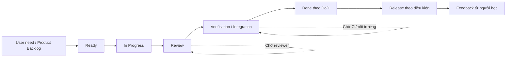
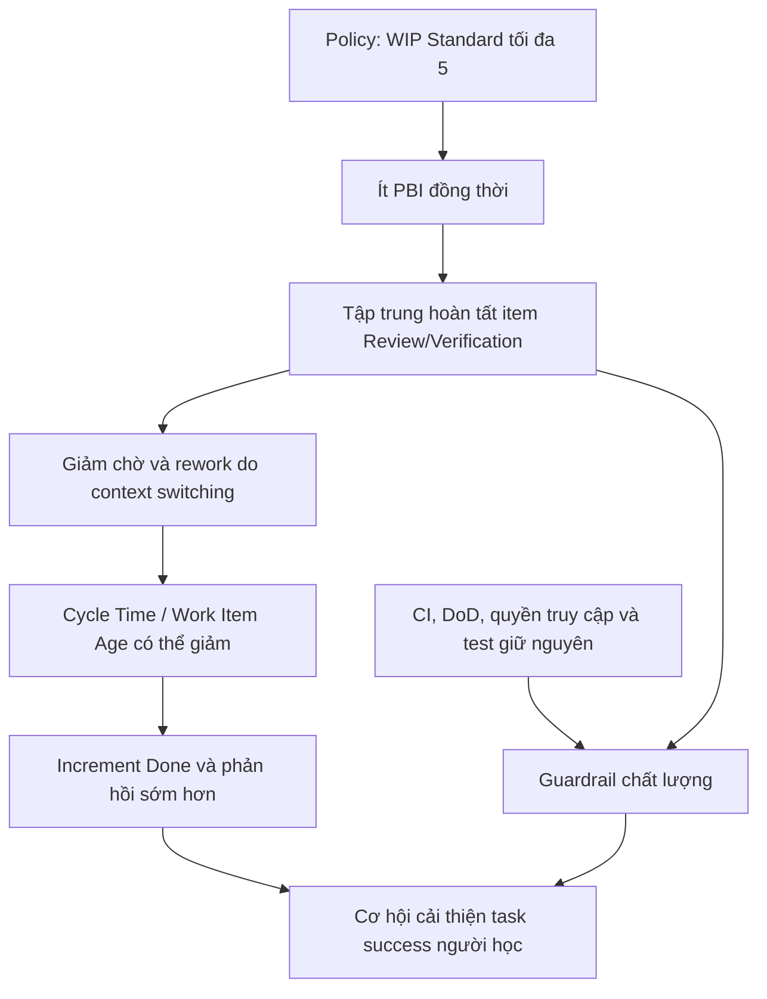

# Thiết kế một thử nghiệm cải tiến với cách kiểm chứng kết quả

Một Scrum Team phát triển nền tảng học trực tuyến thường kết thúc Sprint với nhiều Product Backlog Items (PBIs) “đã viết code” nhưng chưa đủ điều kiện **Definition of Done (DoD)**. Review kéo dài, kiểm thử tích hợp dồn cuối Sprint, người học phải chờ tính năng **“Tiếp tục bài học đang dở”** lâu hơn dự kiến. Nhóm đề xuất giới hạn **Work in Progress (WIP)** để dành nhiều năng lực hơn cho việc hoàn tất PBI đã bắt đầu.

Tuy nhiên, một thành viên hỏi: “Nếu sau bốn tuần chúng ta thấy Cycle Time giảm, làm sao biết đó là do WIP limit? Nếu giảm vì ticket được chia nhỏ hơn, Sprint ít sự cố hơn hoặc team bỏ bớt test thì sao? Và nếu cycle time tốt hơn nhưng học viên vẫn không tìm lại đúng bài, có gọi là cải tiến thành công không?”

Đó là vấn đề trung tâm của bài học này: **thiết kế một thử nghiệm cải tiến có thể kiểm chứng**, không chỉ “thử một phương pháp mới rồi cảm thấy mọi thứ tốt hơn”.

Trong phát triển phần mềm thích ứng, nhóm liên tục có các giả thuyết: chia user story nhỏ sẽ giảm rework; tích hợp thường xuyên sẽ phát hiện lỗi sớm; giới hạn WIP sẽ giảm chờ; review Product Backlog cùng stakeholder sẽ giảm làm sai nhu cầu. Mỗi giả thuyết cần được biến thành **một can thiệp đủ cụ thể**, có **đường cơ sở**, **phép đo**, **tiêu chí thành công và rủi ro**, sau đó được kiểm tra bằng dữ liệu và phản hồi thực tế.

Bài Knowledge thuộc chương **Thực hành tổng hợp**, mô-đun **AGILE_DEVELOPMENT**: hiểu giá trị và nguyên tắc Agile qua phản hồi sớm, giao phần mềm tăng dần và cải tiến liên tục; kết hợp user story, backlog, Scrum, Kanban, XP và đo lường dòng công việc để lựa chọn cách phối hợp phù hợp.

> **Phạm vi:** Các số liệu, ngưỡng quyết định, tên item và bối cảnh trong ví dụ là **giả định phục vụ học tập**, không phải kết quả nghiên cứu hay khuyến nghị định mức chung. Bài hướng dẫn cách thiết kế và đọc một thử nghiệm thực tiễn, không thay thế phân tích thống kê chuyên nghiệp hoặc yêu cầu kiểm thử/an toàn/tuân thủ bắt buộc.

## 1. Mục tiêu học tập

Sau bài học, bạn có thể:

1. Phân biệt **ý tưởng cải tiến**, **giả thuyết có thể bác bỏ**, **can thiệp** và **bằng chứng kết quả**.
2. Chọn một vấn đề cải tiến cụ thể gắn **Product Goal, người dùng hoặc dòng giao giá trị**.
3. Vẽ chuỗi tác động *can thiệp → thay đổi hành vi nhóm → tín hiệu flow/quality → outcome*.
4. Xây **problem statement** dựa trên quan sát, tránh nhảy ngay từ triệu chứng tới tên phương pháp.
5. Xác định **đơn vị thử nghiệm, phạm vi đối tượng, thời lượng, quyền quyết định, rủi ro và giới hạn**.
6. So sánh thiết kế **before–after, đối chứng song song, triển khai tuần tự và chuỗi thời gian**, biết giới hạn nhân quả của từng cách.
7. Xác định cách đo **Start, Finish, WIP, Work Item Age, Cycle Time, Throughput và thời gian chờ**, không đổi định nghĩa giữa các giai đoạn.
8. Chọn một hoặc vài **chỉ số chính**, các chỉ số phụ, **guardrails chất lượng/an toàn** và outcome người dùng.
9. Viết **tiêu chí giữ/sửa/dừng** trước khi xem kết quả, tránh “đổi mục tiêu sau khi thấy số”.
10. Tính và diễn giải trung vị, trung bình, phân vị, tỷ lệ thay đổi và throughput từ dữ liệu mẫu.
11. Nhận diện **bias, confounder, lựa chọn mẫu, seasonality, survivor bias và Goodhart's law**.
12. Phân biệt **cải thiện chỉ số flow** với **giá trị sản phẩm**, **sự phù hợp người dùng** và tác động lâu dài.
13. Lập kế hoạch thử nghiệm phù hợp **Scrum, Kanban, XP**, không làm mất DoD hoặc tuân thủ bắt buộc.
14. Tổ chức các điểm kiểm tra trong thời gian thử, tránh ra quyết định từ một tuần tốt bất thường.
15. Viết **báo cáo thí nghiệm và đề xuất bước tiếp theo** dựa trên bằng chứng, kể cả khi kết quả chưa rõ hoặc thất bại.

## 2. Thế nào là một thử nghiệm cải tiến trong Agile?

### 2.1. Thay đổi quy trình chưa phải là thí nghiệm

Các câu dưới đây mới là **ý định**:

- “Tuần sau nhóm chuyển sang Kanban.”
- “Chúng ta tăng số buổi refinement.”
- “Mọi người phải pair programming nhiều hơn.”
- “Hãy viết thêm unit tests.”
- “Giảm số giờ họp để tăng năng suất.”

Chúng chưa nói:

- Vấn đề nào đang gây thiệt hại?
- Vì sao thay đổi ấy có thể giúp?
- Kết quả mong đợi là gì?
- Đơn vị nào được thử?
- Có rủi ro làm giảm chất lượng hoặc giá trị không?
- Khi nào và bằng cách nào nhóm biết có nên tiếp tục?

Một **thử nghiệm cải tiến có khả năng kiểm chứng** trả lời được các câu hỏi trên, ngay cả khi cách đánh giá chỉ là một thử nghiệm trước–sau có giới hạn, chưa phải nghiên cứu ngẫu nhiên.

### 2.2. Công thức tư duy

```text
Vấn đề quan sát được
    -> Giả thuyết nguyên nhân
    -> Can thiệp cụ thể, có phạm vi
    -> Dự đoán về thay đổi có thể đo
    -> Baseline và cách đo nhất quán
    -> Thực hiện + ghi biến cố
    -> Phân tích flow + chất lượng + outcome
    -> Giữ / sửa / dừng / thử tiếp
```

**Một thử nghiệm tốt có thể cho kết quả “giả thuyết chưa được ủng hộ”.** Đó không nhất thiết là thất bại công việc: nó giúp tránh mở rộng một thay đổi không tạo tác dụng.

### 2.3. Ba loại thử nghiệm thường giao nhau

| Loại | Câu hỏi | Ví dụ |
| --- | --- | --- |
| **Cải tiến hệ thống làm việc** | Team có hoàn tất giá trị nhanh, chất lượng và bền vững hơn không? | Giới hạn WIP, điều chỉnh review, giảm batch size |
| **Thử nghiệm kỹ thuật** | Cách làm mới có giảm lỗi/rework/rủi ro thay đổi mã không? | Thêm contract tests, CI pipeline, pairing, characterization tests |
| **Khám phá/kiểm chứng sản phẩm** | Người dùng có thực sự nhận lợi ích từ giải pháp không? | Thử mẫu giao diện Tiếp tục bài học, kiểm tra task success |

Trong ví dụ xuyên suốt, **can thiệp chính là một chính sách WIP**, còn outcome người học là **tín hiệu giá trị ở cấp sản phẩm**. Nếu outcome không cải thiện, không thể tự kết luận WIP limit thất bại vì có thể còn các nút nghẽn khác; ngược lại, flow cải thiện **không đủ** để công bố thành công về sản phẩm.

## 3. Bắt đầu từ vấn đề thay vì tên framework

### 3.1. Một problem statement có thể kiểm tra

Ví dụ:

> “Trong bốn tuần gần nhất, các PBI Standard về luồng học viên có trung vị Cycle Time khoảng 15,5 ngày lịch. Nhiều PBI đợi Review hoặc Verification trong khi Developers tiếp tục Start việc mới. Hậu quả là Increment hoàn tất muộn, phản hồi người dùng đến chậm. Đội muốn kiểm tra liệu kiểm soát WIP có giảm thời gian Start–Finish mà không làm tăng lỗi hồi quy hay không.”

Điểm mạnh:

- **Phạm vi:** PBI Standard thuộc luồng học viên.
- **Tín hiệu:** thời gian, hàng chờ và hành vi Start việc.
- **Tác động:** Increment và phản hồi.
- **Giả thuyết:** WIP control có thể giảm chờ.
- **Guardrail:** lỗi hồi quy không được xấu đi.

Không vội khẳng định **WIP cao là nguyên nhân duy nhất**: có thể Review thiếu người, test không đáng tin hoặc cách cắt PBI quá lớn.

### 3.2. Bản đồ dòng công việc trước khi can thiệp



Nhóm cần kiểm tra đây có phải **workflow thực tế** không. Một cột `Review` có thể che hai bước: chờ kiểm tra tự động và chờ người có thẩm quyền bảo mật. Thí nghiệm không nên dựa vào sơ đồ lý tưởng mà bỏ sót hàng chờ thật.

### 3.3. Phân biệt triệu chứng và cơ chế

| Quan sát | Cơ chế khả dĩ | Bằng chứng cần thêm |
| --- | --- | --- |
| PBI lâu Done | Review/CI/batch test nghẽn | Thời gian ở từng trạng thái, age, lịch sử PR |
| WIP cao | Start mới khi có blocker, push policy | Số item Start/ngày, lý do mở mới |
| Lỗi hồi quy cuối Sprint | Tích hợp muộn, DoD không rõ | Kết quả CI, hợp đồng API, thời điểm phát hiện |
| Sprint Goal thường thất bại | Quá nhiều việc, nhiều incident, PBI lớn | Sprint Backlog changes và loại work |
| Stakeholder ít thấy giá trị | Increment chưa tích hợp hoặc release queue dài | DoD, deployment/release cadence, review feedback |

**Không nên dùng một chỉ số duy nhất để đặt tên nguyên nhân**. Giảm hàng chờ có thể cần WIP limit, nhưng nếu một bước test bắt buộc mất nhiều ngày, phải xử lý năng lực kỹ thuật và chính sách tương ứng.

## 4. Mô hình tác động: vì sao can thiệp có thể tạo kết quả?

### 4.1. Viết chuỗi nhân quả *dự đoán*, không coi là sự thật đã chứng minh



Mũi tên biểu thị **giả thuyết lý thuyết thay đổi**; thí nghiệm phải kiểm tra xem chúng có xảy ra không.

### 4.2. Chọn mắt xích gần can thiệp nhất làm phép đo chính

Nếu thử WIP control, **Cycle Time, Work Item Age, số item bị chặn, WIP và throughput** là các tín hiệu gần cơ chế.

Nếu dùng **tỷ lệ học viên quay lại hoàn thành bài** làm chỉ số duy nhất, có thể mất nhiều tháng và chịu rất nhiều yếu tố ngoài WIP. Outcome ấy vẫn cần quan tâm, nhưng nên phân loại là **chỉ số giá trị ở cấp sản phẩm hoặc chỉ số thứ cấp**.

### 4.3. Kiểm tra giả thuyết đối lập

Ngoài giả thuyết “giảm WIP giúp nhanh hơn”, hãy viết:

- **H1:** Giảm WIP giảm context switching và chờ.
- **H2:** Việc Review thiếu kỹ năng là nút thắt chính, limit chỉ làm WIP thấp trên bảng nhưng không cải thiện Done.
- **H3:** PBI đã được cắt nhỏ hơn hoặc ít phức tạp hơn, nên Cycle Time giảm không do limit.
- **H4:** Dữ liệu đẹp do nhóm chuyển item blocked ra ngoài ranh giới Start/Finish.
- **H5:** Cycle Time giảm nhưng lỗi bị đẩy sang production do hạ chất lượng.

Các giả thuyết cạnh tranh giúp nhóm **tìm bằng chứng có thể phản bác**, không chỉ tìm lý do ủng hộ quyết định sẵn có.

## 5. Viết giả thuyết có thể kiểm chứng

### 5.1. Mẫu cơ bản

> **Nếu** [nhóm/đối tượng] áp dụng [can thiệp đo được] trong [thời gian], **thì** [chỉ số chính] sẽ [thay đổi mục tiêu so với baseline], **vì** [cơ chế dự đoán], **miễn là** [guardrails không bị phá]. **Chúng tôi sẽ** [cách thu thập và so sánh], **quyết định** [giữ/sửa/dừng] theo [điều kiện trước].

Ví dụ cụ thể:

> “Trong bốn tuần, đối với PBI Standard của dịch vụ học tập, nếu giới hạn WIP toàn luồng Start–Finish ở mức 5 (item blocked vẫn tính), và khi đầy WIP thì ưu tiên hoàn tất item cũ, trung vị Cycle Time có thể giảm ít nhất 20% so với đường cơ sở bốn tuần trước. Việc giảm được kỳ vọng nhờ ít chuyển ngữ cảnh và chờ Review. Thử nghiệm chỉ được xem để mở rộng khi DoD giữ nguyên, không xuất hiện dấu hiệu tăng rủi ro nghiêm trọng và dữ liệu đủ so sánh.”

**Mức 20% và WIP = 5 là ngưỡng thử giả định**, không phải quy tắc Kanban.

### 5.2. Giả thuyết phải có khả năng thất bại

Câu “chúng ta sẽ hợp tác tốt hơn” khó bác bỏ. Câu “số PBI Standard quá hạn SLE sẽ giảm, không tăng lỗi” rõ hơn.

Một giả thuyết có thể không được ủng hộ nếu:

- Sau thử nghiệm, Cycle Time hầu như không đổi.
- WIP giảm nhưng throughput giảm mạnh vì thiếu reviewer.
- Work Item Age của item khó tăng dù trung vị giảm.
- Chất lượng giảm vì tiêu chuẩn Finish bị hạ.
- Mọi thay đổi trùng với giai đoạn ít việc bất thường.
- Nhóm không tuân thủ policy, nên không biết tác dụng can thiệp thực tế.

### 5.3. Kiểm chứng được không đồng nghĩa bảo đảm quan hệ nhân quả

Một phép so sánh trước–sau có thể cho thấy **sự khác biệt đáng chú ý**, nhưng hiếm khi cho biết chắc **toàn bộ khác biệt do một chính sách**. Muốn kết luận mạnh hơn cần thiết kế đối chứng phù hợp, dữ liệu đủ và xử lý nhiều nguồn sai lệch.

## 6. Xác định phạm vi và đơn vị thử nghiệm

### 6.1. Unit of intervention, unit of analysis và đối tượng có thể khác nhau

| Khái niệm | Ví dụ | Vì sao cần rõ |
| --- | --- | --- |
| **Đơn vị áp dụng can thiệp** | Một Scrum Team với WIP policy chung | Không thể giới hạn WIP thực của từng ticket độc lập nếu cùng chia sẻ queue |
| **Đơn vị đo flow** | PBI Standard từ Start tới Done | Mỗi item có Cycle Time, Age và loại công việc |
| **Đơn vị đo chất lượng** | Những thay đổi của sản phẩm trong kỳ | Không bỏ lọt incident do nhóm khác hoặc rework |
| **Đơn vị đo outcome** | Một học viên/tác vụ trên luồng Tiếp tục bài học | Người dùng, không phải ticket, là đối tượng giá trị |
| **Đơn vị quyết định rollout** | Nhóm, sản phẩm, dịch vụ hoặc luồng | Tránh suy từ một team sang mọi phòng ban |

Không được mặc định **12 PBI = 12 mẫu độc lập về mặt thống kê**: chúng cùng chia sẻ reviewer, Sprint, môi trường và các nguyên nhân. Khi đánh giá can thiệp ở cấp team, đơn vị tác động thực tế thường là **team qua thời gian**, khiến việc suy luận nhân quả từ ít tuần rất hạn chế.

### 6.2. Tiêu chí chọn item tham gia

Một chính sách minh bạch:

- Bao gồm: **PBI Standard** về luồng học viên, được Start và Finished theo DoD định nghĩa trước.
- Không trộn: các incident bảo mật khẩn với thời gian xử lý và thẩm quyền khác.
- Theo dõi riêng: expedite, fixed-date, hỗ trợ ngoài scope, cancelled/reopened.
- Không loại: item đang WIP/blocked ở điểm chốt thời gian chỉ vì chưa Done.
- Ghi: item đưa vào từ trước giai đoạn thí nghiệm, ranh giới Start/Finish, kích thước và độ phức tạp tương đối.

Khi loại một nhóm item khỏi phép tính chính, vẫn phải **ghi nhận nó ở dashboard tải/công việc chung**. Không được đẩy công việc khó ra khỏi thống kê để có kết quả đẹp.

### 6.3. Phạm vi nhỏ nhưng có ý nghĩa

Một pilot hữu ích có thể là:

- Một team/dịch vụ ổn định.
- Một loại work item tương đối nhất quán.
- Một thay đổi chính sách có thể đảo ngược.
- Khoảng thời gian đủ nhìn vài lần hoàn tất.
- Một tập chỉ số đủ để quyết định tiếp.

**Không chọn pilot chỉ gồm những ticket dễ nhất rồi tuyên bố áp dụng được cho toàn công ty**.

## 7. Những kiểu thiết kế thử nghiệm

### 7.1. Trước–sau trong cùng nhóm

Cách thực hiện:

1. Đo baseline trước can thiệp.
2. Đặt và công bố chính sách mới.
3. Đo các chỉ số cùng ranh giới sau can thiệp.
4. So sánh, ghi những thay đổi đồng thời.

Ưu điểm: **dễ bắt đầu, ít tổn hại vận hành**. Giới hạn: thay đổi người, loại việc, mùa cao điểm hoặc chất lượng công cụ có thể gây sai lệch.

Ví dụ WIP limit bốn tuần trước – bốn tuần sau là một **pilot trước–sau**, không được gọi là **randomized controlled trial**.

### 7.2. Nhóm đối chứng song song

Nếu có hai nhóm/dòng tương đồng và can thiệp không ảnh hưởng qua lại:

- Nhóm A thử chính sách mới.
- Nhóm B giữ chính sách cũ trong một giai đoạn phù hợp.
- Cả hai cùng được quan sát.
- So sánh biến động, tính đến khác biệt ban đầu.

Ưu điểm: hỗ trợ phân biệt biến động chung của thời gian. Giới hạn: team **không thật sự tương đồng** về kỹ năng, hệ thống, workload; reviewer chung có thể gây **spillover**, nên kết quả không còn độc lập.

Không cố tình giữ một nhóm trong trạng thái **thiếu bảo vệ dữ liệu hoặc lỗi nghiêm trọng** chỉ để tạo đối chứng.

### 7.3. Triển khai tuần tự (*staggered rollout*)

Một số team áp dụng ở các mốc khác nhau:

- Team A thử ở tuần 1.
- Team B thử ở tuần 3 khi đạt điều kiện.
- Team C áp dụng sau khi có thêm bằng chứng.

Có thể quan sát trước/sau và dùng nhóm chưa áp dụng làm mốc so sánh có điều kiện. Giới hạn: thời điểm chọn có thể liên quan mức sẵn sàng, mùa cao điểm hoặc người quản lý, nên vẫn bị nhiễu.

### 7.4. Chuỗi thời gian có điểm can thiệp

Thu dữ liệu **nhiều kỳ trước và nhiều kỳ sau**, xem cả mức và xu hướng khi chính sách thay đổi. Cách này hữu ích nếu flow biến động và có lịch sử đủ dài.

Giới hạn: nếu đổi CI, thay người và vào mùa khai giảng đúng lúc áp dụng WIP limit, việc quy kết vẫn khó.

### 7.5. A/B testing cho trải nghiệm người dùng

A/B testing có thể thích hợp với **thay đổi sản phẩm** khi:

- Có cơ sở phù hợp để phân nhóm người dùng.
- Cả hai biến thể đáp ứng yêu cầu an toàn/chất lượng.
- Không có rủi ro phân quyền, dữ liệu hoặc quyền lợi bị đánh đổi trái phép.
- Có cách tránh một người thấy biến thể lẫn lộn và đo outcome nhất quán.
- Có quyền, thông báo/đồng ý khi cần theo chính sách, và khả năng dừng.

**Không dùng A/B để đưa người dùng thật vào một phiên bản có lỗi bảo mật nghiêm trọng**. Đối với chính sách WIP ở cấp một team, randomize từng user thường **không đo đúng đơn vị can thiệp**.

### 7.6. Bảng lựa chọn thiết kế

| Thiết kế | Dễ thực hiện | Hỗ trợ nhân quả | Rủi ro cần xử lý |
| --- | --- | --- | --- |
| Before–after một team | Cao | Hạn chế | Seasonality, mix công việc, đổi định nghĩa |
| Hai team có so sánh phù hợp | Trung bình | Có thể mạnh hơn | Chọn nhóm khác nhau, dùng chung constraint |
| Staggered rollout | Trung bình | Có thể hữu ích | Thời điểm không ngẫu nhiên, spillover |
| Interrupted time series | Cần lịch sử nhiều kỳ | Hữu ích khi giả định phù hợp | Xu hướng có sẵn, can thiệp khác cùng mốc |
| A/B trải nghiệm | Phụ thuộc hạ tầng và đạo đức | Có thể cao với randomization đúng | Quyền riêng tư, sample, network effects |
| Case-based qualitative study | Thường dễ khi mẫu nhỏ | Không chứng minh nhân quả định lượng | Interview bias, diễn giải chủ quan |

**Chọn thiết kế phù hợp mục tiêu và giới hạn thật**, không gắn nhãn “A/B” cho mọi phép so sánh.

## 8. Baseline: đo hiện trạng trước khi thay đổi

### 8.1. Baseline là dữ liệu có định nghĩa, không phải số nhớ lại

Ví dụ:

> “Từ đầu D1 tới trước D29 của giai đoạn baseline giả định, có 12 PBI Standard đi qua điểm Finish theo DoD, các mốc Start/Finish được lấy từ lịch sử workflow không sửa lại. Cycle Time tính bằng ngày lịch theo hiệu hai mốc. Các item đang WIP tại ngày chốt vẫn được theo dõi Work Item Age, không tự đưa vào phân phối Cycle Time đã Done.”

Cần ghi:

- Khoảng quan sát và múi giờ.
- Các loại item được đưa vào/loại khỏi phép đo.
- Phân biệt Start/Finish/Done/Released.
- Mức tin cậy của timestamp.
- Những thay đổi trạng thái bằng tay.
- Các ngày nghỉ, incident hoặc migration lớn.
- Quy tắc xử lý cancelled/reopened.
- Số item còn mở và age của chúng tại điểm chốt.

### 8.2. Baseline có thể gồm định tính

Đừng chỉ lấy dashboard:

- Quan sát một buổi review theo từng PBI.
- Hỏi Developer vì sao mở item mới khi chờ.
- Hỏi reviewer mất thời gian vì thiếu bối cảnh gì.
- Xem bản ghi CI/test và lý do phải chạy lại.
- Hỏi Product Owner bao nhiêu PBI hoàn tất tạo giá trị thật.
- Xem phản hồi của học viên về khả năng quay lại bài.

Dữ liệu định tính giúp **giải thích cơ chế và phát hiện điều không được công cụ ghi nhận**.

### 8.3. Định nghĩa nhất quán hơn độ chính xác giả

Nếu công cụ ghi `Done` khi merge code trước khi test, phải **sửa quy tắc Finish/DoD** cho tương lai. Nhưng đổi định nghĩa đồng thời với can thiệp sẽ làm **Cycle Time trước/sau không còn so sánh trực tiếp**. Cần:

1. Thừa nhận dữ liệu cũ không tương thích.
2. Có thể tái tính các timestamp quá khứ nếu có bằng chứng đáng tin.
3. Hoặc đo một baseline mới theo định nghĩa chuẩn trước can thiệp.
4. Ghi giai đoạn chuyển tiếp và không lấy so sánh giả làm bằng chứng.

## 9. Chọn chỉ số chính, phụ và điều kiện bảo vệ

### 9.1. Một dashboard chưa phải thiết kế đánh giá

Thí nghiệm không nên đo 40 KPI rồi chọn chỉ số đẹp nhất sau cùng. Nên ưu tiên:

- **Primary measure:** kết quả gần cơ chế nhất; ví dụ median Cycle Time PBI Standard.
- **Supporting flow measures:** WIP bình quân, Work Item Age, throughput, Review wait.
- **Quality guardrails:** DoD không đổi, lỗi hồi quy, incident, CI, bảo mật và privacy.
- **Product outcomes:** task success, thời gian học viên quay lại bài, hành vi dùng tính năng.
- **Human sustainability:** thời gian gián đoạn, làm thêm giờ, quyền hỗ trợ nhau; không dùng để xếp hạng cá nhân.

### 9.2. Định nghĩa để người khác tính lại được

| Chỉ số | Định nghĩa | Lưu ý |
| --- | --- | --- |
| **Median Cycle Time (primary)** | Trung vị số ngày lịch từ Start tới Done của PBI Standard đủ điều kiện | Xem cả item chưa Done để tránh thiên lệch |
| **P85 Cycle Time** | Phân vị 85 theo phương pháp đã chọn trên item Finished | Mẫu nhỏ dễ biến động; nêu nearest-rank khi dùng |
| **Average WIP** | Trung bình snapshot số PBI Standard đã Start chưa Done mỗi ngày cùng mốc | Không bỏ blocked items |
| **Work Item Age** | Thời gian từ Start tới thời điểm xem của item chưa Done | Theo dõi item già nhất hoặc phân phối age |
| **Throughput** | Số item Standard Finished mỗi tuần | Chia item nhất quán, không đồng nhất giá trị |
| **Review wait** | Thời gian thực item chờ review theo policy | Cần timestamp đủ tin cậy |
| **DoD compliance** | Có đạt đầy đủ tiêu chí Done đã chốt hay không | Không hạ DoD khi triển khai |
| **Defect escape** | Lỗi lọt qua kiểm chứng vào môi trường tiếp nhận theo định nghĩa | Phải xem mức nghiêm trọng và phạm vi quan sát |
| **Task success** | Tỷ lệ người học hoàn thành tác vụ xác định trên mẫu hợp lệ | Không tự suy từ kết quả demo nhỏ ra mọi người |

### 9.3. Guardrail có thể yêu cầu dừng ngay

Ví dụ:

- Phát hiện hành vi tiết lộ tiến độ học viên khác → **kích hoạt quy trình bảo vệ người dùng ngay**.
- CI/test bắt buộc bị bỏ để ép item Done → **không coi kết quả đó hợp lệ**.
- Workload khiến các thành viên phải tăng làm ngoài giờ liên tục → **xem lại năng lực và chính sách**.
- Thay đổi bản chất quyền truy cập/dữ liệu ngoài thẩm quyền của pilot → **dừng phần thay đổi chưa được duyệt**.

Không chờ đủ “mức ý nghĩa thống kê” để xử lý nguy cơ nghiêm trọng đã được xác nhận.

## 10. Chọn một can thiệp có phạm vi và cơ chế rõ

### 10.1. Thiết kế chính sách thử nghiệm

**Can thiệp đề xuất (giả định):**

- **Đối tượng:** PBI Standard trong luồng công việc từ `In Progress` qua `Review` và `Verification` tới `Done`.
- **WIP limit:** tối đa **5 PBI Standard** đã Start và chưa Done trong phạm vi thử.
- **Blocked policy:** item bị chặn vẫn được tính WIP và có nguyên nhân/người gỡ blocker.
- **Pull policy:** khi đạt limit, không kéo Standard item mới; ưu tiên hỗ trợ item đang mở.
- **Flow review:** dùng cuộc trao đổi hằng ngày đang có để kiểm tra age, review và sự kiện mới, không bắt đầu thêm một cuộc họp lớn.
- **Expedite:** incident/bảo mật nghiêm trọng đi theo runbook và thẩm quyền riêng, được ghi tác động lên Standard flow.
- **Chất lượng:** DoD, kiểm tra phân quyền, CI và tiêu chuẩn release giữ nguyên.
- **Thời lượng:** bốn tuần sau baseline bốn tuần, xem lại sau từng tuần.
- **Quyền điều chỉnh:** Team thống nhất cách vận hành; PO tham gia về ưu tiên; người có thẩm quyền xử lý rủi ro điều phối khi khẩn.

Đây là **một gói chính sách phối hợp**, không phải một “biến số độc lập duy nhất” theo chuẩn phòng thí nghiệm. Trong báo cáo phải nói rõ **WIP limit + quy tắc kéo/hoàn tất** được triển khai cùng nhau.

### 10.2. Điều gì không được âm thầm thay đổi?

Nếu muốn biết tác động của chính sách WIP, trong giai đoạn chính nên cố giữ tương đối nhất quán:

- Definition of Done.
- Cách ghi Start/Finish.
- Cách chia/định nghĩa PBI.
- Bảng phân loại Standard/Expedite.
- Review/security requirements.
- Cách ghi sự cố và lỗi.
- Mục tiêu ưu tiên và quy tắc release.

Nếu cần thay đổi vì bảo mật, chất lượng hoặc sự kiện sản phẩm, **được và phải thay**; nhưng cần ghi sự kiện và hạn chế khả năng quy kết, không dùng “thí nghiệm” để từ chối sửa lỗi quan trọng.

## 11. Định nghĩa trước ngưỡng quyết định

### 11.1. “Cải thiện” cần được đặt trước khi xem kết quả

Một chính sách minh họa:

| Kết quả muốn có | Ngưỡng quan sát ban đầu | Lý do |
| --- | --- | --- |
| Median Cycle Time | Giảm ít nhất **20%** so với baseline | Mức đổi đủ đáng quan tâm với nhóm |
| P85 Cycle Time | Không tăng, ưu tiên giảm | Không hy sinh item đuôi dài |
| Throughput Standard | Không giảm rõ rệt kéo dài sau khi ổn định | Tránh limit làm đình trệ dòng |
| Average WIP Standard | Hướng về mức khoảng **5** theo policy | Kiểm tra can thiệp có thực thi |
| DoD/CI | Không giảm tiêu chuẩn hoặc bỏ bước bắt buộc | Guardrail chất lượng |
| Lỗi nghiêm trọng về quyền/dữ liệu | Có dấu hiệu → xử lý/dừng theo incident policy | Không chấp nhận rủi ro để đổi lấy flow |
| Feedback người dùng | Ghi hướng thay đổi, không gán nhân quả ngay | Liên hệ giá trị thực |

**Đây là tiêu chí ra quyết định cho pilot**, không phải một bài kiểm định có sẵn xác suất sai lầm thống kê.

### 11.2. Định nghĩa rõ “giữ, sửa, dừng”

- **Giữ để quan sát thêm / mở rộng có kiểm soát:** can thiệp thực sự được tuân thủ; nhiều tín hiệu cùng hướng; không vi phạm guardrail; bối cảnh đủ tương đồng.
- **Sửa:** median tốt nhưng item già còn tăng; WIP thấp nhưng throughput giảm; reviewer vẫn là bottleneck; dữ liệu chưa đủ; hoặc policy quá cứng.
- **Dừng/phục hồi chính sách:** chất lượng/rủi ro vượt điều kiện bảo vệ, chi phí phối hợp lớn hơn lợi ích, tác động ngược kéo dài, dữ liệu sai hoặc can thiệp không khả thi.

Thí nghiệm **không cần ép một lựa chọn “thắng hay thua”** từ mẫu quá nhỏ. “Chưa đủ bằng chứng, kéo dài với cách đo tốt hơn” cũng là kết quả hợp lệ.

### 11.3. Phải chỉ rõ ai ra quyết định

- **Developers và những người tham gia flow:** thực hiện, làm lộ blockers, đánh giá khả năng kỹ thuật.
- **Product Owner** (khi dùng Scrum): giữ góc nhìn giá trị, Product Backlog và tác động tới Product Goal.
- **Scrum Master/flow facilitator:** giúp minh bạch, gỡ trở ngại tổ chức, không gán trách nhiệm cá nhân từ số liệu.
- **Stakeholders/người sử dụng:** phản hồi giá trị và rủi ro thực.
- **Vận hành/bảo mật/dữ liệu:** giữ quyền theo trách nhiệm chính thức khi có tác động cần kiểm soát.

Không tạo một “người chủ thí nghiệm” có quyền bỏ DoD hoặc ghi đè chính sách sản phẩm.

## 12. Thiết kế thu thập dữ liệu và kiểm tra độ tin cậy

### 12.1. Một event log tối thiểu

```text
work_item_id
type = Standard | Expedite | FixedDate | ...
product_area
started_at (ISO 8601 + timezone)
finished_at (ISO 8601 + timezone; null nếu chưa Done)
current_state
blocked_periods (nếu đo được)
review_wait_start / review_wait_end (nếu đo được)
quality_evidence_link
reopened_or_cancelled (status và nguyên nhân)
notable_context (incident, holiday, version change)
```

Thông tin phải được thu thập theo **quyền truy cập, bảo mật và lưu trữ được phép**. Không cần lưu tên người học hoặc dữ liệu cá nhân nhạy cảm trong bảng flow.

### 12.2. Quy tắc tính

Giả sử timestamp đại diện **đầu ngày lịch tương đối Dn**, item Start ở D3 và Finish ở D8:

```text
Cycle Time = D8 - D3 = 5 ngày lịch.

Tại đầu D6:
Nếu D3 <= D6 < D8, item còn WIP.
Work Item Age = D6 - D3 = 3 ngày lịch.
```

Với dữ liệu thật, nên tính từ timestamp đầy đủ, nêu rõ **giờ/múi giờ và cách quy đổi sang ngày**. Không tự thêm một ngày cho cả ngày bắt đầu lẫn ngày kết thúc nếu đơn vị là hiệu timestamp.

### 12.3. Tránh thiên lệch vì item chưa hoàn tất

Nếu chỉ nhìn PBI đã Done sau bốn tuần, những PBI khó bị chặn lâu vẫn chưa Finished sẽ **không có Cycle Time hoàn chỉnh** trong mẫu. Đây là vấn đề **right-censoring/survivor bias** ở điểm quan sát.

Cần báo thêm:

- Số item **đang WIP** ở cuối kỳ.
- Work Item Age phân phối, đặc biệt item già nhất.
- Số item blocked và thời gian chờ.
- Item được mở trước giai đoạn thử nhưng Done trong giai đoạn.
- Item bị hủy, tách, reopen hoặc thay đổi scope.

Không xóa item đang WIP chỉ vì nó làm dashboard xấu.

### 12.4. Kiểm chứng dữ liệu trước phân tích

Một checklist kỹ thuật:

- Không có Finish trước Start, trừ lỗi ghi cần sửa.
- Timestamp có timezone hoặc quy tắc quy đổi.
- Không đếm lại một item reopen như một hạng mục hoàn toàn mới nếu policy không cho phép.
- Trạng thái Done khớp bằng chứng chất lượng.
- Không trộn incident vào Standard khi so hai kỳ.
- Số Finished trong event log khớp throughput.
- Snapshot WIP tính đúng những item Start chưa Finish tại cùng thời điểm.
- Giải thích được các thay đổi của Definition of Workflow.

**Không làm phép tính phức tạp trước khi dữ liệu tối thiểu đúng.**

## 13. Không nên dùng kiểm định thống kê thay cho tư duy kỹ thuật

### 13.1. Độ lớn tác động khác “p-value”

Một thay đổi median từ 15,5 xuống 8,5 ngày có thể đáng chú ý về vận hành, nhưng muốn suy luận rộng cần xem:

- Số item và số khoảng thời gian độc lập.
- Mix công việc trước–sau.
- Variance và các item đuôi dài.
- Item chưa Done.
- Cointerventions, incident và mùa cao điểm.
- Chất lượng dữ liệu.
- Những thay đổi nào tạo ra khác biệt.

Một **p-value nhỏ** không tự chứng minh tác động hữu ích, cũng không bảo đảm không có confounder; một p-value lớn trong mẫu nhỏ **không chứng minh không có tác động**.

### 13.2. Tránh quyết định từ một ngày đẹp

Nếu ngay hôm đầu giảm WIP, có thể bốn PBI đang gần Done đồng loạt Finish. Throughput một ngày tăng nhưng **không chắc xu hướng bền vững**.

Cần xem **một giai đoạn đủ nhiều vòng xử lý**, cả những item Start sau can thiệp và item chuyển tiếp, rồi quyết định với mức bất định được nêu rõ.

### 13.3. Không tạo “độ chính xác giả”

Không nên viết:

> “Tác động thật của WIP limit là 42,81% và chắc chắn áp dụng cho mọi nhóm.”

Nếu chỉ có 28 item Done trong hai kỳ và một team, cách nói đúng hơn:

> “Trong ví dụ giả định, median Cycle Time của các item đã Done giảm khoảng 45%; chưa thể quy toàn bộ khác biệt cho chính sách WIP hoặc suy rộng sang những nhóm khác.”

## 14. Kế hoạch đo end-to-end cho tình huống LMS

### 14.1. Bản tóm tắt thiết kế

| Trường | Giá trị minh họa |
| --- | --- |
| **Vấn đề** | PBI Standard của luồng học viên chờ Review/Verification lâu |
| **Giả thuyết** | WIP Standard tối đa 5 và ưu tiên hoàn tất sẽ giảm cycle time |
| **Đơn vị can thiệp** | Một team phát triển/hỗ trợ nền tảng học |
| **Baseline** | 4 tuần, giữ dữ liệu Start/Finish theo DoD |
| **Pilot** | 4 tuần áp dụng policy WIP |
| **Primary metric** | Median Cycle Time của Standard PBI Finished |
| **Supporting** | P85, Throughput, daily WIP average, aging WIP và review wait |
| **Quality guardrails** | CI/DoD không giảm; lỗi hồi quy, phân quyền, incident |
| **Product outcome** | Task success Tiếp tục bài học ở một cohort đủ điều kiện |
| **Cointerventions** | Ghi nếu có thay đổi kỹ thuật, số người, workload, release |
| **Review points** | Daily flow review + weekly inspect; cuối pilot quyết định |
| **Kết quả có thể** | Giữ để thử thêm, sửa chính sách hoặc dừng |

### 14.2. Tiền đề cần đủ trước khi bắt đầu

- Product Owner và Developers hiểu tại sao đây là vấn đề ưu tiên.
- Không có sự cố an toàn bắt buộc xử lý mà pilot làm chậm trễ.
- DoD và tiêu chí Finish được xác nhận.
- Một số dữ liệu baseline đủ tin cậy để có điểm xuất phát.
- WIP policy và cách xử lý incident được viết rõ.
- Có quyền phối hợp Review/Verification, không chỉ quyền đổi cột.
- Có người theo dõi dữ liệu nhưng không dùng để đánh giá cá nhân.
- Có kế hoạch để rollback **chính sách làm việc** nếu nó gây bất lợi; việc này khác rollback dữ liệu production.

### 14.3. Dạng lưu thí nghiệm tối thiểu

```yaml
experiment_id: AGILE-FLOW-01
title: "Giảm WIP Standard để rút ngắn thời gian hoàn tất PBI"
problem: "Review/Verification có hàng chờ dài, Increment đến người dùng muộn"
hypothesis: "WIP <= 5 và ưu tiên finish làm median cycle time giảm >= 20%"
scope: "Một team; PBI Standard của luồng học viên"
unit_of_intervention: "Team"
baseline: "4 tuần; số liệu Start/Finish/DoD cùng định nghĩa"
pilot: "4 tuần; ghi nhận incident và các thay đổi đồng thời"
primary_metric: "Median Cycle Time của PBI Standard Finished"
supporting_metrics:
  - "P85 Cycle Time"
  - "Average daily WIP"
  - "Throughput Standard per week"
  - "Aging WIP and blocked time"
quality_guardrails:
  - "Không hạ Definition of Done"
  - "CI/test bắt buộc vẫn đạt"
  - "Dừng/escalate nếu có rủi ro an toàn dữ liệu nghiêm trọng"
product_outcome: "Task success: học viên tiếp tục đúng bài"
review: "Flow review hằng ngày, kiểm tra mỗi tuần, quyết định cuối pilot"
decision_rule: "Giữ/sửa/dừng theo bằng chứng và guardrails, không chỉ một số"
```

Đây là **mẫu YAML viết bên trong bài học**, không phải metadata của lesson và không phải định dạng do Scrum Guide/Kanban Guide quy định. Giá trị `<=`, `>=` là mô tả ngưỡng minh họa; trong triển khai thật phải quy định người, thời điểm và cách tính rõ.

## 15. Bộ dữ liệu trước–sau minh họa và cách tính

Toàn bộ dữ liệu trong phần này **giả định**. Hai giai đoạn dài **bốn tuần**; cùng định nghĩa:

- **Work item:** PBI Standard nhỏ của luồng học viên, được xác nhận phù hợp tiêu chí chọn mẫu.
- **Start:** thời điểm PBI được kéo vào `In Progress`.
- **Finish:** thời điểm PBI tích hợp và đạt DoD.
- **Cycle Time:** số ngày lịch giữa hai timestamp.
- **Throughput:** số PBI Standard Finished trong bốn tuần.
- **WIP:** số PBI Standard đã Start và chưa Finish tại một thời điểm; item blocked vẫn tính.
- **Phân vị P85:** phép nearest-rank; chỉ dùng để minh họa thống kê nhỏ.

Chọn dữ liệu độc lập với các outcome sử dụng production; đây là **dòng phát triển**, không phải chứng minh một release đã tạo giá trị.

### 15.1. Cycle Time của 12 PBI Finished trong baseline

| Item | Cycle Time (ngày lịch) | Item | Cycle Time (ngày lịch) |
| --- | ---: | --- | ---: |
| B01 | 10 | B07 | 16 |
| B02 | 11 | B08 | 17 |
| B03 | 12 | B09 | 18 |
| B04 | 13 | B10 | 19 |
| B05 | 14 | B11 | 21 |
| B06 | 15 | B12 | 24 |

Dãy đã sắp tăng:

```text
10, 11, 12, 13, 14, 15, 16, 17, 18, 19, 21, 24

Tổng = 10 + 11 + 12 + 13 + 14 + 15
     + 16 + 17 + 18 + 19 + 21 + 24
     = 190 ngày-item

Số Finished trong 4 tuần = 12 item
Throughput trung bình = 12 / 4 = 3 item/tuần

Mean Cycle Time = 190 / 12 = 15,833... ngày

Median (12 item, vị trí 6 và 7) = (15 + 16) / 2
                              = 15,5 ngày

P85 nearest-rank:
rank = ceil(0,85 × 12) = ceil(10,2) = 11
Giá trị thứ 11 = 21 ngày
```

### 15.2. Cycle Time của 16 PBI Finished trong pilot

| Item | Cycle Time (ngày lịch) | Item | Cycle Time (ngày lịch) |
| --- | ---: | --- | ---: |
| P01 | 5 | P09 | 9 |
| P02 | 6 | P10 | 9 |
| P03 | 6 | P11 | 10 |
| P04 | 7 | P12 | 10 |
| P05 | 7 | P13 | 11 |
| P06 | 8 | P14 | 12 |
| P07 | 8 | P15 | 13 |
| P08 | 8 | P16 | 15 |

Dãy đã sắp tăng:

```text
5, 6, 6, 7, 7, 8, 8, 8, 9, 9, 10, 10, 11, 12, 13, 15

Tổng = 5 + 6 + 6 + 7 + 7 + 8 + 8 + 8
     + 9 + 9 + 10 + 10 + 11 + 12 + 13 + 15
     = 144 ngày-item

Số Finished trong 4 tuần = 16 item
Throughput trung bình = 16 / 4 = 4 item/tuần

Mean Cycle Time = 144 / 16 = 9 ngày

Median (16 item, vị trí 8 và 9) = (8 + 9) / 2
                              = 8,5 ngày

P85 nearest-rank:
rank = ceil(0,85 × 16) = ceil(13,6) = 14
Giá trị thứ 14 = 12 ngày
```

### 15.3. So sánh có đơn vị và cách làm tròn

| Chỉ số | Baseline | Pilot | Chênh lệch quan sát |
| --- | ---: | ---: | --- |
| Số item Finished trong bốn tuần | 12 | 16 | +4 item |
| Throughput bình quân | 3 item/tuần | 4 item/tuần | +1 item/tuần, khoảng +33,3% |
| Mean Cycle Time | 15,83 ngày | 9,00 ngày | −6,83 ngày, khoảng −43,2% |
| Median Cycle Time (**primary**) | 15,5 ngày | 8,5 ngày | −7,0 ngày, khoảng **−45,2%** |
| P85 nearest-rank | 21 ngày | 12 ngày | −9 ngày, khoảng −42,9% |
| WIP bình quân từ snapshot chuẩn hóa | khoảng 7 item | khoảng 5 item | −2 item, khoảng −28,6% |
| PBI Standard vẫn WIP cuối kỳ | Cần báo theo log | Cần báo theo log | **Không suy ra** từ bảng Completed items |

Cách tính thay đổi median:

```text
Giảm tương đối = (15,5 - 8,5) / 15,5
               = 7 / 15,5
               = 0,451612...
               ≈ 45,2%

Tăng throughput tương đối = (4 - 3) / 3
                           = 1/3
                           ≈ 33,3%
```

Số WIP trung bình được **giả định đo bằng snapshot hằng ngày** riêng, **không tính bằng trung bình số item trong bảng Cycle Time**. Để xác minh Little’s Law, cần dữ liệu đầy đủ đủ dài với cùng ranh giới và điều kiện ổn định; **không nên thay WIP bình quân bằng WIP tại một ngày hoặc cố ép phương trình khớp chính xác trong mẫu bốn tuần**.

### 15.4. Đồ thị trước–sau: một hình ảnh dễ hiểu nhưng dễ gây hiểu nhầm

```text
Median Cycle Time (ngày lịch)
Baseline  |###############.  15,5
Pilot     |########.         8,5

P85 Cycle Time (ngày lịch)
Baseline  |#####################  21
Pilot     |############           12

Throughput (item/tuần)
Baseline  |###                     3
Pilot     |####                    4
```

Đồ thị này **chỉ là biểu diễn số giả định**. Nó không cho thấy phân phối đầy đủ, work item đang mở hoặc những thay đổi đồng thời.

### 15.5. Một bài học quan trọng: số liệu không tự chứng minh cơ chế

Quan sát median giảm 45,2% là **lớn hơn ngưỡng ra quyết định 20% được đặt trước**. Nhưng chưa thể tuyên bố:

> “WIP limit khiến team nhanh hơn 45,2%”.

Lý do:

- Baseline và pilot có **số item khác nhau**.
- Có thể có item dễ/khó khác nhau.
- Các item đang WIP cuối kỳ chưa được tính Cycle Time.
- Reviewer có thể được hỗ trợ bởi kỹ năng/hệ thống mới.
- Có thể có thay đổi về stakeholder, incident hoặc lịch nghỉ.
- Thời gian quan sát bốn tuần mỗi kỳ rất ngắn.
- Can thiệp gồm **WIP limit và thay đổi cách pull/flow review**, không tách từng hiệu ứng.

Cách kết luận phù hợp:

> “Trong giai đoạn thử giả định, những item Standard đã Done có median Cycle Time thấp hơn khoảng 45%, P85 thấp hơn và throughput cao hơn. Đây là tín hiệu ủng hộ việc **tiếp tục kiểm tra chính sách hoàn tất trước khi mở thêm**, với guardrails và theo dõi item chưa Done. Chưa đủ bằng chứng quy kết chính xác mức thay đổi cho WIP policy hoặc suy rộng sang team khác.”

## 16. Đọc thêm dữ liệu chất lượng và giá trị sản phẩm

### 16.1. Bảng tín hiệu bổ sung

Giả sử cùng hai kỳ quan sát, nhóm còn ghi:

| Tín hiệu giả định | Baseline | Pilot | Lưu ý |
| --- | ---: | ---: | --- |
| PR chờ review trung vị | 5 ngày | 3 ngày | Cần đảm bảo định nghĩa wait như nhau |
| Lỗi hồi quy production ghi nhận trong kỳ | 1 | 1 | Mẫu nhỏ, có thể chưa đủ thời gian xuất hiện lỗi |
| Lỗi nghiêm trọng về quyền truy cập phát hiện | 0 | 0 | Không chứng minh hệ thống không có lỗi tiềm ẩn |
| Bước DoD/CI bắt buộc bị bỏ | 0 | 0 | Cần kiểm tra bằng chứng, không chỉ báo cáo |
| Học viên hoàn thành tác vụ thử “tiếp tục đúng bài” | 38/50 | 41/50 | Hai cohort nhỏ có thể khác nhau |
| Tỷ lệ task success trong mẫu | 76% | 82% | +6 điểm phần trăm, chưa thể gán cho WIP |
| Mốc release sản phẩm | Theo chính sách được duyệt | Theo chính sách được duyệt | Tốc độ Done không đồng nghĩa tốc độ Released |

**38/50 = 76%; 41/50 = 82%; chênh lệch tuyệt đối +6 điểm phần trăm**, không phải tăng “6% tương đối”. Mức tăng tương đối là `(82−76)/76 ≈ 7,9%`, nhưng **không cần dùng số này để phóng đại tín hiệu**.

### 16.2. Diễn giải guardrails

- Không có lỗi nghiêm trọng được ghi nhận **không bảo đảm** không có nguy cơ.
- Hai kỳ cùng một lỗi hồi quy **không chứng minh** chất lượng bằng nhau: lượng deployment hoặc thời gian quan sát khác nhau có thể làm tỷ lệ tiếp xúc khác.
- Không bỏ DoD là điều kiện cần, nhưng chưa bảo đảm thiết kế DoD đủ tốt.
- Task success tăng có thể do UX, dữ liệu, hành vi người học hoặc thay đổi cohort.
- Nếu thử nghiệm làm nhóm phải tăng làm ngoài giờ để nhanh Done, cần đánh giá tính bền vững.

### 16.3. Khi tín hiệu trái chiều

Ví dụ:

| Kết quả | Quyết định nên cân nhắc |
| --- | --- |
| Cycle Time giảm, lỗi bảo mật nghiêm trọng xuất hiện | Ưu tiên incident và đánh giá dừng can thiệp liên quan, không lấy số flow bào chữa |
| WIP giảm, throughput giảm mạnh và item già tăng | Xem limit quá cứng hoặc bottleneck không được giải quyết |
| Throughput tăng nhưng DoD bị hạ | Kết quả không hợp lệ để kết luận cải tiến chất lượng |
| Median giảm, P85 và age của item khó tăng | Điều tra việc bỏ đói item lớn/khó |
| Flow tốt, task success không đổi | Cải thiện có thể là năng lực nội bộ; tiếp tục tìm rào cản sản phẩm |
| Flow không đổi, quality tốt hơn | Có thể cải thiện giá trị chất lượng dù chưa đạt giả thuyết tốc độ |
| Không đủ dữ liệu hoặc cấu trúc item đổi mạnh | Kết luận chưa rõ; thiết kế baseline/segment tốt hơn trước khi quyết định rộng |

**Không có một phép cộng điểm đơn giản giữa sự an toàn dữ liệu và vài ngày Cycle Time.**

## 17. Phân tích biến động và độ tin cậy khi mẫu nhỏ

### 17.1. Trung bình, trung vị và phân vị trả lời các câu khác nhau

- **Mean:** tổng Cycle Time chia số item; chịu ảnh hưởng từ item rất chậm.
- **Median:** một điểm giữa phân phối Completed items; không nhạy bằng mean với vài giá trị cực trị.
- **P85:** trong tập mẫu theo phương pháp tính công bố, gợi ý một vùng của đuôi phân phối.
- **Work Item Age:** tín hiệu chưa hoàn tất, đặc biệt quan trọng khi median Completed items cải thiện nhưng một số item khác mắc kẹt.

Trong dữ liệu nhỏ, **P85 thay đổi mạnh khi một item đổi**. Vì vậy, có thể trình bày cả dãy hoặc biểu đồ phân phối thay vì dựa duy nhất một ngưỡng.

### 17.2. Không áp dụng ý nghĩa thống kê một cách cơ học

Một nghiên cứu về chính sách làm việc cấp team cần xem:

- Có bao nhiêu **team hoặc giai đoạn tương đối độc lập**?
- Tính tự tương quan giữa các item trong cùng team.
- Có thay đổi phân phối mix work items không?
- Dữ liệu bị right-censoring ở cuối kỳ ra sao?
- Có hiệu ứng học tập/khởi động khi can thiệp không?
- Có đủ quy mô để phát hiện tác động quan trọng không?
- Có giả định nào vi phạm khi chọn phép kiểm định?

Mười hai và mười sáu item trong hai cửa sổ bốn tuần thường **không đủ cơ sở cho tuyên bố thống kê tổng quát** về việc WIP policy làm Cycle Time giảm chính xác bao nhiêu.

### 17.3. Báo cả mức bất định thay vì số quá chính xác

Cách diễn đạt nên có:

- “Median giảm từ 15,5 xuống 8,5 ngày trong mẫu minh họa.”
- “Phương pháp so sánh là trước–sau một team, không có nhóm đối chứng.”
- “Một số hạng mục chưa Done chưa có Cycle Time cuối.”
- “Không đủ chứng cứ loại trừ mọi confounder.”
- “Đội đề xuất thử thêm một giai đoạn và phân tích phân phối theo loại PBI.”

Đây là **trung thực phương pháp**, không làm giảm giá trị của một cải tiến vận hành đáng quan tâm.

## 18. Các nguồn sai lệch cần thiết kế phòng tránh

### 18.1. Selection bias: chọn item khác loại

Nếu baseline gồm những PBI phức tạp và pilot toàn bug nhỏ, Cycle Time pilot sẽ có xu hướng thấp dù policy không đổi.

Ví dụ giả định:

| Giai đoạn | Item đơn giản | Item phức tạp | Thời gian của từng loại |
| --- | ---: | ---: | --- |
| Baseline | 2 | 8 | Đơn giản 4 ngày, phức tạp 12 ngày |
| Pilot | 8 | 2 | Đơn giản 4 ngày, phức tạp 12 ngày |

Median toàn mẫu giảm **từ 12 xuống 4 ngày**, dù **trong từng loại không có cải thiện nào**.

Đây là cảnh báo về **thay đổi mix/aggregation**. Cần:

- Chia nhóm item theo loại/rủi ro/hạng mục hợp lý.
- Công bố thay đổi tỷ trọng.
- Không lựa chọn những item dễ nhất chỉ để làm đẹp pilot.
- Cân nhắc so các đơn vị tương đồng hoặc dùng phương pháp điều chỉnh phù hợp.

### 18.2. History/seasonality: có sự kiện ngoài can thiệp

- Baseline trùng mùa khai giảng, nhiều incident.
- Pilot trùng kỳ nghỉ ít sử dụng.
- Có một migration lớn hoặc đối tác thay API.
- Reviewer chính nghỉ phép ở baseline rồi trở lại ở pilot.
- Test environment ổn định hơn do nâng hạ tầng.

Không thể loại tất cả biến cố, nhưng có thể **ghi ngày, tác động, nhóm item liên quan và độ lớn** để không suy luận sai.

### 18.3. Regression to the mean

Nếu nhóm bắt đầu thử nghiệm **ngay sau một Sprint tệ nhất năm**, giai đoạn sau có thể tự tốt lên dù không can thiệp do biến động thông thường. Cần xem **nhiều kỳ baseline và xu hướng lịch sử** khi có thể.

### 18.4. Survivorship/right-censoring bias

Chỉ đo item Completed làm mất dấu:

- PBI quá lớn chưa Done.
- PBI chờ bảo mật hoặc data migration.
- PBI bị reopen sau test.
- PBI bị hủy nhưng vẫn tiêu tốn nhiều ngày.
- Item bị reset trạng thái hoặc chuyển team.

Khắc phục: công bố **cohort item đang mở**, age và lịch sử trạng thái; xem các Item đi qua Start trong thời gian pilot ngay cả khi chưa Finish.

### 18.5. Measurement/Gaming bias

Nếu quản lý thưởng khi median giảm, nhóm có thể:

- Đổi Start sang lúc bắt đầu code thay vì lúc nhận việc.
- Đóng ticket trước khi test.
- Tạo nhiều item nhỏ không độc lập.
- Chuyển blocked item về Backlog.
- Chỉ chọn việc dễ.
- Tạo các hạng mục phụ để ghi throughput.

Cần **minh bạch chính sách, kiểm tra log, dữ liệu chất lượng và không dùng chỉ số để phạt cá nhân**. Đây là một rủi ro gần với **Goodhart's law**: khi một chỉ số trở thành mục tiêu bị thao túng, nó có thể ngừng đại diện điều cần đo.

### 18.6. Hawthorne/observation effects

Việc team biết đang được quan sát có thể làm họ chú ý Review và cập nhật board tốt hơn, bất kể WIP limit cụ thể. Đây vẫn có thể là lợi ích thực, nhưng phải **phân biệt cải tiến văn hóa minh bạch với tác động của con số limit**.

### 18.7. Contamination/spillover

Khi nhóm pilot và nhóm so sánh dùng chung reviewer, thay đổi WIP của nhóm A có thể **giải phóng reviewer cho nhóm B**. Nhóm B không còn là đối chứng hoàn toàn độc lập.

Cần vẽ **nguồn lực chia sẻ** trước khi chọn thiết kế đối chứng hoặc randomization.

### 18.8. Multiple comparisons / chọn kết quả đẹp nhất

Nếu đội đo 25 KPI rồi chỉ báo cáo ba KPI cải thiện nhiều nhất, kết luận sẽ thiên lệch. Nên **đặt primary metric và guardrails trước**, công bố cả những tín hiệu trái chiều, ghi những phân tích phát sinh sau khi xem dữ liệu là **exploratory**.

## 19. Bảo vệ chất lượng và người dùng trong thí nghiệm

### 19.1. Quyền lợi người dùng là giới hạn, không phải biến số đem đổi

Một thí nghiệm nội bộ không được bỏ:

- Phân quyền theo tài khoản/khóa.
- Kiểm soát dữ liệu cá nhân.
- Kiểm thử và code review bắt buộc.
- Yêu cầu an toàn, pháp lý hoặc hợp đồng.
- Quy trình xử lý incident và phát hành.
- Definition of Done của Scrum.
- Quyền nghỉ/ngắt quãng hợp lý và chính sách nhân sự.

Nếu quy trình review bảo mật gây chờ, có thể thử **đưa review lên sớm, tạo test tự động hoặc đào tạo người thay thế có thẩm quyền**, không đơn giản xóa review.

### 19.2. Ưu tiên rủi ro nghiêm trọng trước tính hợp lệ thí nghiệm

Giả sử đang thử giảm WIP, nhưng phát hiện API có thể trả tiến độ học viên A cho B. Không nên trì hoãn xử lý vì “sẽ làm thay đổi dữ liệu pilot”. Việc cần làm:

1. Kích hoạt quy trình ứng phó theo trách nhiệm.
2. Ngăn hoặc giảm tác động theo thẩm quyền.
3. Ghi biến cố trong log pilot.
4. Xem giả thuyết còn kiểm tra được không.
5. Điều chỉnh phạm vi hoặc dừng pilot nếu cần.

**Đúng về đạo đức và bảo mật quan trọng hơn một phép so sánh trước–sau sạch đẹp.**

### 19.3. Dữ liệu người dùng không cần phải sao chép vào bảng thử nghiệm

Với task success, có thể lưu dữ liệu **tổng hợp hoặc định danh giả/ẩn theo chính sách** thay vì tên, email, nội dung cá nhân. Cần:

- Giới hạn quyền truy cập và thời gian lưu.
- Không đưa thông tin nhận diện vào tài liệu học/bảng công khai.
- Xác nhận quyền thu thập/nhận đồng ý khi phù hợp.
- Không suy đoán đặc điểm nhạy cảm từ nhóm mẫu.
- Có cơ chế phản hồi an toàn cho người thử.

### 19.4. Một pilot UX không được xem lỗi nghiêm trọng là rủi ro chấp nhận được

Nếu một nhánh A/B chưa vượt kiểm thử quyền dữ liệu, **không cho nhóm người dùng thật vào chỉ vì mẫu ít**. Rollout theo phần trăm chỉ giúp kiểm soát mức phơi nhiễm sau khi đáp ứng rào chắn bắt buộc, không thay các biện pháp bảo vệ.

## 20. Thực hiện thí nghiệm trong Scrum

### 20.1. Scrum có sẵn cơ chế kiểm tra–thích ứng

Một Scrum Team có thể thử một thay đổi cải tiến qua những Sprint mà vẫn giữ:

- Product Goal để định hướng giá trị.
- Product Backlog được quản lý hiệu quả.
- Sprint Goal tạo sự tập trung.
- Developers tự quản cách làm.
- Increment Done và DoD không đổi.
- Sprint Review kiểm tra giá trị với stakeholder.
- Sprint Retrospective cải thiện chất lượng/hiệu quả.

**Không phải mọi Sprint đều cần một thí nghiệm hình thức phức tạp**. Nhưng với một thay đổi tổ chức đáng kể, ghi giả thuyết và cách đánh giá giúp team học tốt hơn.

### 20.2. Retrospective tạo giả thuyết, không chỉ tạo danh sách việc

Một mẫu trao đổi:

> “Chúng ta thấy 60% PBI đang mở đợi Review vào ngày giữa Sprint. Giả thuyết là WIP Standard cao khiến chúng ta mở việc mới thay vì tập trung đưa item cũ qua Review. Trong hai Sprint tới, thử WIP limit 5; mỗi Daily Scrum xem aging WIP và giúp hoàn tất. Chúng ta theo dõi median Cycle Time, item già và lỗi hồi quy.”

Con số 60% chỉ là **ví dụ mô tả**, cần đo thật trước khi dùng.

### 20.3. Daily Scrum xem tiến độ hướng Sprint Goal

Developers có thể hỏi:

- Item nào cần review/test để hoàn tất Sprint Goal?
- Có vi phạm WIP policy và vì sao?
- Một PBI bị chặn cần pairing/swarming nào?
- Điều kiện Done còn gì chưa đạt?
- Có cần trao đổi với Product Owner để điều chỉnh Sprint Backlog?
- Thí nghiệm có đang làm Sprint Goal gặp rủi ro không?

Daily Scrum **không thành cuộc báo cáo thí nghiệm cho lãnh đạo**, và không được dùng thí nghiệm làm lý do bỏ mục đích của event.

### 20.4. Sprint Review và Product Backlog

Stakeholder cần thấy **Increment đã Done và thông tin giá trị**, không chỉ đồ thị Cycle Time. Product Owner có thể quyết định điều chỉnh backlog nếu feedback từ người học cho thấy một hạng mục ít giá trị hơn kỳ vọng.

Một thử nghiệm WIP giúp phát triển nhanh hơn nhưng **không xác định thay Product Owner điều gì cần ưu tiên**.

### 20.5. Tránh ép thời lượng thử nghiệm trùng chính xác một Sprint

Nếu Sprint hai tuần và baseline/pilot cần bốn tuần mỗi kỳ, team có thể dùng **hai Sprint cho mỗi giai đoạn**. Không nhất thiết đánh giá thành công chỉ từ ngày cuối Sprint đầu tiên.

Sprint vẫn có Increment Done và feedback; **thí nghiệm vận hành có cửa sổ đo riêng**.

## 21. Thực hiện thí nghiệm theo Kanban

### 21.1. Definition of Workflow là nền để kiểm chứng

Đội cần một **Definition of Workflow (DoW)** cho phạm vi thử:

- Loại Work Item.
- Start/Finish.
- Các trạng thái thực.
- Cách kiểm soát WIP.
- Các chính sách rõ khi pull/blocked/expedite.
- Service Level Expectation (SLE).

Nếu không rõ Start/Finish, không thể diễn giải Cycle Time trước–sau.

### 21.2. WIP limit không chỉ là một nhãn trên bảng

Can thiệp thật phải thay hành vi:

1. Nhóm công bố giới hạn phù hợp.
2. Khi đầy WIP, ưu tiên **hoàn tất việc cũ**.
3. Item blocked vẫn được tính WIP.
4. Người có năng lực có thể hỗ trợ Review/Verification thay vì mở task mới.
5. Có policy ngoại lệ incident rõ.
6. Việc vượt limit được ghi và xem như tín hiệu học, không che.
7. Sau vài kỳ, giới hạn được xem lại dựa trên dữ liệu.

**Nếu nhóm vẫn mở thêm mọi ticket như trước**, thí nghiệm “WIP limit” chưa thực sự được triển khai.

### 21.3. SLE và quản lý thời gian chờ

Giả sử nhóm có SLE tạm “85% PBI Standard ≤ 12 ngày lịch” từ dữ liệu đủ phù hợp. Các item Work Item Age đạt 10–12 ngày nên được chú ý **trước khi Finish**, thay vì chờ tới báo cáo cuối tháng.

SLE là **kỳ vọng xác suất**, không phải deadline tuyệt đối. Pilot không nên hứa 100% item đúng 12 ngày khi không có cơ sở.

### 21.4. Kết hợp quality guardrail với flow

Kanban board có thể thêm tín hiệu:

- PBI đang chờ test quyền truy cập.
- PBI bị blocked do contract LMS.
- PR cần reviewer có thẩm quyền.
- PBI Done nhưng đang chờ release window.
- Lỗi regression phát hiện trước production.

**WIP phát triển và release queue** cần ranh giới đo minh bạch; giảm một loại chờ không có nghĩa time-to-value đã giảm nếu release queue tăng.

## 22. Thực hiện thí nghiệm kỹ thuật với XP

### 22.1. TDD và contract tests

Giả thuyết:

> “Nếu bổ sung contract tests cho điểm giao giữa API tiến độ và LMS, chúng ta có thể phát hiện sai lệch schema sớm hơn và giảm số lỗi tích hợp phải sửa cuối Sprint.”

Cách thử:

- Chọn một hợp đồng thay đổi thường xuyên.
- Viết test cho những tình huống liên quan, gồm quyền và dữ liệu stale.
- Chạy test trong CI.
- Ghi thời điểm phát hiện lỗi và rework.
- Xem defect escape và thời gian pipeline.
- Tránh thay hết mọi hợp đồng cùng lúc nếu không có nhu cầu.

**Số test tăng không tự chứng minh chất lượng cao hơn**; cần xem loại lỗi được ngăn và ảnh hưởng tới khả năng thay đổi.

### 22.2. Pair programming / swarming

Giả thuyết:

> “Nếu một reviewer chuyên môn ghép đôi với một Developer khác khi xử lý PBI phức tạp, thời gian chờ review và phụ thuộc vào một người có thể giảm mà vẫn giữ kiểm soát chất lượng.”

Cần đo:

- Review wait theo loại item.
- Cycle Time và Work Item Age.
- Số thành viên có thể giải thích/sửa module an toàn.
- Số lỗi hồi quy hoặc sự cố.
- Chi phí phối hợp và phản hồi của team.

Không đánh giá pairing theo “hai người cùng một ticket nên năng suất giảm 50%”. **Đơn vị là giá trị hoàn tất với chất lượng**.

### 22.3. Refactoring

Giả thuyết:

> “Nếu tạo seam và characterization tests cho module batch legacy trước khi thay đổi, số lần phải sửa lại hợp đồng và độ trễ review trên các yêu cầu sau sẽ giảm.”

Đây là **đầu tư có tác động trễ**. Một tuần có thể chưa đủ thấy hiệu quả. Có thể theo dõi **vùng mã được chạm lặp lại, lỗi tích hợp, thời gian hiểu và test**, nhưng không biến **số dòng refactor** thành mục tiêu thành công.

### 22.4. Continuous Integration

Giả thuyết:

> “Nếu team tích hợp các thay đổi nhỏ trong ngày và chạy các kiểm tra phù hợp trên mỗi PR, lỗi tích hợp sẽ xuất hiện sớm hơn và ít bị dồn cuối Sprint.”

Đo:

- Thời gian từ thay đổi tới kết quả CI.
- Tỷ lệ lần build/test thất bại và nguyên nhân.
- Lỗi tích hợp phát hiện muộn.
- Thời gian chờ merge/review.
- Defect escape và chất lượng release.

**CI không bắt buộc production deploy liên tục**. Một hệ thống bị giới hạn change window vẫn có thể thực nghiệm tăng nhịp tích hợp và test an toàn.

## 23. Thử nghiệm cải tiến backlog và việc tạo giá trị

### 23.1. Đổi cách chia PBI

Giả thuyết:

> “Nếu refinement tạo các lát cắt dọc có hành vi người dùng và điều kiện Done rõ, đội sẽ giảm rework yêu cầu và thời gian Start–Done của PBI.”

Các tín hiệu:

- Thời gian chờ làm rõ acceptance criteria.
- Số PBI bị reopen do hiểu sai.
- Cycle Time và age.
- Tỷ lệ PBI đạt DoD trong Sprint.
- Tính sử dụng được của Increment.
- Kết quả kiểm tra tác vụ người dùng.

**Đừng chia PBI thành ticket frontend/backend/QA riêng rồi gọi mỗi ticket Done là một lát cắt giá trị.**

### 23.2. Thử một cải tiến Product Backlog Refinement

Ví dụ:

- Trước mỗi item quan trọng, mời Developer/tester có liên quan cùng làm rõ ví dụ Given–When–Then.
- Xác định data/authorization cases sớm.
- Ghi giả định nghiệp vụ chưa chắc chắn.
- Chọn item đủ Ready thay vì Start rồi đợi.

So sánh **rework từ yêu cầu sai, thời gian blocked vì câu hỏi nghiệp vụ, tuổi item và feedback người dùng**. Nếu thêm một buổi refinement khiến mọi PBI chờ lâu hơn, cần điều chỉnh cách chuẩn bị.

### 23.3. Product discovery khác delivery improvement

Một nhóm có thể có **cycle time thấp** nhưng xây chức năng học viên không cần. Khi đó giả thuyết cần thử ở **product discovery**, ví dụ:

> “Nếu đưa nút Tiếp tục gần khu vực người học vào trang khóa học, người dùng sẽ hoàn thành tác vụ trở lại bài nhanh hơn.”

Thử qua usability tests, mock, pilot hoặc A/B **khi có điều kiện đạo đức và kỹ thuật phù hợp**, chứ không chỉ đếm ticket Done.

## 24. Lộ trình thực thi minh họa theo tuần

Tình huống sử dụng **baseline bốn tuần và pilot bốn tuần**, không phải yêu cầu mọi thử nghiệm phải dài tám tuần.

### 24.1. Tuần baseline 1–4

| Tuần | Công việc | Bằng chứng |
| --- | --- | --- |
| **B1** | Xác định DoW/DoD, ranh giới sản phẩm, nguồn intake, các rủi ro | Data dictionary, product context |
| **B2** | Ghi timestamp và lý do blocked, kiểm chứng log với vài PBI thực | WIP snapshot, mẫu Cycle Time đáng tin |
| **B3** | Quan sát Review/Verification, phỏng vấn thành viên và stakeholder | Bản đồ hàng chờ, giả thuyết cạnh tranh |
| **B4** | Chốt giả thuyết, intervention, guardrails, ngưỡng quyết định trước khi pilot | Experiment charter và baseline |

Trong giai đoạn này, đội **vẫn giải quyết lỗi/bảo mật bắt buộc**. Không cố giữ hệ thống tệ thêm để có một baseline đẹp.

### 24.2. Tuần pilot 1–4

| Tuần | Hoạt động | Điều cần xem |
| --- | --- | --- |
| **P1** | Công bố WIP limit 5, chính sách kéo việc, blocked/incident | Policy có được hiểu và thực thi thật không? |
| **P2** | Review age và blocker; ưu tiên Finish; ghi các ngoại lệ | WIP và thời gian chờ thay đổi thế nào? |
| **P3** | Kiểm tra rủi ro, xem item khó chưa Done và các biến cố ngoài | Có tín hiệu đảo chiều hoặc bias không? |
| **P4** | Khóa dữ liệu theo quy tắc đã chốt; phân tích cùng nhóm | Giữ/sửa/dừng, tiếp tục học gì? |

**Không nên liên tục đổi WIP limit từ 5 → 4 → 6 rồi báo cáo toàn kỳ như một can thiệp ổn định**. Nếu phải thay, ghi mốc và phân tích các giai đoạn tương ứng.

### 24.3. Nhịp xem giữa kỳ

- **Daily:** WIP, age và blocker; xử lý rủi ro ngay, không chờ phân tích.
- **Weekly:** chất lượng dữ liệu, throughput, item đang già, phát sinh incident và mức tuân thủ chính sách.
- **Sprint Review/product review:** Increment Done, phản hồi người dùng và Product Goal.
- **Retrospective:** thực hành làm việc và tác động ngoài dự kiến.
- **Cuối pilot:** so sánh theo tiêu chí đã xác định trước và công bố giới hạn kết luận.

## 25. Quyết định khi dữ liệu có tín hiệu tích cực nhưng chưa đủ chắc chắn

### 25.1. Dùng bảng quyết định nhiều chiều

| Điều kiện | Ý nghĩa | Quyết định ví dụ |
| --- | --- | --- |
| Median giảm vượt ngưỡng 20% | Tín hiệu gần cơ chế tích cực | Xem thêm các yếu tố |
| P85 và age không tăng | Không thấy đuôi công việc xấu đi trong mẫu | Tiếp tục theo dõi |
| WIP giảm thật, không có giấu blocked items | Policy được thực hiện | Có cơ sở giữ thử |
| Throughput không giảm và vẫn bảo vệ chất lượng | Không thấy đánh đổi rõ trong giai đoạn ngắn | Cân nhắc mở rộng thận trọng |
| Không xuất hiện dấu hiệu bảo mật nghiêm trọng | Guardrail chưa bị phá trong phạm vi quan sát | Không đồng nghĩa đã an toàn tuyệt đối |
| Data mix/seasonality khác nhiều | Quy kết nhân quả yếu | Tái thiết kế hoặc đo thêm |
| Team mệt mỏi, làm ngoài giờ tăng | Tính bền vững xấu đi | Sửa chính sách và phân bổ năng lực |
| Outcome người học không rõ | Chưa chứng minh giá trị cuối | Lập thử nghiệm sản phẩm bổ sung |

### 25.2. Cách kết luận trường hợp dữ liệu mẫu

Một quyết định hợp lý:

> “Các tín hiệu Cycle Time, P85, WIP và throughput trong mẫu đang ủng hộ việc giữ thử chính sách WIP, trong khi guardrails chưa có vấn đề được ghi nhận. Vì chỉ có một team và hai kỳ ngắn, nhóm **không kết luận mức giảm 45% do policy duy nhất gây ra**. Chúng ta tiếp tục thêm một giai đoạn với cách phân loại item chặt hơn, ghi item chưa Done và review lại sau bốn tuần; không mở rộng toàn doanh nghiệp lúc này.”

### 25.3. Phân biệt cải tiến về kết quả và cải tiến về khả năng học

Đôi khi pilot không làm median giảm nhưng mang lại:

- Timestamp flow đáng tin hơn.
- Một bottleneck trước đây chưa được nhận ra.
- Cơ chế xử lý incident rõ hơn.
- Nguồn dữ liệu chất lượng để dự báo.
- Sự hiểu biết chung về DoD và Release.

Đây có thể là **giá trị học tập thật**, nhưng **không dùng nó để tuyên bố giả thuyết hiệu quả đã đúng**. Kết quả và học hỏi phải được báo cáo riêng.

## 26. Một báo cáo thí nghiệm hoàn chỉnh nên có gì?

### 26.1. Cấu trúc một trang

Một bản báo cáo thực hành gồm:

1. **Vấn đề và lý do ưu tiên.**
2. **Giả thuyết, cơ chế kỳ vọng.**
3. **Can thiệp, phạm vi và thời gian.**
4. **Thiết kế so sánh và ranh giới số liệu.**
5. **Baseline, primary metric và guardrails đặt trước.**
6. **Dữ liệu đã quan sát, gồm item chưa Finished.**
7. **Biến cố ngoài can thiệp và chất lượng dữ liệu.**
8. **Kết quả/diễn giải thận trọng.**
9. **Quyết định giữ/sửa/dừng và lý do.**
10. **Người theo dõi, thời hạn và thử nghiệm tiếp.**

### 26.2. Ví dụ báo cáo tóm tắt

```text
THÍ NGHIỆM: AGILE-FLOW-01
Câu hỏi: Hạn chế WIP Standard có giảm thời gian hoàn tất PBI không?
Đơn vị can thiệp: 1 team, 1 dòng luồng học viên
Thiết kế: before–after, 4 tuần baseline + 4 tuần pilot
Can thiệp: Standard WIP <= 5, ưu tiên gỡ việc đang mở; incident riêng
Ranh giới: Start = In Progress, Finish = đáp ứng DoD
Primary: median Cycle Time Standard giảm >= 20%
Guardrails: DoD/CI giữ nguyên; bảo mật và lỗi nghiêm trọng
Dữ liệu giả định:
  Baseline: 12 Done, median 15,5d, P85 21d, throughput 3/wk
  Pilot:    16 Done, median 8,5d, P85 12d, throughput 4/wk
  WIP snapshot bình quân: khoảng 7 -> khoảng 5
  Task success (mẫu nhỏ): 76% -> 82%
  Lỗi hồi quy production: 1 -> 1; không ghi nhận sự cố
Giới hạn: một team, ít kỳ; mix item, age item chưa Done và
           thay đổi song song chưa loại trừ hoàn toàn
Kết luận: tín hiệu flow tích cực, chưa chứng minh nhân quả tuyệt đối
Quyết định: giữ thử thêm 4 tuần, audit cohort và theo dõi item chưa Done
Trách nhiệm: team + Product Owner; kiểm tra bảo mật theo thẩm quyền
```

Nếu dùng một biểu mẫu báo cáo có trường `decision`, nên ghi rõ **“tiếp tục kiểm chứng”** thay vì “success tuyệt đối” khi dữ liệu chưa đủ.

## 27. Mẫu Experiment Canvas để áp dụng lại

### 27.1. Phiếu thiết kế

| Trường | Câu hỏi cần trả lời |
| --- | --- |
| **Tên/ID** | Thử nghiệm này là gì, tránh trùng các thay đổi khác? |
| **Vấn đề** | Người dùng/flow đang gặp thiệt hại gì, có bằng chứng nào? |
| **Mục tiêu** | Product Goal, Sprint Goal hoặc service objective liên quan? |
| **Giả thuyết** | Nếu thay X, kỳ vọng Y, vì cơ chế Z? |
| **Giả thuyết đối lập** | Điều gì khác có thể tạo ra cùng kết quả? |
| **Can thiệp** | Chính sách/kỹ thuật thay đổi cụ thể ra sao? |
| **Đơn vị thử** | Team, luồng công việc, feature hoặc cohort người dùng? |
| **Đối tượng/ngoại lệ** | Item/user nào được đưa vào hoặc loại ra và vì sao? |
| **Thiết kế so sánh** | Before–after, đối chứng, staggered hoặc khác? |
| **Baseline** | Đo khi nào, nguồn gì, Start/Finish thế nào? |
| **Primary metric** | Chỉ số nào là tín hiệu quyết định chính? |
| **Supporting metrics** | Những chỉ số nào giúp giải thích cơ chế? |
| **Guardrails** | Điều gì không được đánh đổi? Cần dừng ngay khi nào? |
| **Outcome** | Người dùng/stakeholder nhận giá trị gì? Đo ra sao? |
| **Giới hạn/bias** | Seasonality, data mix, sample size, phụ thuộc và tác động lan tỏa? |
| **Thời lượng** | Bắt đầu/kết thúc khi nào, đủ bao nhiêu vòng xử lý? |
| **Nguồn lực/thẩm quyền** | Ai vận hành, ai có quyền phê duyệt rủi ro và release? |
| **Quy tắc quyết định** | Giữ/sửa/dừng hay đo thêm theo điều kiện nào? |
| **Truyền thông** | Ai nhận kết quả và mốc nào cập nhật kỳ vọng? |
| **Bài học tiếp theo** | Nếu có hoặc không có tác dụng, điều gì cần thử tiếp? |

### 27.2. Mẫu giả thuyết dạng điền

```text
ID: __________________________
Vấn đề quan sát: ______________
Nhóm/đối tượng: _______________
Product Goal liên quan: ________
Nguyên nhân giả định: __________
Can thiệp cụ thể: _____________
Cơ chế dự đoán: _______________
Primary metric: ______________
Baseline/range: ______________
Tiêu chí cải thiện đặt trước: __
Guardrails và điều kiện dừng: __
Các thay đổi đồng thời: ________
Nguồn dữ liệu/độ tin cậy: _____
Mốc ra quyết định: ____________
Quyết định + bằng chứng: ______
Bước học tiếp: ________________
```

### 27.3. Câu hỏi kiểm tra Canvas trước khi bắt đầu

- Can thiệp đã đủ cụ thể để hai người áp dụng **giống nhau** không?
- Có thể quan sát việc can thiệp **thực sự được thực hiện** không?
- Primary metric gần cơ chế hay quá xa?
- Có guardrail ngăn đẩy lỗi/rủi ro ra người dùng không?
- Baseline và pilot có cùng định nghĩa?
- Những item chưa Done có bị quên không?
- Có tiêu chí dừng và người có thẩm quyền?
- Có thể kết luận “chưa rõ” mà không bị coi là thất bại cá nhân không?

## 28. Một số thử nghiệm khác và cách kiểm chứng

### 28.1. Thử tăng chất lượng Product Backlog Refinement

**Giả thuyết:** Làm rõ acceptance criteria bằng ví dụ nghiệp vụ trước Start sẽ giảm PBI blocked vì câu hỏi yêu cầu và giảm rework.

**Can thiệp:** Mỗi PBI Standard có 10–15 phút thảo luận ví dụ khó với PO/Developer/tester phù hợp trước khi kéo việc; không bắt mọi item phải có một buổi họp dài.

**Tín hiệu:** thời gian blocked vì yêu cầu, reopen vì hiểu sai, Cycle Time, outcome tác vụ.

**Guardrail:** không tăng thời gian chuẩn bị quá mức, không đổi DoD.

**Giới hạn:** PBI nhỏ/dễ hơn có thể làm rework giảm dù refinement không đổi.

### 28.2. Thử contract tests giữa hai nhóm

**Giả thuyết:** Test hợp đồng giữa API tiến độ và client làm lỗi sai schema xuất hiện sớm hơn.

**Can thiệp:** Bổ sung contract tests cho một endpoint, chạy trên CI.

**Tín hiệu:** lỗi contract phát hiện trước merge, lỗi integration muộn, thời gian sửa, độ tin cậy pipeline.

**Guardrail:** kiểm tra phân quyền và dữ liệu vẫn đầy đủ; không bỏ E2E cần thiết.

**Giới hạn:** Số lỗi phát hiện trước tăng có thể là **tín hiệu phát hiện tốt hơn**, không tự động chất lượng code kém.

### 28.3. Thử giảm kích thước PR

**Giả thuyết:** PR nhỏ hơn và có bối cảnh rõ giúp Review ít chờ và ít rework hơn.

**Can thiệp:** Đưa hướng dẫn chia thay đổi có thể tích hợp, link acceptance tests và rủi ro; giữ quyền reviewer.

**Tín hiệu:** Review wait, số vòng sửa, CI, Cycle Time, lỗi hồi quy.

**Guardrail:** không chia PR thành nhiều thay đổi không thể chạy/tích hợp, không giấu thiếu test.

**Giới hạn:** PR size không hoàn toàn phản ánh rủi ro; một thay đổi nhỏ ở bảo mật vẫn cần review sâu.

### 28.4. Thử pairing ở vùng kiến thức tập trung

**Giả thuyết:** Pairing có mục tiêu giúp giảm phụ thuộc một reviewer và nâng khả năng xử lý lỗi LMS.

**Can thiệp:** Một số PBI liên quan `ProgressPort` được làm cùng người có kinh nghiệm và người đang học, có test và ghi chép.

**Tín hiệu:** item chờ một reviewer, khả năng giải thích module, lỗi regression, thời gian hoàn tất.

**Guardrail:** quyền production/bảo mật không bị cấp trái policy; hỗ trợ không biến thành thêm giờ vô hạn.

**Giới hạn:** hiệu quả chuyển giao tri thức có thể xuất hiện sau vài tuần, không chỉ ở item đầu.

### 28.5. Thử giảm batch size release

**Giả thuyết:** Chuẩn bị các artifact/changes nhỏ và kiểm chứng độc lập làm giảm rework khi release window cố định.

**Can thiệp:** Tách những changes độc lập có hợp đồng tương thích, CI/artifact versioning và rehearsal.

**Tín hiệu:** lỗi phát hiện cuối kỳ, thời gian chuẩn bị release, rollback/recovery incidents và queue age.

**Guardrail:** không bypass change windows, approval hoặc kiểm tra migration.

**Giới hạn:** release frequency có thể vẫn không đổi; vẫn có giá trị nếu chất lượng và độ tin cậy tăng.

### 28.6. Thử làm rõ Definition of Done chung

**Giả thuyết:** Một DoD chung cho cùng sản phẩm làm giảm trường hợp “team Done nhưng tích hợp chưa chạy”.

**Can thiệp:** Các Scrum Teams thống nhất rõ điều kiện tích hợp/test; đưa bằng chứng sớm vào workflow.

**Tín hiệu:** PBI reopen, late integration defects, age, tính sử dụng được của Increment.

**Guardrail:** không giản lược DoD để đạt mục tiêu; giữ kiểm soát dữ liệu.

**Giới hạn:** Khi DoD nghiêm ngặt hơn, Cycle Time báo cáo **có thể tăng lúc đầu** vì Finish được định nghĩa đúng; không được so trực tiếp với “code complete” cũ.

### 28.7. Thử chuyển từ component handoff sang feature collaboration

**Giả thuyết:** Team có kỹ năng đủ thực hiện lát cắt dọc sẽ giảm số lần chuyển giao và thời gian chờ của user story.

**Can thiệp:** Chọn một nhóm PBI để các thành viên UI/backend/test cùng hoàn tất thay vì qua ba queue tuần tự.

**Tín hiệu:** số handoff, blocked time, Cycle Time end-to-end, DoD và task success.

**Guardrail:** kỹ năng/bảo mật/operational ownership được hỗ trợ; không ép mọi người biết mọi thứ ngay.

**Giới hạn:** Đây là thay đổi tổ chức phức tạp, thường cần thời gian dài và đối chứng thận trọng hơn.

### 28.8. Thử cải thiện flow review của nhóm phân tán

**Giả thuyết:** Ghi dependency, PR context và quyết định async giúp giảm vòng trao đổi chờ qua múi giờ.

**Can thiệp:** Mỗi PR có mẫu bối cảnh/contract/test, lịch overlap và người dự phòng theo quyền.

**Tín hiệu:** review wait, số vòng hỏi lại, age, phản hồi của thành viên.

**Guardrail:** không ép người trả lời ngoài giờ hoặc tiết lộ dữ liệu/secret vào chat.

**Giới hạn:** Lịch nghỉ và lệch múi giờ theo mùa có thể thay đổi kết quả.

## 29. Khi kết quả trái với dự đoán

### 29.1. Can thiệp được triển khai nhưng Cycle Time không giảm

Những nguyên nhân có thể:

- WIP limit chưa đủ thay đổi hành vi.
- Một bottleneck bên ngoài không được xử lý.
- Item lớn, khó chia thành lát cắt.
- Người có quyền review/QA quá tải.
- Pipeline flaky và test environment không đáng tin.
- Work item đang mở từ trước pilot vẫn mất nhiều thời gian.
- Khoảng quan sát quá ngắn để thấy tác động.

**Không kết luận ngay “Kanban/WIP limits vô ích”** từ một pilot; cần tìm cơ chế và xác định có nên sửa giả thuyết.

### 29.2. Cycle Time giảm nhưng throughput cũng giảm

Có thể:

- Giảm WIP quá mạnh khiến những phụ thuộc chờ bên ngoài làm team không tận dụng năng lực hợp lý.
- PBI cần nhiều test hơn và chất lượng đã được giữ.
- Mix item khó hơn.
- Đội mất người hoặc có incident.
- Số Completed items ít nên throughput biến động.

Cần xem **WIP, age, quality và phân phối item**, không chỉ hai số tổng.

### 29.3. Flow cải thiện nhưng outcome người dùng không đổi

Đây là dấu hiệu cần hỏi:

- Đội có đang làm **đúng nhu cầu** không?
- Increment có được Released tới người dùng không?
- Tính năng có dễ tìm và dễ hiểu không?
- Số người dùng đủ để đo chưa?
- Outcome cần thời gian dài hơn mới xuất hiện?
- Có hạn chế dữ liệu LMS hoặc quyền truy cập khiến giá trị chưa đến?
- Có thể sử dụng prototype/usability tests để học nhanh hơn không?

**Delivery efficiency và product effectiveness khác nhau**. Không nên yêu cầu team tăng throughput vô hạn để bù cho việc chưa hiểu người dùng.

### 29.4. Guardrail xấu đi

Nếu lỗi quyền truy cập tăng hoặc DoD bị bỏ:

1. Ưu tiên **bảo vệ người dùng/incident**.
2. Dừng hoặc sửa phần can thiệp góp phần gây rủi ro theo thẩm quyền.
3. Lưu sự kiện và dữ liệu cần thiết an toàn.
4. Không đánh dấu PBI chưa Done thành Done.
5. Xem lại nguyên nhân và cách xây chính sách.
6. Chỉ tiếp tục khi có rào chắn phù hợp.

## 30. Những sai lầm trong thiết kế thí nghiệm cải tiến

| Sai lầm | Vì sao làm kết luận yếu hoặc gây hại | Cách khắc phục |
| --- | --- | --- |
| Chọn một framework rồi tìm bằng chứng nó đúng | Confirmation bias | Bắt đầu từ vấn đề và giả thuyết cạnh tranh |
| Không có baseline | Không biết thay đổi bao nhiêu | Đo hiện trạng, công bố giới hạn dữ liệu |
| Thay quá nhiều việc cùng lúc rồi quy cho một việc | Không phân biệt tác động | Giảm can thiệp hoặc ghi rõ gói thay đổi |
| Không ghi Start/Finish | Cycle Time mơ hồ | Định nghĩa DoW/DoD và timestamp |
| Xem chỉ Completed items | Bỏ sót PBI rất lâu chưa Done | Theo dõi Work Item Age và WIP cuối kỳ |
| Bỏ item blocked khỏi WIP | WIP giả thấp | Giữ lịch sử, ghi blocker và age |
| Đổi DoD giữa hai kỳ mà vẫn so như cũ | Không cùng ranh giới chất lượng | Tạo baseline mới hoặc chú thích |
| Chọn item dễ cho pilot | Selection bias | Tiêu chí đối tượng rõ, công bố mix |
| Lấy một Sprint bất thường làm baseline | Regression to the mean | Dùng nhiều kỳ và chú ý xu hướng |
| Chỉ báo cáo KPI đẹp | Selective reporting | Primary/guardrails đặt trước, báo cả kết quả trái chiều |
| Gọi trước–sau là A/B randomized | Nói quá thiết kế | Ghi đúng kiểu so sánh và giới hạn |
| Kéo dài thí nghiệm dù có lỗi dữ liệu nghiêm trọng | Đặt phép đo trên an toàn | Dừng/xử lý incident ngay |
| “P-value < 0,05 = có giá trị” | Nhầm ý nghĩa thống kê và sản phẩm | Xem effect size, outcome và guardrails |
| Không xem size/mix work items | Mất tính so sánh | Phân loại PBI và giải thích thay đổi |
| Dùng throughput cá nhân làm KPI thưởng | Khuyến khích gaming | Dùng flow metrics cấp hệ thống |
| Tăng số test = tự động giảm bug | Đếm hoạt động thay vì chất lượng | Xem loại lỗi, phát hiện sớm và escaped defects |
| Không nêu thời lượng/điểm dừng | Có thể diễn giải tùy tiện | Chốt window, review points và stop conditions |
| Cố làm kết quả “đạt” để bảo vệ người đề xuất | Không học được | Cho phép giả thuyết bị bác bỏ và báo trung thực |
| Áp dụng rộng từ một team | Khác sản phẩm, kỹ năng, rủi ro | Pilot thêm nơi phù hợp, đánh giá khả năng chuyển giao |
| Bỏ Product Goal vì “chỉ đo flow” | Giao nhanh việc không giá trị | Kết hợp outcome và feedback người dùng |
| Nhầm Done với Released | Người dùng chưa nhận thay đổi | Tách development và release flow |
| Bỏ quality guardrails để đạt Cycle Time | Tạo rework và rủi ro | Giữ DoD, CI, bảo mật và test cần thiết |
| Không ghi sự kiện mùa cao điểm/incident | Quy kết sai | Event log và chú thích time series |
| Đổi metric sau khi xem kết quả mà không ghi | Hindsight bias | Đánh dấu phân tích mới là exploratory |

## 31. Bài tập thực hành tổng hợp

Các bài tập dưới đây dùng một phần dữ liệu minh họa đã trình bày; nếu không nói khác, mọi con số đều **giả định**. Mục đích là tập **thiết kế và diễn giải bằng chứng**, không chỉ tính đúng phép chia.

### Bài tập 1 — Phân biệt ý tưởng và giả thuyết

Có bốn đề xuất:

1. “Tổ chức thêm một buổi họp refinement.”
2. “Giới hạn WIP Standard bằng 5.”
3. “Chuyển tất cả sang Kanban để nhanh hơn.”
4. “Thêm contract tests cho API tiến độ.”

Với từng đề xuất, hãy viết:

- Vấn đề quan sát đã khiến đội chọn đề xuất.
- Một giả thuyết có thể bác bỏ.
- Cơ chế dự đoán.
- Ít nhất một primary metric.
- Guardrail không được đánh đổi.
- Một tình huống dữ liệu cho thấy giả thuyết chưa được ủng hộ.

### Bài tập 2 — Problem statement chưa đủ bằng chứng

Một quản lý nói:

> “Dạo này các Developers quá chậm. Chúng ta phải tăng throughput bằng cách yêu cầu ai cũng có hai ticket đang làm.”

Hãy viết lại thành problem statement trung tính:

- Bằng chứng tối thiểu cần thu thập.
- Ranh giới Start/Finish.
- Người dùng hoặc luồng giá trị bị ảnh hưởng.
- Giả thuyết nguyên nhân chưa được xác minh.
- Cách quyết định liệu WIP control có đáng thử không.

### Bài tập 3 — Chọn thiết kế đánh giá

Xét ba trường hợp:

- **A:** Một Scrum Team, không có nhóm đối chứng, log flow đã ổn định hai tháng.
- **B:** Hai nhóm cùng loại dịch vụ, reviewer dùng chung và backlog khác nhau.
- **C:** Một trang học viên có hai cách trình bày nút Tiếp tục, cả hai đều đạt kiểm thử quyền dữ liệu và policy cho phép thử với người dùng.

Hãy đề xuất **before–after, time series, đối chứng có điều kiện hoặc A/B** cho từng tình huống. Giải thích nguồn thiên lệch có thể làm kết luận yếu đi, đặc biệt **spillover** của reviewer chung.

### Bài tập 4 — Mức thay đổi primary metric

Dựa trên bảng Cycle Time ở mục 15:

1. Tính tổng Cycle Time baseline và pilot.
2. Tính mean của từng giai đoạn.
3. Tính median của từng giai đoạn.
4. Tính chênh lệch tuyệt đối median.
5. Tính tỷ lệ giảm median.
6. Ngưỡng giảm 20% được đặt trước có đạt không?
7. Vì sao đạt ngưỡng **không có nghĩa đã chứng minh nhân quả**?

### Bài tập 5 — Phân vị và item đuôi dài

Với hai dãy số ở mục 15:

1. Dùng nearest-rank tính P85 của 12 và 16 item.
2. Nêu giá trị đứng ở rank nào.
3. Nếu một item pilot chưa Done và đã age 27 ngày, vì sao P85 của Completed items vẫn có thể rất tốt?
4. Đội nên bổ sung những phép đo nào để không bỏ sót item ấy?
5. Nếu dùng phương pháp percentile nội suy khác, điều gì phải công bố?

### Bài tập 6 — Throughput và WIP

Baseline có 12 item Finished trong bốn tuần, pilot có 16 item Finished trong bốn tuần; WIP snapshot bình quân lần lượt khoảng 7 và 5 item.

Hãy:

- Tính throughput bình quân từng kỳ.
- Tính tỷ lệ tăng throughput.
- Tính tỷ lệ giảm WIP bình quân.
- Giải thích vì sao WIP snapshot bình quân không thể thay bằng một snapshot cuối tuần.
- Nêu **ít nhất ba cách** đội có thể làm WIP “thấp giả” mà không cải thiện flow.

### Bài tập 7 — Little’s Law trong báo cáo thí nghiệm

Một người đề xuất:

> “WIP 7, throughput 3 item/tuần thì Cycle Time chắc chắn đúng 7/3 tuần; chúng ta có thể dùng công thức ấy bảo đảm ngày Done cho mọi PBI.”

Hãy:

1. Tính `7/3` tuần và quy đổi ra ngày lịch theo tuần 7 ngày.
2. So với mean Cycle Time baseline trong ví dụ.
3. Giải thích vì sao không cần trùng chính xác trong một cửa sổ bốn tuần.
4. Liệt kê các điều kiện dùng Little’s Law.
5. Viết lại kết luận mà không hứa hạn hoàn thành từng item.

### Bài tập 8 — Selection bias làm median giảm giả

Từ ví dụ mục 18.1:

- Baseline có hai item dễ **4 ngày** và tám item khó **12 ngày**.
- Pilot có tám item dễ **4 ngày** và hai item khó **12 ngày**.

Hãy tính median của hai kỳ, giải thích vì sao cải thiện tổng thể có thể là ảo, rồi đề xuất **cách chia lớp dữ liệu và lựa chọn mẫu** có thể kiểm tra tác động đúng hơn.

### Bài tập 9 — Bảng guardrail trái chiều

Một pilot cho kết quả:

- Median Cycle Time: 15 ngày → 9 ngày.
- Throughput: 3 → 4 item/tuần.
- Có ba item phải reopen do thiếu test bắt buộc.
- Một lỗi phân quyền nghiêm trọng được phát hiện ở production.
- Công việc khẩn bị đẩy ra khỏi thống kê.

Hãy quyết định có nên công bố “thành công” không, cần hành động bảo vệ người dùng nào và dữ liệu nào phải được phân tích lại.

### Bài tập 10 — Thiết kế thử nghiệm trong Scrum

Scrum Team vẫn có Sprint hai tuần, Product Goal rõ và Increment Done. Họ muốn thử WIP limit để bớt dồn Review cuối Sprint.

Hãy lập kế hoạch:

- Các accountability và Sprint events phải giữ.
- Cách dùng Sprint Goal cùng pilot.
- Cách theo dõi aging WIP tại Daily Scrum.
- Một cải tiến kỹ thuật có thể hỗ trợ mà không làm khó quy kết.
- Cách giữ DoD.
- Vai trò của Sprint Review và Retrospective.
- Đơn vị ra quyết định cuối pilot.

### Bài tập 11 — Thử Kanban WIP và SLE

Một nhóm hỗ trợ phần mềm nhận bug Standard, fixed-date requests và incident nghiêm trọng.

Thiết kế một Definition of Workflow gồm:

- Work item types, Start/Finish.
- Cột/trạng thái thật.
- WIP limit và blocked policy.
- SLE có mức thời gian và phần trăm, nêu rõ nguồn.
- Quy tắc expedite/incident.
- Một báo cáo bảo vệ quyền người dùng.
- Một cách kiểm tra liệu policy có thật sự được tuân thủ.

### Bài tập 12 — Thử nghiệm kỹ thuật XP

Có nhiều lỗi contract giữa API tiến độ và LMS. Đội muốn đồng thời áp dụng TDD, viết 200 integration tests mới, pairing và chuyển nhánh mã.

Hãy đề xuất **một thử nghiệm nhỏ hơn và dễ học hơn**, với primary metric, quality guardrails, thời gian quan sát và cách ghi nhận các thay đổi đồng thời nếu không thể tách.

### Bài tập 13 — Outcome người dùng và A/B

Có hai phương án hiển thị nút Tiếp tục. Product Owner muốn chọn phương án giúp người học mở đúng bài nhanh hơn.

Hãy thiết kế thí nghiệm:

1. Định nghĩa tác vụ thành công.
2. Định nghĩa cohort và phân nhóm khi có thể.
3. Đảm bảo cả hai biến thể đạt quyền truy cập và DoD.
4. Chọn outcome chính và guardrails.
5. Nêu tác động của learning effects, multi-device và người dùng quay lại.
6. Xác định điều kiện dừng và cách công bố giới hạn mẫu.

### Bài tập 14 — Kết quả âm nhưng vẫn học được

Sau pilot, median Cycle Time không đổi, nhưng team phát hiện `Review` mất trung vị sáu ngày, nguyên nhân là chỉ một reviewer có quyền. Hãy viết:

- Giả thuyết nào chưa được ủng hộ?
- Điều mới học được?
- Thí nghiệm tiếp theo nên là gì?
- Cần rủi ro/quyền nào được giữ?
- Vì sao không nên gọi pilot ban đầu “thành công về tốc độ”?

### Bài tập 15 — Thử nghiệm nhiều team

Ba Scrum Teams cùng một sản phẩm có một Product Backlog và DoD chung. Một team thử giới hạn WIP nhưng cả ba dùng chung môi trường E2E và cùng reviewer bảo mật.

Hãy đánh giá:

- **Đơn vị can thiệp và đơn vị đo**.
- Spillover/contamination.
- Tại sao không nên kết luận kết quả team A đại diện mọi team.
- Có thể thiết kế **staggered rollout** thế nào.
- Những phụ thuộc nào cần giảm bằng kiến trúc hoặc kỹ năng.
- Cách giữ Integrated Increment và chất lượng chung.

### Bài tập 16 — Ràng buộc release theo tháng

Một hệ thống legacy có Increment Done thường xuyên nhưng production chỉ được deploy theo change window hàng tháng.

Hãy thiết kế cách đo tách:

- Development Cycle Time.
- Release queue age.
- Lỗi tích hợp và migration.
- Lead time tới người dùng.
- Product outcome sau release.

Vì sao **không được bỏ change approval hoặc dùng feature flags như lối đi vòng** chỉ vì mục tiêu thí nghiệm là nhanh hơn?

### Bài tập 17 — Một báo cáo thí nghiệm một trang

Dựa trên dữ liệu mục 15–16, hãy viết bản báo cáo có đủ:

- Vấn đề.
- Giả thuyết và can thiệp.
- Đơn vị thử, baseline/pilot.
- Kết quả chính và phép tính.
- Guardrails và outcome.
- Những giới hạn có thể gây sai lệch.
- Quyết định giữ/sửa/dừng.
- Thử nghiệm tiếp theo, trách nhiệm và mốc xem lại.

Báo cáo cần **trung thực về mức độ chứng minh**, không dùng kết quả giả định để quảng bá một framework.

### Bài tập 18 — Lập Experiment Canvas hoàn chỉnh

Chọn một vấn đề có thật hoặc một tình huống giả định khác, ví dụ:

- PBI bị blocked vì acceptance criteria chưa rõ.
- Review wait cao ở một module.
- CI flaky làm queue Verification dài.
- Nhiều bug được sửa lại sau release.
- User story bị chia theo UI/backend/QA mà thiếu giá trị end-to-end.

Thiết kế **Experiment Canvas** theo mục 27 và thuyết minh trong khoảng 5–10 phút. Người đánh giá phải có thể trả lời: “Nếu dữ liệu cho thấy điều ngược dự đoán, chúng ta có thực sự dám điều chỉnh giả thuyết không?”

## 32. Gợi ý đáp án và phương pháp tự kiểm

### 32.1. Đáp án số học của ví dụ trước–sau

| Phép đo | Baseline | Pilot |
| --- | ---: | ---: |
| Số PBI Standard Finished | **12** | **16** |
| Tổng Cycle Time | **190 ngày-item** | **144 ngày-item** |
| Mean Cycle Time | **15,83 ngày** | **9,00 ngày** |
| Median Cycle Time | **15,5 ngày** | **8,5 ngày** |
| P85 nearest-rank | **21 ngày** | **12 ngày** |
| Throughput (bốn tuần) | **12 item** | **16 item** |
| Throughput bình quân | **3 item/tuần** | **4 item/tuần** |
| WIP bình quân snapshot hằng ngày (giả định) | **7 item** | **5 item** |
| Tỷ lệ tác vụ học viên hoàn tất trong mẫu | **38/50 = 76%** | **41/50 = 82%** |

- Median giảm: `(15,5−8,5)/15,5 ≈ 45,2%`.
- Throughput tăng: `(4−3)/3 ≈ 33,3%`.
- WIP bình quân giảm: `(7−5)/7 ≈ 28,6%`.
- Mean Cycle Time giảm: `(15,833−9)/15,833 ≈ 43,2%`.
- P85 baseline: `ceil(0,85×12)=11` → item thứ 11 là **21 ngày**.
- P85 pilot: `ceil(0,85×16)=14` → item thứ 14 là **12 ngày**.
- Outcome task success tăng **6 điểm phần trăm**; khác biệt này **không thể gán chắc cho WIP limit**.

### 32.2. Đáp án Little’s Law

```text
Baseline giả định:
Average WIP ≈ 7
Average throughput ≈ 3 item/tuần

Average Cycle Time theo Little's Law, nếu điều kiện phù hợp:
7 / 3 = 2,333... tuần
      ≈ 16,33 ngày lịch (quy ước tuần = 7 ngày)

Pilot giả định:
Average WIP ≈ 5
Average throughput ≈ 4 item/tuần

5 / 4 = 1,25 tuần
      = 8,75 ngày lịch
```

Mean Cycle Time trong hai tập Completed items là khoảng **15,83** và **9,00 ngày**, không trùng tuyệt đối với 16,33 và 8,75. **Không phải lỗi cần “chỉnh số cho khớp”**: snapshot WIP được nêu xấp xỉ, cửa sổ ngắn, item có thể Start trước kỳ và Finish sau kỳ, hệ thống biến động. Muốn vận dụng Little’s Law nghiêm túc cần quan sát dữ liệu đầy đủ, nhất quán trên ranh giới và điều kiện phù hợp.

### 32.3. Đáp án selection bias

- Baseline: 2 item 4 ngày + 8 item 12 ngày → median **12 ngày**.
- Pilot: 8 item 4 ngày + 2 item 12 ngày → median **4 ngày**.
- Từng loại vẫn giữ **4 ngày** hoặc **12 ngày**; không có cải thiện **bên trong loại**.
- Median tổng giảm vì tỷ trọng item dễ tăng, không phải vì từng item được xử lý nhanh hơn.

Cần báo cáo **mix công việc, loại item và phân phối theo nhóm**, đồng thời xem item đang WIP chưa Finish và các yếu tố biến động.

### 32.4. Đáp án tình huống guardrail

Không công bố “thành công” khi có lỗi phân quyền nghiêm trọng. Cần **bảo vệ người dùng theo quy trình incident**, làm rõ test/DoD bị bỏ, rà lại dữ liệu có bị loại item khẩn không hợp lý và điều chỉnh/dừng can thiệp liên quan. **Tốc độ hoàn tất không được dùng để đánh đổi dữ liệu cá nhân**.

### 32.5. Khung đánh giá bài Experiment Canvas

Có thể tự chấm theo các tiêu chí, mỗi tiêu chí **0–2 điểm** để phản hồi học tập (không phải thang đánh giá chính thức của Agile):

| Tiêu chí | 0 điểm | 1 điểm | 2 điểm |
| --- | --- | --- | --- |
| **Vấn đề và giá trị** | Chỉ nêu tên framework | Có vấn đề nhưng thiếu người dùng/tác động | Có bằng chứng vấn đề và kết nối outcome |
| **Giả thuyết** | Không thể bác bỏ | Có dự đoán nhưng mơ hồ | Có can thiệp, cơ chế, phép đo và điều kiện |
| **Baseline và dữ liệu** | Không có | Có số nhưng định nghĩa thiếu | Ranh giới, cohort, nguồn và giới hạn rõ |
| **Thiết kế so sánh** | Không nêu | Có before–after nhưng không xét bias | Nêu thiết kế đúng, bias và cách giảm thiểu |
| **Guardrails** | Không có | Nêu chung chung | Chất lượng/an toàn và điều kiện dừng cụ thể |
| **Quyết định** | Chỉ chốt “tốt/xấu” | Có ý định xem lại | Giữ/sửa/dừng, ai quyết định, mốc xem lại |
| **Học và minh bạch** | Chỉ tìm chứng cứ ủng hộ | Có nêu hạn chế | Báo kết quả trái chiều, biến cố và bước tiếp |

Điểm tối đa trong thang minh họa là **14**. Mục đích chính là **phản hồi để cải thiện bản thiết kế**, không chạy theo điểm số.

## 33. Checklist trước, trong và sau thử nghiệm

### 33.1. Trước khi bắt đầu

- [ ] Vấn đề quan sát có bằng chứng và liên quan giá trị/người dùng.
- [ ] Phân biệt triệu chứng với ít nhất một cơ chế giả định.
- [ ] Có giả thuyết có thể bị bác bỏ.
- [ ] Can thiệp được mô tả đủ cụ thể để team thực hiện giống nhau.
- [ ] Đơn vị can thiệp và đơn vị đo không bị đánh đồng.
- [ ] Có Product Goal, service objective hoặc rủi ro cần giảm rõ.
- [ ] Biết những item/user nào thuộc phạm vi và ngoại lệ nào cần ghi.
- [ ] Đã chọn thiết kế so sánh phù hợp năng lực và đạo đức.
- [ ] Baseline có thời gian, ranh giới, nguồn dữ liệu và độ tin cậy.
- [ ] Primary metric và supporting metrics được đặt trước.
- [ ] DoD, bảo mật, quyền riêng tư, vận hành và rủi ro được bảo vệ.
- [ ] Tiêu chí giữ/sửa/dừng và người có quyền ra quyết định rõ.
- [ ] Có mốc review, người theo dõi và cơ chế báo cho stakeholder.
- [ ] Không bắt người dùng chịu rủi ro vượt điều kiện cho phép để “thử”.

### 33.2. Trong thời gian thử

- [ ] Policy/can thiệp thực sự được thực hiện, không chỉ viết trên wiki.
- [ ] Mọi work item đã Start chưa Finish vẫn được tính WIP.
- [ ] Blocker và item già được thấy và có hành động.
- [ ] Start/Finish, DoD và cách đếm item không đổi âm thầm.
- [ ] Incident, thay đổi người/CI/release và biến cố quan trọng được ghi.
- [ ] Những kiểm tra chất lượng bắt buộc vẫn đạt.
- [ ] Người dùng/stakeholder có đường phản hồi phù hợp.
- [ ] Không dùng số liệu để xếp hạng hoặc trừng phạt cá nhân.
- [ ] Có cách xử lý khẩn khi guardrail bị phá.
- [ ] Không điều chỉnh ngưỡng thành công sau khi thấy số mà không ghi rõ.
- [ ] Những người liên quan có thể nêu giả thuyết trái chiều.
- [ ] Có năng lực xử lý công việc thường và rủi ro khẩn mà không ép làm thêm giờ vô hạn.

### 33.3. Khi phân tích

- [ ] Số item và khoảng thời gian của hai kỳ được nêu.
- [ ] Mean/median/percentile có công thức/quy ước khi cần.
- [ ] Có dữ liệu Work Item Age cho item chưa Finished.
- [ ] Throughput và WIP dùng đúng ranh giới.
- [ ] Có xem các loại công việc và kích thước/độ khó khác nhau.
- [ ] Có ghi seasonality, staffing, CI changes và những cointerventions.
- [ ] Có phân biệt hiệu quả flow với outcome người dùng.
- [ ] Có dữ liệu quality guardrail, không chọn chỉ số đẹp.
- [ ] Không tự diễn giải khác biệt trước–sau là nhân quả chắc chắn.
- [ ] Không nhầm “không phát hiện lỗi” với “không có rủi ro”.
- [ ] Đã nêu giới hạn, cỡ mẫu và tình huống khó khái quát hóa.
- [ ] Những phân tích sau khi xem kết quả được đánh dấu exploratory.

### 33.4. Sau khi ra quyết định

- [ ] Quyết định giữ/sửa/dừng/đo thêm có lý do và người chịu trách nhiệm.
- [ ] Những policy mới được cập nhật vào working agreement/DoW khi phù hợp.
- [ ] Những thí nghiệm không ủng hộ giả thuyết vẫn được ghi bài học.
- [ ] Có giới hạn mở rộng pilot và điều kiện an toàn.
- [ ] Cách tiếp tục đo không bị bỏ chỉ vì dashboard đẹp trong một tuần.
- [ ] Có Product Backlog item hoặc hành động cụ thể cho phát hiện mới.
- [ ] Dữ liệu nhạy cảm được xử lý theo chính sách.
- [ ] Có kế hoạch xem lại nếu nhu cầu, kỹ năng hoặc sản phẩm thay đổi.

## 34. Các nguyên tắc ghi nhớ để thiết kế thử nghiệm đáng tin

1. **Bắt đầu từ người dùng hoặc vấn đề hệ thống**, không từ ý muốn triển khai một công cụ.
2. **Nói rõ cơ chế**: vì sao thay đổi hành vi có thể tạo kết quả.
3. **Giả thuyết phải có khả năng bị bác bỏ**; nếu mọi kết quả đều được gọi là thành công, đó chưa phải phép thử.
4. **Baseline có định nghĩa và độ tin cậy** quan trọng hơn số liệu có nhiều chữ số thập phân.
5. **Chọn chỉ số chính trước**; kết hợp flow, chất lượng, outcome và tính bền vững.
6. **Giữ rào chắn an toàn**: không đánh đổi DoD, phân quyền, dữ liệu hay nghĩa vụ thực.
7. **Đừng giấu hạng mục chưa Done**; chúng là bằng chứng về thời gian chờ hiện tại.
8. **Phân biệt so sánh với nguyên nhân**; mô tả thiết kế và confounders rõ.
9. **Báo kết quả trái chiều**; một pilot không đạt giả thuyết có thể giúp tiết kiệm nhiều công sức tương lai.
10. **Ra quyết định theo ngữ cảnh**; giữ, điều chỉnh, dừng hoặc học thêm đều có thể đúng.
11. **Ưu tiên thử nghiệm nhỏ, an toàn và có thể quan sát**, nhất là với hệ thống legacy hoặc release constraints.
12. **Liên hệ Scrum, Kanban và XP theo nhu cầu thực**; không biến nghi thức thành mục tiêu.

## 35. Tổng kết

**Thiết kế một thử nghiệm cải tiến với cách kiểm chứng kết quả** là năng lực cốt lõi của một nhóm Agile trưởng thành. Nhóm không chỉ nêu ý tưởng “hãy làm khác đi”, mà còn biết **chỉ rõ vấn đề, viết giả thuyết, chọn can thiệp phù hợp, xác định đường cơ sở, đo lường có ranh giới, bảo vệ chất lượng và ra quyết định thận trọng**.

Trong tình huống xuyên suốt của nền tảng học trực tuyến, chính sách **giới hạn WIP Standard và ưu tiên hoàn tất** cho thấy những tín hiệu flow tích cực ở dữ liệu giả định: median Cycle Time từ **15,5 xuống 8,5 ngày**, throughput từ **3 lên 4 item/tuần** và WIP bình quân khoảng **7 xuống 5 item**. Nhưng một phép so sánh trước–sau ngắn **không chứng minh** chính sách ấy là nguyên nhân duy nhất. Phải xem mix công việc, item chưa Done, sự kiện đồng thời, phản hồi của nhóm và outcome người học.

**Scrum** cung cấp mục tiêu, Increment và nhịp kiểm tra–thích ứng; **Kanban** cung cấp ngôn ngữ quản lý dòng như WIP, Work Item Age, Cycle Time và SLE; **XP** giúp giảm rework bằng TDD, CI, pairing và refactoring. Thí nghiệm cải tiến có thể kết hợp những cách tiếp cận ấy khi phù hợp, nhưng không được bỏ **Definition of Done, an toàn dữ liệu hoặc quyền quyết định hợp lệ**.

Mục tiêu cuối không phải có một báo cáo trông thuyết phục. Mục tiêu là **học sớm, giảm lãng phí có bằng chứng, giữ chất lượng và tăng khả năng giao giá trị người dùng một cách bền vững**.

**Câu hỏi cần giữ sau mọi thử nghiệm:**

> “Chúng ta đã dự đoán điều gì? Quan sát thấy điều gì? Điều gì có thể giải thích khác đi? Người dùng và chất lượng có tốt hơn không? Và nên thay đổi điều gì ở vòng tiếp theo?”

## Tài liệu tham khảo

1. [Manifesto for Agile Software Development](https://agilemanifesto.org/) và [Principles behind the Agile Manifesto](https://agilemanifesto.org/principles.html) — phản hồi sớm, giao phần mềm hoạt động và cải tiến liên tục.
2. [The Scrum Guide](https://scrumguides.org/scrum-guide.html), bản tháng 11/2020 — empiricism, Scrum events, Product Goal, Sprint Goal, Increment và Definition of Done.
3. [The Kanban Guide](https://kanbanguides.org/english/) — Definition of Workflow, Work in Progress, Work Item Age, Throughput, Cycle Time và Service Level Expectation.
4. [Scrum.org — Kanban Guide for Scrum Teams](https://www.scrum.org/resources/kanban-guide-scrum-teams) — ứng dụng thực hành flow khi vẫn giữ cấu trúc Scrum.
5. Kent Beck & Cynthia Andres, *Extreme Programming Explained: Embrace Change*, ấn bản 2 (2004) — TDD, pairing, CI, refactoring và phản hồi kỹ thuật nhanh.
6. Daniel S. Vacanti, *Actionable Agile Metrics for Predictability: An Introduction* (2015) — đo lường, phân phối flow, aging WIP, CFD và khả năng dự báo.
7. John D. C. Little, “A Proof for the Queuing Formula: L = λW”, *Operations Research* 9(3), 1961 — quan hệ trung bình giữa WIP, throughput và Cycle Time dưới điều kiện phù hợp.
8. Donald G. Reinertsen, *The Principles of Product Development Flow: Second Generation Lean Product Development* (2009) — biến động, hàng chờ, WIP, batch size và kinh tế của dòng phát triển sản phẩm.
9. Ron Kohavi, Diane Tang & Ya Xu, *Trustworthy Online Controlled Experiments: A Practical Guide to A/B Testing* (2020) — thiết kế, đo lường và các cạm bẫy của thử nghiệm online có đối chứng.
10. William R. Shadish, Thomas D. Cook & Donald T. Campbell, *Experimental and Quasi-Experimental Designs for Generalized Causal Inference* (2002) — kiểm chứng nhân quả và các nguồn đe dọa tính hợp lệ.
11. Eric Ries, *The Lean Startup* (2011) — vòng lặp build–measure–learn, giả thuyết và kiểm chứng giá trị.
12. Alistair Croll & Benjamin Yoskovitz, *Lean Analytics* (2013) — lựa chọn chỉ số giúp ra quyết định dựa trên học hỏi sản phẩm.
13. Nicole Forsgren, Jez Humble & Gene Kim, *Accelerate: The Science of Lean Software and DevOps* (2018) — đo hiệu quả giao phần mềm trong quan hệ với chất lượng và năng lực tổ chức.
14. [DORA — DevOps Research and Assessment](https://dora.dev/) — những góc nhìn nghiên cứu về hiệu quả giao phần mềm, độ tin cậy và cải tiến tổ chức.
15. [Martin Fowler — Continuous Integration](https://martinfowler.com/articles/continuousIntegration.html) — tích hợp thay đổi thường xuyên và phản hồi sớm từ tự động hóa.
16. [NIST — Secure Software Development Framework](https://csrc.nist.gov/Projects/ssdf) — tham chiếu các thực hành phát triển an toàn để lựa chọn guardrails thích hợp theo trách nhiệm và rủi ro.
