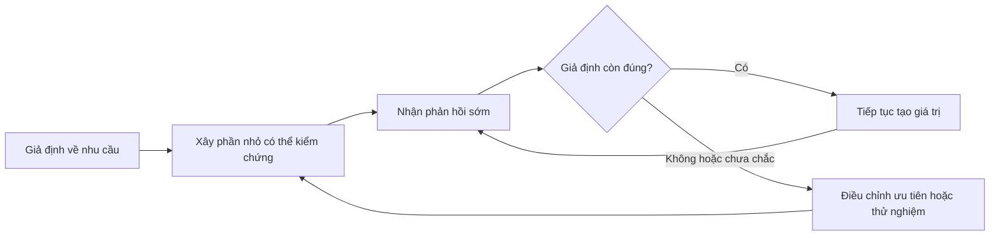

# Đón nhận thay đổi yêu cầu trong quá trình phát triển

## Mục tiêu học tập

Sau bài học, bạn có thể:

- Giải thích vì sao Agile coi khả năng đón nhận thay đổi yêu cầu là một lợi thế khi phát triển phần mềm.
- Phân biệt **đón nhận thay đổi có kiểm soát** với việc liên tục đổi ý, phá vỡ cam kết hoặc mở rộng phạm vi không giới hạn.
- Mô tả cách tiếp nhận, đánh giá, chia nhỏ và sắp xếp ưu tiên một yêu cầu mới trong **product backlog**.
- Áp dụng nguyên tắc này vào **Scrum, Kanban và các thực hành kỹ thuật của XP**, đồng thời bảo vệ chất lượng và nhịp làm việc bền vững.
- Chọn tín hiệu và chỉ số để đánh giá một thay đổi có thực sự tạo giá trị, thay vì chỉ đếm số yêu cầu được xử lý.

## 1. Nguyên tắc Agile: vì sao phải đón nhận thay đổi?

Trong bộ **12 nguyên tắc đằng sau Tuyên ngôn Agile (2001)**, nguyên tắc thứ hai đề cao việc **chào đón các yêu cầu thay đổi, kể cả khi phát triển đã ở giai đoạn muộn**, và sử dụng khả năng thích ứng để tạo lợi thế cho khách hàng. Nguyên tắc này cụ thể hóa giá trị **“phản ứng với thay đổi hơn bám sát kế hoạch”** trong Tuyên ngôn Agile.

Lý do rất thực tế: phát triển phần mềm là quá trình **vừa xây dựng, vừa khám phá vấn đề và kiểm chứng giải pháp**. Bản yêu cầu được viết lúc khởi động dự án chỉ phản ánh hiểu biết tại thời điểm đó. Sau khi nhóm có phần mềm chạy được, kiểm thử, quan sát người dùng hoặc nhận tin từ thị trường, họ thường biết thêm điều quan trọng mà lúc đầu chưa thể dự đoán.

Chẳng hạn, một nền tảng học trực tuyến được yêu cầu bổ sung chứng chỉ PDF. Sau bản thử nghiệm đầu tiên, người dùng cho biết họ không tìm thấy bài học đang học dở, nên tỷ lệ hoàn thành khóa thấp. Thông tin mới này có thể làm thay đổi thứ tự ưu tiên: **giải quyết việc tiếp tục học** trước khi đầu tư đầy đủ vào chứng chỉ.

Đón nhận thay đổi ở đây không có nghĩa bỏ mục tiêu kinh doanh. Nhóm vẫn theo đuổi kết quả *giúp người học hoàn thành khóa học*. Điều có thể thay đổi là giả thuyết về **tính năng nào tạo ra kết quả ấy hiệu quả nhất**.

> **Tư duy cốt lõi:** Kế hoạch là quyết định tốt nhất dựa trên dữ liệu đang có; khi dữ liệu đáng tin cậy thay đổi, nhóm cần có khả năng điều chỉnh quyết định.

### Khi nào yêu cầu có thể thay đổi?

| Nguồn thay đổi | Ví dụ trong sản phẩm đào tạo | Điều nhóm cần học hoặc xác nhận |
| --- | --- | --- |
| Phản hồi người dùng | Học viên muốn tiếp tục từ bài học đã xem gần nhất. | Vấn đề ảnh hưởng bao nhiêu người? Mất bao lâu để tìm lại bài học? |
| Thay đổi thị trường | Đối thủ ra mắt chức năng học trên điện thoại tiện hơn. | Người dùng có thực sự cần trải nghiệm di động tốt hơn ngay lúc này? |
| Quy định hoặc chính sách | Chính sách lưu trữ dữ liệu học viên được cập nhật. | Điều khoản nào có hiệu lực, phạm vi dữ liệu nào chịu tác động? |
| Hiểu biết nghiệp vụ mới | Bộ phận đào tạo phát hiện một số khóa có điều kiện tiên quyết. | Quy tắc nào là bắt buộc trước khi cho phép ghi danh? |
| Phát hiện kỹ thuật | Tích hợp thanh toán hiện tại không đáp ứng yêu cầu bảo mật. | Rủi ro cụ thể là gì, có phương án giảm thiểu nào? |
| Số liệu sau phát hành | Nhiều học viên bắt đầu khóa học nhưng bỏ dở ở bài đầu. | Nguyên nhân do nội dung, trải nghiệm hay lỗi kỹ thuật? |

Không phải thông tin mới nào cũng dẫn đến thay đổi sản phẩm. Một yêu cầu được đề xuất cần **được kiểm chứng, cân nhắc và ra quyết định**. Agile khuyến khích phản ứng dựa trên bằng chứng, không tự động đồng ý với mọi đề nghị.

## 2. Phân biệt thích ứng với thay đổi tùy tiện

Một nhóm thiếu định hướng có thể thay đổi chức năng hằng ngày, mở quá nhiều việc, cắt kiểm thử để kịp hạn và gọi đó là “linh hoạt”. Đây không phải biểu hiện tốt của Agile.

| Đón nhận thay đổi có chủ đích | Thay đổi tùy tiện hoặc mở rộng phạm vi không kiểm soát |
| --- | --- |
| Gắn với mục tiêu sản phẩm và một vấn đề đã được làm rõ. | Làm theo ý tưởng mới nhất mà không xét giá trị. |
| Có người chịu trách nhiệm quyết định ưu tiên. | Nhiều bên trực tiếp giao việc trái ngược cho đội phát triển. |
| So sánh giá trị, mức độ khẩn cấp, chi phí và rủi ro. | Thêm tính năng nhưng không bỏ, hoãn hoặc điều chỉnh việc khác. |
| Làm rõ tiêu chí chấp nhận và tác động lên phần đã xây. | Bắt đầu ngay khi yêu cầu vẫn mơ hồ. |
| Bảo toàn chất lượng, an toàn, khả năng vận hành. | Cắt kiểm thử, bỏ rà soát để theo kịp các lần đổi hướng. |
| Ghi nhận quyết định, giao tiếp thay đổi và kiểm chứng kết quả. | Không ai biết vì sao phạm vi bị đổi hoặc thế nào là thành công. |

Vì vậy, **“đón nhận” nghĩa là sẵn sàng xem xét và học từ thay đổi**; nó không đồng nghĩa với **“chấp nhận triển khai mọi thay đổi ngay lập tức”**. Đôi khi quyết định tốt nhất là trì hoãn, thử nghiệm ở quy mô nhỏ hoặc từ chối đề nghị vì giá trị không đủ bù chi phí cơ hội.

### Ba thứ cần giữ ổn định ở mức phù hợp

1. **Mục tiêu hoặc kết quả mong muốn:** ví dụ tăng tỷ lệ học viên hoàn thành khóa, thay vì cam kết phải xây mọi tính năng được đề xuất từ đầu.
2. **Ràng buộc thiết yếu:** bảo mật, tuân thủ, ngân sách, thời hạn, khả năng vận hành và mức chất lượng tối thiểu không biến mất khi yêu cầu đổi.
3. **Cách ra quyết định minh bạch:** ai đánh giá, ai quyết định thứ tự ưu tiên, khi nào trao đổi với nhóm và làm sao kiểm tra tác động.

Trong khi đó, **giải pháp cụ thể, thứ tự ưu tiên và kế hoạch ở tương lai xa** nên có chỗ để điều chỉnh. Độ chi tiết của kế hoạch cũng cần tăng dần khi đến gần lúc thực hiện (*progressive elaboration* hoặc *rolling-wave planning*).

## 3. Chi phí thay đổi đến từ đâu?

Thay đổi có thể dễ hoặc khó, tùy thời điểm và cấu trúc hệ thống. Khi chưa viết mã, sửa một quy tắc nghiệp vụ thường rẻ hơn so với lúc quy tắc đã len vào cơ sở dữ liệu, API, giao diện, tài liệu và quy trình vận hành. Tuy nhiên, chi phí **không tăng theo một công thức cố định cho mọi dự án**: hệ thống có thiết kế tốt, kiểm thử tự động và triển khai an toàn có thể thay đổi muộn với chi phí chấp nhận được.

Các yếu tố thường làm thay đổi trở nên đắt đỏ:

- **Phụ thuộc lan rộng:** một quy tắc xuất hiện trong nhiều dịch vụ hoặc các mô-đun giao tiếp bằng hợp đồng khó đổi.
- **Phản hồi chậm:** yêu cầu sai được phát hiện sau khi nhiều tính năng khác đã xây trên giả định đó.
- **Thiếu kiểm thử hồi quy:** nhóm không biết sửa một hành vi có làm hỏng hành vi khác hay không.
- **Tồn đọng công việc dở dang:** nhiều nhánh mã, tính năng chưa hoàn thiện hoặc công việc đang chờ kiểm thử khiến việc chuyển ưu tiên khó hơn.
- **Ràng buộc bên ngoài:** tích hợp đối tác, quy định và hợp đồng có thể cần thông báo hoặc phê duyệt trước khi thay đổi.

Agile không hứa “mọi thay đổi đều miễn phí”. Thay vào đó, Agile khuyến khích **rút ngắn vòng phản hồi** và các thực hành kỹ thuật giúp giảm chi phí học hỏi và điều chỉnh.



Vòng lặp trên phải đủ ngắn để phát hiện sai lầm khi phạm vi ảnh hưởng còn nhỏ. Nó cũng cần đủ **kỷ luật kỹ thuật** để mỗi lần sửa vẫn giữ sản phẩm đáng tin cậy.

## 4. Quy trình xử lý một yêu cầu thay đổi từ đầu đến cuối

Không có một quy trình duy nhất áp dụng cho mọi đội, nhưng mô hình sau giúp chuyển nguyên tắc thành hành động có thể lặp lại.

### Bước 1. Tiếp nhận vấn đề, chưa vội chốt giải pháp

Khi có đề xuất như “thêm nút tải file Excel”, hãy hỏi:

- Ai cần chức năng đó, đang làm công việc gì và gặp trở ngại nào?
- Có ví dụ thao tác, phản hồi, số liệu hoặc tình huống thực tế nào cho thấy trở ngại tồn tại?
- Người dùng cần *kết quả* gì? Có cách nào đơn giản hơn nút tải Excel?
- Nếu không làm ngay, tổ chức chịu chi phí hay rủi ro nào?

Có khi người dùng muốn Excel vì không thể xem dữ liệu đã lọc trên giao diện. Sửa bộ lọc hoặc cung cấp báo cáo định kỳ có thể giải quyết nhu cầu tốt hơn. Việc nắm được vấn đề giúp đội tránh biến mọi gợi ý giải pháp thành yêu cầu bắt buộc.

### Bước 2. Làm rõ giá trị, thời điểm và ràng buộc

Đánh giá đề nghị bằng một số tiêu chí phù hợp:

| Tiêu chí | Câu hỏi gợi ý |
| --- | --- |
| Giá trị | Ai hưởng lợi? Kết quả nào cải thiện và bằng cách nào sẽ đo? |
| Mức độ khẩn cấp | Nếu chậm một tuần hoặc một tháng, tổn thất hoặc rủi ro thay đổi thế nào? |
| Độ tin cậy của bằng chứng | Có quan sát người dùng, lỗi tái hiện được hay chỉ là nhận định cá nhân? |
| Công sức và phụ thuộc | Cần thay đổi những thành phần nào, ảnh hưởng các nhóm nào? |
| Rủi ro | Có ảnh hưởng bảo mật, dữ liệu, vận hành hoặc tương thích ngược không? |
| Chi phí cơ hội | Khi chọn việc này, việc quan trọng nào sẽ bị dời lại? |

Không nhất thiết phải gán điểm số chính xác. Một cuộc trao đổi dựa trên những tiêu chí này thường hữu ích hơn một bảng xếp hạng tạo cảm giác chính xác giả tạo.

### Bước 3. Đưa vào backlog, tách nhỏ và xác định tiêu chí chấp nhận

Nếu nhu cầu hợp lý, người phụ trách sản phẩm đưa nó vào **product backlog** hoặc cơ chế tiếp nhận tương đương. Mục tiêu là biến nhu cầu thành một hoặc nhiều hạng mục có thể làm rõ, kiểm chứng và sắp xếp ưu tiên.

Ví dụ user story:

> Là một học viên đang theo học, tôi muốn mở lại bài học chưa hoàn thành gần nhất để tiếp tục học mà không phải tìm kiếm từ đầu.

Một tập tiêu chí chấp nhận khởi đầu:

```gherkin
Tính năng: Tiếp tục bài học gần nhất

Tình huống: Học viên quay lại khóa đang học
  Cho trước học viên đã đăng nhập
  Và học viên có một bài học đã bắt đầu nhưng chưa hoàn thành
  Khi học viên mở trang khóa học
  Thì hệ thống hiển thị lựa chọn "Tiếp tục học"
  Và lựa chọn đó dẫn tới bài học đang dở gần nhất

Tình huống: Học viên chưa bắt đầu khóa học
  Cho trước học viên đã ghi danh nhưng chưa bắt đầu bài nào
  Khi học viên mở trang khóa học
  Thì hệ thống hiển thị lựa chọn "Bắt đầu học"
```

Những tiêu chí trên chỉ là ví dụ. Nhóm cần làm rõ thêm cách xác định “gần nhất” nếu có nhiều thiết bị, nhiều khóa đang học, dữ liệu tiến độ đồng bộ trễ hoặc người học không còn quyền truy cập. Tách các trường hợp phức tạp thành những phần có giá trị để nhóm kiểm thử sớm.

### Bước 4. Quyết định ưu tiên và thời điểm thực hiện

Không nên đưa thẳng việc mới vào tay lập trình viên chỉ vì bên đề xuất có chức danh cao. Người có trách nhiệm quyết định thứ tự ưu tiên sản phẩm (trong **Scrum** là **Product Owner**) cân nhắc nó với các hạng mục hiện tại.

Các khả năng thường gặp:

- **Làm trước:** lỗi nghiêm trọng, nghĩa vụ bắt buộc sắp có hiệu lực hoặc cơ hội giá trị cao cần phản ứng nhanh.
- **Lên thứ tự cho lần làm tiếp theo:** thay đổi hữu ích nhưng không đủ cấp bách để làm gián đoạn công việc hiện tại.
- **Thử nghiệm nhỏ:** chưa đủ bằng chứng, cần mẫu thử hoặc phỏng vấn trước khi đầu tư lớn.
- **Hoãn hoặc từ chối:** giá trị thấp, không phù hợp mục tiêu hoặc chi phí cơ hội quá cao.

**Ghi nhận điều bị ảnh hưởng:** nếu thêm việc mới trong giới hạn thời gian và năng lực có sẵn, một phần việc khác sẽ bị lùi, giảm phạm vi hoặc cần thay đổi thỏa thuận. Không nên âm thầm kỳ vọng nhóm làm thêm toàn bộ phần việc mới bên cạnh kế hoạch cũ.

### Bước 5. Triển khai thành phần nhỏ, kiểm thử và tích hợp liên tục

Lựa chọn một lát cắt chức năng có thể sử dụng hoặc kiểm chứng được. Khi sửa hành vi cũ, nhóm nên chạy lại các kiểm thử phù hợp, cập nhật tài liệu bắt buộc và đánh giá tính tương thích. Nếu thay đổi có rủi ro lớn, cân nhắc cờ tính năng (*feature flag*), triển khai cho nhóm người dùng nhỏ hoặc cơ chế quay lui đã được thử.

**Definition of Done** (nếu nhóm sử dụng) cần được giữ nhất quán: thay đổi yêu cầu không cho phép bỏ qua bảo mật, kiểm thử, quan sát vận hành hoặc chuẩn chất lượng đã cam kết.

### Bước 6. Quan sát kết quả và tiếp tục học hỏi

Sau khi phát hành hoặc thử nghiệm, hỏi: học viên có sử dụng chức năng “Tiếp tục học” không; họ mất ít thời gian hơn để trở lại bài học không; tỷ lệ quay lại hay hoàn thành khóa học có cải thiện không; có lỗi đồng bộ tiến độ không?

Nếu kết quả không như kỳ vọng, nhóm điều chỉnh giả thuyết hoặc giải pháp. **Hoàn thành một user story chưa tự động chứng minh đã tạo giá trị.** Phần mềm chạy được là điều kiện cần để kiểm chứng giá trị, chứ chưa phải bằng chứng duy nhất của thành công.

## 5. Ví dụ xuyên suốt: thay đổi yêu cầu vào giữa đợt phát triển

Giả sử một đội xây dựng nền tảng học trực tuyến, mục tiêu quý là giúp người học duy trì tiến độ và hoàn thành khóa học. Đội đang thực hiện tính năng gửi thông báo nhắc lịch học. Sau khi dùng thử bản phát hành gần nhất, nhiều học viên cho biết họ muốn thấy nút **“Tiếp tục học”** ngay tại trang chủ.

**Cách xử lý có chủ đích:**

1. **Xác minh:** bộ phận sản phẩm tổng hợp phản hồi, quan sát người học thử, kiểm tra xem chức năng này có giải quyết vấn đề quay lại bài học hay không.
2. **So sánh:** nhóm ước lượng tác động kỹ thuật của việc lưu tiến độ, xử lý truy cập khóa học và hiển thị bài gần nhất; so sánh lợi ích với phần nhắc lịch đang làm.
3. **Chia nhỏ:** thay vì hứa ngay “tiếp tục chính xác trên mọi thiết bị và trong mọi trường hợp”, nhóm chọn phiên bản đầu tiên chỉ cho một khóa đang học, với quy tắc lưu tiến độ rõ ràng.
4. **Quyết định:** người phụ trách sản phẩm ưu tiên thử nghiệm sớm. Đội cân nhắc giữ mục tiêu của chu kỳ hiện tại và đưa hạng mục vào chu kỳ tiếp theo, hoặc thương lượng lại phạm vi nếu thực tế cho phép.
5. **Đánh giá:** sau phát hành giới hạn, theo dõi tỷ lệ sử dụng nút, thời gian quay lại bài học và phản hồi lỗi; từ đó quyết định có mở rộng hỗ trợ nhiều thiết bị hay không.

Điều quan trọng không nằm ở việc *đổi thứ tự nhanh nhất*, mà ở việc **đổi thứ tự đúng lý do, công khai chi phí và biết cách kiểm chứng kết quả**.

### Nếu yêu cầu xuất hiện khi công việc khác đang dở dang?

Ví dụ đội đã gần hoàn thành thông báo nhắc lịch. Dừng toàn bộ việc đang làm có thể tạo thêm công việc tồn đọng và làm giảm khả năng giao sản phẩm. Hãy xem:

- Hạng mục đang dở còn bao lâu để đạt chất lượng hoàn thành?
- Yêu cầu mới có hạn chót thực sự không, hay chỉ tạo cảm giác gấp?
- Có thể thực hiện một thử nghiệm hoặc làm rõ yêu cầu mà không ngắt dòng công việc chính không?
- Ai có quyền thay đổi ưu tiên và những người bị ảnh hưởng đã được thông báo chưa?

Những câu hỏi này giúp giảm **chi phí đổi ngữ cảnh** và tránh việc nhóm làm nhiều hạng mục cùng lúc nhưng rất ít hạng mục hoàn thành.

## 6. Đón nhận thay đổi trong Scrum, Kanban và XP

Agile là hệ giá trị và nguyên tắc. Các phương pháp cụ thể có cơ chế khác nhau để thực hiện nguyên tắc đón nhận thay đổi.

| Cách tiếp cận | Cách tiếp nhận và xử lý thay đổi | Điểm cần tránh |
| --- | --- | --- |
| **Scrum** | Product Owner quản lý thứ tự ưu tiên Product Backlog; qua Sprint Review và các tương tác khác, nhóm nhận thông tin mới để thích nghi. Trong Sprint, phạm vi có thể được làm rõ và thương lượng với Product Owner khi nhóm hiểu thêm, miễn không làm nguy hại Sprint Goal. | Coi Sprint là bản hợp đồng đóng băng mọi chi tiết; hoặc thay toàn bộ mục tiêu Sprint theo yêu cầu phát sinh hằng ngày. |
| **Kanban** | Làm rõ chính sách tiếp nhận và thứ tự công việc, trực quan hóa các trạng thái, giới hạn việc đang làm (WIP), theo dõi dòng chảy. Có thể chọn việc mới khi năng lực được giải phóng; trường hợp thực sự cấp bách cần chính sách xử lý minh bạch. | Đẩy yêu cầu mới vào giữa luồng không xét WIP, để nhiều việc dang dở hoặc liên tục “chen hàng”. |
| **XP** | Dùng các thực hành kỹ thuật như kiểm thử tự động, TDD, tích hợp liên tục, tái cấu trúc mã và thiết kế đơn giản để giảm rủi ro khi thay đổi hành vi phần mềm. | Đón nhận yêu cầu mới nhưng bỏ kiểm thử hoặc tích lũy nợ kỹ thuật khiến lần thay đổi sau khó hơn. |

### 6.1. Scrum: thay đổi được nhưng có điểm tựa là Sprint Goal

Trong Scrum, **Product Backlog luôn có thể được điều chỉnh** khi có hiểu biết mới. Sprint có **Sprint Goal** giúp đội tập trung vào một kết quả chung trong khoảng thời gian ngắn. Theo *Scrum Guide 2020*, trong Sprint không thực hiện thay đổi làm nguy hại Sprint Goal, chất lượng không bị giảm, Product Backlog được tinh chỉnh khi cần và phạm vi có thể được làm rõ, thương lượng lại với Product Owner khi nhóm hiểu biết thêm.

Vì vậy, khi yêu cầu mới xuất hiện giữa Sprint:

1. Product Owner và Developers cùng làm rõ ý nghĩa, độ khẩn cấp và tác động.
2. Nếu không cấp bách, thường ưu tiên cập nhật Product Backlog để cân nhắc trong kế hoạch tiếp theo.
3. Nếu phù hợp với Sprint Goal, Developers và Product Owner có thể thương lượng phạm vi công việc của Sprint để phản ánh kiến thức mới.
4. Nếu Sprint Goal đã trở nên lỗi thời, chỉ Product Owner có quyền hủy Sprint theo Scrum Guide; đây là quyết định đáng cân nhắc, không phải cách xử lý mặc định cho mọi thay đổi.

**Ví dụ:** Sprint Goal là “Học viên có thể quay lại khóa đang học dễ dàng”. Việc bổ sung nút “Tiếp tục học” có thể hỗ trợ mục tiêu. Nhưng đề nghị xây ngay toàn bộ hệ thống chứng chỉ dù không liên quan cần được đánh giá cho Product Backlog, thay vì chen vào vì một yêu cầu mới đến.

### 6.2. Kanban: thay đổi ưu tiên mà vẫn bảo vệ dòng công việc

Kanban giúp nhóm thấy hạng mục ở đâu trong dòng công việc, bao nhiêu việc đang làm và điều gì đang bị chặn. Đội có thể dùng các chính sách rõ ràng như:

- Ưu tiên các hạng mục đang gần hoàn thành trước khi kéo thêm việc mới.
- Chỉ bắt đầu công việc khi còn năng lực theo giới hạn WIP của giai đoạn liên quan.
- Xác định chính sách cho yêu cầu thực sự khẩn cấp, ví dụ sự cố bảo mật nghiêm trọng, và xem xét hậu quả khi áp dụng chính sách này.
- Định kỳ xem lại thời gian hoàn thành và những hạng mục bị chờ lâu để điều chỉnh hệ thống làm việc.

Kanban không yêu cầu phải có Sprint cố định. Tùy mô hình vận hành, một hạng mục mới có thể được kéo vào khi đủ điều kiện và khi nguồn lực sẵn sàng. Điều này phù hợp với đội hỗ trợ sản phẩm, nơi yêu cầu mới đến đều đặn nhưng vẫn cần **dòng chảy ổn định**.

### 6.3. XP: năng lực thích ứng dựa trên chất lượng kỹ thuật

Một thay đổi nhỏ về nghiệp vụ đôi khi chạm vào nhiều nơi trong mã nguồn. Các thực hành XP giúp nhóm tự tin sửa phần mềm:

- **Kiểm thử tự động:** cho tín hiệu nhanh về hành vi đã đúng trước đó.
- **Test-Driven Development (TDD):** diễn đạt hành vi mong đợi bằng kiểm thử trước khi hoặc trong khi triển khai thay đổi, theo chu kỳ nhỏ.
- **Tái cấu trúc mã (refactoring):** cải thiện cấu trúc mà không đổi hành vi quan sát được để giảm sự rối rắm.
- **Tích hợp liên tục:** phát hiện xung đột và lỗi tích hợp sớm nhờ hợp nhất và kiểm tra thường xuyên.
- **Thiết kế đơn giản:** tránh xây những khả năng chưa có bằng chứng là cần thiết.

Đội không buộc phải áp dụng toàn bộ XP để hưởng lợi từ những kỹ thuật này. Điểm cần nhớ là **khả năng phản ứng với thay đổi chịu ảnh hưởng trực tiếp từ chất lượng và khả năng kiểm chứng của hệ thống**.

## 7. Thực hành ra quyết định: một yêu cầu mới có đáng ưu tiên không?

Giả sử nhóm có ba đề xuất cùng xuất hiện trong tuần:

| Đề xuất | Bằng chứng và giá trị dự kiến | Rủi ro nếu trì hoãn | Hướng xử lý ban đầu |
| --- | --- | --- | --- |
| Sửa lỗi học viên được ghi danh hai lần và bị tính phí trùng | Lỗi tái hiện được, ảnh hưởng trực tiếp đến tiền và niềm tin người dùng | Cao | Xử lý sớm theo quy trình sự cố và kiểm tra dữ liệu bị ảnh hưởng. |
| Thêm “Tiếp tục học” tại trang chủ | Có phản hồi và số liệu gợi ý người học khó quay lại nội dung | Trung bình | Làm rõ giá trị, chia nhỏ và đưa lên ưu tiên thích hợp; có thể thử nghiệm sớm. |
| Thêm hoạt ảnh trang trí khi chuyển bài | Chưa có bằng chứng về tác động đến trải nghiệm học tập | Thấp | Đưa vào danh sách ý tưởng hoặc thử nghiệm nhỏ nếu chi phí rất thấp. |

Đây là **đánh giá minh họa**, không phải kết luận áp dụng cho mọi sản phẩm. Tổ chức phải cân nhắc mức độ ảnh hưởng thực tế, cam kết với khách hàng và năng lực xử lý. Chẳng hạn, một lỗi thanh toán nghiêm trọng có thể cần khôi phục dịch vụ và xử lý sự cố trước khi đi qua quy trình ưu tiên thông thường.

Một mẫu ghi quyết định ngắn gọn giúp các bên phối hợp:

```text
Yêu cầu thay đổi: [Tên/ngữ cảnh]
Vấn đề người dùng: [Ai đang gặp khó khăn gì?]
Bằng chứng: [Phỏng vấn, số liệu, lỗi hoặc quy định]
Kết quả mong muốn: [Thay đổi đo được hoặc có thể quan sát]
Phạm vi nhỏ nhất có thể thử: [Một lát cắt giá trị]
Tác động: [Kỹ thuật, dữ liệu, bảo mật, phụ thuộc, vận hành]
Ưu tiên và người quyết định: [Quyết định, lý do]
Chi phí cơ hội: [Việc bị dời hoặc giảm phạm vi]
Thời điểm xem lại: [Khi có thêm dữ liệu hoặc sau phát hành]
```

Mẫu này không phải thủ tục bắt buộc theo Tuyên ngôn Agile. Nó là một công cụ nhẹ để giảm hiểu nhầm và lưu dấu lý do thay đổi.

## 8. Đo lường khả năng thích ứng và giá trị tạo ra

Đếm số yêu cầu đã đổi hoặc số user story đã đóng **không đủ** để kết luận nhóm thích ứng tốt. Một nhóm liên tục đổi hướng nhưng không hoàn tất sản phẩm có thể tạo rất ít giá trị. Nên kết hợp các tín hiệu phù hợp mục tiêu:

| Nhóm tín hiệu | Ví dụ | Điều cần lưu ý |
| --- | --- | --- |
| Kết quả người dùng | Tỷ lệ hoàn thành khóa, tỷ lệ quay lại, thời gian tìm được bài học đang dở | So sánh trước/sau và xem yếu tố bên ngoài có thể tác động. |
| Tốc độ phản hồi | Thời gian từ lúc xuất hiện tín hiệu đến khi có quyết định hoặc thử nghiệm | Nhanh hơn không luôn tốt nếu quyết định thiếu bằng chứng. |
| Dòng công việc | **Lead time**, **cycle time**, WIP, tuổi công việc đang làm và throughput | Sử dụng định nghĩa đo lường nhất quán, xét theo loại công việc. |
| Chất lượng | Lỗi lọt ra sản phẩm, sự cố sau thay đổi, tỷ lệ kiểm thử hồi quy có ý nghĩa | Không giảm chất lượng để đạt chỉ số tốc độ. |
| Khả năng học hỏi | Có giả thuyết, có dữ liệu sau phát hành, có quyết định tiếp theo dựa trên kết quả | Thử nghiệm không đạt kỳ vọng vẫn có giá trị nếu tạo được kiến thức hữu ích. |

Trong bối cảnh Kanban, **lead time** thường đo từ mốc yêu cầu được đưa vào hệ thống theo định nghĩa của đội tới khi giao xong, còn **cycle time** thường đo từ lúc thực sự bắt đầu xử lý tới khi hoàn tất. Hai mốc phải được thống nhất theo workflow cụ thể để tránh so sánh sai. **Throughput** là số hạng mục hoàn tất trong một khoảng thời gian, còn **WIP** là lượng công việc đang được xử lý.

Những chỉ số này giúp nhóm nhìn thấy tắc nghẽn, nhưng không tự chứng minh giá trị kinh doanh. Ví dụ, giao tính năng “Tiếp tục học” nhanh mà không ai dùng thì nhóm cần điều tra lại giả thuyết sản phẩm. Ngược lại, một thay đổi có lead time dài do phải đáp ứng kiểm toán hoặc an toàn có thể hoàn toàn hợp lý.

## 9. Sai lầm thường gặp và cách xử lý

### “Khách hàng đổi ý thì cứ làm ngay”

Nguyên tắc khuyến khích tiếp nhận và cân nhắc thay đổi; khách hàng cần được lắng nghe, nhưng vẫn phải có một cơ chế sắp xếp ưu tiên rõ ràng. Hãy công khai **giá trị, chi phí, rủi ro và thứ tự** thay vì chuyển yêu cầu thành mệnh lệnh tức thời.

### “Đã chốt phạm vi thì mọi thay đổi đều xấu”

Giữ nguyên phạm vi có thể đơn giản hóa quản trị ngắn hạn, nhưng một tính năng ít giá trị vẫn tiêu tốn thời gian dù có mặt trong hợp đồng ban đầu. Cần phân biệt yêu cầu bắt buộc phải giữ với những giả thuyết sản phẩm có thể thay đổi khi xuất hiện bằng chứng.

### “Thích nghi là bỏ kế hoạch và hạn chót”

Nhóm vẫn cần kế hoạch và trách nhiệm với cam kết. Hãy chọn một biến linh hoạt có chủ đích: phạm vi, thứ tự, thời điểm, năng lực hoặc giải pháp. Khi nhiều yếu tố bị ràng buộc chặt, hãy trình bày rõ tác động để các bên cùng ra quyết định.

### “Cứ làm nhiều việc song song để xử lý thay đổi nhanh hơn”

Đổi ngữ cảnh và công việc dở dang có thể kéo dài thời gian giao giá trị. Hạn chế WIP, hoàn tất phần việc đã bắt đầu và chỉ xử lý khẩn cấp theo chính sách rõ ràng thường giúp phản ứng ổn định hơn.

### “Có kiểm thử tự động thì đổi gì cũng an toàn”

Kiểm thử chỉ bảo vệ những hành vi đã được kiểm tra; chúng không tự bảo đảm đáp ứng nhu cầu người dùng, an toàn dữ liệu hay mọi ràng buộc tích hợp. Cần kết hợp kiểm thử, rà soát rủi ro, quan sát sau phát hành và khả năng khôi phục.

## 10. Bài tập vận dụng

**Tình huống:** Đội đang xây tính năng tạo chứng chỉ cuối khóa. Trong buổi trình diễn gần nhất, giảng viên đề xuất thêm điều kiện “học viên phải hoàn thành tất cả bài kiểm tra bắt buộc” trước khi được cấp chứng chỉ. Một khách hàng khác đồng thời đề nghị thay màu và hình nền chứng chỉ.

Hãy tự trả lời:

1. Yêu cầu nào liên quan trực tiếp tới **tính đúng đắn của nghiệp vụ**, yêu cầu nào thiên về trình bày? Chúng có cùng độ ưu tiên không?
2. Bạn cần hỏi thêm những ai, và cần bằng chứng gì để xác nhận quy tắc cấp chứng chỉ?
3. Quy tắc mới ảnh hưởng những thành phần nào: điểm số, bài kiểm tra, trạng thái hoàn thành, phát hành chứng chỉ, chứng chỉ đã cấp?
4. Có thể chia yêu cầu thành các lát cắt để kiểm thử sớm thế nào?
5. Nếu thay đổi đến giữa Sprint, bạn sẽ trao đổi với Product Owner và Developers ra sao để bảo vệ Sprint Goal?
6. Sau phát hành, bạn dựa vào tín hiệu gì để xác nhận hệ thống cấp chứng chỉ đúng quy tắc mới?

**Gợi ý định hướng:** làm rõ và xác minh quy tắc trước; đánh giá ảnh hưởng tới người đã được cấp chứng chỉ; ưu tiên theo rủi ro nghiệp vụ; bổ sung các tình huống kiểm thử về đủ/thiếu điều kiện; thương lượng phạm vi và thời điểm triển khai công khai; tiếp tục kiểm tra dữ liệu thực tế sau phát hành. Vấn đề đổi màu có thể được ghi nhận riêng và đưa vào thứ tự ưu tiên phù hợp, trừ khi có căn cứ cho thấy nó cấp bách hơn.

## 11. Ghi nhớ cốt lõi

- Agile đón nhận yêu cầu thay đổi, kể cả muộn, vì thông tin mới có thể giúp sản phẩm đáp ứng nhu cầu và tạo lợi thế cho khách hàng tốt hơn.
- **Thay đổi cần đi qua học hỏi và ra quyết định**, không phải tự động trở thành việc làm ngay.
- Product backlog, user story và tiêu chí chấp nhận giúp làm rõ nhu cầu và chọn phần giá trị nhỏ để kiểm chứng.
- Scrum bảo vệ Sprint Goal và cho phép thương lượng phạm vi khi hiểu biết thay đổi; Kanban dùng chính sách dòng công việc và WIP; XP cung cấp các thực hành kỹ thuật giúp sửa phần mềm an toàn.
- Đánh giá thay đổi bằng **kết quả người dùng, khả năng giao giá trị và chất lượng**; tránh tối ưu tốc độ xử lý yêu cầu nhưng đánh mất mục tiêu sản phẩm.

Khi một yêu cầu mới xuất hiện, hãy tự hỏi: **“Chúng ta vừa học được điều gì, và điều đó có đáng thay đổi thứ tự ưu tiên hoặc giải pháp hay không?”** Đây là câu hỏi trung tâm của nguyên tắc đón nhận thay đổi trong phát triển phần mềm Agile.

## Nguồn tham khảo

- [Manifesto for Agile Software Development](https://agilemanifesto.org/) — bốn giá trị của Tuyên ngôn Agile (2001).
- [Principles behind the Agile Manifesto](https://agilemanifesto.org/principles.html) — 12 nguyên tắc, đặc biệt nguyên tắc thứ hai về đón nhận thay đổi yêu cầu.
- [The Scrum Guide (2020)](https://scrumguides.org/scrum-guide.html) — định nghĩa Product Backlog, Sprint Goal, việc thích nghi và các quy tắc trong Sprint.
- [The Kanban Guide](https://kanbanguides.org/the-kanban-guide/) — cách định nghĩa và quản lý dòng công việc, WIP và các thước đo luồng công việc.
