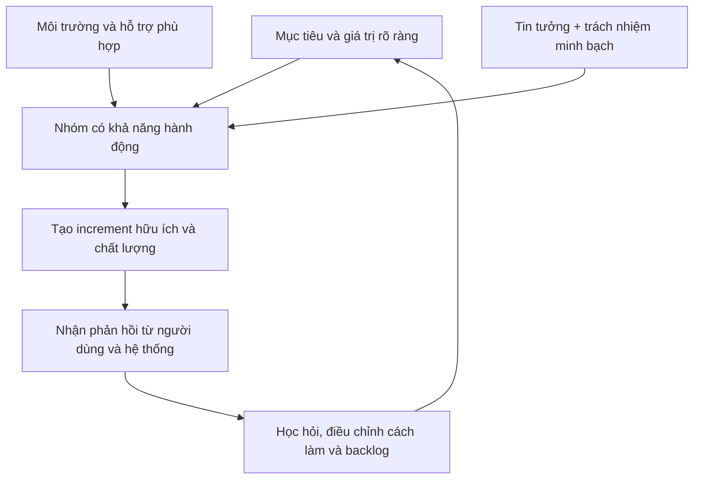
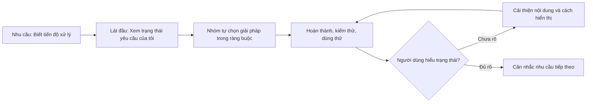

# Xây dựng môi trường hỗ trợ, tin tưởng và tạo động lực cho con người

## 1. Con người là trung tâm của khả năng thích ứng

Trong phát triển phần mềm, không phải mọi yêu cầu, rủi ro và cách thực hiện đều có thể dự đoán trước. Khi nhu cầu khách hàng thay đổi, lỗi phát sinh hoặc giải pháp ban đầu không còn phù hợp, nhóm cần có khả năng tự quan sát, trao đổi và điều chỉnh. Khả năng đó phụ thuộc nhiều vào **môi trường làm việc, mức độ tin tưởng và động lực** của những người trực tiếp tạo ra sản phẩm.

Nguyên tắc thứ năm trong **12 nguyên tắc của Agile Manifesto** nêu rằng:

> Xây dựng dự án quanh những cá nhân có động lực. Cung cấp môi trường và sự hỗ trợ họ cần, đồng thời tin tưởng họ sẽ hoàn thành công việc.

Đây là nguyên tắc về **cách tổ chức và lãnh đạo công việc**, không phải yêu cầu mọi người lúc nào cũng phải hào hứng. Động lực có thể giảm khi mục tiêu mơ hồ, thiếu công cụ, liên tục bị ngắt quãng hoặc bị trách phạt vì nêu vấn đề. Trách nhiệm của tổ chức và người dẫn dắt là tạo điều kiện để người có năng lực phát huy năng lực, phối hợp và học hỏi từ phản hồi.

Trong phạm vi phát triển phần mềm theo Agile, nguyên tắc này liên kết trực tiếp với **user story và Product Backlog** (làm rõ điều gì có giá trị), **Scrum và Kanban** (tổ chức công việc minh bạch và thích ứng), **XP** (duy trì năng lực kỹ thuật) và **đo lường dòng công việc** (nhận biết trở ngại). Công cụ và framework chỉ hỗ trợ; chính cách mọi người được đối xử và cùng ra quyết định mới quyết định chúng có phát huy tác dụng hay không.

**Thông điệp cốt lõi:** hỗ trợ và tin tưởng không có nghĩa là buông lỏng quản lý; đó là cách chuyển trọng tâm từ kiểm soát từng thao tác sang **định hướng kết quả, gỡ bỏ rào cản và minh bạch tiến độ**.

## 2. Động lực không đến từ việc thúc ép liên tục

Động lực trong công việc có nhiều nguồn: thu nhập và sự công bằng, cơ hội học hỏi, cảm giác được đóng góp, quan hệ đồng nghiệp, quyền chủ động và niềm tin rằng nỗ lực sẽ tạo ra kết quả. Không có một biện pháp tạo động lực phù hợp với tất cả mọi người; điều quan trọng là **trao đổi trực tiếp để hiểu nhu cầu và trở ngại của từng thành viên**.

Ba điều kiện thường giúp nhóm duy trì động lực là:

| Điều kiện | Thực hành hỗ trợ | Tình huống làm suy giảm động lực |
| --- | --- | --- |
| **Quyền tự chủ có giới hạn rõ ràng** | Nêu mục tiêu, ràng buộc, thời hạn; để nhóm chọn phương pháp triển khai | Giao từng bước chi tiết, thay đổi quyết định của nhóm mà không giải thích |
| **Năng lực và cơ hội tiến bộ** | Có thời gian học, review code, thực hành cùng người nhiều kinh nghiệm, cải thiện công cụ | Giao việc vượt khả năng nhưng không hỗ trợ, hoặc không cho người làm thử cách mới |
| **Cảm giác thuộc về và có ý nghĩa** | Cho nhóm gặp người dùng, hiểu tác động của increment, ghi nhận đóng góp cá nhân và tập thể | Thành viên chỉ nhận ticket, không biết ai cần hoặc vì sao phải làm |

Các điều kiện đó không thay thế nhu cầu cơ bản về **phân công công bằng, thời gian nghỉ ngơi, an toàn và nguồn lực tối thiểu**. Một nhóm bị quá tải liên tục sẽ khó duy trì động lực, dù được mời dự nhiều buổi chia sẻ về Agile.

### Từ câu lệnh sang mục tiêu có ý nghĩa

So sánh hai cách giao việc:

**Giao theo thao tác:** “Trong ba ngày, hãy viết đúng sáu endpoint theo bản thiết kế này. Mỗi chiều gửi bảng giờ đã làm.”

**Giao theo kết quả:** “Người dùng hiện phải gọi tổng đài để biết yêu cầu hỗ trợ đang ở bước nào. Mục tiêu đợt này là họ có thể tự xem trạng thái của yêu cầu. Chúng ta cần giữ dữ liệu cá nhân an toàn, triển khai được trong đợt thử nghiệm tuần này. Nhóm hãy đề xuất lát nhỏ nhất và các rủi ro cần xử lý.”

Cách thứ hai cung cấp **mục đích, kết quả mong muốn và ranh giới** rồi dành chỗ cho chuyên môn của nhóm. Nó vẫn cho phép người phụ trách sản phẩm góp ý, hỏi về bằng chứng, làm rõ ưu tiên và điều chỉnh phạm vi khi cần. Điểm khác biệt là nhóm có quyền cùng suy nghĩ về cách tạo ra kết quả.

## 3. “Môi trường hỗ trợ” bao gồm những gì?

Một môi trường Agile tốt không chỉ là không gian văn phòng thoải mái hoặc nhiều công cụ chat. Đó là tập hợp điều kiện giúp nhóm **tập trung, phối hợp, tạo ra thay đổi an toàn và nhận phản hồi nhanh**.

### 3.1. Mục tiêu sản phẩm và thông tin đủ rõ

- Product Owner hoặc người chịu trách nhiệm sản phẩm giải thích **vấn đề của người dùng, mức ưu tiên và kết quả kỳ vọng**, thay vì chỉ giao danh sách chức năng.
- User story có đủ ngữ cảnh để thảo luận; tiêu chí chấp nhận được thống nhất bằng ví dụ cụ thể trước hoặc trong lúc thực hiện.
- Nhóm có cơ hội trao đổi với người dùng hoặc người am hiểu nghiệp vụ để kiểm tra giả định.
- Các quyết định, thay đổi phạm vi và lý do thay đổi được ghi ở nơi dễ tìm, tránh thông tin chỉ tồn tại trong một cuộc họp riêng.

Sự rõ ràng ở đây không có nghĩa là viết tài liệu dự đoán hết mọi trường hợp. Agile chấp nhận bất định; nhóm cần biết **điều gì đã được xác nhận, điều gì còn là giả thuyết và cần học gì tiếp theo**.

### 3.2. Năng lực kỹ thuật và công cụ làm việc

Nhóm cần quyền truy cập phù hợp, môi trường phát triển đủ ổn định và cách kiểm tra phần mềm đáng tin cậy. Ví dụ:

- Kho mã nguồn và quy trình review rõ ràng, giúp thành viên cộng tác mà không phải chờ một người duy nhất.
- Kiểm thử tự động và tích hợp liên tục (**CI**) để phát hiện lỗi sớm; có môi trường kiểm thử đại diện cho luồng thật.
- Thời gian dành cho xử lý nợ kỹ thuật có tác động thực tế, refactoring và cải thiện cách triển khai.
- Hỗ trợ khi cần chuyên môn bảo mật, cơ sở dữ liệu, vận hành, thiết kế trải nghiệm hoặc phân tích dữ liệu.
- Khả năng theo dõi lỗi và tình trạng hệ thống để nhóm tự kiểm chứng hiệu quả sau khi bàn giao.

Không nên yêu cầu nhóm “tự chủ” trong khi họ không có quyền truy cập môi trường, không thể chạy kiểm thử, hoặc mọi thay đổi nhỏ đều phải chờ một quy trình phê duyệt không rõ người chịu trách nhiệm.

### 3.3. Điều kiện hợp tác và tập trung

- Tạo khoảng thời gian làm việc tập trung; chỉ tổ chức họp khi cần quyết định, đồng bộ hoặc gỡ vướng.
- Thống nhất kênh trao đổi, thời gian phản hồi hợp lý và cách xử lý vấn đề khẩn cấp, đặc biệt khi nhóm làm việc từ xa.
- Giới hạn **work in progress (WIP)** để ưu tiên hoàn tất một số ít hạng mục thay vì mở nhiều việc chưa hoàn thành.
- Khuyến khích trao đổi trực tiếp khi hiểu lầm kéo dài; lưu lại kết luận để mọi người nắm cùng thông tin.
- Bảo đảm thành viên mới, người ít nói và người ở múi giờ khác có cơ hội phát biểu, đặt câu hỏi và tiếp cận quyết định.

Mục tiêu của phối hợp là **giảm thời gian chờ và lỗi hiểu sai**. Không phải mọi cuộc họp đều xấu, nhưng một nhóm liên tục bị phân tán thường khó giao increment có chất lượng.

### 3.4. Nhịp làm việc bền vững

Hỗ trợ còn có nghĩa là xem lại công suất thực tế, lịch trực sự cố, việc đột xuất và thời gian nghỉ. Đừng mặc định tăng giờ làm là cách xử lý tình trạng backlog lớn. Khi công suất không đủ, các lựa chọn thường là **giảm phạm vi, điều chỉnh ưu tiên, cải thiện quy trình hoặc bổ sung nguồn lực phù hợp**. Một cam kết chỉ đáng tin khi nhóm hiểu điều kiện để hoàn thành và có thể cảnh báo rủi ro sớm.

## 4. Tin tưởng là trao quyền đi kèm trách nhiệm

**Tin tưởng** nghĩa là mặc định các thành viên có thiện chí, dùng chuyên môn để hướng tới mục tiêu chung và có thể chủ động đưa ra quyết định trong phạm vi đã thống nhất. **Trách nhiệm** nghĩa là nhóm làm rõ cam kết, thể hiện kết quả, thông báo vướng mắc và kiểm tra chất lượng công việc.

Hai điều này bổ sung cho nhau. Một nhóm được “tin tưởng” nhưng không biết mục tiêu, không có tiêu chuẩn chất lượng hoặc không có nơi nêu rủi ro vẫn khó hoạt động hiệu quả. Ngược lại, giám sát từng giờ và chỉ đạo mọi bước có thể làm người có năng lực ngại nêu ý tưởng và ngại chịu trách nhiệm cho kết quả.

| Câu hỏi quyết định | Ai thường dẫn dắt? | Những người khác đóng góp thế nào? |
| --- | --- | --- |
| **Vì sao phải làm? Ai hưởng lợi?** | Product Owner/người chịu trách nhiệm sản phẩm | Nhóm kiểm tra giả thuyết, làm rõ vấn đề và đề xuất cách đo giá trị |
| **Ưu tiên giá trị nào trước?** | Product Owner quản lý thứ tự Product Backlog trong Scrum | Nhóm cung cấp ước lượng, rủi ro, phụ thuộc và phương án chia nhỏ |
| **Thực hiện bằng cách nào?** | Những người trực tiếp tạo sản phẩm trong phạm vi chuyên môn và quy tắc chung | Product Owner, chuyên gia và lãnh đạo cung cấp thông tin hoặc ràng buộc cần thiết |
| **Increment có đủ chất lượng chưa?** | Nhóm chịu trách nhiệm tạo sản phẩm, dựa trên Definition of Done và tiêu chí chấp nhận | Người phụ trách sản phẩm kiểm tra kết quả nghiệp vụ, khách hàng cung cấp phản hồi |
| **Trở ngại vượt thẩm quyền nhóm xử lý ra sao?** | Người có quyền giải quyết tương ứng; Scrum Master hỗ trợ gỡ cản trở trong Scrum | Nhóm nêu rõ tác động, phương án và thời điểm cần quyết định |

Trong Scrum, Scrum Team là đội **tự quản**, cùng quyết định ai làm gì, khi nào và làm như thế nào trong phạm vi trách nhiệm chung. Product Owner chịu trách nhiệm tối đa hóa giá trị và quản lý Product Backlog; Scrum Master hỗ trợ hiệu quả áp dụng Scrum và xử lý trở ngại; Developers xây dựng increment đạt Definition of Done. Điều này không đồng nghĩa bỏ qua các quy tắc bảo mật, an toàn, pháp lý hoặc ranh giới ngân sách của tổ chức.

### Ví dụ về giới hạn quyết định rõ ràng

Giả sử nhóm được chọn công nghệ để làm chức năng xem tiến độ xử lý yêu cầu hỗ trợ. Lãnh đạo có thể nêu các ràng buộc: hệ thống phải tích hợp với dịch vụ danh tính hiện có, bảo vệ thông tin khách hàng, đáp ứng yêu cầu vận hành và dùng hạ tầng được phê duyệt. Trong ranh giới đó, nhóm đề xuất kiến trúc, so sánh phương án và quyết định cách triển khai. Nếu cần mua dịch vụ mới vượt ngân sách, nhóm xin quyết định ở cấp có thẩm quyền và nêu rõ đánh đổi.

Đó là **trao quyền có thể thực thi**: mọi người biết mình được tự quyết điều gì, khi nào cần tham vấn và ai đưa ra quyết định cuối cùng. Câu nói “các bạn cứ chủ động” sẽ thiếu hiệu lực nếu một quyết định sau đó bị đảo ngược mà không có lý do minh bạch.

## 5. An toàn tâm lý giúp vấn đề xuất hiện trước khi thành sự cố

Trong nhóm phát triển phần mềm, người đầu tiên nhận ra nguy cơ thường là người trực tiếp viết mã, kiểm thử hoặc hỗ trợ khách hàng. Nếu họ sợ bị đánh giá là kém cỏi khi thừa nhận chưa biết, thông tin quan trọng sẽ bị giữ lại. **An toàn tâm lý** là khả năng đặt câu hỏi, phản biện, nêu sai sót hoặc xin hỗ trợ mà không phải lo bị làm nhục hay trả đũa vì hành vi thiện chí.

Một số hành vi tạo điều kiện cho an toàn tâm lý:

1. **Người dẫn dắt thừa nhận bất định:** “Chúng ta chưa đủ dữ liệu để biết đây có phải vấn đề quan trọng nhất.”
2. **Đón nhận tín hiệu rủi ro:** “Cảm ơn bạn đã phát hiện; hãy cùng xem tác động và lựa chọn khắc phục.”
3. **Hỏi về cơ chế thay vì quy tội:** sau một lỗi, xem quy trình kiểm thử, cách review, sự phân quyền và khả năng quan sát hệ thống.
4. **Tranh luận trên bằng chứng:** thành viên có thể phản đối giải pháp, nhưng cần trình bày lý do và tôn trọng người khác.
5. **Tạo lối báo trở ngại:** khi không thể giải quyết trong nhóm, người nêu vấn đề biết gửi cho ai và khi nào được phản hồi.

An toàn tâm lý **không đồng nghĩa mọi hành vi đều được chấp nhận**. Nhóm vẫn giữ tiêu chuẩn chất lượng, quy tắc giao tiếp, trách nhiệm bảo vệ dữ liệu và xử lý hành vi thiếu chuyên nghiệp. Có thể phân tích lỗi hệ thống một cách xây dựng, đồng thời xác định hành động khắc phục và người chịu trách nhiệm thực hiện.

### Phản hồi về công việc mà không công kích con người

**Ít hữu ích:** “Bạn lại làm chậm Sprint. Sao lần nào cũng ước lượng sai?”

**Hữu ích hơn:** “Story cập nhật trạng thái đang chờ quyền truy cập môi trường kiểm thử từ thứ Ba. Điều này ảnh hưởng Sprint Goal như thế nào? Ai có thể giúp mở quyền hoặc giảm phạm vi trong hôm nay?”

Cách trao đổi thứ hai chỉ ra **quan sát, tác động, trở ngại và hành động tiếp theo**. Nếu sự chậm trễ đến từ một kỹ năng cần cải thiện, nhóm vẫn có thể trao đổi cụ thể, cung cấp hỗ trợ và kiểm tra tiến bộ.

## 6. Thể hiện nguyên tắc qua Scrum, Kanban và XP

Agile không bắt buộc mọi nhóm dùng một phương pháp giống nhau. Nguyên tắc về con người có thể được thực hành bằng nhiều cơ chế, miễn là chúng thực sự hỗ trợ sự cộng tác, trách nhiệm và khả năng thích ứng.

| Thực hành | Cách hỗ trợ con người | Cần tránh |
| --- | --- | --- |
| **Scrum: Sprint Goal** | Cho Scrum Team mục tiêu chung để tự chọn và điều chỉnh cách thực hiện | Dùng Sprint Goal như danh sách task bất biến dù bối cảnh đổi |
| **Scrum: Daily Scrum** | Developers kiểm tra tiến độ hướng tới Sprint Goal và điều chỉnh kế hoạch | Biến thành buổi từng người báo cáo cho cấp trên |
| **Scrum: Sprint Review** | Nhận phản hồi của stakeholder về increment và thích ứng backlog | Chỉ trình diễn slide thành tích, không bàn về kết quả sản phẩm |
| **Scrum: Retrospective** | Đề xuất thay đổi quy trình, công cụ và phối hợp; theo dõi hành động cải tiến | Biến thành buổi tìm người chịu lỗi hoặc hứa cải tiến nhưng không làm |
| **Kanban: Trực quan hóa & WIP limits** | Thấy việc bị chặn, giảm phân tán, tạo động lực hoàn tất | Dùng bảng để giám sát từng phút của cá nhân |
| **Kanban: Quy tắc luồng rõ ràng** | Mọi người biết điều kiện bắt đầu/hoàn thành và khi nào cần hỗ trợ | Áp đặt quy tắc mà không cùng xem lại dữ liệu dòng công việc |
| **XP: Pair programming, review và CI** | Chia sẻ kiến thức, giảm rủi ro phụ thuộc một người, phát hiện lỗi sớm | Ép ghép đôi liên tục khi không phù hợp ngữ cảnh hoặc dùng review để chỉ trích |
| **XP: Kiểm thử, refactoring** | Tạo sự tự tin để nhóm thay đổi phần mềm nhanh mà vẫn giữ chất lượng | Bỏ qua kiểm thử để chạy theo số lượng tính năng đã làm |

Những thực hành trên không tự động mang lại sự tin tưởng. Ví dụ, bảng Kanban có thể giúp đồng đội thấy hạng mục bị chặn và đến hỗ trợ; nhưng cùng bảng đó cũng có thể bị dùng để xếp hạng cá nhân theo số ticket, dẫn tới việc né các nhiệm vụ phức tạp hoặc che giấu trở ngại.

### User story, backlog và tiêu chí chấp nhận cũng tạo động lực

Một backlog hữu ích không chỉ ghi “việc cần làm”; nó giúp nhóm hiểu ai nhận lợi ích và thế nào là hoàn thành. Ví dụ:

> Là khách hàng đã đăng nhập và gửi yêu cầu hỗ trợ, tôi muốn xem trạng thái các yêu cầu của mình, nhằm không phải gọi tổng đài chỉ để hỏi tiến độ.

Nhóm có thể trao đổi về giả định, hành trình người dùng, cách bảo vệ mã tra cứu và phản hồi sẽ thu thập. Product Owner làm rõ giá trị và thứ tự ưu tiên; những người tạo sản phẩm tự đề xuất cách chia story thành lát có thể kiểm chứng. **Definition of Done** nhất quán giúp cả nhóm chịu trách nhiệm chất lượng, thay vì chỉ chăm chú đóng ticket.

## 7. Ví dụ xuyên suốt: nhóm xây tính năng theo dõi yêu cầu hỗ trợ

### Tình huống

Một công ty có nhóm sản phẩm gồm Product Owner, thiết kế, lập trình viên, kiểm thử và người hỗ trợ vận hành. Khách hàng phải gọi điện để hỏi trạng thái xử lý yêu cầu. Lãnh đạo muốn có chức năng tự tra cứu trong một đợt phát hành sắp tới.

Ban đầu, nhóm gặp ba vấn đề:

- Yêu cầu giao xuống dưới dạng một danh sách dài các trang web, endpoint, email thông báo và biểu đồ quản trị; chưa rõ chức năng nào quan trọng nhất với khách hàng.
- Người phụ trách giao task trực tiếp cho từng cá nhân và liên tục thay đổi thứ tự, khiến hạng mục nào cũng đang làm dở.
- Môi trường thử nghiệm không có dữ liệu trạng thái phù hợp; nhóm phát hiện lỗi tích hợp sát ngày phát hành.

**Cách áp dụng nguyên tắc Agile số 5:**

**Bước 1 — Chia sẻ mục tiêu và ràng buộc.** Product Owner trình bày vấn đề: giảm nhu cầu liên hệ tổng đài chỉ để hỏi trạng thái; khách hàng cần hiểu yêu cầu đã được nhận, đang xử lý hay đã hoàn tất. Nhóm thống nhất bảo vệ thông tin khách hàng và không tiết lộ dữ liệu qua mã tra cứu dễ đoán.

**Bước 2 — Trao quyền thiết kế lát đầu.** Nhóm đề xuất một luồng nhỏ: khách hàng đăng nhập, mở yêu cầu của chính mình và xem trạng thái cùng thời điểm cập nhật gần nhất. Họ hoãn email tự động, biểu đồ phức tạp và các bộ lọc chưa cần. Nhóm cùng Product Owner xác nhận khả năng này đủ hữu ích để thử với nhóm người dùng giới hạn.

**Bước 3 — Gỡ bỏ trở ngại thực tế.** Người có thẩm quyền cấp quyền dùng môi trường kiểm thử; đại diện vận hành cung cấp dữ liệu trạng thái mẫu và quy tắc chuyển trạng thái; nhóm bổ sung kiểm thử quyền truy cập, trường hợp không tìm thấy yêu cầu và trạng thái cập nhật chậm. Nhóm kiểm tra tiến độ và nêu vướng mắc trên bảng công việc thay vì gửi báo cáo giờ riêng lẻ.

**Bước 4 — Đồng ý về chất lượng và cách đánh giá.** Increment phải chạy xuyên từ giao diện đến dữ liệu thật hoặc môi trường kiểm thử phù hợp, đáp ứng tiêu chí chấp nhận, qua review/kiểm thử và có cơ chế theo dõi lỗi. Nhóm dự kiến quan sát xem người dùng tra cứu thành công không, họ có hiểu các trạng thái không và số cuộc gọi chỉ hỏi trạng thái có thay đổi không.

**Bước 5 — Trình diễn, học hỏi và điều chỉnh.** Người dùng thử cho biết nhãn “Đang xử lý” quá chung chung. Nhóm cân nhắc bổ sung giải thích trạng thái trước khi mở rộng sang thông báo đa kênh. Quyết định dựa trên kết quả trải nghiệm, không dựa vào việc giữ nguyên danh sách chức năng đã viết từ đầu.

Điểm tạo động lực không phải chỉ là nhóm được tự chọn thư viện lập trình. Họ **thấy được lý do công việc có ý nghĩa, có quyền quyết định cách tiếp cận, được gỡ cản trở và thấy phản hồi thật** từ những gì đã bàn giao.

## 8. Thiết lập thỏa thuận làm việc để tin tưởng có cơ sở

Tin tưởng trở nên hữu hình khi nhóm thống nhất một số **working agreements** đơn giản. Đây không phải bộ quy tắc dùng để phạt người, mà là những thỏa thuận giúp phối hợp và phát hiện sớm vấn đề.

Ví dụ một nhóm làm việc theo chu kỳ ngắn có thể bắt đầu với:

| Thỏa thuận mẫu | Mục đích | Khi nào xem lại? |
| --- | --- | --- |
| Mỗi story có kết quả người dùng và tiêu chí chấp nhận rõ trước khi bắt đầu | Tránh hiểu sai kỳ vọng | Khi story bị trả về vì thiếu thông tin |
| Khi công việc bị chặn quá một ngày làm việc, nêu trở ngại trên bảng và tìm người hỗ trợ | Tránh chờ đợi âm thầm | Trong buổi kiểm tra dòng công việc |
| Không mở thêm story khi cột đang vượt giới hạn WIP đã thống nhất | Ưu tiên hoàn tất thay vì bắt đầu thêm | Khi thấy hàng đợi tăng hoặc công việc khẩn cấp đến |
| Review thay đổi mã kèm lý do, bằng chứng kiểm thử và câu hỏi cụ thể | Giúp học hỏi và giữ chất lượng | Khi review thường xuyên bị ùn tắc |
| Thành viên có thể đề xuất thay đổi thiết kế, nhưng ghi lại quyết định ảnh hưởng lớn | Giữ quyền chủ động và khả năng truy vết | Trong retrospective hoặc khi xuất hiện hiểu lầm |
| Sự cố được xem xét theo sự kiện, nguyên nhân hệ thống và hành động phòng ngừa | Khuyến khích nêu vấn đề sớm | Sau sự cố và khi hoàn tất hành động cải tiến |

Những mốc như “một ngày làm việc” chỉ là **ví dụ**, cần điều chỉnh theo quy mô, lịch trực, múi giờ và mức độ rủi ro. Thỏa thuận tốt phải đủ rõ để thực hiện, có người hỗ trợ khi phát sinh ngoại lệ và được xem lại khi không còn hữu ích.

### Vòng trao đổi khi một cam kết có nguy cơ trễ

Một cuộc trao đổi hỗ trợ có thể đi theo trình tự:

1. **Nêu sự kiện:** “Hạng mục xem trạng thái vẫn ở bước tích hợp, đang thiếu dữ liệu kiểm thử.”
2. **Nhìn tác động:** “Nếu không giải quyết, chúng ta khó đạt Sprint Goal hoặc mốc phát hành thử.”
3. **Hỏi nhu cầu hỗ trợ:** “Cần quyền truy cập, chuyên gia dữ liệu hay giảm phạm vi?”
4. **Chọn hành động và chủ sở hữu:** “Người phụ trách môi trường cung cấp dữ liệu mẫu; nhóm hoàn thành kiểm thử phân quyền; Product Owner xem lại phạm vi.”
5. **Kiểm tra lại kết quả:** “Ở lần đồng bộ tiếp theo, xác minh trở ngại đã được loại bỏ và điều chỉnh dự báo.”

Nhóm vẫn có trách nhiệm báo sớm, chủ động tìm phương án và hoàn tất công việc đạt chuẩn. Người dẫn dắt cũng có trách nhiệm đáp ứng yêu cầu hỗ trợ đã nhận, không chỉ đòi báo cáo về trở ngại.

## 9. Đo lường để hỗ trợ và cải tiến, không để giám sát vi mô

Một môi trường tin tưởng không né tránh dữ liệu. Nhóm dùng số liệu để trả lời **“điều gì đang cản trở việc cung cấp giá trị?”** và **“thay đổi vừa làm có cải thiện tình hình không?”**.

| Góc nhìn | Tín hiệu có thể theo dõi | Cách sử dụng phù hợp |
| --- | --- | --- |
| **Giá trị với người dùng** | Tỷ lệ tự tra cứu thành công, mức hiểu trạng thái, phản hồi từ người dùng | Quyết định sửa trải nghiệm hay ưu tiên tính năng tiếp theo |
| **Luồng công việc** | Cycle time, số hạng mục hoàn tất, WIP, tuổi của hạng mục đang làm | Nhận ra công việc bị tắc, giới hạn việc mở mới hoặc xử lý phụ thuộc |
| **Chất lượng** | Lỗi sau phát hành, sự cố, kiểm thử không ổn định, thời gian khắc phục | Đầu tư kiểm thử, cải tiến triển khai và nâng khả năng quan sát |
| **Hợp tác và hỗ trợ** | Phản hồi định tính về khả năng xin trợ giúp, thời gian chờ quyết định, trở ngại lặp lại | Chỉnh cách phối hợp và phân quyền |
| **Nhịp độ bền vững** | Việc khẩn cấp ngoài kế hoạch, thời gian trực/sự cố, dấu hiệu quá tải qua trao đổi | Điều chỉnh công suất, lịch hỗ trợ và phạm vi cam kết |

**Cycle time** thường được tính từ lúc một hạng mục bắt đầu được thực hiện đến khi hoàn tất theo quy tắc nhóm; **lead time** phụ thuộc mốc bắt đầu được thống nhất (chẳng hạn từ lúc có yêu cầu đến khi bàn giao). Khi so sánh xu hướng, phải giữ định nghĩa nhất quán. Số ticket hoàn thành không phản ánh trực tiếp độ khó hay giá trị, nên không phù hợp làm thước đo duy nhất để xếp hạng lập trình viên.

Ví dụ minh họa: trong một tuần nhóm có 12 hạng mục bị chặn vì chờ môi trường kiểm thử; tuần sau chỉ còn 4 sau khi bổ sung quyền truy cập và dữ liệu. Đây là tín hiệu **đáng tìm hiểu**, nhưng chưa đủ để kết luận cải tiến đã có tác dụng lâu dài: cần xem loại hạng mục, quy mô công việc, cách ghi nhận blocker và xu hướng nhiều tuần.

### Lắng nghe con người bằng câu hỏi cụ thể

Số liệu dòng công việc không nói hết về động lực. Có thể dùng trao đổi 1:1, retrospective hoặc khảo sát ngắn tự nguyện, chẳng hạn:

- “Bạn có hiểu kết quả mà nhóm đang cố đạt được không?”
- “Bạn có thể nêu rủi ro hoặc thừa nhận cần trợ giúp mà không sợ bị đổ lỗi không?”
- “Bạn được quyết định những gì trong công việc của mình?”
- “Trở ngại nào đang tốn nhiều thời gian nhất nhưng nhóm chưa tự giải quyết được?”
- “Một thay đổi nhỏ nào sẽ giúp bạn làm việc tốt hơn trong hai tuần tới?”

Với phản hồi nhạy cảm, chỉ chia sẻ kết quả tổng hợp khi có đủ người tham gia để bảo vệ danh tính; không ép người tham gia phải nói công khai. **Hành động sau phản hồi** quan trọng hơn việc tổ chức khảo sát thường xuyên mà không có thay đổi nào.

## 10. Những ngộ nhận và hành vi làm mất niềm tin

| Ngộ nhận hoặc hành vi | Hệ quả có thể xảy ra | Cách làm phù hợp hơn |
| --- | --- | --- |
| “Đã tin tưởng thì không cần mục tiêu, tiêu chuẩn hay kiểm tra tiến độ.” | Nhóm khó phối hợp và khó biết kết quả có đạt yêu cầu | Thống nhất mục tiêu, DoD, tín hiệu kết quả và nhịp kiểm tra minh bạch |
| “Tự quản nghĩa là muốn làm gì thì làm.” | Quyết định xung đột ưu tiên sản phẩm, ngân sách hoặc nghĩa vụ bảo mật | Ghi rõ quyền quyết định, ràng buộc và cách báo vấn đề vượt thẩm quyền |
| “Có động lực thì sẽ luôn làm thêm giờ.” | Kiệt sức, lỗi và mất khả năng dự báo | Lập kế hoạch theo công suất thực, điều chỉnh phạm vi và giữ nhịp bền vững |
| “Người giỏi không cần trợ giúp.” | Rủi ro bị che giấu, kiến thức tập trung vào một người | Hỏi về blocker, tạo cơ hội học và làm việc cùng nhau |
| “Thống kê số ticket/commit sẽ cho biết ai làm tốt.” | Né việc khó, tối ưu số lượng thay vì giá trị và chất lượng | Dùng dữ liệu ở mức hệ thống, kết hợp chất lượng và kết quả người dùng |
| “Retrospective là nơi chỉ tên người làm sai.” | Thành viên ngại nêu lỗi, vấn đề lặp lại | Phân tích sự kiện, điều kiện hệ thống, hành động và người theo dõi hành động |
| “Cứ thêm họp cập nhật để kiểm soát tốt hơn.” | Mất thời gian tập trung mà thông tin chưa chắc rõ hơn | Minh bạch trạng thái trên công cụ chung, họp để xử lý quyết định/vướng mắc |
| “Giao việc chi tiết sẽ chắc chắn nhanh hơn.” | Giảm quyền chủ động, chậm thích ứng khi thực tế khác dự kiến | Giao mục tiêu và tiêu chí; cùng nhóm chọn cách triển khai và kiểm chứng |

Không phải mọi quy trình kiểm soát đều là giám sát vi mô. Trong hệ thống có yêu cầu an toàn hoặc tuân thủ cao, review, phân quyền, phê duyệt thay đổi và kiểm tra độc lập có thể là những **ràng buộc chính đáng**. Cần thiết kế chúng minh bạch, có mục đích, có người chịu trách nhiệm và đủ nhanh để không biến thành thời gian chờ không rõ nguyên nhân.

## 11. Bài thực hành: cải thiện một nhóm thiếu động lực

**Tình huống:** Nhóm sáu người đang phát triển tính năng cho một ứng dụng nội bộ. Sprint gần đây có nhiều story dở dang, review mã chậm và hai lỗi quan trọng được phát hiện khi trình diễn. Trong Daily Scrum, mọi người thường chỉ nói “hôm qua làm gì, hôm nay làm gì” với quản lý. Một thành viên đã cảnh báo về môi trường kiểm thử nhưng chưa được xử lý. Quản lý nhận xét “nhóm thiếu động lực” và đề xuất yêu cầu từng người báo cáo số giờ làm mỗi ngày.

Hãy thử giải quyết bốn câu hỏi trước khi đọc gợi ý:

1. Cần kiểm tra **điều kiện làm việc nào** trước khi kết luận thành viên thiếu động lực?
2. Ai nên làm rõ **mục tiêu sản phẩm**, và ai nên quyết định **cách triển khai**?
3. Nhóm có thể thực hiện **hai thay đổi nhỏ** nào trong một hoặc hai tuần?
4. Cần thu thập **bằng chứng nào** để biết các thay đổi giúp ích?

### Một cách xử lý tham khảo

**Chẩn đoán dựa trên sự kiện.** Xem lại story chưa hoàn tất: thiếu tiêu chí chấp nhận, số lượng việc đang làm, thời gian chờ review, quyền truy cập môi trường và lỗi tích hợp. Hỏi thành viên điều gì khiến họ ngại nêu trở ngại. Không suy diễn về thái độ chỉ từ số ticket hoặc việc trễ ước lượng.

**Làm rõ trách nhiệm.** Product Owner làm rõ Sprint Goal, thứ tự ưu tiên và kết quả có giá trị. Developers cùng quyết định cách thực hiện, chia nhỏ story và điều chỉnh kế hoạch hằng ngày. Scrum Master, nếu nhóm dùng Scrum, hỗ trợ gỡ vướng và nâng hiệu quả của các sự kiện Scrum; người có quyền về hạ tầng giải quyết truy cập môi trường.

**Thử nghiệm hai thay đổi.** (1) Giới hạn số story đang triển khai và ưu tiên hoàn tất những việc gần Done; (2) tạo cơ chế review/người hỗ trợ rõ ràng và xử lý blocker môi trường kiểm thử. Giữ các thỏa thuận trong thời gian đủ để quan sát, rồi điều chỉnh theo dữ liệu.

**Kiểm chứng kết quả.** Theo dõi hạng mục bị chặn, cycle time, số story thật sự đạt Definition of Done, lỗi phát hiện muộn và phản hồi thành viên về khả năng được hỗ trợ. Khi số liệu thay đổi, kiểm tra xem có thay đổi loại công việc hoặc cách đo trước khi kết luận. Retrospective chọn một hành động cải tiến cụ thể, có người theo dõi và mốc xem lại.

Nếu sau thử nghiệm vẫn có một thành viên thường xuyên bỏ cam kết mà không báo sớm, người quản lý cần trao đổi riêng bằng ví dụ cụ thể, xác định kỳ vọng và hỗ trợ cần thiết. **Tin tưởng và an toàn tâm lý không loại trừ trách nhiệm cá nhân**; chúng giúp cuộc trao đổi dựa trên sự kiện và hướng đến cải thiện.

## 12. Checklist áp dụng trong nhóm phát triển phần mềm

- [ ] Mọi thành viên hiểu **người dùng cần gì, vì sao quan trọng** và kết quả của đợt làm việc này.
- [ ] Nhóm biết **quyền tự quyết**, ràng buộc và cơ chế xin quyết định khi vượt thẩm quyền.
- [ ] Mục tiêu, story và tiêu chí chấp nhận đủ rõ để thảo luận và kiểm chứng.
- [ ] Nhóm có **môi trường, công cụ, kỹ năng và quyền truy cập** cần thiết để hoàn thành công việc.
- [ ] Thành viên có thể nêu rủi ro, phản biện và xin trợ giúp mà không bị bêu tên hay đổ lỗi.
- [ ] Các trở ngại được hiển thị và có người giải quyết, thay vì tồn tại âm thầm qua nhiều chu kỳ.
- [ ] Có Definition of Done và thực hành kỹ thuật giúp bảo vệ chất lượng khi thay đổi.
- [ ] Số lượng công việc đang làm phù hợp năng lực; tiến độ được xem xét qua kết quả và dòng công việc.
- [ ] Nhóm nhận phản hồi từ người dùng/stakeholder và dùng phản hồi để điều chỉnh backlog.
- [ ] Retrospective hoặc buổi cải tiến tương đương tạo ra **hành động cụ thể được theo dõi**.
- [ ] Thành viên có cơ hội học, chia sẻ kiến thức và được ghi nhận công bằng.
- [ ] Cam kết công việc dựa trên **nhịp làm việc bền vững**, không phụ thuộc vào làm thêm giờ thường xuyên.

**Ghi nhớ:** Động lực không phải nguồn lực có thể “ra lệnh” để xuất hiện. Lãnh đạo và đồng đội xây dựng động lực bằng **mục tiêu có ý nghĩa, quyền chủ động, hỗ trợ kịp thời, chất lượng kỹ thuật, phản hồi hữu ích và sự tin tưởng có trách nhiệm**. Khi các điều kiện này hiện diện, nhóm có khả năng giao phần mềm hữu ích từng bước, học từ phản hồi và cải tiến liên tục đúng tinh thần Agile.

### Tài liệu đọc thêm

- [Agile Manifesto – Principles behind the Agile Manifesto](https://agilemanifesto.org/principles.html): nguyên tắc thứ năm về cá nhân có động lực, môi trường hỗ trợ và niềm tin.
- [The Scrum Guide](https://scrumguides.org/scrum-guide.html): Scrum Team tự quản, trách nhiệm của Product Owner, Scrum Master và Developers, các sự kiện kiểm tra–thích ứng.
