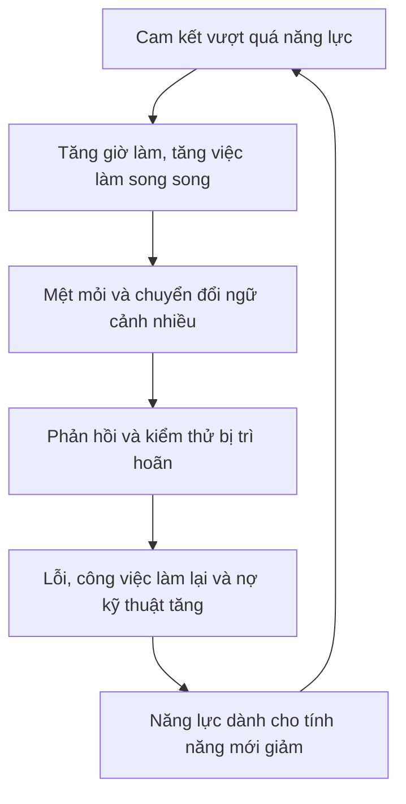

# Duy trì nhịp phát triển bền vững

## 1. Nguyên tắc này nói về điều gì?

Trong **Agile Development**, việc giao phần mềm có giá trị sớm và liên tục chỉ thực sự hiệu quả khi nhóm có khả năng duy trì cách làm đó trong thời gian dài. Một nhóm có thể tăng tốc trong vài tuần bằng cách làm thêm giờ, bỏ kiểm thử hoặc trì hoãn sửa lỗi, nhưng khoản chi phí này thường quay lại dưới dạng mệt mỏi, lỗi sản phẩm, nợ kỹ thuật, chậm phản hồi và mất khả năng dự báo.

**Nguyên tắc thứ tám của Tuyên ngôn Agile** đề cao phát triển bền vững: bên tài trợ, người phát triển và người sử dụng cần có khả năng duy trì một nhịp tiến độ ổn định trong thời gian dài. Ở đây, “ổn định” nói đến **khả năng tiếp tục tạo ra giá trị và thích ứng mà không liên tục làm cạn sức người hoặc suy giảm chất lượng**. Nó không đòi hỏi mỗi tuần phải hoàn thành số lượng tính năng y hệt nhau.

Nguyên tắc này gắn trực tiếp với mục tiêu của Agile: tạo ra các phần tăng trưởng sản phẩm có chất lượng, nhận phản hồi sớm và cải tiến liên tục. Nếu nhịp làm việc không bền vững, các vòng phản hồi bị đứt đoạn; nhóm phải dành nhiều công sức xử lý lỗi hoặc khắc phục hậu quả, nên ngày càng khó thích ứng với yêu cầu mới.

Sau bài này, người học có thể:

- Giải thích ý nghĩa của nhịp phát triển bền vững và phân biệt với việc chạy nhanh trong ngắn hạn.
- Nhận diện những yếu tố khiến nhịp làm việc mất bền vững ở cả nhóm phát triển, khách hàng và bên tài trợ.
- Áp dụng các cách quản lý phạm vi, năng lực, công việc đang làm và chất lượng kỹ thuật phù hợp với Scrum, Kanban hoặc XP.
- Sử dụng tín hiệu từ dòng công việc, chất lượng và phản hồi của con người để phát hiện quá tải và cải tiến cách phối hợp.

## 2. Vì sao nhịp phát triển bền vững quan trọng?

Phần mềm thường tồn tại và thay đổi lâu hơn giai đoạn tạo phiên bản đầu tiên. Khi sản phẩm có người dùng thực, nhóm tiếp tục nhận yêu cầu mới, sửa lỗi, nâng cấp nền tảng, xử lý sự cố và tuân thủ các ràng buộc vận hành. Vì thế, hiệu quả phát triển phải được xem theo **nhiều chu kỳ liên tiếp**, không chỉ theo một lần bàn giao.

Một chuỗi tác động thường gặp khi nhóm cố duy trì tốc độ cao hơn năng lực thực tế:



Chu trình này không xảy ra với mọi nhóm và mức độ tác động khác nhau theo bối cảnh. Tuy nhiên, nó giải thích vì sao nỗ lực “tăng tốc” bằng việc chất thêm công việc có thể khiến thời gian bàn giao kéo dài hơn.

Ngược lại, nhịp bền vững giúp nhóm có khoảng trống để hiểu vấn đề, trao đổi với người dùng, kiểm thử trước khi bàn giao và điều chỉnh thứ tự ưu tiên khi có thông tin mới. **Nhịp bền vững là điều kiện để phản hồi sớm có thể diễn ra đều đặn**, chứ không phải phần thưởng chỉ có sau khi dự án đã hoàn thành.

### 2.1. Bền vững với những ai?

Nguyên tắc đề cập đến nhiều phía, bởi phát triển sản phẩm là một hệ thống cộng tác:

| Đối tượng | Khả năng duy trì nhịp bền vững thể hiện ở đâu? | Điều gì thường làm nhịp bị phá vỡ? |
|---|---|---|
| **Nhóm phát triển** | Có thời gian làm việc tập trung, kiểm thử, tích hợp, bảo trì và học hỏi; không phụ thuộc liên tục vào tăng ca. | Ôm quá nhiều việc, chuyển ngữ cảnh, khắc phục lỗi khẩn cấp kéo dài, phụ thuộc vào một cá nhân. |
| **Người dùng/khách hàng** | Có thể xem kết quả, sử dụng thay đổi, cung cấp phản hồi và tiếp nhận phiên bản mới theo nhịp phù hợp. | Thay đổi quá dồn dập, tài liệu hướng dẫn thiếu, không có thời gian kiểm chứng hoặc đào tạo. |
| **Bên tài trợ/quản lý sản phẩm** | Có thể duy trì quyết định ưu tiên, nguồn lực và phản hồi ở mức đủ đều để nhóm tiến lên. | Thêm ưu tiên mới liên tục, đưa hạn chót không dựa trên năng lực, trì hoãn quyết định rồi yêu cầu bù tiến độ. |
| **Các nhóm liên quan** | Có khả năng phối hợp về kiểm thử, bảo mật, hạ tầng, vận hành và hỗ trợ. | Hàng chờ phê duyệt quá dài, yêu cầu đầu vào thiếu rõ ràng, phát hành dồn vào cuối kỳ. |

Một nhóm lập trình làm việc đúng giờ vẫn có thể gặp nhịp không bền vững nếu người dùng liên tục bị buộc thử nghiệm nhiều thay đổi không có hướng dẫn, hoặc đội vận hành phải thức đêm xử lý các đợt phát hành thiếu ổn định. Vì vậy, cần quan sát nhịp làm việc trên **toàn bộ dòng tạo ra giá trị**.

## 3. Phân biệt các khái niệm dễ nhầm lẫn

“Nhịp bền vững” không đồng nghĩa với “chậm”, “không có áp lực” hay “làm ít việc”. Nhóm vẫn có mục tiêu rõ ràng, ưu tiên cao và cam kết chất lượng; điều khác biệt nằm ở cách thiết kế hệ thống làm việc để duy trì kết quả qua nhiều chu kỳ.

| Khái niệm | Ý nghĩa | Điều cần tránh |
|---|---|---|
| **Nhịp làm việc (pace)** | Tần suất nhóm có thể tạo kết quả hữu ích, tích hợp, kiểm tra và phản hồi. | Đánh giá chỉ bằng số giờ bận rộn. |
| **Năng lực (capacity)** | Lượng thời gian, kỹ năng và sự tập trung thực tế có thể dành cho công việc trong một giai đoạn. | Giả định mỗi thành viên đều có 100% thời gian cho tính năng mới. |
| **Tốc độ bàn giao (delivery rate)** | Số hạng mục hoặc phần giá trị hoàn thành trong một khoảng thời gian với tiêu chuẩn hoàn thành rõ ràng. | Tăng số lượng bằng cách cắt nhỏ tùy tiện để làm đẹp số liệu. |
| **Khả năng dự báo (predictability)** | Mức độ có thể ước lượng phạm vi/thời điểm dựa trên dữ liệu và rủi ro đã biết. | Biến dự báo thành lời hứa chắc chắn bất kể thay đổi. |
| **Tính bền vững (sustainability)** | Khả năng duy trì kết quả, chất lượng và sức khỏe tổ chức qua nhiều chu kỳ. | Đánh đổi dài hạn lấy một giai đoạn năng suất biểu kiến. |

Nhịp ổn định **không yêu cầu đầu ra bằng nhau từng Sprint**. Hạng mục khác nhau về độ khó; có kỳ nghỉ, sự cố, thay đổi kỹ thuật và giai đoạn khám phá. Điều quan trọng là nhóm sớm nhận ra chênh lệch giữa nhu cầu và năng lực, rồi điều chỉnh phạm vi, thứ tự ưu tiên, phương pháp hoặc nguồn lực bằng trao đổi minh bạch.

## 4. Các trụ cột tạo nên nhịp phát triển bền vững

### 4.1. Giới hạn cam kết theo năng lực thực tế

Nhóm cần tính đến ngày nghỉ, bảo trì, trực sự cố, hỗ trợ khách hàng, họp cần thiết, nghiên cứu và công việc kỹ thuật. Chỉ phần năng lực còn lại mới có thể dành cho các tính năng mới. Một Sprint có mười ngày làm việc không có nghĩa mỗi thành viên có mười ngày liên tục để lập trình tính năng.

Khi quyết định phạm vi, nhóm nên làm rõ mục tiêu quan trọng nhất, chọn các hạng mục đủ nhỏ để hoàn thành và bảo vệ một phần năng lực cho các tình huống đã biết nhưng không thể xác định chính xác thời điểm. Nếu xuất hiện yêu cầu mới cấp bách, hãy **thảo luận việc thay thế hoặc bỏ bớt phạm vi đang lên kế hoạch**, thay vì mặc định cộng thêm vào lịch làm việc.

**Ví dụ:** nhóm đang phát triển chức năng tìm kiếm sản phẩm. Giữa chu kỳ, nhóm phải xử lý lỗi thanh toán nghiêm trọng. Sau khi đánh giá mức độ ưu tiên, người phụ trách sản phẩm và nhóm thống nhất hoãn bộ lọc tìm kiếm nâng cao sang chu kỳ sau; mục tiêu bàn giao chức năng tìm kiếm cơ bản vẫn được giữ nếu còn khả thi.

### 4.2. Hoàn thành công việc trước khi bắt đầu quá nhiều việc mới

Một hạng mục đang làm nhưng chưa thể dùng thường chưa mang lại giá trị mong đợi. Khi nhiều hạng mục cùng mở, thành viên phải chuyển đổi ngữ cảnh, dễ quên quyết định và phải phối hợp trên nhiều nhánh công việc. Nếu không có giới hạn công việc đang làm (Work in Progress — **WIP**), hệ thống có thể trông bận rộn nhưng rất ít việc đi đến hoàn thành.

Nhóm có thể:

- Minh bạch các trạng thái từ lúc bắt đầu cho đến khi hoàn thành theo tiêu chí chất lượng.
- Thống nhất giới hạn WIP phù hợp với năng lực và đặc điểm công việc.
- Ưu tiên hỗ trợ giải quyết hạng mục bị chặn hoặc đang chờ kiểm thử trước khi lấy việc mới.
- Chia hạng mục lớn thành các phần có thể kiểm tra hoặc bàn giao độc lập để giảm thời gian chờ.

Giới hạn WIP là một cơ chế phối hợp; không phải mức trần bất biến. Nhóm có thể điều chỉnh dựa trên dữ liệu về tắc nghẽn và kết quả của các thử nghiệm cải tiến.

### 4.3. Chuyển giao giá trị theo những phần nhỏ

Một chức năng lớn, mơ hồ thường kéo theo tích hợp muộn và khó lấy phản hồi. **Chia nhỏ theo lát giá trị cho người dùng** giúp nhóm hoàn thành, kiểm thử và đánh giá từng phần. Đây là điểm kết nối với user story và backlog trong Agile.

Ví dụ với ứng dụng quản lý công việc:

| Cách chia khó duy trì nhịp | Cách chia dễ kiểm chứng hơn |
|---|---|
| Làm toàn bộ cơ sở dữ liệu, rồi toàn bộ API, rồi toàn bộ giao diện cho hệ thống nhắc việc | Hoàn thành luồng tạo một lời nhắc có thể lưu và hiển thị; tiếp theo là chỉnh sửa lời nhắc; cuối cùng bổ sung thông báo theo lịch. |
| Chờ tích hợp tất cả phần việc mới kiểm thử | Tích hợp và kiểm thử từng luồng đầy đủ từ đầu đến cuối khi hoàn thành. |

Chia nhỏ không có nghĩa bỏ qua kiến trúc hoặc chia công việc thành các nhiệm vụ kỹ thuật thiếu giá trị. Mục tiêu là giảm kích thước một đợt thay đổi nhưng vẫn bảo toàn tính sử dụng được, khả năng kiểm thử và sự rõ ràng về chất lượng.

### 4.4. Đầu tư vào chất lượng kỹ thuật để không trả giá liên tục

Nhịp bền vững phụ thuộc vào việc mỗi thay đổi mới có thể được xây dựng và kiểm tra với chi phí hợp lý. Các thực hành kỹ thuật thường hỗ trợ mục tiêu này gồm:

- **Tích hợp liên tục (CI):** hợp nhất các thay đổi thường xuyên và thực hiện kiểm tra tự động để phát hiện vấn đề tích hợp sớm.
- **Kiểm thử tự động:** bảo vệ các hành vi quan trọng trước lỗi hồi quy; kết hợp kiểm thử đơn vị, tích hợp và đầu cuối theo nhu cầu sản phẩm.
- **Rà soát mã và cộng tác:** chia sẻ kiến thức, phát hiện thiếu sót và giảm phụ thuộc vào một người duy nhất.
- **Tái cấu trúc (refactoring):** cải thiện cách tổ chức mã mà không thay đổi hành vi được mong đợi, giúp tính năng mới dễ bổ sung hơn.
- **Definition of Done:** làm rõ tiêu chuẩn hoàn thành, bao gồm những yêu cầu chất lượng, kiểm thử, tài liệu và vận hành phù hợp.
- **Quan sát sau phát hành:** theo dõi lỗi, hiệu năng và phản hồi của người dùng để phát hiện sớm tác động không mong muốn.

Không phải đội nào cũng cần cùng một công cụ hoặc mức tự động hóa. Nhóm nên chọn thực hành giảm rủi ro lớn nhất trong bối cảnh của mình và cải tiến dần. Việc liên tục bỏ qua kiểm thử hoặc trì hoãn sửa lỗi để đạt hạn chót có thể khiến nhịp hiện tại cao hơn nhưng làm nhịp tương lai suy giảm.

### 4.5. Tạo điều kiện cho tập trung, nghỉ ngơi và chia sẻ tri thức

Làm việc bền vững cần thời gian tập trung phù hợp, cơ chế trao đổi rõ ràng, quãng nghỉ và cơ hội học hỏi. Tăng ca kéo dài khiến nhóm dễ mất tập trung, khó sáng tạo và tăng nguy cơ sai sót. Người quản lý nên quan sát **mô hình công việc**, chẳng hạn gián đoạn liên tục hoặc người trực hỗ trợ phải xử lý quá nhiều kênh, thay vì đánh giá từng người bằng số phút trực tuyến.

Chia sẻ tri thức thông qua tài liệu đủ dùng, lập trình cặp, rà soát mã hoặc luân phiên nhiệm vụ quan trọng giúp giảm “điểm phụ thuộc một người”. Điều này hỗ trợ tiến độ khi có người nghỉ phép, chuyển nhóm hoặc phải xử lý sự cố.

### 4.6. Duy trì vòng phản hồi và cải tiến liên tục

Lịch họp đều đặn chỉ hữu ích khi giúp nhóm phát hiện sai lệch và đưa ra quyết định. Nhóm cần có nơi để trình diễn kết quả, làm rõ ưu tiên, nhìn lại nguyên nhân tắc nghẽn và thử cải tiến cụ thể. Hãy chọn một vấn đề thực tế mỗi lần, thử thay đổi nhỏ, đo tác động rồi điều chỉnh nếu cần.

Ví dụ, nếu hạng mục thường chờ kiểm thử ba ngày, nhóm có thể thử đưa kiểm thử viên vào trao đổi tiêu chí chấp nhận sớm hơn, hỗ trợ viết kiểm thử tự động và giảm số việc lập trình đồng thời. Sau vài chu kỳ, nhóm đánh giá thời gian chờ và số lỗi để biết thay đổi có giúp ích hay không.

## 5. Nhịp bền vững khi thực hành Scrum, Kanban và XP

Agile không quy định một lịch làm việc duy nhất. Các khung và thực hành khác nhau đưa ra cơ chế phối hợp khác nhau để hỗ trợ cùng một mục tiêu.

### 5.1. Với Scrum: dùng Sprint để tạo nhịp học hỏi và bàn giao

Scrum tổ chức công việc theo Sprint có độ dài cố định, tối đa một tháng. Trong mỗi Sprint, nhóm xác định **Sprint Goal**, chọn những Product Backlog Item có khả năng hoàn thành và lên kế hoạch thực hiện. Việc dự kiến công việc cần dựa trên năng lực hiện có, hiệu suất đã quan sát và Definition of Done.

Những điểm giúp giữ nhịp bền vững:

1. **Sprint Planning:** làm rõ mục tiêu, cân nhắc thời gian nghỉ, công việc hỗ trợ và các rủi ro đã biết trước khi lựa chọn phạm vi.
2. **Daily Scrum:** Developers kiểm tra tiến độ hướng tới Sprint Goal, phối hợp và điều chỉnh kế hoạch hằng ngày khi cần.
3. **Sprint Review:** cùng bên liên quan xem xét Increment và điều chỉnh Product Backlog dựa trên kết quả, phản hồi và bối cảnh mới.
4. **Sprint Retrospective:** chọn cải tiến có thể thực hiện được cho chất lượng, luồng công việc và cách phối hợp.
5. **Definition of Done:** ngăn việc tính các hạng mục chưa đủ chất lượng là đã hoàn thành.

Sprint Goal tạo trọng tâm để nhóm thích ứng với công việc phát sinh. Khi khó khăn xuất hiện, phạm vi có thể được làm rõ và thương lượng trong Sprint với Product Owner mà không gây nguy hiểm cho Sprint Goal; nhóm không nên mặc định yêu cầu thêm giờ để giữ nguyên mọi hạng mục dự kiến. Sprint chỉ là hộp thời gian cho việc kiểm tra và thích ứng, không phải “đợt nước rút” phải kiệt sức.

**Velocity**, nếu được nhóm dùng, có thể hỗ trợ dự báo trong bối cảnh riêng của nhóm. Điểm story point không có đơn vị chuẩn giữa các nhóm; tăng điểm ước lượng không đồng nghĩa tăng giá trị hay năng suất. Việc dùng velocity để xếp hạng cá nhân, ép mức cam kết hoặc so sánh các nhóm có thể tạo động cơ làm méo số liệu và làm hỏng nhịp bền vững.

### 5.2. Với Kanban: điều khiển dòng công việc và giới hạn WIP

Kanban phù hợp khi công việc đến liên tục hoặc khi nhóm cần quan sát dòng việc qua nhiều trạng thái. Nhóm định nghĩa quy trình thực tế, trực quan hóa các hạng mục, đặt giới hạn WIP và chủ động xử lý công việc bị mắc kẹt.

```text
Sẵn sàng  ->  Đang phát triển  ->  Đang kiểm thử  ->  Hoàn thành
                  WIP: 3             WIP: 2
```

Ví dụ, nếu cột “Đang kiểm thử” đã có đủ hai hạng mục, người hoàn thành phần lập trình nên hỗ trợ đưa một hạng mục qua kiểm thử thay vì tự động bắt đầu tính năng thứ tư. Giới hạn minh họa trên cần được điều chỉnh theo năng lực và đặc điểm sản phẩm của nhóm.

Các chỉ số như WIP, cycle time, throughput và work item age giúp nhóm nhận diện nhu cầu cao hơn năng lực, thời gian chờ và công việc bất thường. Kanban không bắt buộc Sprint; một nhịp liên tục vẫn có thể có các thời điểm bổ sung công việc, xem xét dịch vụ, nhận phản hồi và cải tiến rõ ràng.

### 5.3. Với XP: thực hành kỹ thuật hỗ trợ tốc độ dài hạn

Extreme Programming (**XP**) nhấn mạnh phản hồi ngắn và chất lượng kỹ thuật để thay đổi phần mềm an toàn. Các thực hành như phát triển hướng kiểm thử (TDD), lập trình cặp, tích hợp liên tục, thiết kế đơn giản và tái cấu trúc làm giảm chi phí tích hợp và sửa lỗi về sau.

XP cũng đề cao **sustainable pace**, thường được diễn giải thông qua việc tránh làm thêm giờ kéo dài và giữ thời gian làm việc hợp lý. Điều này không đồng nghĩa mọi cá nhân luôn phải làm số giờ giống nhau, mà có nghĩa nhóm không thiết kế kế hoạch phụ thuộc vào trạng thái quá tải liên tục.

Nhóm có thể dùng Scrum để điều phối mục tiêu, Kanban để quan sát và giới hạn luồng công việc, đồng thời dùng các thực hành XP để giữ chất lượng. Khi kết hợp, các quy tắc và trách nhiệm cần được trình bày rõ để tránh tăng số nghi thức mà không cải thiện kết quả.

## 6. Đo lường nhịp bền vững như thế nào?

Không có một chỉ số đơn lẻ chứng minh nhóm đang làm việc bền vững. Cần xem xét đồng thời **dòng công việc, chất lượng, khả năng dự báo và trải nghiệm làm việc**. Mốc đo và định nghĩa cần nhất quán trước khi so sánh giữa các giai đoạn.

| Nhóm tín hiệu | Chỉ số/quan sát | Cách diễn giải hữu ích |
|---|---|---|
| Dòng công việc | **WIP**: số hạng mục đang xử lý | WIP tăng kéo dài có thể báo hiệu bắt đầu nhiều việc hơn mức có thể hoàn thành. |
| Dòng công việc | **Cycle time**: thời gian từ lúc bắt đầu xử lý đến lúc hoàn thành | Thời gian kéo dài hoặc biến động lớn có thể chỉ ra tắc nghẽn, hạng mục quá lớn hoặc chờ phụ thuộc. |
| Dòng công việc | **Throughput**: số hạng mục hoàn thành trong một khoảng thời gian | Xem xu hướng và biến động cùng kích thước công việc; không chạy theo số lượng một cách máy móc. |
| Dòng công việc | **Work item age**: tuổi của hạng mục đang mở | Phát hiện sớm những hạng mục có nguy cơ bị mắc kẹt trước khi chúng trễ hạn. |
| Chất lượng | Lỗi phát sinh sau phát hành, lỗi hồi quy, công việc làm lại | Tỷ lệ lỗi hoặc việc làm lại tăng có thể cho thấy sức ép tiến độ đang lấn át chất lượng. |
| Khả năng dự báo | Mức chênh lệch giữa dự báo và kết quả theo nhiều chu kỳ | Chênh lệch lặp lại gợi ý cần điều chỉnh phạm vi, năng lực hoặc cách chia nhỏ. |
| Sức khỏe hệ thống làm việc | Giờ làm ngoài kế hoạch, sự cố khẩn cấp, gián đoạn, điểm nghẽn phụ thuộc một người | Sự gia tăng thường xuyên cần được phân tích nguyên nhân và tác động đến khả năng duy trì công việc. |
| Trải nghiệm con người | Phản hồi định tính về mức tập trung, quá tải, khả năng phục hồi và hợp tác | Trao đổi trong môi trường tin cậy; không biến phản hồi cá nhân thành công cụ giám sát hay xếp hạng. |

**Lead time** cũng hữu ích nếu nhóm định nghĩa rõ điểm bắt đầu và kết thúc, chẳng hạn từ lúc tiếp nhận yêu cầu đến khi bàn giao. Lead time dài có thể bao gồm thời gian chờ trước khi được bắt đầu, còn cycle time theo dõi quãng xử lý sau khi công việc đã bắt đầu. Khi backlog chưa được ưu tiên, lead time có thể tăng dù nhóm đang xử lý công việc với tốc độ ổn định.

### Ví dụ đọc chỉ số đúng bối cảnh

Giả sử trong ba chu kỳ gần đây, nhóm quan sát thấy số việc đang làm tăng từ 5 lên 11, cycle time trung vị tăng từ 4 lên 9 ngày, trong khi throughput gần như không đổi. Đây là **dữ liệu minh họa**, nhưng mô hình này gợi ý nhóm đang mở thêm nhiều công việc mà chưa tăng khả năng hoàn thành.

Một phản ứng hợp lý là kiểm tra vị trí tồn đọng, giảm WIP, chia nhỏ việc quá lớn và hỗ trợ xử lý công việc bị chặn. Chỉ yêu cầu mọi người làm nhiều giờ hơn sẽ không nhất thiết giải quyết nguyên nhân.

Ngược lại, nếu cycle time tăng tạm thời vì nhóm chủ động nâng cấp công cụ kiểm thử nhằm giảm lỗi về sau, cần đánh giá cả chi phí ngắn hạn lẫn lợi ích sau một vài chu kỳ. Không nên phán xét một số đo bị tách khỏi ngữ cảnh.

## 7. Ví dụ thực tế: một Sprint bắt đầu quá tải

Một nhóm phát triển phần mềm đặt lịch gồm năm thành viên lập kế hoạch cho Sprint hai tuần. Nhóm muốn hoàn thành ba hạng mục: xem lịch trống, đặt lịch và nhắc lịch qua email. Tuy nhiên, thời gian thực có thể dùng cho công việc mới thấp hơn tổng số ngày làm việc trên lịch.

### 7.1. Xem lại năng lực

Giả sử năm thành viên có tổng cộng 50 ngày-người theo lịch trong hai tuần. Các khoản cần tính đến gồm:

| Yếu tố | Ước tính minh họa |
|---|---:|
| Tổng ngày-người theo lịch | 50 |
| Nghỉ phép đã biết | −5 |
| Hỗ trợ sản phẩm đang vận hành | −8 |
| Phối hợp, chuẩn bị phát hành, hoạt động nội bộ cần thiết | −7 |
| **Năng lực gần đúng còn dành cho mục tiêu Sprint** | **30** |

Con số trên chỉ giúp nhìn thấy ràng buộc; **ngày-người không chuyển trực tiếp thành story point hoặc năng suất tuyến tính**. Việc một hạng mục có thể hoàn thành còn phụ thuộc vào kỹ năng, sự phối hợp, phụ thuộc kỹ thuật, mức độ bất định và tiêu chí hoàn thành.

### 7.2. Giữ mục tiêu, điều chỉnh phạm vi

Sau khi thảo luận, nhóm thống nhất Sprint Goal là: **“Người dùng có thể chọn một khung giờ hợp lệ và đặt lịch thành công.”** Phạm vi được tổ chức như sau:

1. Hoàn thành luồng xem khung giờ trống và đặt lịch ở mức tối thiểu có thể dùng.
2. Viết tiêu chí chấp nhận cho trường hợp hai người chọn cùng một khung giờ; thực hiện kiểm thử và tích hợp cần thiết.
3. Đưa nhắc lịch qua email về backlog cho chu kỳ sau nếu không còn năng lực, thay vì giữ nó như một cam kết bất khả thi.
4. Dành thời điểm trình diễn cho người đại diện phòng khám để nhận phản hồi về luồng đặt lịch.

Nếu có sự cố vận hành phát sinh, Developers và Product Owner tiếp tục làm rõ phạm vi và tác động đến Sprint Goal. Nếu mục tiêu bị đe dọa, nhóm thông báo sớm để các bên cùng quyết định. Nhờ đó, trạng thái thực được minh bạch và nhóm có cơ hội bàn giao một Increment đáp ứng Definition of Done.

### 7.3. Bài học từ ví dụ

Nhóm không hứa hoàn thành mọi ý tưởng trong cùng một Sprint. Họ chọn **giá trị ưu tiên, kích thước phần bàn giao và mức chất lượng** sao cho phù hợp với năng lực. Nhịp bền vững được hình thành từ những quyết định lặp lại theo cách này, qua nhiều Sprint, thay vì một lần giảm phạm vi đơn lẻ.

## 8. Xử lý các tình huống dễ phá vỡ nhịp làm việc

### 8.1. Hạn chót cố định nhưng phạm vi quá lớn

Hạn chót có thể xuất phát từ quy định, sự kiện kinh doanh hoặc cam kết với khách hàng. Khi thời điểm bàn giao khó thay đổi, nhóm cần sớm làm rõ **phần giá trị tối thiểu phải có**, phụ thuộc bắt buộc, tiêu chuẩn an toàn/chất lượng và phương án giảm phạm vi. Nếu cả thời hạn, phạm vi và năng lực đều bị cố định vượt quá khả năng thực tế, việc chỉ yêu cầu “làm nhanh hơn” không tạo ra năng lực mới.

Có thể thảo luận phương án giao theo giai đoạn, giảm chức năng ít giá trị, tăng hỗ trợ có mục tiêu, hoặc đàm phán lại yêu cầu. Không nên dùng việc bỏ kiểm thử bảo mật hay bỏ điều kiện vận hành thiết yếu làm cách rút ngắn tiến độ.

### 8.2. Sự cố khẩn cấp xuất hiện giữa công việc thường ngày

Sự cố có mức độ ưu tiên cao cần được giải quyết theo quy trình phản ứng phù hợp. Để nhịp không liên tục bị gián đoạn, nhóm có thể lập cơ chế trực luân phiên, phân loại mức nghiêm trọng, dành năng lực dự phòng và ghi nhận những công việc bị ảnh hưởng.

Sau khi xử lý, nhóm xem lại nguyên nhân, cải tiến khả năng quan sát và tự động hóa nhằm giảm số lần sự cố tương tự tái diễn. Một giai đoạn ứng cứu khẩn cấp có thể cần thêm nỗ lực tạm thời; điều cần tránh là biến trạng thái ứng cứu thành cách vận hành mặc định.

### 8.3. Bên liên quan liên tục thay đổi ưu tiên

Agile khuyến khích phản hồi với thay đổi, nhưng phản hồi cần đi kèm quyết định về ưu tiên và chi phí cơ hội. Người quản lý sản phẩm nên làm rõ điều gì được dừng, hoãn hoặc thay thế khi nhận yêu cầu mới. Có thể dùng Product Backlog, mục tiêu sản phẩm, quy tắc xử lý việc khẩn cấp hoặc lịch bổ sung công việc rõ ràng để tránh mọi yêu cầu cùng trở thành ưu tiên cao nhất.

### 8.4. Nhóm phụ thuộc vào một chuyên gia duy nhất

Khi chỉ một người biết vận hành thành phần quan trọng, mọi vấn đề liên quan đều chờ người đó. Nhóm có thể chia sẻ tri thức bằng tài liệu thao tác, rà soát mã, làm việc cặp hoặc luân phiên trách nhiệm. Cách này có thể tốn thêm thời gian ban đầu nhưng giảm rủi ro tắc nghẽn dài hạn.

## 9. Những biểu hiện của việc áp dụng sai nguyên tắc

| Biểu hiện | Vì sao gây vấn đề? | Điều chỉnh có thể thử |
|---|---|---|
| Gọi mọi Sprint là một đợt “nước rút” cần tăng ca | Kỳ vọng nỗ lực cao bất thường trở thành định mức liên tục. | Lập kế hoạch dựa trên năng lực và kết quả đã hoàn thành, có tính đến công việc ngoài tính năng. |
| Luôn bắt đầu thêm việc vì mọi người phải “bận” | WIP tăng, công việc chờ nhiều và thời gian hoàn thành khó dự báo. | Tập trung đưa việc đã bắt đầu đến trạng thái Done; giới hạn WIP. |
| Đo năng suất bằng số giờ trực tuyến hoặc số story point | Chỉ số không phản ánh trực tiếp giá trị và chất lượng, dễ tạo hành vi đối phó. | Xem kết quả bàn giao, thời gian dòng công việc, chất lượng và phản hồi người dùng. |
| Ghi nhận hạng mục “xong code” là hoàn thành | Kiểm thử, tích hợp và tài liệu bị dồn sang cuối, tạo rủi ro chưa được nhìn thấy. | Thống nhất Definition of Done và áp dụng trước khi tính hoàn thành. |
| Hoãn mọi cải tiến kỹ thuật để “tập trung tính năng” | Nợ kỹ thuật và công việc sửa lỗi có thể làm giảm năng lực ở các chu kỳ sau. | Chọn các cải tiến kỹ thuật có tác động rõ đến thời gian xử lý hoặc rủi ro. |
| Cố định số hạng mục giống hệt nhau ở mọi chu kỳ | Bỏ qua khác biệt về độ khó, bất định và năng lực thực tế. | Dự báo theo dữ liệu nhiều chu kỳ và cập nhật khi bối cảnh thay đổi. |
| Dùng khẩu hiệu “bền vững” để tránh trách nhiệm bàn giao | Thiếu mục tiêu rõ, kiểm tra kết quả và chủ động xử lý trở ngại. | Gắn nhịp làm việc với mục tiêu, phần mềm hoàn thành, phản hồi và cải tiến có thể kiểm chứng. |

Nhịp bền vững vẫn cần kỷ luật. Điểm khác biệt nằm ở việc kỷ luật phục vụ **kết quả dài hạn có chất lượng**, thay vì duy trì biểu hiện bận rộn hoặc tốc độ cao trong một giai đoạn ngắn.

## 10. Quy trình thử cải thiện nhịp làm việc trong bốn tuần

Một nhóm có thể thử áp dụng nguyên tắc với phạm vi nhỏ, sau đó điều chỉnh theo dữ liệu thực tế. Mốc bốn tuần dưới đây là **ví dụ tổ chức thử nghiệm**, không phải quy tắc bắt buộc của Agile.

| Giai đoạn | Hành động | Kết quả mong đợi |
|---|---|---|
| **Tuần 1: Quan sát** | Vẽ luồng công việc, xác định Definition of Done, ghi nhận WIP, việc bị chặn, cycle time và nguồn gián đoạn. | Nhóm thấy được điểm nghẽn và hiểu lý do hoàn thành chậm. |
| **Tuần 2: Giảm quá tải** | Thử giới hạn WIP, chia nhỏ hạng mục, làm rõ thứ tự ưu tiên và công việc hỗ trợ thường xuyên. | Ít hạng mục mở đồng thời và có nhiều việc đi đến Done hơn. |
| **Tuần 3: Củng cố chất lượng** | Chọn một vấn đề kỹ thuật gây làm lại; thử cải thiện kiểm thử, tích hợp, review hoặc tài liệu đúng nơi cần thiết. | Giảm rủi ro lỗi hồi quy hoặc thời gian chờ liên quan đến vấn đề đã chọn. |
| **Tuần 4: Kiểm tra và điều chỉnh** | So sánh xu hướng chỉ số, chất lượng bàn giao, phản hồi người dùng và trải nghiệm của nhóm; giữ hoặc sửa thử nghiệm. | Một hoặc hai thay đổi làm việc có cơ sở để tiếp tục trong các chu kỳ sau. |

Trước khi kết thúc giai đoạn thử nghiệm, nhóm nên trao đổi: “Chúng ta đã hoàn thành được phần mềm có thể sử dụng và kiểm tra chưa?”, “Công việc đang kẹt ở đâu?”, “Nợ kỹ thuật hoặc việc khẩn cấp nào đang lấy mất năng lực?”, “Có ai đang phải duy trì nhịp không thể kéo dài?”, và “Thay đổi nhỏ nào sẽ cải thiện dòng làm việc ở chu kỳ tới?”.

Những câu hỏi này giúp kết nối ba tầng của Agile Development: **giá trị sản phẩm**, **cách phối hợp giữa con người** và **khả năng duy trì chất lượng kỹ thuật**.

## 11. Ghi nhớ

**Duy trì nhịp phát triển bền vững** là khả năng các bên liên quan liên tục tạo ra, kiểm chứng và tiếp nhận giá trị mà không dựa vào quá tải kéo dài hoặc đánh đổi chất lượng thiết yếu. Muốn làm được điều đó, nhóm cần cam kết theo năng lực thực tế, ưu tiên việc quan trọng, giới hạn WIP, chia nhỏ phần bàn giao, duy trì thực hành kỹ thuật tốt và thường xuyên học từ phản hồi.

Trong Scrum, nhịp này được hỗ trợ bởi Sprint Goal, Increment và các vòng kiểm tra thích ứng. Trong Kanban, nó được thể hiện qua quản lý dòng công việc và giới hạn WIP. Trong XP, nó được củng cố nhờ phản hồi kỹ thuật nhanh và tránh làm thêm giờ kéo dài. Dù chọn cách phối hợp nào, mục tiêu vẫn là **bàn giao phần mềm có giá trị theo cách có thể lặp lại và cải tiến liên tục qua thời gian**.
