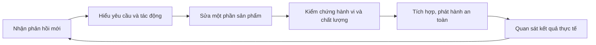
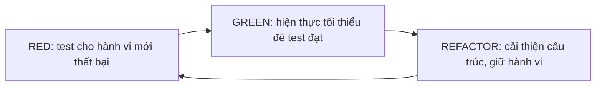
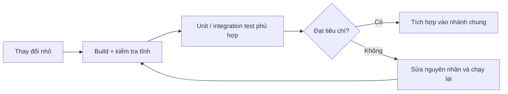

# Chú trọng năng lực kỹ thuật và thiết kế tốt

> “Continuous attention to technical excellence and good design enhances agility.”
>
> — Nguyên tắc thứ 9 trong [12 nguyên tắc của Tuyên ngôn Agile](https://agilemanifesto.org/principles.html).

Có thể diễn đạt nguyên tắc này bằng tiếng Việt: **Liên tục chú trọng sự xuất sắc về kỹ thuật và thiết kế tốt giúp tăng khả năng linh hoạt, thích ứng**.

Một nhóm sản phẩm có thể giao chức năng mới rất nhanh trong vài tuần đầu. Nhưng sau nhiều tháng, mỗi thay đổi nhỏ lại kéo theo hàng loạt lỗi, kiểm thử mất hàng giờ, các thành viên ngại sửa những phần mã quan trọng và việc phát hành trở thành sự kiện căng thẳng. Khi ấy, dù nhóm vẫn có Sprint, user story và retrospective, **khả năng phản hồi trước thay đổi của họ đã suy giảm**.

Nguyên tắc Agile thứ 9 nhắc rằng **chất lượng kỹ thuật không phải việc trang trí làm sau khi đã giao giá trị**. Nó là một phần của năng lực giao giá trị liên tục. Mã dễ hiểu, thiết kế phù hợp, kiểm thử đáng tin cậy và quy trình phát hành an toàn giúp đội học từ phản hồi sớm, sửa quyết định sai với chi phí thấp và duy trì nhịp phát triển bền vững.

Bài học thuộc chương **Nguyên tắc Agile** trong mô-đun **AGILE_DEVELOPMENT**. Nó kết nối nguyên tắc Agile với các thực hành user story, backlog, Scrum, Kanban, XP và đo lường dòng công việc để làm rõ **vì sao chất lượng kỹ thuật phải được quan tâm trong từng lần giao tăng dần**.

## 1. Mục tiêu học tập

Sau bài này, bạn có thể:

- Giải thích mối liên hệ nhân quả giữa năng lực kỹ thuật, thiết kế tốt và khả năng thích ứng với phản hồi.
- Phân biệt tính đúng đắn, chất lượng bên trong, chất lượng bên ngoài, thiết kế tốt và việc tối ưu quá mức.
- Nhận diện vai trò của kiểm thử tự động, TDD, CI, refactoring, code review, thiết kế tăng dần và phản hồi vận hành.
- Viết ví dụ quy tắc nghiệp vụ nhỏ có thể kiểm thử, và phân biệt **refactoring** với **thay đổi hành vi**.
- Đưa chất lượng kỹ thuật vào user story, backlog và Definition of Done (DoD) mà không biến nó thành bước xử lý cuối.
- Đánh giá nợ kỹ thuật và theo dõi các tín hiệu chất lượng, tốc độ phản hồi, khả năng giao hàng.
- Chọn cách phối hợp thích hợp trong Scrum, Kanban hoặc XP, thay vì phụ thuộc máy móc vào một công thức.

## 2. Nguyên tắc này nói gì về Agile?

### 2.1. “Continuous attention”: sự quan tâm phải diễn ra liên tục

Từ khóa **liên tục** nhấn mạnh rằng công việc kỹ thuật tốt cần hiện diện trong hoạt động hằng ngày: trước khi bắt đầu một yêu cầu, khi thiết kế giải pháp, trong lúc viết mã, khi kiểm thử, tích hợp, triển khai và quan sát sau phát hành.

Ví dụ:

- Khi làm rõ yêu cầu, hỏi thêm về điều kiện lỗi, quyền truy cập, tải dự kiến và hành vi tại ranh giới dữ liệu.
- Khi lập trình, tách trách nhiệm rõ ràng, đặt tên dễ hiểu, bổ sung kiểm thử tại nơi có rủi ro.
- Khi tích hợp, phát hiện sớm lỗi hồi quy và xung đột giữa các thay đổi.
- Khi review, kiểm tra tính đúng, độ dễ bảo trì, bảo mật và khả năng vận hành.
- Khi phát hành, xác minh chức năng hoạt động trong môi trường thật và có cách xử lý khi không như mong đợi.
- Khi retrospective, điều chỉnh cả **cách làm kỹ thuật**, không chỉ lịch họp hoặc cách chia ticket.

**Hiểu sai thường gặp:** “Chúng ta sẽ dành hai tuần cuối dự án để nâng chất lượng.” Cách này thường khiến lỗi thiết kế tích tụ và đến lúc sửa thì đã có nhiều mã phụ thuộc. Những đợt cải tiến tập trung vẫn có ích, nhưng không thay thế sự chú ý liên tục.

### 2.2. “Technical excellence”: năng lực giao thay đổi an toàn và đáng tin cậy

**Năng lực kỹ thuật** không chỉ là biết một ngôn ngữ, dùng framework mới hoặc tạo mã phức tạp. Trong bối cảnh Agile, nó thể hiện ở khả năng đội **hiểu, thay đổi, kiểm chứng, triển khai và vận hành** hệ thống với chất lượng phù hợp.

Có thể nhìn ở các chiều sau:

| Chiều chất lượng | Câu hỏi cần trả lời | Tín hiệu thực tế |
| --- | --- | --- |
| **Tính đúng và tính đầy đủ của hành vi** | Phần mềm có giải quyết đúng trường hợp nghiệp vụ, kể cả ngoại lệ? | Kiểm thử phù hợp, tiêu chí chấp nhận rõ, ít lỗi hồi quy |
| **Dễ hiểu và dễ bảo trì** | Một người khác có thể đọc, sửa và kiểm chứng mã một cách an toàn? | Trách nhiệm rõ, độ phức tạp có chủ đích, ít phụ thuộc chằng chịt |
| **Khả năng kiểm thử** | Có thể xác minh quy tắc mà không phải dựng toàn hệ thống cho mọi trường hợp? | Tách lớp phù hợp, kiểm thử chạy nhanh, dễ chẩn đoán lỗi |
| **Khả năng tích hợp và phát hành** | Mã mới có thể kết hợp với mã hiện có và đến người dùng an toàn? | CI tin cậy, phát hiện lỗi sớm, triển khai có kiểm soát |
| **Bảo mật và tin cậy** | Hệ thống có bảo vệ dữ liệu, xử lý lỗi và chịu được tình huống bất lợi? | Kiểm soát truy cập đúng, lỗi được giám sát, có phương án khôi phục |
| **Khả năng quan sát** | Khi điều gì xảy ra ở môi trường thật, đội có phát hiện và giải thích được? | Log, metric, trace và cảnh báo hữu ích, tôn trọng dữ liệu nhạy cảm |
| **Năng lực cộng tác** | Kiến thức và quyết định kỹ thuật có được chia sẻ? | Review có ý nghĩa, trao đổi thiết kế, hướng dẫn và cải tiến chung |

Một hệ thống có thể có **rất nhiều unit test** nhưng vẫn không đạt chất lượng vì kiểm thử sai hành vi, thiếu kiểm tra phân quyền hoặc pipeline thường xuyên bị bỏ qua. Chất lượng cần được đánh giá bằng năng lực thực tế của hệ thống và đội, không bằng một chỉ số đơn lẻ.

### 2.3. “Good design”: thiết kế làm cho thay đổi hợp lý trở nên dễ dàng

**Thiết kế tốt** là cách tổ chức trách nhiệm, dữ liệu, hợp đồng giao tiếp, cấu trúc mã và kiến trúc để đáp ứng nhu cầu hiện tại, đồng thời không làm các thay đổi **có khả năng xảy ra** trở nên quá tốn kém hoặc nguy hiểm.

Thiết kế tốt không đồng nghĩa với:

- Nhiều lớp, nhiều interface hoặc mọi thành phần đều có design pattern.
- Dự đoán trước mọi yêu cầu trong tương lai.
- Chọn microservices, event sourcing hay công nghệ mới nhất.
- Mã ngắn nhất bằng mọi giá.
- Không bao giờ phải sửa thiết kế đã chọn.

Tiêu chí quan trọng hơn là: **thiết kế có giải quyết đúng vấn đề hiện tại, thể hiện rõ ý định, hạn chế rủi ro thay đổi và phù hợp với chi phí vận hành của đội không?**

### 2.4. Vì sao kỹ thuật tốt lại làm tăng tính linh hoạt?

Xem một vòng thay đổi phổ biến:



Nếu mã khó hiểu, các phụ thuộc không rõ ràng và kiểm thử không đáng tin, thời gian ở các bước B, C, D, E tăng lên. Đội mất nhiều thời gian để xác định một thay đổi có an toàn hay không, dẫn đến phản hồi tới người dùng chậm. Thiết kế tốt và thực hành kỹ thuật phù hợp **giảm chi phí của mỗi vòng học**.

Chú ý rằng mối quan hệ này không có nghĩa “càng đầu tư nhiều công nghệ thì càng Agile”. Đầu tư kỹ thuật có ích khi làm giảm rủi ro và chi phí thay đổi trong bối cảnh cụ thể. Một tầng trừu tượng không cần thiết cũng có thể làm vòng học chậm hơn.

## 3. Thiết kế tốt trong phát triển tăng dần

### 3.1. Đúng trách nhiệm, kết dính cao, phụ thuộc hợp lý

Một số nguyên tắc thiết kế thực hành:

| Định hướng | Ví dụ dễ hiểu | Lợi ích |
| --- | --- | --- |
| **Cohesion cao** — những việc liên quan ở cùng chỗ | Quy tắc tính phí vận chuyển nằm trong một thành phần chính sách phù hợp | Dễ tìm và kiểm chứng hành vi |
| **Coupling hợp lý/thấp** — tránh kết nối không cần thiết | Quy tắc phí không phụ thuộc trực tiếp controller HTTP hay cơ sở dữ liệu | Thay đổi giao diện hoặc lưu trữ ít tác động đến quy tắc |
| **Encapsulation** — che giấu chi tiết có thể thay đổi | Bên ngoài gọi một hàm tính phí, không truy cập cấu trúc nội bộ | Giảm số nơi cần sửa |
| **Tính đơn giản có chủ đích** | Một quy tắc có hai nhánh dùng `if` rõ ràng | Tránh nhiều tầng trừu tượng trước khi có nhu cầu |
| **Phụ thuộc có thể kiểm soát** | Gọi dịch vụ ngoài thông qua ranh giới được xác định và kiểm thử | Có thể kiểm chứng lỗi, timeout và hợp đồng tích hợp |
| **Thiết kế hướng khả năng quan sát** | Có mã lỗi, trạng thái và thông tin chẩn đoán phù hợp | Sửa sự cố nhanh hơn, không phụ thuộc đoán mò |

Không nguyên tắc nào được áp dụng bất chấp bối cảnh. Ví dụ, tách mọi hàm thành một class có thể làm mã phân mảnh và khó theo dõi. Ngược lại, giữ toàn bộ nghiệp vụ trong controller giúp viết nhanh lúc đầu nhưng khó thử và sửa khi quy tắc trở nên phức tạp.

### 3.2. Thiết kế tiến hóa (*evolutionary design*)

Agile không khuyến khích việc phát triển thiếu thiết kế. **Thiết kế tiến hóa** bắt đầu từ hiểu biết và rủi ro hiện tại, rồi điều chỉnh cấu trúc khi có bằng chứng mới:

1. Hiểu tình huống nghiệp vụ cần hỗ trợ và các ràng buộc cần thiết.
2. Chọn cấu trúc **đủ tốt** cho tình huống và mức rủi ro đã biết.
3. Viết kiểm thử/tiêu chí kiểm chứng để bảo vệ hành vi quan trọng.
4. Giao thay đổi nhỏ và xem điều gì thực sự thay đổi.
5. Refactor khi xuất hiện sự lặp lại có ý nghĩa, ranh giới trách nhiệm mới hoặc điểm khó sửa rõ rệt.
6. Khi quyết định kiến trúc có tác động lớn, ghi lại lý do, phương án thay thế và điều kiện cần xem xét lại.

Có thể cân nhắc ghi quyết định bằng **Architecture Decision Record (ADR)** ngắn khi chọn cách lưu dữ liệu, ranh giới dịch vụ hay cơ chế xác thực. Mục tiêu là giữ lại ngữ cảnh quyết định, không tạo thêm giấy tờ cho mọi lựa chọn nhỏ.

### 3.3. Đơn giản không phải sơ sài; trừu tượng không phải lúc nào cũng tốt

Hai sai lầm đối xứng thường gặp:

- **Thiếu cấu trúc:** nhân bản quy tắc tính giảm giá trong nhiều API, khiến yêu cầu mới phải sửa nhiều nơi.
- **Trừu tượng hóa quá sớm:** tạo hệ thống plugin cho năm chiến lược giảm giá khi thực tế mới có một quy tắc đơn giản và chưa biết nhu cầu tương lai.

Có thể dùng các câu hỏi:

- Phần nào đang thay đổi thường xuyên trên bằng chứng thực tế?
- Hai đoạn mã giống nhau có thực sự thể hiện cùng một quy tắc nghiệp vụ không?
- Abstraction này giúp người mới hiểu và kiểm thử dễ hơn hay buộc họ mở nhiều tệp hơn?
- Nếu giả định kinh doanh đổi, cần sửa bao nhiêu nơi và rủi ro hồi quy thế nào?
- Chi phí vận hành, học tập và bảo trì có tương xứng với lợi ích không?

**YAGNI** (*You Aren't Gonna Need It*) khuyên không xây năng lực chưa có nhu cầu được chứng minh. **DRY** (*Don't Repeat Yourself*) khuyên tránh lặp lại kiến thức/quy tắc cần có một nguồn sự thật; không yêu cầu gộp mọi đoạn mã trông giống nhau thành một abstraction. Hai nguyên tắc hỗ trợ nhau khi dùng với phán đoán kỹ thuật.

### 3.4. Chất lượng phi chức năng cũng là một phần của thiết kế

Thiết kế tốt cần xét những thuộc tính tác động đến khả năng sử dụng sản phẩm:

- **Bảo mật và quyền riêng tư:** xác thực, phân quyền, bảo vệ dữ liệu, ghi log phù hợp.
- **Độ tin cậy:** xử lý lỗi, dữ liệu nhất quán, retry an toàn khi có thể, khôi phục sau sự cố.
- **Hiệu năng:** độ trễ, khả năng đáp ứng tải thật và tài nguyên tiêu thụ.
- **Khả năng tiếp cận (*accessibility*):** hỗ trợ bàn phím, công nghệ hỗ trợ và giao diện dễ sử dụng.
- **Khả năng tương thích:** giao tiếp với hệ thống khác mà không gây phụ thuộc mong manh.
- **Khả năng bảo trì và vận hành:** thay đổi được an toàn, quan sát được trạng thái, khắc phục được lỗi.

Không nên chờ “sau khi chức năng xong” mới xem xét quyền truy cập dữ liệu hay lỗi giao dịch. Một Increment chưa đáp ứng các ràng buộc cốt lõi có thể không dùng được và tạo rủi ro tích lũy.

## 4. Thực hành kỹ thuật giúp duy trì khả năng thay đổi

Các thực hành sau xuất hiện nổi bật trong **Extreme Programming (XP)** và phong trào kỹ thuật Agile, đồng thời có thể được dùng trong Scrum, Kanban hoặc cách phối hợp khác. Không có thực hành đơn lẻ nào bảo đảm thành công; hiệu quả phụ thuộc vào mục đích, mức độ tin cậy và cách kết hợp.

### 4.1. Kiểm thử tự động: vòng phản hồi về tính đúng

Kiểm thử tự động giúp xác nhận một hành vi vẫn đúng sau khi chỉnh sửa. Một chiến lược hợp lý thường kết hợp:

| Loại kiểm thử | Kiểm chứng điều gì? | Điểm mạnh và giới hạn |
| --- | --- | --- |
| **Unit test** | Quy tắc/hàm nhỏ trong ranh giới rõ | Nhanh, cho phản hồi sớm; không đủ để chứng minh mọi hệ thống tích hợp đúng |
| **Integration test** | Tương tác giữa thành phần thật, cơ sở dữ liệu, API hoặc hệ thống phụ thuộc | Bắt lỗi hợp đồng và cấu hình; chi phí chạy và bảo trì cao hơn |
| **End-to-end / acceptance test** | Một hành trình quan trọng nhìn từ người dùng hoặc hệ thống bên ngoài | Kiểm chứng luồng thực tế; thường chạy chậm và dễ bị ảnh hưởng bởi môi trường |
| **Kiểm tra phi chức năng** | Bảo mật, hiệu năng, khả năng tiếp cận, độ tin cậy | Bảo vệ các ràng buộc thiết yếu nhưng cần công cụ và phương pháp riêng |

Không nên biến “tăng code coverage” thành mục tiêu độc lập. Coverage cho biết vùng mã đã được thực thi, **không chứng minh rằng kiểm thử đã kiểm tra đúng kết quả**. Một tập kiểm thử nhỏ, có ý nghĩa và ổn định có thể hữu ích hơn hàng nghìn test chỉ gọi hàm để làm đẹp tỷ lệ.

### 4.2. Test-Driven Development (TDD)

TDD là thực hành tạo phản hồi rất ngắn từ hành vi mong đợi đến hiện thực:

1. **Red:** viết một kiểm thử nhỏ mô tả hành vi chưa có và thấy nó thất bại vì đúng lý do.
2. **Green:** viết mã tối thiểu để kiểm thử đạt.
3. **Refactor:** cải thiện cấu trúc mà giữ nguyên hành vi, sau đó chạy lại kiểm thử.



TDD không bắt buộc cho mọi thay đổi, cũng không thay thế thử nghiệm tích hợp, khả năng sử dụng hoặc bảo mật. Nhưng ở phần có quy tắc rõ và dễ xảy ra hồi quy, TDD giúp làm sáng tỏ yêu cầu, giảm vòng thử-sai và cho phép refactor với sự tự tin cao hơn.

### 4.3. Tích hợp liên tục (CI)

**Continuous Integration** là thực hành tích hợp thay đổi thường xuyên vào nhánh mã chung và xác nhận trạng thái tích hợp bằng quy trình build/test đáng tin cậy. Các công cụ như GitHub Actions, Jenkins hay GitLab CI chỉ là phương tiện thực hiện.

Một luồng đơn giản:



Các kiểm tra trước hay sau khi tích hợp có thể khác nhau tùy quy trình; điều thiết yếu là **mã tích hợp được kiểm chứng thường xuyên và lỗi được xử lý sớm**. Nếu pipeline thường xuyên đỏ hoặc mất quá lâu khiến mọi người bỏ qua, đội cần cải thiện nó như một phần của hệ thống phát triển.

### 4.4. Continuous Delivery và phát hành có kiểm soát

**Continuous Delivery** tập trung duy trì phần mềm trong trạng thái có thể đưa đến người dùng bằng quy trình triển khai tin cậy. Việc có thể phát hành **không có nghĩa phải** công bố tính năng cho mọi người ngay khi mã được hợp nhất.

Đội có thể kết hợp:

- Build lặp lại được và quản lý cấu hình phù hợp.
- Kiểm tra theo rủi ro trước khi giao.
- Phát hành từng phần, feature flag hoặc triển khai theo nhóm người dùng khi phù hợp.
- Cơ chế quan sát tác động, khôi phục hoặc vô hiệu hóa tính năng khi gặp sự cố.
- Phối hợp với trách nhiệm vận hành và các yêu cầu bảo mật/tuân thủ thực tế.

Tích hợp liên tục là một nền tảng quan trọng cho delivery; đường ống tự động chưa đủ nếu đội không thể tin kết quả kiểm tra hay phản ứng với sự cố.

### 4.5. Refactoring: đổi cấu trúc, giữ nguyên hành vi

**Refactoring** là thay đổi cấu trúc bên trong mã trong khi giữ nguyên hành vi quan sát được bên ngoài. Ví dụ: đổi tên cho rõ, trích một hàm nghiệp vụ, giảm lồng ghép hoặc tách một phụ thuộc khó kiểm thử.

Phân biệt:

| Hành động | Bản chất | Cách kiểm chứng |
| --- | --- | --- |
| Đổi tên hàm `calculate` thành `calculateShippingFee` cho rõ nghĩa | Refactoring, nếu hợp đồng và hành vi vẫn như cũ | Kiểm thử hồi quy và kiểm tra nơi gọi |
| Tách quy tắc vận chuyển ra khỏi controller, không đổi kết quả | Refactoring | So sánh hành vi trước/sau bằng test |
| Đổi ngưỡng miễn phí vận chuyển từ 500.000đ xuống 400.000đ | Thay đổi nghiệp vụ | Tiêu chí chấp nhận và test cho quy tắc mới |
| Sửa lỗi tính phí bị lệch ở giá trị ranh giới | Bug fix làm thay đổi hành vi sai thành đúng | Test chứng minh lỗi cũ và hành vi mong đợi |
| Viết lại toàn bộ module mà chưa hiểu hợp đồng đang dùng | Thay đổi có rủi ro lớn, không tự động là refactoring | Cần chiến lược xác minh, chuyển đổi và kiểm soát rủi ro |

Refactor nhỏ và liên tục thường dễ kiểm soát hơn những lần “đại tu” không có kiểm thử đủ tin cậy. Tuy vậy, có tình huống cần chỉnh kiến trúc lớn; khi đó cần xác định phạm vi, đường chuyển đổi và bằng chứng an toàn thích hợp.

### 4.6. Code review, pair programming và chia sẻ tri thức

Code review tốt nhằm làm rõ ý định, phát hiện vấn đề quan trọng và truyền đạt hiểu biết. Các câu hỏi review hữu ích gồm:

- Hành vi có đáp ứng nhu cầu và điều kiện ranh giới không?
- Có rủi ro phân quyền, dữ liệu, hiệu năng hoặc vận hành nào chưa được xét?
- Mã có dễ thay đổi tại chỗ dự kiến sẽ thay đổi không?
- Kiểm thử có mô tả trường hợp thật sự quan trọng?
- Có cách đơn giản hơn mà vẫn giữ được tính đúng đắn?

**Pair programming** là hai người cùng giải quyết một vấn đề tại cùng thời điểm, luân phiên vai trò và trao đổi thiết kế ngay khi phát sinh. Nó hữu ích ở phần khó, rủi ro hoặc khi chia sẻ kiến thức, nhưng không nhất thiết phù hợp mọi thời điểm.

Review không nên biến thành hàng chờ kéo dài chỉ để “đủ số người duyệt”. Nếu chờ review là nút thắt, đội có thể giảm kích thước thay đổi, cùng làm sớm, công khai tiêu chí ưu tiên hoặc điều chỉnh chính sách. Điều quan trọng là **bảo đảm chất lượng mà vẫn giữ dòng phản hồi ngắn**.

## 5. Ví dụ Java: giữ quy tắc ổn định và đổi thiết kế an toàn

Giả sử ứng dụng thương mại điện tử có quy tắc tính phí vận chuyển, sử dụng **số nguyên VND** để minh họa:

- Giao tiêu chuẩn: đơn hàng dưới **500.000đ** chịu phí **30.000đ**.
- Giao tiêu chuẩn: đơn hàng từ **500.000đ trở lên** được miễn phí.
- Giao nhanh: luôn thu phí **50.000đ**, không phụ thuộc ngưỡng trên.

Điều kiện “từ 500.000đ” bao gồm chính xác 500.000đ, nên kiểm thử ranh giới là rất quan trọng.

### 5.1. Mã ban đầu: quy tắc dễ bị nhân bản

Trong phần xử lý đặt hàng, logic có thể bắt đầu như sau (đoạn minh họa rút gọn):

```java
int shippingFee;
if (express) {
    shippingFee = 50_000;
} else {
    if (subtotalVnd >= 500_000) {
        shippingFee = 0;
    } else {
        shippingFee = 30_000;
    }
}
invoice.setShippingFee(shippingFee);
```

Mã trên không nhất thiết sai; nhưng nếu controller, tác vụ nền và báo cáo đều sao chép cùng quy tắc, mỗi thay đổi về phí sẽ phải sửa nhiều nơi. Việc nhân bản **kiến thức nghiệp vụ** khiến khả năng thay đổi suy giảm.

### 5.2. Bảo vệ hành vi bằng kiểm thử

Dùng JUnit Jupiter (JUnit 5) để mô tả quy tắc mong đợi:

```java
import static org.junit.jupiter.api.Assertions.assertEquals;

import org.junit.jupiter.api.Test;

class ShippingPolicyTest {
    private final ShippingPolicy policy = new ShippingPolicy();

    @Test
    void standardOrderBelowThresholdPaysFee() {
        assertEquals(30_000, policy.calculate(499_999, false));
    }

    @Test
    void standardOrderAtThresholdIsFree() {
        assertEquals(0, policy.calculate(500_000, false));
    }

    @Test
    void expressOrderAlwaysHasExpressFee() {
        assertEquals(50_000, policy.calculate(500_000, true));
    }
}
```

Nếu viết test trước lớp chính sách, đây có thể là phần **Red** của TDD. Nếu lớp hiện có đã có logic đúng, nhóm có thể bổ sung test để chuẩn bị **refactor**. Hai quy trình khác nhau nhưng cùng cần một cơ sở xác minh hành vi.

### 5.3. Tách quy tắc thành thành phần dễ kiểm chứng

```java
final class ShippingPolicy {

    int calculate(int subtotalVnd, boolean express) {
        if (express) {
            return 50_000;
        }
        return subtotalVnd >= 500_000 ? 0 : 30_000;
    }
}
```

Tại nơi xử lý đặt hàng:

```java
ShippingPolicy policy = new ShippingPolicy();
invoice.setShippingFee(policy.calculate(subtotalVnd, express));
```

Trong ví dụ, việc tách trách nhiệm và đổi cấu trúc **không làm thay đổi ba quy tắc nghiệp vụ**. Nếu tất cả test đạt trước và sau, đó là một bằng chứng có ích cho refactoring. Tuy nhiên, kiểm thử này mới bao phủ những trường hợp đã mô tả; hệ thống thật cần xét thêm đầu vào âm/không hợp lệ, quy tắc hoàn tiền, ngoại lệ, tính nhất quán giao dịch và tích hợp với bảng giá.

**Lưu ý tài chính:** dùng `int` VND ở đây chỉ để minh họa vì giá trị phí là số nguyên. Với hệ thống thật có nhiều đơn vị tiền tệ, số tiền thập phân hay quy tắc làm tròn, nên dùng kiểu giá trị tiền tệ phù hợp (chẳng hạn biểu diễn bằng đơn vị nhỏ nhất hoặc `BigDecimal`) và quản lý chính sách làm tròn rõ ràng; tránh dựa vào `double` cho tiền.

### 5.4. Khi nghiệp vụ đổi, đó là yêu cầu mới

Giả sử Product Owner xác nhận một quy tắc mới: tài khoản hạng ưu tiên được miễn phí **giao tiêu chuẩn** từ **400.000đ**, còn các tài khoản khác giữ ngưỡng 500.000đ. Đây **không phải refactoring** vì kết quả phải thay đổi với một số đầu vào.

Cách xử lý theo tư duy Agile:

1. Ghi rõ điều kiện mới và nhóm người dùng chịu tác động trong backlog.
2. Làm rõ trường hợp ranh giới 399.999đ / 400.000đ, quan hệ với giao nhanh và nguồn dữ liệu hạng tài khoản.
3. Viết kiểm thử cho hành vi mới; giữ kiểm thử bảo vệ hành vi cũ cho tài khoản thường.
4. Mở rộng chính sách tối thiểu, lựa chọn cách biểu diễn gọn và rõ.
5. Chạy kiểm thử liên quan, kiểm tra tích hợp với tổng tiền hiển thị và phát hành có kiểm soát.
6. Xem kết quả thực tế, xử lý phản hồi nếu quy tắc gây hiểu nhầm cho khách hàng.

Nếu hệ thống dần có nhiều loại phí và biến thể, lúc đó mới cân nhắc thêm mô hình chính sách phù hợp. **Thiết kế tốt phát triển cùng bằng chứng về mức độ biến đổi của nghiệp vụ.**

## 6. “Definition of Done” và chất lượng được xây ngay trong công việc

### 6.1. Hoàn thành một ticket khác với sản phẩm sẵn sàng sử dụng

Ví dụ, người phát triển viết xong chức năng đăng nhập nhưng chưa kiểm tra quyền truy cập, chưa tích hợp với dịch vụ xác thực thật hoặc chưa xử lý lỗi hết phiên. Đánh dấu `Done` vì “đã viết xong code” có thể khiến người khác hiểu sai trạng thái sản phẩm.

Trong **Scrum Guide**, *Definition of Done* là mô tả chính thức về trạng thái Increment khi đáp ứng các tiêu chuẩn chất lượng cần thiết cho sản phẩm. Công việc không đạt Definition of Done **không được coi là một phần của Increment**. Nếu tổ chức có một tiêu chuẩn DoD chung, các Scrum Team phải tuân thủ mức tối thiểu đó; nếu chưa có, Scrum Team tạo định nghĩa phù hợp cho sản phẩm.

Một DoD minh họa cho đội phát triển web có thể bao gồm:

| Tiêu chí DoD minh họa | Cách có thể xác minh |
| --- | --- |
| Chức năng thỏa tiêu chí chấp nhận đã thống nhất | Review hành vi với ví dụ cụ thể và kiểm thử phù hợp |
| Code đã tích hợp, build và bộ kiểm thử trọng yếu đạt | Pipeline CI tin cậy, không có lỗi bị bỏ qua không có giải trình |
| Các thay đổi quan trọng được xem xét kỹ thuật | Review hoặc làm việc cặp theo chính sách của đội |
| Bảo mật, dữ liệu, logging và khả năng truy cập đã được đánh giá theo rủi ro | Kiểm tra các trường hợp/tiêu chuẩn áp dụng |
| Có thể phát hành và vận hành an toàn | Triển khai, cấu hình, quan sát và phương án phục hồi phù hợp |
| Tài liệu cần thiết được cập nhật | Hợp đồng API, hướng dẫn vận hành hay quyết định thiết kế thực sự bị tác động |

**Đây chỉ là ví dụ**, không phải danh sách bắt buộc mà Scrum Guide quy định chi tiết. DoD phải cụ thể, có thể kiểm tra và phù hợp bối cảnh; nếu quá chung như “code chất lượng tốt” thì khó dùng, còn nếu quá hình thức sẽ tạo công việc không đem lại an toàn.

### 6.2. Acceptance criteria, DoD và mục tiêu sản phẩm

Ba khái niệm giải quyết ba lớp vấn đề:

- **Acceptance criteria (tiêu chí chấp nhận)** mô tả hành vi/ràng buộc cụ thể của một hạng mục. Ví dụ: phí giao tiêu chuẩn bằng 0 ở đúng ngưỡng 500.000đ.
- **Definition of Done** xác định tiêu chuẩn chất lượng nhất quán để hạng mục được coi là hoàn thành trong Increment.
- **Mục tiêu sản phẩm / Sprint Goal** cho biết vì sao các hạng mục được thực hiện và kết quả cần hướng tới.

Ví dụ, một user story “người mua thấy tổng tiền trước xác nhận” có thể đạt các tiêu chí giao diện nhưng vẫn chưa hoàn thành nếu thiếu kiểm tra phân quyền hay giao dịch. Ngược lại, một hạng mục đáp ứng DoD về kỹ thuật vẫn có thể **chưa tạo outcome mong muốn** nếu giả thuyết sản phẩm ban đầu sai. Đội cần cả hai vòng kiểm chứng: **sản phẩm có hoạt động đúng và an toàn không?**; **nó có tạo giá trị không?**

## 7. Nợ kỹ thuật: nhận diện, quản lý và lựa chọn đầu tư

**Nợ kỹ thuật (*technical debt*)** là cách nói về chi phí thay đổi trong tương lai do các quyết định, giới hạn hoặc giải pháp kỹ thuật hiện tại gây ra. Thuật ngữ “nợ” hữu ích khi nhấn mạnh rằng một lựa chọn nhanh trước mắt có thể làm công việc sau tốn thêm chi phí. Tuy nhiên, không phải mọi mã chưa hoàn hảo đều là nợ kỹ thuật, và không phải mọi khoản nợ đều là lỗi do thiếu trách nhiệm.

### 7.1. Nguồn gốc nợ kỹ thuật thường gặp

- **Chủ động và có giới hạn:** đội chọn giải pháp đơn giản để kiểm chứng nhu cầu, biết rõ rủi ro và đặt điều kiện xem lại.
- **Thiếu hiểu biết tại thời điểm xây:** sau khi người dùng sử dụng, đội mới biết mô hình dữ liệu ban đầu chưa phù hợp.
- **Để lỗi tích tụ:** bỏ qua kiểm thử, vi phạm ranh giới kiến trúc, sao chép logic hoặc duy trì pipeline hỏng quá lâu.
- **Môi trường thay đổi:** phụ thuộc hết hỗ trợ, yêu cầu bảo mật mới hoặc tải thực tế vượt giả định cũ.

Điều cần quản lý không chỉ là “bao nhiêu nợ”, mà là **nợ ở đâu, tác động đến luồng tạo giá trị thế nào, và khi nào nên trả**.

### 7.2. Ghi nợ dưới dạng rủi ro và tác động

Một ghi nhận nợ kỹ thuật hữu ích có thể có các phần:

| Trường | Ví dụ |
| --- | --- |
| Vấn đề | Ba nơi khác nhau cùng tính phí vận chuyển |
| Tác động hiện tại | Mỗi thay đổi quy tắc phải sửa và kiểm thử lặp lại; đã xuất hiện kết quả không nhất quán |
| Rủi ro nếu trì hoãn | Sai phí giao hàng, tăng thời gian sửa và số lỗi hồi quy |
| Phương án nhỏ nhất | Tách chính sách phí chung, bổ sung test ở trường hợp ranh giới |
| Ước lượng/độ bất định | Phụ thuộc vào số nơi gọi và khả năng chuẩn hóa dữ liệu |
| Điều kiện ưu tiên | Trước khi triển khai chính sách phí mới hoặc khi lỗi liên quan xuất hiện |
| Cách kiểm chứng kết quả | Một nguồn quy tắc thống nhất, test đạt, lỗi phí giảm và thay đổi tiếp theo dễ hơn |

Cách ghi này giúp Product Owner và đội kỹ thuật **thảo luận nợ như một vấn đề giá trị và rủi ro**, thay vì coi nó là nhu cầu kỹ thuật mơ hồ không liên quan backlog.

### 7.3. Khi nào nên trả nợ?

Ưu tiên cao khi:

- Nợ chặn những thay đổi có giá trị đã biết trong tương lai gần.
- Gây lỗi hoặc rủi ro bảo mật, tin cậy, mất dữ liệu.
- Là nút thắt làm nhiều hạng mục chờ đợi, kiểm thử khó hoặc triển khai thường xuyên thất bại.
- Có cách cải thiện nhỏ, tác động rõ và dễ kiểm chứng.

Có thể hoãn có chủ đích khi:

- Khu vực mã ít thay đổi, không gây rủi ro đáng kể.
- Phương án “hoàn hảo hơn” tốn chi phí lớn nhưng lợi ích không rõ.
- Nghiệp vụ còn bất định và một abstraction phức tạp sẽ bị thay thế sớm.

Quy tắc thực hành là **dọn sạch phần liên quan khi thay đổi** (*Boy Scout Rule*) trong phạm vi an toàn và phù hợp, thay vì bắt mọi hạng mục phải kèm theo cuộc đại tu không giới hạn.

## 8. Đo lường chất lượng kỹ thuật và khả năng thích ứng

Đo lường nên giúp đội trả lời: “Chúng ta có thể **đưa một thay đổi có ích** tới người dùng sớm và an toàn đến mức nào?” Chỉ số riêng lẻ hiếm khi đủ.

| Nhóm tín hiệu | Ví dụ | Điều cần thận trọng |
| --- | --- | --- |
| **Tốc độ và khả năng giao hàng** | Thời gian từ bắt đầu thay đổi đến khi phát hành, tần suất phát hành | Nhanh hơn không có nghĩa tính năng đúng hoặc có giá trị hơn |
| **Độ tin cậy khi thay đổi** | Tỷ lệ thay đổi dẫn tới sự cố, thời gian khôi phục sau lỗi | Cần thống nhất cách phân loại thay đổi, sự cố và mốc thời gian |
| **Dòng công việc** | WIP, throughput, cycle time, tuổi việc đang làm | Kích thước hạng mục khác nhau; số lượng không đồng nghĩa giá trị |
| **Chất lượng phản hồi kỹ thuật** | Thời gian pipeline, tỷ lệ test không ổn định, độ trễ review | Không được tối ưu tốc độ bằng cách bỏ kiểm tra quan trọng |
| **Chất lượng sản phẩm** | Lỗi lọt sản xuất, sự cố bảo mật, trải nghiệm người dùng, tỷ lệ hoàn tất tác vụ | Cần quan sát cả rủi ro và outcome; lỗi ít vì ít người dùng chưa chắc tốt |
| **Dễ bảo trì** | Số nơi phải sửa cho một quy tắc, thời gian hiểu mã, phụ thuộc gây cản trở | Đánh giá cùng ngữ cảnh; tránh dùng một “điểm maintainability” làm sự thật tuyệt đối |

Những chỉ số như thời gian từ thay đổi mã đến triển khai, tần suất triển khai, tỷ lệ thay đổi gây lỗi và thời gian phục hồi thường được nhắc đến trong nghiên cứu **DORA** về hiệu suất giao phần mềm. Khái niệm/định nghĩa có thể thay đổi qua các phiên bản bộ đo; khi sử dụng cần công bố ranh giới đo và tham khảo hướng dẫn hiện hành.

**Không dùng số dòng mã, số commit, số story point hoặc code coverage để xếp hạng cá nhân.** Những phép đo này dễ bị tối ưu sai, không trực tiếp phản ánh khả năng giao giá trị đáng tin cậy. Với xu hướng cải tiến, nên xem số liệu theo thời gian, kết hợp câu chuyện thực tế đằng sau thay đổi, phân bố và điều kiện quan sát.

### 8.1. Ví dụ sử dụng dữ liệu đúng cách

Một đội thấy thời gian chờ code review tăng từ **0,5 ngày** lên **3 ngày** trong hai tháng, trong khi số hạng mục đang chờ review cũng tăng. Dữ liệu này gợi ý **nút thắt trong dòng công việc**; chưa đủ để kết luận người review thiếu năng lực.

Đội có thể thử:

1. Chia thay đổi thành các phần nhỏ, vẫn giữ khả năng kiểm thử.
2. Đặt WIP limit cho cột review và công khai chính sách ưu tiên.
3. Dành thời gian xem xét thay đổi quan trọng sớm hơn; phối hợp thiết kế trước khi viết nhiều mã.
4. Theo dõi thời gian chờ, tỷ lệ lỗi hồi quy và chất lượng phản hồi sau vài tuần.

Nếu thời gian chờ giảm nhưng lỗi hồi quy tăng, đội cần điều chỉnh; **tối ưu thời gian review bằng cách duyệt qua loa là tối ưu sai**.

## 9. Kết hợp nguyên tắc này với Scrum, Kanban và XP

Các cách tổ chức công việc giải quyết vấn đề khác nhau nhưng có thể kết hợp thực hành kỹ thuật:

| Bối cảnh | Cách áp dụng nguyên tắc |
| --- | --- |
| **Scrum** | Đưa chất lượng vào Definition of Done; chọn Sprint Goal có giá trị; bảo đảm Increment đáp ứng tiêu chuẩn; dùng Sprint Retrospective để cải thiện kỹ thuật và cách phối hợp |
| **Kanban Method** | Trực quan hóa bước kiểm thử, review, triển khai; quản lý WIP; công khai chính sách chất lượng; quan sát điểm tắc nghẽn và chu kỳ phản hồi |
| **XP** | Tập trung vào TDD/test-first, refactoring, CI, pair programming, thiết kế đơn giản và phát hành nhỏ; phối hợp chặt với phản hồi nghiệp vụ |
| **User story và backlog** | Làm rõ hành vi, rủi ro kỹ thuật và mục tiêu giá trị; biểu diễn cải tiến chất lượng/rủi ro bằng hạng mục có thể ưu tiên; không giấu toàn bộ công việc bảo trì khỏi quá trình lập kế hoạch |
| **Phát triển sản phẩm** | Kiểm chứng cả outcome của người dùng lẫn khả năng duy trì chất lượng; không dồn mọi sự quan tâm vào số tính năng đã giao |

Điểm cần phân biệt: **Scrum không định nghĩa chi tiết phải dùng TDD hay pipeline CI nào**; **Kanban Method không tự động bảo đảm tính đúng của mã**; **XP không thay thế nhu cầu ưu tiên sản phẩm phù hợp**. Đội chọn các cơ chế phối hợp và kỹ thuật để giải quyết trở ngại thật, với tiêu chí kiểm chứng rõ ràng.

### 9.1. Không tách “công việc tính năng” và “công việc chất lượng” thành hai thế giới

Một cách lập kế hoạch chưa tốt là luôn ưu tiên tính năng, rồi đặt mọi việc kiểm thử, refactor và bảo mật vào “khi nào rảnh”. Khi lỗi và chi phí thay đổi tăng, khả năng giao tính năng mới sẽ giảm.

Cách trao đổi hiệu quả hơn:

- Với **mỗi hạng mục**, xác định tiêu chí chất lượng cần đạt ngay trong lần giao.
- Với **nợ kỹ thuật đáng kể**, mô tả rủi ro, giá trị của việc sửa và tác động nếu hoãn.
- Khi cần đầu tư nền tảng lớn, chia thành các bước nhỏ có thể xác minh và phù hợp với kế hoạch sản phẩm.
- Ưu tiên cải tiến trên cơ sở dữ liệu về nút thắt, sự cố, chi phí thay đổi và giá trị tương lai.

Không có tỷ lệ phần trăm cố định được Agile áp đặt cho “tính năng” và “nợ kỹ thuật”. Đội cần cân đối theo rủi ro, mục tiêu và hiện trạng hệ thống.

## 10. Tình huống xuyên suốt: đội thanh toán bị chậm vì chất lượng tích tụ

Một nhóm phát triển sản phẩm thương mại điện tử muốn thay đổi cách tính phí, tích hợp cổng thanh toán mới và giao cải tiến hằng tuần. Họ dùng Sprint hai tuần, có user story và thực hiện Daily Scrum. Tuy vậy, mỗi lần sửa quy tắc tính tiền thường gây lỗi ở đơn hoàn tiền hoặc báo cáo doanh thu.

**Quan sát ban đầu (số liệu giả định để minh họa):**

| Hiện trạng | Dấu hiệu |
| --- | --- |
| Quy tắc tính phí | Được chép trong ba module |
| Kiểm thử | Chủ yếu kiểm tra thủ công sau khi hoàn tất tính năng |
| Tích hợp | Nhiều nhánh tồn tại lâu; xung đột chỉ được phát hiện gần cuối Sprint |
| Review | Nhiều thay đổi lớn cùng chờ một người |
| Phát hành | Đội ngại phát hành nhỏ vì khó biết phần nào có thể bị hỏng |
| Phản hồi sản phẩm | Người dùng phản ánh lỗi nhưng nguyên nhân khó truy vết |

### 10.1. Chọn vấn đề theo rủi ro và tác động

Nhóm xác định mục tiêu: **giảm lỗi quy tắc tính tiền và giảm thời gian đưa thay đổi an toàn ra môi trường sử dụng**. Product Owner quan tâm vì sai phí ảnh hưởng trực tiếp đến khách hàng. Developers và người phụ trách vận hành quan tâm vì lỗi mất nhiều thời gian sửa. Scrum Master (nếu đội dùng Scrum) hỗ trợ nhóm nhìn thấy trở ngại và cải tiến cách phối hợp, không tự đưa ra mọi quyết định kỹ thuật thay Developers.

Họ không bắt đầu bằng quyết định “viết lại toàn bộ hệ thống”. Thay vào đó, chọn một **lát cắt** có thể cải thiện ngay: quy tắc phí vận chuyển.

### 10.2. Vòng cải tiến thứ nhất: tạo nền tảng tin cậy

1. Thu thập các trường hợp nghiệp vụ và lỗi từng xảy ra, đặc biệt trường hợp ngưỡng và ngoại lệ.
2. Bổ sung test đặc trưng hóa hành vi đang có, làm rõ hành vi nào thực sự đúng.
3. Tách quy tắc phí khỏi các đường đi gọi khác nhau, giảm nhân bản.
4. Tích hợp thường xuyên vào nhánh chung và cấu hình CI chạy kiểm thử nhanh, đáng tin.
5. Giữ các thay đổi nhỏ và dùng review có trọng tâm ở những chỗ liên quan giao dịch.

Khi test thất bại, nhóm phân biệt **lỗi do thay đổi hành vi**, **lỗi test không ổn định** và **vấn đề môi trường**, rồi xử lý nguyên nhân. Không đánh dấu thành công chỉ vì chạy lại nhiều lần cuối cùng có một lần xanh.

### 10.3. Vòng cải tiến thứ hai: quan sát luồng và phát hành

Nhóm trực quan hóa các bước `Ready → In development → Review → Verification → Ready to release → Done`. Họ thấy công việc dồn tại `Review` và `Verification`, nên:

- Giới hạn việc dở dang theo năng lực thực tế.
- Chia hạng mục lớn thành các phần trọn vẹn có thể kiểm chứng.
- Bổ sung kiểm thử tích hợp tại hợp đồng với dịch vụ thanh toán.
- Làm rõ chính sách xử lý lỗi khẩn và mức kiểm tra trước phát hành.
- Ghi nhận thời gian chờ, sự cố và mức độ tin cậy khi triển khai.

Nhóm vẫn cần nhìn **toàn bộ** từ yêu cầu đến giá trị người dùng. Một lần cải thiện thời gian CI nhưng không giảm hàng chờ review có thể chưa làm lead time tốt hơn.

### 10.4. Vòng cải tiến thứ ba: trả lời câu hỏi sản phẩm

Khi quy tắc phí được kiểm chứng và phát hành ổn định hơn, Product Owner có thể thử chính sách phí mới cho một nhóm khách hàng trong phạm vi kiểm soát. Đội theo dõi tỷ lệ hoàn tất thanh toán, lỗi giao dịch và phản hồi về chi phí. Nếu giả thuyết sai, họ có thể điều chỉnh sớm mà ít phải lo phá vỡ toàn bộ hệ thống.

**Đây là mối liên hệ trực tiếp với Agile:** năng lực kỹ thuật và thiết kế tốt giúp giảm rào cản giữa phản hồi mới và một quyết định sản phẩm được kiểm chứng. Mục tiêu cuối không phải “bộ test đẹp”, mà là **có thể thay đổi sản phẩm đúng hướng với rủi ro kiểm soát được**.

## 11. Những ngộ nhận phổ biến

| Phát biểu | Điều cần hiểu lại |
| --- | --- |
| “Agile ưu tiên nhanh nên kiểm thử có thể làm sau” | Agile muốn giao giá trị thường xuyên và bền vững; bỏ chất lượng thường làm thay đổi về sau chậm hơn. |
| “Thiết kế tốt là thiết kế hoàn chỉnh toàn hệ thống trước khi code” | Cần thiết kế đủ theo rủi ro và ràng buộc đã biết, rồi cải tiến có kiểm chứng khi học thêm. |
| “Refactoring là sửa bug hoặc bổ sung tính năng” | Refactoring giữ nguyên hành vi quan sát được; bug fix và tính năng mới làm thay đổi hành vi. |
| “Có 100% code coverage tức là hệ thống an toàn” | Coverage không chứng minh kiểm thử đúng, cũng không bao phủ mọi tích hợp, bảo mật và vận hành. |
| “CI nghĩa là mua một công cụ chạy pipeline” | CI là thực hành tích hợp và xác minh thường xuyên; công cụ chỉ hỗ trợ thực hành đó. |
| “Đội Scrum phải dùng TDD” | Scrum Guide không bắt buộc TDD. Đội chọn thực hành kỹ thuật phù hợp để đạt chất lượng của Increment. |
| “Một lớp/interface cho mỗi hàm là thiết kế tốt” | Trừu tượng cần làm trách nhiệm và thay đổi rõ hơn; quá nhiều lớp có thể tăng độ phức tạp. |
| “Mọi mã cũ phải viết lại” | Cần ưu tiên theo rủi ro và tác động; nhiều cải tiến nhỏ, có test, an toàn hơn một lần viết lại không kiểm soát. |
| “Nợ kỹ thuật chỉ do lập trình viên lười” | Nợ có thể đến từ lựa chọn có ý thức, thay đổi bối cảnh hoặc thiếu thông tin; cần quản lý như vấn đề hệ thống. |
| “Tối ưu tốc độ hoàn thành ticket là đủ” | Nên đo khả năng giao giá trị và phản hồi với thay đổi, cùng chất lượng và độ ổn định. |
| “Review càng nhiều vòng càng an toàn” | Thêm vòng chỉ có ích khi giảm rủi ro đủ lớn; bàn giao và chờ đợi dư thừa có thể làm hệ thống chậm. |

## 12. Hướng dẫn thực hành cho đội phát triển

Đội có thể bắt đầu bằng một vòng cải tiến nhỏ, tránh áp dụng đồng loạt các quy tắc mà không biết vấn đề nào cần giải quyết.

### Bước 1 — Chọn một vấn đề kỹ thuật đang cản trở giá trị

Ví dụ: “Mỗi lần sửa phí vận chuyển có nguy cơ gây sai tổng tiền ở màn hình thanh toán”. Diễn đạt này cụ thể hơn “code thiếu clean”.

### Bước 2 — Thu thập bằng chứng

Xem những lỗi từng xảy ra, số vị trí cùng định nghĩa quy tắc, thời gian kiểm thử, thời gian review và thời gian đến môi trường thật. Hỏi người vận hành hoặc hỗ trợ khách hàng về hậu quả thực tế.

### Bước 3 — Xác định tiêu chí thành công và giới hạn an toàn

Ví dụ: các trường hợp ngưỡng phí đều có test; mỗi thay đổi quy tắc chỉ cần sửa một nơi; lỗi phí mới không tăng; thời gian đến phát hành được theo dõi. Các điều kiện phân quyền, nhất quán dữ liệu và bảo mật vẫn bắt buộc.

### Bước 4 — Chọn hành động nhỏ có khả năng tác động

Có thể bổ sung kiểm thử ranh giới, tách chính sách nghiệp vụ, cải thiện CI hoặc giảm kích thước thay đổi để review nhanh hơn. Không nhất thiết làm mọi việc cùng lúc.

### Bước 5 — Đưa việc chất lượng vào cách lập kế hoạch hiện có

Nếu dùng Scrum, gắn tiêu chuẩn chất lượng với DoD và xem lại trở ngại tại retrospective. Nếu dùng Kanban, đặt chính sách chất lượng cho các bước và theo dõi WIP. Nếu chọn thực hành XP, dùng TDD/CI/refactoring theo rủi ro và khả năng đội.

### Bước 6 — Đo lại sau thay đổi và tiếp tục học

So sánh số lỗi, độ tin cậy, thời gian từ thay đổi đến phát hành và phản hồi của người dùng. Nếu cải tiến làm một chỉ số tốt lên nhưng làm chỉ số khác xấu đi, cần tìm nguyên nhân trước khi mở rộng.

### Câu hỏi tự kiểm tra

1. Vì sao một nhóm hoàn thành nhiều story mỗi Sprint nhưng thường xuyên gây lỗi hồi quy vẫn có thể **thiếu khả năng Agile thực chất**?
2. Với quy tắc phí vận chuyển trong ví dụ Java, hãy xác định rõ một **refactoring**, một **bug fix** và một **thay đổi nghiệp vụ**.
3. Nếu pipeline CI chạy **80 phút** và thường xuyên báo lỗi không ổn định, những hệ quả nào có thể xuất hiện đối với vòng phản hồi? Hãy đề xuất cách kiểm tra nguyên nhân trước khi tối ưu.
4. Khi nào việc thêm một interface là hợp lý? Khi nào nó có thể chỉ làm tăng độ phức tạp?
5. Một đội không có Sprint nhưng liên tục tích hợp, kiểm thử, phát hành an toàn và cải tiến luồng công việc có đang thực hành tinh thần nguyên tắc thứ 9 không? Vì sao?
6. Nếu lỗi bảo mật tăng trong khi tần suất phát hành cũng tăng, đội cần điều chỉnh cách đo và chính sách chất lượng thế nào?

### Tóm tắt

**Năng lực kỹ thuật và thiết kế tốt là điều kiện giúp Agile bền vững qua thời gian.** TDD, kiểm thử tự động, CI, refactoring, review, thiết kế tiến hóa và khả năng quan sát là các thực hành hỗ trợ xây dựng phần mềm dễ thay đổi và đáng tin cậy. Chúng cần được lựa chọn theo rủi ro và mục tiêu, không dùng như nghi thức hoặc chỉ tiêu hình thức.

Scrum, Kanban, XP, user story và backlog giúp tổ chức và thực hiện công việc ở những cấp độ khác nhau. Khi kết hợp các cơ chế đó với chất lượng được xây dựng liên tục, đội có thể **nhận phản hồi sớm → thay đổi nhỏ → kiểm chứng nhanh → giao an toàn → học và cải tiến**, đúng với tinh thần Agile.

## Tài liệu tham khảo

1. [Principles behind the Agile Manifesto](https://agilemanifesto.org/principles.html) — nguyên tắc thứ 9 về chú trọng năng lực kỹ thuật và thiết kế tốt; các nguyên tắc liên quan đến giao thường xuyên, tính đơn giản và cải tiến liên tục.
2. [Manifesto for Agile Software Development](https://agilemanifesto.org/) — bốn giá trị cốt lõi của Agile.
3. [The Scrum Guide](https://scrumguides.org/scrum-guide.html) (Scrum Guide 2020) — Increment, Definition of Done, trách nhiệm của Scrum Team và các cơ chế kiểm tra, thích ứng.
4. [Martin Fowler — Refactoring](https://martinfowler.com/books/refactoring.html) — cải thiện cấu trúc bên trong mà không thay đổi hành vi quan sát được.
5. [Martin Fowler — Continuous Integration](https://martinfowler.com/articles/continuousIntegration.html) — thực hành tích hợp thay đổi thường xuyên và kiểm chứng bằng build/test tự động.
6. [Agile Alliance — Extreme Programming (XP)](https://agilealliance.org/glossary/xp/) — phương pháp XP và các thực hành phát triển phần mềm.
7. [DORA — Research and guides](https://dora.dev/) — nghiên cứu về năng lực giao phần mềm, hiệu suất vận hành và cải tiến dựa trên dữ liệu.
