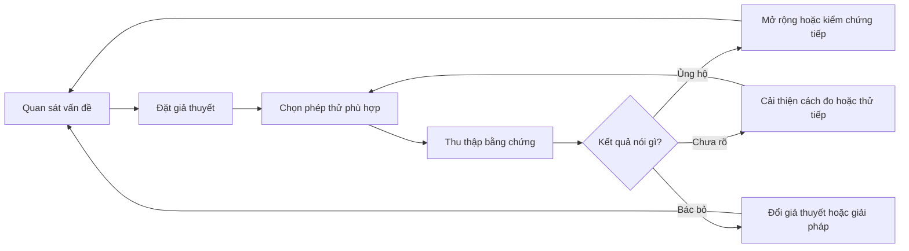
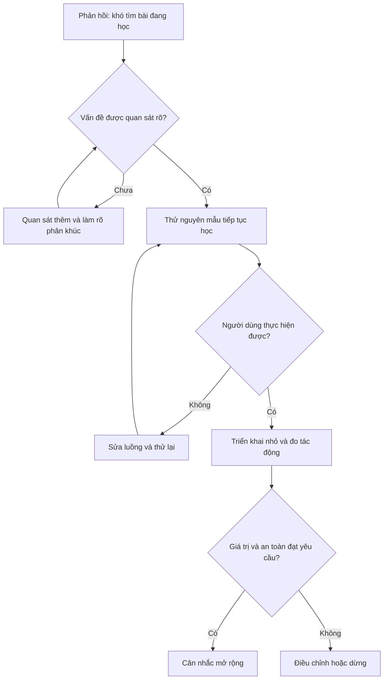

# Đặt giả thuyết trước khi triển khai giải pháp

## Mục tiêu bài học

Sau bài học này, bạn có thể:

- Phân biệt **sự kiện quan sát được**, **vấn đề**, **giả định**, **giả thuyết có thể kiểm chứng** và **giải pháp đề xuất**.
- Viết giả thuyết đủ cụ thể về đối tượng, thay đổi dự kiến, cơ chế tác động, tín hiệu đo lường và điều kiện để chấp nhận hoặc bác bỏ.
- Chọn cách thử nghiệm nhỏ, an toàn và phù hợp với mức độ bất định trước khi đầu tư phát triển toàn bộ tính năng.
- Đọc kết quả một cách thận trọng, điều chỉnh product backlog và ghi lại quyết định dựa trên bằng chứng.
- Liên hệ tư duy thực nghiệm với Agile, user story, Scrum, Kanban, XP và các chỉ số phản ánh giá trị thực tế.

## 1. Vì sao cần có giả thuyết trước khi viết giải pháp?

Phát triển phần mềm thường bắt đầu khi đội ngũ **chưa biết chắc** người dùng gặp vấn đề gì, giải pháp nào có tác dụng và điều kiện kỹ thuật nào có thể cản trở. Một yêu cầu nghe hợp lý chưa chắc giải quyết được vấn đề lớn; một tính năng được hoàn thiện đúng đặc tả cũng chưa chắc tạo ra giá trị.

Chẳng hạn, nhóm phát triển nền tảng học tập nhận đề xuất: “Hãy xây hệ thống gợi ý khóa học bằng AI để học viên học thường xuyên hơn”. Đề xuất này chứa ít nhất ba điều chưa được xác minh:

1. Học viên thực sự học không thường xuyên vì **khó tìm khóa học phù hợp**.
2. Gợi ý cá nhân hóa giúp họ **quay lại học và hoàn thành bài** nhiều hơn một cách tìm kiếm hoặc sắp xếp khóa học đơn giản.
3. Đội ngũ có **dữ liệu, kỹ thuật và chi phí vận hành** phù hợp để tạo gợi ý đáng tin cậy.

Nếu xây ngay toàn bộ hệ thống, đội ngũ có thể mất nhiều tuần rồi mới biết vấn đề gốc là thời gian học bị gián đoạn, chứ không phải khâu khám phá khóa học. Cách tiếp cận thực nghiệm bắt đầu bằng câu hỏi: **“Chúng ta đang tin điều gì là đúng, và bằng chứng nào có thể khiến chúng ta thay đổi suy nghĩ?”**

### Liên hệ với Agile

Agile ưu tiên **phần mềm hoạt động được, cộng tác với khách hàng và thích ứng khi nhận thông tin mới**. Để thực hiện các giá trị ấy, nhóm cần một vòng học hỏi: đưa ra giả thuyết, tạo cách kiểm chứng, quan sát kết quả rồi điều chỉnh quyết định.



Đây là một **mô hình học hỏi** hữu ích cho phát triển phần mềm thích ứng. Không phải mọi quyết định đều cần thí nghiệm A/B, cũng không phải mọi nhóm đều phải dùng cùng biểu mẫu. Điều quan trọng là làm rõ phần nào đang là kiến thức đáng tin cậy, phần nào mới là suy đoán và cần bằng chứng nào trước khi mở rộng đầu tư.

## 2. Phân biệt quan sát, giả định, giả thuyết và giải pháp

Những khái niệm này dễ bị trộn lẫn trong cuộc họp lập kế hoạch.

| Thành phần | Câu hỏi trọng tâm | Ví dụ trong nền tảng học trực tuyến |
| --- | --- | --- |
| **Quan sát** | Chúng ta đã thấy hoặc đo được điều gì? | Trong dữ liệu của tháng trước, nhiều học viên mở ứng dụng rồi rời đi mà không vào bài học. |
| **Vấn đề cần hiểu** | Kết quả nào chưa đạt, ai bị ảnh hưởng và ở tình huống nào? | Học viên quay lại khó bắt đầu học tiếp, dẫn đến thời gian học bị gián đoạn. |
| **Giả định** | Ta đang tin điều gì nhưng chưa có đủ bằng chứng? | Học viên rời đi chủ yếu vì không nhớ bài đang học dở nằm ở đâu. |
| **Giả thuyết** | Nếu can thiệp một cách nhất định, ta dự kiến điều gì thay đổi và đo ra sao? | Nếu có lối vào bài học đang dở trên trang chủ, tỷ lệ quay lại được bài trong 2 phút sẽ tăng ở nhóm học viên đủ điều kiện. |
| **Giải pháp đề xuất** | Ta dự định tạo hoặc thay đổi thứ gì? | Thêm nút “Tiếp tục học” liên kết đến bài đang dở gần nhất. |
| **Bằng chứng kiểm chứng** | Dữ liệu nào sẽ giúp ta đánh giá giả thuyết? | Quan sát thao tác, thời gian vào bài, tỷ lệ tiếp tục học, lỗi điều hướng sau khi thử nghiệm. |

Một **giả định** có thể đúng hoặc sai nhưng thường chưa chỉ rõ phép đo. Một **giả thuyết** biến giả định thành nhận định cụ thể có thể đem ra đối chiếu với bằng chứng. Còn **giải pháp** là một lựa chọn hành động, không phải sự thật cần tin tuyệt đối.

### Cạm bẫy: đặt tên tính năng thành giả thuyết

Những câu dưới đây chưa đủ tốt:

> “Chúng tôi tin rằng cần làm chatbot AI.”

> “Giả thuyết của chúng tôi là người dùng sẽ thích giao diện mới.”

Câu thứ nhất chỉ mô tả giải pháp. Câu thứ hai chưa nói rõ **ai**, **thích theo nghĩa nào**, **cách đo**, **điều kiện thử nghiệm** và **kết quả nào sẽ làm nhóm đổi quyết định**. Một bản phát hành được nhiều người nhấn vào cũng chưa chứng minh được nó làm người dùng hoàn thành công việc tốt hơn.

Thay vào đó, hãy đặt vấn đề dưới dạng kết quả:

> “Với học viên đã ghi danh nhưng chưa hoàn thành khóa, nếu hiển thị bài học đang dở ngay tại trang chủ, chúng tôi dự đoán tỷ lệ truy cập lại bài đó trong vòng 2 phút kể từ lúc mở ứng dụng sẽ tăng, bởi họ không còn phải tìm thủ công trong danh mục khóa học.”

Câu này đã chỉ ra **đối tượng, can thiệp, kết quả dự kiến và cơ chế tác động**. Để có kế hoạch kiểm chứng hoàn chỉnh, vẫn cần bổ sung cách đo, đường cơ sở, thời gian, mức thay đổi có ý nghĩa và các giới hạn an toàn.

## 3. Công thức viết một giả thuyết có thể kiểm chứng

Một mẫu thực dụng cho sản phẩm phần mềm là:

> **Chúng tôi tin rằng** [đối tượng trong bối cảnh cụ thể] đang gặp [vấn đề]. **Nếu** [thay đổi hoặc cách tiếp cận], **thì** [kết quả quan sát hoặc đo được] sẽ [xu hướng/mức thay đổi] **vì** [cơ chế dự kiến]. Chúng tôi sẽ kiểm chứng qua [phương pháp, nhóm thử, khoảng thời gian]; kết quả đủ để [tiếp tục/điều chỉnh/dừng] là [tiêu chí quyết định], với điều kiện [rào chắn chất lượng hoặc an toàn].

Mẫu này có thể rút gọn khi quyết định ít rủi ro. Đối với khoản đầu tư lớn hoặc thay đổi ảnh hưởng nhiều người dùng, nên làm rõ các thành phần sau.

| Thành phần | Ý nghĩa | Câu hỏi cần trả lời |
| --- | --- | --- |
| **Đối tượng** | Nhóm người dùng hoặc hệ thống chịu tác động | Ai? Họ có cùng nhu cầu và điều kiện sử dụng không? |
| **Vấn đề** | Kết quả hiện tại chưa tốt | Vấn đề được quan sát trong hoàn cảnh nào? |
| **Can thiệp** | Thay đổi có thể thử nghiệm | Ta định thay đổi một yếu tố hay quá nhiều yếu tố cùng lúc? |
| **Cơ chế** | Lý do kỳ vọng thay đổi tạo ra kết quả | Vì sao can thiệp này có thể giải quyết vấn đề? |
| **Kết quả mong đợi** | Hành vi hoặc kết quả có ý nghĩa với người dùng | Người dùng sẽ làm điều gì tốt hơn? |
| **Thước đo và đường cơ sở** | Cách quan sát thay đổi so với hiện trạng | Tử số, mẫu số, mốc bắt đầu/kết thúc được định nghĩa thế nào? |
| **Ngưỡng ra quyết định** | Mức kết quả đáng để tiếp tục đầu tư | Cải thiện bao nhiêu là có ý nghĩa về sản phẩm hoặc vận hành? |
| **Giới hạn an toàn** | Điều không được đánh đổi | Có làm tăng lỗi, độ trễ, chi phí hoặc rủi ro dữ liệu không? |

### Những tiêu chí của giả thuyết tốt

**Có thể bác bỏ:** cần tồn tại kết quả quan sát được khiến nhóm thừa nhận giả thuyết chưa đúng. Câu “giao diện đẹp sẽ tốt hơn” khó bác bỏ; “người dùng hoàn thành thao tác đăng ký nhanh hơn mà tỷ lệ lỗi không tăng” cụ thể hơn.

**Có thể đo hoặc quan sát:** định lượng thường hữu ích, nhưng bằng chứng định tính từ phỏng vấn hay quan sát thao tác cũng có giá trị, đặc biệt khi đang khám phá vấn đề. Đừng ép mọi câu hỏi vào một con số nếu chưa có định nghĩa hợp lý.

**Tập trung:** nếu đồng thời sửa chức năng tìm kiếm, cấu trúc danh mục, thông báo và giao diện trang chủ, nhóm khó biết yếu tố nào tạo ra kết quả. Khi không thể tách riêng, cần thừa nhận giới hạn đó khi diễn giải.

**Có quan hệ với mục tiêu sản phẩm:** nhấp chuột vào nút mới là tín hiệu sử dụng chức năng; người học thực sự quay lại bài học và duy trì tiến độ mới gần với giá trị mong muốn hơn.

**Có thời điểm xem lại:** một kết luận không gắn với kỳ quan sát hoặc điều kiện đủ dữ liệu dễ trở thành lời hứa “sẽ đo sau”.

### Ví dụ sửa một giả thuyết mơ hồ

| Mức độ | Cách phát biểu | Hạn chế hoặc cải thiện |
| --- | --- | --- |
| Chưa đạt | “Làm dashboard mới để giảng viên hài lòng hơn.” | Chỉ nói giải pháp và cảm nhận mơ hồ. |
| Khá hơn | “Nếu thêm tổng hợp tiến độ lớp học, giảng viên sẽ dành ít thời gian kiểm tra kết quả học viên hơn.” | Nêu đối tượng, can thiệp và kết quả nhưng chưa có phương pháp đo. |
| Có thể thử | “Với giảng viên phụ trách từ 30 học viên, bảng tổng hợp tiến độ có thể giảm thời gian xác định những học viên cần hỗ trợ so với quy trình hiện tại. Chúng tôi sẽ cho giảng viên hoàn thành cùng bộ tác vụ trên nguyên mẫu và giao diện cũ, đo thời gian, độ chính xác và hỏi về điểm chưa rõ.” | Nêu được đối tượng, so sánh, tác vụ và bằng chứng; ngưỡng quyết định có thể bổ sung trước phép thử. |

## 4. Tìm giả định rủi ro nhất trước khi chọn phép thử

Không phải mọi giả định đều đáng kiểm chứng ngay. Nếu một giả định sai có thể khiến toàn bộ giải pháp thất bại, nhóm nên học về nó sớm, trước khi xây phần tốn kém hoặc khó đảo ngược.

Một cách phân nhóm hữu ích:

| Loại giả định | Câu hỏi | Ví dụ | Phép thử nhỏ có thể dùng |
| --- | --- | --- | --- |
| **Nhu cầu / giá trị (desirability)** | Người dùng thực sự có vấn đề này và có muốn giải quyết không? | Học viên khó tìm bài đang học dở hay chỉ ít thời gian học? | Phỏng vấn dựa trên hành vi gần đây, quan sát tác vụ, phân tích hành trình người dùng. |
| **Khả năng sử dụng (usability)** | Người dùng có hiểu và dùng được giải pháp không? | Họ có nhận ra nút “Tiếp tục học” và hiểu nó dẫn tới đâu? | Nguyên mẫu tương tác, thử nghiệm sử dụng với tác vụ cụ thể. |
| **Khả thi kỹ thuật (feasibility)** | Hệ thống và đội ngũ có thực hiện được không? | Có thể đồng bộ vị trí học giữa thiết bị mà không nhầm khóa? | Proof of concept, technical spike có giới hạn thời gian, kiểm thử tải và tích hợp. |
| **Hiệu quả kinh doanh (viability)** | Giá trị thu được có xứng chi phí và phù hợp định hướng không? | Chi phí vận hành cá nhân hóa có phù hợp quy mô học viên? | Ước lượng chi phí, thử nghiệm giá trị, phân tích tỷ lệ sử dụng và hiệu quả đầu tư. |
| **Pháp lý, đạo đức, vận hành** | Giải pháp có thể triển khai an toàn và đúng trách nhiệm không? | Dữ liệu học tập có bị sử dụng ngoài phạm vi đã cho phép? | Rà soát quyền truy cập, dữ liệu, rủi ro và thử trên môi trường kiểm soát. |

Ví dụ: nếu chưa biết **học viên có cần tính năng cá nhân hóa hay không**, kiểm chứng mô hình AI chính xác hơn có thể là giải đúng bài toán sai. Ngược lại, nếu nhu cầu đã rõ nhưng việc lưu vị trí học có rủi ro mất dữ liệu, một technical spike có thể quan trọng hơn phỏng vấn thêm nhiều người.

Có thể ưu tiên giả định theo hai chiều **mức độ ảnh hưởng nếu sai** và **mức độ thiếu bằng chứng**. Với thay đổi khó đảo ngược, thêm chiều **chi phí hoặc rủi ro triển khai**. Không cần biến mọi đánh giá thành phép tính điểm số tuyệt đối: mục đích của khung là làm rõ lý do nên kiểm chứng điều gì trước.

## 5. Quy trình thực hành: từ vấn đề đến quyết định dựa trên bằng chứng

### Bước 1 — Bắt đầu từ kết quả cần cải thiện

Diễn đạt mục tiêu ở mức giá trị người dùng hoặc doanh nghiệp, chẳng hạn “học viên dễ tiếp tục khóa đang học” hoặc “giảng viên phát hiện học viên cần hỗ trợ kịp thời”. Tránh định nghĩa mục tiêu ban đầu là “phải xây chatbot” hoặc “phải phát hành 20 user story”.

Kiểm tra dữ liệu hiện có, quan sát thao tác và trò chuyện với người liên quan để hiểu **ai gặp vấn đề, khi nào, mức độ nghiêm trọng ra sao**. Ghi lại phần đã quan sát được và phần vẫn chỉ là giả định.

### Bước 2 — Liệt kê giả định và chọn điều quan trọng nhất

Tạo một danh sách ngắn những điều cần phải đúng để giải pháp có giá trị. Hỏi: “Nếu điều nào trong đây sai, chúng ta sẽ không nên tiếp tục cách làm hiện tại?” Ưu tiên các giả định vừa có tác động lớn vừa thiếu bằng chứng.

Một nhóm có thể đồng thời có các giả định về nhu cầu, kỹ thuật và mô hình kinh doanh. Hãy chọn **phép thử phù hợp với từng câu hỏi**, thay vì mặc định tất cả đều phải viết mã.

### Bước 3 — Viết giả thuyết và tiêu chí ra quyết định trước khi thử

Xác định nhóm người dùng, can thiệp, kết quả dự kiến, cách đo, khoảng thời gian và các giới hạn chất lượng. Nếu đặt ngưỡng như “cải thiện ít nhất 10 điểm phần trăm”, hãy giải thích **vì sao mức đó có ý nghĩa** dựa trên chi phí đầu tư, tác động người dùng hoặc mục tiêu sản phẩm. Không được coi một ngưỡng tự chọn là bằng chứng thống kê.

Quan trọng hơn, thống nhất từ trước việc nhóm sẽ **tiếp tục**, **điều chỉnh**, **dừng** hoặc **thu thập thêm dữ liệu** trong điều kiện nào. Việc này giảm xu hướng chỉ chọn những con số có lợi sau khi đã phát hành.

### Bước 4 — Chọn phép thử nhỏ nhất có thể trả lời câu hỏi

| Câu hỏi đang cần trả lời | Phép thử gợi ý | Kết quả có thể học | Giới hạn cần nhớ |
| --- | --- | --- | --- |
| Người dùng có gặp vấn đề thật không? | Phỏng vấn theo tình huống gần đây; quan sát cách họ làm việc hiện tại. | Biết bối cảnh, tần suất và hậu quả của vấn đề. | Lời nói về ý định tương lai không đồng nghĩa hành vi thực tế. |
| Người dùng có hiểu cách dùng giải pháp không? | Nguyên mẫu giấy hoặc nguyên mẫu tương tác; tác vụ usability. | Thấy nơi người dùng mắc kẹt và cách họ hiểu giao diện. | Nguyên mẫu chưa chứng minh lợi ích dài hạn. |
| Một quy tắc hoặc công nghệ có khả thi không? | Technical spike, proof of concept, benchmark trên dữ liệu đại diện. | Biết giới hạn tích hợp, độ trễ, chi phí, độ chính xác. | Một bản mẫu chạy được chưa bảo đảm sẵn sàng vận hành thật. |
| Thay đổi có cải thiện hành vi không? | Phát hành giới hạn, thử nghiệm so sánh hoặc A/B nếu đủ điều kiện. | Đo thay đổi trong hành vi và các tác động phụ. | Cần thiết kế đối chứng phù hợp, đủ dữ liệu và kiểm soát yếu tố nhiễu. |
| Hành vi có duy trì theo thời gian không? | Theo dõi nhóm người dùng theo kỳ, phỏng vấn bổ sung. | Thấy tác dụng lâu dài, tỷ lệ quay lại và sự thay đổi thói quen. | Thời gian quan sát ngắn có thể bỏ sót tác động trễ. |

**Phép thử nhỏ nhất** không nhất thiết là một phiên bản tính năng chạy trong môi trường thật. Khi chưa hiểu nhu cầu, năm buổi quan sát có mục tiêu có thể trả lời đúng câu hỏi hơn nhiều ngày lập trình. Nhưng số buổi quan sát ít chỉ giúp phát hiện vấn đề ban đầu, **không đủ để ước lượng chính xác tỷ lệ gặp vấn đề của toàn bộ người dùng**.

### Bước 5 — Chuẩn bị phép đo và bảo vệ người tham gia

Trước khi thu thập dữ liệu, định nghĩa rõ sự kiện và mẫu số. Ví dụ “tỷ lệ tiếp tục học” phải nêu ai được tính là học viên đủ điều kiện, mốc bắt đầu tính thời gian, hành vi nào được xem là tiếp tục học thành công và loại trừ những trường hợp nào.

Chỉ thu thập dữ liệu cần thiết, giới hạn quyền truy cập, xử lý thông tin cá nhân theo quy định và chính sách áp dụng. Không nên thử nghiệm rủi ro cao trực tiếp trên người dùng nếu chưa có cơ chế bảo vệ, giám sát và khôi phục.

### Bước 6 — Thực hiện, kiểm tra dữ liệu và diễn giải

Trong lúc thử, cần bảo đảm hệ thống ghi nhận đúng sự kiện. Kiểm tra các lỗi như ghi trùng sự kiện, mất dữ liệu khi mất mạng, nhóm người dùng khác nhau về đặc điểm quan trọng, hoặc một chiến dịch truyền thông chạy cùng thời gian khiến hành vi đổi.

Phân biệt **quan sát thấy hai đại lượng đi cùng nhau** với **kết luận một thay đổi gây ra kết quả**. Nếu chỉ so sánh tuần trước và tuần sau, những sự kiện bên ngoài có thể giải thích sự khác biệt. Để ước lượng tác động nhân quả tốt hơn, có thể dùng nhóm đối chứng hoặc phân bổ ngẫu nhiên khi phù hợp và đủ điều kiện.

### Bước 7 — Ra quyết định và cập nhật backlog

Sau thử nghiệm, ghi lại:

- Giả thuyết ban đầu và bằng chứng đã có trước khi thử.
- Phép thử thực sự đã làm, ai tham gia, dữ liệu nào được thu thập và giới hạn của dữ liệu.
- Điều quan sát được, điều chưa chắc chắn và rủi ro phát sinh.
- Quyết định tiếp tục, mở rộng, điều chỉnh, quay lại khám phá vấn đề hoặc dừng.
- Các hạng mục cần thêm, sửa, giảm phạm vi hoặc hủy trong **product backlog**; thời điểm kiểm tra lại.

Một phép thử cho kết quả không như dự đoán vẫn có ích nếu giúp nhóm **tránh khoản đầu tư sai** hoặc hiểu vấn đề tốt hơn. Giá trị của thực nghiệm nằm ở **chất lượng của quyết định sau đó**, không nằm ở tỷ lệ giả thuyết được “chứng minh đúng”.

## 6. Ví dụ đầy đủ: có nên thêm nút “Tiếp tục học”?

Giả sử nhóm phát triển nền tảng học trực tuyến nhận thấy nhiều học viên mở ứng dụng nhưng không quay lại bài học đang dở. Nhóm dự định bổ sung nút **“Tiếp tục học”** trên trang chủ. Thay vì xem đề xuất là chắc chắn đúng, nhóm viết kế hoạch kiểm chứng.

### 6.1. Từ dữ liệu đến giả thuyết

| Thành phần | Nội dung minh họa |
| --- | --- |
| **Mục tiêu sản phẩm** | Học viên dễ quay lại nội dung đang học, góp phần cải thiện tiến độ học tập. |
| **Quan sát** | Một số học viên quay lại ứng dụng rồi mất thời gian tìm bài học trước đó. |
| **Giả định có rủi ro** | Khó tìm bài đang dở là nguyên nhân đáng kể khiến họ rời ứng dụng. |
| **Giả thuyết** | Nếu hiển thị lối vào bài học đang dở trên trang chủ cho học viên đủ điều kiện, tỷ lệ truy cập thành công bài đó trong 2 phút sau khi mở ứng dụng sẽ tăng vì không cần đi qua nhiều màn hình. |
| **Đối tượng đủ điều kiện** | Học viên đã đăng nhập, có ít nhất một bài học đã bắt đầu nhưng chưa hoàn thành và quay lại ứng dụng sau một khoảng nghỉ được xác định trước. |
| **Chỉ số chính** | Số phiên đủ điều kiện truy cập thành công bài đang dở trong vòng 2 phút / tổng số phiên đủ điều kiện. |
| **Tín hiệu phụ** | Thời gian trung vị đến khi tiếp tục bài; tỷ lệ học tiếp sau 5 phút; phản hồi về khả năng tìm bài. |
| **Rào chắn** | Không làm tăng lỗi điều hướng, truy cập sai khóa, mất tiến độ hoặc độ trễ trang chủ vượt mức chấp nhận được. |

**Để minh họa cách ra quyết định**, giả sử đường cơ sở trước đó khoảng **30%** và nhóm coi mức **45%** là một mức cải thiện có ý nghĩa về sản phẩm để cân nhắc đầu tư tiếp. Đây là các **con số giả định**, không phải dữ liệu được đo từ một nền tảng thật hoặc ngưỡng thống kê có giá trị chung.

### 6.2. Chọn phép thử theo thứ tự chi phí và rủi ro

**Phép thử 1 — Xác minh vấn đề:** mời một số học viên phù hợp thực hiện tác vụ “mở lại bài đang học dở” trên giao diện hiện tại. Quan sát họ đi qua những màn hình nào, họ tìm sai ở đâu và hỏi về lần gặp khó khăn gần đây. Nếu đa số người được quan sát không gặp vấn đề tìm bài, nhóm cần xem lại giả định hoặc chọn đúng phân khúc hơn.

**Phép thử 2 — Kiểm tra cách dùng:** tạo nguyên mẫu trang chủ có nút “Tiếp tục học”. Yêu cầu người tham gia tiếp tục bài từ trạng thái ứng dụng vừa mở; xem họ có nhận ra nút, có hiểu bài được chọn và có lo về quyền truy cập sai khóa không.

**Phép thử 3 — Kiểm tra tác động khi có sản phẩm chạy được:** nếu hai bước đầu ủng hộ hướng tiếp cận và rủi ro kỹ thuật chấp nhận được, nhóm triển khai lát cắt nhỏ, có kiểm thử hồi quy và ghi nhận sự kiện. Nếu đủ lưu lượng và các điều kiện thử nghiệm được đáp ứng, có thể so sánh nhóm được hiển thị nút với nhóm đối chứng thông qua phân bổ ngẫu nhiên. Nếu không đủ điều kiện A/B, có thể phát hành giới hạn rồi đánh giá với sự thận trọng về yếu tố nhiễu.



### 6.3. Định nghĩa đo lường để không tự đánh lừa

Một bản mô tả sự kiện ngắn gọn có thể như sau:

```text
event: learning_session_opened
  session_id: ID ngẫu nhiên của phiên
  learner_id: ID giả danh hoặc khóa định danh được phép sử dụng
  opened_at: Thời điểm mở phiên
  eligible_for_resume: Học viên có bài đang dở theo quy tắc đã chốt?

event: unfinished_lesson_opened
  session_id: Liên kết với phiên mở ứng dụng
  elapsed_ms: Thời gian từ mở ứng dụng đến mở đúng bài đang dở
  entry_point: Trang chủ / danh sách khóa / vị trí khác

event: resume_navigation_failed
  session_id: Liên kết với phiên mở ứng dụng
  failure_category: Không đủ quyền / không tìm thấy tiến độ / lỗi hệ thống
```

Đây là **phác thảo thiết kế đo lường**, không phải một schema bắt buộc. Chỉ ghi những thuộc tính thực sự cần thiết, tránh thu thập nội dung học tập nhạy cảm hoặc thông tin cá nhân ngoài mục đích. Dữ liệu đã ẩn danh/giả danh vẫn cần biện pháp quản trị phù hợp với khả năng liên kết trở lại người dùng.

Nếu nhóm chỉ đếm lượt nhấn “Tiếp tục học”, chỉ số có thể tăng đơn giản vì nút được đặt nổi bật, trong khi người học chưa chắc tìm đúng bài hoặc học tiếp. Cần kết hợp **sự kiện thành công** với tín hiệu chất lượng và kết quả tiếp theo.

### 6.4. Đọc kết quả và quyết định

| Kết quả minh họa | Cách diễn giải phù hợp | Quyết định khả dĩ |
| --- | --- | --- |
| Tỷ lệ tiếp tục học tăng rõ, chất lượng ổn định và dữ liệu đủ tin cậy. | Có bằng chứng ủng hộ giả thuyết trong phạm vi đã thử. | Cân nhắc mở rộng theo kế hoạch, tiếp tục theo dõi tác dụng lâu dài. |
| Nhiều lượt nhấn nút nhưng tỷ lệ truy cập đúng bài gần như không đổi. | Mức độ sử dụng giao diện tăng nhưng chưa chứng minh cải thiện kết quả chính. | Rà soát luồng điều hướng, logic chọn bài và cách đo. |
| Kết quả chính tăng nhưng phát sinh truy cập sai khóa hoặc mất tiến độ. | Lợi ích tiềm năng đi kèm rủi ro vượt rào chắn. | Dừng mở rộng, xử lý vấn đề an toàn và kiểm thử lại. |
| Chênh lệch nhỏ, số phiên thấp hoặc dữ liệu thiếu nhất quán. | Chưa thể kết luận tin cậy. | Sửa lỗi đo, tăng thời gian quan sát hợp lý hoặc chọn thử nghiệm phù hợp hơn. |
| Phỏng vấn cho thấy vấn đề thật là thiếu thời gian học, không phải tìm bài. | Giả định về cơ chế tác động có thể sai. | Quay lại khám phá vấn đề và xem xét giải pháp khác. |

Không nên nhìn một mức tăng từ 30% lên 45% ở một nhóm bất kỳ rồi mặc định **nút mới gây ra mức tăng ấy**. Cần xem thiết kế phép thử, độ bất định của ước lượng, đặc điểm người tham gia, biến động theo thời gian và tác động bên ngoài. Ngưỡng sản phẩm dùng để ra quyết định và tiêu chuẩn suy luận thống kê là hai khái niệm khác nhau.

## 7. Đưa giả thuyết vào user story, backlog và thực hành Agile

Một **user story** mô tả nhu cầu nhìn từ góc nhìn người dùng, chẳng hạn:

> Là một học viên có bài học đang dở, tôi muốn tiếp tục bài đó từ trang chủ để không phải tìm lại thủ công.

**Tiêu chí chấp nhận** xác định hành vi mà tính năng cần đáp ứng: khi học viên có bài đang dở và đủ quyền truy cập, nút dẫn tới đúng bài; khi không có bài đang dở, nút không xuất hiện hoặc được thay bằng hành động phù hợp.

**Giả thuyết về giá trị** lại hỏi điều khác: *Tính năng này có thực sự làm học viên tiếp tục học nhanh và thường xuyên hơn không?*

| Tài liệu hoặc hoạt động | Nó giúp trả lời điều gì? | Ví dụ |
| --- | --- | --- |
| **Giả thuyết** | Vì sao việc này đáng đầu tư? Ta kỳ vọng điều gì sẽ thay đổi? | Giảm thời gian tìm bài sẽ tăng tỷ lệ tiếp tục học. |
| **User story / Product Backlog Item** | Người dùng cần khả năng gì? | Truy cập bài đang dở từ trang chủ. |
| **Tiêu chí chấp nhận** | Thực hiện đúng yêu cầu ở mức hành vi có nghĩa là gì? | Liên kết đúng bài, xử lý người chưa có tiến độ và người hết quyền. |
| **Definition of Done** | Sản phẩm đã đạt chuẩn hoàn thành chung của nhóm chưa? | Kiểm thử, tích hợp, bảo mật và tài liệu cần thiết đạt yêu cầu. |
| **Kiểm chứng sau phát hành** | Giá trị kỳ vọng có xuất hiện không? | Thay đổi tỷ lệ tiếp tục học, thời gian vào bài, lỗi phát sinh. |

**Một sản phẩm có thể đạt mọi tiêu chí chấp nhận mà giả thuyết về giá trị vẫn sai.** Điều đó không có nghĩa triển khai kém chất lượng; nó có thể cho thấy vấn đề hoặc cơ chế tác động đã được hiểu chưa đúng. Nhóm nên dùng phát hiện ấy để quyết định ưu tiên tiếp theo.

### Scrum: thực nghiệm qua minh bạch, kiểm tra và thích nghi

Scrum dựa trên **empiricism**: quyết định dựa trên điều được quan sát, đồng thời sử dụng **minh bạch, kiểm tra và thích nghi**. Product Owner chịu trách nhiệm tối đa hóa giá trị sản phẩm và quản lý Product Backlog. Developers xây dựng Increment có thể dùng được. Sprint Review là một cơ hội để các bên xem kết quả và trao đổi bước đi tiếp theo.

Đội có thể nối **Product Goal** với kết quả cần đạt, xác định một **Sprint Goal** có ý nghĩa và chọn những hạng mục nhỏ làm tăng hiểu biết hoặc tạo giá trị. Tuy nhiên, **Sprint không bắt buộc phải là một thí nghiệm A/B**, và không nên biến Sprint Review thành nghi thức chỉ trình diễn giao diện mà không xem lại phản hồi hoặc tác động.

Ví dụ: Sprint Goal có thể là “Giúp học viên quay lại khóa đang học thuận tiện hơn”. Sprint Backlog có thể bao gồm một lát cắt giao diện, kiểm thử điều hướng và cơ chế ghi sự kiện. Sau khi Increment được hoàn thành, nhóm còn cần khoảng quan sát phù hợp để đánh giá tác động thật.

### Kanban: giả thuyết cải tiến dòng công việc

Tư duy đặt giả thuyết cũng áp dụng cho **chính quy trình phát triển**, không chỉ tính năng sản phẩm. Ví dụ:

> “Nếu giới hạn số hạng mục đang làm ở bước kiểm thử và ưu tiên giải quyết mục bị chặn trước khi kéo việc mới, chúng tôi kỳ vọng thời gian chờ kiểm thử giảm mà số lỗi lọt sản xuất không tăng.”

Nhóm có thể làm rõ cách đo **WIP**, **cycle time**, **throughput**, thời gian công việc bị chặn và lỗi sau phát hành; quan sát theo những khoảng thời gian đủ phù hợp và xét khác biệt về loại công việc. Đặt giới hạn WIP là **can thiệp**, còn dòng chảy có thực sự cải thiện hay không là **giả thuyết cần đánh giá**.

### XP: kiểm chứng ý tưởng với rủi ro kỹ thuật thấp hơn

Các thực hành như kiểm thử tự động, phát triển hướng kiểm thử (TDD), tích hợp liên tục, tái cấu trúc mã và phát hành nhỏ giúp nhóm thay đổi phần mềm mà vẫn nhận phản hồi kỹ thuật nhanh. Chúng không tự chứng minh một tính năng có giá trị với khách hàng, nhưng làm **chi phí thử nghiệm và sửa sai** dễ kiểm soát hơn.

Ví dụ: khi thử nút “Tiếp tục học”, nhóm nên có kiểm thử cho quyền truy cập, trường hợp mất tiến độ và chọn sai khóa. Nếu kết quả sản phẩm khiến nhóm quyết định sửa thiết kế, các kiểm thử đó giúp bảo vệ hành vi quan trọng trong lần triển khai tiếp theo.

## 8. Đọc dữ liệu thực nghiệm một cách có trách nhiệm

### 8.1. Phân biệt chỉ số đầu ra, kết quả và tác động

| Cấp độ | Ví dụ | Điều chỉ số chưa chứng minh được |
| --- | --- | --- |
| **Đầu ra (output)** | Đã phát hành nút “Tiếp tục học”. | Chưa biết người dùng dùng được hay không. |
| **Mức sử dụng (adoption)** | Có bao nhiêu học viên nhấn nút. | Chưa biết nút có giúp họ học tốt hơn không. |
| **Kết quả hành vi (outcome)** | Tỷ lệ tiếp tục đúng bài trong 2 phút tăng. | Chưa chứng minh tác động dài hạn tới việc hoàn thành khóa. |
| **Tác động dài hạn (impact)** | Tỷ lệ hoàn thành khóa, mức duy trì học tập cải thiện. | Cần thêm thời gian và xem xét các yếu tố ngoài tính năng. |

Thước đo nên **gần với giả thuyết**, nhưng đừng đánh mất mục tiêu cuối cùng. Nếu một chỉ số trung gian cải thiện trong khi trải nghiệm thực tế xấu đi, nhóm cần điều tra trước khi mở rộng.

### 8.2. Đường cơ sở, nhóm so sánh và độ bất định

Trước phép thử, xem tỷ lệ hiện tại biến động thế nào theo tuần, thiết bị, nhóm học viên và mùa học. Nếu không có đường cơ sở, nhóm khó đánh giá cải thiện. Nếu không có nhóm so sánh phù hợp, nhóm cần thận trọng khi gán nguyên nhân cho một thay đổi.

Thử nghiệm A/B với phân bổ ngẫu nhiên có thể giúp đánh giá tác động nhân quả, nhưng **chỉ khi được thiết kế đúng**: xác định đơn vị phân bổ, tránh một người thấy nhiều phiên bản gây nhiễu, dự kiến cỡ mẫu và độ nhạy cần thiết, kiểm soát việc nhìn kết quả quá sớm và báo cáo độ bất định của ước lượng. Một kết quả không đạt ngưỡng ý nghĩa thống kê **không phải bằng chứng rằng tác động bằng không**; cũng không nên chọn riêng phân khúc hoặc thời điểm đẹp nhất sau khi thấy dữ liệu rồi trình bày như kết luận chắc chắn.

Không có đủ người tham gia để A/B vẫn có thể học hỏi qua quan sát, nguyên mẫu, phỏng vấn hoặc phát hành giới hạn. Chỉ cần **ghi rõ phép thử đó trả lời được câu hỏi nào và không trả lời được câu hỏi nào**.

### 8.3. Chất lượng và an toàn là rào chắn

Một cải thiện ngắn hạn không đáng để đánh đổi dữ liệu, quyền riêng tư hoặc trải nghiệm của người dùng. Hãy đặt trước tiêu chí dừng hoặc quay lui khi có lỗi nghiêm trọng, sai quyền truy cập, suy giảm hiệu năng, chi phí bất thường hay phản hồi có hại. Với thay đổi liên quan thanh toán, sức khỏe, an toàn, dữ liệu nhạy cảm hoặc pháp luật, cần tuân thủ cơ chế kiểm soát tương ứng; không lấy lý do “thử nghiệm” để bỏ qua các nghĩa vụ này.

## 9. Những sai lầm thường gặp khi đặt giả thuyết

| Sai lầm | Vì sao nguy hiểm | Cách sửa |
| --- | --- | --- |
| **Viết giải pháp dưới nhãn giả thuyết** | Nhóm mặc định phải xây tính năng trước khi hiểu vấn đề. | Viết rõ người dùng, vấn đề, cơ chế tác động và kết quả kỳ vọng. |
| **Chỉ chọn chỉ số dễ tăng** | Nút được nhấn nhiều nhưng mục tiêu sử dụng không cải thiện. | Gắn chỉ số chính với hành vi có giá trị, thêm chỉ số chất lượng. |
| **Chọn ngưỡng thành công sau khi xem kết quả** | Dễ tự thuyết phục rằng phép thử “đã thắng”. | Đặt tiêu chí quyết định và cách đo trước khi thử; ghi lại mọi điều chỉnh. |
| **Đo không có mẫu số rõ ràng** | Chỉ số không so sánh được giữa các kỳ hoặc phân khúc. | Định nghĩa đối tượng đủ điều kiện, mốc thời gian và sự kiện thành công. |
| **Gộp quá nhiều thay đổi trong một phép thử** | Khó biết yếu tố nào tạo ra kết quả. | Giảm số biến can thiệp hoặc thừa nhận giới hạn suy luận. |
| **Lấy lời hứa của người dùng làm hành vi chắc chắn** | Ý định được tự thuật có thể khác việc họ thực hiện. | Quan sát tác vụ hoặc hành vi thực tế khi an toàn, phù hợp. |
| **Chỉ đòi dữ liệu định lượng** | Có thể bỏ qua nguyên nhân và bối cảnh phía sau con số. | Kết hợp phân tích dữ liệu, quan sát và phỏng vấn. |
| **Thấy số tăng rồi kết luận có quan hệ nhân quả** | Chiến dịch, mùa vụ hoặc thay đổi tệp người dùng có thể gây nhiễu. | Dùng thiết kế so sánh tốt hơn; trình bày độ bất định. |
| **Thất bại thì bỏ qua kết quả** | Nhóm lặp lại sai lầm và tiếp tục đầu tư theo cảm tính. | Ghi lại điều đã học và cập nhật ưu tiên hoặc giả thuyết mới. |
| **Thử nghiệm bất chấp rủi ro** | Có thể gây tổn hại người dùng và mất niềm tin. | Định nghĩa rào chắn, phê duyệt cần thiết và phương án dừng/khôi phục. |

## 10. Mẫu thực hành có thể áp dụng ngay

Sử dụng mẫu ngắn này khi một bên đề xuất tính năng mới hoặc một cải tiến quy trình:

```text
TÊN GIẢ THUYẾT:
Mục tiêu sản phẩm / quy trình:
Quan sát và bằng chứng hiện có:
Đối tượng và bối cảnh:
Vấn đề cần giải quyết:
Giả định rủi ro nhất:

NẾU [can thiệp hoặc thay đổi]
THÌ [hành vi / kết quả kỳ vọng]
VÌ [cơ chế giải thích]

Phép thử nhỏ nhất có thể trả lời câu hỏi:
Đường cơ sở (nếu có):
Chỉ số / bằng chứng chính và cách định nghĩa:
Chỉ số phụ / rào chắn an toàn:
Khoảng thời gian và đối tượng thử:
Tiêu chí để tiếp tục / điều chỉnh / dừng:
Giới hạn suy luận và yếu tố gây nhiễu cần theo dõi:
Người chịu trách nhiệm quyết định:

KẾT QUẢ SAU THỬ:
Điều quan sát được:
Điều chưa chắc chắn:
Quyết định và lý do:
Thay đổi trong backlog / bước kế tiếp:
```

Mẫu này nhằm hỗ trợ cuộc trao đổi và ghi lại kiến thức đã học. Nó **không thay thế** yêu cầu kiểm thử, tiêu chí chấp nhận, quản trị rủi ro hay các nghĩa vụ phê duyệt đặc thù của tổ chức.

## 11. Bài tập tự luyện

### Tình huống A — Giảm tỷ lệ bỏ dở đăng ký khóa học

Đội sản phẩm nhận đề xuất “thêm chatbot để trả lời mọi câu hỏi trước khi ghi danh”. Dữ liệu cho thấy nhiều người truy cập trang chi tiết khóa nhưng không ghi danh; nhóm chưa biết nguyên nhân.

**Yêu cầu:**

1. Viết ít nhất ba giả định có thể giải thích hành vi bỏ dở (ví dụ: thiếu thông tin học phí, yêu cầu kiến thức đầu vào khó hiểu, quy trình thanh toán phức tạp).
2. Chọn một giả định có tác động lớn và thiếu bằng chứng, rồi viết một giả thuyết theo cấu trúc **Nếu – Thì – Vì**.
3. Chọn một phép thử có chi phí thấp trước khi xây chatbot và nêu dữ liệu cần thu thập.
4. Đặt một chỉ số giá trị và một rào chắn an toàn; cho biết điều kiện nào khiến bạn đổi hướng.

**Gợi ý:** quan sát người học hoàn thành tác vụ ghi danh và phỏng vấn về lần họ dừng gần đây. Nếu nguyên nhân chính là thông tin học phí khó tìm, thử trình bày học phí rõ hơn có thể hợp lý hơn xây chatbot. Khi đo tỷ lệ ghi danh, cần kiểm tra cả lỗi thanh toán và phản hồi người dùng, không chỉ lượt nhấp vào nút đăng ký.

### Tình huống B — Cải tiến luồng công việc của đội phát triển

Một đội Kanban thấy nhiều hạng mục dồn ở bước kiểm thử. Đề xuất là “tăng số việc lập trình đồng thời để làm nhanh hơn”.

**Yêu cầu:** viết một giả thuyết thay thế liên quan tới **giảm WIP hoặc xử lý công việc bị chặn**, chỉ rõ thước đo trước/sau, thời gian quan sát và điều kiện để không gây suy giảm chất lượng.

**Gợi ý:** nếu giới hạn việc mới được kéo vào khi cột kiểm thử đã đầy và cùng hỗ trợ hoàn tất hạng mục đang chờ, nhóm có thể giảm thời gian chờ kiểm thử. Hãy theo dõi cycle time, tuổi hạng mục đang làm, throughput, lỗi lọt ra sản phẩm và lưu ý chênh lệch về loại công việc giữa các kỳ.

### Câu hỏi tự kiểm tra

- Vì sao một user story hoàn thành đúng yêu cầu vẫn có thể không xác nhận giả thuyết về giá trị?
- Khi nào nên phỏng vấn, khi nào dùng nguyên mẫu, khi nào cần technical spike hoặc A/B?
- Sự khác nhau giữa ngưỡng cải thiện có ý nghĩa kinh doanh và bằng chứng thống kê là gì?
- Nếu số liệu sau thử nghiệm không rõ ràng, nhóm nên làm gì trước khi mở rộng phát hành?
- Làm thế nào để giữ tinh thần thích ứng nhưng không đánh đổi bảo mật, chất lượng và trách nhiệm với người dùng?

## 12. Ghi nhớ cốt lõi

**Đặt giả thuyết trước khi triển khai giải pháp** giúp đội phát triển phần mềm quyết định nên học điều gì, bằng cách nào và khi nào nên đầu tư thêm. Giả thuyết tốt bắt đầu từ vấn đề có bối cảnh, nêu dự đoán có thể kiểm chứng và chỉ rõ bằng chứng có thể khiến nhóm thay đổi quyết định.

Trong Agile, giả thuyết kết nối **mục tiêu sản phẩm** với **user story và backlog**, biến các lần giao sản phẩm tăng dần thành cơ hội nhận phản hồi sớm. Scrum cung cấp nhịp kiểm tra và thích nghi; Kanban hỗ trợ thực nghiệm với luồng công việc; XP giúp duy trì chất lượng kỹ thuật để sửa đổi an toàn. **Đo được điều gì không đồng nghĩa đã hiểu nguyên nhân**, và một thử nghiệm có ích ngay cả khi kết quả bác bỏ kỳ vọng ban đầu.

Câu hỏi nên xuất hiện trước khi bắt đầu một tính năng lớn là: **“Điều gì phải đúng để giải pháp này tạo giá trị, và chúng ta có thể kiểm chứng điều đó bằng phép thử nhỏ, đáng tin cậy và an toàn nào?”**

## Tài liệu tham khảo

- [Manifesto for Agile Software Development](https://agilemanifesto.org/) — bốn giá trị nền tảng của Agile.
- [Principles behind the Agile Manifesto](https://agilemanifesto.org/principles.html) — các nguyên tắc giao giá trị sớm, đón nhận thay đổi, hợp tác và cải tiến.
- [The Scrum Guide (2020)](https://scrumguides.org/scrum-guide.html) — empiricism, transparency, inspection, adaptation và các thành phần Product Goal, Sprint Goal, Product Backlog.
- [The Lean Startup — Principles](https://theleanstartup.com/principles) — cách tiếp cận học hỏi có kiểm chứng (*validated learning*) và thử nghiệm trong phát triển sản phẩm.
